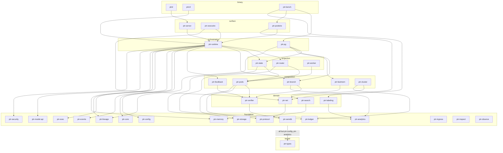
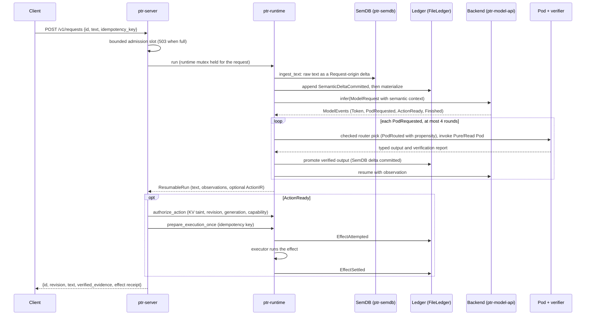
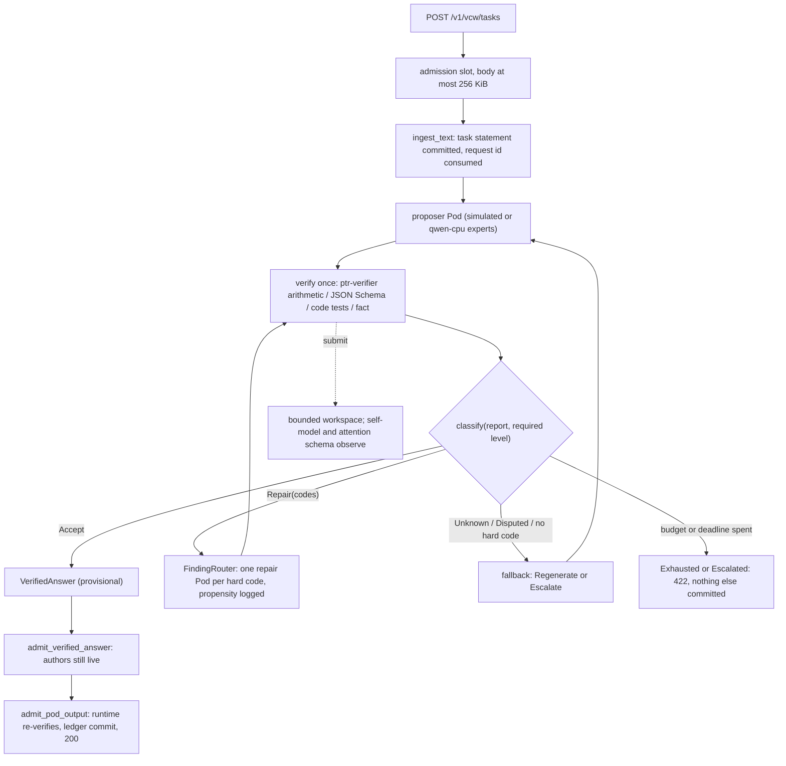

# PTR — Probabilistically Typed Reasoning

PTR is a research-first Rust monorepo for a **typed cognitive runtime and model architecture**.
Instead of letting one token stream carry everything, it keeps raw language, typed semantic
state, uncertainty, specialist modules ("Pods"), verification, effects and durable authority as
separate, checked layers: a model may propose, but only the runtime commits, and only through a
ledger and a hard effect boundary. Around that runtime the repository holds a verifier-closed
mixture-of-experts loop (VCW-MoE), KV-cache reuse with revocation, a PostgreSQL projection
substrate, authenticated cluster/execution/Pod wires, a small trainable model (Burn A0), a Python
training pipeline for routed MoE fine-tuning, and a preregistered experiment programme.

> **Status (2026-10-13).** A compiling research baseline, not a product and not evidence of
> superiority. The authority path (ledger, semantic state, execution audit) is the most mature
> part; most model-side crates are scaffolds. **No research claim is supported as a whole**:
> every candidate claim in [`research/novelty/CLAIMS.md`](research/novelty/CLAIMS.md) is
> "NOT YET PROVEN". Completed experiments are mechanism checks on CPU reference paths or with
> simulated experts; the A0 model-mechanism studies are INCONCLUSIVE, and three CPU toy or
> untrained studies were FALSIFIED (C007, C008, M008). No GPU run is recorded in the repository. Evidence per experiment: [`STATUS.md`](STATUS.md).

---

## What is in the tree

| Area | Contents |
|---|---|
| [`crates/`](crates/) | 33 library crates (`ptr-*`), each with `component.toml`, `config.toml`, README with diagram, `tests/` |
| [`bins/`](bins/README.md) | `ptrd` (daemon), `ptrctl` (CLI), `ptr-bench` (experiment harnesses), `ptr-worker` (scaffold) |
| [`bindings/ptr-py`](bindings/ptr-py/README.md) | PyO3 module `ptr_py`: governance checks and read-only VCW components for Python (own workspace) |
| [`model/`](model/README.md) | `model/burn-a0` (trainable Burn model, own workspace), model modification specs |
| [`training/`](training/README.md) | Python training workspace (uv-locked): run manifests, `trl-moe` backend, M011 routed PEFT |
| [`experiments/`](experiments/README.md) | 108 registered experiments with manifests, preregistrations, criteria and results |
| [`evaluations/`](evaluations/README.md) | 32 technology slots (all `open`) behind PTR-owned contracts |
| [`research/`](research/README.md) | claims, prior art, falsification studies, catalogs, agenda, 22 ADRs |
| [`docs/`](docs/) | architecture (docs 00–41), invariants, runbooks, generated component status |
| `proto/`, `sdk/`, `docs-site/`, `fuzz/`, `release/`, `hardware/`, `datasets/`, `benchmarks/` | wire schemas, TypeScript SDK contract, static landing page, protocol fuzzing, release/SBOM config, hardware profiles, dataset registry, benchmark suites |
| [`vendor/`](docs/VENDOR_PATCH_POLICY.md) | patched upstream crates (raft, raft-engine, burn backends, …), integrity-checked |

Generated inventory: [`docs/components/STATUS.md`](docs/components/STATUS.md) (33 components:
1 `foundation`, 21 `prototype`, 1 `research-scaffold`, 10 `scaffold`; 271 Rust source files,
135,703 nonblank source lines, 3,155 test markers).

## Architecture

### Crate layers

The layering is data, not prose: [`research/catalogs/crate-layers.toml`](research/catalogs/crate-layers.toml)
places every workspace member in one of eight ranked layers, and
`scripts/check_crate_layering.py` fails CI if a crate depends on a higher layer or a backend crate
(iroh, raft, tokio-postgres, turso, opendal, candle, …) leaks outside its owner
([doc 41](docs/architecture/41-crate-layering.md)). The edges below are the workspace's real
normal/build dependencies (`cargo metadata --no-deps`), reduced transitively: an edge implied by a
longer path is omitted, and so is the edge to `ptr-types`, which every crate except `ptr-config`
and `ptr-analytics` has.



Two things the graph makes visible: no workspace crate depends on `ptr-ingress`, `ptr-inspect` or
`ptr-observe`, so they are on no request path; and no binary depends on `ptr-cluster` or
`ptr-execwire` — clustering and the execution wire exist as library compositions, not as `ptrd`
modes.

### A request through `ptrd`

`POST /v1/requests` on `ptrd` (`bins/ptrd/src/main.rs` → `crates/ptr-server/src/lib.rs` →
`PtrRuntime::run_resumable_with_pods_using_router`, `crates/ptr-runtime/src/stepped.rs`):



What actually runs today: the shipped backends are deterministic plumbing (`reference-echo`,
`scenario`, which emits one `demo-note` mutation) and `reference-kv` (a seeded random tiny Qwen2
stack on CPU that reuses KV across requests and goes through `run_model_run_resumable`); none is a
language model. `ptrd` registers no Pods, so the Pod loop is exercised by tests and harnesses, not
by the daemon. The default verifier is `PayloadBoundsVerifier` (type id, size, UTF-8). The only
effect executor is `DemoNoteExecutor`, which writes `<data_dir>/effects/demo-note.txt`.
`ptr-core` (the model scaffold) is not called on this path, and `ptr-ingress` is not used:
ingestion is `PtrRuntime::ingest_text` (`crates/ptr-runtime/src/semantic.rs`).

### The verifier-closed loop (VCW-MoE)

`POST /v1/vcw/tasks` exists only with `[vcw] enabled = true`. The loop is `VcwLoop::run`
(`crates/ptr-runtime/src/vcw/`), served by `crates/ptr-server/src/vcw/`, specified in
[doc 39](docs/architecture/39-vcw-moe.md). Task kinds: `arithmetic`, `json_object`, `code`, `fact`.



Closure rules hold by construction: acceptance is built only by `ptr_router::classify` (no
score, bid or workspace state is an argument), budgets are typed and metered, `Exhausted` never
carries a rejected candidate, and the module holds no handle that can admit, fence or commit
except `admit_pod_output`. Shadow learning (`learning = "shadow"`) logs doubly robust estimates
but never routes; promotion is a host action (`PolicyBook::promote`). L3 restructuring
(`crates/ptr-runtime/src/vcw_host/`, `StructureDriver` → `admit_expert_proposal`) is used by the
F007 harness and tests, not by `ptrd`. `GET /v1/vcw/traces/{id}` reads back the last 64 traces.
`make vcw-demo` runs one repaired and one exhausted request against a live `ptrd`.

## Crate map

Maturity is `component.toml`'s; features are the crate's own Cargo features (all off by default).

| Crate | Purpose | Maturity | Backends / features |
|---|---|---|---|
| [ptr-types](crates/ptr-types/README.md) | Shared type kernel: semantic role, epistemic and uncertainty axes, operators, identities, codebook, validity masks, checkpoint header | `foundation` | — |
| [ptr-config](crates/ptr-config/README.md) | Typed config with file → environment → CLI precedence, incl. `[vcw]` | `prototype` | — |
| [ptr-analytics](crates/ptr-analytics/README.md) | Intervals, calibration and agreement statistics used by experiments and gates | `prototype` | — |
| [ptr-semdb](crates/ptr-semdb/README.md) | Revisioned semantic store, dependency invalidation, immutable snapshots, canonical delta codec | `prototype` | — |
| [ptr-ledger](crates/ptr-ledger/README.md) | Authoritative ordered log: `FileLedger` (PTRLOG02), anchors, acknowledgment, retention, raft storage and node | `prototype` | `raft-engine-backend`, `raft-rs-backend`, `failpoints` |
| [ptr-model-api](crates/ptr-model-api/README.md) | Backend-neutral `ModelEvent` stream, inference traits, KV-reuse reports and taint, plumbing backends | `scaffold` | — |
| [ptr-security](crates/ptr-security/README.md) | `ActionAuthorization` decisions: capability, effect, revision and generation gates | `prototype` | — |
| [ptr-protocol](crates/ptr-protocol/README.md) | PodWire domain frames; prost messages from `proto/` converted into validated values | `scaffold` | — |
| [ptr-storage](crates/ptr-storage/README.md) | Content-addressed artifacts, multi-tier manifests, object-store trait | `prototype` | `tier-opendal`, `tier-opendal-fs`, `tier-opendal-s3` |
| [ptr-memory](crates/ptr-memory/README.md) | Memory classes, `SemanticCapsule`, digest-checked raw events (in-memory only) | `scaffold` | — |
| [ptr-lineage](crates/ptr-lineage/README.md) | Adapter lineage, forgetting gate, subspace interference, AIMER expert scoring, TIES merge | `prototype` | — |
| [ptr-core](crates/ptr-core/README.md) | Model-architecture data structures (slots, workspace, budgets); the trainable model is `model/burn-a0` | `research-scaffold` | — |
| [ptr-exec](crates/ptr-exec/README.md) | Bounded `Mailbox` with explicit `Full`/`Closed` (R001); no scheduler yet | `prototype` | — |
| [ptr-events](crates/ptr-events/README.md) | Runtime event taxonomy (incl. `PodRouted`), producer/consumer contract | `scaffold` | — |
| [ptr-ingress](crates/ptr-ingress/README.md) | Raw input and typed-proposal structures; not on the request path | `scaffold` | — |
| [ptr-inspect](crates/ptr-inspect/README.md) | Inspection tree and always-redacting `Secret<T>` | `scaffold` | — |
| [ptr-observe](crates/ptr-observe/README.md) | Tracing field names, `FlowSignature`, trace sink port | `scaffold` | `tracing-adapter` |
| [ptr-verifier](crates/ptr-verifier/README.md) | Verification reports and fabric; deterministic verifiers for arithmetic, JSON Schema, code tests, facts; finding-code table | `scaffold` | — |
| [ptr-search](crates/ptr-search/README.md) | Non-authoritative search hits and evidence promotion through exact-source resolution (Q002); no engine adapters | `prototype` | — |
| [ptr-net](crates/ptr-net/README.md) | Authenticated transport, peer book, address authority, ALPNs for raft, exec and PodWire | `prototype` | `iroh-backend`, `wireguard-uapi-backend`, `wintun-backend` |
| [ptr-labeling](crates/ptr-labeling/README.md) | Weak supervision label model where verifiers veto (F002) | `prototype` | — |
| [ptr-pods](crates/ptr-pods/README.md) | Pod manifests and project-scoped registry, leases, expert proposals, KV chains and paged KV, bounded workspace, CPU Qwen2 generator | `prototype` | `qwen-cpu`, `candle-cuda` |
| [ptr-branch](crates/ptr-branch/README.md) | Certified agent branches on a snapshot, merged as verified deltas; arbiter (S003, F003) | `prototype` | — |
| [ptr-feedback](crates/ptr-feedback/README.md) | `Candidate::passes`, `Critique`, generate-verify-repair `RepairLoop` (F001) | `scaffold` | — |
| [ptr-fastmem](crates/ptr-fastmem/README.md) | Gated delta-rule fast-weight memory, exactly revocable by input generation (L003, M008) | `prototype` | — |
| [ptr-cluster](crates/ptr-cluster/README.md) | Raft messages over `ptr-raft/1` between authenticated members | `prototype` | `cluster-backend` |
| [ptr-router](crates/ptr-router/README.md) | Project-scoped Pod routing with keyed sampling and propensities, finding router, OPE (IPS/SNIPS/DR), learner, policy book, self-model, attention schema | `scaffold` | — |
| [ptr-state](crates/ptr-state/README.md) | Projects committed ledger events into materialized state | `prototype` | `turso-backend` |
| [ptr-runtime](crates/ptr-runtime/README.md) | Orchestrator: ingestion, run loops, semantic origins, execution audit and fencing, neural-state admission, compacted snapshots, expert authority, KV reuse and taint, `VcwLoop` | `prototype` | `qwen-cpu`, `candle-cuda`, `oidc-http` |
| [ptr-pg](crates/ptr-pg/README.md) | PostgreSQL projection, derived search caches and work schema, verified against ledger anchors (L004, Q003-v3) | `prototype` | `postgres-backend` |
| [ptr-server](crates/ptr-server/README.md) | Axum HTTP API: `/health`, `/v1/requests`, optional `/v1/vcw/*` | `prototype` | `qwen-cpu` |
| [ptr-execwire](crates/ptr-execwire/README.md) | One execution request and receipt over `ptr-exec/1` | `prototype` | `execwire-backend` |
| [ptr-podwire](crates/ptr-podwire/README.md) | One Pod invocation and answer over `ptr-podwire/1`, project from host policy; split-Pod frames (E007) | `prototype` | `podwire-backend` |

Binaries (no `component.toml`): `ptrd` (feature `qwen-cpu`), `ptrctl`, `ptr-bench`
(`postgres-experiments`, `ledger-experiments`, `turso-oracle`) and `ptr-worker`, which only prints
that no Pod adapter is selected. Not compiled by any CI workflow: `candle-cuda` (no CUDA on the
runners) and `qwen-cpu`.

## Running it

### `ptrd`

```bash
cargo run -p ptrd --locked -- --config config/default.toml   # listens on 127.0.0.1:8080
curl -s localhost:8080/health
curl -s -X POST localhost:8080/v1/requests -H 'content-type: application/json' \
  -d '{"id":"r1","text":"hello"}'
```

Config is `--config`, else `PTR_CONFIG`, else `config/default.toml`, overlaid by `PTR_*`
environment variables and CLI flags (`--bind`, `--data-dir`, `--backend`, `--mode`, …; see
[`docs/CONFIGURATION.md`](docs/CONFIGURATION.md)). `ptrd` refuses to start unless the mode is
`standalone`, the bind address is loopback and the backend is `reference-echo`, `scenario` or
`reference-kv`. It opens `<data_dir>/ledger.log` as a durable `FileLedger`, creates a
`router-sampling.key`, and stops cleanly on SIGINT/SIGTERM (30 s grace). With `[vcw] enabled =
true` it also serves `POST /v1/vcw/tasks` and `GET /v1/vcw/traces/{id}`
([`config/vcw-demo.toml`](config/vcw-demo.toml)); the `qwen-cpu` expert backend needs the feature
and four pinned model-file digests.

### `ptrctl`, `ptr-bench`

- `ptrctl doctor [repo-root]` checks repository and configuration; `ptrctl seal --journal …
  --checkpoint … --declaration … --out … --anchor …` binds a checkpoint to a journal.
- `ptr-bench <subcommand>` is the entrypoint of every experiment harness (S001–S003, R001,
  R005–R013, F001–F003, F007, Q002, Q003, M008, E007, L001-v2–L004) plus `all` and
  `kv-reuse-smoke`. A direct run is a dry run; evidence comes only from
  `scripts/run_experiment.py run` on a frozen commit. Table: [`bins/ptr-bench/README.md`](bins/ptr-bench/README.md).

### Make targets

| Target | Does |
|---|---|
| `make check` / `make test` | `cargo check --workspace --all-targets --locked` / `cargo test --workspace --locked` |
| `make fmt` | rustfmt check of the root workspace, `model/burn-a0` and `evaluations/bench/kit` |
| `make docs` / `make docs-check` | regenerate / verify component READMEs and `docs/components/STATUS.md` |
| `make repo-check` | repository structure, MSRV alignment, contract citations |
| `PYTHONPATH=training/src make python-test` | `training/tests` and `scripts/tests` |
| `make ci-local` | every job of `.github/workflows/ci.yml` as `ci-<job>` targets |
| `make vcw-demo` | build `ptrd`, run `scripts/vcw_demo.py` against `config/vcw-demo.toml` |
| `make py-bindings` | build and test `bindings/ptr-py` with maturin (Python ≥ 3.11; not in CI) |
| `make a0` | `model/burn-a0` on `stable` and 1.95.0, as its workflow does |
| `make desktop-setup`, `make gpu-doctor` | GPU desktop setup and diagnosis |
| `make smoke-gpu`, `make olmoe-sft-smoke` | `trl-moe` GPU smokes (default profile `rtx3090`) |

## Authority and durability

- **Ledger first.** Every state change is a `LedgerEvent` appended before it is applied; SemDB
  deltas are prepared, appended as `SemanticDeltaCommitted` with a recorded origin (request, Pod
  output, host write, merge) and only then materialized. `PtrRuntime` runs on `InMemoryLedger` or
  `FileLedger` (PTRLOG02 integrity framing, strict anchored reopen, explicit crash-tail recovery,
  docs [22](docs/architecture/22-durable-semantic-state.md)–[25](docs/architecture/25-erasure-and-retention.md)).
- **Raft is a library backend.** `raft-engine-backend` (`RaftEngineLedger`) and `raft-rs-backend`
  (`RaftNode` over durable raft storage; three-member groups tested in-process, the `ptr-cluster`
  wire tested on localhost)
  are feature-gated in `ptr-ledger` and composed over the network by `ptr-cluster`; the runtime and
  `ptrd` do not use them. Raft never compacts or installs a snapshot above the ledger's retention
  floor (C7 of [ADR-0022](research/decisions/ADR-0022-issue-23-respecification.md),
  [doc 31](docs/architecture/31-cluster-integrity.md)).
- **Execution audit.** An effect commits `EffectAttempted` before dispatch and `EffectSettled`
  after; an unsettled attempt fences the runtime until reconciled; idempotency keys make effects
  at-most-once across restarts ([doc 28](docs/architecture/28-durable-execution-audit.md)).
- **Snapshots.** Replay-backed recovery snapshots bound to an external anchor, and compacted
  snapshots (`PTRCS006`/`PTRCS007`) that carry execution obligations and the expert registry
  across a raised floor (`crates/ptr-runtime/src/compacted.rs`, `persistence.rs`).
- **Projections never become authority.** `ptr-state` materializes committed events (in memory,
  or Turso with `turso-backend`); `ptr-pg` projects into PostgreSQL record by record against
  ledger anchors (invariant 16, [doc 35](docs/architecture/35-agentic-substrate.md)). Search hits
  are promoted only through source resolution and live-generation checks.
- **Neural state is admitted, not trusted.** Model/KV/checkpoint state binds to journal position,
  input digests, generations and codebook version and is re-admitted at every use
  ([doc 27](docs/architecture/27-neural-state-admission.md)); approximate KV reuse taints actions
  so the effect boundary refuses them ([doc 36](docs/architecture/36-kv-reuse.md)).

## Wire and cluster

`ptr-net` provides authenticated transport (Iroh QUIC with `iroh-backend`; WireGuard UAPI and
Wintun tunnel backends), a configured peer book and address authority; discovery is deliberately
not built ([doc 34](docs/architecture/34-address-authority.md)). Exactly three ALPNs exist, each
with a hand-written, bounded, versioned frame format (not protobuf):

| ALPN | Crate | Carries | Doc |
|---|---|---|---|
| `ptr-raft/1` | `ptr-cluster` | raft message batches (`PTRRAFTW`) | [31](docs/architecture/31-cluster-integrity.md) |
| `ptr-exec/1` | `ptr-execwire` | one execution request and receipt (`PTREXREQ`/`PTREXRCP`) | [32](docs/architecture/32-execution-wire.md) |
| `ptr-podwire/1` | `ptr-podwire` | one Pod invocation and answer (`PTRPWREQ`/`PTRPWANS`, V2/V3 split-Pod frames) | [33](docs/architecture/33-pod-wire.md) |

The sender is always the authenticated connection, never a field; peers are admitted by host
policy ([doc 29](docs/architecture/29-peer-admission-and-pod-scope.md)). Nothing runs an
accept/tick loop in a deployment yet, and receipts and answers are not signed (ADR-0022).

## MoE, model and training

- **Pod-MoE** ([doc 37](docs/architecture/37-pod-moe.md)): experts as Pods whose structure
  (Birth, Merge, Split, Freeze, Reactivate, Prune, Retire) changes only through
  `PtrRuntime::admit_expert_proposal` with a bound forgetting-gate report, ledger events and a
  fence path (R011), plus Ed25519 attestations for artifact-producing admissions (R013). Design
  otherwise.
- **VCW-MoE** ([doc 39](docs/architecture/39-vcw-moe.md)): the verifier-closed loop above, with
  the finding router and OPE in `ptr-router`; F007 is its CPU mechanism check with simulated
  experts. Functional indicator work: [doc 38](docs/architecture/38-consciousness-indicators.md),
  bound by [`docs/MODEL_WELFARE.md`](docs/MODEL_WELFARE.md).
- **KV reuse** ([doc 36](docs/architecture/36-kv-reuse.md)): control plane (catalog, per-layer
  chain keys, dependency admission, taint) on a CPU reference stack; no engine integration.
- **`ptr-lineage`, `ptr-fastmem`, `ptr-labeling`, `ptr-branch`, `ptr-pg`**: the agentic
  substrate of [doc 35](docs/architecture/35-agentic-substrate.md).
- **`bindings/ptr-py`**: Python access to lineage gates, VCW verifiers, finding router with
  propensity log, OPE estimators and an in-process loop simulation.
- **`training/`**: `ptr_training.run` writes immutable run manifests (default backend `dry-run`);
  the `trl-moe` backend (`training/src/ptr_training/moe/`) runs OLMoE SFT → RL with TRL's GRPO
  trainer configured as GSPO or SAPO → routing metrics → optional `ptr_py` gates, verified only as
  a tiny-random CPU pipeline smoke; `ptr_training.moe.m011` is the M011 routed-PEFT entrypoint
  (PERFT-R, MixLoRA, plain LoRA arms). Python ≥ 3.11, locked in `training/uv.lock`.
- **`model/burn-a0`**: a small trainable Burn model with typed slots, typed attention, latent
  refinement, operator router and lifecycle masks; not connected to the runtime (ADR-0022, S8).
- **GPU**: the target machine is two RTX 3090 ([`hardware/dual-rtx3090.toml`](hardware/dual-rtx3090.toml)).
  Run order and open decisions: [`docs/LOCAL_START.md`](docs/LOCAL_START.md),
  [`docs/DESKTOP_SETUP.md`](docs/DESKTOP_SETUP.md), [`docs/GPU_HANDOVER.md`](docs/GPU_HANDOVER.md),
  [`docs/VCW_MOE_GPU_PLAN.md`](docs/VCW_MOE_GPU_PLAN.md). All plans; nothing has run on GPU.

## Research programme

Every claim needs a baseline, an ablation, a sensitivity control and preregistered failure
criteria ([`AGENTS.md`](AGENTS.md) §3, [doc 19](docs/architecture/19-research-method.md));
negative results are kept. `experiments/registry.toml` holds 108 experiments:

| Registry status | Count |
|---|---:|
| `completed` | 27 |
| `prepared` | 31 |
| `planned` | 35 |
| `superseded` | 13 |
| `failed` | 2 |

A registry status is not a verdict. Verdicts in `results/run.json`: 21 COMPLETED, 2 `hard-pass`
(L003, L004), 3 INCONCLUSIVE (M001-v6, M002-v11, M003-v4), 2 FALSIFIED (C007, C008), 1 NOT_SHOWN
(C001, registry `prepared`); S003 completed without a `verdict` key; M008 is FALSIFIED on four
valid seeds (`results/OUTCOME.md`, registry `prepared`); Q003-v2 is INVALID (incomplete).

| Result | Evidence class | What it shows |
|---|---|---|
| S001, S002, S003 | mechanism check | dependency invalidation equals an oracle; stale runs cancel; certified branches lose no updates |
| L001-v2, L002 | mechanism check | no acknowledged revocation lost under crash, power-loss and raft recovery schedules |
| R005–R007, R009, R010, R012, E007 | mechanism check | KV reuse never serves revoked state and stays bit-identical on the CPU reference; split-Pod transport |
| R011, R013 | mechanism check | no gate bypass or self-promotion path for expert structure changes |
| F001, F002, F003, F007 | mechanism check | repair loop, verifier-veto labels, calibrated arbiter, VCW loop with simulated experts |
| L003, L004, Q003-v3 | mechanism check | exact fast-memory revocation; PostgreSQL projection equivalence; 0 stale hits (lexical half empty on natural-language queries) |
| C004 | mechanism check (toy) | recurrence extrapolates on a counter task |
| M001-v6, M002-v11, M003-v4 | NO-GO | A0 typed slots, typed attention, routing: no positive claim |
| C007, C008, M008 | NO-GO (falsified) | self-model and attention-schema toys; untrained fast-weight recall |
| C001 | NO-GO (not shown) | learned workspace vs all-to-all straddles the margin |

**Next.** The MoE research agenda ([`research/agenda/MOE_RESEARCH_AGENDA.md`](research/agenda/MOE_RESEARCH_AGENDA.md),
a proposal, not evidence) narrows the programme to three theses — failure-mode experts,
off-policy-auditable routing, lineage-closed expert revocation — each CPU first, then the two
RTX 3090s, with preregistration checklists. The planned GPU experiments (C002, C003, C005, C006,
F004–F006, M004–M007, M010–M016, E004–E006) are listed in `STATUS.md`. Decisions are recorded as
ADRs in [`research/decisions/`](research/decisions/) (22; ADR-0022 re-specifies issue #23 against
the integrated tree); the current goal is [`docs/GOAL.md`](docs/GOAL.md).

## Invariants

[`docs/INVARIANTS.md`](docs/INVARIANTS.md) is binding (17 invariants). The ones most often at
stake: raw is never replaced by typed state (1); revoked or superseded generations never
become usable again (3); uncommitted state is never authoritative (4); search never self-promotes
to truth (5); effects need capability, permission, current revision and generation and required
verification (7); queues are bounded (8); backend crates stay in their owner crates and
dependencies point down the layers (10); a learned score cannot override a deterministic verifier
contradiction (11); secrets are redacted by default (13); state rebuilds from committed history
(14); projections advance only against ledger anchors (16).

## Documentation map

- **Start**: [`docs/GOAL.md`](docs/GOAL.md), [`STATUS.md`](STATUS.md),
  [`docs/TECHNICAL_ARCHITECTURE.md`](docs/TECHNICAL_ARCHITECTURE.md),
  [`docs/architecture/README.md`](docs/architecture/README.md) (docs 00–41 with status).
- **Contracts**: [`docs/INVARIANTS.md`](docs/INVARIANTS.md),
  [`docs/COMPONENT_CONTRACTS.md`](docs/COMPONENT_CONTRACTS.md),
  [`docs/DEFINITION_OF_DONE.md`](docs/DEFINITION_OF_DONE.md),
  [`docs/components/README.md`](docs/components/README.md),
  [`docs/components/STATUS.md`](docs/components/STATUS.md).
- **Engineering**: [`docs/DEVELOPMENT_ENVIRONMENT.md`](docs/DEVELOPMENT_ENVIRONMENT.md),
  [`docs/CONFIGURATION.md`](docs/CONFIGURATION.md), [`docs/RUST_API_STYLE.md`](docs/RUST_API_STYLE.md),
  [`docs/TESTING.md`](docs/TESTING.md), [`docs/TECH_STACK.md`](docs/TECH_STACK.md),
  [`docs/VENDOR_PATCH_POLICY.md`](docs/VENDOR_PATCH_POLICY.md), [`docs/RELEASE.md`](docs/RELEASE.md).
- **Research**: [`research/novelty/CLAIMS.md`](research/novelty/CLAIMS.md),
  [`research/agenda/MOE_RESEARCH_AGENDA.md`](research/agenda/MOE_RESEARCH_AGENDA.md),
  [`experiments/README.md`](experiments/README.md), [`evaluations/README.md`](evaluations/README.md),
  [`docs/FREEZE_PROCEDURE.md`](docs/FREEZE_PROCEDURE.md), [`docs/MODEL_WELFARE.md`](docs/MODEL_WELFARE.md).
- **Machines and agents**: [`docs/LOCAL_START.md`](docs/LOCAL_START.md),
  [`docs/DESKTOP_SETUP.md`](docs/DESKTOP_SETUP.md), [`docs/GPU_HANDOVER.md`](docs/GPU_HANDOVER.md),
  [`docs/HOSTING.md`](docs/HOSTING.md), [`AGENTS.md`](AGENTS.md), [`CLAUDE.md`](CLAUDE.md),
  [`docs/CLAUDE_TOOLING.md`](docs/CLAUDE_TOOLING.md).
- **Planning**: [`docs/PRIORITIES.md`](docs/PRIORITIES.md), [`docs/ROADMAP.md`](docs/ROADMAP.md).
- **Maps and diagrams**: [`docs/diagrams/README.md`](docs/diagrams/README.md),
  [`docs/atlas/README.md`](docs/atlas/README.md) (generated, can lag the code).

## Getting started

```bash
rustup show                     # rust-toolchain.toml pins 1.99.0 (also the MSRV)
make check && make test         # always --locked; see CLAUDE.md for clippy
make repo-check docs-check
cd training && uv venv --python 3.11 .venv && uv pip install --python .venv/bin/python -e .
```

Backends are Cargo features and a plain `--workspace` run does not build them; each has its own
CI job (`make ci-local` lists them). PostgreSQL jobs need PostgreSQL 16+ with pgvector and
`PTR_PG_TEST_DSN` / `PTR_PG_EXPERIMENT_DSN`. Small hosts: build with `CARGO_BUILD_JOBS=2
CARGO_INCREMENTAL=0`.

Contributing: [`CONTRIBUTING.md`](CONTRIBUTING.md) and [`AGENTS.md`](AGENTS.md) (roles, freeze
discipline, research rules). Security: [`SECURITY.md`](SECURITY.md). License: MIT or Apache-2.0
([`LICENSE-MIT`](LICENSE-MIT), [`LICENSE-APACHE`](LICENSE-APACHE)); notices in [`NOTICE`](NOTICE)
and [`THIRD-PARTY-NOTICES.md`](THIRD-PARTY-NOTICES.md); citation in [`CITATION.cff`](CITATION.cff).
