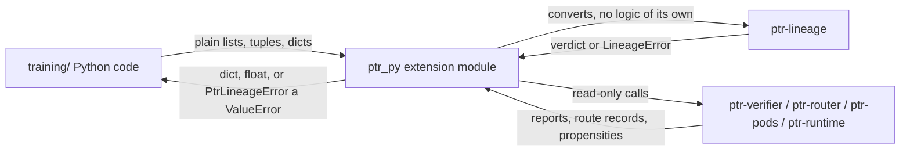

# ptr-py — Python bindings for PTR governance checks and the VCW-MoE components

> **Role:** A PyO3 extension module `ptr_py` that lets Python training code call the governance checks of `ptr-lineage` (AIMER expert scoring, subspace interference, TIES merge, forgetting gate). These are governance checks, not training code: the gate decides, Python only calls it. It also gives read-only access to the VCW-MoE deterministic verifiers, the finding router with its propensity log and off-policy estimators, the bounded workspace and an in-process loop simulation, so a Python RLVR/OPE trainer can log propensities and read verifier rewards.
> **Maturity:** prototype.



## Build and test

```bash
make py-bindings   # venv + fmt + clippy + cargo test + maturin develop --locked + unittest
# PYTHON=python3.11 make py-bindings   # select the interpreter (must be >= 3.11)
```

The crate is its own Cargo workspace (like `model/burn-a0`), excluded from the root workspace, so `cargo check --workspace` at the root does not build it. Versions: pyo3 `=0.29.3` with `abi3-py311`, maturin `1.15.0`, Python >= 3.11. The venv lives in `bindings/ptr-py/.venv` (gitignored).

## API

Matrices are row-major `list[list[float]]`. Errors raise `PtrLineageError` (a `ValueError`); the message is `<RUST_ERROR_CODE>: <text>`, for example `PTR_LINEAGE_EMPTY: weights is empty`.

| Function | Notes |
| --- | --- |
| `aimer_score(weights)` | `list[float] -> float` in `[1/sqrt(N), 1]` |
| `rank_experts_for_pruning(experts)` | `list[(id, weights)] -> list[id]`, highest score first |
| `subspace_overlap(a, b)` | `dim x k` matrices; column spaces compared (Rust `Basis` cannot be built unchecked, so `column_basis` is applied) |
| `chance_overlap(a, b)` | same inputs; `max(rank_a, rank_b) / dim` |
| `measure_interference(candidate, updates, earlier)` | updates are `(layer, B, A)` with `delta_W = B A`; returns per-layer overlaps, chance levels, `worst`, `max_overlap` |
| `ties_merge(vectors, density)` | `density` in `(0, 1]` |
| `forgetting_gate_evaluate(adapter, accuracy, public_serving, public_candidate, *, max_average_forgetting, max_task_forgetting, min_backward_transfer, max_public_regression)` | returns `passed`, `violations`, and the accuracy-matrix metrics |


### VCW-MoE surface (read-only)

Errors raise `PtrVerifierError`, `PtrRouterError`, `PtrWorkspaceError` or `PtrVcwError` (all `ValueError`s). Levels are `unverified`, `latent_agreement`, `sample_verified`, `full_semantic`, `deterministic`.

| Name | Notes |
| --- | --- |
| `verify_arithmetic(task, candidate)`, `verify_json_schema(schema, candidate)`, `verify_code(entry, tests, candidate)`, `verify_facts(facts, claims, *, live_revision=None)` | run the deterministic verifier; return a `VerificationReport` (`status`, `level`, `score`, `findings` with `code`/`severity`/`message`, `hard_codes()`, `to_dict()`). The report has no constructor, so it cannot be forged |
| `finding_code_table()`, `repair_roles()`, `codes_for_role(role)`, `repair_role_for(code)` | the finding code table |
| `classify_report(report)` | the deterministic class: accept, repair (codes) or fallback (reason); only a passing report with no hard finding at the fixed `deterministic` level is accept (the level is not a parameter) |
| `FindingRouter(seed, proposers, repairers, *, exploration, instance, generations)` | `route(report, *, request_id)` returns the decision with `propensity` (equal to the chosen Pod's entry in `support` over `2**53`), `draw`, `nonce`, `decision_id`; the roster, eligibility, generations and required level are fixed at construction and no `route` call can change them. `settle(decision_id, candidate)` verifies the candidate inside Rust against the task of the routed report (same verifier kind), derives the reward from that report with `classify` and stores the SHA-256 of the report and of the candidate (`log_digests()` returns `{report, candidate}` per logged reward; the report digest covers the report only); a report object from Python is not accepted, so Python cannot state or forge a reward. Python also chooses which routed decisions it settles, the task of the report it routes and the candidate text; the reward is bound to the routed report's task and computed in Rust, so estimates are only as honest as the harness that produces candidates from the routed Pod and settles every decision. `estimate(target, *, reward_model, default_reward)` returns IPS, SNIPS and doubly robust. Scorer, fallback policy and limits are fixed; promotion is not exposed |
| `BoundedWorkspace(kind, spec, *, slots, tie_break_seed)` | `submit`, `subscribe`, `run_cycle`, `receive`; the verifier and level are fixed at construction; candidate text is capped at 64 KiB, texts not held by a slot are evicted after each cycle (`held_texts`; a stale mailbox snapshot then shows `candidate: None`), pending/quota overflows raise `PtrWorkspaceCapacityError`, and `author` is an unauthenticated label (the quota is per label) |
| `simulate_vcw_run(seed, proposers, repairers, *, error_rates, repair_success, ...)` | one `VcwLoop` request in-process with seeded simulated experts; returns outcome (`Accepted`/`Exhausted`/`Escalated`), trace, budget use and per-step routes. No server, so no `/v1/vcw/traces` parser is needed |

Tests: `tests/test_binding.py` (lineage) and `tests/test_vcw.py` include checks that no Python path changes a gate, threshold, verifier or eligibility (public-surface allowlists, keyword rejection, read-only attributes).
