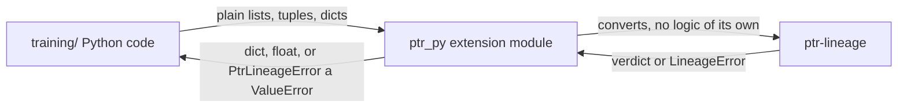

# ptr-py — Python bindings for PTR governance checks

> **Role:** A PyO3 extension module `ptr_py` that lets Python training code call the governance checks of `ptr-lineage` (AIMER expert scoring, subspace interference, TIES merge, forgetting gate). These are governance checks, not training code: the gate decides, Python only calls it.
> **Maturity:** prototype.



## Build and test

```bash
make py-bindings   # venv + fmt + clippy + maturin develop --locked + unittest
```

The crate is its own Cargo workspace (like `model/burn-a0`), excluded from the root workspace, so `cargo check --workspace` at the root does not build it. Versions: pyo3 `=0.29.3` with `abi3-py311`, maturin `1.15.0`, Python >= 3.11. The venv lives in `bindings/ptr-py/.venv` (gitignored).

## API

Matrices are row-major `list[list[float]]`. Errors raise `PtrLineageError` (a `ValueError`); the message is `<RUST_ERROR_CODE>: <text>`, for example `PTR_LINEAGE_EMPTY: weights is empty`.

| Function | Notes |
| --- | --- |
| `aimer_score(weights)` | `list[float] -> float` in `[1/sqrt(N), 1]` |
| `rank_experts_for_pruning(experts)` | `list[(id, weights)] -> list[id]`, highest score first |
| `subspace_overlap(a, b)` | `dim x k` matrices; column spaces compared (Rust `Basis` cannot be built unchecked, so `column_basis` is applied) |
| `chance_overlap(a, b)` | same inputs; `max(rank_a, rank_b) / dim` |
| `measure_interference(candidate, updates, earlier)` | updates are `(layer, B, A)` with `delta_W = B A`; returns per-layer overlaps, chance levels, `worst`, `max_overlap` |
| `ties_merge(vectors, density)` | `density` in `(0, 1]` |
| `forgetting_gate_evaluate(adapter, accuracy, public_serving, public_candidate, *, max_average_forgetting, max_task_forgetting, min_backward_transfer, max_public_regression)` | returns `passed`, `violations`, and the accuracy-matrix metrics |

