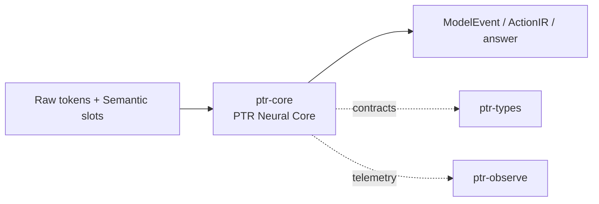

# ptr-core — PTR Neural Core

> **Role:** Research implementation of the model architecture: raw token states plus typed semantic slots, epistemic state, latent recurrence and operator routing.  
> **Maturity:** see the generated status below; production behavior must be proven by the linked experiments and component evaluations.

<!-- PTR:STATUS:BEGIN -->
## Current implementation status

> **Generated section.** Source of truth: [`component.toml`](component.toml) plus code-derived metrics from `src/`. Run `python3 scripts/update_component_docs.py --write` after editing implementation metadata. Do not hand-edit inside this block.

**Maturity:** `prototype`  
**Last reviewed:** 2026-10-14  
**Code footprint:** 20 Rust source files · 3799 nonblank source lines · 4 integration-test files · 78 test markers (`#[test]`, `#[tokio::test]`)

### Implemented now

- PTR-Core family/config structures for AR and diffusion research paths
- SemanticSlot uses orthogonal shared SemanticRole, EpistemicState and UncertaintyKind axes plus generation, validity, confidence, latent vector and provenance
- EpistemicWorkspace and live-slot filter
- ReasoningBudget and latent-step accounting scaffold
- Shared ptr-types ReasoningOperator taxonomy with weighted neural router decision
- Branch frontier pruning and probability normalization helpers
- ActionIr with explicit target/generation/revision plus CoreVerification output contracts
- Internal: ptr_core::action_head no longer defines its own ActionIr; it re-exports ptr_types::ActionIr (same fields: operation, target, capability, effect, input type, generation, revision, payload), so core, model-api and the runtime share one definition
- Deterministic pure-Rust f32 CPU reference of the PTR-Core forward pass (std + ptr-types only, no unsafe): row-major Matrix with shape-checked matmul/add/transpose, max-subtracted row softmax, layer norm, GELU/tanh, typed ShapeError and a seeded SplitMix64 Xavier-uniform initializer; randomly initialised or checkpoint-loaded, not a trained model
- CoreConfig validation (d_model > 0, heads divide d_model, bounded width, feed-forward width, slot count, recurrence depth and diffusion vocabulary per Invariant 8) and CoreModel with separate learnable embedding tables per SemanticRole, EpistemicState and UncertaintyKind (indexed by the ptr-types Codebook V1) summed with the latent content vector
- Multi-head scaled dot-product attention over slots with an additive per-key bias from the ptr-types ValidityMask (-inf for non-live slots, tested to give exactly zero weight in every row and head, rows sum to 1) and an optional learned per-(role, role) bias matrix; an all-excluded mask is refused
- Shared refinement block (attention, MLP, residual, post layer norm) applied up to min(ReasoningBudget::steps, max_latent_steps) times with ACT-style halting (stop when the cumulative halting probability reaches 1 - epsilon; no remainder-weighted averaging), per-step traces, and step accounting into EpistemicWorkspace.step
- Operator router head (pooled admitted-slot mean to softmax over the ptr-types ReasoningOperator codes, returned as RouterDecision), verifier-head pass probability, and an ActionIR head that only ranks a caller-supplied ActionIr list (never constructs target/revision/generation) and never selects a candidate rejected by a supplied deterministic check
- Toy training of one head only: exact analytic softmax cross-entropy gradient for the linear router head with a frozen random backbone, full-batch gradient descent on a seeded synthetic task whose label is the plurality slot role; tested for loss decrease and against f64 finite differences (relative error < 1e-3). Not task training
- PTR-Diff reference step: discrete masked denoising on a small vocabulary with a deterministic ceil(masked/steps_remaining) unmasking schedule, top-k most-confident unmasking, tested for monotone unmasking, no rewrite of known tokens and termination; there is no training objective
- Checkpoint save/load: ptr-types CheckpointHeader (format 3, codebook, slot encoding, architecture binding) plus a little-endian parameter manifest (name, shape, in-crate CRC-32 per tensor and for the payload); load rejects wrong magic, model name, codebook, architecture, manifest, shape, checksum and non-finite values with typed errors; forward after save then load is bit-identical, and a tiny-config golden test pins outputs (CRC-32 detects corruption, it is not authentication)
- External model/burn-a0 research package implements trainable raw↔typed cross-attention, epistemic/validity/provenance metadata, typed attention bias, latent refinement and router gradients

### Missing for the target architecture

- Production-integrated Burn/CubeCL PTR model and GPU execution beyond the isolated A0 research package (this crate is a CPU f32 reference)
- Task-trained recurrent latent reasoning (the shared refinement block runs with random weights; ACT halting is untrained and has no remainder-weighted state averaging)
- Task-trained operator router plus ActionIR/verifier neural heads (only the router head has a toy fit on a synthetic role-plurality task; the ActionIR head scores hashed candidate features and the verifier head is untrained)
- PTR-Diff training objective and any learned denoiser (only the inference-time masked-denoising mechanics exist, with random weights)
- Numerical parity between this CPU reference and model/burn-a0 (no shared weights, no cross-implementation comparison; the golden values pin this implementation against itself only)
- Evidence that typed embeddings or typed attention help: the reference is untrained, so no M001-M005 claim follows from it

### Next milestones

- Matched comparisons beyond A0's own ablations: the A0 studies so far (M001-v6 full against no-semantic-slots-masked, M002-v11, M003-v4) are INCONCLUSIVE with no positive claim, and connecting A0 to the runtime waits on a study that passes its gates (ADR-0022, S8)
- Build matched plain-transformer baseline at equal parameter/compute budget
- Run M001–M005 ablations before scaling model size

### Linked experiments

- [M001](../../experiments/model/M001-semantic-slots/README.md) — `planned`
- [M002](../../experiments/model/M002-typed-attention/README.md) — `planned`
- [M003](../../experiments/model/M003-latent-recurrence/README.md) — `planned`
- [M004](../../experiments/model/M004-operator-router/README.md) — `planned`
- [M005](../../experiments/model/M005-epistemic-calibration/README.md) — `planned`
- [M006](../../experiments/model/M006-ptr-diff/README.md) — `planned`
- [M007](../../experiments/model/M007-model-event-stream/README.md) — `planned`
- [E001](../../experiments/system/E001-end-to-end/README.md) — `planned`
- [E003](../../experiments/system/E003-token-efficiency/README.md) — `planned`
- [E004](../../experiments/system/E004-long-horizon/README.md) — `planned`

### Technology evaluations

- [model-framework](../../evaluations/components/model-framework/README.md) — `open`
- [inference-serving](../../evaluations/components/inference-serving/README.md) — `open`

### Decision records

- [ADR-0003-raw-and-typed.md](../../research/decisions/ADR-0003-raw-and-typed.md)
- [ADR-0007-model-event-stream.md](../../research/decisions/ADR-0007-model-event-stream.md)
- [ADR-0004-backend-independence.md](../../research/decisions/ADR-0004-backend-independence.md)

### Current automated checks

- Burn A0 NdArray forward/autodiff/synthetic optimizer tests run in separate model workflow
- workspace fmt/check/test/clippy

<!-- PTR:STATUS:END -->

## Position in PTR

Dedicated diagram source: [`docs/diagrams/components/ptr-core.mmd`](../../docs/diagrams/components/ptr-core.mmd)

**Upstream:** ptr-types  
**Downstream:** ptr-runtime, ptr-execwire, ptr-bench

## Mission

Research implementation of the model architecture: raw token states plus typed semantic slots, epistemic state, latent recurrence and operator routing.

PTR keeps this responsibility in its own crate so the semantics remain stable even when an external library or implementation is replaced.

## Responsibilities

- semantic slots that encode shared ptr-types cognitive axes
- role/epistemic/uncertainty/lifecycle-aware typed attention
- epistemic workspace
- latent recurrent reasoning
- operator router
- branch/probabilistic reasoning primitives
- action/verifier heads
- PTR-AR and PTR-Diff research families

## Explicit non-responsibilities

- durable truth
- permissions
- external side effects
- distributed consensus

## Data flow

| Direction | Contract |
|---|---|
| Input | Semantic snapshot, raw token stream, observations, model configuration |
| Output | ModelEvent stream, typed hypotheses, operator requests, ActionIR candidates, natural-language output |
| Failure | Explicit typed error / rejected state; no silent fallback that changes semantics |
| Observability | Standard PTR tracing fields and a stable component span |

## Technical approach

- Burn/CubeCL Rust-native research path
- PyTorch reference implementation path
- SGLang/vLLM used only as serving backends for compatible models

External projects are **candidates**, not architectural authority. The PTR-owned traits and domain types must remain usable with a replacement backend.

## Core invariants

1. The model may be uncertain; effects may not bypass the hard runtime boundary.
2. Typed slots remain distinguishable from raw language states.
3. Every architectural modification must support ablation.

These invariants should be executable wherever possible through unit, property, lifecycle or chaos tests.

## Failure model

The component must fail closed for semantic or effect-safety violations. Infrastructure failures should surface as typed errors that preserve request, revision, generation and provenance context. Retries must be idempotent whenever the operation may cross a process or network boundary.

## Performance model

Measure before optimizing. Benchmarks should record at least latency distribution, throughput, allocations/resident memory, queue depth or working-set size where relevant, and the cost of verification. Performance optimizations may not bypass generation, revision, capability or evidence checks.

## Security and privacy

- Treat external inputs and backend outputs as untrusted until validated.
- Do not put raw secrets/private evidence into generic tracing or inspection.
- Preserve provenance on every promotion from raw/possible evidence to stronger semantic state.
- External effects pass through `ptr-security` even if this component already performed local validation.

## Technology evaluation

- [model-framework](../../evaluations/components/model-framework/README.md)
- [inference-serving](../../evaluations/components/inference-serving/README.md)

A new candidate should be added with a reproducible benchmark and failure-semantics analysis rather than replacing the default ad hoc.

## Tests required before production use

- Contract/unit tests for all domain transitions.
- Invalid, stale-generation and stale-revision cases.
- Cancellation/retry behavior.
- Property tests for invariants where practical.
- Cross-backend equivalence if more than one backend exists.
- Observability and redaction checks.

## Related architecture

- [System architecture](../../docs/architecture/00-system.md)
- [Technical architecture](../../docs/TECHNICAL_ARCHITECTURE.md)
- [Component contracts](../../docs/COMPONENT_CONTRACTS.md)
- [Global invariants](../../docs/INVARIANTS.md)

