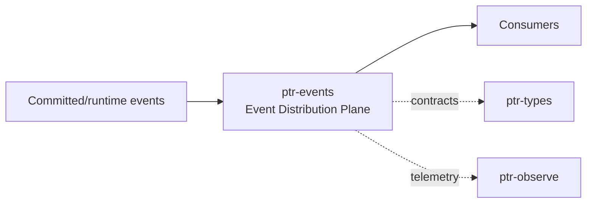

# ptr-events — Event Distribution Plane

> **Role:** Projects committed and runtime events into scalable streams for analytics, materializers, telemetry and training collectors.  
> **Maturity:** see the generated status below; production behavior must be proven by the linked experiments and component evaluations.

<!-- PTR:STATUS:BEGIN -->
## Current implementation status

> **Generated section.** Source of truth: [`component.toml`](component.toml) plus code-derived metrics from `src/`. Run `python3 scripts/update_component_docs.py --write` after editing implementation metadata. Do not hand-edit inside this block.

**Maturity:** `prototype`  
**Last reviewed:** 2026-10-14  
**Code footprint:** 5 Rust source files · 2733 nonblank source lines · 5 integration-test files · 77 test markers (`#[test]`, `#[tokio::test]`)

### Implemented now

- RuntimeEvent::{ReflexHit { pod }, ReflexMiss { reason }, ReflexFailover { to }} (work package 2): telemetry of the reflex counters, emitted by ptr-runtime. ReflexMiss carries a stable pod-free code (ptr_router::MissReason::code) and precedes the PodInvoked of a failover pod; ReflexFailover is emitted only after the default pod output was promoted by the same verifier path, so a refused failover has no such event. In memory, not ledger records, no authority; the counters (PtrRuntime::reflex_counters), not this bounded log, are the count
- RuntimeEvent taxonomy for request/snapshot/candidate/Pod/verifier/commit lifecycle
- EventEnvelope with sequence number
- RuntimeEvent::PodRouted { pod, propensity: f64, nonce: [u8; 16], draw: u64, key_id: [u8; 8] } records a Pod chosen by the trusted checked routing path (ptr-router route_checked) with its propensity, decision nonce, keyed draw and the non-secret sampling key id; the runtime emits it before PodInvoked, and the key itself is never an event field
- EventProducer/EventConsumer contract with at-least-once delivery, monotone commits bounded by the end, and event classes separating projections from telemetry
- RuntimeEvent::ScopeLifecycle { scope, kind } carries a scope's ptr_types::ScopeId and ScopeLifecycleKind in the runtime event taxonomy; this crate only defines the variant (no producer inside ptr-events)
- InMemoryBus reference implementation: bounded, refusing a publish rather than dropping a record some registered consumer has not committed, and refusing a registration beyond the end, which would let the next publish trim records the consumer never polled
- Authoritative vs telemetry separation in types and behavior: EventClass::authority() derives Authority (Authoritative or Diagnostic) which BusRecord exposes per record; an authoritative record is never evicted or compacted while any registered consumer has not acknowledged it; NewRecord::reclassify refuses (BusError::TelemetryPromotion) to turn a telemetry record into a projection, and NewRecord::republish keeps the class
- Typed BackpressurePolicy per class (ClassPolicies): Reject returns BusError::Full with limit, capacity, depth and the blocking consumer (blocked_by); DropOldestTelemetry evicts only the oldest unacknowledged telemetry record and only when the incoming record is itself telemetry (a full bus answers a projection publish with Full, never by evicting telemetry), counts the drop per consumer (dropped) and in total, and is refused for the projection class; record and byte bounds, a consumer cap and field/payload length bounds keep everything bounded
- RetentionPolicy for acknowledged history by max records, max bytes and logical age (caller-supplied monotonic tick via advance_tick, no wall clock); compaction advances a low-water mark and replay/registration below it returns BusError::Truncated { requested, low_water }; retention never removes an unacknowledged authoritative record
- FileEventLog: std-only append-only segmented log with CRC32-framed records (in-crate CRC), fsync policy (Always, EveryRecords, Never), recovery on open that truncates and reports a torn tail (RecoveryReport/TornTail) and returns typed BusError::Corrupt for checksum, length, offset-gap or segment-gap damage elsewhere, durable consumer offsets in offsets.bin replaced atomically (temp file + rename), replay from any offset at or above the low-water mark, size-based segment rollover, and deletion of whole closed segments that are fully acknowledged and outside the retention window; single writer, local disk, not replicated
- EventProducer/EventConsumer extended additively with register, committed, lag, end, low_water, replay, blocked_by and dropped; InMemoryBus and FileEventLog implement the same traits
- RuntimeEvent::RunCancelled { request, bound, current } records that a stepped resumable run was ended before its next round because the semantic revision moved for a reason other than the run's own writes (emitted by ptr-runtime's steppable run); this crate only defines the variant, the effect boundary does not read it, and no shipped host steps runs, so nothing emits it in production today
- RuntimeEvent::VcwFinished { request, outcome, trace_digest } records how a verifier-closed workspace request ended (verified, exhausted, escalated, not_admitted or failed) and the digest of its trace; emitted by ptr-runtime (PtrRuntime::record_vcw_finished) for ptr-server vcw path; observability only, no authority; ptr-events only defines the variant
- FileEventLog rolls a failed append back: if sync_data fails after the frame was written the segment is truncated to its last good length, so a retry cannot duplicate an offset and a reopen cannot resurrect a publish that returned an error; if that truncation also fails the writer is poisoned (BusError::WriterPoisoned on every publish) until the log is reopened and recovered
- A RetentionPolicy with no record or byte limit (RetentionPolicy::is_unbounded; an age limit alone does not count, since logical ticks may never advance) is refused by FileEventLog::open and InMemoryBus::try_with_config (PolicyViolation::UnboundedRetention); the infallible InMemoryBus::with_config falls back to RetentionPolicy::acked_only (also for age-only policies) so acknowledged history cannot grow without limit
- FileEventLog treats retention after a durable consumer commit as best effort: a segment-delete I/O error no longer fails a commit whose offset is already on disk; it is counted (compaction_failures) and kept (last_compaction_error), cleared by the next successful pass, and retried on later commits and publishes (advance_tick and compact still return the error)
- FileLogConfig::validate refuses a max_record_bytes whose frame cannot be described by the u32 frame length (PolicyViolation::RecordLimitTooLarge); the frame limit is computed with checked arithmetic, so usize::MAX no longer overflows or wraps
- FileEventLog::open refuses a segment with base offset zero as CorruptionKind::SegmentGap { expected: 1, found: 0 } (offsets start at 1), instead of underflowing the low-water arithmetic
- FileEventLog rolls a failed append back by truncating through a separate write handle on the segment path, because the active handle is append-only and Windows denies set_len on such a handle (not verified on Windows from this environment)
- RuntimeEvent::VcwPolicyChanged { scope, sequence, action, from, to, evidence } records that a host promoted or rolled back the routing policy of a verifier-closed loop (policy digests, the digest of the off-policy evidence a promotion rested on); emitted by ptr-runtime (PtrRuntime::record_vcw_policy_event). Observability of a host action, in memory, not a ledger event and no authority; not an audit record (lost on restart, not replayed, no gate record checked against it) until a ledger event exists
- InMemoryBus and BusConfig clamp the record capacity to 1..=MAX_BUS_RECORD_CAPACITY (1 << 20), so a host passing usize::MAX still gets a bounded queue; FileEventLog never reads offset u64::MAX (open returns CorruptionKind::BadEncoding for a record at that offset instead of overflowing) and publish refuses with BusError::Full before writing the offset that would lead to it
- Review fixes: FileEventLog syncs the rollback truncation through the same write handle and poisons the writer if the truncation or its sync fails (crash durability itself is only tested through the injected-failure seam); a directory fsync failure (segment creation, offsets rename, segment deletion) is returned as BusError::Io on Unix instead of discarded (a no-op on Windows, where std cannot open a directory), and a segment whose creation could not be made durable is removed again; FileLogConfig::max_unacked_records above MAX_FILE_LOG_UNACKED_RECORDS and RetentionPolicy max_records/max_bytes above MAX_RETENTION_RECORDS/MAX_RETENTION_BYTES are refused with PolicyViolation::LimitTooLarge by FileEventLog::open and InMemoryBus::try_with_config (RetentionPolicy::validate) and clamped by the infallible InMemoryBus::with_config

### Missing for the target architecture

- Apache Iggy adapter
- Bridge between the FileEventLog/EventConsumer contract and the ptr-pg projection event log, which still keeps its own per-consumer offsets in PostgreSQL
- Multi-process safety and replication of FileEventLog (no directory lock, no fencing, no consensus); partitions, consumer groups and network transport
- DropOldestTelemetry on the file-backed log (append-only segments cannot drop individual records, so the policy is refused there); retention there works only in whole segments
- Production use by a host: no crate outside ptr-events publishes to or consumes from these buses yet, and no experiment measures them

### Next milestones

- Bridge the ptr-pg projection event log to the EventConsumer contract
- Implement Iggy adapter behind it
- Connect trajectory/training consumer: read semantic.delta_committed by consumer offset, read each delta from the ledger at its commit, admit it only if its branch merged and was neither reverted nor adjudicated harmful, and key examples by commit index, so a redelivery or a rebuild admits none twice

### Linked experiments

- [E001](../../experiments/system/E001-end-to-end/README.md) — `planned`
- [F001](../../experiments/feedback/F001-generate-verify-repair/README.md) — `frozen`

### Technology evaluations

- [event-streaming](../../evaluations/components/event-streaming/README.md) — `open`

### Decision records

- [ADR-0004-backend-independence.md](../../research/decisions/ADR-0004-backend-independence.md)
- [ADR-0009-consensus-ledger-state-separation.md](../../research/decisions/ADR-0009-consensus-ledger-state-separation.md)

### Current automated checks

- ptr-runtime tests/reflex.rs asserts the order ReflexMiss, PodInvoked, ReflexFailover, that a refused or failed failover emits no ReflexFailover, and that a hit emits ReflexHit
- ptr-runtime tests/routed_pods.rs emits and asserts RuntimeEvent::PodRouted (key id, incrementing nonce, replayed draw)
- workspace fmt/check/test/clippy
- tests/bus.rs redelivery until commit, backpressure instead of loss, monotone bounded commits
- tests/policy.rs authority exposure, telemetry never promoted, Reject/DropOldestTelemetry with per-consumer drop counters, authoritative never dropped, retention by count/bytes/age, Truncated below low-water
- tests/file_log.rs ordering, independent durable offsets, replay after restart, torn-tail recovery, mid-file and non-final-segment corruption, segment gaps, offsets ahead of log, rollover, segment deletion, retention by count/bytes/age, fsync policies

<!-- PTR:STATUS:END -->

## Position in PTR

Dedicated diagram source: [`docs/diagrams/components/ptr-events.mmd`](../../docs/diagrams/components/ptr-events.mmd)

**Upstream:** ptr-types  
**Downstream:** ptr-runtime (no stream consumer such as a training collector or materializer exists yet)

## Mission

Projects committed and runtime events into scalable streams for analytics, materializers, telemetry and training collectors.

PTR keeps this responsibility in its own crate so the semantics remain stable even when an external library or implementation is replaced.

## Responsibilities

- event envelope
- stream/topic abstraction
- subscriber offsets
- projection from authoritative events

## Explicit non-responsibilities

- authoritative ordering of semantic writes
- request execution
- model reasoning

## Data flow

| Direction | Contract |
|---|---|
| Input | Committed events and non-authoritative telemetry events |
| Output | Persistent event streams for consumers |
| Failure | Explicit typed error / rejected state; no silent fallback that changes semantics |
| Observability | Standard PTR tracing fields and a stable component span |

## Technical approach

- Apache Iggy primary candidate
- in-process reference bus
- future enterprise bridges such as RocketMQ/Kafka

External projects are **candidates**, not architectural authority. The PTR-owned traits and domain types must remain usable with a replacement backend.

## Core invariants

1. Event streaming cannot create authority.
2. Consumer replay is idempotent.
3. Authoritative and telemetry event classes remain distinguishable.

These invariants should be executable wherever possible through unit, property, lifecycle or chaos tests.

## Failure model

The component must fail closed for semantic or effect-safety violations. Infrastructure failures should surface as typed errors that preserve request, revision, generation and provenance context. Retries must be idempotent whenever the operation may cross a process or network boundary.

## Performance model

Measure before optimizing. Benchmarks should record at least latency distribution, throughput, allocations/resident memory, queue depth or working-set size where relevant, and the cost of verification. Performance optimizations may not bypass generation, revision, capability or evidence checks.

## Security and privacy

- Treat external inputs and backend outputs as untrusted until validated.
- Do not put raw secrets/private evidence into generic tracing or inspection.
- Preserve provenance on every promotion from raw/possible evidence to stronger semantic state.
- External effects pass through `ptr-security` even if this component already performed local validation.

## Technology evaluation

- [event-streaming](../../evaluations/components/event-streaming/README.md)

A new candidate should be added with a reproducible benchmark and failure-semantics analysis rather than replacing the default ad hoc.

## Tests required before production use

- Contract/unit tests for all domain transitions.
- Invalid, stale-generation and stale-revision cases.
- Cancellation/retry behavior.
- Property tests for invariants where practical.
- Cross-backend equivalence if more than one backend exists.
- Observability and redaction checks.

## Related architecture

- [System architecture](../../docs/architecture/00-system.md)
- [Technical architecture](../../docs/TECHNICAL_ARCHITECTURE.md)
- [Component contracts](../../docs/COMPONENT_CONTRACTS.md)
- [Global invariants](../../docs/INVARIANTS.md)

