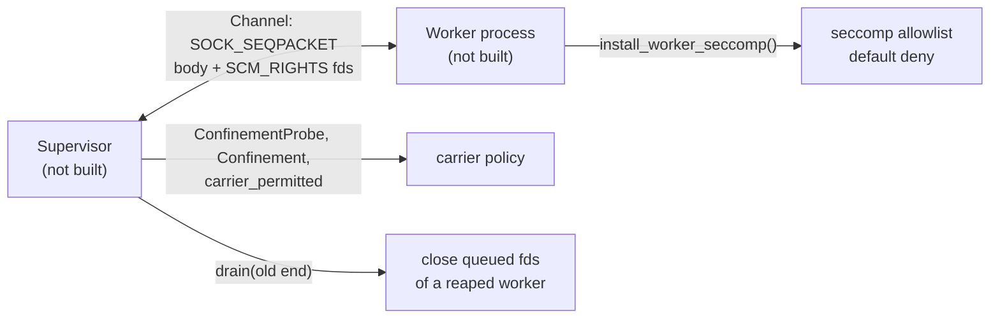

# ptr-fabric — carriers of the Pod data plane

> **Role:** Moves or maps the bytes behind a `TensorHandle` and checks them against the handle's commitment before use. Two carriers exist: `Bytes` (inline, every platform) and `HostShm` (a dedicated sealed `memfd` per export, Linux only, feature `shm-backend`).
> **Maturity:** prototype; the carriers are proven in `tests/bytes_carrier.rs` and `tests/host_shm.rs` without a worker process. The building blocks of the worker data channel (a descriptor-carrying frame channel, the confinement probe and policy, the seccomp allowlist) are tested in `tests/worker_channel.rs` and `tests/worker_confine.rs`; the supervisor and the worker binary that use them are not built.

<!-- PTR:STATUS:BEGIN -->
## Current implementation status

> **Generated section.** Source of truth: [`component.toml`](component.toml) plus code-derived metrics from `src/`. Run `python3 scripts/update_component_docs.py --write` after editing implementation metadata. Do not hand-edit inside this block.

**Maturity:** `prototype`  
**Last reviewed:** 2026-10-14  
**Code footprint:** 6 Rust source files · 2231 nonblank source lines · 5 integration-test files · 59 test markers (`#[test]`, `#[tokio::test]`)

### Implemented now

- Bytes carrier (all platforms): export_bytes turns a tensor into CarrierLocator::Bytes and refuses an empty tensor and one above MAX_INLINE_BYTES with a typed error; import_bytes refuses an empty payload (EmptyTensor), checks the carrier and the locator variant, the length against the handle's byte_len and the SHA-256 against its content_digest before it returns the bytes
- HostShm carrier (feature shm-backend, Linux only), producer side: ShmExport::create writes the tensor once into a dedicated memfd (MFD_CLOEXEC | MFD_ALLOW_SEALING), checks that the file size equals byte_len, applies F_SEAL_WRITE, F_SEAL_SHRINK, F_SEAL_GROW and then F_SEAL_SEAL, refuses an empty tensor and one above MAX_HANDLE_BYTES, and exposes the locator (offset 0, caller-supplied fd_slot), the digest and footprint_bytes (the memfd rounded up to whole pages, for the runtime's handle admission)
- HostShm carrier, consumer side: ShmMapping::map checks offset 0, all four seals and the file size before mapping, maps exactly byte_len bytes with PROT_READ and MAP_SHARED, verifies the SHA-256 of the mapped bytes before as_bytes can be called, and unmaps on drop; every failed check is a typed FabricError and nothing stays mapped
- One exhaustive FabricError enum (empty tensor, too large, wrong carrier, wrong locator, length mismatch, digest mismatch, non-zero offset, missing seal, not sealable (a descriptor that is not a memfd, EINVAL from the seal query), length not addressable, OS error); the only unsafe code is mmap, munmap and the slice over the mapping, each with a SAFETY comment
- ShmMapping::map and ShmExpectation::from_handle refuse a byte_len above MAX_HANDLE_BYTES with FabricError::TooLarge before any fcntl, fstat or mmap on the descriptor
- Worker data channel (feature worker-channel, Linux only): Channel is a connected SOCK_SEQPACKET pair (message boundaries keep each frame's SCM_RIGHTS descriptors attached to that frame and make a cut-off body visible as MSG_TRUNC) carrying one opaque body of 1 to MAX_FRAME_BODY_BYTES (64 KiB) plus 0 to MAX_FDS_PER_FRAME (8) descriptors; send refuses an empty body, an oversize body and too many descriptors before any system call; recv bounds its buffer, receives descriptors as OwnedFd with MSG_CMSG_CLOEXEC, turns MSG_TRUNC and MSG_CTRUNC into typed errors and closes every descriptor that arrived, closes and refuses more than the allowed descriptors, maps peer close to ChannelError::PeerClosed (crash detection), retries EINTR; a zero-length read is end of file only when the peer hung up (POLLHUP), otherwise the typed EmptyFrame error (descriptors closed); try_send never blocks and reports a full queue as WouldBlock (the supervisor polls and uses it); Channel::from_fd refuses a socket that is not SOCK_SEQPACKET; drain receives and closes every frame and descriptor still queued (non-blocking) and reports the counts, for the supervisor's rule-3b drain of a reaped worker's old socket end; an empty datagram is counted and never ends the drain, the one-time ECONNRESET a peer that closed with unread data leaves behind (ChannelError::ConnectionReset) does not end it either, and recv and try_recv read past it to the queued frames; the drain ends at an empty queue (EAGAIN), at end of file after the peer hung up (more consecutive zero reads than the peer's send buffer could have queued datagrams: the larger of this end's SO_SNDBUF and twice net.core.wmem_max, over 256 bytes per datagram (about 766 measured), plus a margin; no bound, so Capped, when either figure is unreadable or the bound reaches the cap), or at a cap of DRAIN_MAX_RECEIVES (DrainEnd::Capped, for a peer that is not reaped, or when that bound cannot be read); it reads into one reusable buffer; drain_with_limit takes the cap
- Worker confinement parts (feature worker-confine, Linux only): ConfinementProbe::detect reports per mechanism whether this host can provide a seccomp filter (a null-filter PR_SET_SECCOMP query that installs nothing), an own user id (CAP_SETUID and CAP_SETGID in the effective set), a writable delegated cgroup v2 group (cgroup2 mount found in /proc/self/mountinfo, own group from /proc/self/cgroup) and a new network namespace (unshare(CLONE_NEWNET), or with a user namespace, tried in a forked child that only calls unshare and _exit), without changing the calling process; Confinement is Full only when all four are applied, otherwise Partial with the missing ones or None; carrier_permitted is an exhaustive policy over Carrier (Bytes and Remote always, HostShm, CudaIpc, DevicePeer and PinnedHost only under Full, InProcess and NvmeFile never for a worker process)
- install_worker_seccomp (and _with(DenyAction)): PR_SET_NO_NEW_PRIVS then a hand-written seccomp-BPF default-deny allowlist (SECCOMP_RET_ERRNO(EPERM), or KILL_PROCESS on request) installed on all threads (TSYNC), architecture checked first (x86_64 and aarch64 little endian, a wrong ABI kills the process, any other architecture is ConfineError::Unsupported); allows fd I/O, recvmsg and sendmsg, poll and epoll, fstat, fcntl only as F_GETFD, F_SETFD, F_GETFL, F_SETFL, F_DUPFD_CLOEXEC, F_ADD_SEALS and F_GET_SEALS, ftruncate, memfd_create, memory, futex and time, signals and exit, clone only with CLONE_THREAD and no CLONE_NEW bit, ioctl only FIONBIO, FIOCLEX and FIONCLEX, tgkill only for the thread group of the installing process (getpid at install time), prlimit64 only as a read of the own limits; clone3 answers ENOSYS; socket, socketpair, connect, bind, listen, accept, accept4, io_uring_*, pidfd_getfd, pidfd_open, ptrace, process_vm_readv and process_vm_writev, fork, vfork, execve and execveat, openat, unshare and setns are denied by omission; worker_allowlist returns the exact list
- The shm-backend feature compiles to nothing off Linux and rustix is a Linux-only target dependency, so neither the default build nor a build with the feature pulls or compiles anything on Windows and macOS; import_bytes refuses an inline payload above MAX_INLINE_BYTES before hashing it

### Missing for the target architecture

- The supervisor and the worker binary (package C5c): spawning a worker, binding a descriptor slot to the handle nonce and the handle's fd_slot, the session ids, the key delivery and challenge, recycling the pair; the channel here moves frames and descriptors but knows nothing of handles or sessions
- Applying the own user id, the cgroup-v2 isolation domain and the network namespace to a worker (package C5c): the probe only reports whether the host could; only the seccomp filter is applied by code in this crate, so no worker is Full-confined yet
- The seccomp allowlist is the minimum for a compute worker with a blocking control socket and Rust std threads; a worker that needs more (eventfd, pipe2, a timer, an async runtime) needs its own reviewed additions. mmap and mprotect are not restricted (no W^X), newfstatat and statx accept any path (metadata only; openat is denied), and aarch64 is only interpreter-tested: its program is built from written-out syscall numbers (taken from the libc tables) and checked by a BPF interpreter unit test, but never installed or run on an aarch64 kernel, while the x86_64 numbers are also compared against libc and exercised by the child tests
- Real-interface behaviour of the probe is only as good as the host: it was exercised on one Linux 6.18 root environment; the unprivileged and the cgroup-delegation-denied paths are covered by parser unit tests only; EINTR retry in the channel has no test; the end-of-file bound of drain is derived from the send buffer limits (SO_MEMINFO's receive allocation was tried and is zero on AF_UNIX while datagrams are queued, because they are charged to the sender), so it assumes the reaped peer could not raise its send buffer beyond twice net.core.wmem_max: a peer with CAP_NET_ADMIN (SO_SNDBUFFORCE) could exceed it, workers must run without that capability (the supervisor, C5c, drops it), and the confined worker has no setsockopt; recv is not lossless after the peer died (an empty datagram queued before the close reads as PeerClosed), the supervisor uses drain for that
- CudaIpc, DevicePeer and PinnedHost carriers (package C7); the NvmeFile carrier is not planned here
- HostShm on Windows or macOS: Windows and macOS have the Bytes carrier only
- A host with vm.memfd_noexec=2 refuses memfd_create without MFD_NOEXEC_SEAL; that surfaces as FabricError::Io and is not handled yet
- ShmMapping is not Send or Sync; a hand-over between threads needs a reviewed unsafe impl or a different owner type
- Nothing calls the carriers from ptr-runtime's handle admission yet; footprint_bytes is the value a caller passes to HandleAdmissionRequest::footprint_bytes

### Next milestones

- The supervisor and the worker binary on top of the channel and the confinement parts (C5c)
- Register the data-plane experiment (E009) that measures the carriers against the Bytes baseline

### Linked experiments

- None recorded.

### Technology evaluations

- None recorded.

### Decision records

- [ADR-0004-backend-independence.md](../../research/decisions/ADR-0004-backend-independence.md)

### Current automated checks

- tests/bytes_carrier.rs: roundtrip, the bound accepted and one byte above it refused, empty tensor refused on export and on import of a hand-built empty handle, wrong digest, tampered inline payload, wrong locator variant, wrong carrier, length mismatch in both directions
- tests/host_shm.rs (shm-backend, Linux): a length above MAX_HANDLE_BYTES refused as TooLarge before the descriptor is touched (a regular-file descriptor gives TooLarge, not NotSealable; the bound itself reaches the seal query) and from_handle refuses it too; roundtrip with exact size and offset 0, all four seals present on the export, write and grow and shrink refused with EPERM after export, a dup of the descriptor imports the same bytes, a hand-built memfd missing each seal in turn refused, wrong file size, non-zero offset, wrong digest with no mapping left, mapping length exactly byte_len, empty tensor on both sides, page-rounded footprint, 3000 map and drop cycles leave no mapping, a regular-file descriptor refused as NotSealable with nothing mapped
- tests/worker_channel.rs (worker-channel, Linux): round trip with no descriptor and a body of exactly the bound, a sealed memfd from ShmExport surviving the trip and mapping with ShmMapping, the maximum number of descriptors arriving CLOEXEC, too many descriptors refused on send with nothing sent, closed and refused on receive (one over and far over, with the process descriptor count unchanged), an oversize body refused on send and truncated on receive with its descriptors closed, empty body, peer close on receive and send, from_fd refusing a SOCK_STREAM socket and a non-socket, drain closing queued descriptors (a queued pipe write end reaches end of file only after the drain), ending at empty or peer closed, not stopping at an empty datagram before an fd-carrying frame (peer live and peer dropped; 200 empties in a row) and stopping at the cap; a peer that died with unread data in its own queue (ECONNRESET, then the queued frame with a descriptor, then end of file) is drained with the descriptor closed and read past by recv; 250 empties then an fd frame then a dropped peer, and 1500 empties queued by a peer that raised its send buffer (more than the former 896 floor; the host granted 8 MiB), pure unit tests of the queue bound (both limits known, either unreadable, above the cap); an empty frame from a live peer is EmptyFrame and from a gone peer PeerClosed; try_send returns WouldBlock on a full queue
- tests/worker_confine.rs and unit tests in src/confine.rs (worker-confine, Linux): detect leaves the seccomp mode, no_new_privs, user ids and network namespace of the caller unchanged, a re-executed child installs the filter and then gets EPERM for socket, socketpair, connect, bind, listen, accept, accept4, io_uring_setup, enter and register, pidfd_getfd and pidfd_open, ptrace, process_vm_readv and writev, execve, execveat, openat, kill, unshare, setns, fork, vfork, clone without CLONE_THREAD and a thread clone with CLONE_NEWNET, a wrong ioctl, a writing or foreign prlimit64, tgkill of pid 1 and fcntl F_SETOWN, F_SETSIG and F_SETOWN_EX (while tgkill of the own thread group and F_GETFD work), ENOSYS for clone3, while a thread, an inherited pipe, a memfd round trip and a recvmsg of a sealed memfd over an inherited control socket with the reply by sendmsg still work; KillProcess mode ends the child with SIGSYS; the tests skip with a printed reason when seccomp is unavailable and fail under CI=true; the allowlist holds none of the forbidden numbers; a BPF interpreter test runs the program for both x86_64 and aarch64 (x32 numbers denied, off-list numbers denied, wrong ABI kills, clone, ioctl, prlimit64, tgkill and fcntl argument filters, clone3 answers ENOSYS, KillProcess mode) and the host's number table is compared with libc; Confinement and carrier_permitted tables; mountinfo, cgroup path and capability parsers

<!-- PTR:STATUS:END -->

## Diagram

Source: [`docs/diagrams/components/ptr-fabric.mmd`](../../docs/diagrams/components/ptr-fabric.mmd).

## Carriers

- `Bytes`: `export_bytes` refuses an empty tensor and one above `MAX_INLINE_BYTES`; `import_bytes` checks the carrier and locator variant, the length and the SHA-256 before it returns the bytes.
- `HostShm`: `ShmExport::create` writes the tensor once into a fresh memfd and applies `F_SEAL_WRITE`, `F_SEAL_SHRINK`, `F_SEAL_GROW` and `F_SEAL_SEAL`, in that order. `ShmMapping::map` checks the seals, offset 0 and the file size, maps exactly `byte_len` bytes read-only and verifies the digest before it hands out the slice (doc 42 rule 3a).

`ShmMapping::map` and `ShmExpectation::from_handle` refuse a `byte_len` above `MAX_HANDLE_BYTES` before any system call on the descriptor.

## Worker data channel (stage S1 of doc 42, Linux only)

Three pieces for the Pod worker process, behind non-default features so default builds on Windows and macOS are unaffected. The supervisor and the worker binary that wire them together are the next package.

- **`channel`** (feature `worker-channel`): `Channel` is a connected `SOCK_SEQPACKET` pair. A frame is one opaque body (1 to 64 KiB; the caller encodes the PodWire or control frame) plus up to 8 descriptors sent with `SCM_RIGHTS`. Sequenced packets keep message boundaries, so a descriptor is attached to exactly one frame and a cut-off body is visible as `MSG_TRUNC`; a byte stream would attach them to an arbitrary slice. Receiving is defensive: descriptors arrive as `CLOEXEC` `OwnedFd`, a truncated body or control message is a typed error and everything that arrived is closed, more descriptors than allowed are closed and refused, and a closed peer is `ChannelError::PeerClosed` (the supervisor's crash detection; a zero-length read from a peer that has not hung up is `EmptyFrame`, never `PeerClosed`). `try_send` never blocks. `drain` receives and closes every frame and descriptor still queued on a reaped worker's old end (doc 42 rule 3b); neither empty datagrams nor the `ECONNRESET` of a peer that died with unread data end it, and it is capped against a peer that is not reaped.
- **`confine`** (feature `worker-confine`): `ConfinementProbe::detect` reports, without changing the process, whether the host offers seccomp, an own user id, a writable cgroup v2 group and a new network namespace; `Confinement` is `Full` only when all four are applied; `carrier_permitted` is the carrier policy (shared carriers only under `Full`); `install_worker_seccomp` installs the default-deny allowlist. The allowlist, its argument filters and its known limits are in the module docs; `worker_allowlist()` returns it.
- Applying the user id, the cgroup domain and the network namespace is the supervisor's job and is not here, so no worker is `Full`-confined yet.



## Tests

```bash
cargo test -p ptr-fabric --locked
cargo test -p ptr-fabric --features shm-backend --locked
cargo test -p ptr-fabric --features worker-channel,worker-confine --locked
```

The seccomp tests re-execute the test binary as a child and skip with a printed reason where seccomp is unavailable; under `CI=true` they fail instead.
