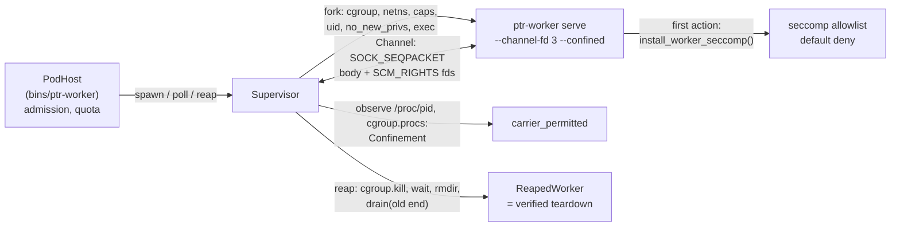
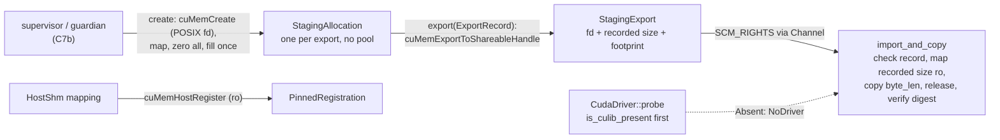

# ptr-fabric — carriers of the Pod data plane

> **Role:** Moves or maps the bytes behind a `TensorHandle` and checks them against the handle's commitment before use. Two carriers exist: `Bytes` (inline, every platform) and `HostShm` (a dedicated sealed `memfd` per export, Linux only, feature `shm-backend`).
> **Maturity:** prototype; the carriers are proven in `tests/bytes_carrier.rs` and `tests/host_shm.rs` without a worker process. The worker data channel (a descriptor-carrying frame channel, the confinement probe and policy, the seccomp allowlist) is tested in `tests/worker_channel.rs` and `tests/worker_confine.rs`, and the supervisor that spawns, confines, watches and reaps real worker processes in `tests/worker_supervisor.rs`. The worker binary and the handle/quota glue that use them are in `bins/ptr-worker` (feature `data-plane`). The supervisor-owned CUDA staging lifecycle (doc 42 rules 3, 3a, 3b: a pool per producer/consumer pair, the export registry, the footprint sink, the guardian protocol and process handle) is the `staging` module (features `shm-backend`, `worker-channel`, `worker-supervisor`; the CUDA backend and the GPU tests need `cuda-ipc-core` or `cuda-ipc`) and is tested on a CPU with a fake backend in `tests/staging_pool.rs` and, with a real guardian process, in `bins/ptr-worker/tests/staging_guardian.rs`.

<!-- PTR:STATUS:BEGIN -->
## Current implementation status

> **Generated section.** Source of truth: [`component.toml`](component.toml) plus code-derived metrics from `src/`. Run `python3 scripts/update_component_docs.py --write` after editing implementation metadata. Do not hand-edit inside this block.

**Maturity:** `prototype`  
**Last reviewed:** 2026-10-15  
**Code footprint:** 23 Rust source files · 9083 nonblank source lines · 11 integration-test files · 173 test markers (`#[test]`, `#[tokio::test]`)

### Implemented now

- Bytes carrier (all platforms): export_bytes turns a tensor into CarrierLocator::Bytes and refuses an empty tensor and one above MAX_INLINE_BYTES with a typed error; import_bytes refuses an empty payload (EmptyTensor), checks the carrier and the locator variant, the length against the handle's byte_len and the SHA-256 against its content_digest before it returns the bytes
- HostShm carrier (feature shm-backend, Linux only), producer side: ShmExport::create writes the tensor once into a dedicated memfd (MFD_CLOEXEC | MFD_ALLOW_SEALING), checks that the file size equals byte_len, applies F_SEAL_WRITE, F_SEAL_SHRINK, F_SEAL_GROW and then F_SEAL_SEAL, refuses an empty tensor and one above MAX_HANDLE_BYTES, and exposes the locator (offset 0, caller-supplied fd_slot), the digest and footprint_bytes (the memfd rounded up to whole pages, for the runtime's handle admission)
- HostShm carrier, consumer side: ShmMapping::map checks offset 0, all four seals and the file size before mapping, maps exactly byte_len bytes with PROT_READ and MAP_SHARED, verifies the SHA-256 of the mapped bytes before as_bytes can be called, and unmaps on drop; every failed check is a typed FabricError and nothing stays mapped
- One exhaustive FabricError enum (empty tensor, too large, wrong carrier, wrong locator, length mismatch, digest mismatch, non-zero offset, missing seal, not sealable (a descriptor that is not a memfd, EINVAL from the seal query), length not addressable, OS error); the only unsafe code is mmap, munmap and the slice over the mapping, each with a SAFETY comment
- ShmMapping::map and ShmExpectation::from_handle refuse a byte_len above MAX_HANDLE_BYTES with FabricError::TooLarge before any fcntl, fstat or mmap on the descriptor
- Worker data channel (feature worker-channel, Linux only): Channel is a connected SOCK_SEQPACKET pair (message boundaries keep each frame's SCM_RIGHTS descriptors attached to that frame and make a cut-off body visible as MSG_TRUNC) carrying one opaque body of 1 to MAX_FRAME_BODY_BYTES (64 KiB) plus 0 to MAX_FDS_PER_FRAME (8) descriptors; send refuses an empty body, an oversize body and too many descriptors before any system call; recv bounds its buffer, receives descriptors as OwnedFd with MSG_CMSG_CLOEXEC, turns MSG_TRUNC and MSG_CTRUNC into typed errors and closes every descriptor that arrived, closes and refuses more than the allowed descriptors, maps peer close to ChannelError::PeerClosed (crash detection), retries EINTR; a zero-length read is end of file only when the peer hung up (POLLHUP), otherwise the typed EmptyFrame error (descriptors closed); try_send never blocks and reports a full queue as WouldBlock (the supervisor polls and uses it); Channel::from_fd refuses a socket that is not SOCK_SEQPACKET; drain receives and closes every frame and descriptor still queued (non-blocking) and reports the counts, for the supervisor's rule-3b drain of a reaped worker's old socket end; an empty datagram is counted and never ends the drain, the one-time ECONNRESET a peer that closed with unread data leaves behind (ChannelError::ConnectionReset) does not end it either, and recv and try_recv read past it to the queued frames; the drain ends at an empty queue (EAGAIN), at end of file after the peer hung up (more consecutive zero reads than the peer's send buffer could have queued datagrams: the larger of this end's SO_SNDBUF and twice net.core.wmem_max, over 256 bytes per datagram (about 766 measured), plus a margin; no bound, so Capped, when either figure is unreadable or the bound reaches the cap), or at a cap of DRAIN_MAX_RECEIVES (DrainEnd::Capped, for a peer that is not reaped, or when that bound cannot be read); it reads into one reusable buffer; drain_with_limit takes the cap
- Worker confinement parts (feature worker-confine, Linux only): ConfinementProbe::detect reports per mechanism whether this host can provide a seccomp filter (a null-filter PR_SET_SECCOMP query that installs nothing), an own user id (CAP_SETUID and CAP_SETGID in the effective set), a writable delegated cgroup v2 group (cgroup2 mount found in /proc/self/mountinfo, own group from /proc/self/cgroup) and a new network namespace (unshare(CLONE_NEWNET), or with a user namespace, tried in a forked child that only calls unshare and _exit), without changing the calling process; Confinement is Full only when all four are applied, otherwise Partial with the missing ones or None; carrier_permitted is an exhaustive policy over Carrier (Bytes and Remote always, HostShm, CudaIpc, DevicePeer and PinnedHost only under Full, InProcess and NvmeFile never for a worker process)
- install_worker_seccomp (and _with(DenyAction)): PR_SET_NO_NEW_PRIVS then a hand-written seccomp-BPF default-deny allowlist (SECCOMP_RET_ERRNO(EPERM), or KILL_PROCESS on request) installed on all threads (TSYNC), architecture checked first (x86_64 and aarch64 little endian, a wrong ABI kills the process, any other architecture is ConfineError::Unsupported); allows fd I/O, recvmsg and sendmsg, poll and epoll, fstat, fcntl only as F_GETFD, F_SETFD, F_GETFL, F_SETFL, F_DUPFD_CLOEXEC, F_ADD_SEALS and F_GET_SEALS, ftruncate, memfd_create, memory, futex and time, signals and exit, clone only with CLONE_THREAD and no CLONE_NEW bit, ioctl only FIONBIO, FIOCLEX and FIONCLEX, tgkill only for the thread group of the installing process (getpid at install time), prlimit64 only as a read of the own limits; clone3 answers ENOSYS; socket, socketpair, connect, bind, listen, accept, accept4, io_uring_*, pidfd_getfd, pidfd_open, ptrace, process_vm_readv and process_vm_writev, fork, vfork, execve and execveat, openat, unshare and setns are denied by omission; worker_allowlist returns the exact list
- The shm-backend feature compiles to nothing off Linux and rustix is a Linux-only target dependency, so neither the default build nor a build with the feature pulls or compiles anything on Windows and macOS; import_bytes refuses an inline payload above MAX_INLINE_BYTES before hashing it
- Worker supervisor (feature worker-supervisor, Linux only): Supervisor::spawn starts a worker child with its own SOCK_SEQPACKET Channel end inherited at a fixed descriptor number (3, passed as --channel-fd 3, every other descriptor from 3 up marked close-on-exec with close_range, standard input and output /dev/null, the environment cleared) and applies, in the forked child before exec and in this order: move into a fresh cgroup-v2 child group created by the supervisor (write 0 to its cgroup.procs), unshare(CLONE_NEWNET), drop the bounding set and clear the ambient set, setgroups(0) then setresgid and setresuid to a user and group id of the worker's own (a configured range, from a random start, skipping ids a live worker of this supervisor holds; Supervisor::new rejects a range containing 0, u32::MAX or the supervisor's own euid, one smaller than max_workers, and an overflow; a channel descriptor below 3 is refused), capset to empty, PR_SET_NO_NEW_PRIVS; the seccomp allowlist is installed by the worker itself as its first action after exec; the supervisor does not take the child's word for any of it: it reads /proc/<pid>/status (all four uid and gid fields, the capability sets, NoNewPrivs, Seccomp), the group's cgroup.procs and the network namespace link, reports a WorkerObservation and a Confinement that is Full only when all four mechanisms are observed (confirm_seccomp re-reads the filter after the worker had time to install it and also requires the worker's own probe_forbidden_calls report to show EPERM for socket, socketpair, fork, open, io_uring_setup, process_vm_readv and pidfd_open, because the status line alone accepts any filter, an allow-all one included; the report is a self-report of a binary the supervisor started, not a kernel proof), and kills the child and fails the spawn when a mechanism it applied is not shown; ConfinePolicy chooses Skip, IfAvailable or Require per mechanism; at most max_workers workers; typed SupervisorError, no panic in library code
- Worker session ids and crash detection (feature worker-supervisor): SessionId is a bijective scramble of a counter offset by a random boot salt from getrandom, so no id is issued twice by one supervisor and a respawn always has a new one; Supervisor::poll reports a worker lost, once, when the child exited (try_wait) or the worker's channel end hung up (POLLHUP), without reaping it; fill_random exposes getrandom for keys and nonces
- Worker reap (feature worker-supervisor): Supervisor::reap kills the whole cgroup (cgroup.kill where the kernel has it, else SIGKILL to every pid in cgroup.procs until the list is empty), kills and waits for the child, verifies the group is empty, removes it, and only then drains the old channel end until it shows closed (an empty queue with the peer still holding its end is retried to the deadline and then the typed ReapFailure::DrainNotClosed; only PeerClosed proves the end gone); the returned ReapedWorker (private fields with accessors session, exit, drain_report and cgroup_removed, made only by reap) is the proof the runtime glue turns into a verified teardown; a step that cannot complete (child not exited, group not empty or not removable, drain failed, capped or not closed) is a typed ReapFailure and the worker stays registered, and a retry skips what is done (a removed group is not looked at again, a vanished one counts as empty); the group removal retries while the kernel still counts a just-exited task, also on the spawn-failure paths and in Drop; dropping the Supervisor kills every remaining worker group and removes it
- Channel and carrier additions for the supervisor: Channel::wait_readable (bounded wait for a frame or a hangup), Channel::peer_hung_up, unsafe Channel::from_inherited_fd (takes the descriptor number a worker inherited and refuses a socket that is not SOCK_SEQPACKET), inspect_region (the supervisor checks a received memfd for all four seals and measures its size and page-rounded footprint before it admits the handle), probe_forbidden_calls (a worker's self-test of the calls the allowlist must refuse: socket, socketpair, fork, open, io_uring_setup, process_vm_readv, pidfd_open)
- CUDA foundations (features cuda-ipc-core and cuda-ipc, Linux only; cudarc =0.19.10, already in Cargo.lock, no package added; nothing has run on a GPU): the cudarc features are split because cudarc's build.rs allows exactly one linking mode and needs a CUDA version: cuda-ipc-core carries std and driver plus fallback-dynamic-loading (a no-op as soon as another crate in the build picks a linking mode) and cuda-version-from-build-system with fallback-latest (candle's own version choice; the fallback only matters on a host without nvcc, where the newest bindings are used), so it unifies with candle-cuda (dynamic-linking, version from nvcc) and builds alone without a toolkit; cuda-ipc adds dynamic-loading and the fixed cuda-12080 bindings, is the toolkit-free variant CI compiles, and must not be combined with candle-cuda; the code is gated on cuda-ipc-core and builds against both the 12.x and the 13.2+ CUmemLocation layout (device_location writes the ordinal into the field after the type; a layout test pins the sizes). CudaDriver::open asks whether libcuda can be opened before any driver call (cudarc's is_culib_present with cuda-ipc, a dlopen of libcuda.so.1 with cuda-ipc-core alone; under dynamic linking a missing libcuda fails the process load before any code runs) and returns CudaError::NoDriver when libcuda is missing or cuInit fails (cached, a missing entry point is caught as no driver), so no cudarc call can run without that proof (every GPU operation takes a &CudaDriver); CudaDriver::probe returns CudaProbe::Absent { reason } or Present with, per device, ordinal, name, total memory, VMM support, POSIX-descriptor handle support, the minimum allocation granularity of a POSIX-descriptor-exportable allocation, and the ordered peer matrix from cuDeviceCanAccessPeer (measured per direction, never assumed), with is_consistent and can_access
- CUDA footprint rule 3b as pure checked functions: footprint_vmm(len, granularity), footprint_legacy(len) (2 MiB), footprint_memfd(len, page); None on overflow, on length 0 and on a zero unit
- VMM staging export (cuda-ipc), supervisor or guardian side: StagingAllocation::create does cuMemCreate with CU_MEM_HANDLE_TYPE_POSIX_FILE_DESCRIPTOR sized to the granularity-rounded footprint, cuMemAddressReserve, cuMemMap, cuMemSetAccess (read-write for the creator) and zeroes the whole allocation, padding included, before anything can be written; fill writes exactly byte_len bytes once and returns the SHA-256; export(ExportRecord) refuses an unfilled allocation and a record whose device or size differs, calls cuMemExportToShareableHandle and returns StagingExport { fd (close-on-exec OwnedFd), recorded_size, footprint, record } with cuda_export(fd_slot) for the locator; this type has no pool of its own (the staging pool is below): every allocation is fresh, and dropping unmaps, frees the address range and releases the creator's handle (the driver keeps the memory while an exported descriptor or an import lives, so the caller keeps the value until both domains are reaped)
- VMM import (cuda-ipc), consumer side: import_and_copy checks the ExportRecord against an ImportExpectation first (consumer session, operation, device, recorded size equal to the locator's alloc_size, extent with overflow-checked offset + byte_len against the recorded size, byte_len above zero and at most MAX_HANDLE_BYTES), then cuMemImportFromShareableHandle, reserves and maps exactly the recorded size read-only for the consumer's device, copies byte_len bytes into a Vec, unmaps and releases the import before it returns, and verifies content_digest on the copy; ImportExpectation::from_handle derives the expectation from a CudaIpc or DevicePeer handle with a VMM export and refuses a legacy export, another carrier and a carrier that disagrees with the device pair; audit_export_padding is the overread test (copies the whole recorded extent, verifies the tensor prefix digest, reports whether the padding is all zero)
- PinnedHost registration (cuda-ipc): PinnedRegistration::register registers an existing sealed HostShm ShmMapping with cuMemHostRegister (read-only and portable flags, refused with Unsupported on a device without read-only host registration) so the pinned buffer is itself the HostShm region, borrows the mapping so it cannot be unmapped while registered, and unregisters on drop; footprint_bytes is the page-rounded footprint
- Staging lifecycle (feature shm-backend, Linux only; the doc 42 rules 3, 3a and 3b policy, written against StagingBackend { type Allocation; footprint_for, allocate -> (allocation, footprint), fill, export(&allocation, &ExportRecord) -> OwnedFd, scrub, scrub_retains, release -> Result } so it runs on a CPU): FakeBackend is memfd-backed (a descriptor of it is a real shared buffer), rounds to a unit, zeroes on scrub and counts live allocations, live bytes, exports, scrubs and releases (FakeCounters is cloneable); CudaBackend (cuda-ipc-core) puts the same trait over StagingAllocation, with scrub as a new zeroed allocation of the same footprint because the C7a type is fill-once, the replaced allocation kept in a retired list until the buffer is released (a producer may still have it imported; scrub_retains is true, so the pool counts one more footprint against the device cap, the pair and both sessions before it scrubs, and refuses the reuse with the typed bound when it does not fit; every reuse of a CUDA buffer thus costs one footprint more until the producer is reaped); ExportRecord moved from the cuda module to the crate root so the pool needs no GPU
- StagingPool (shm-backend): a pool per PairKey { producer_session, consumer_lane } (sessions are never reissued, so reuse needs the stable lane of the consumer stage; a key of the two sessions could never reuse); acquire(AcquireRequest) mints the ExportRecord (size = the allocated footprint) and returns a Lease; a fresh allocation for every handle while the consumer session that imported an earlier buffer of the pair is alive; a buffer is reused only for the same pair, device and footprint, only after on_reaped(consumer) and only after the backend scrubbed all of it (padding included); a buffer is freed to the backend only when on_reaped has been called for both its producer and its consumer (any order); the footprint is charged as allocated to producer and consumer through a FootprintSink trait object (no runtime dependency; ChargeBook is the reference sink, NoCharges a no-op) and released when the buffer is freed, or moved from the old to the new consumer when it is reused; bounded with typed PoolRefusal variants (empty, too large, same session, session already reaped, producer quota with needed_release, consumer quota, pair bytes, pair buffers, total buffers, host-wide VRAM cap per device with per-device overrides, charge refused, backend error, footprint disagreement, record mismatch); nothing is allocated for a request refused before the allocation, and a refused charge rolls back the allocation and the first charge; recovery_plan(producer, needed) returns the consumers to recycle oldest export first with the bytes released and whether that covers the need (the pool only plans, the caller recycles); abandon_all drops every slot without calling the backend and releases every charge when the guardian died
- Pool failure handling (C7b-1 review): a buffer whose scrub fails is poisoned, not freed (it stays allocated and charged while the producer lives and is excluded from reuse; it goes when both domains are reaped); a release the backend did not confirm (RemoteBackend: the guardian did not answer) keeps its charges in a stuck list (ReapReport::release_failed, stuck_count) until abandon_all runs after the guardian is gone, because the memory may still be held; a lease is filled once through the pool (AlreadyFilled; a reuse resets it); the reaped-session memory is bounded and relies on the supervisor never reissuing a session id; recovery_plan may list the consumer of the refused handle (the caller decides)
- Staging host (bins/ptr-worker staging_host, C7b-1 review): a guardian loss is stored in the host (cause, workers still to end) and carried forward by every watch, because the supervisor reports a loss once: a failed worker reap returns the error and the next watch resumes with the workers that are left, and the pool and registry are emptied and the guardian reaped only after all of them are gone; a guardian whose stub broke after a request timeout counts as lost (GuardianLoss::Unresponsive: its process is killed first); shutdown with a failing worker reap leaves the guardian alive and resumes when called again; dropping a StagingHost that still backs workers does not reap the guardian and logs a warning on standard error (the guardian's own supervisor still ends its group when the field drops, so drop the PodHost first); StagingHostConfig::require_isolation refuses a guardian the supervisor did not observe in a cgroup and a network namespace of its own, otherwise the gap is logged; ptr-worker guardian --backend fake warns on standard error
- ExportRegistry (shm-backend): the supervisor issues an ExportRecord per handle with an expiry (operation deadline plus skew); admit(ImportClaim { producer_session, consumer_session, operation, device, size }) consumes the oldest live record that matches exactly (two producers exporting equal sizes to one consumer for one operation are told apart by the producer), sweeps every other expired record,, once, and refuses a claim without one (NoRecord) and one whose record expired (Expired, removed); issue refuses when the registry is full (Full; expired records are swept first, has_room lets the caller ask before it leases a buffer); on_reaped(session) drops the records naming a session as producer or consumer; bounded
- Guardian protocol (feature worker-channel): serve_guardian(&Channel, backend, GuardianLimits) answers FootprintFor, Allocate, Fill, Export (one descriptor with the reply), Scrub, Release and Ping over the supervisor's channel, one reply per request, Error { reason } for a refusal, refuses a request that carries a descriptor, and frees every buffer and returns when the supervisor closes its end; RemoteBackend is the supervisor-side StagingBackend over a Channel with a per-call timeout that marks itself broken when the guardian does not answer or the channel closes, so StagingPool runs unchanged over a guardian process; Channel::try_clone gives the stub a second handle on the supervisor's socket
- GuardianHost (feature worker-supervisor): spawns the guardian program with a Supervisor of its own (max_workers 1; default policy: its own cgroup and network namespace where the host has them, no uid of its own because the GPU device nodes belong to the supervisor's user; capabilities dropped and no_new_privs like a worker; deliberately not seccomp-confined, it is trusted code that needs the driver calls the worker allowlist forbids), poll() reports it lost once, reap() ends its domain and drains its channel (to be called after every worker domain), kill_process() simulates a crash
- CudaError is one exhaustive typed enum (NoDriver, Driver { call, code, name }, Unsupported, MissingEntryPoint, ExtentMismatch, DigestMismatch, Overflow, EmptyTensor, RecordMismatch, WrongLocator, NoSuchDevice, Io); no unwrap or panic in library code; every unsafe block carries a SAFETY comment; the legacy cuIpc* form has no export path in this crate

### Missing for the target architecture

- The seccomp allowlist is the minimum for a compute worker with a blocking control socket and Rust std threads; a worker that needs more (eventfd, pipe2, a timer, an async runtime) needs its own reviewed additions. mmap and mprotect are not restricted (no W^X), newfstatat and statx accept any path (metadata only; openat is denied), and aarch64 is only interpreter-tested: its program is built from written-out syscall numbers (taken from the libc tables) and checked by a BPF interpreter unit test, but never installed or run on an aarch64 kernel, while the x86_64 numbers are also compared against libc and exercised by the child tests
- Real-interface behaviour of the probe is only as good as the host: it was exercised on one Linux 6.18 root environment; the unprivileged and the cgroup-delegation-denied paths are covered by parser unit tests only; EINTR retry in the channel has no test; the end-of-file bound of drain is derived from the send buffer limits (SO_MEMINFO's receive allocation was tried and is zero on AF_UNIX while datagrams are queued, because they are charged to the sender), so it assumes the reaped peer could not raise its send buffer beyond twice net.core.wmem_max: a peer with CAP_NET_ADMIN (SO_SNDBUFFORCE) could exceed it, workers must run without that capability (the supervisor drops it), and the confined worker has no setsockopt; recv is not lossless after the peer died (an empty datagram queued before the close reads as PeerClosed), the supervisor uses drain for that
- CUDA carriers beyond the C7a foundations and the C7b-1 staging lifecycle: the broker path by which a producer imports its own staging buffer and writes the tensor through it (the CUDA staging backend exports only after the guardian filled the buffer from bytes the supervisor sent, at most MAX_FILL_BYTES of about 64 KiB per fill, because StagingAllocation::export needs the digest of a fill and the allocation cannot be zeroed in place), event handles for stream ordering (CudaIpc and DevicePeer locators carry an event_handle that nothing here produces), the receiver-side copy into a device allocation (import_and_copy returns host memory; the contract's device-to-device copy into a receiver-owned allocation is not built), peer-to-peer copies for DevicePeer and the stream-ordered GPU to pinned host to GPU copies of PinnedHost, the E009 GPU cells, and the CudaIpc and DevicePeer carriers in PodHost (the staging host of bins/ptr-worker is not yet in the produce, admit and consume path)
- Feature conflict with candle, narrowed not removed: cuda-ipc (dynamic-loading) still cannot share a build with candle-cuda (dynamic-linking), cudarc's build.rs panics. cuda-ipc-core can: it names no linking mode, so the pair unifies to candle's dynamic-linking and version-from-build-system (with nvcc present); that combination (ptr-worker built with cuda-ipc-core next to ptr-pods or ptr-runtime with candle-cuda) has never been compiled, nothing here has nvcc. In a core build without nvcc the newest bindings (13.4) are used, and the GPU code has only been type-checked against that and against cuda-12080; fallback-latest also turns a missing cuDNN, NCCL or cuTENSOR header into a silent newest-version fallback in a build that enables those cudarc features
- The no-panic guarantee is exactly this: without a driver no cudarc call runs (CudaError::NoDriver, CudaProbe::Absent); a driver entry point missing from the installed libcuda (cudarc's lazy loader panics) is caught at the public GPU entry points (StagingAllocation::create, fill and export, import_and_copy, audit_export_padding, PinnedRegistration::register, the probe) and returned as CudaError::MissingEntryPoint, and destructors swallow it (the resource then stays allocated); the catch needs unwinding, a panic = abort build loses it; CUDA_VISIBLE_DEVICES remaps ordinals consistently for cuDeviceGet and CUmemLocation.id
- The legacy cuIpcGetMemHandle form is not implemented: it is a bearer capability, carrier_permitted never allows it for a Pod worker, and ImportExpectation::from_handle refuses it; a trusted-caller-only form is not built
- Nothing in the cuda module has run on a GPU: this host has no GPU and no CUDA toolkit and CI has neither, so the driver calls, the cudarc struct layouts at cuda-12080 against a real libcuda and every ignored GPU test are unverified; a driver older than the entry points used is only tested by a unit test of the catch (a simulated panic), not against a real old libcuda; cudarc's CUresult is a Rust enum, so a driver answering a code that enum lacks is undefined behaviour inside cudarc (not guarded here)
- The peer matrix is checked against the driver's cuDeviceCanAccessPeer only; the runtime API's cudaDeviceCanAccessPeer and the real topology (nvidia-smi topo) are the owner's cross-check on the GPU PC; whether peer access is faster than PinnedHost is E011's calibration, not decided here
- Staging gaps (C7b-1): the staging host of bins/ptr-worker is not in PodHost's produce, admit and consume path (no CudaIpc or DevicePeer handle is produced or consumed through it, and no descriptor is forwarded to a worker); the FootprintSink adapter onto ptr-runtime's SharedHostQuota is not written (that ledger charges session pairs, the sink charges single sessions; the pool enforces its own per-session, per-pair and per-device caps meanwhile, and ChargeBook is the only sink); the pool reuses a buffer only at exactly the footprint of the new tensor and keeps a reusable buffer (consumer reaped, producer alive) allocated and charged to the producer until that producer is reaped, with no idle trim; recovery covers the producer quota (recovery_plan), the consumer quota is the pair recycle of PodHost::recycle; the guardian answers one request at a time and the supervisor blocks up to request_timeout per call; the export time that orders a recovery plan is a logical counter taken at acquire, which the broker follows immediately with the export
- The guardian has no PR_SET_PDEATHSIG and no seccomp filter: it ends when its channel closes (it frees everything first), which a SIGKILLed supervisor causes, but a supervisor that is killed leaves the guardian's cgroup behind like it leaves the workers'; the unprivileged and the root path of tests/staging_guardian.rs ran here (as root, and as uid 65534 without cgroups), the cgroup-delegation path on a CI runner did not
- The NvmeFile carrier is not planned here
- HostShm on Windows or macOS: Windows and macOS have the Bytes carrier only
- A host with vm.memfd_noexec=2 refuses memfd_create without MFD_NOEXEC_SEAL; that surfaces as FabricError::Io and is not handled yet
- ShmMapping is not Send or Sync; a hand-over between threads needs a reviewed unsafe impl or a different owner type
- ptr-runtime does not call the carriers or the supervisor itself: the glue that admits handles, forwards descriptors and releases quota charges after a reap is PodHost in bins/ptr-worker (feature data-plane), and nothing wires it into ptrd or the runtime's request path yet; footprint_bytes and inspect_region give the value a caller passes to HandleAdmissionRequest::footprint_bytes
- The supervisor is Linux only: no Windows named-pipe channel or job-object confinement, no macOS equivalent; on a host without a delegated cgroup v2 group (cgroup v1 only, an unprivileged runner, a container without cgroup access), without CAP_SETUID and CAP_SETGID, or without a network namespace the worker starts under Partial or no confinement and carrier_permitted keeps every shared carrier away from it, so its tensors go by Bytes
- The supervisor does not make itself a child subreaper: a descendant a non-confined worker forks is killed with the cgroup, but a zombie that is reparented to a pid 1 that does not reap keeps the group busy and the reap fails with a typed CgroupNotEmpty or CgroupRemove (the worker stays registered); a worker without a cgroup has descendants the supervisor cannot find
- Exercised on one Linux 6.18 root sandbox with a hybrid cgroup layout (cgroup2 at /sys/fs/cgroup/unified): the older-kernel fallbacks (SIGKILL loop where cgroup.kill is missing, a per-descriptor fcntl loop where close_range is missing) and the unprivileged-user-namespace fallback of the network namespace step (unshare(CLONE_NEWUSER | CLONE_NEWNET) when the plain unshare is refused) are written but never exercised; the root path has not run on a GitHub-hosted runner
- User ids are validated and unique among the live workers of one supervisor, but a supervisor cannot see other supervisors or the host's user database: every supervisor on a host needs a range disjoint from every other one's (a test starts two with disjoint ranges), and no database entry is managed
- A frame carries at most one region per produce call (the locator's fd_slot is always 0): binding several descriptor slots to one frame, or a slot to the handle nonce beyond the one frame it rides on, is not built
- A worker's capability bounding set can only be emptied by a supervisor with CAP_SETPCAP; an unprivileged supervisor reports bounding_set_empty false (permitted, effective, inheritable and ambient sets are still empty and no_new_privs is set, which is what the spawn requires)
- No PR_SET_PDEATHSIG (the uid change clears it, and it fires on the forking thread's exit, not the process's): a supervisor that is killed with SIGKILL leaves its workers running and their ptr-worker-* cgroups behind, and a new supervisor does not sweep stale groups under its cgroup parent; Drop covers an orderly end only
- S1 limits of the host glue in bins/ptr-worker: a produce call carries the tensor inside one channel frame (64 KiB including the template), so a tensor is about 60 KiB at most, and a worker keeps at most 64 exports open (MAX_EXPORTS) until it is reaped; larger tensors need the worker to compute and keep its own buffer, which S1 does not build
- The host glue (bins/ptr-worker) remembers the principal of at most 4096 reaped workers to release their pairs; a pair whose producer was evicted from that list stays charged (it fails closed: bytes are never released without the proof), and only a restart of the host clears it. A worker that failed its handshake and could not be reaped even on one retry stays in the supervisor and is reported as HostError::StrandedWorker

### Next milestones

- Wire PodHost (bins/ptr-worker) into ptrd and the runtime's request path: Placement from the placement controller, OperationLiveness from the operation record, a respawn policy after recycle
- Register the data-plane experiment (E009) that measures the carriers against the Bytes baseline

### Linked experiments

- None recorded.

### Technology evaluations

- None recorded.

### Decision records

- [ADR-0004-backend-independence.md](../../research/decisions/ADR-0004-backend-independence.md)

### Current automated checks

- tests/bytes_carrier.rs: roundtrip, the bound accepted and one byte above it refused, empty tensor refused on export and on import of a hand-built empty handle, wrong digest, tampered inline payload, wrong locator variant, wrong carrier, length mismatch in both directions
- tests/host_shm.rs (shm-backend, Linux): a length above MAX_HANDLE_BYTES refused as TooLarge before the descriptor is touched (a regular-file descriptor gives TooLarge, not NotSealable; the bound itself reaches the seal query) and from_handle refuses it too; roundtrip with exact size and offset 0, all four seals present on the export, write and grow and shrink refused with EPERM after export, a dup of the descriptor imports the same bytes, a hand-built memfd missing each seal in turn refused, wrong file size, non-zero offset, wrong digest with no mapping left, mapping length exactly byte_len, empty tensor on both sides, page-rounded footprint, 3000 map and drop cycles leave no mapping, a regular-file descriptor refused as NotSealable with nothing mapped
- tests/worker_channel.rs (worker-channel, Linux): round trip with no descriptor and a body of exactly the bound, a sealed memfd from ShmExport surviving the trip and mapping with ShmMapping, the maximum number of descriptors arriving CLOEXEC, too many descriptors refused on send with nothing sent, closed and refused on receive (one over and far over, with the process descriptor count unchanged), an oversize body refused on send and truncated on receive with its descriptors closed, empty body, peer close on receive and send, from_fd refusing a SOCK_STREAM socket and a non-socket, drain closing queued descriptors (a queued pipe write end reaches end of file only after the drain), ending at empty or peer closed, not stopping at an empty datagram before an fd-carrying frame (peer live and peer dropped; 200 empties in a row) and stopping at the cap; a peer that died with unread data in its own queue (ECONNRESET, then the queued frame with a descriptor, then end of file) is drained with the descriptor closed and read past by recv; 250 empties then an fd frame then a dropped peer, and 1500 empties queued by a peer that raised its send buffer (more than the former 896 floor; the host granted 8 MiB), pure unit tests of the queue bound (both limits known, either unreadable, above the cap); an empty frame from a live peer is EmptyFrame and from a gone peer PeerClosed; try_send returns WouldBlock on a full queue
- tests/worker_confine.rs and unit tests in src/confine.rs (worker-confine, Linux): detect leaves the seccomp mode, no_new_privs, user ids and network namespace of the caller unchanged, a re-executed child installs the filter and then gets EPERM for socket, socketpair, connect, bind, listen, accept, accept4, io_uring_setup, enter and register, pidfd_getfd and pidfd_open, ptrace, process_vm_readv and writev, execve, execveat, openat, kill, unshare, setns, fork, vfork, clone without CLONE_THREAD and a thread clone with CLONE_NEWNET, a wrong ioctl, a writing or foreign prlimit64, tgkill of pid 1 and fcntl F_SETOWN, F_SETSIG and F_SETOWN_EX (while tgkill of the own thread group and F_GETFD work), ENOSYS for clone3, while a thread, an inherited pipe, a memfd round trip and a recvmsg of a sealed memfd over an inherited control socket with the reply by sendmsg still work; KillProcess mode ends the child with SIGSYS; the tests skip with a printed reason when seccomp is unavailable and fail under CI=true; the allowlist holds none of the forbidden numbers; a BPF interpreter test runs the program for both x86_64 and aarch64 (x32 numbers denied, off-list numbers denied, wrong ABI kills, clone, ioctl, prlimit64, tgkill and fcntl argument filters, clone3 answers ENOSYS, KillProcess mode) and the host's number table is compared with libc; Confinement and carrier_permitted tables; mountinfo, cgroup path and capability parsers
- tests/worker_supervisor.rs (worker-supervisor, Linux; the child is this test binary re-executed): spawn applies what the kernel then shows (own uid and gid, group membership, network namespace, no capabilities, no_new_privs, Confinement missing exactly Seccomp for a worker that installs none) and reap removes the group; reap kills a descendant that is not confined together with the worker, removes the cgroup and its drain closes the one descriptor frame queued and never read; a SIGKILLed worker is reported lost once (child exit signal 9), its channel end shows hung up and PeerClosed, and reap returns the exit; max_workers is enforced, sessions are distinct, a freed slot is reusable; a program that cannot start is a typed error and leaves no group; Require refuses a spawn the host cannot confine; dropping the supervisor kills its workers; a reap that cannot wait leaves the worker registered; root-only tests print a skip reason and fail under CI=true unless PTR_WORKER_UNPRIVILEGED_CI=1; two supervisors with disjoint uid ranges, unsafe ranges and a channel descriptor below 3 refused; every spawn goes through one lock and ETXTBSY is retried in the test helper only (the binary copy lives in a random 0711 directory, synced and renamed, never a predictable path); unit tests of the session ids, the status parsers, the uid range and its validation, a live worker's uid skipped, the seccomp-report check and the policy decision
- tests/worker_channel.rs and tests/host_shm.rs additions: wait_readable times out when idle, sees a frame and a hangup; from_inherited_fd accepts a SEQPACKET duplicate and refuses a stream socket; inspect_region reports the size and footprint of a sealed export and refuses an unsealed memfd and a regular file
- The end-to-end tests with real processes are bins/ptr-worker/tests/pod_data_plane.rs (supervisor plus two workers: handle transfer by HostShm or Bytes, producer crash mid-flight, a lying Consumed, the key challenge, EPERM after seccomp, a producer that swaps the carrier, changes an authority-fixed field or hands over an unsealed, wrong-size or non-memfd region (refused, descriptor closed, producer reaped, descriptor count checked), a respawned session surviving the fence of the old one, abandoned handles expiring, a killed producer fenced by admit and consume without a poll); CI job pod-worker builds the root-requiring test binaries as the runner user and runs them under sudo -E (scripts/run_pod_worker_tests.py)
- tests/staging_pool.rs (shm-backend, Linux, CPU backend): one producer serving several consumers with the producer quota full recycles the oldest exports first and releases every charge; a locator forwarded to another consumer finds no record and consumes nothing; the host-wide device cap refuses with DeviceCap and has room again after both sessions of a pair are reaped; a long-then-short reuse shows only zeros over the whole footprint
- unit tests in src/staging (shm-backend and worker-channel, run here and in CI): the pool (charged as allocated to both sessions, fresh while the consumer lives, reuse only after the consumer is reaped and zeroed, another lane, producer, footprint or device never reuses, freed only after both reaps in either order, repeated and unknown reaps change nothing, a reaped session gets no buffer, every typed refusal, refused charge and backend failure roll back, a failed scrub poisons the buffer, a retaining scrub is bounded by the device cap, a lease is filled once, an unconfirmed release keeps the charges until abandon_all, export needs the minted record, recovery plan order and coverage, executing a plan frees the quota, abandon_all), the registry (consumed once, mismatching claims consume nothing, oldest first, expiry, bound, reap), and ChargeBook, FakeBackend, and the guardian protocol over a thread (also malformed requests: truncated at every field, unknown tags, a reply tag, trailing bytes are refused and the guardian keeps serving) (every request, descriptor round trip, refusals keep the guardian serving, a request with a descriptor is refused, free at supervisor close, a pool over a RemoteBackend reuses and frees like an in-process one, a dead guardian breaks the stub)
- tests/staging_cuda.rs (cuda-ipc-core): the backend does not open without a driver (CPU, runs in CI); GPU tests, #[ignore], never run: the pool lifecycle on VMM allocations (fresh, fill, export, import and copy, reuse after the consumer is reaped shows zero padding, free after both reaps) and the device cap as a typed refusal. The same lifecycle with a real guardian process is bins/ptr-worker/tests/staging_guardian.rs (data-plane): the fake backend runs everywhere, the CUDA one is an ignored test
- bins/ptr-worker/tests/staging_guardian.rs (data-plane, Linux; real guardian process with --backend fake, real PodHost workers; runs unprivileged and as root): the guardian has no seccomp filter, dropped capabilities, no_new_privs and a cgroup and network namespace of its own where the host gives them; two handles to a live consumer get two fresh buffers charged a page each to both sessions, a producer's write through its descriptor shows in the consumer's, a record is consumed once and a claim by another session, operation or size finds nothing, a forged record exports nothing; after the consumer is reaped the buffers are reusable and still held and charged, a new consumer session on the same lane gets the old buffers back zeroed over the whole footprint (the old descriptor reads zeros) and the charge moves; a producer reaped while its consumer lives frees nothing, the consumer's reap then frees every buffer in the guardian (counted from its descriptor table) and every charge; shutdown reaps every worker before the guardian (event order, timestamps, the guardian alive at each worker reap); a SIGKILLed guardian ends exactly the workers whose buffers it held (the bystander still answers a Pod call), drops the pool, the charges and the records, and is reaped last; a full producer quota is recovered oldest export first by recycling the producer and the listed consumer; a full registry leases nothing; a failed worker reap after a guardian loss is resumed by the next watch; a shutdown with a failing worker reap leaves the guardian alive and resumes; a SIGSTOPped guardian is killed and handled as lost; the descriptor tables (a worker holds /dev/null and its one channel socket and no memfd, the guardian /dev/null, one socket and one memfd per buffer); two producers to one consumer are admitted each by its own record
- tests/cuda_gating.rs: CUDA_IPC_COMPILED equals the cuda-ipc-core feature on Linux, with and without the feature
- unit tests in src/cuda (cuda-ipc, run here and in CI): footprint_vmm, footprint_legacy and footprint_memfd round up, never below the length, None for length 0, a zero unit and overflow; the export record checks (each field, the recorded-size extent, overflow, empty and oversize tensors, padding zero) and ImportExpectation::from_handle for VMM CudaIpc, DevicePeer on another device, a CudaIpc handle for another device, a legacy export, another carrier and a mismatching carrier tag; the probe report invariants (ordered directional matrix, broken reports detected) and a probe that on a host without libcuda is Absent while open() is NoDriver, and on a host with a driver is consistent
- tests/cuda_ipc.rs (cuda-ipc): probe absent or consistent without a panic, probing twice agrees, footprints, the record checks before any driver call; GPU tests, all #[ignore] (need an NVIDIA GPU and driver, run on the owner's PC per docs/GPU_HANDOVER.md, never run so far): single-process export, import, copy and digest round trip; wrong digest and forwarded record refused; overread (the padding past the tensor reads zero); fresh allocation per export and no second fill; the peer matrix against cuDeviceCanAccessPeer; a HostShm region registers, unregisters and registers again
- tests/cuda_ipc_process.rs (cuda-ipc and worker-channel): GPU tests, #[ignore]: the export crosses to a re-executed child over the C5b Channel with SCM_RIGHTS, is imported, copied and digest-verified there; a record forwarded under another consumer session is refused in the child before any driver call

<!-- PTR:STATUS:END -->

## Diagram

Source: [`docs/diagrams/components/ptr-fabric.mmd`](../../docs/diagrams/components/ptr-fabric.mmd).

## Carriers

- `Bytes`: `export_bytes` refuses an empty tensor and one above `MAX_INLINE_BYTES`; `import_bytes` checks the carrier and locator variant, the length and the SHA-256 before it returns the bytes.
- `HostShm`: `ShmExport::create` writes the tensor once into a fresh memfd and applies `F_SEAL_WRITE`, `F_SEAL_SHRINK`, `F_SEAL_GROW` and `F_SEAL_SEAL`, in that order. `ShmMapping::map` checks the seals, offset 0 and the file size, maps exactly `byte_len` bytes read-only and verifies the digest before it hands out the slice (doc 42 rule 3a).

`ShmMapping::map` and `ShmExpectation::from_handle` refuse a `byte_len` above `MAX_HANDLE_BYTES` before any system call on the descriptor.

## Worker data channel and supervisor (stage S1 of doc 42, Linux only)

Four pieces for the Pod worker process, behind non-default features so default builds on Windows and macOS are unaffected. The code that joins them to handle admission and the byte quota is in `bins/ptr-worker` (`PodHost`), because it needs `ptr-runtime`, which this crate must not depend on.

- **`channel`** (feature `worker-channel`): `Channel` is a connected `SOCK_SEQPACKET` pair. A frame is one opaque body (1 to 64 KiB; the caller encodes the PodWire or control frame) plus up to 8 descriptors sent with `SCM_RIGHTS`. Sequenced packets keep message boundaries, so a descriptor is attached to exactly one frame and a cut-off body is visible as `MSG_TRUNC`; a byte stream would attach them to an arbitrary slice. Receiving is defensive: descriptors arrive as `CLOEXEC` `OwnedFd`, a truncated body or control message is a typed error and everything that arrived is closed, more descriptors than allowed are closed and refused, and a closed peer is `ChannelError::PeerClosed` (the supervisor's crash detection; a zero-length read from a peer that has not hung up is `EmptyFrame`, never `PeerClosed`). `try_send` never blocks and `wait_readable` bounds a wait. `drain` receives and closes every frame and descriptor still queued on a reaped worker's old end (doc 42 rule 3b); neither empty datagrams nor the `ECONNRESET` of a peer that died with unread data end it, and it is capped against a peer that is not reaped.
- **`confine`** (feature `worker-confine`): `ConfinementProbe::detect` reports, without changing the process, whether the host offers seccomp, an own user id, a writable cgroup v2 group and a new network namespace; `Confinement` is `Full` only when all four are applied; `carrier_permitted` is the carrier policy (shared carriers only under `Full`); `install_worker_seccomp` installs the default-deny allowlist; `probe_forbidden_calls` is the worker's self-test that the filter refuses what it must. The allowlist, its argument filters and its known limits are in the module docs; `worker_allowlist()` returns it.
- **`supervisor`** (feature `worker-supervisor`): `Supervisor::spawn` starts a worker with its channel end at descriptor 3 and applies, in the child before `exec`: the fresh cgroup-v2 group, a network namespace, capability dropping (bounding, ambient, then an empty `capset`), a user and group id of its own, `PR_SET_NO_NEW_PRIVS`. The worker installs seccomp itself as its first action. The supervisor reads `/proc/<pid>` and the group back and reports the `Confinement` it **observed**; a mechanism it applied that the kernel does not show fails the spawn. `poll` reports a lost worker (child exit or channel hangup); `reap` kills the whole group, waits, verifies the group empty, removes it and then drains the old channel end, and only the returned `ReapedWorker` is proof for the quota. Session ids are never reused; at most `max_workers` run at once.
- **`shm`** additions: `inspect_region` lets the supervisor check a received `memfd` (all four seals) and measure its size and footprint before it admits the handle.



## CUDA foundations (stage S2 of doc 42, feature `cuda-ipc`, Linux only)

The foundations of the `CudaIpc`, `DevicePeer` and `PinnedHost` carriers, through `cudarc =0.19.10` with `dynamic-loading` (no `libcuda` link, no `nvcc`, no new package in `Cargo.lock`). **Nothing here has run on a GPU**: this host and CI have none; the GPU tests are `#[ignore]`d and are run on the owner's PC per [`docs/GPU_HANDOVER.md`](../../docs/GPU_HANDOVER.md).

- **`CudaDriver::open` / `probe`**: `is_culib_present` is asked before any driver call; without `libcuda` the answer is `CudaError::NoDriver` or `CudaProbe::Absent`, never a panic. Every GPU operation takes a `&CudaDriver`, so no call can skip that proof. The probe measures devices, VMM support, POSIX-descriptor handle support, the allocation granularity and the ordered peer matrix (`cuDeviceCanAccessPeer`, never assumed).
- **Footprints** (`footprint_vmm`, `footprint_legacy`, `footprint_memfd`): checked, `None` on overflow or length 0; the value rule 3b charges.
- **`StagingAllocation` / `StagingExport`** (supervisor or guardian side): one `cuMemCreate` allocation per export, granularity-rounded, zeroed over its whole footprint before any write, filled once, exported as a close-on-exec POSIX descriptor together with an `ExportRecord`. **There is no pool and no reuse**; freeing is the caller's job after both domains are reaped (the guardian that does this is C7b).
- **`import_and_copy` / `audit_export_padding`** (consumer side): the record is checked against the handle-derived `ImportExpectation` first, then exactly the recorded size is mapped read-only, `byte_len` bytes are copied out, the import is released **before** the function returns, and the digest is verified on the copy. The extent uses the recorded size, not `cuMemGetAddressRange`.
- **`PinnedRegistration`**: a sealed `HostShm` mapping registered with `cuMemHostRegister` (read-only, portable), unregistered on drop; the pinned buffer is the `HostShm` region.
- **Not built**: the legacy `cuIpc*` form (a bearer capability, never for a worker), the guardian, pools, event handles, device-side receiver copies and peer-to-peer copies (see `missing` in `component.toml`).



## Tests

```bash
cargo test -p ptr-fabric --locked
cargo test -p ptr-fabric --features shm-backend --locked
cargo test -p ptr-fabric --features worker-channel,worker-confine --locked
cargo test -p ptr-fabric --features cuda-ipc --locked             # CPU tests; GPU tests are ignored
cargo test -p ptr-fabric --features cuda-ipc,worker-channel --locked -- --ignored   # on a GPU PC only
cargo test -p ptr-fabric --features worker-supervisor --locked   # root-only tests skip with a printed reason
sudo -E python3 scripts/run_pod_worker_tests.py                  # or: make ci-pod-worker
```

The seccomp tests re-execute the test binary as a child and skip with a printed reason where seccomp is unavailable; under `CI=true` they fail instead. The supervisor tests need root (a user id of their own, a cgroup-v2 group, a network namespace): where the host lacks one they print why and skip, and under `CI=true` they fail unless `PTR_WORKER_UNPRIVILEGED_CI=1` is set. CI builds them as the runner user and runs the finished binaries under `sudo -E` (`scripts/run_pod_worker_tests.py`, job `pod-worker`).
