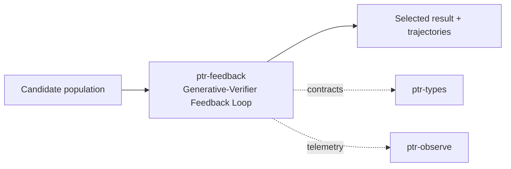

# ptr-feedback — Generative-Verifier Feedback Loop

> **Role:** Implements candidate populations, critique, patch/rewrite, selection and trajectory capture for test-time and training-time improvement.  
> **Maturity:** see the generated status below; production behavior must be proven by the linked experiments and component evaluations.

<!-- PTR:STATUS:BEGIN -->
## Current implementation status

> **Generated section.** Source of truth: [`component.toml`](component.toml) plus code-derived metrics from `src/`. Run `python3 scripts/update_component_docs.py --write` after editing implementation metadata. Do not hand-edit inside this block.

**Maturity:** `scaffold`  
**Last reviewed:** 2026-10-09  
**Code footprint:** 3 Rust source files · 775 nonblank source lines · 3 integration-test files · 21 test markers (`#[test]`, `#[tokio::test]`)

### Implemented now

- Candidate<T>, Critique and Population<T> domain structures; Population insertion
- Candidate::passes(required): the one acceptance rule, mirroring TriagePolicy::triage in ptr-branch (a report must exist, its status must be Pass, no finding may be hard, its level must be at least the required one; a score never decides). RepairLoop and Population::best_verified(required) both accept only through it, which closes the earlier gap where best_verified trusted the Pass status alone and so selected a forged Pass that carried a hard finding
- Critique::from_report: the issues are the codes of the report's hard findings (each once, in order); it is repairable only for a Fail that names at least one hard finding. Unknown, Disputed, a Pass that contradicts itself with a hard finding, and a Fail without a hard finding are not repairable and are rewritten, not repaired
- RepairLoop (generate-verify-repair state machine) over any Verifier<T>: traits Generator<T> and Repairer<T> (a repairer may decline), RepairBudget {max_verifier_calls, max_rounds} validated to be positive, RepairPolicy {required_level, budget}; every candidate is verified exactly once, at most max_verifier_calls verifier calls and 1 + max_rounds candidates are spent, a run that spends its budget returns Outcome::Exhausted {reason} and never a best-effort failure, and the run keeps a Trajectory of every candidate (rejected ones included) with its report, critique, origin (Initial, Repaired, Rewritten) and the loop's decision, plus a Usage record of the calls it claims
- Experiment F001 (ptr-bench generate-verify-repair) exercises this mechanism against an independent oracle, a call-counting boundary and an exact analytic expectation with a seeded stub generator; it is completed (preregistered at f001-prereg; 5 seeds, mutation check 24 of 24) and makes no claim about model generation quality

### Missing for the target architecture

- Candidate diversity/dedup clustering
- Tournament/Pareto selection
- A learned or model-backed Generator and Repairer (only seeded stubs exist, in the F001 harness)
- Persisting trajectories for training and GEPA

### Next milestones

- Add multi-verifier/Pareto selection beyond single passing score
- Measure repair against rewrite with a real generator once one exists (F001 covers the mechanism with a seeded stub)
- Persist full trajectories for training and GEPA

### Linked experiments

- [F001](../../experiments/feedback/F001-generate-verify-repair/README.md) — `frozen`
- [E001](../../experiments/system/E001-end-to-end/README.md) — `planned`

### Technology evaluations

- None recorded.

### Decision records

- [ADR-0004-backend-independence.md](../../research/decisions/ADR-0004-backend-independence.md)

### Current automated checks

- failed high-score candidate cannot beat passing candidate test
- regression: a forged Pass that carries a hard finding, a Pass below the required level, an Unknown, a Disputed and an unverified candidate are never selected by best_verified
- unit and integration tests of the loop: acceptance only through Candidate::passes, each candidate verified once, the call and round budgets, Exhausted returns no candidate, Unknown/Disputed/contradicting reports are rewritten, a declined repair becomes a fresh draw, trajectory content, with the real ActionContractVerifier
- workspace fmt/check/test/clippy

<!-- PTR:STATUS:END -->

## Position in PTR

Dedicated diagram source: [`docs/diagrams/components/ptr-feedback.mmd`](../../docs/diagrams/components/ptr-feedback.mmd)

**Upstream:** ptr-types, ptr-verifier  
**Downstream:** ptr-runtime, ptr-bench

## Mission

Implements candidate populations, critique, patch/rewrite, selection and trajectory capture for test-time and training-time improvement.

PTR keeps this responsibility in its own crate so the semantics remain stable even when an external library or implementation is replaced.

## Responsibilities

- Candidate<T>
- population management
- critique
- repair/rewrite
- selection/tournaments
- trajectory records

## Explicit non-responsibilities

- ground-truth authority
- model weight updates
- environment sandbox implementation

## Data flow

| Direction | Contract |
|---|---|
| Input | Generated candidates and verifier reports |
| Output | Selected candidate plus rich trajectories and preference/repair data |
| Failure | Explicit typed error / rejected state; no silent fallback that changes semantics |
| Observability | Standard PTR tracing fields and a stable component span |

## Technical approach

- MaxProof-like generate→verify→repair loop
- cuVS-style clustering/dedup optional
- GEPA/RL consumes traces but does not override hard invariants

External projects are **candidates**, not architectural authority. The PTR-owned traits and domain types must remain usable with a replacement backend.

## Core invariants

1. Failures are retained as training evidence.
2. A candidate cannot self-certify.
3. Selection must preserve verifier provenance.

These invariants should be executable wherever possible through unit, property, lifecycle or chaos tests.

## Failure model

The component must fail closed for semantic or effect-safety violations. Infrastructure failures should surface as typed errors that preserve request, revision, generation and provenance context. Retries must be idempotent whenever the operation may cross a process or network boundary.

## Performance model

Measure before optimizing. Benchmarks should record at least latency distribution, throughput, allocations/resident memory, queue depth or working-set size where relevant, and the cost of verification. Performance optimizations may not bypass generation, revision, capability or evidence checks.

## Security and privacy

- Treat external inputs and backend outputs as untrusted until validated.
- Do not put raw secrets/private evidence into generic tracing or inspection.
- Preserve provenance on every promotion from raw/possible evidence to stronger semantic state.
- External effects pass through `ptr-security` even if this component already performed local validation.

## Technology evaluation

- No dedicated technology slot yet; architectural alternatives should be added to `evaluations/components/` before lock-in.

A new candidate should be added with a reproducible benchmark and failure-semantics analysis rather than replacing the default ad hoc.

## Tests required before production use

- Contract/unit tests for all domain transitions.
- Invalid, stale-generation and stale-revision cases.
- Cancellation/retry behavior.
- Property tests for invariants where practical.
- Cross-backend equivalence if more than one backend exists.
- Observability and redaction checks.

## Related architecture

- [System architecture](../../docs/architecture/00-system.md)
- [Technical architecture](../../docs/TECHNICAL_ARCHITECTURE.md)
- [Component contracts](../../docs/COMPONENT_CONTRACTS.md)
- [Global invariants](../../docs/INVARIANTS.md)

