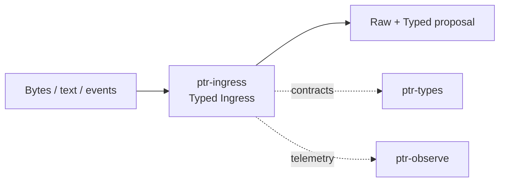

# ptr-ingress — Typed Ingress

> **Role:** Preserves raw evidence while building a provisional typed interpretation that can be cross-verified before reasoning.  
> **Maturity:** see the generated status below; production behavior must be proven by the linked experiments and component evaluations.

<!-- PTR:STATUS:BEGIN -->
## Current implementation status

> **Generated section.** Source of truth: [`component.toml`](component.toml) plus code-derived metrics from `src/`. Run `python3 scripts/update_component_docs.py --write` after editing implementation metadata. Do not hand-edit inside this block.

**Maturity:** `prototype`  
**Last reviewed:** 2026-10-14  
**Code footprint:** 9 Rust source files · 3682 nonblank source lines · 6 integration-test files · 95 test markers (`#[test]`, `#[tokio::test]`)

### Implemented now

- RawInput variants for text, bytes and artifact references
- ArtifactKind taxonomy
- SemanticProposal label scores and semantic issues
- Basic raw↔typed cross-check status function
- Deterministic magic-byte MIME/kind sniffer (PDF, PNG, JPEG, GIF, WebP, WAV, MP3/ID3, OGG, FLAC, MP4/ISO-BMFF, ZIP, gzip, tar, 7z, SQLite, UTF-8/UTF-16/legacy single-byte text) with confidence over a bounded 8 KiB window
- Std-only text normalizer: BOM detection, strict UTF-8, UTF-16LE/BE, Windows-1252 fallback with an explicit lossy flag, CRLF to LF, NUL reject/strip policy, and a per-character offset map back to raw bytes
- Deterministic structural parser: depth-limited strict JSON recognizer plus Markdown headings/code fences, source code (rust/python/javascript/shell), key=value/TOML-like, CSV and prose segmentation with a segment bound
- Pluggable SemanticClassifier trait with a rule-based lexicon reference classifier (task, reasoning and read-only/write/network/exec effect labels, normalized probabilities) and a document-shape prior classifier as a second opinion
- Span-level provenance: every segment and label evidence carries a RawSpan into the original raw bytes, verified to round-trip for UTF-8, UTF-16 and CRLF input
- Risk/disagreement verification policy producing Agree/SampleVerified/Disputed/NeedsFullCheck with typed reasons (kind/extension mismatch, invalid or too-deep JSON, classifier disagreement, probability divergence, lossy decoding, always full check for write/network/exec effects)
- PolicyConfig::validate and IngressPipeline::try_new reject NaN, infinite or out-of-[0, 1] policy thresholds with a typed PolicyConfigError; IngressPipeline::new and evaluate_policy stay infallible but fail closed by replacing an invalid threshold with the strictest valid value (0.0 risk/divergence, 1.0 minimum sniff confidence)
- IngressPipeline producing an IngressRecord that keeps the untouched raw input next to kind, normalized text, segments, proposal, evidence and decision, with a configurable input size bound and typed errors

### Missing for the target architecture

- infer-crate MIME adapter: only a std-only magic-byte sniffer exists, with a fixed small signature table and no container-internal detection (for example OOXML versus plain ZIP)
- encoding_rs adapter: only strict UTF-8, UTF-16 and a Windows-1252 fallback exist; no other legacy encodings or charset sniffing
- Unicode NFC (or any other Unicode normalization form) is not applied
- GLiClass-rs (learned) classifier adapter: only a lexicon/rule reference classifier and a shape prior exist, with no calibration and no measured accuracy
- Parsers beyond heuristics: no YAML/XML/HTML parsing, no real language parsers for source code, and scalar-only JSON documents are not recognized as JSON
- Non-text artifacts (images, audio, PDF, archives) are sniffed but not decoded, so they receive no typed interpretation and always need a full check
- Artifact references (RawInput::Artifact) cannot be ingested until a resolver supplies their bytes
- Corruption/ambiguity benchmark with measured detection rates for the ingress-classifier evaluation (E001/E004 not run)

### Next milestones

- Create corruption/ambiguity benchmark cases for raw↔typed disagreement and run them through the ingress-classifier evaluation
- Add a learned classifier adapter behind the SemanticClassifier trait and compare it with the rule baseline
- Add an artifact resolver port so RawInput::Artifact can be ingested

### Linked experiments

- [E001](../../experiments/system/E001-end-to-end/README.md) — `planned`
- [E004](../../experiments/system/E004-long-horizon/README.md) — `planned`

### Technology evaluations

- [ingress-classifier](../../evaluations/components/ingress-classifier/README.md) — `open`

### Decision records

- [ADR-0003-raw-and-typed.md](../../research/decisions/ADR-0003-raw-and-typed.md)
- [ADR-0004-backend-independence.md](../../research/decisions/ADR-0004-backend-independence.md)

### Current automated checks

- workspace fmt/check/test/clippy

<!-- PTR:STATUS:END -->

## Position in PTR

Dedicated diagram source: [`docs/diagrams/components/ptr-ingress.mmd`](../../docs/diagrams/components/ptr-ingress.mmd)

**Upstream:** ptr-types; input from the external world  
**Downstream:** none yet (no crate consumes it)

## Mission

Preserves raw evidence while building a provisional typed interpretation that can be cross-verified before reasoning.

PTR keeps this responsibility in its own crate so the semantics remain stable even when an external library or implementation is replaced.

## Responsibilities

- raw input capture
- artifact/MIME and encoding normalization
- cheap semantic classification
- raw↔typed disagreement detection

## Explicit non-responsibilities

- authoritative semantic state
- long-horizon memory
- external action execution

## Data flow

| Direction | Contract |
|---|---|
| Input | Text, bytes, files, events, API requests |
| Output | Raw representation plus typed semantic proposal and verification signals |
| Failure | Explicit typed error / rejected state; no silent fallback that changes semantics |
| Observability | Standard PTR tracing fields and a stable component span |

## Technical approach

- infer for MIME candidate
- encoding_rs for deterministic decoding
- GLiClass-rs candidate for low-cost classification
- deterministic parsers/rules where appropriate

External projects are **candidates**, not architectural authority. The PTR-owned traits and domain types must remain usable with a replacement backend.

## Core invariants

1. Raw evidence is retained and never replaced by the typed proposal.
2. Uncertainty and ambiguity are explicit.
3. Untrusted context never promotes directly to Known<T>.

These invariants should be executable wherever possible through unit, property, lifecycle or chaos tests.

## Failure model

The component must fail closed for semantic or effect-safety violations. Infrastructure failures should surface as typed errors that preserve request, revision, generation and provenance context. Retries must be idempotent whenever the operation may cross a process or network boundary.

## Performance model

Measure before optimizing. Benchmarks should record at least latency distribution, throughput, allocations/resident memory, queue depth or working-set size where relevant, and the cost of verification. Performance optimizations may not bypass generation, revision, capability or evidence checks.

## Security and privacy

- Treat external inputs and backend outputs as untrusted until validated.
- Do not put raw secrets/private evidence into generic tracing or inspection.
- Preserve provenance on every promotion from raw/possible evidence to stronger semantic state.
- External effects pass through `ptr-security` even if this component already performed local validation.

## Technology evaluation

- [ingress-classifier](../../evaluations/components/ingress-classifier/README.md)

A new candidate should be added with a reproducible benchmark and failure-semantics analysis rather than replacing the default ad hoc.

## Tests required before production use

- Contract/unit tests for all domain transitions.
- Invalid, stale-generation and stale-revision cases.
- Cancellation/retry behavior.
- Property tests for invariants where practical.
- Cross-backend equivalence if more than one backend exists.
- Observability and redaction checks.

## Related architecture

- [System architecture](../../docs/architecture/00-system.md)
- [Technical architecture](../../docs/TECHNICAL_ARCHITECTURE.md)
- [Component contracts](../../docs/COMPONENT_CONTRACTS.md)
- [Global invariants](../../docs/INVARIANTS.md)

