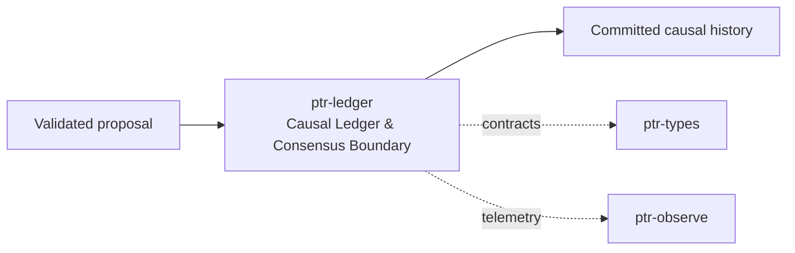

# ptr-ledger — Causal Ledger & Consensus Boundary

> **Role:** Records the authoritative ordered lifecycle of semantic changes and, in cluster mode, applies distributed consensus before state materialization.  
> **Maturity:** see the generated status below; production behavior must be proven by the linked experiments and component evaluations.

<!-- PTR:STATUS:BEGIN -->
## Current implementation status

> **Generated section.** Source of truth: [`component.toml`](component.toml) plus code-derived metrics from `src/`. Run `python3 scripts/update_component_docs.py --write` after editing implementation metadata. Do not hand-edit inside this block.

**Maturity:** `prototype`  
**Last reviewed:** 2026-10-08  
**Code footprint:** 9 Rust source files · 8388 nonblank source lines · 16 integration-test files · 173 test markers (`#[test]`, `#[tokio::test]`)

### Implemented now

- check_encodable refuses a MeshTunnelLifecycle event whose endpoint binding the decoder would refuse (for example a relayed route without a relay id), so an append path cannot write a record the log cannot read back
- EffectAttempted/EffectSettled/EffectReconciled records (tags 9-11, beside the unchanged 0-8 and the semantic tag 12) carry an execution audit: the attempt is addressed by its own commit index, and a settled response keeps its digest unconditionally and its bytes up to MAX_RETAINED_RESPONSE
- Effect and VerificationLevel are written through explicit code tables rather than discriminant casts, so inserting an enum variant breaks a build instead of renumbering records already stored
- Rustdoc covers the protected-anchor, acknowledgment, compaction and erasure APIs plus their integrity and serialization helpers
- LogPaths::orphans claims a file only when log_path of the floor its name encodes is that same path, so a neighbouring log set sharing the directory can never have its live log reclaimed as this set's orphan
- InMemoryLedger::append is fallible and uses checked arithmetic: an exhausted commit index is refused with PTR_LEDGER_INDEX_EXHAUSTED and nothing is stored, rather than saturating and handing the same index out twice
- PTRLOG02 bounded SHA-256 record chain with checked header, sequence, payload and trailer
- Strict nonmutating open; independently anchored rollback checks and explicit partial-tail recovery
- Create-new checked-log restore and guarded explicit legacy inspection/migration
- Explicit RAII unlock prevents duplicate-descriptor retention across concurrent process spawn
- SemanticDeltaCommitted preserves base/result revisions and opaque transaction bytes and carries a SemanticOrigin recorded in the same append: Legacy encodes as tag 8, byte for byte as before origins existed, and Request, PodOutput, Host and Merge encode as tag 12 (a kind byte; an Attestation of required level FullSemantic or Deterministic, weakest level, 1 to 16 verifier names and up to 32 finding codes; a merge record's branch, author, seal, plan and dependency digests, strictly ascending rebased keys up to MAX_REBASED_KEYS and a Triage or Reviewed authority); the codec checks shape only, and which origin replay accepts where is ptr-runtime's rule (it writes no Legacy record and replays one only before the first attributed record)
- LedgerEvent gains eleven variants with explicit encode/decode arms at tags 13-23 (ScopeLifecycle 13, ProtectedStateCommitted 14, MeshTunnelLifecycle 15, ExecutionManifestAdmitted 16, ExecutionManifestRevoked 17, PodEvidenceCommitted 18, PodOutputAdmitted 19, PodHypothesisCommitted 20, PolicyBundleActivated 21, PolicyBundleRevoked 22, SessionRevoked 23), beside the unchanged tags 0-12; the ledger stores manifest, policy-bundle and Pod-evidence bytes opaquely and owns only ordering, durability and record integrity, while their schemas and replay rules belong to ptr-pods and ptr-runtime
- ProtectedStateCommitted (tag 14) records only a domain code, logical id, generation, revision and the plaintext, ciphertext and anchor digests, so neither payload nor key material enters the ledger
- PodHypothesisCommitted decoding bounds provenance entries and dependency digests at 1024 each, and check_encodable applies those limits plus the attestation bounds of PodOutputAdmitted and PodHypothesisCommitted with the decoder's own functions (pod_events_are_bounded_before_encoding_and_stay_readable), MeshTunnelLifecycle decoding validates a present endpoint binding, and unknown scope-lifecycle, mesh-event and mesh-route codes are refused
- SemanticOrigin::PodCandidate (kind 5 under tag 12: request, pod, output digest, verification level) marks a retained candidate that is not an already promoted fact; the codec checks shape only, as for the other origins, and ptr-runtime's semantic.rs writes it
- check_encodable refuses, before anything is encoded, an event the decoder would refuse (an attestation below FullSemantic or with a verifier or finding count outside its bounds, more rebased keys than MAX_REBASED_KEYS: the same functions check each rule on both sides) or whose encoding exceeds MAX_RECORD_BYTES: encode_log and FileLedger, the raft-engine adapter and a raft proposal all check it, so none writes a record no decoder reads back; InMemoryLedger encodes nothing, so a writer appending there checks it itself
- PTRANC01 protected anchor storage: HMAC-SHA256 under a host-held key, fixed-length record, atomic rename publication, monotonic epoch/index/digest and carried chain origin
- integrity::hmac_sha256 (RFC 2104, no dependency beyond sha2) and integrity::constant_time_eq are public: anchor MACs and ptr-pg's branch seal tags use them, each under a domain of its own
- Retained-epoch witness rejects rollback of the anchor file itself; authenticity alone is documented as insufficient for freshness
- AcknowledgedLedger log-first append/acknowledge ordering with writer fencing when anchor publication fails
- RecoverableLog classifies every log/anchor split under one held lock and repairs only the tail per explicit TailPolicy
- integrity scan/encode/decode accept a trusted compaction floor so a log need not begin at index 1
- LogPaths floor-in-filename addressing: the protected anchor alone names the live log, so a cutover is unambiguous on both sides of its commit point
- RetentionPolicy/CompactionBarrier planning capped by snapshot coverage and blocked by lagging consumers or unresolved revocations
- Create-new compaction cutover with the anchor advance as commit point, revalidated plans and explicit orphan reclamation
- Erasure audit over live and superseded logs: byte-level presence search biased toward still-retained, with host-retained artifacts folded in explicitly
- Two audit entry points: the live log is read through its owning handle when a ledger is open, since mandatory Windows locks make an independent handle unusable there
- Named permanent erasure boundaries (host-retained artifacts, storage residue, model-derived state) reported by every audit rather than as situational caveats
- FileRaftStorage survives a stop at every step of its snapshot transitions (L002): the snapshot payload is stored under a name that is its own digest, the state file names that digest together with the covered position, and Storage::snapshot refuses a payload the state does not name, so a stop leaves the old pair or the new pair and never one under the other; a snapshot is installed by writing the payload, then the state with the covered-event count marked AppliedEvents::SnapshotPending, then replacing the log by an empty one written beside it and renamed over it, and recorded by writing the payload, then the state with the covered-event count, then compacting the log; the in-memory state is rolled back when the state file cannot be written; a restart skips log records the snapshot covers, finishes an interrupted installation and offers a snapshot the host has not accounted for to the host again (RaftNode::take_installed_snapshot after open) instead of adopting it unvetted, keeps the committed entries above it and applies them once the host has accounted for it, and a recorded snapshot persists the number of events it covers so the leader's numbering survives a restart
- Opening a Raft log cuts off a tail only when it is all zero or when no valid record follows the break, reports the bytes cut (Core::trimmed_tail_bytes), checks the committed prefix whether or not a snapshot is pending, and refuses a damaged record that valid records follow, because those may have been acknowledged; the log it read is synced before the member answers for it
- FileRaftStorage trims a torn tail of the log (a record cut short, a hole, another magic or a wrong digest, the state after a power loss in the middle of an append) when the records read reach the commit index, and refuses a log that ends below it; an existing log is synced when it is opened, so a record a stopped process wrote and never synced is not answered for before it is
- RaftNode::report_snapshot(peer, SnapshotDelivery) and report_unreachable(peer) hand the transport's knowledge of a lost snapshot or message to the leader, which otherwise stops sending a member that was handed a snapshot anything else for ever
- Test-only failpoints in FileRaftStorage behind `failpoints` (raft.append.after_write_before_sync, raft.atomic.after_write_before_sync, raft.atomic.after_sync_before_rename, raft.state.after_rename_before_dir_sync, raft.snapshot.after_payload, raft.snapshot.after_state, raft.snapshot.after_log_rewrite, raft.compact.after_sync_before_rename, raft.compact.after_rename_before_dir_sync, raft.install.after_payload, raft.install.after_log_reset), two that return an I/O error in place of a write (raft.append.before_write, raft.state.before_write), and in the compaction cutover (compaction.before_build, ledger.create_after_write_before_sync, ledger.create_after_sync_before_dir_sync, compaction.after_log_built_before_anchor, compaction.after_anchor_before_install)
- Cross-process single-writer advisory lock retained for FileLedger handle lifetime
- Poisoned writer after ambiguous append failure; reopen/replay required before subsequent writes
- Lifecycle LedgerEvent enum
- CommittedEvent with CommitIndex
- Ledger trait and in-memory reference implementation, with an optional compaction-floor offset so restored records keep their committed indices
- CompactionBarrier scaffold
- Durable reference FileLedger with checked versioned frames, file synchronization and anchor-required tail recovery
- Directed recovery trims a tail that is all zero (a file extended whose data never reached the disk, the usual state after a power loss with delayed allocation) as it trims a partial frame: only when every byte from the end of the last complete, valid frame to the end of the file is zero, only in the anchor-directed recovery (AcknowledgedLedger::open, RecoverableLog::repair, FileLedger::recover_unacknowledged_tail), only when the anchor (or the trusted tail anchor) is a boundary of the complete prefix (an anchor beyond the zero region is a lost suffix and is refused as before), and under TailPolicy::Refuse it is refused with every byte left in place. Strict open and decode still refuse it, and a zero gap followed by written bytes, a partially written frame followed by zeros up to its length, zeros inside a frame and zeros before a frame keep being refused. Whole valid frames followed by zeros are not damage: they are the ordinary unacknowledged records (kept, discarded or refused by TailPolicy exactly as without the zeros) and only the zero region after the last complete valid frame is trimmed (incomplete_frame_removed is also true for a pure zero tail; trimmed_zero_tail_bytes > 0 tells it apart from a torn frame). The trim is reported (TailRecovery::trimmed_zero_tail_bytes, AcknowledgedLedger::recovery, FileLedger::recover_unacknowledged_tail_reporting), truncates and syncs the file (the directory entry does not change, so no directory sync is needed) and is idempotent across a crash between the truncation and its sync (failpoint ledger.trim_after_truncate_before_sync). Found by the L001-v2 pilot 1001 before the freeze: every recovery of a zero tail was refused
- Feature-gated fail-rs injection points around record write/payload/fsync/memory-commit boundaries
- Test-only failpoints in the anchor's publication, one after each step (anchor.after_scratch_write_before_sync, anchor.after_scratch_sync_before_rename, anchor.after_rename_before_dir_sync, anchor.after_dir_sync) and one at each directory synchronization (ledger.sync_parent, so a harness can count them) behind the same `failpoints` feature, and a `raft-engine-failpoints` feature that forwards to the vendored raft-engine's own `failpoints` (file_pipe_log::append, log_file::write::err, log_fd::sync::err are then reachable while RaftEngineLedger appends); instrumentation only, compiled out without the feature so the default build is unchanged. tests/failpoints.rs and tests/engine_failpoints.rs check that each point fires once per publication or append in order, that a panic at any anchor point leaves the old or the new anchor and never a blend, and that the scratch file of an interrupted publication is never authoritative. The L001-v2 harness (bins/ptr-bench, `ledger-experiments`) drives them
- Feature-gated raft-engine 0.4.2 durable adapter stores ordered PTR ledger events with synchronous writes and reopen validation, and propagates a refused batch put instead of recording an event it never wrote
- Feature-gated raft-rs 0.7 single-node consensus harness proposes and commits PTR LedgerEvents through RawNode, over durable state rather than MemStorage: a reopened node replays its committed prefix and tells raft what it already applied
- Snapshot transfer: a member records its application state at a committed position and the log below it is discarded, a member the leader cannot replay to is sent that payload verbatim, and applying anything further is refused until the application has accounted for what the payload covers
- RaftNode is one member that hands its outbound messages back instead of dropping them, with no knowledge of transport: ticks are a count rather than a duration, so a partition, a leader change and a duplicated message are testable without a timer
- Raft's message type is re-exported so a transport can name it without declaring its own raft dependency: two pins would be two wire formats for the very messages they exchange
- Raft messages have a bounded wire encoding; a frame that does not decode is dropped rather than partially stepped, and SingleNodeRaftConsensus is a thin wrapper over the same node so there is one place where entries are persisted, hard state flushed and committed entries applied
- FileRaftStorage keeps term, vote, commit, configuration, log and snapshot position on disk: the state file is rewritten atomically, entries and hard state are flushed before anything depending on them could leave the node, and a conflicting append truncates the log so the file is always a prefix of one history
- A member persists how many ledger events it has applied, so reopening after a snapshot continues the numbering the snapshot established instead of handing the next event an index the snapshot already covers
- FileRaftStorage keeps a fencing token — the highest term it has ever accepted — in the state file, re-read from disk before every write, checked on persist_state, append, apply_snapshot and record_snapshot, and refuses a writer at a lower term with PTR_RAFT_FENCED so a process partitioned from its peers but not from their storage, or resumed from a stale image, cannot write beneath the group
- propose_membership proposes a single-voter ConfChange from a leader only, and apply_committed applies a committed one through apply_conf_change and persists the resulting ConfState, so a membership change takes effect and becomes durable at the same moment
- An installed snapshot carries a digest computed from the bytes that arrived, and take_installed_snapshot_matching accepts it only against a RetainedSnapshotAnchor the host got from somewhere the sender does not control; a mismatch refuses by index or by digest and leaves the snapshot installed so the member stays blocked
- Raft log records carry an explicit entry-type code and a per-record digest, and indexes must be consecutive from the snapshot position, so a changed record and a removed or duplicated one are separate refusals; a snapshot older than raft asks for is refused rather than fabricated at the requested index
- ExpertStructuralCommitted at tag 27 (project, ExpertOpKind with pinned codes Birth 0 to Retire 6, proposal id, operation id, evidence digest and an opaque ptr-pods record of 1 byte to MAX_EXPERT_RECORD_BYTES = 1 MiB); the ledger stores and size-checks the record and cannot check that the ids agree with it (the admission path must derive them from the decoded record and replay must re-derive and compare), and no writer exists yet
- ExpertFenceCommitted at tag 28 (project, pod, ExpertFenceAction Fence 0, Readmit 1, Escalate 2 or Retire 3, ExpertFenceCause InputRevoked 0 or AuthorityQuarantine 1, ExpertFenceResume Serving 0 or Frozen 1, generation, expected_state_version, epoch, an optional ExpertFenceRevocation (subject, generation; present exactly for an InputRevoked Fence, Escalate or Retire, subject non-empty, an Escalate and a Retire only ever InputRevoked) and optional ExpertFenceEvidence of gate epoch, required gate config digest and the opaque report bytes, present exactly for a Readmit, never for a Retire, and 1 byte to MAX_EXPERT_RECORD_BYTES long): epoch must be exactly expected_state_version + 1, the pod non-empty and the generation non-zero, or both check_encodable and the decoder refuse it, as do unknown action (code 4 and up), cause or resume codes and an unknown revocation flag; tag 28 was never written by a released build, so its layout changed in place and trailing bytes; the ledger cannot check who was authorized, which the runtime fence path does with a typed grant
- KvTaintCommitted at tag 29 (subjects: 1 to MAX_KV_TAINT_SUBJECTS (16) pairs of KvTaintSubjectKind Action 0, Derivation 1, Content 2, PodOutput 3 or Request 4 and a 32-byte digest, in strictly ascending (kind code, digest) order; change: Record 0 with report and recipe digests, or Clear 1 with recipe and recompute digests): an empty or over-limit subject list, an unsorted or duplicated one, any zero digest, an unknown kind or change code and trailing bytes are refused by the decoder and by check_encodable; the ledger cannot check that a Clear names a live Record or who may write one, which the runtime does (the runtime registry that consumes the event is not built yet, so replay applies it as a no-op)
- InputInvalidated at tag 30 (R011 WP3), the compound input invalidation: input identity (1 to MAX_INPUT_IDENTITY_BYTES = 256 bytes, no control character), generation (non-zero), binding digest, an InputInvalidationKind (code 0 Revoked, or code 1 Superseded { old_generation, new_generation, new_digest, replacement_ref }), a u32 fence count and a fence digest. The event names the experts it fences by count and digest only, never by a list; the ledger checks the shape (no zero digest, a Superseded kind repeats the event's generation as old_generation and moves strictly forward) with one function used by the decoder and check_encodable, and cannot check that the count and digest are the fence set, which the runtime re-derives on commit and replay. The public ptr-runtime commit refuses the event; only PtrRuntime::invalidate_input writes it
- ExpertAuthorityChanged at tag 31 (R011 WP4), the change of an evidence authority: ExpertAuthorityKind (code 0 GateConfig, 1 Evaluator), a 32-byte identity digest, a non-zero epoch, ExpertAuthorityClass (code 0 Revoke, 1 TighteningRotation, 2 NonTightening), a u32 fence count and a fence digest. A Revoke or TighteningRotation fences the experts admitted under an earlier epoch of that kind in the same record, committed to by count and digest only like tag 30; the codec refuses a zero epoch, a zero identity or fence digest, and a NonTightening change with a non-zero count. The crate cannot check that the epoch advances or that the count and digest are the fence set; the runtime does both on commit and on replay, and the public commit refuses the event

### Missing for the target architecture

- Hardware power-loss evidence; anchor key custody, rotation and hardware-backed sealing. L001-v2 models power loss as fsync-honest crash images (the synced prefix of each file plus a seeded subset of what was written after it), not a real power cut, and its durability probe sees file data pages only, so a missing directory fsync is not detected
- RaftEngineLedger has no hash chain and no protected anchor, so it cannot detect that it lost acknowledged records: its default recovery mode drops a torn tail and reports success (L001-v2 counts this as undetected_rollback, descriptive, and attempts no product work on it)
- A composition of RaftNode over ptr-net transport on ALPN_RAFT: the group is driven by a test's queue, so there is no framing, no authenticated sender, no bound on what a peer may send and no evidence a real connection carries these messages; ptr-ledger must not depend on transport, so the composition needs its own home
- Membership changes beyond one voter at a time, and any discovery of where a joining voter can be reached: propose_membership adds or removes a single voter, and a joiner must still be given an address out of band
- Any relation between raft's own log floor and the ledger's retention floor: a snapshot can be recorded and transferred, but the two floors are still independent. The consequence that had teeth is closed elsewhere — a compacted snapshot now carries the at-most-once obligations the raised floor removes — so what is left here is the structural relation, not a lost guarantee
- fsync/durability modes and revocation barriers
- Distributed snapshot/compaction protocols and cross-node cutover
- Retention schedule/policy engine and durable snapshot lifecycle tracking; PTR does not enumerate or reclaim host-retained snapshots
- Storage-residue and model-derived-state erasure, so no all-state-deleted declaration is available

### Next milestones

- Define storage/consensus interfaces around existing Ledger contract
- Benchmark FileLedger against raft-engine, then connect raft-rs RawNode to raft-engine persistence and network transport
- L002 (recovery of the compaction cutover and of a Raft member's snapshot transitions) is built to freeze-ready; the head freezes it and runs its five seeds

### Linked experiments

- [L001](../../experiments/lifecycle/L001-revocation-crash/README.md) — `superseded`
- [L001-v2](../../experiments/lifecycle/L001-v2-revocation-crash/README.md) — `frozen`
- [L002](../../experiments/lifecycle/L002-raft-recovery/README.md) — `planned`
- [E004](../../experiments/system/E004-long-horizon/README.md) — `planned`

### Technology evaluations

- [consensus](../../evaluations/components/consensus/README.md) — `open`
- [ledger](../../evaluations/components/ledger/README.md) — `open`

### Decision records

- [ADR-0002-authority-hierarchy.md](../../research/decisions/ADR-0002-authority-hierarchy.md)
- [ADR-0009-consensus-ledger-state-separation.md](../../research/decisions/ADR-0009-consensus-ledger-state-separation.md)
- [ADR-0020-only-the-runtime-merges-an-agent-branch.md](../../research/decisions/ADR-0020-only-the-runtime-merges-an-agent-branch.md)

### Current automated checks

- the mesh tunnel event round-trips with tag 15 (effect_record_tests::mesh_tunnel_events_round_trip_with_a_stable_tag) and the protected-state reference round-trips with tag 14 without a payload marker in its bytes (semantic_origin_tests::protected_state_reference_round_trips_without_payload_or_key_material)
- tests/pod_evidence.rs, tests/pod_output.rs (admission and hypothesis with payload and lineage) and the extended all_event_variants_roundtrip_across_reopen (now including ScopeLifecycle) reopen each new record from a FileLedger unchanged; the unknown-origin-kind test now refuses kinds 0, 6 and 255
- all ten effect and verification codes are pinned to exact bytes, unknown codes are refused at a position located by diffing two records, and invalid presence bytes, truncated digests and trailing bytes are each rejected
- an exhausted anchor epoch refuses both acknowledge and compacted advance without republishing the record
- a neighbouring log set is never reported as this set's orphan, and short, non-numeric, past-u64 and non-canonical floor fields are all rejected
- an exhausted commit index is refused rather than repeated, leaving the ledger unchanged
- tests/raft_storage_crash.rs (a torn tail is trimmed and damage below the commit index is refused; a snapshot installed or recorded and the process stopped at each step leaves a member that opens, with `failpoints`) and, in tests/raft_cluster.rs, a lost snapshot is sent again once the leader is told, a leader that recorded a snapshot keeps numbering after a restart, and an unvetted installed snapshot is offered again after a restart
- Every single-bit mutation of the reference log, independent hashlib golden vector, ordering and hostile-length rejection
- Every partial-frame cut, wrong anchor, complete suffix loss and rehashed alternative-history rejection
- Create-new destination safety, guarded legacy migration and duplicate-descriptor unlock regression
- RFC 4231 HMAC-SHA256 known answers, constant-time comparison and redacted key Debug output
- Every single-bit mutation and every length variation of the 168-byte anchor record rejected
- Every log/anchor split outcome: aligned, unacknowledged, lost suffix, rehashed divergence, foreign origin and base mismatch
- Stale-witness anchor rollback, interrupted publication and fenced writer after failed acknowledgment
- The six fencing-token tests (tests/raft_fence.rs) are a declared feature test run by the ledger-raft-rs CI job
- clippy -D warnings over the failpoints, raft-engine-backend and raft-rs-backend builds, which no CI job linted before
- Retention bounds, barrier blocking and snapshot-coverage capping of the proposed floor
- Cutover interrupted on both sides of its commit point, orphan reclamation and exact retained-suffix reconstruction
- Stale, non-advancing, above-tail and wrong-digest plans refused without mutation; destination never overwritten
- Logical deletion asserted to leave history intact; erasure requires both the raised floor and orphan reclamation
- Host-retained snapshot defeats erasure once folded in; destroying the anchor key removes verifiability only
- Reading the live log through the writer restores the append position, proven by appending and re-verifying afterwards
- FileLedger all-event reopen and partial-tail crash recovery tests
- FileLedger strict open never truncates; explicit recovery requires an independent matching prefix anchor
- fail-rs panic-after-length-prefix recovery test
- raft-engine durable append/reopen ordering integration test
- raft-rs single-node proposal/commit ordering integration test
- a reopened node holds exactly the history it committed, index by index, and continues the same sequence; the term and the vote it recorded survive the process and a new election is a later term
- a three-member group elects exactly one leader with its followers in the same term; a majority commits while a minority decides nothing; a member that knows no leader refuses a write outright and a partitioned follower's forwarded proposal never resurfaces after healing
- a member compacted past is caught up by a snapshot and ends with the same history as one restored by full replay, with the event after the snapshot continuing the ledger numbering; a member refuses to apply anything until an installed snapshot is accounted for; a leader that recorded no snapshot cannot invent one and the member catches up by replay instead
- a restarted deposed leader recovers what was committed rather than the tail it wrote alone, and that tail does not survive the restart
- a deposed leader appends but cannot commit and the entry only it held is overwritten rather than resurrected; a leader change leaves one total order with indexes exactly 1..n; duplicated and stale messages change nothing; a restarted member restores exactly the leader's committed state
- a conflicting append truncates on disk rather than splicing two histories; a gap, a non-consecutive batch, a damaged record digest, a damaged length field, a removed middle record, a torn state file, a snapshot ahead of the commit index and a snapshot older than requested are each refused
- a legacy origin encodes as tag 8 byte for byte against golden bytes and nothing may follow its delta; every attributed origin round-trips through tag 12 and matches a layout written out by hand; unknown kinds, level codes and authorities, a requirement below FullSemantic, verifier counts outside 1..=16, more than 32 findings, rebased keys out of order, duplicated or above the bound, a trailing byte and every cut are each refused
- a log mixing tag-8 and tag-12 records round-trips canonically through encode_log and FileLedger; a record above MAX_RECORD_BYTES, an attestation outside its counts and one below FullSemantic are refused before framing by check_encodable, encode_log and FileLedger, which still appends afterwards, and by the raft-engine adapter and a raft proposal, after which each still commits and reopens
- over every required level and every count at and beyond its bound, for a host write and a merge, an event is refused before encoding exactly when the decoder refuses its encoding, with the same code, and every accepted one decodes to itself
- workspace fmt/check/test/clippy
- expert_op_kinds_have_pinned_codes, expert_structural_events_round_trip_with_a_stable_tag (tag 27, every op kind), expert_structural_events_refuse_trailing_bytes_and_unknown_op_codes and expert_structural_records_are_bounded_and_non_empty (check_encodable refuses what the decoder refuses)
- expert_fence_codes_are_pinned_and_events_round_trip_under_tag_28 and expert_fence_events_refuse_unknown_codes_and_non_canonical_epochs: pinned action, cause and resume codes, round trip of Fence, Readmit and Retire, truncation and trailing bytes refused, epoch not equal to expected + 1, zero generation and empty pod refused on both the append check and the decoder
- an_expert_retirement_carries_a_revocation_and_never_gate_evidence and the revocation-presence test: a Retire (code 3) round trips, needs cause InputRevoked and a non-empty revocation subject, and gate evidence or an epoch other than expected_state_version + 1 is refused by check_encodable and the decoder
- kv_taint_round_trips_every_kind_and_change (tag 29, every subject kind, Record and Clear, 1 and 16 subjects, truncation and trailing bytes) and kv_taint_refuses_malformed_records_on_encode_and_decode (empty, over-limit, unsorted, duplicate, zero digest, unknown kind and change codes)
- input_invalidation_round_trips_under_tag_30_and_the_codes_are_pinned, input_invalidation_refuses_every_non_canonical_form (empty, over-long and control-character identity, zero generation, zero binding or fence digest, a supersession that disagrees with the event's generation or does not move forward, zero new digest or replacement reference: each refused by check_encodable and the decoder) and input_invalidation_refuses_an_unknown_kind (every prefix, trailing bytes, kind codes 2, 3 and 255)
- authority_change_round_trips_under_tag_31_and_the_codes_are_pinned (every prefix and trailing byte refused), authority_change_refuses_every_non_canonical_form (zero epoch, zero identity, zero fence digest, a non-tightening change that fences: each refused by check_encodable and the decoder) and authority_change_refuses_an_unknown_kind_or_class (effect_record_tests in src/lib.rs)

<!-- PTR:STATUS:END -->

## Position in PTR

Dedicated diagram source: [`docs/diagrams/components/ptr-ledger.mmd`](../../docs/diagrams/components/ptr-ledger.mmd)

**Upstream:** ptr-verifier, ptr-security  
**Downstream:** ptr-state, ptr-events

## Mission

Records the authoritative ordered lifecycle of semantic changes and, in cluster mode, applies distributed consensus before state materialization.

PTR keeps this responsibility in its own crate so the semantics remain stable even when an external library or implementation is replaced.

## Responsibilities

- ledger event model
- commit index
- revocation barriers
- snapshots/compaction barriers
- consensus adapter
- durable log adapter

## Explicit non-responsibilities

- query-friendly state
- search indexes
- network transport implementation

## Data flow

| Direction | Contract |
|---|---|
| Input | Validated semantic proposals and lifecycle events |
| Output | CommittedEvent sequence and durable snapshots |
| Failure | Explicit typed error / rejected state; no silent fallback that changes semantics |
| Observability | Standard PTR tracing fields and a stable component span |

## Technical approach

- raft-rs candidate for consensus
- raft-engine candidate for durable Raft log
- fail-rs for adversarial failure injection

External projects are **candidates**, not architectural authority. The PTR-owned traits and domain types must remain usable with a replacement backend.

## Core invariants

1. Uncommitted events never become authoritative.
2. Revoked generations cannot resurrect after restart.
3. Compaction requires snapshot, consumer and generation safety barriers.

These invariants should be executable wherever possible through unit, property, lifecycle or chaos tests.

## Failure model

The component must fail closed for semantic or effect-safety violations. Infrastructure failures should surface as typed errors that preserve request, revision, generation and provenance context. Retries must be idempotent whenever the operation may cross a process or network boundary.

## Performance model

Measure before optimizing. Benchmarks should record at least latency distribution, throughput, allocations/resident memory, queue depth or working-set size where relevant, and the cost of verification. Performance optimizations may not bypass generation, revision, capability or evidence checks.

## Security and privacy

- Treat external inputs and backend outputs as untrusted until validated.
- Do not put raw secrets/private evidence into generic tracing or inspection.
- Preserve provenance on every promotion from raw/possible evidence to stronger semantic state.
- External effects pass through `ptr-security` even if this component already performed local validation.

## Technology evaluation

- [consensus](../../evaluations/components/consensus/README.md)
- [ledger](../../evaluations/components/ledger/README.md)

A new candidate should be added with a reproducible benchmark and failure-semantics analysis rather than replacing the default ad hoc.

## Tests required before production use

- Contract/unit tests for all domain transitions.
- Invalid, stale-generation and stale-revision cases.
- Cancellation/retry behavior.
- Property tests for invariants where practical.
- Cross-backend equivalence if more than one backend exists.
- Observability and redaction checks.

## Related architecture

- [System architecture](../../docs/architecture/00-system.md)
- [Technical architecture](../../docs/TECHNICAL_ARCHITECTURE.md)
- [Component contracts](../../docs/COMPONENT_CONTRACTS.md)
- [Global invariants](../../docs/INVARIANTS.md)

## P0.2 semantic journal integration

[Durable semantic-state contract](../../docs/architecture/22-durable-semantic-state.md)
records the new code/codec, ownership and replay boundaries. Publication follows
successful journal append. Typed Pod bytes and source identity participate in
semantic revisions. Logical removals do not erase log history; neural checkpoints
and authenticated framing remain separate gates. Execution evidence is in the PR.

## Persistence contract update

See [P0.3 checked records and replay-backed recovery snapshots](../../docs/architecture/23-persistence-integrity.md)
for strict reopen, explicit legacy migration, independent anchors, create-new
restore and format/API compatibility. Old automatic crash-tail repair is replaced
by explicit anchored recovery. No authority or neural checkpoint is restored.
