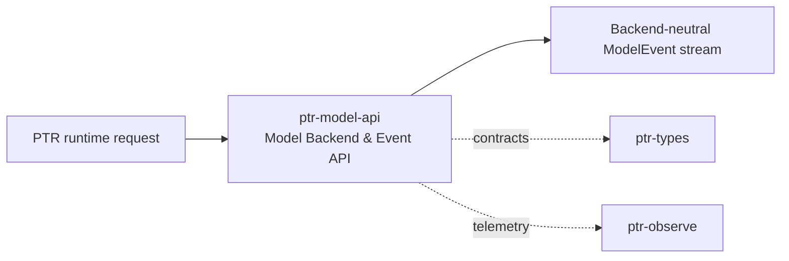

# ptr-model-api — Model Backend & Event API

> **Role:** Keeps the runtime independent of any single inference server or model implementation.  
> **Maturity:** see the generated status below; production behavior must be proven by the linked experiments and component evaluations.

<!-- PTR:STATUS:BEGIN -->
## Current implementation status

> **Generated section.** Source of truth: [`component.toml`](component.toml) plus code-derived metrics from `src/`. Run `python3 scripts/update_component_docs.py --write` after editing implementation metadata. Do not hand-edit inside this block.

**Maturity:** `prototype`  
**Last reviewed:** 2026-10-14  
**Code footprint:** 10 Rust source files · 2559 nonblank source lines · 8 integration-test files · 79 test markers (`#[test]`, `#[tokio::test]`)

### Implemented now

- Backend-neutral ModelRequest with request/revision/raw text
- ModelEvent enum for slot, hypothesis, confidence, typed ReasoningOperator request, typed Pod request, candidate, action, token and completion events
- InferenceBackend trait and ModelError
- KV-reuse P2a taint types: KvReuseReport::digest and ::taint, KvReuseTaint (Exact default, Approximate { report_digest }, join where Approximate dominates and two Approximate keep the smaller digest), Tainted<T> (exact, from_report, map, combine, value, taint, into_exact refusing Approximate with TokenContractError::ApproximateTaint; no setter or downgrading constructor) and ModelRun::taint / into_tainted_events; enforced at the action boundary by ptr-runtime
- Deterministic ReferenceEchoBackend for runtime conformance tests
- ModelObservation, ModelResumeRequest and ResumableInferenceBackend continuation contract
- ModelRequest and ModelResumeRequest carry a ptr_types::SemanticContext (revision plus the exact snapshot entries) instead of a bare revision; revision() reads it back from the context
- ModelEvent::ActionReady carries a full ptr_types::ActionIr (operation, target, capability, effect, input type, generation, revision, payload) instead of an operation string
- ReferenceEchoBackend also implements ResumableInferenceBackend (resume yields Finished)
- ScenarioBackend: a deterministic demonstrator backend named scenario that echoes the raw text as a Token and emits one Mutation ActionIr (create demo-note, capability demo.local-note.create, type ptr.demo-note.v1) at the request's revision; resume yields Finished. Its own doc comment calls it plumbing evidence for the local HTTP/effect path, not a model-quality baseline
- KV-reuse P1 token contract (doc 36): TokenId, Tokenizer trait with TokenizerIdentity, ByteTokenizer (ptr.byte v1, one token per UTF-8 byte), SegmentSource (Raw, Semantic, Memory, Derived), PromptSegment with SHA-256 content_digest and lineage_contribution (Raw carries kind and content digest only), SegmentedModelRequest with tokens() and order-dependent lineage_digest() (covers semantic revision, tokenizer identity and segments), KvReuseMode, KvReusePolicy, KvReuseHint, KvReuseReport (hit_tokens bounded by total, Approximate rejected under ExactOnly), ModelRun and the KvReusingBackend trait; ModelRequest is unchanged. The one non-test implementation is ptr-runtime's CPU ReferenceKvReuseBackend; that Approximate reuse never reaches an effect path is enforced in ptr-runtime (authorize_action and the execution boundary), for runs the host routes through it
- PromptSegment::from_text/from_tokens Semantic, Memory and Derived segments are caller-asserted (documented on the constructors): the crate cannot check that the text is the committed value of its source at its generation; a production path builds Semantic segments with ptr-runtime PtrRuntime::semantic_prompt_segment, and lineages fragment per cited generation
- Structured cancellation: CancellationToken (shared atomic flag; clones share it; a child token is cancelled with any ancestor but never the reverse; dropping a token unlinks its uniquely owned ancestor chain iteratively, so a 1_000_000-deep child() chain drops on a 256 KiB stack, while is_cancelled stays linear in chain depth), Clock with SystemClock and ManualClock, Deadline (budget on an injected clock, exceeded when elapsed > budget) and the typed GenerationError (Cancelled { at_token }, DeadlineExceeded, CapabilityUnsupported, InvalidLimits, StreamClosed, Tokenize, Backend(ModelError)) with From conversions into and out of ModelError
- Synchronous streaming contract: StreamingBackend::open_stream returns a boxed EventStream pull iterator (next_event yields Token, Text, Model, Done { FinishReason::Completed | MaxTokens } or Error); BoundedStream checks cancellation and the deadline before every source step and every delivered event, enforces max_tokens, and keeps a look-ahead buffer of at most buffer_capacity items (limits validated: buffer at most 4096, max_tokens at most 2^20); BoundedStream::new also clamps a directly constructed StreamLimits (public fields bypass StreamLimits::new): buffer_capacity into 1..=4096 and max_tokens into 1..=2^20, and the refill loop and token cap use those effective bounds, so max_tokens of usize::MAX over an endless source still ends with Done { MaxTokens } at 2^20 tokens; collect_stream drains a stream
- InferenceStreamAdapter wraps any existing InferenceBackend as a StreamingBackend (infer still returns its whole Vec at open time; the Token text is then cut into Text chunks lazily, one per pull, so chunk memory is one chunk and stop checks run between chunks; the concatenation equals the non-streamed text) and ReferenceByteStreamingBackend streams one Token per byte through ByteTokenizer; both are deterministic plumbing, not models
- Capability negotiation: BackendCapabilities (max context, streaming, resumable, KvReuseSupport, tokenizer identity, max batch, DType list), CapabilityRequirements (from_request estimates context as raw-text byte length; from_segmented uses the exact token count and tokenizer) and negotiate(), which returns every RejectionReason per rejected backend and picks among the survivors by dtype fidelity, then larger context, then larger batch, then smaller backend id, independent of offer order; empty offers and duplicate ids are typed errors
- TaintedPage and TaintedCatalogEntry carry KvReuseTaint plus per-part lineage and payload digests for cached pages; TaintedPage::join (taint join plus part-set union, bounded at 1024 parts) is commutative, associative and idempotent, and require_exact refuses tainted content with PageTaintError::Tainted naming the pages. Metadata only: no K/V bytes, no ActivationFrame fields
- CheckpointHandle: sealed, versioned (v1), SHA-256 digest-bound state with a byte encoding; verify checks version, then backend id, then digest, with typed CheckpointError variants (the digest is unkeyed integrity, not authentication). CheckpointableBackend (provided methods only) is implemented for ReferenceEchoBackend and ScenarioBackend by exporting the ModelResumeRequest continuation state; resume_from_checkpoint requires the supplied context revision to equal the recorded one

### Missing for the target architecture

- A real Hugging Face tokenizer behind the Tokenizer trait: ByteTokenizer is the only implementation, and the tokenizers-backed tokenizer of ptr-pods' qwen-cpu feature does not implement it
- KV-reuse taint is not carried on ActivationFrame, KV page transport or tier objects (TaintedPage/TaintedCatalogEntry exist here as metadata wrappers but nothing outside this crate uses them yet; ptr-runtime persists its own taint registry as ledger events); a Tainted<T> wrapper can be bypassed by cloning the value out of value(), so it is a discipline for derived values, not a sandbox
- Any KvReusingBackend outside ptr-runtime's CPU reference: the P2 catalog, admission and Raw-segment checks live in ptr-runtime (PtrRuntime::admit_segments), not in this crate, which only offers the raw_from_* constructor split
- Async (tokio/futures) streaming adapter: the streaming contract is a synchronous pull iterator, and the runtime does not consume StreamingBackend yet
- SGLang, vLLM and Burn-native adapters; no real backend implements StreamingBackend or reports BackendCapabilities, and the capability descriptors are not yet wired into ptr-router or ptr-runtime backend selection
- Checkpoint handles carry only observation-based continuation state of the two plumbing backends; no backend exports model state (KV pages, activations), and the handle digest is unkeyed
- Cancellation and deadlines are enforced only by the streaming wrappers here; the existing Vec-returning infer/resume calls and ptr-runtime do not take a CancellationToken or Deadline

### Next milestones

- Route ptr-runtime through StreamingBackend with a CancellationToken and Deadline, and feed BackendCapabilities into backend selection
- Add an async (tokio/futures) adapter over the synchronous EventStream
- Implement first external model adapter after inference-serving evaluation

### Linked experiments

- [M007](../../experiments/model/M007-model-event-stream/README.md) — `planned`
- [E001](../../experiments/system/E001-end-to-end/README.md) — `planned`
- [E003](../../experiments/system/E003-token-efficiency/README.md) — `planned`

### Technology evaluations

- [inference-serving](../../evaluations/components/inference-serving/README.md) — `open`

### Decision records

- [ADR-0004-backend-independence.md](../../research/decisions/ADR-0004-backend-independence.md)
- [ADR-0007-model-event-stream.md](../../research/decisions/ADR-0007-model-event-stream.md)

### Current automated checks

- reference backend request/event conformance test
- typed PodRequested event contract covered by runtime loop tests
- typed ReasoningOperator model event contract test
- observation/resume contract covered by runtime multi-step tests
- KV-reuse token contract tests: ByteTokenizer round trip, digest/lineage sensitivity, pinned lineage digest, request validation, report bound, trivial KvReusingBackend
- tests/kv_taint.rs: report taint follows mode, taint survives two derivation hops, join laws, no downgrade by re-wrapping, Exact released
- workspace fmt/check/test/clippy

<!-- PTR:STATUS:END -->

## Position in PTR

Dedicated diagram source: [`docs/diagrams/components/ptr-model-api.mmd`](../../docs/diagrams/components/ptr-model-api.mmd)

**Upstream:** ptr-types; implemented by in-process backends, no external inference service yet  
**Downstream:** ptr-runtime, ptr-server, ptrd, ptr-bench

## Mission

Keeps the runtime independent of any single inference server or model implementation.

PTR keeps this responsibility in its own crate so the semantics remain stable even when an external library or implementation is replaced.

## Responsibilities

- ModelRequest and ModelEvent contracts
- streaming inference abstraction
- backend capability negotiation
- resume/observation handoff semantics

## Explicit non-responsibilities

- model architecture itself
- provider-specific business logic
- runtime permissions

## Data flow

| Direction | Contract |
|---|---|
| Input | Typed model requests and semantic snapshots |
| Output | Streaming model events |
| Failure | Explicit typed error / rejected state; no silent fallback that changes semantics |
| Observability | Standard PTR tracing fields and a stable component span |

## Technical approach

- Async Rust traits/streams
- vLLM and SGLang remote adapters
- Burn native backend
- future TensorRT/native backends

External projects are **candidates**, not architectural authority. The PTR-owned traits and domain types must remain usable with a replacement backend.

## Core invariants

1. Backends expose capabilities explicitly.
2. The runtime never assumes every backend can emit latent/typed events.
3. Provider output is validated before becoming domain state.

These invariants should be executable wherever possible through unit, property, lifecycle or chaos tests.

## Failure model

The component must fail closed for semantic or effect-safety violations. Infrastructure failures should surface as typed errors that preserve request, revision, generation and provenance context. Retries must be idempotent whenever the operation may cross a process or network boundary.

## Performance model

Measure before optimizing. Benchmarks should record at least latency distribution, throughput, allocations/resident memory, queue depth or working-set size where relevant, and the cost of verification. Performance optimizations may not bypass generation, revision, capability or evidence checks.

## Security and privacy

- Treat external inputs and backend outputs as untrusted until validated.
- Do not put raw secrets/private evidence into generic tracing or inspection.
- Preserve provenance on every promotion from raw/possible evidence to stronger semantic state.
- External effects pass through `ptr-security` even if this component already performed local validation.

## Technology evaluation

- [inference-serving](../../evaluations/components/inference-serving/README.md)

A new candidate should be added with a reproducible benchmark and failure-semantics analysis rather than replacing the default ad hoc.

## Tests required before production use

- Contract/unit tests for all domain transitions.
- Invalid, stale-generation and stale-revision cases.
- Cancellation/retry behavior.
- Property tests for invariants where practical.
- Cross-backend equivalence if more than one backend exists.
- Observability and redaction checks.

## Related architecture

- [System architecture](../../docs/architecture/00-system.md)
- [Technical architecture](../../docs/TECHNICAL_ARCHITECTURE.md)
- [Component contracts](../../docs/COMPONENT_CONTRACTS.md)
- [Global invariants](../../docs/INVARIANTS.md)

