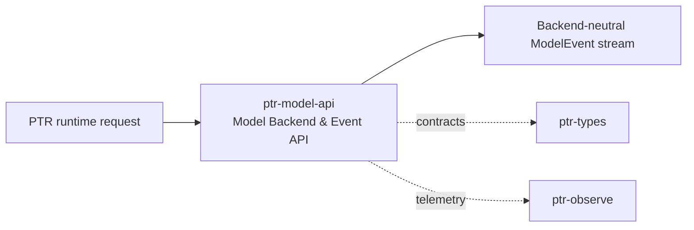

# ptr-model-api — Model Backend & Event API

> **Role:** Keeps the runtime independent of any single inference server or model implementation.  
> **Maturity:** see the generated status below; production behavior must be proven by the linked experiments and component evaluations.

<!-- PTR:STATUS:BEGIN -->
## Current implementation status

> **Generated section.** Source of truth: [`component.toml`](component.toml) plus code-derived metrics from `src/`. Run `python3 scripts/update_component_docs.py --write` after editing implementation metadata. Do not hand-edit inside this block.

**Maturity:** `prototype`  
**Last reviewed:** 2026-10-16  
**Code footprint:** 13 Rust source files · 5049 nonblank source lines · 11 integration-test files · 156 test markers (`#[test]`, `#[tokio::test]`)

### Implemented now

- Backend-neutral ModelRequest with request/revision/raw text
- ModelEvent enum for slot, hypothesis, confidence, typed ReasoningOperator request, typed Pod request, candidate, action, token and completion events
- InferenceBackend trait and ModelError
- KV-reuse P2a taint types: KvReuseReport::digest and ::taint, KvReuseTaint (Exact default, Approximate { report_digest }, join where Approximate dominates and two Approximate keep the smaller digest), Tainted<T> (exact, from_report, map, combine, value, taint, into_exact refusing Approximate with TokenContractError::ApproximateTaint; no setter or downgrading constructor) and ModelRun::taint / into_tainted_events; enforced at the action boundary by ptr-runtime
- Deterministic ReferenceEchoBackend for runtime conformance tests
- ModelObservation, ModelResumeRequest and ResumableInferenceBackend continuation contract
- ModelRequest and ModelResumeRequest carry a ptr_types::SemanticContext (revision plus the exact snapshot entries) instead of a bare revision; revision() reads it back from the context
- ModelEvent::ActionReady carries a full ptr_types::ActionIr (operation, target, capability, effect, input type, generation, revision, payload) instead of an operation string
- ReferenceEchoBackend also implements ResumableInferenceBackend (resume yields Finished)
- ScenarioBackend: a deterministic demonstrator backend named scenario that echoes the raw text as a Token and emits one Mutation ActionIr (create demo-note, capability demo.local-note.create, type ptr.demo-note.v1) at the request's revision; resume yields Finished. Its own doc comment calls it plumbing evidence for the local HTTP/effect path, not a model-quality baseline
- KV-reuse P1 token contract (doc 36): TokenId, Tokenizer trait with TokenizerIdentity, ByteTokenizer (ptr.byte v1, one token per UTF-8 byte), SegmentSource (Raw, Semantic, Memory, Derived), PromptSegment with SHA-256 content_digest and lineage_contribution (Raw carries kind and content digest only), SegmentedModelRequest with tokens() and order-dependent lineage_digest() (covers semantic revision, tokenizer identity and segments), KvReuseMode, KvReusePolicy, KvReuseHint, KvReuseReport (hit_tokens bounded by total, Approximate rejected under ExactOnly), ModelRun and the KvReusingBackend trait; ModelRequest is unchanged. The one non-test implementation is ptr-runtime's CPU ReferenceKvReuseBackend; that Approximate reuse never reaches an effect path is enforced in ptr-runtime (authorize_action and the execution boundary), for runs the host routes through it
- PromptSegment::from_text/from_tokens Semantic, Memory and Derived segments are caller-asserted (documented on the constructors): the crate cannot check that the text is the committed value of its source at its generation; a production path builds Semantic segments with ptr-runtime PtrRuntime::semantic_prompt_segment, and lineages fragment per cited generation
- Structured cancellation: CancellationToken (shared atomic flag; clones share it; a child token is cancelled with any ancestor but never the reverse; dropping a token unlinks its uniquely owned ancestor chain iteratively, so a 1_000_000-deep child() chain drops on a 256 KiB stack, while is_cancelled stays linear in chain depth), Clock with SystemClock and ManualClock, Deadline (budget on an injected clock, exceeded when elapsed > budget) and the typed GenerationError (Cancelled { at_token }, DeadlineExceeded, CapabilityUnsupported, InvalidLimits, StreamClosed, Tokenize, Backend(ModelError)) with From conversions into and out of ModelError (Cancelled and DeadlineExceeded convert to ModelError of kind Cancelled and DeadlineExceeded, message kept, so is_cancelled and is_deadline_exceeded hold; every other variant except Backend is kind Other)
- Synchronous streaming contract: StreamingBackend::open_stream returns a boxed EventStream pull iterator (next_event yields Token, Text, Model, Done { FinishReason::Completed | MaxTokens } or Error); BoundedStream checks cancellation and the deadline before every source step and every delivered event, enforces max_tokens, and keeps a look-ahead buffer of at most buffer_capacity items (limits validated: buffer at most 4096, max_tokens at most 2^20); BoundedStream::new also clamps a directly constructed StreamLimits (public fields bypass StreamLimits::new): buffer_capacity into 1..=4096 and max_tokens into 1..=2^20, and the refill loop and token cap use those effective bounds, so max_tokens of usize::MAX over an endless source still ends with Done { MaxTokens } at 2^20 tokens; collect_stream drains a stream
- InferenceStreamAdapter wraps any existing InferenceBackend as a StreamingBackend (infer still returns its whole Vec at open time; the Token text is then cut into Text chunks lazily, one per pull, so chunk memory is one chunk and stop checks run between chunks; the concatenation equals the non-streamed text) and ReferenceByteStreamingBackend streams one Token per byte through ByteTokenizer; both are deterministic plumbing, not models
- Capability negotiation: BackendCapabilities (max context, streaming, resumable, KvReuseSupport, tokenizer identity, max batch, DType list), CapabilityRequirements (from_request estimates context as raw-text byte length; from_segmented uses the exact token count and tokenizer) and negotiate(), which returns every RejectionReason per rejected backend and picks among the survivors by dtype fidelity, then larger context, then larger batch, then smaller backend id, independent of offer order; empty offers and duplicate ids are typed errors
- TaintedPage and TaintedCatalogEntry carry KvReuseTaint plus per-part lineage and payload digests for cached pages; TaintedPage::join (taint join plus part-set union, bounded at 1024 parts) is commutative, associative and idempotent, and require_exact refuses tainted content with PageTaintError::Tainted naming the pages. Metadata only: no K/V bytes, no ActivationFrame fields
- CheckpointHandle: sealed, versioned (v1), SHA-256 digest-bound state with a byte encoding; verify checks version, then backend id, then digest, with typed CheckpointError variants (the digest is unkeyed integrity, not authentication). CheckpointableBackend (provided methods only) is implemented for ReferenceEchoBackend and ScenarioBackend by exporting the ModelResumeRequest continuation state; resume_from_checkpoint requires the supplied context revision to equal the recorded one; export_checkpoint preflights the encoded length with checked arithmetic and returns StateTooLarge before allocating the state
- AdaptiveBatcher<B: BatchInferenceBackend>: one worker thread, a bounded queue (queue_capacity at most 65536; a full queue answers ModelError::overloaded before anything grows), requests grouped by BatchKey { project, adapter, principal, generation } so different keys (a same-named adapter of another project included) never share a model call, a batch dispatched when it holds max_batch requests, when its oldest request has waited max_wait, or when its tightest deadline is within the margin, the key of the oldest ready request first; a request whose deadline passed or that was cancelled (CancelFlag) is answered without a model call, at the door or in the queue; a BatchGate is asked about the batch's key immediately before every model call (a revoked generation or project is refused at that use, ModelError::revoked), a key that names an adapter is refused when the batcher has no gate (AdaptiveBatcher::new has none, with_parts takes an optional one; there is no admit-all default), and a resume goes through an opaque Continuation: infer_scoped returns the answer with one (not Clone, no public constructor, an unguessable 128-bit id, Debug prints nothing of it), the whole resume context (BatchKey, request id, semantic context, round) lives in a table of at most MAX_OPEN_CONTINUATIONS (4096) with a quota of MAX_CONTINUATIONS_PER_PRINCIPAL (256) per BatchKey.principal keyed by that id (a principal at its quota evicts its own oldest; when the table is full, entries past their deadline or cancelled are swept first and, if it is still full, the new infer_scoped is refused with ModelError::overloaded before the model runs and nothing of another principal is evicted: existing continuations are never lost to others' load, and opens can be refused under load; an evicted continuation fails closed), and resume_continuation(continuation, key, observation) consumes the handle and the entry, refuses a key other than the entry's (and an unknown, evicted or used continuation) with ModelErrorKind::ScopeMismatch, asks the gate about the entry's key and builds the ModelResumeRequest itself from the stored request id, semantic context and round plus the caller's observation, returning the continuation of the next round; The observation is new caller input under the continuation's scope: the gate checks exactly that scope, as for a fresh infer under it, and the batcher cannot see where the caller's bytes came from; what it guarantees is that no stale state is resumed, because request id, semantic context, round and (in the router) placement come only from the table entry, which belongs to exactly one scope; the entry also keeps the admission's deadline and CancelFlag, and every resume path (resume_continuation and the unscoped trait resume) is refused when the batcher is closed (ModelError::closed), past its deadline or cancelled, before and after the gate, without a backend call; dropping a Continuation releases its entry (a weak reference to the table, no cycle) and a run that ended with ModelEvent::Finished opens none; a running resume keeps its entry reserved (in flight: not resumable twice, never evicted or swept) and moves it in place to the next round under a new id, so a successful resume of a still-open run always has its successor and no other principal can take the slot; plain infer and infer_with open no continuation; the unscoped resume of the trait is served only by a batcher built without a gate and is refused with ModelError::revoked when a gate is configured; a resume has the same panic containment as a batch (a panicking backend fails that call as backend_failure); a gate that panics has not admitted the key (the batch or resume is refused as revoked, counted, and the worker keeps serving); a worker that ends for any reason closes the batcher and answers every queued caller with ModelError::closed, so nobody waits on a queue nothing serves; deadlines and cancellations are checked again after the gate, immediately before the backend call, so a request that went stale while the gate decided never reaches the model; a backend panic or a wrong-length answer fails its batch and the batcher keeps serving; every caller gets exactly one answer, also on drop; counters in BatchStats. infer_with takes the per-request BatchAdmission; the plain infer uses the unscoped key and no deadline. The deterministic queue rule (batch_queue) takes the time as an argument and is unit-tested with a virtual clock; infer_scoped reserves one slot of the global capacity atomically before the model runs (entries plus reservations never exceed MAX_OPEN_CONTINUATIONS, so two calls are never both promised the last slot) and applies the principal's quota only when a continuation is committed: an error, a cancellation, an expired deadline, a gate refusal or a run that ended with Finished releases the reservation and evicts nothing; a resume is counted in BatchStats::dispatched immediately before the backend sees it; a reservation is charged to the opening principal and its in-flight reservations may not exceed MAX_CONTINUATIONS_PER_PRINCIPAL (256), so one principal's slow calls cannot take the capacity of others; the closed check is repeated right before the backend resume call; queue age (max_wait) is measured on a monotonic Instant reading while absolute deadlines stay on the batcher clock; the queue keeps readiness incrementally per key (ordered schedules by oldest arrival and tightest deadline, a ready set by oldest request), so one push and one take cost O(log n) schedule operations and never walk the queue; a cancelled request leaves when its group is dispatched; the closed check is also made between the gate and the backend for a batch (the batch is answered Closed, no backend call), and AdaptiveBatcher::close closes a batcher without dropping it and answers every queued caller with closed under the queue lock, also when the worker is stuck in a backend call; infer_scoped checks closed before reserving capacity (a closed batcher with a full table is closed, not overloaded) and refuses a second scoped call under a live request id (reservation, open continuation, resume in flight and successor) with ModelError::duplicate_request before the backend runs, the id being free again when the continuation ends, is dropped, evicted or swept, or the run finished or failed
- ReplicaRouter over Arc<dyn ResumableInferenceBackend> (1 to 64 replicas) under a ReplicaPolicy { max_failover, resume }: round-robin start, failover to at most max_failover other replicas each tried once, by an allowlist on the typed ModelErrorKind (ModelError::allows_failover: only Overloaded and BackendFailure; a refusal of the request itself, kind Other, a passed deadline, a cancellation, a revoked generation and a closed backend end the request, and the message is never read); resume tries one replica unless ResumeFailover::Interchangeable declares the replicas interchangeable for a resume, and infer_placed returns the answer with a per-invocation Placement (not Clone; an unguessable token bound, in a table of at most MAX_OPEN_PLACEMENTS = 4096, to the router, the request id and the semantic context; a full table refuses the call before any replica runs, dropping a placement releases its entry) that resume_placed checks (another router's placement, another request id or another context is ScopeMismatch before any replica runs) and consumes, and answers with the placement of the replica that served it (every round keeps its affinity), so under Never a resume goes to exactly the replica of its own invocation, once, and a request id is live from infer_placed until its run finishes or fails or its placement is dropped (a resume in flight included): a second infer_placed under a live id is refused router-wide with ModelError::duplicate_request (kind DuplicateRequest, no failover) before any replica runs, so a stateful backend never sees two live invocations under one id, and the id is free again afterwards; the plain trait resume carries no placement and takes the rotation's replica; per-replica attempts, failures and failovers; ReplicaRouter(AdaptiveBatcher(backend)) composes; a replica that panics is a failed replica (backend_failure, counted, failed over) and not a failed caller; a run that ended with Finished (infer_placed or resume_placed) creates no placement (PlacedAnswer::placement is an Option) and takes no table slot
- ModelError is a typed error { kind: ModelErrorKind, message } with constructors and predicates for the contract kinds (overloaded, deadline_exceeded, cancelled, revoked, closed, scope_mismatch, duplicate_request, backend_failure) and ModelError::new(message) for any other failure (kind Other); the old tuple field is gone, so code built ModelError(String) now calls ModelError::new and reads message()

### Missing for the target architecture

- A real Hugging Face tokenizer behind the Tokenizer trait: ByteTokenizer is the only implementation, and the tokenizers-backed tokenizer of ptr-pods' qwen-cpu feature does not implement it
- KV-reuse taint is not carried on ActivationFrame, KV page transport or tier objects (TaintedPage/TaintedCatalogEntry exist here as metadata wrappers but nothing outside this crate uses them yet; ptr-runtime persists its own taint registry as ledger events); a Tainted<T> wrapper can be bypassed by cloning the value out of value(), so it is a discipline for derived values, not a sandbox
- Any KvReusingBackend outside ptr-runtime's CPU reference: the P2 catalog, admission and Raw-segment checks live in ptr-runtime (PtrRuntime::admit_segments), not in this crate, which only offers the raw_from_* constructor split
- Async (tokio/futures) streaming adapter: the streaming contract is a synchronous pull iterator, and the runtime does not consume StreamingBackend yet
- SGLang, vLLM and Burn-native adapters; no real backend implements StreamingBackend or reports BackendCapabilities, and the capability descriptors are not yet wired into ptr-router or ptr-runtime backend selection
- Checkpoint handles carry only observation-based continuation state of the two plumbing backends; no backend exports model state (KV pages, activations), and the handle digest is unkeyed
- Cancellation and deadlines are enforced only by the streaming wrappers here; the existing Vec-returning infer/resume calls and ptr-runtime do not take a CancellationToken or Deadline
- AdaptiveBatcher is not wired into ptrd or ptr-config ([model.batch] and [model.replicas] do not exist): ptr-server serializes requests behind the runtime lock, so a batcher in front of it would only queue; the lock restructuring (model call outside the lock, commit inside) is not done
- ModelRequest carries neither a deadline nor a batch key (adding fields would touch every struct literal, about 70 across 40 files); the scoped path is AdaptiveBatcher::infer_with
- No backend implements infer_batch with a batched forward pass, so the default sequential loop gains nothing; the throughput gain of batching is unmeasured, and the experiment that would measure it, E014-adaptive-batching, is planned with no entrypoint (it cannot be frozen until the server calls the model outside its runtime lock)
- ReplicaRouter failover does not carry the request deadline, and the replicas must serve one model: a resume that starts at the next replica in rotation, not at the one that served the infer, is correct only for replicas declared interchangeable; and a batcher refuses a resume of a request id it did not serve, so behind a router a resume works only when rotation reaches the batcher that served the infer

### Next milestones

- Route ptr-runtime through StreamingBackend with a CancellationToken and Deadline, and feed BackendCapabilities into backend selection
- Add an async (tokio/futures) adapter over the synchronous EventStream
- Implement first external model adapter after inference-serving evaluation
- Move the model call out of ptr-server's runtime lock (call outside, commit inside, generation checked at the commit) and then wire AdaptiveBatcher and ReplicaRouter into ptrd with [model.batch] and [model.replicas]
- Build and run E014-adaptive-batching (baseline: no batcher; batch-size, wait and deadline ablations, a batch-cost sensitivity control, an oracle ceiling) once the server-lock restructuring exists

### Linked experiments

- [M007](../../experiments/model/M007-model-event-stream/README.md) — `planned`
- [E001](../../experiments/system/E001-end-to-end/README.md) — `planned`
- [E003](../../experiments/system/E003-token-efficiency/README.md) — `planned`

### Technology evaluations

- [inference-serving](../../evaluations/components/inference-serving/README.md) — `open`

### Decision records

- [ADR-0004-backend-independence.md](../../research/decisions/ADR-0004-backend-independence.md)
- [ADR-0007-model-event-stream.md](../../research/decisions/ADR-0007-model-event-stream.md)

### Current automated checks

- reference backend request/event conformance test
- typed PodRequested event contract covered by runtime loop tests
- typed ReasoningOperator model event contract test
- observation/resume contract covered by runtime multi-step tests
- KV-reuse token contract tests: ByteTokenizer round trip, digest/lineage sensitivity, pinned lineage digest, request validation, report bound, trivial KvReusingBackend
- tests/kv_taint.rs: report taint follows mode, taint survives two derivation hops, join laws, no downgrade by re-wrapping, Exact released
- workspace fmt/check/test/clippy
- src/batch_queue.rs tests: a full queue refuses before it grows, a batch waits for max_wait unless full, keys never share a batch, the oldest ready key is served first, a tight deadline dispatches early, an expired or cancelled request never reaches a batch, a batch never exceeds max_batch; a queue of 60000 distinct keys is scanned in linear time (one pass builds the groups); waiting is judged on the monotonic reading and deadlines on the wall reading, each turned into a distance from now; 65,536 arrivals on distinct keys, each followed by a take, and the drain of all of them stay within a bounded number of schedule operations (an operation counter, not wall-clock time)
- tests/batch.rs: concurrent requests share one model call, a lone request is served after max_wait, different keys never share a call, a full queue answers overloaded at once, a passed deadline is refused before the model and one that passes in the queue drops the request unserved, a cancelled request is dropped, a generation revoked while a request waited is refused at dispatch, a backend panic and a wrong-length answer fail the batch without stopping the batcher, an out-of-range policy is refused by field, the debug form prints no prompt; a revoked project's request does not ride with another project's live one of the same adapter name and is refused at dispatch; a key naming an adapter is refused when no gate vouches for it; a closed gate stops a resume_with; a resume runs on the stored request id, semantic context and round and never on the caller's (the observation's own revision does not reach the context; the next continuation carries round 2); a continuation from a revoked scope is refused by the gate, one claimed under another scope's key is a ScopeMismatch, and each continuation is single-use; the open continuations are bounded and an evicted one fails closed; 5000 continuations of one principal evict none of another principal's, which still resumes, while the flooding principal's own oldest fails closed; 4096 opens under 4096 distinct principals displace no victim and the next open is refused, and an expired deadline frees a slot again; 5000 plain infer calls evict no continuation; a closed gate stops a resume; a deadline that passes, or a cancellation that lands, while the gate decides keeps the request from the backend; a panicking backend resume fails that call and the batcher keeps serving; a gate that panics refuses the batch and the resume as revoked and the worker keeps serving; a worker killed by a panicking clock closes the batcher and answers the waiting callers with closed; a resume after the deadline or a cancellation never reaches the backend; every resume path is Closed once the worker has ended and the backend gets no call; 4096 dropped handles free the table again; a run that finished opens no continuation; a full table, a slow resume and a concurrent open from another principal: the open is refused and the resume keeps its successor; the last slot is reserved before the model runs (one of two concurrent calls is refused before the backend and the other keeps its continuation); cancelled, expired and finished requests at the principal's quota evict nothing; the dispatched and backend_errors counters after a resume succeeds and fails; 256 slow calls of one principal in flight refuse its next call and do not block another principal; a batcher closed while the gate decides never reaches the backend; a wall clock stepped back by a day does not stretch max_wait; a batcher closed while the gate decides a batch never calls the backend; a live request id is refused before the backend (also while the first run is inside the model, under another scope, and through a resume and its successor) and is free after the continuation is dropped, after a finished run and after a refused one; a closed batcher with a full table answers closed and counts no overload; close answers a queued caller while the worker is blocked in the backend; cancelled waiters are reclaimed (and answered cancelled) before a full queue refuses a live request, while the worker is still in the backend
- tests/replica.rs: rotation, failover counted per replica, failover bounded with each replica tried once, only overload and backend failure fail over (a refusal of the request itself, kind Other, is not repeated, and a message that looks like overload does not make it so), deadline, cancellation, revocation and closure end the request, resume does not fail over unless declared interchangeable and infer still does, replica-count bounds, composition over a batcher; a panicking replica fails over and is counted, and alone it yields a typed error; a placed resume without failover lands on the replica of its own invocation in three rounds in a row, for two live invocations under distinct ids; a second infer_placed under a live id is refused as DuplicateRequest before any replica runs (also while its resume is in flight, and across resume rounds), the first still resumes on its own replica, and the id is free after the placement is dropped, after a failed run and after a finished run; placements of two invocations cannot be swapped (different contexts), another router's placement and another request id are refused, and each correct placement routes to its own replica; 4096 open placements refuse the next call before any replica runs and dropping them frees the table; 5000 finished runs, and 5000 resumes that finish, never fill the placement table

<!-- PTR:STATUS:END -->

## Position in PTR

Dedicated diagram source: [`docs/diagrams/components/ptr-model-api.mmd`](../../docs/diagrams/components/ptr-model-api.mmd)

**Upstream:** ptr-types; implemented by in-process backends, no external inference service yet  
**Downstream:** ptr-runtime, ptr-server, ptrd, ptr-bench

## Mission

Keeps the runtime independent of any single inference server or model implementation.

PTR keeps this responsibility in its own crate so the semantics remain stable even when an external library or implementation is replaced.

## Responsibilities

- ModelRequest and ModelEvent contracts
- streaming inference abstraction
- backend capability negotiation
- resume/observation handoff semantics

## Explicit non-responsibilities

- model architecture itself
- provider-specific business logic
- runtime permissions

## Data flow

| Direction | Contract |
|---|---|
| Input | Typed model requests and semantic snapshots |
| Output | Streaming model events |
| Failure | Explicit typed error / rejected state; no silent fallback that changes semantics |
| Observability | Standard PTR tracing fields and a stable component span |

## Technical approach

- Async Rust traits/streams
- vLLM and SGLang remote adapters
- Burn native backend
- future TensorRT/native backends

External projects are **candidates**, not architectural authority. The PTR-owned traits and domain types must remain usable with a replacement backend.

## Core invariants

1. Backends expose capabilities explicitly.
2. The runtime never assumes every backend can emit latent/typed events.
3. Provider output is validated before becoming domain state.

These invariants should be executable wherever possible through unit, property, lifecycle or chaos tests.

## Failure model

The component must fail closed for semantic or effect-safety violations. Infrastructure failures should surface as typed errors that preserve request, revision, generation and provenance context. Retries must be idempotent whenever the operation may cross a process or network boundary.

## Performance model

Measure before optimizing. Benchmarks should record at least latency distribution, throughput, allocations/resident memory, queue depth or working-set size where relevant, and the cost of verification. Performance optimizations may not bypass generation, revision, capability or evidence checks.

## Security and privacy

- Treat external inputs and backend outputs as untrusted until validated.
- Do not put raw secrets/private evidence into generic tracing or inspection.
- Preserve provenance on every promotion from raw/possible evidence to stronger semantic state.
- External effects pass through `ptr-security` even if this component already performed local validation.

## Technology evaluation

- [inference-serving](../../evaluations/components/inference-serving/README.md)

A new candidate should be added with a reproducible benchmark and failure-semantics analysis rather than replacing the default ad hoc.

## Tests required before production use

- Contract/unit tests for all domain transitions.
- Invalid, stale-generation and stale-revision cases.
- Cancellation/retry behavior.
- Property tests for invariants where practical.
- Cross-backend equivalence if more than one backend exists.
- Observability and redaction checks.

## Related architecture

- [System architecture](../../docs/architecture/00-system.md)
- [Technical architecture](../../docs/TECHNICAL_ARCHITECTURE.md)
- [Component contracts](../../docs/COMPONENT_CONTRACTS.md)
- [Global invariants](../../docs/INVARIANTS.md)

