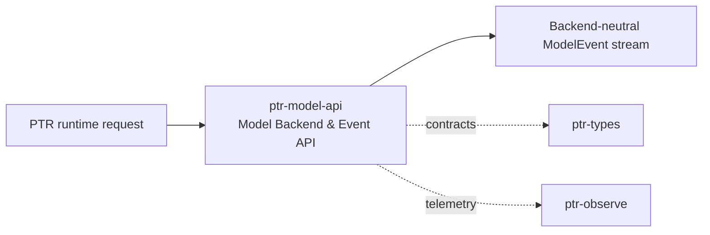

# ptr-model-api — Model Backend & Event API

> **Role:** Keeps the runtime independent of any single inference server or model implementation.  
> **Maturity:** see the generated status below; production behavior must be proven by the linked experiments and component evaluations.

<!-- PTR:STATUS:BEGIN -->
## Current implementation status

> **Generated section.** Source of truth: [`component.toml`](component.toml) plus code-derived metrics from `src/`. Run `python3 scripts/update_component_docs.py --write` after editing implementation metadata. Do not hand-edit inside this block.

**Maturity:** `scaffold`  
**Last reviewed:** 2026-10-14  
**Code footprint:** 8 Rust source files · 1986 nonblank source lines · 7 integration-test files · 64 test markers (`#[test]`, `#[tokio::test]`)

### Implemented now

- Backend-neutral ModelRequest with request/revision/raw text
- ModelEvent enum for slot, hypothesis, confidence, typed ReasoningOperator request, typed Pod request, candidate, action, token and completion events
- InferenceBackend trait and ModelError
- KV-reuse P2a taint types: KvReuseReport::digest and ::taint, KvReuseTaint (Exact default, Approximate { report_digest }, join where Approximate dominates and two Approximate keep the smaller digest), Tainted<T> (exact, from_report, map, combine, value, taint, into_exact refusing Approximate with TokenContractError::ApproximateTaint; no setter or downgrading constructor) and ModelRun::taint / into_tainted_events; enforced at the action boundary by ptr-runtime
- Deterministic ReferenceEchoBackend for runtime conformance tests
- ModelObservation, ModelResumeRequest and ResumableInferenceBackend continuation contract
- ModelRequest and ModelResumeRequest carry a ptr_types::SemanticContext (revision plus the exact snapshot entries) instead of a bare revision; revision() reads it back from the context
- ModelEvent::ActionReady carries a full ptr_types::ActionIr (operation, target, capability, effect, input type, generation, revision, payload) instead of an operation string
- ReferenceEchoBackend also implements ResumableInferenceBackend (resume yields Finished)
- ScenarioBackend: a deterministic demonstrator backend named scenario that echoes the raw text as a Token and emits one Mutation ActionIr (create demo-note, capability demo.local-note.create, type ptr.demo-note.v1) at the request's revision; resume yields Finished. Its own doc comment calls it plumbing evidence for the local HTTP/effect path, not a model-quality baseline
- KV-reuse P1 token contract (doc 36): TokenId, Tokenizer trait with TokenizerIdentity, ByteTokenizer (ptr.byte v1, one token per UTF-8 byte), SegmentSource (Raw, Semantic, Memory, Derived), PromptSegment with SHA-256 content_digest and lineage_contribution (Raw carries kind and content digest only), SegmentedModelRequest with tokens() and order-dependent lineage_digest() (covers semantic revision, tokenizer identity and segments), KvReuseMode, KvReusePolicy, KvReuseHint, KvReuseReport (hit_tokens bounded by total, Approximate rejected under ExactOnly), ModelRun and the KvReusingBackend trait; ModelRequest is unchanged. The one non-test implementation is ptr-runtime's CPU ReferenceKvReuseBackend; that Approximate reuse never reaches an effect path is enforced in ptr-runtime (authorize_action and the execution boundary), for runs the host routes through it
- PromptSegment::from_text/from_tokens Semantic, Memory and Derived segments are caller-asserted (documented on the constructors): the crate cannot check that the text is the committed value of its source at its generation; a production path builds Semantic segments with ptr-runtime PtrRuntime::semantic_prompt_segment, and lineages fragment per cited generation
- AdaptiveBatcher<B: BatchInferenceBackend>: one worker thread, a bounded queue (queue_capacity at most 65536; a full queue answers ModelError::overloaded before anything grows), requests grouped by BatchKey { project, adapter, principal, generation } so different keys (a same-named adapter of another project included) never share a model call, a batch dispatched when it holds max_batch requests, when its oldest request has waited max_wait, or when its tightest deadline is within the margin, the key of the oldest ready request first; a request whose deadline passed or that was cancelled (CancelFlag) is answered without a model call, at the door or in the queue; a BatchGate is asked about the batch's key immediately before every model call (a revoked generation or project is refused at that use, ModelError::revoked), a key that names an adapter is refused when the batcher has no gate (AdaptiveBatcher::new has none, with_parts takes an optional one; there is no admit-all default), and a resume goes through the gate under the scoped key its request was admitted under (remembered by request id for the most recent 4096 requests, the unscoped key for a request the batcher never saw; resume_with takes the key explicitly), so a generation revoked since the infer stops the resume; deadlines and cancellations are checked again after the gate, immediately before the backend call, so a request that went stale while the gate decided never reaches the model; a backend panic or a wrong-length answer fails its batch and the batcher keeps serving; every caller gets exactly one answer, also on drop; counters in BatchStats. infer_with takes the per-request BatchAdmission; the plain infer uses the unscoped key and no deadline. The deterministic queue rule (batch_queue) takes the time as an argument and is unit-tested with a virtual clock
- ReplicaRouter over Arc<dyn ResumableInferenceBackend> (1 to 64 replicas) under a ReplicaPolicy { max_failover, resume }: round-robin start, failover to at most max_failover other replicas each tried once, by an allowlist on the typed ModelErrorKind (ModelError::allows_failover: only Overloaded and BackendFailure; a refusal of the request itself, kind Other, a passed deadline, a cancellation, a revoked generation and a closed backend end the request, and the message is never read); resume tries one replica unless ResumeFailover::Interchangeable declares the replicas interchangeable for a resume; per-replica attempts, failures and failovers; ReplicaRouter(AdaptiveBatcher(backend)) composes
- ModelError is a typed error { kind: ModelErrorKind, message } with constructors and predicates for the contract kinds (overloaded, deadline_exceeded, cancelled, revoked, closed, backend_failure) and ModelError::new(message) for any other failure (kind Other); the old tuple field is gone, so code built ModelError(String) now calls ModelError::new and reads message()

### Missing for the target architecture

- A real Hugging Face tokenizer behind the Tokenizer trait: ByteTokenizer is the only implementation, and the tokenizers-backed tokenizer of ptr-pods' qwen-cpu feature does not implement it
- KV-reuse taint is not carried with cached pages or catalog entries, on ActivationFrame, KV page transport or tier objects (ptr-runtime persists the taint registry as ledger events and contains tainted Pod outputs, see its component record); a Tainted<T> wrapper can be bypassed by cloning the value out of value(), so it is a discipline for derived values, not a sandbox
- Any KvReusingBackend outside ptr-runtime's CPU reference: the P2 catalog, admission and Raw-segment checks live in ptr-runtime (PtrRuntime::admit_segments), not in this crate, which only offers the raw_from_* constructor split
- Async streaming backend contract
- Backend capability negotiation
- SGLang, vLLM and Burn-native adapters
- Backend checkpoint/state handles beyond observation-based continuation
- Structured cancellation and timeout semantics
- AdaptiveBatcher is not wired into ptrd or ptr-config ([model.batch] and [model.replicas] do not exist): ptr-server serializes requests behind the runtime lock, so a batcher in front of it would only queue; the lock restructuring (model call outside the lock, commit inside) is not done
- ModelRequest carries neither a deadline nor a batch key (adding fields would touch every struct literal, about 70 across 40 files); the scoped path is AdaptiveBatcher::infer_with
- No backend implements infer_batch with a batched forward pass, so the default sequential loop gains nothing; the throughput gain of batching is unmeasured, and the experiment that would measure it, E014-adaptive-batching, is planned with no entrypoint (it cannot be frozen until the server calls the model outside its runtime lock)
- ReplicaRouter failover does not carry the request deadline, and the replicas must serve one model: a resume that starts at the next replica in rotation, not at the one that served the infer, is correct only for replicas declared interchangeable

### Next milestones

- Convert infer/resume from Vec-returning sync calls to cancellable async streams
- Add backend capability descriptor
- Implement first external model adapter after inference-serving evaluation
- Move the model call out of ptr-server's runtime lock (call outside, commit inside, generation checked at the commit) and then wire AdaptiveBatcher and ReplicaRouter into ptrd with [model.batch] and [model.replicas]
- Build and run E014-adaptive-batching (baseline: no batcher; batch-size, wait and deadline ablations, a batch-cost sensitivity control, an oracle ceiling) once the server-lock restructuring exists

### Linked experiments

- [M007](../../experiments/model/M007-model-event-stream/README.md) — `planned`
- [E001](../../experiments/system/E001-end-to-end/README.md) — `planned`
- [E003](../../experiments/system/E003-token-efficiency/README.md) — `planned`

### Technology evaluations

- [inference-serving](../../evaluations/components/inference-serving/README.md) — `open`

### Decision records

- [ADR-0004-backend-independence.md](../../research/decisions/ADR-0004-backend-independence.md)
- [ADR-0007-model-event-stream.md](../../research/decisions/ADR-0007-model-event-stream.md)

### Current automated checks

- reference backend request/event conformance test
- typed PodRequested event contract covered by runtime loop tests
- typed ReasoningOperator model event contract test
- observation/resume contract covered by runtime multi-step tests
- KV-reuse token contract tests: ByteTokenizer round trip, digest/lineage sensitivity, pinned lineage digest, request validation, report bound, trivial KvReusingBackend
- tests/kv_taint.rs: report taint follows mode, taint survives two derivation hops, join laws, no downgrade by re-wrapping, Exact released
- workspace fmt/check/test/clippy
- src/batch_queue.rs tests: a full queue refuses before it grows, a batch waits for max_wait unless full, keys never share a batch, the oldest ready key is served first, a tight deadline dispatches early, an expired or cancelled request never reaches a batch, a batch never exceeds max_batch
- tests/batch.rs: concurrent requests share one model call, a lone request is served after max_wait, different keys never share a call, a full queue answers overloaded at once, a passed deadline is refused before the model and one that passes in the queue drops the request unserved, a cancelled request is dropped, a generation revoked while a request waited is refused at dispatch, a backend panic and a wrong-length answer fail the batch without stopping the batcher, an out-of-range policy is refused by field, the debug form prints no prompt; a revoked project's request does not ride with another project's live one of the same adapter name and is refused at dispatch; a key naming an adapter is refused when no gate vouches for it; a closed gate stops a resume; a resume is refused after the generation of its infer was revoked (the unscoped key would still be admitted) and resume_with asks the gate about exactly the given key; a deadline that passes, or a cancellation that lands, while the gate decides keeps the request from the backend
- tests/replica.rs: rotation, failover counted per replica, failover bounded with each replica tried once, only overload and backend failure fail over (a refusal of the request itself, kind Other, is not repeated, and a message that looks like overload does not make it so), deadline, cancellation, revocation and closure end the request, resume does not fail over unless declared interchangeable and infer still does, replica-count bounds, composition over a batcher

<!-- PTR:STATUS:END -->

## Position in PTR

Dedicated diagram source: [`docs/diagrams/components/ptr-model-api.mmd`](../../docs/diagrams/components/ptr-model-api.mmd)

**Upstream:** ptr-types; implemented by in-process backends, no external inference service yet  
**Downstream:** ptr-runtime, ptr-server, ptrd, ptr-bench

## Mission

Keeps the runtime independent of any single inference server or model implementation.

PTR keeps this responsibility in its own crate so the semantics remain stable even when an external library or implementation is replaced.

## Responsibilities

- ModelRequest and ModelEvent contracts
- streaming inference abstraction
- backend capability negotiation
- resume/observation handoff semantics

## Explicit non-responsibilities

- model architecture itself
- provider-specific business logic
- runtime permissions

## Data flow

| Direction | Contract |
|---|---|
| Input | Typed model requests and semantic snapshots |
| Output | Streaming model events |
| Failure | Explicit typed error / rejected state; no silent fallback that changes semantics |
| Observability | Standard PTR tracing fields and a stable component span |

## Technical approach

- Async Rust traits/streams
- vLLM and SGLang remote adapters
- Burn native backend
- future TensorRT/native backends

External projects are **candidates**, not architectural authority. The PTR-owned traits and domain types must remain usable with a replacement backend.

## Core invariants

1. Backends expose capabilities explicitly.
2. The runtime never assumes every backend can emit latent/typed events.
3. Provider output is validated before becoming domain state.

These invariants should be executable wherever possible through unit, property, lifecycle or chaos tests.

## Failure model

The component must fail closed for semantic or effect-safety violations. Infrastructure failures should surface as typed errors that preserve request, revision, generation and provenance context. Retries must be idempotent whenever the operation may cross a process or network boundary.

## Performance model

Measure before optimizing. Benchmarks should record at least latency distribution, throughput, allocations/resident memory, queue depth or working-set size where relevant, and the cost of verification. Performance optimizations may not bypass generation, revision, capability or evidence checks.

## Security and privacy

- Treat external inputs and backend outputs as untrusted until validated.
- Do not put raw secrets/private evidence into generic tracing or inspection.
- Preserve provenance on every promotion from raw/possible evidence to stronger semantic state.
- External effects pass through `ptr-security` even if this component already performed local validation.

## Technology evaluation

- [inference-serving](../../evaluations/components/inference-serving/README.md)

A new candidate should be added with a reproducible benchmark and failure-semantics analysis rather than replacing the default ad hoc.

## Tests required before production use

- Contract/unit tests for all domain transitions.
- Invalid, stale-generation and stale-revision cases.
- Cancellation/retry behavior.
- Property tests for invariants where practical.
- Cross-backend equivalence if more than one backend exists.
- Observability and redaction checks.

## Related architecture

- [System architecture](../../docs/architecture/00-system.md)
- [Technical architecture](../../docs/TECHNICAL_ARCHITECTURE.md)
- [Component contracts](../../docs/COMPONENT_CONTRACTS.md)
- [Global invariants](../../docs/INVARIANTS.md)

