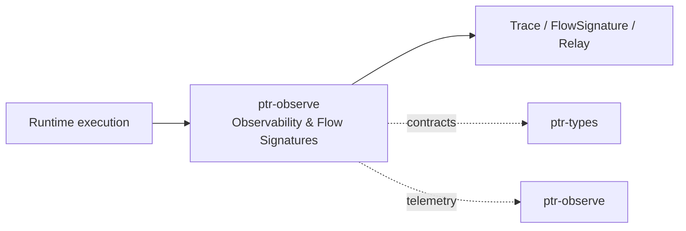

# ptr-observe — Observability & Flow Signatures

> **Role:** Records structured runtime execution without requiring natural-language chain-of-thought logging.  
> **Maturity:** see the generated status below; production behavior must be proven by the linked experiments and component evaluations.

<!-- PTR:STATUS:BEGIN -->
## Current implementation status

> **Generated section.** Source of truth: [`component.toml`](component.toml) plus code-derived metrics from `src/`. Run `python3 scripts/update_component_docs.py --write` after editing implementation metadata. Do not hand-edit inside this block.

**Maturity:** `prototype`  
**Last reviewed:** 2026-10-14  
**Code footprint:** 14 Rust source files · 2629 nonblank source lines · 11 integration-test files · 70 test markers (`#[test]`, `#[tokio::test]`)

### Implemented now

- Standard PTR tracing field names including operation/outcome/error/expected/actual/latency fields
- FlowSignature with request/operators/state transitions
- Backend-neutral TraceEvent, TraceLevel and typed TraceValue structures
- TraceSink port with infallible NoopTraceSink reference implementation
- Typed TraceError variants with stable machine-readable error codes
- Feature-gated tracing 0.1 adapter implementing the PTR TraceSink contract
- Unit tests beside source modules plus thematic integration tests with shared tests/common fixtures
- Lazy trace-field iteration with impl Iterator, closure-based match-guard filtering and fallible try_for_each traversal
- Internal macro_rules-generated TraceValue conversions plus public hygienic trace_event! builder macro
- Bounded span model: deterministic seeded TraceId/SpanId generator, Tracer with injectable monotonic Clock (ManualClock for tests), RAII SpanGuard, events attached to spans, typed SpanError for open-span/parent limits and counted drops/truncation for finished-span ring, fields, events and value length
- RedactingSink<S: TraceSink>: case-insensitive substring key deny-list (password, secret, token, api_key, authorization, cookie, dsn, private_key, ...) plus value heuristics (Bearer/Basic, URL passwords, PEM private keys, JWT shape, known credential prefixes, long hex / high-entropy tokens) applied before any inner sink sees an event
- Value heuristics cover every text-carrying TraceValue variant (String and RequestId, since clients may supply any string as a request id); a secret-looking RequestId is replaced by the [REDACTED] string in both RedactingSink and the OTLP-JSON exporter (shared Redactor::redact_fields)
- Tracer bounds every text-carrying field value (String and RequestId, exhaustive match) to max_value_len before retaining it, counting truncations
- Tracer classifies over-limit field keys (key deny-list on the full key) and over-limit text (field values, request ids, span/event names, error messages; secret heuristics on the full text) with a default-policy Redactor before truncating, and stores REDACTED instead, so max_value_len cannot shorten away the signal a later exporter redactor needs
- MemorySink bounded ring (capacity clamped to MAX_MEMORY_SINK_CAPACITY = 65536, so a usize::MAX host config cannot disable eviction), FanoutSink, and deterministic counter-based per-level 1-in-N SamplingSink
- OtlpJsonFileExporter: hand-written, redacting JSON-lines file writer following the OTLP/JSON trace field layout (resourceSpans/scopeSpans/spans); not an OpenTelemetry SDK, collector or network exporter
- OtlpJsonFileExporter append rollback: a failed or partial line write (write/flush) is truncated back to the pre-call file length so the append-only JSONL never keeps a fragment; if the truncate also fails the exporter (and every clone) is poisoned and returns TraceError::ExporterPoisoned until re-created; the exporter has no byte cap or dropped-export counter, so there is no accounting to adjust
- Tracer::new clamps every TracerLimits field (open spans, finished spans, fields per event, events per span, value length) to a public TracerLimits::HARD_MAX_* constant; TracerLimits::clamped exposes the same rule
- OtlpJsonFileExporter serializes open, length measurement, append and rollback across clones with a shared lock, so one clone's rollback cannot truncate away another clone's successful append
- PlanRecord plus deterministic plan-vs-execution correlator over spans tagged ptr.plan_step reporting Executed/Skipped/OutOfOrder/Failed/Unplanned per step with a summary
- Tracer::active_tree: open-span tree snapshot with ages relative to the clock, text rendering and stuck-span detection (std-only stand-in for async-backtrace, covers only instrumented spans); StuckSpan paths are capped at 16 names and 4096 ancestor-name bytes with an explicit path_truncated flag, so the stuck report stays linear in open spans

### Missing for the target architecture

- Subscriber/layer setup and exporter integration beyond the tracing sink adapter and the OTLP-JSON file writer
- OpenTelemetry SDK/collector (OTLP network) integration and NeMo Relay exporters
- Real async-backtrace of arbitrary futures (only explicitly instrumented spans appear in the active tree)
- Redaction is heuristic: low-entropy or short secrets under non-denied keys are not detected, and hex digests are over-redacted
- No instrumentation of runtime/execution/Pod/verifier boundaries yet

### Next milestones

- Instrument request/execution/Pod/verifier boundaries
- Wire Tracer, RedactingSink and plan correlation into ptr-runtime request lifecycle
- Feed FlowSignature + runtime trace into feedback trajectories

### Linked experiments

- [F001](../../experiments/feedback/F001-generate-verify-repair/README.md) — `frozen`
- [E003](../../experiments/system/E003-token-efficiency/README.md) — `planned`

### Technology evaluations

- [observability](../../evaluations/components/observability/README.md) — `open`

### Decision records

- [ADR-0001-rust-runtime.md](../../research/decisions/ADR-0001-rust-runtime.md)
- [ADR-0010-component-docs-as-code.md](../../research/decisions/ADR-0010-component-docs-as-code.md)

### Current automated checks

- typed trace event expected/actual value test
- namespaced tracing field test
- feature-gated tracing adapter emission test
- unit tests for trace construction, iterator adapters/closures, fallible traversal, sink behavior and stable error codes/messages
- integration tests share deterministic fixture code through tests/common/mod.rs
- integration tests exercise exported macro expansion and generated TraceValue conversions
- span lifecycle, nesting, bounds, redaction (keys, value heuristics, no plaintext via Debug), sampling determinism, OTLP-JSON shape (parsed back by a test-only JSON parser), plan correlation outcomes and active-tree/stuck detection tests
- workspace fmt/check/test/clippy; guarded matches filter checked during merge review

<!-- PTR:STATUS:END -->

## Position in PTR

Dedicated diagram source: [`docs/diagrams/components/ptr-observe.mmd`](../../docs/diagrams/components/ptr-observe.mmd)

**Upstream:** ptr-types  
**Downstream:** none yet (no crate consumes it)

## Mission

Records structured runtime execution without requiring natural-language chain-of-thought logging.

PTR keeps this responsibility in its own crate so the semantics remain stable even when an external library or implementation is replaced.

## Responsibilities

- standard tracing fields
- span hierarchy
- FlowSignature
- OTel/Relay export
- latency and resource telemetry

## Explicit non-responsibilities

- generic object inspection
- business-state persistence
- authorization

## Data flow

| Direction | Contract |
|---|---|
| Input | Runtime spans, events, model/operator metadata |
| Output | Structured traces, flow signatures and exported telemetry |
| Failure | Explicit typed error / rejected state; no silent fallback that changes semantics |
| Observability | Standard PTR tracing fields and a stable component span |

## Technical approach

- tokio-rs/tracing
- OpenTelemetry
- NeMo Relay trajectory export
- async-backtrace for selective diagnostics

External projects are **candidates**, not architectural authority. The PTR-owned traits and domain types must remain usable with a replacement backend.

## Core invariants

1. Sensitive values are redacted before export.
2. Tracing metadata distinguishes plan from actual execution.
3. Observability failure cannot block hard safety checks.

These invariants should be executable wherever possible through unit, property, lifecycle or chaos tests.

## Failure model

The component must fail closed for semantic or effect-safety violations. Infrastructure failures should surface as typed errors that preserve request, revision, generation and provenance context. Retries must be idempotent whenever the operation may cross a process or network boundary.

## Performance model

Measure before optimizing. Benchmarks should record at least latency distribution, throughput, allocations/resident memory, queue depth or working-set size where relevant, and the cost of verification. Performance optimizations may not bypass generation, revision, capability or evidence checks.

## Security and privacy

- Treat external inputs and backend outputs as untrusted until validated.
- Do not put raw secrets/private evidence into generic tracing or inspection.
- Preserve provenance on every promotion from raw/possible evidence to stronger semantic state.
- External effects pass through `ptr-security` even if this component already performed local validation.

## Technology evaluation

- [observability](../../evaluations/components/observability/README.md)

A new candidate should be added with a reproducible benchmark and failure-semantics analysis rather than replacing the default ad hoc.

## Tests required before production use

- Contract/unit tests for all domain transitions.
- Invalid, stale-generation and stale-revision cases.
- Cancellation/retry behavior.
- Property tests for invariants where practical.
- Cross-backend equivalence if more than one backend exists.
- Observability and redaction checks.

## Related architecture

- [System architecture](../../docs/architecture/00-system.md)
- [Technical architecture](../../docs/TECHNICAL_ARCHITECTURE.md)
- [Component contracts](../../docs/COMPONENT_CONTRACTS.md)
- [Global invariants](../../docs/INVARIANTS.md)

