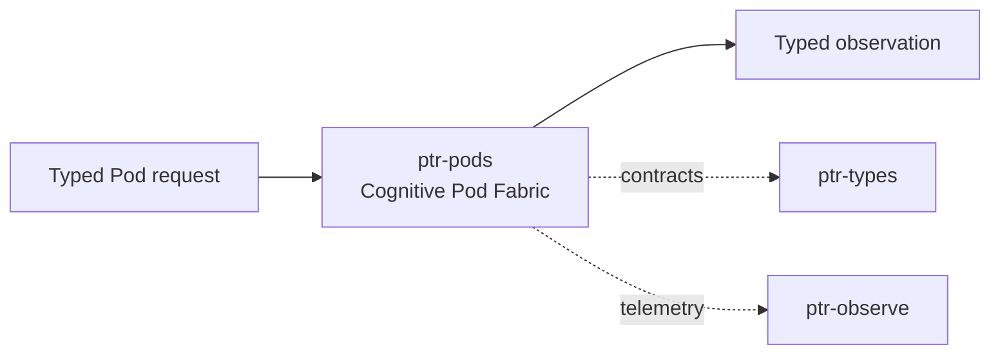

# ptr-pods — Cognitive Pod Fabric

> **Role:** Defines specialist computational modules through semantic contracts rather than fragile tool names.  
> **Maturity:** see the generated status below; production behavior must be proven by the linked experiments and component evaluations.

<!-- PTR:STATUS:BEGIN -->
## Current implementation status

> **Generated section.** Source of truth: [`component.toml`](component.toml) plus code-derived metrics from `src/`. Run `python3 scripts/update_component_docs.py --write` after editing implementation metadata. Do not hand-edit inside this block.

**Maturity:** `prototype`  
**Last reviewed:** 2026-10-13  
**Code footprint:** 40 Rust source files · 18974 nonblank source lines · 27 integration-test files · 344 test markers (`#[test]`, `#[tokio::test]`)

### Implemented now

- TCP and UDP executors refuse a request under a topic policy or on an MQTT link with EgressRefusalReason::TopicUnverifiable (code 6), because they send the payload unchanged and cannot tie a declared topic to the wire; check_publication is kept for an executor that reads the topic from its frame
- Topic policy is total: a policy that lists topics refuses a request that names none (EgressRefusalReason::TopicRequired); a refused topic is recorded as a digest prefix and length (redact_topic), a host or port refusal as a hashed host with its port (redact_endpoint, host:<16 hex>:<len>:<port>); PodLink and native validation use milliseconds since the epoch
- Egress enforcement (src/egress.rs): MQTT-style topic filters (+ and #, $-topics, bounded) checked against EgressPolicy.topics, EgressPolicy::check_endpoint / check_topic, ProtocolError::EgressRefused { target, reason } with a redacted target, NativeProtocolRequest.topic, and FrameRateLimiter, a bounded integer token bucket per Pod lease wired into the TCP and UDP executors
- Global workspace contract (src/workspace/, doc 37; a contract, not a model): Workspace holds a fixed bounded number of slots and a revision that advances by one per cycle. Pods submit Proposals (author pod and generation, content digest, PayloadRef, computed_against revision, requested Bid); neither Proposal nor WorkspaceConfig can carry or change a gate, level, threshold, report or verifier, and slot content is Authority::Provisional (invariant 4). Workspace::run_cycle takes a host CycleHost (verifier, VerifierIdentity recorded in the snapshot, AuthorRegistry) and is two-phase: the whole plan is computed without touching the workspace (a verifier panic is caught and judged Unknown with the hard finding verifier-panic, counted), then committed with no fallible step. Order: drop subscriptions of revoked Pod generations; retire incumbents (AuthorRevoked, Aged, Explicit, or Contradicted when Revalidation re-runs the verifier on the incumbent's original proposal and check_verification_gate no longer passes; SlotDecay::NeverUnsafe needs an acknowledgement and a revalidation); judge pending proposals (stale unless within max_staleness and no slot changed since, revoked author, then check_verification_gate = Candidate::passes of ptr-feedback, pinned against it in tests, score never read); admit gate-passers by effective bid (requested bid clamped by max_bid and the registry's per-author ceiling), seeded SHA-256 tie-break, proposal id, with duplicate content keeping its first author, a per-author slot cap and a per-author pending quota; opt-in Displacement::Policy (default off) lets a challenger that passed the gate at a level not below the incumbent's, beat its bid by a margin, after the incumbent's min residency, take an unpinned incumbent's slot under per-cycle and per-author caps, recorded as RetireReason::Displaced. Every loser has a counted Refusal with its reason and findings. Finding messages are host-side by default (invariant 13): snapshots carry bounded finding codes and hard flags, messages go to CycleReport::host_findings unless FindingVisibility::Public; findings per snapshot are bounded. One immutable Arc<WorkspaceSnapshot> with a SHA-256 digest is offered to every subscriber's bounded mailbox; a full mailbox refuses the new snapshot (counted) and never blocks
- StructuralOp::outcomes is the single post-operation state table for an admitted structural operation (ExpertOutcome, OutcomeKind): operands first, then results; results enter Serving at state_version 1, Merge and Split sources become Superseded, Freeze gives Frozen, unfreeze Serving, Prune and Retire Retired with their reason, and each operand's state_version advances by one; a reactivated Retired(GateFailed) source yields no operand outcome because its pod now names the new generation. The runtime registry and the ptr-state projection both apply it
- Decoding an evidence output no longer sizes an allocation from the dependency or provenance count stored in the record: the vectors grow with what is read, so a forged count ends at the first missing byte as an error instead of a capacity-overflow panic
- PodRegistry::register replaces an existing (project, id) entry and returns the old one (kept for current callers); PodRegistry::register_new is the non-replacing insert that structural-admission paths must use: it returns PodRegistrationError::AlreadyRegistered and leaves the original entry unchanged; PodRegistry::replace_if_current(expected, new) is the compare-and-replace for the atomic takeover of an operand of the same operation (a retired-target reactivation puts generation g+1 on the same pod id): it swaps only when the entry for new's (project, id) is exactly expected (Arc::ptr_eq), returns the old entry, and otherwise leaves the registry unchanged with NotRegistered, NotCurrent or IdentityMismatch; the registry tracks no token-expert (layer, slot), so slot ownership is not checked there
- PodRegistry is keyed by project and id, so two projects may register the same Pod id without shadowing and no lookup path exists that takes an id alone
- PodManifest declares the one project a Pod serves; resolution inside another project finds nothing rather than a worse match
- PodManifest with capability, accepted/produced types, effects and protocol version
- Typed Pod associated Input/Output/Error contract
- Ready and Revoked lease typestates
- Revocation consumes Ready lease and produces Revoked lease
- invoke_with_lease requires PodLease<Ready>; compile-fail doctest rejects revoked lease
- Object-safe DynPod and PodRegistry resolve semantic capability plus accepted input type
- PodManifest::digest is a length-prefixed SHA-256 over project, id, capabilities, accepted/produced types, effects and protocol version; NeuralPodAdapter refuses a descriptor whose manifest_hash differs or whose input/output schema the manifest does not list
- PodRegistry::candidates returns only same-project Pod ids in canonical order; bind_registered/resolve_bound pin a (project, id, manifest) binding and resolve_bound returns nothing once the registered manifest differs
- NeuralPodDescriptor validates identity, non-zero manifest hash and generation, schemas, resources, tensor contract, provenance and an Admitted/Prepared/Ready lifecycle; transition_to allows only listed lifecycle edges and terminal states (Released/Revoked/Failed) cannot move on
- NeuralPodAdapter wraps a sync NeuralPodExecutor as a DynPod (activate, infer, release); a failed infer calls executor.abort so the lease is recovered, and an output type outside the manifest is rejected
- NeuralPodLease (Ready/Busy/Released/Revoked) rejects begin while Busy or Revoked; DeviceLease counts active tensors, refuses release while tensors are in use and refuses new tensors once Released, Revoked or Failed
- ReferenceNeuralExecutor is an in-process executor that checks the input type and returns the input bytes typed as the output schema; it is a contract reference, not a model, and ReferenceExecutorFactory builds it from a descriptor
- InMemoryArtifactCatalog admits descriptors by (artifact, generation), rejects a conflicting descriptor for the same generation, rejects invalidated generations and verifies lineage by exact descriptor equality; admit_with_manifest additionally checks manifest digest, pod id and schemas
- InMemoryResourceGovernor reserves RAM, VRAM and concurrency against fixed capacity; release is idempotent for an identical lease and rejects mismatched or unknown leases
- PodWireRequest/PodWireResponse validation binds manifest hash, artifact, generation, input type, protocol version, request id, revision and output type (types and checks only; no wire serialization in this crate)
- PodSemanticManifest validates identity, type contract, role/domain/provenance, resources, Active-needs-protocol and model-variant requirements, with a set-order-independent digest; ExecutionManifest binds lineage and has a canonical encode/decode that detects tampering and duplicate keys; LifecycleGate requires admission checks before Evaluated/Approved/Active
- ProtocolBinding enumerates transport kinds with a ProtocolProfile (pattern, delivery, connection scope, multiplexing, max frame bytes); PodLink validation checks addresses, project/namespace scope, deadline, hop limit, cycles, artifact, capability, ACL, non-zero attestation and egress policy, and validate_against_manifest requires the exact execution-manifest digest
- TcpProtocolExecutor and UdpProtocolExecutor (tokio) send one typed frame (u16 type length, u32 body length, type id, body) to an endpoint that must be on the link egress allow-list, with a timeout, an unexpired deadline and a 1 MiB frame cap; the executors do not themselves run PodLink::validate
- DuplexSession records sequenced, session-bound turn events (commit, interrupt with epoch bump, close) and resumes from a sequence cursor; a rejected event leaves the turn counter and epoch untouched, and emit refuses the kinds that move session state (TurnCommitted, TurnInterrupted, SessionClosed: TurnError::ReservedKind), which only commit_turn, interrupt and close may produce
- PodOutput has a canonical digest that is independent of provenance/dependency order and covers kind, payload, generation, digests, revision and verified flag; validate requires provenance, non-zero digests and the expected type, and rejects StateDelta/VerifiedResult unless promotion is allowed and the output is verified
- PodEvidenceBundle holds a sequence-checked chain of turn events and outputs, seals to a digest, replays deterministically, round-trips through canonical bytes preserving chain order, detects tampering, and carries an Ed25519 signature over the bundle digest via provider-neutral EvidenceSigner/EvidenceVerifier traits
- merge_hypotheses drops hypotheses whose VerificationReport is not Pass first and then rejects mixed generations among the ones that remain (a rejected hypothesis of another generation no longer aborts the merge), picks the highest-confidence (then lowest-latency, then branch id) output and deduplicates evidence
- PodCache key includes pod identity, semantic revision, execution manifest, capability, input digest, knowledge revision, principal and protocol, and supports predicate invalidation
- KvTensorBackend contract with a CPU InMemoryKvTensorBackend (F32 only): append, truncate, digest-bound snapshot and restore, device and schema checks, and a KvPageTable that reserves and releases logical pages; FP8/NVFP4/MX dtypes are declared but rejected as unsupported
- Feature-gated candle-cuda (off by default, adds optional candle-core with CUDA): CandleDenseExecutor loads an F32 [output, input] weight and optional bias from Safetensors and does a matmul on a CUDA device, and CandleKvTensorBackend keeps per-layer F32 KV tensors on CUDA behind a DeviceLease; this path could not be compiled or run in the review environment (no nvcc), so it is code-reviewed only
- KvTensorSchema has key_value_heads next to attention_heads (zero rejected, attention_heads must be a multiple of it); K/V width is key_value_heads * head_dim, and the dense snapshot digest binds key_value_heads (digest_versioned keeps a legacy v1 digest without it); KvBackendError gains OutOfMemory, InvalidPageState, PrefixMismatch and StaleLease and KvTensorBackend gains a default no-op revoke (src/kv.rs); only the page-table and snapshot tests in tests/kv.rs exercise this, the legacy-digest path has no test in tests/
- InMemoryPagedKvBackend (src/paged_kv.rs, CPU, F32) implements PagedKvTensorBackend over KvPageSize (power of two in 1..=256, default 16) pages bound by KvPageBinding (model, adapter, generation, execution manifest, principal, device, dtype, page size; batch_size must be 1): append fills and seals pages (Writable to Sealed with a per-page digest), seal_snapshot returns a lease that pins the pages while later appends copy the tail (copy-on-write, counted in KvPageMetrics::cow_copies), publish_prefix and fork_prefix_admitted share full sealed pages only under a KvPrefixKey of principal, execution manifest, model, adapter, generation, schema digest and prefix digest, and an append beyond capacity returns OutOfMemory without changing the cache; KvPagedSnapshot::validate/verify_digest check page structure, per-page digests and the snapshot digest and to_dense converts to a KvTensorSnapshot; covered by tests/kv.rs (paged_backend_validates_page_size_and_appends_across_boundaries, online_snapshot_is_immutable_while_tail_continues_with_cow, prefix_sharing_is_bound_to_principal_and_manifest (forks through a witness), paged_oom_does_not_mutate_cache, paged_snapshot_digest_binds_tensor_schema_and_page_structure); bind_runtime_lease/revoke_runtime_lease/StaleLease (KvRuntimeLeaseBinding needs non-zero placement epoch and fencing token), restore_paged and the page states Transferring/Revoked/Corrupt/Released are implemented in code but no test in tests/ calls them; plain allocate() uses a fixed internal legacy binding (generation 1, principal ptr:legacy-local)
- ReferenceCausalAttentionExecutor (src/attention.rs) runs one-layer multi-head causal attention through the KvContinuationExecutor trait (prefill takes N tokens, decode exactly one) against any PagedKvTensorBackend, with square F32 Q/K/V/O matrices (CausalAttentionWeights::identity or, behind candle-cuda, from_safetensors); it requires layer_count 1 and key_value_heads == attention_heads and takes a dense snapshot of the cache per token, so it is a correctness reference, not an efficient kernel; tests/kv.rs paged_prefill_then_decode_matches_full_causal_recompute checks that prefill+decode matches a full recompute on InMemoryPagedKvBackend with identity weights within 1e-6 and checks first_position/next_position
- Qwen2PagedDecoder (src/qwen.rs) is a single-decoder-layer CPU f32 reference for a Qwen2-style layer: RMSNorm, Q/K/V projections with bias, half-split RoPE (rope_theta), grouped-query attention over compact key_value_heads K/V stored in the paged backend, optional sliding_window, output projection, SwiGLU MLP (SiLU) and residuals; Qwen2LayerConfig::validate rejects zero sizes, non-divisible head counts, a non-positive or non-finite rope_theta/rms_norm_eps, an odd head_dim, any hidden_act other than Silu, and any rope_scaling other than None or a valid DynamicNtk (see the Qwen2PagedStack entry), while Qwen2PagedDecoder::new refuses any scaling because the single-layer decoder has no admission regime, and Qwen2DecoderWeights::validate checks all shapes; it requires layer_count 1 and batch_size 1, and there are no embeddings, LM head or multi-layer stack; tests/kv.rs qwen_config_rejects_invalid_grouped_query_attention and qwen_gqa_prefill_decode_matches_recompute_and_keeps_compact_kv (2 query heads, 1 KV head, near-diagonal toy weights) check config validation, prefill+decode against full recompute within 1e-6 and a [3, 2] compact KV shape; no test compares the output with an external Qwen reference or exercises sliding_window, and Qwen2DecoderWeights::from_safetensors (candle-cuda only, reads model.layers.{L}.* names) is code-only here
- Tier storage adapters (src/tier_storage.rs, on ptr-storage PreparedTierObject): KvTierAdapter and PagedKvTierAdapter prepare/restore KV snapshots under a KvTierBinding (logical id, generation, revision, context digest, placement epoch, fencing token; zero or blank values rejected), with the paged form writing one header chunk plus one chunk per page (magic PTRKVP3) and restore verifying chunk integrity, the page count and the digests; ModelWeightTierAdapter::prepare and ArtifactTierAdapter::prepare build tier objects whose schema digest binds the manifest, model/tensor/dtype/shape or artifact and provenance digests (ArtifactTierAdapter additionally requires the bytes to hash to artifact_digest; ModelWeightTierAdapter does not check the bytes against artifact_digest and neither has a restore function); tests/tier_storage.rs covers kv_snapshot_roundtrips_through_chunked_tier_object, kv_restore_rejects_changed_fencing_binding_and_corruption, paged_kv_roundtrip_preserves_one_chunk_per_page, paged_kv_roundtrip_preserves_compact_grouped_query_heads, paged_kv_restore_rejects_corrupt_page_chunk, kv_decoder_rejects_hostile_lengths_before_allocating (PTRKVTR1 magic, dense decoder only), weight_schema_binds_manifest_model_tensor_shape_and_dtype (only a dtype change is compared) and artifact_frontend_requires_content_digest_and_lineage; the decoders also accept the older PTRKVTR1 and PTRKVP2 formats, but no test restores a valid legacy record (the hostile-length test only feeds a bare PTRKVTR1 header), and the tests do not run the tier objects through any storage backend
- candle-cuda extensions (code-only: the feature and tests/candle_cuda.rs were not compiled or run here): CandleKvTensorBackend is now a type alias of CandlePagedKvBackend, which implements PagedKvTensorBackend with CUDA page bundles (each cache keeps a DeviceLease and its own stream device), and CandleGpuTierBackend implements the ptr-storage TierBackend (put/get/verify/delete chunk, health) with chunks held as CUDA byte tensors; tests/candle_cuda.rs has paged_cuda_snapshot_uses_cow_and_continues_causal_attention, cuda_gpu_tier_backend_roundtrips_verified_chunk and qwen2_safetensors_layer_runs_gqa_on_paged_cuda_cache next to the two older tests; the hardware results described in CANDLE_CUDA.md are not adopted here
- Pod-MoE expert proposals (src/expert.rs): StructuralOp is a typed enum carrying its operands (Birth{result}, Merge{sources,result}, Split{source,results>=2}, Freeze{target}, Reactivate{target,result: Option} with result required iff the target is Retired (Frozen with a result is UnexpectedResult), Prune{targets>=1, all Serving, one Token layer}, Retire{target,reason: Superseded or GateFailed only; Pruned uses Prune and InputRevoked is a runtime-grant ledger event, ReasonNotProposable}), so shapes like a birth with a target are unrepresentable; ExpertProposal::new validates in a documented order (canonical project id, proposer project, operand counts, projects, source state against the (OpKind, ExpertState) table via OpKind::allows_state, operation structure, result relations, distinct results) with non_exhaustive typed errors; ExpertState is Candidate, Gated, Serving, Frozen, Fenced, Superseded, Retired(RetiredReason) with a documented mapping to ptr-lineage AdapterStatus and ArtifactLifecycle (adapter_status_name, artifact_lifecycles); Retire is allowed exactly from Serving and Frozen (Candidate, Gated and Superseded give WrongTargetState); a Fenced operand is rejected for every operation with FencedTarget before the state table, so a policy cannot retire a revoked expert as Retired(GateFailed) and reactivate it from revoked weights, and a fenced expert reaches Retired(InputRevoked) only through the runtime revocation path (InputRevoked is neither a proposable reason nor a reactivation seed) and Frozen maps to Serving/Active; Merge needs Token-level sources sharing layer, base model and state, Prune targets share layer and base model (BaseModelRef{id,digest,generation} with a validated BaseModelId (1-128 bytes of ASCII [A-Za-z0-9._:-], BlankBaseModel/NonCanonicalBaseModel) so two records with the same weights and generation but different ids are different base models, for equality, the MixedBaseModels and result base-model checks and both ids; BaseModelRef::new rejects base generation 0, ZeroBaseModelGeneration; the id is in the canonical encoding, so the domain tags are bumped to ptr.pods.expert-proposal.v2 and ptr.pods.expert-operation.v2), results must be new pods in the proposal project with the sources' base model and a compatible level, only Frozen or Retired(GateFailed) can be reactivated (other retired reasons: SeedUnavailable) and Reactivate(Retired) yields exactly generation+1 of the same expert at the exact same level and Token slot (checked_add, overflow is an error); Birth, Merge and Split results must be generation 1 and results may not share a Token slot (DuplicateResultSlot; a source's slot may be reused), Reactivate(Frozen) is an in-place unfreeze with no result and no lineage transition (lineage stays Serving/Active), Reactivate(Retired(GateFailed)) requires a result that enters lineage as a new Candidate; Merge and Prune sources must occupy distinct Token slots (DuplicateSourceSlot); ExpertTarget and ExpertPodSpec have private validated fields (project and pod ids restricted to 1-128 bytes of ASCII [A-Za-z0-9._:-], generation >= 1, non-zero ManifestDigest and BaseModelDigest newtypes, BaseModelRef{digest,generation}, ExpertLevel::Token{layer,index}), ExpertTarget carries manifest digest and state_version as caller-observed claims re-checked at commit; a proposal binds a ProposerRef and the observed_at ledger CommitIndex, and identity is two-stage: operation_id() (the only way to obtain an OperationId, domain ptr.pods.expert-operation.v2; defined on ExpertOperationRequest, the validated pre-result form built from a RequestedOp, a StructuralOp whose results are ResultIntents (every ExpertPodSpec field except the training-produced manifest digest: project, pod, generation, level with Token layer and slot, base model ref), whose constructor runs exactly the rules of ExpertProposal::new through the same code (validate_requested), so no trained result has to be fabricated and two requests that would create different experts get different ids; ExpertProposal::operation_request() derives it and ExpertProposal::operation_id() delegates, so both agree and admission compares ids, there is no from_request binding) is SHA-256 over the pre-training fields only (op kind, operands with observed generation, manifest digest, state and state_version, retire reason, the ordered result intents (per result: project, pod, level including Token layer and slot, base model ref, generation), proposer, project, observed_at, rationale); the only thing it excludes is each result's training-produced manifest digest, so it is stable across training, while proposal_id() (the only way to obtain a ProposalId, the candidate id after training) is SHA-256 over the canonical encoding of every field including results; a proposal is inert data with no threshold, gate, verifier or policy field (invariants #4 and #11), ProposalParts exposes the complete field list (parts() destructures ExpertProposal exhaustively, a compile-time guard); acceptance by gates, verifier and ledger commit is not implemented; covered by tests/expert.rs
- ExpertCommitRecord (proposal, evidence digest, gate epoch; private fields) with a versioned canonical byte codec (version 2 magic PTREXR02 embeds the gate report bytes and the required gate configuration digest via new_with_evidence and is the only kind admission writes; version 1 magic PTREXR01, digest only via new, still decodes as legacy; fixed little-endian layout over every ExpertProposal and StructuralOp field) whose decode rebuilds every identity and the proposal through their constructors, refuses input over MAX_EXPERT_COMMIT_RECORD_BYTES (1 MiB, equal to the ledger's limit) before parsing, a zero digest, an unknown tag, truncated or trailing bytes and any byte string that does not re-encode to itself; it defines the opaque payload of the ledger's structural event and decides no admission
- PagedKvTensorBackend gained retire_prefix (default KvBackendError::Unsupported, so the candle backend, which is not built in CI, inherits it unchanged), take_fork_authority (default Unsupported) and fork_prefix_admitted (default Unsupported). InMemoryPagedKvBackend::retire_prefix removes the published prefix record and returns KvBackendError::PrefixNotFound for an absent key, so a double retire is visible; caches that already forked keep their Arc'd pages. take_fork_authority hands out the backend's single KvForkAuthority once (a second call is an error). The authority is the only way to mint a KvForkWitness (private fields, not Clone, consumed by value; compiler-enforced against a caller that only holds the backend, not against code that controls the process). fork_prefix_admitted checks that the witness belongs to this backend, names this prefix and is still pending (a KvWitnessRevoker held by the runtime catalog can revoke a pending witness), consumes it, and takes pages, length and offset from the registered record rather than from the caller's KvSharedPrefix; the cache must still match the prefix's principal, model, adapter and schema, but its generation and manifest digest are deliberately not compared, because liveness is the catalog's use-time check (doc 36 defect 2: the former binding-trusting PagedKvTensorBackend::fork_prefix is removed from the trait and from both backends, so fork_prefix_admitted is the only fork path; the trait and KvForkWitness docs carry compile_fail doctests that a fork without a witness and a second fork with a moved witness do not compile; a unit test in src/paged_kv.rs checks the second consume of one witness state is refused as Consumed). KvBackendError gained Unsupported, PrefixNotFound and ForkWitnessRejected. Covered by tests/kv_prefix_admission.rs: retire then fork, once-only authority, witness path ignoring the caller's generation but not its principal, foreign-backend, mismatched-prefix, revoked and used witnesses, caller-forged prefix length, default Unsupported through a delegating backend, and a bitwise-equal admitted fork plus decode against a full prefill
- Qwen2PagedStack (src/qwen_stack.rs) is the N-layer CPU f32 reference for experiment R005 (doc 36 P3): token embedding, N Qwen2-style decoder layers (reusing the single-layer math), final RMSNorm and an LM head giving logits per input token, behind KvContinuationExecutor over any PagedKvTensorBackend, with typed Qwen2StackError (ZeroLayers, ZeroVocab, HeadsNotDivisibleByKvHeads, KeyEncodingMismatch, CacheSchemaMismatch, TokenOutOfVocabulary, ContextExceeded, ...); Qwen2PagedStack::reference(config, seed) builds deterministic splitmix64-seeded weights (not trained weights); an optional per-head QK-norm (Qwen2QkNorm, default choice is the caller's, tests use Disabled and Enabled) is applied before RoPE; every token runs one at a time through the same path with fixed reduction order. KvKeyEncoding {PreRope, PostRope} (src/kv.rs) is declared by the cache schema (KvTensorSchema::key_encoding / with_key_encoding): PreRope stores keys unrotated and rotates them at attention time with the absolute position (defect 3 fix for the reference stack), PostRope is the legacy store-after-RoPE encoding; the encoding is carried as a suffix of KvTensorSchema::model (an additive design that avoids a new struct field in every KvTensorSchema literal), so every model-bound digest and KvPageBinding differs between encodings (PostRope adds no suffix, so existing digests are unchanged), and the stack, Qwen2PagedDecoder and ReferenceCausalAttentionExecutor (RoPE-free, so PostRope only) refuse a cache of the other encoding; KvTensorSchema::validate_key_encoding (called by InMemoryKvTensorBackend::validate_schema, so by allocation, and by every executor) rejects a model identity that contains the reserved marker "#kv-key-encoding=" anywhere except as the single trailing pre-rope suffix, though a real model name that itself ends in that exact suffix is indistinguishable from a marked one and reads as PreRope; tests/qwen_stack.rs checks, on a 4-layer R005-shaped model (hidden 64, 4 heads, 2 KV heads, head_dim 16, vocab 256, seed 20240607): prefill+decode logits bitwise equal to a full prefill for both encodings, PreRope and PostRope logits bitwise equal at canonical positions (with and without QK-norm), different snapshot digests and refused cross-encoding reuse, layer-0 PreRope key rows bitwise equal under a position shift while PostRope rows differ, and typed rejection of invalid configs and inputs; Qwen2RopeScaling::DynamicNtk { factor, original_max_position_embeddings } (validated: factor finite and >= 1, omp > 0, head_dim > 2) implements the Hugging Face dynamic NTK base theta * ((factor * seq_len / omp) - (factor - 1)) ^ (head_dim / (head_dim - 2)) for seq_len > omp and theta otherwise (transformers modeling_rope_utils _compute_dynamic_ntk_parameters, full rotary dimension); Qwen2LayerConfig::rope_regime(admitted_len) / Qwen2PagedStack::admit_rope_regime(prompt, max_new) compute the effective base ONCE at admission (f64 then rounded to f32) into a Qwen2RopeRegime (exact base bits plus the admitted length), prefill_in_regime / decode_in_regime run every token of the request under that one value and never recompute it, so a decode crossing omp stays bitwise equal to a full prefill under the same regime; a run past the admitted length is refused (RopeRegimeExceeded, a transition needs a new admission and a recompute), a regime that the configuration does not yield is refused (RopeRegimeMismatch) and the regime-less trait prefill/decode of a scaled stack fail with RopeRegimeRequired (an unscaled stack is unchanged and bitwise as before); tests/qwen_stack.rs checks the formula against an independent closed form, the positive control (prompt 6, max_new 8, omp 8, both encodings), that the regime changes the logits while the plain regime equals the unscaled stack bit for bit, misuse refusals and invalid parameters; it uses no real tokenizer or trained weights, only DynamicNtk exists (no YaRN, linear or llama3 scaling, no partial rotary factor), and only InMemoryPagedKvBackend was exercised
- derive_kv_layer_chains (src/kv_chain.rs) computes doc 36 section D per-layer KV chain keys from a Qwen2PagedStack's actual weights and configuration: chain(-1) hashes base model + generation, the embedding-table digest, build identity, tokenizer, key encoding and attention shape; chain(l) hashes chain(l-1), a digest of ALL of layer l-1 (Q/K/V/O, both norms, MLP, QK-norms, eps, sliding window, activation) for l >= 1, layer l's input norm and eps, K/V projection weights and biases, the key-norm weights and eps or 'disabled', and the RoPE configuration (theta, scaling policy including DynamicNtk factor and omp, the exact bits of the effective base of the regime fixed at admission, head_dim) for every layer under PostRope and for l >= 1 only under PreRope; floats are hashed as exact little-endian bits (-0.0 and 0.0 differ) and Qwen2PagedStack::new now refuses NaN and infinite weights (InvalidWeights non-finite weight); Qwen2PagedStack::weights exposes the weights read-only; tests/kv_chain.rs checks that a key-norm change at layer l moves chain(>=l) only, a query-norm or FFN change at layer l moves chain(>=l+1) only (the last layer's FFN moves none), K/V projection, bias and input-norm changes move chain(>=l), RoPE theta moves chain(>=1) for PreRope and every chain for PostRope, build identity, generation, base model, tokenizer and embedding change every chain, and equal-seed stacks with one perturbed weight differ; derive_kv_layer_chains refuses a DynamicNtk stack (RopeRegimeRequired) and derive_kv_layer_chains_in_regime takes the regime fixed at admission (a regime the configuration does not yield is RopeRegimeMismatch), so chain(l) changes with the regime exactly per the RoPE rule (every layer for PostRope, layers >= 1 for PreRope; tests: chain_follows_the_regime_per_the_rope_rule, lengths_within_the_original_maximum_share_one_regime, scaling_policy_changes_the_chain_even_at_equal_base, regime_is_required_and_checked), and all admitted lengths up to omp are one regime; adapters and MoE experts are not hashed (none exist here), and max_position_embeddings is deliberately not part of the key
- Qwen2PagedStack extension point for experiments R009/R010 (src/qwen_stack.rs, src/qwen_lora.rs, src/qwen_moe.rs; CPU f32 reference, no trained weights): prefill_bound_in_regime/decode_bound_in_regime take a Qwen2Binding {adapter: Option<&Qwen2Adapter>}, and the per-layer MLP kind is Dense or Moe through Qwen2PagedStack::with_moe; the default binding on a stack without MoE takes the unchanged path (tests/qwen_stack.rs reference_chain_id_and_logits_digest_are_pinned pins the reference weights digest, the final chain id and a logits digest, recorded before the change). Qwen2Adapter (unmerged y = Wx + s*B(Ax); pins rank 4, scale 2.0; A and B seeded from (weight_seed, identity, generation) with B non-zero, an all-zero B is refused; attached at every layer >= first_layer): kinds Qkv, QOnly, MlpOnly (a residual-space correction of the MLP block output) and Activated{invocation} (aLoRA: QKV, active only at positions >= invocation, earlier rows are bitwise the base rows). derive_adapted_kv_layer_chains returns the base and adapted chains: K/V deltas enter chain(l) of the adapted layer, Q and MLP deltas only chain(l+1) through the all-of-layer term, identity, generation, kind (with the aLoRA invocation), rank, scale and the A/B bits are bound, and KvAdaptedChains::effective_layer(layer, positions) gives the base chain for a range wholly before the invocation and the adapted chain for any range that reaches it; tests/qwen_lora.rs checks f in {0,2} for each kind, identity/generation/bit binding, logits change, decode == full prefill and aLoRA pre-invocation row equality at invocation 39. Qwen2Moe: router Linear(n_experts x hidden) and experts {gate, up, down, generation, live} per MoE layer (pins: 4 experts, intermediate 64), softmax over all router logits then top-2 among live experts without renormalisation, lowest index wins ties, dropless and per-token (batch-invariant), expert weights from their own seeded domain (dense weights unchanged); a revoked expert is masked from the selection (the softmax denominator still contains it, so masking an expert that was not routed to is bit-identical); Qwen2RoutingMode::BatchVariantCapacity{capacity} is the negative control (per-step expert loads shared by co-batched requests, prefill_cobatched_in_regime runs requests in a given order) and Qwen2PagedStack::routing_determinism reports NotRouted/BatchInvariant/BatchVariant; prefill_traced_in_regime returns per-layer RoutingCounts (most_routed picks the expert to revoke); the router, all experts with generation and live flag, top-k and routing mode enter full_layer_digest(j), so an expert of layer j reaches chain(l) for l > j only; tests/qwen_moe.rs
- PagedKvTensorBackend::prefix_page_bytes(&KvSharedPrefix) -> Vec<(Digest, u64)> (default KvBackendError::Unsupported, so the candle backend, not built in CI, inherits it): a read-only, per-unique-page-digest (first-occurrence order) byte size of a published prefix, in the unit of KvPageMetrics::resident_bytes (K and V f32 values of every layer of the page, 4 bytes each). InMemoryPagedKvBackend computes it from the stored per-layer pages; an unknown or retired prefix is PrefixNotFound and digests that differ from the stored pages are PrefixMismatch. Covered by tests/kv_prefix_page_bytes.rs (3 tests: per-page bytes sum to the cache's resident_bytes, a repeated digest is listed once, unknown/retired/forged prefixes are refused)
- Layer-scoped prefixes on InMemoryPagedKvBackend (R009/R010 groundwork, WP0+WP1): KvPrefixKey gained layers: KvLayerRange (Full or Span{start,end}; an enum because Range<u16> is not Ord; a span covering every layer is canonicalised to Full) and its adapter is now the EFFECTIVE adapter of those layers, with schema_digest computed under that adapter; KvAdapterLayering{base_adapter, first_adapted_layer} says a cache's adapter leaves layers below the first adapted layer to the base adapter. PagedKvTensorBackend gained publish_prefix_layers, fork_prefix_layers_admitted and adopt_prefix_layers_admitted (defaults Unsupported). Publish stores the full pages of one span with page digests built from that span's layer digests (domain ptr-paged-kv-page-layers-v1, binding with the effective adapter). Fork assembles a cache from several parts (one single-use witness each) whose spans cover 0..L disjointly with identical page counts, valid tokens, length and position offset, sharing each layer's Arc and sealing the pages under the receiving cache's binding; a part is refused unless the receiving cache's effective adapter for that span (from the request's layering) equals the key's adapter, so a LoRA cache can take base layers below its first adapted layer and nothing else. Checked adopt compares every row of the span bitwise (to_bits, so -0.0 differs from 0.0) with the rows the cache already computed and swaps in the published allocations only if all are equal; otherwise it returns KvAdoptError::Mismatch{mismatched_rows, compared_rows} and the cache is untouched; the witness is spent either way. A page layer is now a PageLayer: an optional shared row-prefix (Arc of the source allocation plus a row count) followed by an owned tail, so truncating a shared layer keeps the surviving rows physically shared and later appends go to the owned tail (the aLoRA boundary page keeps its pre-invocation rows shared); layer and page digests hash the rows as contiguous segments and are independent of the representation. InMemoryPagedKvCache::shared_leading_rows is a public diagnostic for allocation sharing. Covered by tests/kv_layer_prefix.rs (9 tests: cross-adapter fork shares exactly the base-effective layers, refusals by layering, adapter, coverage and witness, checked adopt equal/mismatch/flipped-bit/wrong shape, boundary page shares the pre-invocation rows and digests like the unsegmented page, publish range errors, key digests) and unit tests in src/paged_kv.rs (layer_prefix_tests: Arc::ptr_eq of adopted layers, mismatch leaves every allocation unchanged, shared prefix kept across append). Not done: nothing in ptr-runtime uses the new methods yet (the catalog still keys whole-model prefixes), the candle backend only got the Full key field (it inherits the Unsupported defaults and is not compiled in CI), and the snapshot/tier encodings do not carry a layer span; the layering in KvLayerForkRequest and KvLayerAdoptRequest is caller-trusted (documented), so the runtime must pick entries by per-layer chain
- ExpertCommitRecord version 3 (R011 WP3, magic PTREXR03): a version 2 record followed by a typed dependency block, ExpertInputs, of training and evaluation inputs, each an ExpertInputRef (identity of 1 to MAX_EXPERT_INPUT_IDENTITY_BYTES = 256 bytes without a control character, non-zero generation, non-zero 32-byte digest), each list strictly ascending by (identity, generation), at most MAX_EXPERT_INPUTS_PER_ROLE = 256 per list, a pair named twice in one list or with two digests across the lists refused. ExpertCommitRecord::new_with_inputs refuses inputs on an operation that creates no expert. Versions 1 and 2 decode exactly as before and name no inputs; the base model is a dependency through ExpertInputRef::from_base_model (identity base-model:{id}) and source experts are the operation's own sources, so neither adds a field. The block has a domain-separated canonical_digest (ptr.pods.expert-inputs.v1) that ptr-state projects as a commitment. This crate carries and validates the shape only: liveness and digest-registry decisions are ptr-runtime's
- TextGenerator (src/text_generator.rs, always compiled, no dependencies): a backend-independent bounded text generation trait. GenerationRequest carries a system prompt, a user message and max_new_tokens that validate() refuses outside 1..=MAX_NEW_TOKENS_LIMIT (128) instead of clamping; GenerationOutput carries the text, the generated token count and a StopReason (EndOfTurn or MaxTokens); GenerationError is InvalidRequest or Backend(message), so no backend type crosses the trait; GenerationOutput also counts the special tokens the text decoder dropped, and TextGenerator::identity may report ModelIdentity (SHA-256 per model file). Expert Pods in ptr-runtime depend on this trait only.
- CPU Qwen2 generator behind the new qwen-cpu feature (src/qwen_cpu/, tests/qwen_cpu.rs; off by default, pulls safetensors, serde_json and the vendored-patched tokenizers crate with the onig backend): QwenModelConfig::from_json validates config.json (every size field is capped: layers 128, hidden 16384, intermediate 65536, heads 256, vocab and positions 2^20; rms_norm_eps must stay a positive finite f32 after the cast; model_type qwen2, silu, GQA divisibility, even head dimension; sliding-window and rope scaling are refused, not ignored); Weights::from_bytes reads model.safetensors keeping matrices bf16 and norms/biases f32, checks every tensor name, shape and dtype, ties the head to the embedding when tie_word_embeddings; Model::forward is a batched prefill and one-token decode over a per-layer f32 KV cache (RMSNorm, rotate-half RoPE from an f64 table, grouped-query attention, SwiGLU), with a row-parallel matmul over std scoped threads and eight-lane bf16 and f32 dot kernels; QwenCpu::load checks each file size from metadata before reading (weights bound max_weights_bytes, default 4 GiB; peak load memory about twice the weights file), hashes while reading, and optionally pins the SHA-256 of model.safetensors, config.json, tokenizer.json and tokenizer_config.json (DigestMismatch before parsing; digests exposed by digests() and TextGenerator::identity), switches off truncation and padding stored in tokenizer.json, ignores generation_config.json (greedy only), implements TextGenerator with the Qwen2.5 chat template, built from ids so a marker string such as <|im_start|> inside the system or user text is plain text and never a turn boundary (chat_prompt is the text form), greedy argmax (lowest index wins a tie, a non-finite logit is an error), stops before <|im_end|> or <|endoftext|> or at the bound, reuses the longest shared token prefix of the previous request's KV cache (the last prompt token is always recomputed), and counts prefill/decode time for tokens per second. Unit tests (no model needed): config parse and refusals, bf16 round trip, threaded matmul equals a naive product, RoPE identity at position 0 and norm preservation, softmax and RMSNorm, template markers, argmax ties and non-finite refusal, and a synthetic safetensors model (tied and untied head) where batched prefill equals token-by-token decode within 1e-3, a truncated cache re-fed equals a fresh pass, attention does not look ahead and out-of-vocabulary or overlong input is refused.
- Qwen2PagedStack stage execution for a pipeline (layer) split: stage_kv_schema gives the cache schema of a layer span (layer k of the cache is stack layer span.start + k), embed_tokens the first stage's input rows, run_stage_in_regime runs a span over residual rows one row at a time through the same per-layer path as the whole stack (forward_token is now the embedding, forward_layers over the whole span, and the head) and appends that span's K/V, and logits_from_residual is the tail of the last stage; two stages run in turn are the whole stack bit for bit in logits and in each stage's KV bytes (tests/qwen_stage.rs), and a bad span, a mis-shaped input, a decode of several rows and a cache of another layer count are typed errors (Qwen2StackError::InvalidLayerSpan, StageInputShape)
- run_stage_in_regime takes a StageRun (span, residual, rows, StageRows::Prefill or DecodeStep, optional frame positions) instead of positional parameters; the frame's positions must be the next positions of the cache (Qwen2StackError::StagePositions), and a row that fails truncates the cache back to where the run started, so a failed run leaves the cache unchanged (the rollback helper is unit-tested with a position-offset cache and a revoked cache; a fault in the middle of a row is not injected).
- A stage run that fails part-way is rolled back to the cache's sequence length before the run (not to its next position, which differs for a cache restored at a position offset), and a rollback that itself fails is reported together with the failed run's own error as Qwen2StackError::RollbackFailed (the cache then holds the rows of the failed run and must be discarded); a unit test with a position-offset cache and one with a revoked cache (the injected rollback fault) cover both; the position arithmetic of the admission is checked (an offset that overflows is a typed refusal, not a wrap or a panic).
- QwenCpuStats counts decode_steps (single-token forward passes after prefill) directly, and decode_tokens_per_second divides them by decode time instead of generated_tokens minus requests, which an immediate end-of-turn request understated (unit test in src/qwen_cpu/generator.rs, feature qwen-cpu)

### Missing for the target architecture

- MQTT executor binding the checked topic to the wire (the TCP and UDP executors refuse topic policies as TopicUnverifiable until one exists)
- Workspace: only ptr-runtime's VcwLoop drives it (one workspace per request, simulated or test experts), slot content is not committed to the ledger, and no experiment shows that a workspace or displacement helps a model (F007 measured the workspace only as an implementation check in a world that declares a broadcast reader); determinism assumes a pure host verifier and registry, and submit-time bounds (PendingFull) depend on arrival order; the host must bound verifier wall-clock time and a panicking AuthorRegistry is not caught
- Adapters and MoE are not yet wired into ptr-runtime's KvSession/backend: nothing there binds an adapter or expert dependency to a session, re-resolves the binding at restart or tags batch-variant routing Approximate; the catalog and fork paths still have no layer scope or cross-adapter prefix sharing; the MoE has no capacity-free load balancing loss and no trained weights, and the MLP-only adapter is a block-output correction, not a gate/up/down LoRA
- Async invocation and PodContext
- Process-isolated, remote-Iroh and GPU/DLPack adapters
- Capability/effect validation against runtime policy
- Borrowed/busy/backpressured lease states and cancellation
- Admission of an ExpertCommitRecord lives in ptr-runtime (admit_expert_proposal); this crate only defines the validated byte format and the state table: nothing here checks the evidence, the gate epoch or the compare-and-set
- KV reuse beyond the catalog path of doc 36 phase P2: the key of publish_prefix is still the digest of the page digests (defect 1 is addressed by the runtime catalog's token-chain keys, not here); the binding-trusting fork_prefix was removed and fork_prefix_admitted under a single-use witness is the only fork path (defect 2), but the candle backend implements neither take_fork_authority, fork_prefix_admitted nor retire_prefix, so it fails closed on fork and its candle-cuda build is unverified here; the runtime and the single-layer Qwen2PagedDecoder still use post-RoPE keys and the pre-RoPE encoding exists only in Qwen2PagedStack and its schema marker (defect 3 is fixed for the reference stack only; the encoding is a model-name suffix rather than a dedicated KvTensorSchema field, and a real model name ending in the marker cannot be told apart); in-memory pages are now stored per layer (defect 5 part 1) but prefix keys are still not layer-scoped (part 2 is open); the N-layer Qwen2PagedStack is a reference only and is not wired into ptr-runtime
- qwen-cpu limits (src/qwen_cpu/): dense Qwen2 only, bf16 matrices only (f32 matrices are refused), greedy decoding only (no sampling), no quantization, no sliding window or rope scaling, f32 arithmetic with a scalar-autovectorized kernel and thread spawning per matrix product (no persistent pool): about 2 to 6 generated tokens per second for a 0.5B checkpoint on a loaded 4-core host; it is not wired into the paged-KV executors, leases or taint of this crate and its KV cache is private; logits parity was checked against one reference implementation on three prompts, not against a broad corpus; CI never runs it against a real checkpoint (the tests that need one are ignored and read PTR_QWEN_DIR)
- The rollback test injects its fault as a revoked cache, not as a failure in the middle of a layer: a failing layer between rows leaves the layers of the cache uneven before the truncation, and that this works relies on the backend's truncate accepting a cache whose layers differ in length, which no test here checks. Nothing matches Qwen2StackError::RollbackFailed outside the module yet, so a runtime that receives it must discard the cache (the doc says so).
- Stage execution runs the dense layers only for a span: it takes no adapter binding and no MoE routing context (the stack's MoE is applied by layer index, an adapter is not), so a split of an adapted or routed stack is E008's
- qwen_stack position arithmetic: an overflow of position_offset + sequence_length is reported as CacheSchemaMismatch (a misleading name), and one add in the cached-length path (position_offset + cached) stays unchecked because it is unreachable after the admission check on the same &mut cache.

### Next milestones

- Extend registry with lifecycle/backpressure and remote/process adapters
- Wire a real model (the qwen-cpu generator or another) into this crate's paged-KV executors, leases and taint; the registry and native Pods exist (PodRegistry, NeuralPodAdapter, and the VCW expert Pods in ptr-runtime)
- Run unseen-Pod semantic generalization experiment R002

### Linked experiments

- [R002](../../experiments/runtime/R002-unseen-pod-generalization/README.md) — `planned`
- [E001](../../experiments/system/E001-end-to-end/README.md) — `planned`
- [E007](../../experiments/system/E007-split-pod-kv/README.md) — `frozen`

### Technology evaluations

- [environment-runtime](../../evaluations/components/environment-runtime/README.md) — `open`

### Decision records

- [ADR-0006-typed-isolate-runtime.md](../../research/decisions/ADR-0006-typed-isolate-runtime.md)
- [ADR-0011-semantic-pod-contracts.md](../../research/decisions/ADR-0011-semantic-pod-contracts.md)

### Current automated checks

- tests/egress.rs: a declared topic under a topic policy is refused by the TCP and UDP executors; an MQTT link is refused; the topic check itself is tested on the policy
- tests/egress.rs: topic required, topic digest not the topic, expired and future millisecond deadlines
- tests/egress.rs: wildcard matching, filter-versus-topic, malformed filters, host / port / topic reasons with redacted targets, a lease out of budget, a flood bounded by the bucket; src/egress.rs unit tests for the bucket arithmetic
- tests/workspace.rs (public API only) and unit tests in src/workspace/: capacity under overload, winner set and snapshot digest independent of submission order over ten seeded permutations that mix stale, duplicate and gate-failing proposals, seeded tie-break, a refusal and a count for every loser, Fail/Unknown/Disputed/hard-finding/below-level/empty-fabric never admitted, forged Pass with a hard finding refused, check_verification_gate equal to ptr-feedback Candidate::passes over 900 cases, staleness window and slot-change rule, duplicate attribution, pending and per-author quotas, config validation, bid clamping and per-author slot cap, revoked generation (refusal, retirement, subscription), incumbent revalidation and its schedule, aged/explicit retirement, bounded retired log, redaction marker-string leak test and Public opt-in, finding code and snapshot finding bounds, verifier panic atomicity and fail-closed incumbents, displacement off by default and each safety condition (margin, level, residency, pin, caps, contradicted-first) and its determinism, identical Arc snapshot broadcast, slow-subscriber overflow, audit fields, replay digests
- ready/wrong-Pod lease integration tests and revoked compile-fail doctest
- semantic capability/type registry resolution test
- ptr-pods integration tests (cargo test -p ptr-pods --locked, all passing without GPU): neural, device_lease, kv, evidence, output, semantic, native_protocol (loopback TCP and UDP) and registry
- tests/candle_cuda.rs (safetensors_matmul_runs_on_cuda_device, failed_cuda_kv_append_releases_tensor_use_for_recovery) exists behind the candle-cuda feature and needs a CUDA device; not run here
- tests/tier_storage.rs (8 tests: KV and paged-KV tier roundtrips, fencing-binding and corruption rejection, hostile-length decode, weight and artifact bindings) and the paged/Qwen tests in tests/kv.rs (paged_*, online_snapshot_*, prefix_sharing_*, qwen_*) run on CPU without a GPU and are part of the green workspace test run (1281 tests, 0 failures); this shows the tests pass, not that every claim in the entries above is covered: runtime-lease binding/revocation, restore_paged, the legacy PTRKVTR1/PTRKVP2 decoders, Qwen sliding_window and any comparison with an external Qwen reference have no test
- tests/candle_cuda.rs now also has paged_cuda_snapshot_uses_cow_and_continues_causal_attention, cuda_gpu_tier_backend_roundtrips_verified_chunk and qwen2_safetensors_layer_runs_gqa_on_paged_cuda_cache; they need the candle-cuda feature and a CUDA device and were not run here
- tests/expert.rs: valid proposal per operation, the (operation, state) table as a literal matrix and through validation, retire and reactivate reason rules, Retire versus LifecycleGate, prune base model, BaseModelRef validation, exact reactivation slot and generation (including u64::MAX), fresh generation-1 results, result slot uniqueness, the state-to-lineage mapping table, typed operand counts, project and base-model/level/generation result rules, merge/prune/reactivate/split rules, canonical ids, non-zero digest newtypes, validation order, deterministic proposal_id over every field and an exhaustive ProposalParts destructure (no override surface)
- workspace fmt/check/test/clippy
- tests/expert.rs commit-record cases: a round trip for each of the seven operation kinds, every truncation length, trailing bytes, wrong magic, unknown operation and option tags, an oversized count, an invalid proposal (state rewritten) and invalid identities or zero digests refused on decode
- InMemoryPagedKvBackend page storage is per layer (doc 36 defect 5 part 1; no public API change): a page bundle holds Vec<Arc<KvLayerSnapshot>>, so cloning a page is shallow and a write to layer l (Arc::make_mut in extend_layer/truncate) copies only layer l while untouched layers stay shared; the page digest is now v2 (domain ptr-paged-kv-page-v2, binding, ordinal, valid tokens, layer count, then the ordered per-layer digests of domain ptr-paged-kv-layer-v1), so every page, snapshot, prefix and tier-object digest differs from earlier builds and a persisted paged snapshot written before this change fails validation (no migration path; page_digest keeps its signature, so the candle path computes the same v2 digest, though it is not compiled in CI). The fork-then-append path of the runtime still appends all layers per decode step, so a decode step copies every layer of a shared partial tail page; the per-layer sharing is exercised at storage level by unit tests in src/paged_kv.rs (per_layer_page_tests: ptr_eq of untouched layers, resident growth equal to the modified layer's bytes, source bitwise unchanged) and tests/kv_per_layer_pages.rs (3 tests: digest deterministic and sensitive to each single layer, tampering with one layer refused, fork then append leaves the source snapshot unchanged)
- tests/kv_fork_witness_only.rs (3 tests: a witness is spent by its fork, a fork of a retired prefix shares no pages and leaves the witness pending, a foreign-backend witness is refused); tests/kv_prefix_admission.rs (8 tests, cargo test -p ptr-pods --test kv_prefix_admission --locked): retire_prefix and the PrefixNotFound error, the once-only fork authority, witness-gated forks, and the bitwise parity of fork_prefix_admitted then decode against a full prefill (one layer, ReferenceCausalAttentionExecutor); the candle path is not compiled in CI and was not run
- tests/expert_inputs.rs: input references validate identity, generation and digest; a block is canonically ordered, bounded and conflict-free; the block digest covers every part; a version 3 record round-trips and keeps the proposal ids; versions 1 and 2 decode as before; inputs need an operation that produces an expert; every prefix and a padded record are refused; an unsorted, duplicated, zero-digest, zero-generation, over-bound or impossible-count block is refused
- tests/qwen_cpu.rs (feature qwen-cpu; 3 tests without a model: hostile config.json refused first, oversized weights refused from the size, a wrong pinned digest of each of the four files refused before parsing; 7 ignored tests that need PTR_QWEN_DIR and optionally PTR_QWEN_SHA256, PTR_QWEN_CONFIG_SHA256, PTR_QWEN_TOKENIZER_SHA256, PTR_QWEN_TOKENIZER_CONFIG_SHA256, run with --release --ignored; the added ones: template markers inside prompt text stay text, file digests equal the files, and a request after another with a shared prefix gives bitwise the same logits and the same output as a fresh model): prompt token count, top-5 token ids, the top-1 logit within 0.05 and the whole greedy continuation of three chat prompts equal the values recorded from an independent fp32 reference over the same bf16 weights; the generator stops at end of turn and at a 5-token bound and refuses a bound of 129; a repeated request reuses the shared prompt prefix and gives the same text; decode throughput is above 0.5 tokens per second. Unit tests of src/qwen_cpu and src/text_generator.rs run in cargo test -p ptr-pods --features qwen-cpu --lib

<!-- PTR:STATUS:END -->

## Position in PTR

Dedicated diagram source: [`docs/diagrams/components/ptr-pods.mmd`](../../docs/diagrams/components/ptr-pods.mmd)

**Upstream:** ptr-protocol, ptr-storage, ptr-types, ptr-verifier  
**Downstream:** ptr-runtime, ptr-router, ptr-state, ptr-podwire, ptr-server, ptrd, ptr-worker, ptr-bench

## Mission

Defines specialist computational modules through semantic contracts rather than fragile tool names.

PTR keeps this responsibility in its own crate so the semantics remain stable even when an external library or implementation is replaced.

## Responsibilities

- Pod trait and manifests
- typed input/output contracts
- capability/effect declarations
- lease and lifecycle state
- local/process/remote/GPU Pod modes

## Explicit non-responsibilities

- global scheduling policy
- semantic authority
- model-specific prompting

## Data flow

| Direction | Contract |
|---|---|
| Input | Validated Pod request and typed input |
| Output | Typed result, observation, receipt or error |
| Failure | Explicit typed error / rejected state; no silent fallback that changes semantics |
| Observability | Standard PTR tracing fields and a stable component span |

## Technical approach

- Native Rust Pods
- process isolation
- Iroh remote transport
- DLPack/CUDA for tensor payloads
- ROCK-style environments for stateful action Pods

External projects are **candidates**, not architectural authority. The PTR-owned traits and domain types must remain usable with a replacement backend.

## Core invariants

1. Revoked leases cannot invoke.
2. Effects declared by the Pod are checked before execution.
3. Pod names are not the semantic contract.

These invariants should be executable wherever possible through unit, property, lifecycle or chaos tests.

## Failure model

The component must fail closed for semantic or effect-safety violations. Infrastructure failures should surface as typed errors that preserve request, revision, generation and provenance context. Retries must be idempotent whenever the operation may cross a process or network boundary.

## Performance model

Measure before optimizing. Benchmarks should record at least latency distribution, throughput, allocations/resident memory, queue depth or working-set size where relevant, and the cost of verification. Performance optimizations may not bypass generation, revision, capability or evidence checks.

## Security and privacy

- Treat external inputs and backend outputs as untrusted until validated.
- Do not put raw secrets/private evidence into generic tracing or inspection.
- Preserve provenance on every promotion from raw/possible evidence to stronger semantic state.
- External effects pass through `ptr-security` even if this component already performed local validation.

## Technology evaluation

- [environment-runtime](../../evaluations/components/environment-runtime/README.md)

A new candidate should be added with a reproducible benchmark and failure-semantics analysis rather than replacing the default ad hoc.

## Tests required before production use

- Contract/unit tests for all domain transitions.
- Invalid, stale-generation and stale-revision cases.
- Cancellation/retry behavior.
- Property tests for invariants where practical.
- Cross-backend equivalence if more than one backend exists.
- Observability and redaction checks.

## Related architecture

- [System architecture](../../docs/architecture/00-system.md)
- [Technical architecture](../../docs/TECHNICAL_ARCHITECTURE.md)
- [Component contracts](../../docs/COMPONENT_CONTRACTS.md)
- [Global invariants](../../docs/INVARIANTS.md)

