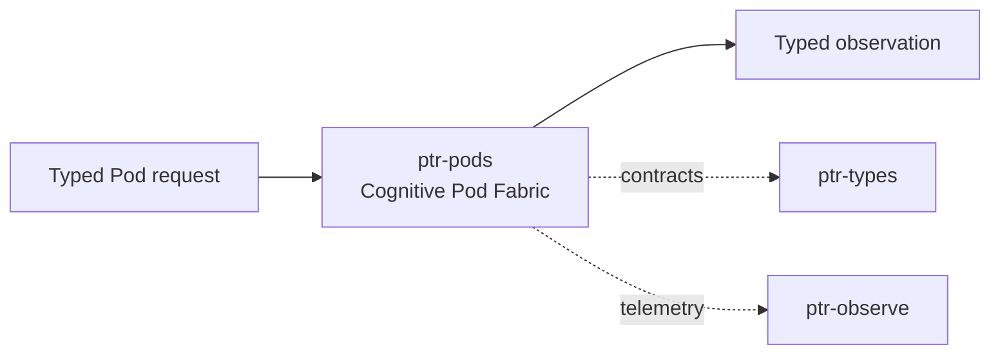

# ptr-pods — Cognitive Pod Fabric

> **Role:** Defines specialist computational modules through semantic contracts rather than fragile tool names.  
> **Maturity:** see the generated status below; production behavior must be proven by the linked experiments and component evaluations.

<!-- PTR:STATUS:BEGIN -->
## Current implementation status

> **Generated section.** Source of truth: [`component.toml`](component.toml) plus code-derived metrics from `src/`. Run `python3 scripts/update_component_docs.py --write` after editing implementation metadata. Do not hand-edit inside this block.

**Maturity:** `prototype`  
**Last reviewed:** 2026-10-05  
**Code footprint:** 22 Rust source files · 10571 nonblank source lines · 16 integration-test files · 168 test markers (`#[test]`, `#[tokio::test]`)

### Implemented now

- StructuralOp::outcomes is the single post-operation state table for an admitted structural operation (ExpertOutcome, OutcomeKind): operands first, then results; results enter Serving at state_version 1, Merge and Split sources become Superseded, Freeze gives Frozen, unfreeze Serving, Prune and Retire Retired with their reason, and each operand's state_version advances by one; a reactivated Retired(GateFailed) source yields no operand outcome because its pod now names the new generation. The runtime registry and the ptr-state projection both apply it
- Decoding an evidence output no longer sizes an allocation from the dependency or provenance count stored in the record: the vectors grow with what is read, so a forged count ends at the first missing byte as an error instead of a capacity-overflow panic
- PodRegistry::register replaces an existing (project, id) entry and returns the old one (kept for current callers); PodRegistry::register_new is the non-replacing insert that structural-admission paths must use: it returns PodRegistrationError::AlreadyRegistered and leaves the original entry unchanged; PodRegistry::replace_if_current(expected, new) is the compare-and-replace for the atomic takeover of an operand of the same operation (a retired-target reactivation puts generation g+1 on the same pod id): it swaps only when the entry for new's (project, id) is exactly expected (Arc::ptr_eq), returns the old entry, and otherwise leaves the registry unchanged with NotRegistered, NotCurrent or IdentityMismatch; the registry tracks no token-expert (layer, slot), so slot ownership is not checked there
- PodRegistry is keyed by project and id, so two projects may register the same Pod id without shadowing and no lookup path exists that takes an id alone
- PodManifest declares the one project a Pod serves; resolution inside another project finds nothing rather than a worse match
- PodManifest with capability, accepted/produced types, effects and protocol version
- Typed Pod associated Input/Output/Error contract
- Ready and Revoked lease typestates
- Revocation consumes Ready lease and produces Revoked lease
- invoke_with_lease requires PodLease<Ready>; compile-fail doctest rejects revoked lease
- Object-safe DynPod and PodRegistry resolve semantic capability plus accepted input type
- PodManifest::digest is a length-prefixed SHA-256 over project, id, capabilities, accepted/produced types, effects and protocol version; NeuralPodAdapter refuses a descriptor whose manifest_hash differs or whose input/output schema the manifest does not list
- PodRegistry::candidates returns only same-project Pod ids in canonical order; bind_registered/resolve_bound pin a (project, id, manifest) binding and resolve_bound returns nothing once the registered manifest differs
- NeuralPodDescriptor validates identity, non-zero manifest hash and generation, schemas, resources, tensor contract, provenance and an Admitted/Prepared/Ready lifecycle; transition_to allows only listed lifecycle edges and terminal states (Released/Revoked/Failed) cannot move on
- NeuralPodAdapter wraps a sync NeuralPodExecutor as a DynPod (activate, infer, release); a failed infer calls executor.abort so the lease is recovered, and an output type outside the manifest is rejected
- NeuralPodLease (Ready/Busy/Released/Revoked) rejects begin while Busy or Revoked; DeviceLease counts active tensors, refuses release while tensors are in use and refuses new tensors once Released, Revoked or Failed
- ReferenceNeuralExecutor is an in-process executor that checks the input type and returns the input bytes typed as the output schema; it is a contract reference, not a model, and ReferenceExecutorFactory builds it from a descriptor
- InMemoryArtifactCatalog admits descriptors by (artifact, generation), rejects a conflicting descriptor for the same generation, rejects invalidated generations and verifies lineage by exact descriptor equality; admit_with_manifest additionally checks manifest digest, pod id and schemas
- InMemoryResourceGovernor reserves RAM, VRAM and concurrency against fixed capacity; release is idempotent for an identical lease and rejects mismatched or unknown leases
- PodWireRequest/PodWireResponse validation binds manifest hash, artifact, generation, input type, protocol version, request id, revision and output type (types and checks only; no wire serialization in this crate)
- PodSemanticManifest validates identity, type contract, role/domain/provenance, resources, Active-needs-protocol and model-variant requirements, with a set-order-independent digest; ExecutionManifest binds lineage and has a canonical encode/decode that detects tampering and duplicate keys; LifecycleGate requires admission checks before Evaluated/Approved/Active
- ProtocolBinding enumerates transport kinds with a ProtocolProfile (pattern, delivery, connection scope, multiplexing, max frame bytes); PodLink validation checks addresses, project/namespace scope, deadline, hop limit, cycles, artifact, capability, ACL, non-zero attestation and egress policy, and validate_against_manifest requires the exact execution-manifest digest
- TcpProtocolExecutor and UdpProtocolExecutor (tokio) send one typed frame (u16 type length, u32 body length, type id, body) to an endpoint that must be on the link egress allow-list, with a timeout, an unexpired deadline and a 1 MiB frame cap; the executors do not themselves run PodLink::validate
- DuplexSession records sequenced, session-bound turn events (commit, interrupt with epoch bump, close) and resumes from a sequence cursor; a rejected event leaves the turn counter and epoch untouched, and emit refuses the kinds that move session state (TurnCommitted, TurnInterrupted, SessionClosed: TurnError::ReservedKind), which only commit_turn, interrupt and close may produce
- PodOutput has a canonical digest that is independent of provenance/dependency order and covers kind, payload, generation, digests, revision and verified flag; validate requires provenance, non-zero digests and the expected type, and rejects StateDelta/VerifiedResult unless promotion is allowed and the output is verified
- PodEvidenceBundle holds a sequence-checked chain of turn events and outputs, seals to a digest, replays deterministically, round-trips through canonical bytes preserving chain order, detects tampering, and carries an Ed25519 signature over the bundle digest via provider-neutral EvidenceSigner/EvidenceVerifier traits
- merge_hypotheses drops hypotheses whose VerificationReport is not Pass first and then rejects mixed generations among the ones that remain (a rejected hypothesis of another generation no longer aborts the merge), picks the highest-confidence (then lowest-latency, then branch id) output and deduplicates evidence
- PodCache key includes pod identity, semantic revision, execution manifest, capability, input digest, knowledge revision, principal and protocol, and supports predicate invalidation
- KvTensorBackend contract with a CPU InMemoryKvTensorBackend (F32 only): append, truncate, digest-bound snapshot and restore, device and schema checks, and a KvPageTable that reserves and releases logical pages; FP8/NVFP4/MX dtypes are declared but rejected as unsupported
- Feature-gated candle-cuda (off by default, adds optional candle-core with CUDA): CandleDenseExecutor loads an F32 [output, input] weight and optional bias from Safetensors and does a matmul on a CUDA device, and CandleKvTensorBackend keeps per-layer F32 KV tensors on CUDA behind a DeviceLease; this path could not be compiled or run in the review environment (no nvcc), so it is code-reviewed only
- KvTensorSchema has key_value_heads next to attention_heads (zero rejected, attention_heads must be a multiple of it); K/V width is key_value_heads * head_dim, and the dense snapshot digest binds key_value_heads (digest_versioned keeps a legacy v1 digest without it); KvBackendError gains OutOfMemory, InvalidPageState, PrefixMismatch and StaleLease and KvTensorBackend gains a default no-op revoke (src/kv.rs); only the page-table and snapshot tests in tests/kv.rs exercise this, the legacy-digest path has no test in tests/
- InMemoryPagedKvBackend (src/paged_kv.rs, CPU, F32) implements PagedKvTensorBackend over KvPageSize (power of two in 1..=256, default 16) pages bound by KvPageBinding (model, adapter, generation, execution manifest, principal, device, dtype, page size; batch_size must be 1): append fills and seals pages (Writable to Sealed with a per-page digest), seal_snapshot returns a lease that pins the pages while later appends copy the tail (copy-on-write, counted in KvPageMetrics::cow_copies), publish_prefix and fork_prefix_admitted share full sealed pages only under a KvPrefixKey of principal, execution manifest, model, adapter, generation, schema digest and prefix digest, and an append beyond capacity returns OutOfMemory without changing the cache; KvPagedSnapshot::validate/verify_digest check page structure, per-page digests and the snapshot digest and to_dense converts to a KvTensorSnapshot; covered by tests/kv.rs (paged_backend_validates_page_size_and_appends_across_boundaries, online_snapshot_is_immutable_while_tail_continues_with_cow, prefix_sharing_is_bound_to_principal_and_manifest (forks through a witness), paged_oom_does_not_mutate_cache, paged_snapshot_digest_binds_tensor_schema_and_page_structure); bind_runtime_lease/revoke_runtime_lease/StaleLease (KvRuntimeLeaseBinding needs non-zero placement epoch and fencing token), restore_paged and the page states Transferring/Revoked/Corrupt/Released are implemented in code but no test in tests/ calls them; plain allocate() uses a fixed internal legacy binding (generation 1, principal ptr:legacy-local)
- ReferenceCausalAttentionExecutor (src/attention.rs) runs one-layer multi-head causal attention through the KvContinuationExecutor trait (prefill takes N tokens, decode exactly one) against any PagedKvTensorBackend, with square F32 Q/K/V/O matrices (CausalAttentionWeights::identity or, behind candle-cuda, from_safetensors); it requires layer_count 1 and key_value_heads == attention_heads and takes a dense snapshot of the cache per token, so it is a correctness reference, not an efficient kernel; tests/kv.rs paged_prefill_then_decode_matches_full_causal_recompute checks that prefill+decode matches a full recompute on InMemoryPagedKvBackend with identity weights within 1e-6 and checks first_position/next_position
- Qwen2PagedDecoder (src/qwen.rs) is a single-decoder-layer CPU f32 reference for a Qwen2-style layer: RMSNorm, Q/K/V projections with bias, half-split RoPE (rope_theta), grouped-query attention over compact key_value_heads K/V stored in the paged backend, optional sliding_window, output projection, SwiGLU MLP (SiLU) and residuals; Qwen2LayerConfig::validate rejects zero sizes, non-divisible head counts, a non-positive or non-finite rope_theta/rms_norm_eps, an odd head_dim, and any rope_scaling or hidden_act other than None/Silu, and Qwen2DecoderWeights::validate checks all shapes; it requires layer_count 1 and batch_size 1, and there are no embeddings, LM head or multi-layer stack; tests/kv.rs qwen_config_rejects_invalid_grouped_query_attention and qwen_gqa_prefill_decode_matches_recompute_and_keeps_compact_kv (2 query heads, 1 KV head, near-diagonal toy weights) check config validation, prefill+decode against full recompute within 1e-6 and a [3, 2] compact KV shape; no test compares the output with an external Qwen reference or exercises sliding_window, and Qwen2DecoderWeights::from_safetensors (candle-cuda only, reads model.layers.{L}.* names) is code-only here
- Tier storage adapters (src/tier_storage.rs, on ptr-storage PreparedTierObject): KvTierAdapter and PagedKvTierAdapter prepare/restore KV snapshots under a KvTierBinding (logical id, generation, revision, context digest, placement epoch, fencing token; zero or blank values rejected), with the paged form writing one header chunk plus one chunk per page (magic PTRKVP3) and restore verifying chunk integrity, the page count and the digests; ModelWeightTierAdapter::prepare and ArtifactTierAdapter::prepare build tier objects whose schema digest binds the manifest, model/tensor/dtype/shape or artifact and provenance digests (ArtifactTierAdapter additionally requires the bytes to hash to artifact_digest; ModelWeightTierAdapter does not check the bytes against artifact_digest and neither has a restore function); tests/tier_storage.rs covers kv_snapshot_roundtrips_through_chunked_tier_object, kv_restore_rejects_changed_fencing_binding_and_corruption, paged_kv_roundtrip_preserves_one_chunk_per_page, paged_kv_roundtrip_preserves_compact_grouped_query_heads, paged_kv_restore_rejects_corrupt_page_chunk, kv_decoder_rejects_hostile_lengths_before_allocating (PTRKVTR1 magic, dense decoder only), weight_schema_binds_manifest_model_tensor_shape_and_dtype (only a dtype change is compared) and artifact_frontend_requires_content_digest_and_lineage; the decoders also accept the older PTRKVTR1 and PTRKVP2 formats, but no test restores a valid legacy record (the hostile-length test only feeds a bare PTRKVTR1 header), and the tests do not run the tier objects through any storage backend
- candle-cuda extensions (code-only: the feature and tests/candle_cuda.rs were not compiled or run here): CandleKvTensorBackend is now a type alias of CandlePagedKvBackend, which implements PagedKvTensorBackend with CUDA page bundles (each cache keeps a DeviceLease and its own stream device), and CandleGpuTierBackend implements the ptr-storage TierBackend (put/get/verify/delete chunk, health) with chunks held as CUDA byte tensors; tests/candle_cuda.rs has paged_cuda_snapshot_uses_cow_and_continues_causal_attention, cuda_gpu_tier_backend_roundtrips_verified_chunk and qwen2_safetensors_layer_runs_gqa_on_paged_cuda_cache next to the two older tests; the hardware results described in CANDLE_CUDA.md are not adopted here
- Pod-MoE expert proposals (src/expert.rs): StructuralOp is a typed enum carrying its operands (Birth{result}, Merge{sources,result}, Split{source,results>=2}, Freeze{target}, Reactivate{target,result: Option} with result required iff the target is Retired (Frozen with a result is UnexpectedResult), Prune{targets>=1, all Serving, one Token layer}, Retire{target,reason: Superseded or GateFailed only; Pruned uses Prune and InputRevoked is a runtime-grant ledger event, ReasonNotProposable}), so shapes like a birth with a target are unrepresentable; ExpertProposal::new validates in a documented order (canonical project id, proposer project, operand counts, projects, source state against the (OpKind, ExpertState) table via OpKind::allows_state, operation structure, result relations, distinct results) with non_exhaustive typed errors; ExpertState is Candidate, Gated, Serving, Frozen, Fenced, Superseded, Retired(RetiredReason) with a documented mapping to ptr-lineage AdapterStatus and ArtifactLifecycle (adapter_status_name, artifact_lifecycles); Retire is allowed exactly from Serving and Frozen (Candidate, Gated and Superseded give WrongTargetState); a Fenced operand is rejected for every operation with FencedTarget before the state table, so a policy cannot retire a revoked expert as Retired(GateFailed) and reactivate it from revoked weights, and a fenced expert reaches Retired(InputRevoked) only through the runtime revocation path (InputRevoked is neither a proposable reason nor a reactivation seed) and Frozen maps to Serving/Active; Merge needs Token-level sources sharing layer, base model and state, Prune targets share layer and base model (BaseModelRef{id,digest,generation} with a validated BaseModelId (1-128 bytes of ASCII [A-Za-z0-9._:-], BlankBaseModel/NonCanonicalBaseModel) so two records with the same weights and generation but different ids are different base models, for equality, the MixedBaseModels and result base-model checks and both ids; BaseModelRef::new rejects base generation 0, ZeroBaseModelGeneration; the id is in the canonical encoding, so the domain tags are bumped to ptr.pods.expert-proposal.v2 and ptr.pods.expert-operation.v2), results must be new pods in the proposal project with the sources' base model and a compatible level, only Frozen or Retired(GateFailed) can be reactivated (other retired reasons: SeedUnavailable) and Reactivate(Retired) yields exactly generation+1 of the same expert at the exact same level and Token slot (checked_add, overflow is an error); Birth, Merge and Split results must be generation 1 and results may not share a Token slot (DuplicateResultSlot; a source's slot may be reused), Reactivate(Frozen) is an in-place unfreeze with no result and no lineage transition (lineage stays Serving/Active), Reactivate(Retired(GateFailed)) requires a result that enters lineage as a new Candidate; Merge and Prune sources must occupy distinct Token slots (DuplicateSourceSlot); ExpertTarget and ExpertPodSpec have private validated fields (project and pod ids restricted to 1-128 bytes of ASCII [A-Za-z0-9._:-], generation >= 1, non-zero ManifestDigest and BaseModelDigest newtypes, BaseModelRef{digest,generation}, ExpertLevel::Token{layer,index}), ExpertTarget carries manifest digest and state_version as caller-observed claims re-checked at commit; a proposal binds a ProposerRef and the observed_at ledger CommitIndex, and identity is two-stage: operation_id() (the only way to obtain an OperationId, domain ptr.pods.expert-operation.v2; defined on ExpertOperationRequest, the validated pre-result form built from a RequestedOp, a StructuralOp whose results are ResultIntents (every ExpertPodSpec field except the training-produced manifest digest: project, pod, generation, level with Token layer and slot, base model ref), whose constructor runs exactly the rules of ExpertProposal::new through the same code (validate_requested), so no trained result has to be fabricated and two requests that would create different experts get different ids; ExpertProposal::operation_request() derives it and ExpertProposal::operation_id() delegates, so both agree and admission compares ids, there is no from_request binding) is SHA-256 over the pre-training fields only (op kind, operands with observed generation, manifest digest, state and state_version, retire reason, the ordered result intents (per result: project, pod, level including Token layer and slot, base model ref, generation), proposer, project, observed_at, rationale); the only thing it excludes is each result's training-produced manifest digest, so it is stable across training, while proposal_id() (the only way to obtain a ProposalId, the candidate id after training) is SHA-256 over the canonical encoding of every field including results; a proposal is inert data with no threshold, gate, verifier or policy field (invariants #4 and #11), ProposalParts exposes the complete field list (parts() destructures ExpertProposal exhaustively, a compile-time guard); acceptance by gates, verifier and ledger commit is not implemented; covered by tests/expert.rs
- ExpertCommitRecord (proposal, evidence digest, gate epoch; private fields) with a versioned canonical byte codec (version 2 magic PTREXR02 embeds the gate report bytes and the required gate configuration digest via new_with_evidence and is the only kind admission writes; version 1 magic PTREXR01, digest only via new, still decodes as legacy; fixed little-endian layout over every ExpertProposal and StructuralOp field) whose decode rebuilds every identity and the proposal through their constructors, refuses input over MAX_EXPERT_COMMIT_RECORD_BYTES (1 MiB, equal to the ledger's limit) before parsing, a zero digest, an unknown tag, truncated or trailing bytes and any byte string that does not re-encode to itself; it defines the opaque payload of the ledger's structural event and decides no admission
- PagedKvTensorBackend gained retire_prefix (default KvBackendError::Unsupported, so the candle backend, which is not built in CI, inherits it unchanged), take_fork_authority (default Unsupported) and fork_prefix_admitted (default Unsupported). InMemoryPagedKvBackend::retire_prefix removes the published prefix record and returns KvBackendError::PrefixNotFound for an absent key, so a double retire is visible; caches that already forked keep their Arc'd pages. take_fork_authority hands out the backend's single KvForkAuthority once (a second call is an error). The authority is the only way to mint a KvForkWitness (private fields, not Clone, consumed by value; compiler-enforced against a caller that only holds the backend, not against code that controls the process). fork_prefix_admitted checks that the witness belongs to this backend, names this prefix and is still pending (a KvWitnessRevoker held by the runtime catalog can revoke a pending witness), consumes it, and takes pages, length and offset from the registered record rather than from the caller's KvSharedPrefix; the cache must still match the prefix's principal, model, adapter and schema, but its generation and manifest digest are deliberately not compared, because liveness is the catalog's use-time check (doc 36 defect 2: the former binding-trusting PagedKvTensorBackend::fork_prefix is removed from the trait and from both backends, so fork_prefix_admitted is the only fork path; the trait and KvForkWitness docs carry compile_fail doctests that a fork without a witness and a second fork with a moved witness do not compile; a unit test in src/paged_kv.rs checks the second consume of one witness state is refused as Consumed). KvBackendError gained Unsupported, PrefixNotFound and ForkWitnessRejected. Covered by tests/kv_prefix_admission.rs: retire then fork, once-only authority, witness path ignoring the caller's generation but not its principal, foreign-backend, mismatched-prefix, revoked and used witnesses, caller-forged prefix length, default Unsupported through a delegating backend, and a bitwise-equal admitted fork plus decode against a full prefill
- Qwen2PagedStack (src/qwen_stack.rs) is the N-layer CPU f32 reference for experiment R005 (doc 36 P3): token embedding, N Qwen2-style decoder layers (reusing the single-layer math), final RMSNorm and an LM head giving logits per input token, behind KvContinuationExecutor over any PagedKvTensorBackend, with typed Qwen2StackError (ZeroLayers, ZeroVocab, HeadsNotDivisibleByKvHeads, KeyEncodingMismatch, CacheSchemaMismatch, TokenOutOfVocabulary, ContextExceeded, ...); Qwen2PagedStack::reference(config, seed) builds deterministic splitmix64-seeded weights (not trained weights); an optional per-head QK-norm (Qwen2QkNorm, default choice is the caller's, tests use Disabled and Enabled) is applied before RoPE; every token runs one at a time through the same path with fixed reduction order. KvKeyEncoding {PreRope, PostRope} (src/kv.rs) is declared by the cache schema (KvTensorSchema::key_encoding / with_key_encoding): PreRope stores keys unrotated and rotates them at attention time with the absolute position (defect 3 fix for the reference stack), PostRope is the legacy store-after-RoPE encoding; the encoding is carried as a suffix of KvTensorSchema::model (an additive design that avoids a new struct field in every KvTensorSchema literal), so every model-bound digest and KvPageBinding differs between encodings (PostRope adds no suffix, so existing digests are unchanged), and the stack, Qwen2PagedDecoder and ReferenceCausalAttentionExecutor (RoPE-free, so PostRope only) refuse a cache of the other encoding; KvTensorSchema::validate_key_encoding (called by InMemoryKvTensorBackend::validate_schema, so by allocation, and by every executor) rejects a model identity that contains the reserved marker 

### Missing for the target architecture

- Async invocation and PodContext
- Process-isolated, remote-Iroh and GPU/DLPack adapters
- Capability/effect validation against runtime policy
- Borrowed/busy/backpressured lease states and cancellation
- Admission of an ExpertCommitRecord lives in ptr-runtime (admit_expert_proposal); this crate only defines the validated byte format and the state table: nothing here checks the evidence, the gate epoch or the compare-and-set
- KV reuse beyond the catalog path of doc 36 phase P2: the key of publish_prefix is still the digest of the page digests (defect 1 is addressed by the runtime catalog's token-chain keys, not here); the binding-trusting fork_prefix was removed and fork_prefix_admitted under a single-use witness is the only fork path (defect 2), but the candle backend implements neither take_fork_authority, fork_prefix_admitted nor retire_prefix, so it fails closed on fork and its candle-cuda build is unverified here; the runtime and the single-layer Qwen2PagedDecoder still use post-RoPE keys and the pre-RoPE encoding exists only in Qwen2PagedStack and its schema marker (defect 3 is fixed for the reference stack only; the encoding is a model-name suffix rather than a dedicated KvTensorSchema field, and a real model name ending in the marker cannot be told apart); pages are not per layer (defect 5); the N-layer Qwen2PagedStack is a reference only and is not wired into ptr-runtime

### Next milestones

- Extend registry with lifecycle/backpressure and remote/process adapters
- Implement registry and one native reference Pod
- Run unseen-Pod semantic generalization experiment R002

### Linked experiments

- [R002](../../experiments/runtime/R002-unseen-pod-generalization/README.md) — `planned`
- [E001](../../experiments/system/E001-end-to-end/README.md) — `planned`

### Technology evaluations

- [environment-runtime](../../evaluations/components/environment-runtime/README.md) — `open`

### Decision records

- [ADR-0006-typed-isolate-runtime.md](../../research/decisions/ADR-0006-typed-isolate-runtime.md)
- [ADR-0011-semantic-pod-contracts.md](../../research/decisions/ADR-0011-semantic-pod-contracts.md)

### Current automated checks

- ready/wrong-Pod lease integration tests and revoked compile-fail doctest
- semantic capability/type registry resolution test
- ptr-pods integration tests (cargo test -p ptr-pods --locked, all passing without GPU): neural, device_lease, kv, evidence, output, semantic, native_protocol (loopback TCP and UDP) and registry
- tests/candle_cuda.rs (safetensors_matmul_runs_on_cuda_device, failed_cuda_kv_append_releases_tensor_use_for_recovery) exists behind the candle-cuda feature and needs a CUDA device; not run here
- tests/tier_storage.rs (8 tests: KV and paged-KV tier roundtrips, fencing-binding and corruption rejection, hostile-length decode, weight and artifact bindings) and the paged/Qwen tests in tests/kv.rs (paged_*, online_snapshot_*, prefix_sharing_*, qwen_*) run on CPU without a GPU and are part of the green workspace test run (1281 tests, 0 failures); this shows the tests pass, not that every claim in the entries above is covered: runtime-lease binding/revocation, restore_paged, the legacy PTRKVTR1/PTRKVP2 decoders, Qwen sliding_window and any comparison with an external Qwen reference have no test
- tests/candle_cuda.rs now also has paged_cuda_snapshot_uses_cow_and_continues_causal_attention, cuda_gpu_tier_backend_roundtrips_verified_chunk and qwen2_safetensors_layer_runs_gqa_on_paged_cuda_cache; they need the candle-cuda feature and a CUDA device and were not run here
- tests/expert.rs: valid proposal per operation, the (operation, state) table as a literal matrix and through validation, retire and reactivate reason rules, Retire versus LifecycleGate, prune base model, BaseModelRef validation, exact reactivation slot and generation (including u64::MAX), fresh generation-1 results, result slot uniqueness, the state-to-lineage mapping table, typed operand counts, project and base-model/level/generation result rules, merge/prune/reactivate/split rules, canonical ids, non-zero digest newtypes, validation order, deterministic proposal_id over every field and an exhaustive ProposalParts destructure (no override surface)
- workspace fmt/check/test/clippy
- tests/expert.rs commit-record cases: a round trip for each of the seven operation kinds, every truncation length, trailing bytes, wrong magic, unknown operation and option tags, an oversized count, an invalid proposal (state rewritten) and invalid identities or zero digests refused on decode
- tests/kv_fork_witness_only.rs (3 tests: a witness is spent by its fork, a fork of a retired prefix shares no pages and leaves the witness pending, a foreign-backend witness is refused); tests/kv_prefix_admission.rs (8 tests, cargo test -p ptr-pods --test kv_prefix_admission --locked): retire_prefix and the PrefixNotFound error, the once-only fork authority, witness-gated forks, and the bitwise parity of fork_prefix_admitted then decode against a full prefill (one layer, ReferenceCausalAttentionExecutor); the candle path is not compiled in CI and was not run

<!-- PTR:STATUS:END -->

## Position in PTR

Dedicated diagram source: [`docs/diagrams/components/ptr-pods.mmd`](../../docs/diagrams/components/ptr-pods.mmd)

**Upstream:** ptr-exec, ptr-router  
**Downstream:** ptr-verifier, ptr-semdb

## Mission

Defines specialist computational modules through semantic contracts rather than fragile tool names.

PTR keeps this responsibility in its own crate so the semantics remain stable even when an external library or implementation is replaced.

## Responsibilities

- Pod trait and manifests
- typed input/output contracts
- capability/effect declarations
- lease and lifecycle state
- local/process/remote/GPU Pod modes

## Explicit non-responsibilities

- global scheduling policy
- semantic authority
- model-specific prompting

## Data flow

| Direction | Contract |
|---|---|
| Input | Validated Pod request and typed input |
| Output | Typed result, observation, receipt or error |
| Failure | Explicit typed error / rejected state; no silent fallback that changes semantics |
| Observability | Standard PTR tracing fields and a stable component span |

## Technical approach

- Native Rust Pods
- process isolation
- Iroh remote transport
- DLPack/CUDA for tensor payloads
- ROCK-style environments for stateful action Pods

External projects are **candidates**, not architectural authority. The PTR-owned traits and domain types must remain usable with a replacement backend.

## Core invariants

1. Revoked leases cannot invoke.
2. Effects declared by the Pod are checked before execution.
3. Pod names are not the semantic contract.

These invariants should be executable wherever possible through unit, property, lifecycle or chaos tests.

## Failure model

The component must fail closed for semantic or effect-safety violations. Infrastructure failures should surface as typed errors that preserve request, revision, generation and provenance context. Retries must be idempotent whenever the operation may cross a process or network boundary.

## Performance model

Measure before optimizing. Benchmarks should record at least latency distribution, throughput, allocations/resident memory, queue depth or working-set size where relevant, and the cost of verification. Performance optimizations may not bypass generation, revision, capability or evidence checks.

## Security and privacy

- Treat external inputs and backend outputs as untrusted until validated.
- Do not put raw secrets/private evidence into generic tracing or inspection.
- Preserve provenance on every promotion from raw/possible evidence to stronger semantic state.
- External effects pass through `ptr-security` even if this component already performed local validation.

## Technology evaluation

- [environment-runtime](../../evaluations/components/environment-runtime/README.md)

A new candidate should be added with a reproducible benchmark and failure-semantics analysis rather than replacing the default ad hoc.

## Tests required before production use

- Contract/unit tests for all domain transitions.
- Invalid, stale-generation and stale-revision cases.
- Cancellation/retry behavior.
- Property tests for invariants where practical.
- Cross-backend equivalence if more than one backend exists.
- Observability and redaction checks.

## Related architecture

- [System architecture](../../docs/architecture/00-system.md)
- [Technical architecture](../../docs/TECHNICAL_ARCHITECTURE.md)
- [Component contracts](../../docs/COMPONENT_CONTRACTS.md)
- [Global invariants](../../docs/INVARIANTS.md)

