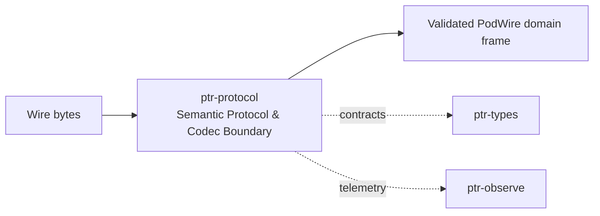

# ptr-protocol — Semantic Protocol & Codec Boundary

> **Role:** Defines PodWire semantics and converts versioned wire messages into validated PTR domain values.  
> **Maturity:** see the generated status below; production behavior must be proven by the linked experiments and component evaluations.

<!-- PTR:STATUS:BEGIN -->
## Current implementation status

> **Generated section.** Source of truth: [`component.toml`](component.toml) plus code-derived metrics from `src/`. Run `python3 scripts/update_component_docs.py --write` after editing implementation metadata. Do not hand-edit inside this block.

**Maturity:** `prototype`  
**Last reviewed:** 2026-10-14  
**Code footprint:** 8 Rust source files · 5631 nonblank source lines · 4 integration-test files · 123 test markers (`#[test]`, `#[tokio::test]`)

### Implemented now

- PodCall.deadline_ms (proto field 7, optional) converted to CallFrame.deadline, zero refused (ProtocolError::ZeroDeadline)
- PodWire v1 semantic version constant
- Prost-generated network schemas compiled with vendored protoc
- TypedPayload, CallFrame and CALL/RET/ERR/EVT/REVOKE domain frames
- PodCall carries no caller-supplied session identifier: the field is removed and its number and name reserved, because a request that crosses a trust boundary has no field naming its caller — held by a compile-fail doctest rather than by the comment beside it, since a comment cannot notice when somebody reuses the number
- Frame kind classification independent of transport
- Validated generated PodCall to domain CallFrame conversion with malformed-frame rejection
- src/activation.rs, the payload schemas of a split-pod (pipeline layer split) operation: ALLOWLISTED_TYPES names the two type ids a split operation admits (the activation chunk and the policy), admit/admit_typed decode a TypedPayload as exactly one of them and refuse any other type_id with SchemaError::NotAllowlisted whatever the bytes are, ActivationFrame (tokens, width, F32 dtype, positions, UpstreamChain of stage, base model, adapters and experts each with identity, generation, digest and fence epoch, placement epoch, tensor) round-trips through a bounded length-prefixed codec whose decoder validates tokens x width x dtype against the tensor length and the positions length against the row count for every frame, and refuses trailing bytes, an unknown dtype, a zero or oversize chunk count and an empty identity; frame_digest, chunk_digest (frame id, chunk place, whole-frame digest, parent operation, signed deadline, chain, chunk bytes) and envelope_signing_bytes define what a chunk binds and what its signature covers; covered by src/activation.rs tests and the E007 harness
- Review fixes of the split path: SplitPolicy is signed (signed_absolute_deadline_ms and a 64-byte signature over policy_signing_bytes), admit_view / ChunkView decode a chunk without copying its bytes so a receiver can authenticate before it allocates, chain_bytes gives the canonical bytes of a chain for digests. Version 1 of the frame is Exact-only: it carries no mode and no taint, and the downstream admission (ptr-runtime admit_frame) refuses an Approximate upstream with ChainFault::NotExact; the mode and taint fields are E008.
- src/negotiation.rs: semantic ProtocolVersion (major.minor.patch) and FeatureSet flags (idempotency, cancel, drain), a CompatibilityMatrix declaring which major pairs may talk and from which version each feature is usable, and negotiate / CompatibilityMatrix::negotiate, which deterministically and symmetrically picks the highest common version (the higher side speaks down) and the features usable at it, with typed rejections (InvalidLocalOffer/InvalidRemoteOffer, MajorMismatch, BelowMinimum, RequiredFeatureMissing); covered by a table of version pairs
- src/control.rs: ControlFrame (Hello with node id, version offer and nonce; Decl; Ack; Cancel; Bye; Call and Reply carrying a bounded IdempotencyKey and a TypedPayload) beside, not inside, the existing Frame enum, with a hand-written versioned codec (magic, codec version, tag, length-prefixed fields, 1 MiB frame cap, string, key and capability caps, every failure a typed CodecError, trailing bytes rejected); tests decode every truncation of every frame kind and seeded random and bit-flipped input without a panic
- src/session.rs: ProtocolSession, a state machine (Idle, HelloSent, Negotiated, Closing, Closed) that speaks ControlFrames with typed IllegalTransition, a bounded in-flight window in each direction, idempotency (a duplicate Call with the same key is answered from a bounded LRU of completed replies without running the handler again, a key reused with a different payload digest is rejected, a duplicate of a queued call is ignored; a repeated Reply to an already answered call, as when the original Reply is only delayed and the retry is answered from the peer's cache, is recognised from a bounded record of recently answered sequence numbers and Reply digests and ignored and counted, while a Reply for a never-sent sequence number or with a different digest stays UnknownSeq), Cancel of a queued call with an Ack, and Bye that drains in-flight work when the drain feature is negotiated; LoopbackTransport is an in-memory duplex of two bounded queues carrying encoded frames; an integration test runs two sessions through handshake, calls, a retried duplicate, a cancel and close
- Session frame producers validate encodability before changing state: start (the Hello and the Decl built from the config) and the responder side of on_frame(Hello) check the handshake frames before leaving Idle, so an unencodable config (empty or oversized node id, oversized capability list) is refused with SessionError::Encode and the session stays Idle; call, cancel and close run the codec's own encode on the frame they would return and refuse it with SessionError::Encode (empty or oversized type id, body over the frame cap, oversized reason) before reserving a window slot, consuming a sequence number, marking a call cancelling or entering Closing; serve_next refuses a handler reply the codec cannot encode with SessionError::Encode, does not leak the queued slot and remembers the key as a tombstone, so a retry of that key is refused with SessionError::ReplyUnencodable instead of running the handler a second time (the protocol has no error reply frame); covered by two tests in tests/control_session.rs
- Send-failure safety of ProtocolSession::pump: on_frame commits state (a cancelled call removed, Bye marked sent, Negotiated entered) before its answers are sent, so an answer the transport refuses (a full bounded queue) is now held (at most MAX_UNSENT_FRAMES = 2, the Hello and Decl of one handshake) and sent first on the next pump, which receives nothing until they are out; a Cancel Ack, a Bye reply and a responder Hello or Decl are no longer lost, and the peer's retried Cancel does not draw a second Ack; ProtocolSession::serve_all routes its Replies through the same hold (serve_next already removed the call and cached the result), sends held frames first, serves nothing while any is held and stops at the first refusal, so a Reply refused by a full queue is sent exactly once by the next serve_all or pump (the bound stays 2); serve_next itself returns the Reply to its caller, who owns sending it; callers of on_frame that send handled.send themselves must still send it; covered by five tests in tests/control_session.rs
- src/debug_json.rs: deterministic hand-written JSON rendering (rendering only, no parsing) of ControlFrame and NegotiatedSession with RFC 8259 escaping and hex bytes; payloads are rendered as length and SHA-256 digest only by default, raw hex (payloads up to 64 bytes) only via the explicit PayloadRendering::RawHex opt-in
- Review-fix bounds: SessionConfig window and completed_capacity above the hard maxima MAX_WINDOW (1024) and MAX_COMPLETED_CAPACITY (65536) are refused with the additive SessionError::WindowTooLarge and CompletedCapacityTooLarge, LoopbackTransport::pair clamps capacity to MAX_TRANSPORT_CAPACITY (65536); debug_json renders every payload as length and SHA-256 digest by default and raw hex only through render_control_frame_with and PayloadRendering::RawHex
- src/handle.rs, the tensor handle of the Pod data plane (doc 42 section 1): TensorHandle is a fenced, signed, single-use claim on a tensor a producer holds, with a closed Carrier enum ordered nearest to farthest (InProcess, Bytes, HostShm, CudaIpc, DevicePeer, PinnedHost, NvmeFile, Remote, each with a stable u8 code), a CarrierLocator variant per serialisable carrier, the BoundaryDtype and shape, byte_len (equal to product(shape) x dtype size with overflow-checked arithmetic, bounded by MAX_HANDLE_BYTES = MAX_FRAME_BYTES, at most 8 dimensions, inline Bytes payload at most 1 MiB and exactly byte_len), the UpstreamChain of the activation schemas, the placement epoch, a signed absolute deadline, a single-use nonce, a signed parent_operation_id and a signed consumer stage identity, a signed payload_type (the schema and argument slot of the tensor, bounded like an identity) (admission refuses a handle presented under another operation or addressed to another stage), content_digest (SHA-256 of the tensor bytes, checked by validate against the inline payload for the Bytes carrier, under the signature; verify_content(handle, bytes) checks length and digest and is what a carrier calls after mapping, because admission reads no memory) and a [u8; 64] signature field; the Remote locator names the whole frame (frame_id, frame_digest, chunk_total in 1..=MAX_CHUNKS_PER_FRAME); CudaIpc and DevicePeer carry a CudaExport (Legacy: cuIpcGetMemHandle bytes; Vmm: a POSIX fd slot passed with SCM_RIGHTS through the supervisor plus the allocation size, which must be non-zero and at least byte_len) plus an event handle, DevicePeer names its source_device and has no raw pointer, the exported buffer is a staging buffer owned by the supervisor so a producer crash cannot free it, and the consumer imports it, copies into a receiver-owned allocation and verifies content_digest there (zero-copy use is outside the contract); the handle describes a dense, row-major, contiguous tensor (a producer materializes a contiguous copy of a sliced or transposed view before signing); the HostShm locator is fd_slot (a descriptor slot passed with SCM_RIGHTS and bound to the nonce, a memfd cannot be reopened by name) plus offset; the hand-written codec (type id ptr.data.tensor-handle.v1, magic PTRHDL01) refuses a bad magic, truncation, trailing bytes, an unknown carrier or dtype, a locator of another carrier, every bound and a shape that disagrees with byte_len, and a handle of Carrier::InProcess can never be encoded; handle_signing_bytes (domain ptr.data.handle.v1) covers every field except the signature and handle_digest binds the signature too; no Ed25519 dependency, no pointer and no mapping: the crate defines bytes only, admission is ptr-runtime's handle_admission; the producer must not write a region after signing; covered by src/handle.rs tests and tests/handle.rs

### Missing for the target architecture

- The v1 ActivationFrame carries no KvReuseMode or KvReuseTaint (doc 36 section D lists them as frame fields); the downstream admission refuses a non-Exact upstream as stated by the caller, and the fields and the Approximate namespace belong to E008.
- rkyv/local codec adapter (the JSON debug adapter is render-only; there is no JSON parser and no rkyv adapter)
- The control frames are not in the prost schemas under proto/ and have no prost conversion; the codec is a separate hand-written format, and the wider PodWire design may define these frames differently
- Nothing over a real network speaks the control frames: the only speaker is the in-memory ProtocolSession over LoopbackTransport, with no timeouts, retry scheduling, reconnection, authentication or Hello nonce check; ptr-podwire carries Pod access in its own bounded format and does not use this session layer
- No carrier backend exists behind the handle: HostShm, CudaIpc, DevicePeer, PinnedHost and NvmeFile are typed locators only (ptr-fabric provides the Bytes and the sealed-memfd HostShm carriers; CudaIpc, DevicePeer and PinnedHost remain future, doc 42 stages S1 to S4), and the Remote locator names a frame digest without a chunk transfer behind it; the handle has no experiment record yet (E009 is only a proposal in doc 42 section 6)
- The activation schemas are hand-written bounded codecs beside the prost schemas, not generated ones; a Raw ancestry, input lineage, mode and taint field is E008's and will be a new type id, not a change of the v1 one

### Next milestones

- Expand validated domain↔prost conversion to all frame types and canonical fixtures
- Add canonical wire fixtures and malformed-frame corpus
- Define semantic contract version separately from wire schema version
- Put the control session on a real transport (ptr-net) behind a feature, with deadlines
- Share the chain and byte reader of activation.rs with handle.rs instead of the copy in handle.rs
- A canonical wire fixture and a malformed-handle corpus for the handle codec

### Linked experiments

- [R002](../../experiments/runtime/R002-unseen-pod-generalization/README.md) — `planned`
- [E001](../../experiments/system/E001-end-to-end/README.md) — `planned`
- [E007](../../experiments/system/E007-split-pod-kv/README.md) — `frozen`

### Technology evaluations

- [network-codec](../../evaluations/components/network-codec/README.md) — `open`
- [local-serialization](../../evaluations/components/local-serialization/README.md) — `open`

### Decision records

- [ADR-0004-backend-independence.md](../../research/decisions/ADR-0004-backend-independence.md)
- [ADR-0007-model-event-stream.md](../../research/decisions/ADR-0007-model-event-stream.md)

### Current automated checks

- tests/prost.rs pins the deadline_ms wire bytes; tests/validation.rs: zero deadline refused, absent and explicit values converted
- prost roundtrip and malformed PodCall validation tests
- negotiation table, control codec truncation and seeded random-input tests, session state machine and idempotency unit tests, tests/control_session.rs loopback end-to-end
- a compile-fail doctest that starts compiling, and therefore fails, if session_id is ever restored to PodCall
- handle codec tests: a round trip for every serialisable carrier, InProcess never encodes, a locator of another carrier is refused, every bound and the shape against byte_len, signing bytes change with each field and not with the signature
- workspace fmt/check/test/clippy

<!-- PTR:STATUS:END -->

## Position in PTR

Dedicated diagram source: [`docs/diagrams/components/ptr-protocol.mmd`](../../docs/diagrams/components/ptr-protocol.mmd)

**Upstream:** ptr-types  
**Downstream:** ptr-net, ptr-pods, ptr-podwire, ptr-runtime, ptr-server, ptr-bench

## Mission

Defines PodWire semantics and converts versioned wire messages into validated PTR domain values.

PTR keeps this responsibility in its own crate so the semantics remain stable even when an external library or implementation is replaced.

## Responsibilities

- PodWire frame semantics
- protocol versioning and compatibility rules
- wire-to-domain validation
- codec boundaries for Protobuf/JSON/rkyv

## Explicit non-responsibilities

- network transport
- Pod execution
- permission authorization

## Data flow

| Direction | Contract |
|---|---|
| Input | Network/local wire frames |
| Output | Validated domain protocol messages |
| Failure | Explicit typed error / rejected state; no silent fallback that changes semantics |
| Observability | Standard PTR tracing fields and a stable component span |

## Technical approach

- Prost/Protobuf candidate for network control
- Serde JSON for public/debug surfaces
- rkyv candidate for trusted local hot paths

External projects are **candidates**, not architectural authority. The PTR-owned traits and domain types must remain usable with a replacement backend.

## Core invariants

1. Successful decoding is not semantic validity.
2. Unknown protocol versions cannot silently execute.
3. Domain types never depend on generated Protobuf structs.

These invariants should be executable wherever possible through unit, property, lifecycle or chaos tests.

## Failure model

The component must fail closed for semantic or effect-safety violations. Infrastructure failures should surface as typed errors that preserve request, revision, generation and provenance context. Retries must be idempotent whenever the operation may cross a process or network boundary.

## Performance model

Measure before optimizing. Benchmarks should record at least latency distribution, throughput, allocations/resident memory, queue depth or working-set size where relevant, and the cost of verification. Performance optimizations may not bypass generation, revision, capability or evidence checks.

## Security and privacy

- Treat external inputs and backend outputs as untrusted until validated.
- Do not put raw secrets/private evidence into generic tracing or inspection.
- Preserve provenance on every promotion from raw/possible evidence to stronger semantic state.
- External effects pass through `ptr-security` even if this component already performed local validation.

## Technology evaluation

- [network-codec](../../evaluations/components/network-codec/README.md)
- [local-serialization](../../evaluations/components/local-serialization/README.md)

A new candidate should be added with a reproducible benchmark and failure-semantics analysis rather than replacing the default ad hoc.

## Tests required before production use

- Contract/unit tests for all domain transitions.
- Invalid, stale-generation and stale-revision cases.
- Cancellation/retry behavior.
- Property tests for invariants where practical.
- Cross-backend equivalence if more than one backend exists.
- Observability and redaction checks.

## Related architecture

- [System architecture](../../docs/architecture/00-system.md)
- [Technical architecture](../../docs/TECHNICAL_ARCHITECTURE.md)
- [Component contracts](../../docs/COMPONENT_CONTRACTS.md)
- [Global invariants](../../docs/INVARIANTS.md)

