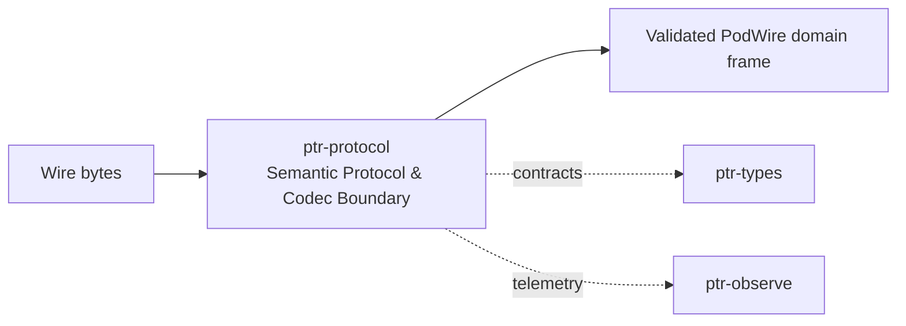

# ptr-protocol — Semantic Protocol & Codec Boundary

> **Role:** Defines PodWire semantics and converts versioned wire messages into validated PTR domain values.  
> **Maturity:** see the generated status below; production behavior must be proven by the linked experiments and component evaluations.

<!-- PTR:STATUS:BEGIN -->
## Current implementation status

> **Generated section.** Source of truth: [`component.toml`](component.toml) plus code-derived metrics from `src/`. Run `python3 scripts/update_component_docs.py --write` after editing implementation metadata. Do not hand-edit inside this block.

**Maturity:** `scaffold`  
**Last reviewed:** 2026-10-13  
**Code footprint:** 3 Rust source files · 967 nonblank source lines · 2 integration-test files · 31 test markers (`#[test]`, `#[tokio::test]`)

### Implemented now

- PodCall.deadline_ms (proto field 7, optional) converted to CallFrame.deadline, zero refused (ProtocolError::ZeroDeadline)
- PodWire v1 semantic version constant
- Prost-generated network schemas compiled with vendored protoc
- TypedPayload, CallFrame and CALL/RET/ERR/EVT/REVOKE domain frames
- PodCall carries no caller-supplied session identifier: the field is removed and its number and name reserved, because a request that crosses a trust boundary has no field naming its caller — held by a compile-fail doctest rather than by the comment beside it, since a comment cannot notice when somebody reuses the number
- Frame kind classification independent of transport
- Validated generated PodCall to domain CallFrame conversion with malformed-frame rejection
- src/activation.rs, the payload schemas of a split-pod (pipeline layer split) operation: ALLOWLISTED_TYPES names the two type ids a split operation admits (the activation chunk and the policy), admit/admit_typed decode a TypedPayload as exactly one of them and refuse any other type_id with SchemaError::NotAllowlisted whatever the bytes are, ActivationFrame (tokens, width, F32 dtype, positions, UpstreamChain of stage, base model, adapters and experts each with identity, generation, digest and fence epoch, placement epoch, tensor) round-trips through a bounded length-prefixed codec whose decoder validates tokens x width x dtype against the tensor length and the positions length against the row count for every frame, and refuses trailing bytes, an unknown dtype, a zero or oversize chunk count and an empty identity; frame_digest, chunk_digest (frame id, chunk place, whole-frame digest, parent operation, signed deadline, chain, chunk bytes) and envelope_signing_bytes define what a chunk binds and what its signature covers; covered by src/activation.rs tests and the E007 harness
- Review fixes of the split path: SplitPolicy is signed (signed_absolute_deadline_ms and a 64-byte signature over policy_signing_bytes), admit_view / ChunkView decode a chunk without copying its bytes so a receiver can authenticate before it allocates, chain_bytes gives the canonical bytes of a chain for digests. Version 1 of the frame is Exact-only: it carries no mode and no taint, and the downstream admission (ptr-runtime admit_frame) refuses an Approximate upstream with ChainFault::NotExact; the mode and taint fields are E008.

### Missing for the target architecture

- The v1 ActivationFrame carries no KvReuseMode or KvReuseTaint (doc 36 section D lists them as frame fields); the downstream admission refuses a non-Exact upstream as stated by the caller, and the fields and the Approximate namespace belong to E008.
- Semantic version negotiation and compatibility matrix
- rkyv/local codec adapter and JSON debug adapter
- Idempotency keys, ACK/CANCEL/BYE/HELLO/DECL frames from the wider PodWire design
- Anything speaking these messages: they remain a declared shape, and the Pod access protocol that does cross a network boundary is ptr-podwire's own bounded format rather than these
- The activation schemas are hand-written bounded codecs beside the prost schemas, not generated ones; a Raw ancestry, input lineage, mode and taint field is E008's and will be a new type id, not a change of the v1 one

### Next milestones

- Expand validated domain↔prost conversion to all frame types and canonical fixtures
- Add canonical wire fixtures and malformed-frame corpus
- Define semantic contract version separately from wire schema version

### Linked experiments

- [R002](../../experiments/runtime/R002-unseen-pod-generalization/README.md) — `planned`
- [E001](../../experiments/system/E001-end-to-end/README.md) — `planned`
- [E007](../../experiments/system/E007-split-pod-kv/README.md) — `frozen`

### Technology evaluations

- [network-codec](../../evaluations/components/network-codec/README.md) — `open`
- [local-serialization](../../evaluations/components/local-serialization/README.md) — `open`

### Decision records

- [ADR-0004-backend-independence.md](../../research/decisions/ADR-0004-backend-independence.md)
- [ADR-0007-model-event-stream.md](../../research/decisions/ADR-0007-model-event-stream.md)

### Current automated checks

- tests/prost.rs pins the deadline_ms wire bytes; tests/validation.rs: zero deadline refused, absent and explicit values converted
- prost roundtrip and malformed PodCall validation tests
- a compile-fail doctest that starts compiling, and therefore fails, if session_id is ever restored to PodCall
- workspace fmt/check/test/clippy

<!-- PTR:STATUS:END -->

## Position in PTR

Dedicated diagram source: [`docs/diagrams/components/ptr-protocol.mmd`](../../docs/diagrams/components/ptr-protocol.mmd)

**Upstream:** ptr-types  
**Downstream:** ptr-net, ptr-pods, ptr-podwire, ptr-runtime, ptr-server, ptr-bench

## Mission

Defines PodWire semantics and converts versioned wire messages into validated PTR domain values.

PTR keeps this responsibility in its own crate so the semantics remain stable even when an external library or implementation is replaced.

## Responsibilities

- PodWire frame semantics
- protocol versioning and compatibility rules
- wire-to-domain validation
- codec boundaries for Protobuf/JSON/rkyv

## Explicit non-responsibilities

- network transport
- Pod execution
- permission authorization

## Data flow

| Direction | Contract |
|---|---|
| Input | Network/local wire frames |
| Output | Validated domain protocol messages |
| Failure | Explicit typed error / rejected state; no silent fallback that changes semantics |
| Observability | Standard PTR tracing fields and a stable component span |

## Technical approach

- Prost/Protobuf candidate for network control
- Serde JSON for public/debug surfaces
- rkyv candidate for trusted local hot paths

External projects are **candidates**, not architectural authority. The PTR-owned traits and domain types must remain usable with a replacement backend.

## Core invariants

1. Successful decoding is not semantic validity.
2. Unknown protocol versions cannot silently execute.
3. Domain types never depend on generated Protobuf structs.

These invariants should be executable wherever possible through unit, property, lifecycle or chaos tests.

## Failure model

The component must fail closed for semantic or effect-safety violations. Infrastructure failures should surface as typed errors that preserve request, revision, generation and provenance context. Retries must be idempotent whenever the operation may cross a process or network boundary.

## Performance model

Measure before optimizing. Benchmarks should record at least latency distribution, throughput, allocations/resident memory, queue depth or working-set size where relevant, and the cost of verification. Performance optimizations may not bypass generation, revision, capability or evidence checks.

## Security and privacy

- Treat external inputs and backend outputs as untrusted until validated.
- Do not put raw secrets/private evidence into generic tracing or inspection.
- Preserve provenance on every promotion from raw/possible evidence to stronger semantic state.
- External effects pass through `ptr-security` even if this component already performed local validation.

## Technology evaluation

- [network-codec](../../evaluations/components/network-codec/README.md)
- [local-serialization](../../evaluations/components/local-serialization/README.md)

A new candidate should be added with a reproducible benchmark and failure-semantics analysis rather than replacing the default ad hoc.

## Tests required before production use

- Contract/unit tests for all domain transitions.
- Invalid, stale-generation and stale-revision cases.
- Cancellation/retry behavior.
- Property tests for invariants where practical.
- Cross-backend equivalence if more than one backend exists.
- Observability and redaction checks.

## Related architecture

- [System architecture](../../docs/architecture/00-system.md)
- [Technical architecture](../../docs/TECHNICAL_ARCHITECTURE.md)
- [Component contracts](../../docs/COMPONENT_CONTRACTS.md)
- [Global invariants](../../docs/INVARIANTS.md)

