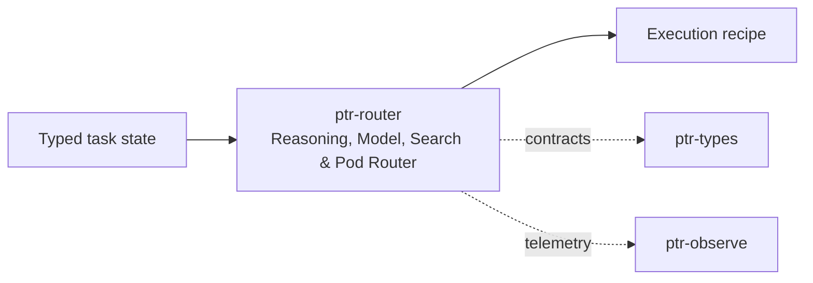

# ptr-router — Reasoning, Model, Search & Pod Router

> **Role:** Chooses how a task should be solved: neural reasoning, search, statistics, simulation, symbolic methods, Pods or combinations.  
> **Maturity:** see the generated status below; production behavior must be proven by the linked experiments and component evaluations.

<!-- PTR:STATUS:BEGIN -->
## Current implementation status

> **Generated section.** Source of truth: [`component.toml`](component.toml) plus code-derived metrics from `src/`. Run `python3 scripts/update_component_docs.py --write` after editing implementation metadata. Do not hand-edit inside this block.

**Maturity:** `scaffold`  
**Last reviewed:** 2026-10-04  
**Code footprint:** 4 Rust source files · 872 nonblank source lines · 2 integration-test files · 39 test markers (`#[test]`, `#[tokio::test]`)

### Implemented now

- RouteScore and RouteDecision with deterministic best-score selection
- RoutingPolicy scaffold with max_parallel and uncertainty_trigger
- RouteDecision::best breaks equal scores by the greater target instead of leaving the winner to iteration order
- PodRouter::candidates and select: candidates come only from the project-scoped ptr_pods::PodRegistry for a capability and input type, so an out-of-registry Pod identity is never returned. Every candidate scores a constant 1.0, so selection is not yet quality- or cost-aware; equal scores are broken by the greater PodId
- Router trait (object safe): policy(&RouteRequest) -> Result<RouteDistribution, RouteError>; a router returns a distribution over pods, not a choice and not a propensity. RouteRequest carries the registry scope, request id and digest and typed RouteFeatures (uncertainty, token budget, finite feature vector). RouteDistribution::new validates (PodId, weight) pairs (finite, non-negative, unique pods, positive total; typed DistributionError), normalizes them, drops weight-zero entries and keeps them sorted by PodId; the empty distribution means no choice. The normalized probabilities are quantized to integer interval widths that sum to exactly RouteDistribution::RESOLUTION = 2^53 (largest-remainder method, ties to the lesser PodId); a positive probability below 2^-53 is rejected with DistributionError::ProbabilityBelowResolution { pod }; probability(pod) returns the quantized mass width/2^53 (exact in f64) and width(pod) the integer width. The validated Propensity newtype (finite, in (0, 1], f64) is only ever produced from the sampled pod's quantized mass. PodRouter implements Router with a point mass on the pod select chooses (zeta tie-break unchanged), so propensity is exactly 1.0
- Trusted sampling and eligibility check: route_checked(&router, &request, &key: &SamplingKey) -> Result<Option<RoutedChoice>, RoutedError> recomputes request.registry.candidates(project, capability, input_type), rejects any pod with positive weight outside it with RouteError::IneligibleChoice { pod }, rejects an empty distribution while candidates exist with MissingChoice { candidates } (Ok(None) only when the candidate set is empty), then samples the pod itself: an integer draw d in [0, 2^53) selects the pod whose interval (ascending PodId order) contains d. The recorded Propensity is exactly the sampled pod's interval width / 2^53 (1.0 for a point mass), so it is the probability the sampler actually had and a router cannot supply a propensity independently; RoutedChoice::new is pub(crate) and RoutedChoice::draw() returns the draw for audit. CheckedRouter<R>::new(inner, key) exposes route(&request) with the same result, owns the key, is not Clone/Default and does not implement Router
- Hidden sampling draw: SamplingKey([u8; 32]) is a secret held only by the trusted side and never part of RouteRequest, so a policy that sees request_id and request_digest cannot predict the draw or correlate its weights with it. The draw is the top 53 bits of the first 8 bytes (big-endian) of HMAC-SHA256(key, len(request_id) as u64 big-endian || request_id || request_digest), HMAC implemented over the workspace sha2 crate and checked against RFC 4231 vectors. SamplingKey::from_bytes([u8; 32]) builds it (replay from a trusted store); it is not Clone/Copy/Default/PartialEq and its Debug prints SamplingKey(..). There is deliberately no generate(): std has no portable entropy source and the crate takes no entropy dependency, so the runtime supplies the 32 bytes. Replay needs the same key, which belongs in trusted runtime or ledger configuration
- Typed policy failures: RouteError::Policy { kind: PolicyFailure, source: Box<dyn Error + Send + Sync> } built with RouteError::policy(kind, source); PolicyFailure is a non_exhaustive stable category (Timeout, Unavailable, InvalidOutput, Internal) and Error::source returns the original error so the chain and downcasting survive; RouteError is no longer Clone/PartialEq
- RoutedError { request_id, request_digest, error: RouteError } is attached at route_checked, the mandatory routing boundary, with getters, a Display that names the request id and digest hex, and Error::source returning the inner RouteError. RouteRequest has no revision or generation and PodRegistry exposes none, so neither is recorded

### Missing for the target architecture

- Typed ExecutionRecipe
- Separate reasoning/model/search/Pod routing policies
- Cost, latency, uncertainty and capability-aware constraints
- Callers (for example ptr-runtime) are not yet migrated to route through route_checked; the check is opt-in until they are, and the type system does not yet force it (no opaque candidate token)
- Routing context beyond request id and digest (revision, generation) in RoutedError, pending those fields on RouteRequest
- Learned router head integration and routing telemetry sink (sampling is replayable and the propensity is bound to it, but no learned stochastic router or log sink exists yet)
- Sampling key provisioning, storage and rotation in the runtime/ledger configuration (the crate only takes a SamplingKey; it neither generates nor persists one, and the key is not zeroized on drop); the runtime must also record the key identity next to the logged draw and propensity
- Fallback/degradation plan when a backend is unavailable

### Next milestones

- Define typed operator/backend capability graph
- Implement deterministic baseline router
- Train/evaluate model operator routing with M004

### Linked experiments

- [M004](../../experiments/model/M004-operator-router/README.md) — `planned`
- [R002](../../experiments/runtime/R002-unseen-pod-generalization/README.md) — `planned`
- [E003](../../experiments/system/E003-token-efficiency/README.md) — `planned`

### Technology evaluations

- [inference-serving](../../evaluations/components/inference-serving/README.md) — `open`
- [distributed-data-compute](../../evaluations/components/distributed-data-compute/README.md) — `open`

### Decision records

- [ADR-0004-backend-independence.md](../../research/decisions/ADR-0004-backend-independence.md)
- [ADR-0011-semantic-pod-contracts.md](../../research/decisions/ADR-0011-semantic-pod-contracts.md)

### Current automated checks

- pod_router_breaks_equal_scores_by_pod_id: two registered Pods of equal score select the greater id (zeta over alpha)
- tests/router.rs: PodRouter policy is a point mass matching select including the zeta tie and logs propensity 1.0 through route_checked, works through &dyn Router and returns Ok(None) without candidates; a budget-determined policy logs 1.0 instead of an arbitrary number; a 1:3 stochastic policy records exactly 0.25 or 0.75 (interval width / 2^53) matching the sampled pod and the recorded draw, sampling is identical on replay with the same key, depends on the digest, and over 2000 request ids matches the weights within 0.05; a different key gives different draws; RouteDistribution rejects NaN, infinite, negative, all-zero, duplicate and overflowing weights with typed errors, quantized widths sum to exactly 2^53 for many weight shapes (including 1/3 splits with the remainder going to the lesser PodIds), a 1e-300 relative weight and anything below 2^-53 is rejected with ProbabilityBelowResolution while 2^-52 is accepted, and a router with a sub-resolution pod fails route_checked with the request context; a failing router yields Err distinguishable from Ok(None); Propensity rejects 0, negatives, values above 1, NaN, infinities and subnormals with an overflowing reciprocal and accepts f64::MIN_POSITIVE
- tests/router.rs: route_checked and CheckedRouter reject unknown and registered-but-unsupported pods with IneligibleChoice, reject a positive-weight ineligible pod and ignore a weight-0 one, reject an empty distribution with MissingChoice { candidates } while candidates exist and pass it when none do, leave PodRouter results identical to select and pass policy errors through; every failure carries the request id and digest, Display names the id and the source is the inner RouteError; RouteError::policy preserves the PolicyFailure kind and a downcastable source chain
- tests/router.rs: a gaming router that recomputes the previous public FNV/splitmix hash of (request id, digest) and puts weights .75/.25 or .25/.75 on it picks alpha 0.5 +- 0.05 of 2000 requests (not 1.0 as with a public draw), alpha is chosen with 0.75 +- 0.07 given its .75 prediction, and the mean logged propensity is 0.625 +- 0.03; SamplingKey Debug (also inside CheckedRouter) prints SamplingKey(..)
- src/sampling.rs unit tests: HMAC-SHA256 matches RFC 4231 test cases 2, 3 and 6 (including a key longer than the block size), draws are below 2^53
- workspace fmt/check/test/clippy

<!-- PTR:STATUS:END -->

## Position in PTR

Dedicated diagram source: [`docs/diagrams/components/ptr-router.mmd`](../../docs/diagrams/components/ptr-router.mmd)

**Upstream:** ptr-semdb, ptr-core  
**Downstream:** ptr-exec, ptr-search, ptr-pods

## Mission

Chooses how a task should be solved: neural reasoning, search, statistics, simulation, symbolic methods, Pods or combinations.

PTR keeps this responsibility in its own crate so the semantics remain stable even when an external library or implementation is replaced.

## Responsibilities

- reasoning operator policy
- model backend selection
- search strategy selection
- Pod selection
- budget/cost/latency policy

## Explicit non-responsibilities

- performing the selected computation
- authoritative verification
- persistent state

## Data flow

| Direction | Contract |
|---|---|
| Input | Task type, semantic snapshot, uncertainty, resource state and budgets |
| Output | ExecutionRecipe and operator mixture |
| Failure | Explicit typed error / rejected state; no silent fallback that changes semantics |
| Observability | Standard PTR tracing fields and a stable component span |

## Technical approach

- Heuristic policies first
- learned router later
- RLlib/GEPA-style policy optimization as experiments
- semantic-router only as an infrastructure-side deployment router

External projects are **candidates**, not architectural authority. The PTR-owned traits and domain types must remain usable with a replacement backend.

## Core invariants

1. Hard safety invariants are not learnable policy knobs.
2. Router decisions are observable and replayable.
3. Unavailable capabilities cannot receive positive executable weight.

These invariants should be executable wherever possible through unit, property, lifecycle or chaos tests.

## Failure model

The component must fail closed for semantic or effect-safety violations. Infrastructure failures should surface as typed errors that preserve request, revision, generation and provenance context. Retries must be idempotent whenever the operation may cross a process or network boundary.

## Performance model

Measure before optimizing. Benchmarks should record at least latency distribution, throughput, allocations/resident memory, queue depth or working-set size where relevant, and the cost of verification. Performance optimizations may not bypass generation, revision, capability or evidence checks.

## Security and privacy

- Treat external inputs and backend outputs as untrusted until validated.
- Do not put raw secrets/private evidence into generic tracing or inspection.
- Preserve provenance on every promotion from raw/possible evidence to stronger semantic state.
- External effects pass through `ptr-security` even if this component already performed local validation.

## Technology evaluation

- [inference-serving](../../evaluations/components/inference-serving/README.md)
- [distributed-data-compute](../../evaluations/components/distributed-data-compute/README.md)

A new candidate should be added with a reproducible benchmark and failure-semantics analysis rather than replacing the default ad hoc.

## Tests required before production use

- Contract/unit tests for all domain transitions.
- Invalid, stale-generation and stale-revision cases.
- Cancellation/retry behavior.
- Property tests for invariants where practical.
- Cross-backend equivalence if more than one backend exists.
- Observability and redaction checks.

## Related architecture

- [System architecture](../../docs/architecture/00-system.md)
- [Technical architecture](../../docs/TECHNICAL_ARCHITECTURE.md)
- [Component contracts](../../docs/COMPONENT_CONTRACTS.md)
- [Global invariants](../../docs/INVARIANTS.md)

