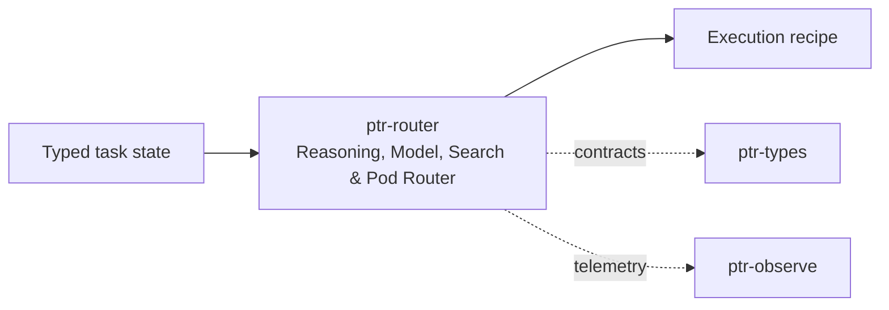

# ptr-router — Reasoning, Model, Search & Pod Router

> **Role:** Chooses how a task should be solved: neural reasoning, search, statistics, simulation, symbolic methods, Pods or combinations.  
> **Maturity:** see the generated status below; production behavior must be proven by the linked experiments and component evaluations.

<!-- PTR:STATUS:BEGIN -->
## Current implementation status

> **Generated section.** Source of truth: [`component.toml`](component.toml) plus code-derived metrics from `src/`. Run `python3 scripts/update_component_docs.py --write` after editing implementation metadata. Do not hand-edit inside this block.

**Maturity:** `scaffold`  
**Last reviewed:** 2026-10-04  
**Code footprint:** 3 Rust source files · 451 nonblank source lines · 2 integration-test files · 20 test markers (`#[test]`, `#[tokio::test]`)

### Implemented now

- RouteScore and RouteDecision with deterministic best-score selection
- RoutingPolicy scaffold with max_parallel and uncertainty_trigger
- RouteDecision::best breaks equal scores by the greater target instead of leaving the winner to iteration order
- PodRouter::candidates and select: candidates come only from the project-scoped ptr_pods::PodRegistry for a capability and input type, so an out-of-registry Pod identity is never returned. Every candidate scores a constant 1.0, so selection is not yet quality- or cost-aware; equal scores are broken by the greater PodId
- Router trait (object safe): route(&RouteRequest) -> Result<Option<RoutedChoice>, RouteError>, where RouteRequest carries the registry scope, request id and digest and typed RouteFeatures (uncertainty, token budget, finite feature vector) a learned router may condition on; Ok(None) means no candidate and Err(RouteError) a router failure (policy/model failure, invalid propensity, invalid features); RoutedChoice { route, propensity } supports off-policy evaluation, with the validated Propensity newtype (finite, in (0, 1], zero and values with a non-finite reciprocal excluded, f64 like ptr-branch auto_propensity); PodRouter implements it deterministically and infallibly with propensity exactly 1.0 and the same selection and tie-break as select
- Trusted eligibility check outside the policy: Router output is documented as untrusted (RoutedChoice::new accepts any PodRoute); route_checked(&router, &request) and the CheckedRouter<R> wrapper (itself a Router) recompute request.registry.candidates(project, capability, input_type) and reject a choice whose pod is not in it with RouteError::IneligibleChoice { pod } (unknown pod, or registered pod lacking the capability or input type); Ok(None) is accepted only when that candidate set is empty and otherwise rejected with RouteError::MissingChoice { candidates } (Ok(None) is reserved for 'the registry offers no candidate'); policy errors pass through unchanged
- Typed policy failures: RouteError::Policy { kind: PolicyFailure, source: Box<dyn Error + Send + Sync> } built with RouteError::policy(kind, source); PolicyFailure is a non_exhaustive stable category (Timeout, Unavailable, InvalidOutput, Internal) and Error::source returns the original error so the chain and downcasting survive; RouteError is no longer Clone/PartialEq

### Missing for the target architecture

- Typed ExecutionRecipe
- Separate reasoning/model/search/Pod routing policies
- Cost, latency, uncertainty and capability-aware constraints
- Callers (for example ptr-runtime) are not yet migrated to route through route_checked; the check is opt-in until they are, and the type system does not yet force it (no opaque candidate token)
- Learned router head integration and replayable routing telemetry (the propensity is defined, but no stochastic router or log sink exists yet)
- Fallback/degradation plan when a backend is unavailable

### Next milestones

- Define typed operator/backend capability graph
- Implement deterministic baseline router
- Train/evaluate model operator routing with M004

### Linked experiments

- [M004](../../experiments/model/M004-operator-router/README.md) — `planned`
- [R002](../../experiments/runtime/R002-unseen-pod-generalization/README.md) — `planned`
- [E003](../../experiments/system/E003-token-efficiency/README.md) — `planned`

### Technology evaluations

- [inference-serving](../../evaluations/components/inference-serving/README.md) — `open`
- [distributed-data-compute](../../evaluations/components/distributed-data-compute/README.md) — `open`

### Decision records

- [ADR-0004-backend-independence.md](../../research/decisions/ADR-0004-backend-independence.md)
- [ADR-0011-semantic-pod-contracts.md](../../research/decisions/ADR-0011-semantic-pod-contracts.md)

### Current automated checks

- pod_router_breaks_equal_scores_by_pod_id: two registered Pods of equal score select the greater id (zeta over alpha)
- tests/router.rs: Router for PodRouter matches select including the zeta tie, logs propensity 1.0, works through &dyn Router and returns Ok(None) without candidates; request features reach a test router that returns a non-1 propensity; a failing router yields Err distinguishable from Ok(None); Propensity rejects 0, negatives, values above 1, NaN, infinities and subnormals with an overflowing reciprocal and accepts f64::MIN_POSITIVE
- tests/router.rs: route_checked and CheckedRouter reject an unknown pod and a registered pod lacking the capability or the input type with IneligibleChoice, accept a valid candidate, reject Ok(None) with MissingChoice { candidates } while candidates exist and pass it when none do, leave PodRouter results identical (zeta tie-break, Ok(None)) and pass policy errors through; RouteError::policy preserves the PolicyFailure kind and a downcastable source chain
- workspace fmt/check/test/clippy

<!-- PTR:STATUS:END -->

## Position in PTR

Dedicated diagram source: [`docs/diagrams/components/ptr-router.mmd`](../../docs/diagrams/components/ptr-router.mmd)

**Upstream:** ptr-semdb, ptr-core  
**Downstream:** ptr-exec, ptr-search, ptr-pods

## Mission

Chooses how a task should be solved: neural reasoning, search, statistics, simulation, symbolic methods, Pods or combinations.

PTR keeps this responsibility in its own crate so the semantics remain stable even when an external library or implementation is replaced.

## Responsibilities

- reasoning operator policy
- model backend selection
- search strategy selection
- Pod selection
- budget/cost/latency policy

## Explicit non-responsibilities

- performing the selected computation
- authoritative verification
- persistent state

## Data flow

| Direction | Contract |
|---|---|
| Input | Task type, semantic snapshot, uncertainty, resource state and budgets |
| Output | ExecutionRecipe and operator mixture |
| Failure | Explicit typed error / rejected state; no silent fallback that changes semantics |
| Observability | Standard PTR tracing fields and a stable component span |

## Technical approach

- Heuristic policies first
- learned router later
- RLlib/GEPA-style policy optimization as experiments
- semantic-router only as an infrastructure-side deployment router

External projects are **candidates**, not architectural authority. The PTR-owned traits and domain types must remain usable with a replacement backend.

## Core invariants

1. Hard safety invariants are not learnable policy knobs.
2. Router decisions are observable and replayable.
3. Unavailable capabilities cannot receive positive executable weight.

These invariants should be executable wherever possible through unit, property, lifecycle or chaos tests.

## Failure model

The component must fail closed for semantic or effect-safety violations. Infrastructure failures should surface as typed errors that preserve request, revision, generation and provenance context. Retries must be idempotent whenever the operation may cross a process or network boundary.

## Performance model

Measure before optimizing. Benchmarks should record at least latency distribution, throughput, allocations/resident memory, queue depth or working-set size where relevant, and the cost of verification. Performance optimizations may not bypass generation, revision, capability or evidence checks.

## Security and privacy

- Treat external inputs and backend outputs as untrusted until validated.
- Do not put raw secrets/private evidence into generic tracing or inspection.
- Preserve provenance on every promotion from raw/possible evidence to stronger semantic state.
- External effects pass through `ptr-security` even if this component already performed local validation.

## Technology evaluation

- [inference-serving](../../evaluations/components/inference-serving/README.md)
- [distributed-data-compute](../../evaluations/components/distributed-data-compute/README.md)

A new candidate should be added with a reproducible benchmark and failure-semantics analysis rather than replacing the default ad hoc.

## Tests required before production use

- Contract/unit tests for all domain transitions.
- Invalid, stale-generation and stale-revision cases.
- Cancellation/retry behavior.
- Property tests for invariants where practical.
- Cross-backend equivalence if more than one backend exists.
- Observability and redaction checks.

## Related architecture

- [System architecture](../../docs/architecture/00-system.md)
- [Technical architecture](../../docs/TECHNICAL_ARCHITECTURE.md)
- [Component contracts](../../docs/COMPONENT_CONTRACTS.md)
- [Global invariants](../../docs/INVARIANTS.md)

