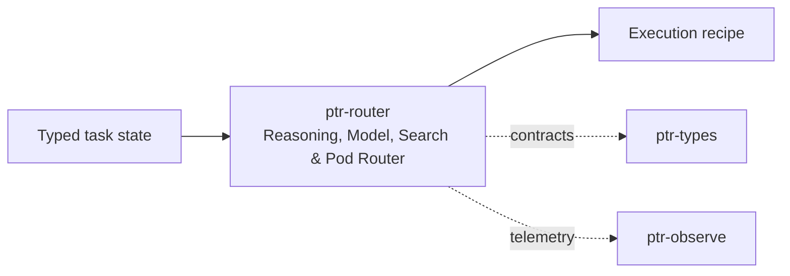

# ptr-router — Reasoning, Model, Search & Pod Router

> **Role:** Chooses how a task should be solved: neural reasoning, search, statistics, simulation, symbolic methods, Pods or combinations.  
> **Maturity:** see the generated status below; production behavior must be proven by the linked experiments and component evaluations.

<!-- PTR:STATUS:BEGIN -->
## Current implementation status

> **Generated section.** Source of truth: [`component.toml`](component.toml) plus code-derived metrics from `src/`. Run `python3 scripts/update_component_docs.py --write` after editing implementation metadata. Do not hand-edit inside this block.

**Maturity:** `scaffold`  
**Last reviewed:** 2026-10-10  
**Code footprint:** 11 Rust source files · 6558 nonblank source lines · 7 integration-test files · 140 test markers (`#[test]`, `#[tokio::test]`)

### Implemented now

- RouteScore and RouteDecision with deterministic best-score selection
- RoutingPolicy scaffold with max_parallel and uncertainty_trigger
- RouteDecision::best breaks equal scores by the greater target instead of leaving the winner to iteration order
- PodRouter::candidates and select: candidates come only from the project-scoped ptr_pods::PodRegistry for a capability and input type, so an out-of-registry Pod identity is never returned. Every candidate scores a constant 1.0, so selection is not yet quality- or cost-aware; equal scores are broken by the greater PodId
- Router trait (object safe): policy(&RouteRequest) -> Result<RouteDistribution, RouteError>; a router returns a distribution over pods, not a choice and not a propensity. RouteRequest carries the registry scope, request id and digest and typed RouteFeatures (uncertainty, token budget, finite feature vector). RouteDistribution::new validates (PodId, weight) pairs (finite, non-negative, unique pods, positive total; typed DistributionError), normalizes them by an order-stable total (weights summed in ascending value order with Neumaier compensation, so a dominant weight cannot round small ones away depending on PodId order), drops weight-zero entries and keeps them sorted by PodId; the empty distribution means no choice. The normalized probabilities are quantized to integer interval widths that sum to exactly RouteDistribution::RESOLUTION = 2^53 (largest-remainder method, ties to the lesser PodId); a positive probability weight/total below 2^-53 is rejected with DistributionError::ProbabilityBelowResolution { pod } before any width is assigned, so accept/reject and widths depend on the weight multiset, not on PodId order; the width correction is O(n log n) (one remainder sort, bulk deficit share, single-pass excess take-back); probability(pod) returns the quantized mass width/2^53 (exact in f64) and width(pod) the integer width. The validated Propensity newtype (finite, in (0, 1], f64) is only ever produced from the sampled pod's quantized mass. PodRouter implements Router with a point mass on the pod select chooses (zeta tie-break unchanged), so propensity is exactly 1.0
- Trusted sampling and eligibility check: route_checked(&router, &request, &key: &SamplingKey, &nonce: &DecisionNonce) -> Result<Option<RoutedChoice>, RoutedError> recomputes request.registry.candidates(project, capability, input_type), checks eligibility with one linear merge scan over the PodId-sorted distribution and candidates (PodRegistry::candidates is BTreeMap-ordered; a copy is sorted if it were not), rejects any pod with positive weight outside it with RouteError::IneligibleChoice { pod }, rejects an empty distribution while candidates exist with MissingChoice { candidates } (Ok(None) only when the candidate set is empty), then samples the pod itself: an integer draw d in [0, 2^53) selects the pod whose interval (ascending PodId order) contains d. The recorded Propensity is exactly the sampled pod's interval width / 2^53 (1.0 for a point mass), so it is the probability the sampler actually had and a router cannot supply a propensity independently; RoutedChoice::new is pub(crate) and RoutedChoice::draw() returns the draw and RoutedChoice::nonce() the DecisionNonce for trusted telemetry. CheckedRouter<R>::new(inner, key, nonces: NonceSequence) exposes route(&request) with the same result, owns the key and a strictly increasing NonceSequence (fresh nonce per call, RouteError::NonceExhausted instead of wrapping), is not Clone/Default and does not implement Router
- Hidden sampling draw: SamplingKey([u8; 32]) is a secret held only by the trusted side and never part of RouteRequest, so a policy that sees request_id and request_digest cannot predict the draw or correlate its weights with it. The draw is the top 53 bits of the first 8 bytes (big-endian) of HMAC-SHA256(key, nonce || len(request_id) as u64 big-endian || request_id || request_digest), HMAC implemented over the workspace sha2 crate and checked against RFC 4231 vectors. SamplingKey::from_bytes([u8; 32]) builds it (replay from a trusted store); it is not Clone/Copy/Default/PartialEq and its Debug prints SamplingKey(..). There is deliberately no generate(): std has no portable entropy source and the crate takes no entropy dependency, so the runtime supplies the 32 bytes. Replay is (key, nonce, request): route_checked with the recorded nonce reproduces the draw exactly, and the key belongs in trusted runtime or ledger configuration
- SamplingKey::key_id() and CheckedRouter::key_id(): the first 8 bytes of SHA-256("ptr-router/sampling-key-id/v1" || key), a non-secret identifier hashed inside this crate so the raw key never leaves it; the runtime records it next to every draw and propensity
- Per-decision sampling nonce: DecisionNonce([u8; 16], Copy, from_bytes/as_bytes) is part of the HMAC input and is not in RouteRequest, so a policy cannot learn it before choosing its distribution. NonceSequence::starting_at(instance: [u8; 8], first_counter: u64) hands out instance || counter (big-endian) from an AtomicU64 via next_nonce() -> Result<DecisionNonce, NonceExhausted>; it never wraps. A fresh decision never reuses a nonce, so a draw revealed by an earlier record of the same request id and digest does not predict the next draw and a stateful policy cannot force the choice while logging a smaller propensity; draw() and nonce() are for trusted telemetry and must not be fed back to a policy
- Typed policy failures: RouteError::Policy { kind: PolicyFailure, source: Box<dyn Error + Send + Sync> } built with RouteError::policy(kind, source); PolicyFailure is a non_exhaustive stable category (Timeout, Unavailable, InvalidOutput, Internal) and Error::source returns the original error so the chain and downcasting survive; RouteError is no longer Clone/PartialEq
- RoutedError { request_id, request_digest, error: RouteError } is attached at route_checked, the mandatory routing boundary, with getters, a Display that names the request id and digest hex, and Error::source returning the inner RouteError. RouteRequest has no revision or generation and PodRegistry exposes none, so neither is recorded
- Finding routing (src/findings.rs): FindingRouter maps a VerificationReport to a typed RouteOutcome over role-tagged Pods. classify(report, required, &RouterLimits) is the only place Accept is decided and it returns the sealed Accepted proof (no public constructor): Pass with no hard finding at the required level. Fail with at least one hard finding is Repair, one CodeRoute per distinct hard code in report order, sampled among the eligible repair-role Pods registered for that code; a code with no eligible Pod is an explicit CodeRoute::Unroutable, counted (the signal for later expert birth). Unknown, Disputed, Fail without a hard finding, a Pass carrying a hard finding (ForgedPass), a Pass below the required level, too many codes and an oversized code are never Repair and never Accept (classify is pinned to ptr-feedback Candidate::passes and Critique::from_report over the full status x level x required x finding matrix): a typed FallbackPolicy sends each to Regenerate (a proposal-role Pod; Escalate with NoProposer when none is eligible) or Escalate. BelowLevel defaults to Regenerate because there is no typed re-verify action; TooManyCodes, OversizedCode, Disputed and ForgedPass default to Escalate
- Bounded state (invariant 8): RouterLimits caps distinct hard codes per report (32), code length (128 bytes) and tracked unroutable counters (1024; further codes share unroutable_overflow, counters saturate); classify holds at most cap+1 codes (BTreeSet membership); FindingRegistry::with_capacity bounds codes and Pods per role (RegistryError::CapacityExceeded); a record stores the sampling support, not the registered list
- Eligibility: every FindingRouteRequest carries a PodEligibility view (current_generation(pod) -> Option<Generation>; EligibilitySnapshot is the in-memory implementation). Only eligible registered Pods are admissible, a registered but ineligible Pod is never chosen and is counted in ineligible_skipped, and the chosen Pod's generation is recorded (pod_generation) so propensity is conditional on the eligible set
- Finding-route sampling and logging: the choice uses the hidden keyed draw, a fresh nonce and the quantized RouteDistribution widths of route_checked, with a purpose-labelled draw input (ptr-router/finding/v1/<class>/<request id>) so draws do not collide with CheckedRouter on a shared key and nonce start. A router-owned Exploration (default 0.05, typed, 0 or in [1e-6, 1]) mixes the scorer distribution with uniform over the eligible Pods so every eligible Pod keeps propensity >= epsilon/n. Each FindingRouteRecord carries request id and digest, class, the sampled support (Pod and interval width), Pod, Pod generation, Propensity in (0, 1], draw, nonce, key id and registry generation; ips_weight(Probability) is finite. An AdmissibleScorer may only return weights over the eligible admissible Pods (a Pod outside is OutsideAdmissibleSet, no weight is NoMass, checked before any nonce is drawn); it never names an outcome class and is not consulted for Accept or Escalate (invariant 11). FindingRouteError carries the request id and digest, has a typed kind and a source chain
- FindingRegistry: deterministic (PodId-ordered) repair-role Pods per FindingCode and proposal-role Pods, versioned by RegistryGeneration; typed RegistryUpdate { expected, change: RegistryChange } is refused with RegistryError::StaleGeneration, AlreadyRegistered, NotRegistered, CapacityExceeded or GenerationExhausted and then changes nothing
- Self-model (src/self_model.rs; HOT-2/HOT-3 functional analogue, not a claim about experience): SelfModel is a bounded deterministic online estimator over typed traces (SelfContext: role, producing Pod and generation, round, budget left, required verification level, finding or refusal codes of the last report; SelfOutcome built by classify from a VerificationReport and the router's FindingRouteRecord, carrying the routed Pod, its generation and the logged Propensity). It predicts before each update (prequential): P(next proposal passes the gate) as a Beta-Bernoulli estimate shrunk to the rate of the other contexts, a categorical over the first hard finding code, and the Pod (with generation) the router will pick, where the Other bucket is scored as a class. Every prediction is logged in a ring and scored online (multiclass Brier, top-label ECE over 10 fixed equal-width bins, Wilson accuracy, a class-conditional P(pass) reliability table; definitions equal ptr_analytics brier_score and expected_calibration_error(EqualWidth(10))). SelfModelLimits cap every table with overflow buckets or eviction, counters and the version saturate, long codes and Pod ids become hashed markers, the SHA-256 digest covers every table and the log, no clock, no randomness, only exactly rounded arithmetic in the update path
- Self-model hints and authority: repair evidence is an inverse-propensity estimate per (code, routed Pod, Pod generation) with the code's logged-step total as the denominator, so traffic a boost adds does not inflate a Pod; one canonical code list (sorted, distinct, bounded) is used for keys, learning and hints; the pair table evicts probationary pairs first, then the least evidenced. SelfModelHint::PreferRepairPod needs two Pods with enough evidence and a lower bound above the runner-up's upper bound; EscalateEarly needs a Wilson upper bound below the threshold. Hints are plain data with no conversion to Accepted or RegistryUpdate, SelfModel holds no router reference and is not an AdmissibleScorer (compile-fail doctests E0277 and E0423 with positive twins, plus tests/authority_surface.rs which pins that the two source files never name a registry, an update, the router or the Accepted constructor and that only ControlledScorer implements the scorer trait)
- C002 harness: TraceLearner (predict(&SelfContext), learn(&SelfTraceStep)) is implemented by SelfModel and by the baselines GlobalRateProbe, LookupTableProbe (raw-context table of equal capacity) and LinearProbe (hashed one-hot features, exp-free link); evaluate_prequential reports binary Brier, Brier skill against the base rate, log loss, AUROC and the multiclass-Brier/top-label-ECE calibration; shuffled_labels is the negative control and FeatureMask the feature ablation
- Attention schema (src/attention_schema.rs; AST-1 functional analogue): AttentionSchema keeps per routing class a moving average of the logged composite attention (FindingRouteRecord::support widths), shrunk inverse-propensity pass rates from settle(record, passed), and a bounded preference table that apply_hints replaces wholesale with validated PreferRepairPod hints (length caps, evidence, finite bounds, lcb above ucb, TTL in observed records, generation match). It forecasts each record's support before learning and reports schema accuracy as the expected hit rate under the logged policy next to the chance and oracle levels and a skill score, with raw hits as a noisy diagnostic only; duplicates are ignored and counted; a Pod whose generation changes loses its statistics
- Control: ControlledScorer<S: AdmissibleScorer> wraps the inner scorer and implements AdmissibleScorer, with w_i = inner_i * clamp(balance_i * hint_i, 1/R_i, R_i), balance_i = (target_i / forecast_i)^beta with beta in {0, 1/2, 1, 2} (exactly rounded), target = power-normalised verifier-grounded pass rates mixed with uniform, and R_i = min(R, 1 + seen_i / k) so a new Pod is not flooded; the final-to-inner ratio is within [1/R, R] including the hint boost (hint_boost <= R <= 64), the pairwise ratio within R^2 times the inner ratio, the router's exploration floor, hidden draw, OutsideAdmissibleSet check and propensity logging stay in force, zero inner weights stay zero and pods outside the admissible set are passed through so the router still refuses them. ControlArm is typed configuration for C003: InnerOnly, ObserveOnly (exactly the inner weights), BalanceOnly, HintOnly, Full and FullMismatched (the forecast rotated by one Pod, the falsifier)
- RepairRoleAssignments (verifier_roles.rs) builds the repair roster from ptr-verifier's finding-code table: assign(RepairRole, PodId) per Pod, repairers() yields the (PodId, Vec<FindingCode>) shape of the runtime Roster, register(&mut FindingRegistry) registers every (code, Pod) pair of the assigned roles (idempotent, capacity errors surfaced); finding_codes_for_role lists a role's codes. Soft codes have no role and are never registered. classify and the routing rules are unchanged
- L1 learning (src/learning.rs; package VL): RoutingLearner keeps one Beta posterior per (route class, Pod) (the class is repair/<code> or regenerate; the scope of the learner names the task kind, so a (finding code, task kind, Pod) triple is an arm), bounded by max_arms and a bounded decision log (oldest dropped by age). settle(record, VerifierReward) counts the verdict and logs a LoggedDecision (class, exact sampling support, chosen Pod, reward, router exploration floor). VerifierReward has no public constructor from a number: from_class(&ReportClass) is 1 exactly for the sealed Accept that classify alone builds, NOT_CLEARED is the constant 0, replayed(bool) re-states a logged verdict (a compile_fail doctest pins the private field). snapshot() freezes a LearnedPolicy (digest over scope, settings, cutoff and every posterior) that implements AdmissibleScorer by Thompson sampling with a SplitMix64 stream seeded from the snapshot, the class and the admissible set only (weights are one plus the number of wins in the draws, over exactly the admissible Pods), so the policy's propensity is a deterministic function an estimator can rebuild. The router keeps the exploration floor and the eligibility filter (a weight on a Pod outside the admissible set is refused, a zeroed Pod keeps epsilon/n)
- Off-policy evaluation and promotion (src/ope.rs, src/policy_book.rs; package VL): estimate_policy gives IPS, SNIPS and doubly robust values with standard errors and the effective sample size over LoggedDecisions, rebuilding the target distribution with the same mixed_distribution function FindingRouter::sample uses (floor included); it refuses an empty log, a logged propensity below epsilon/|support| (no positivity), a policy naming a Pod outside the logged admissible set, an out-of-range reward model and non-finite estimates. compare_policies is a paired difference with a one-sided lower confidence bound. PromotionGate::assess(log, candidate, incumbent, incumbent_digest) refuses a log that contains a decision the candidate trained on (seq < cutoff), too few records, too small an effective sample, or a lower bound not above the margin; only a pass yields a sealed PromotionEvidence (digest bound to candidate, incumbent, log, estimator, numbers). PolicyBook is the host's owner of the active policy: promote(LearnedPolicy, evidence) checks scope, candidate digest and that the evidence was sealed against the policy active now, install it behind an ActiveScorer handle (read-only AdmissibleScorer the router holds), and returns a PolicyEvent; rollback() returns to the previous policy. The loop holds no PolicyBook (source scan)

### Missing for the target architecture

- Typed ExecutionRecipe
- Separate reasoning/model/search/Pod routing policies
- Cost, latency, uncertainty and capability-aware constraints
- Routing context beyond request id and digest (revision, generation) in RoutedError, pending those fields on RouteRequest
- Learned router head integration and routing telemetry sink (sampling is replayable and the propensity is bound to it, but no learned stochastic router or log sink exists yet)
- The type system does not yet force callers through route_checked (no opaque candidate token); ptr-runtime::run_resumable_with_pods_using_router and ptr-server do route through it, while the convenience wrappers run_resumable_with_pods and run_model_with_pods still call PodRouter::select directly
- Nonce persistence across restarts: ptrd uses a fresh random 8-byte instance id per process with the counter at 0, so nonces are unique per incarnation but no counter is stored; a replay needs the recorded nonce, which the runtime logs in RuntimeEvent::PodRouted
- Sampling key rotation and zeroization on drop: ptrd stores one 32-byte key in <data_dir>/router-sampling.key (mode 0600, unix) and logs only SamplingKey::key_id; a rotated key is not retained, so decisions recorded under an older key_id can no longer be replayed
- Self-model and attention schema are statistical (counts) estimators on typed traces: no model-internal state, no OLMoE routing traces, no wiring into ptr-runtime or RepairLoop, no persistence of either, hint staleness only by TTL and generation, and no experiment evidence yet that either helps (C002 and C003 are the tests, with the equal-capacity probes and the arms above as baselines). Interval estimates for the schema accuracy under dependence (blocked or paired per-seed) are left to the experiment
- Fallback/degradation plan when a backend is unavailable
- FindingRouter is not yet wired into ptr-runtime or ptr-feedback RepairLoop: the runtime must supply a PodEligibility view derived from ptr_pods::PodRegistry (and lease through the typestate API), treat a FindingRouteError as escalation never as acceptance, and bound attempts itself (Regenerate and Repair outcomes are stateless, so a loop needs its own budget); the only AdmissibleScorers are UniformScorer and the statistical ControlledScorer wrapper (no neural scorer); counters are in memory and not persisted; FindingCode is not validated beyond the length limit enforced by classify
- L1 learning is a context-free bandit per (class, Pod): no LinUCB or feature-based policy, no workspace or hint features, and the OPE normal approximation needs hundreds of decisions (the gate refuses fewer). Reward attribution when one repair attempt routed several codes is joint (the single verdict on the repaired candidate is every route's reward). Policy promotion is a host action recorded as an in-memory runtime event, not a ledger event; a restart returns to the uniform policy until the host re-promotes. No evidence yet that a learned router helps a model-backed loop (F004/F005)

### Next milestones

- Define typed operator/backend capability graph
- Implement deterministic baseline router
- Train/evaluate model operator routing with M004

### Linked experiments

- [M004](../../experiments/model/M004-operator-router/README.md) — `planned`
- [R002](../../experiments/runtime/R002-unseen-pod-generalization/README.md) — `planned`
- [E003](../../experiments/system/E003-token-efficiency/README.md) — `planned`

### Technology evaluations

- [inference-serving](../../evaluations/components/inference-serving/README.md) — `open`
- [distributed-data-compute](../../evaluations/components/distributed-data-compute/README.md) — `open`

### Decision records

- [ADR-0004-backend-independence.md](../../research/decisions/ADR-0004-backend-independence.md)
- [ADR-0011-semantic-pod-contracts.md](../../research/decisions/ADR-0011-semantic-pod-contracts.md)

### Current automated checks

- unit tests: a role registers its Pod for exactly the table's codes of that role, repairers() has the roster shape without duplicate codes, registering twice is idempotent, every hard code of the verifier table is routable once its role is filled and no soft code is
- pod_router_breaks_equal_scores_by_pod_id: two registered Pods of equal score select the greater id (zeta over alpha)
- tests/router.rs: PodRouter policy is a point mass matching select including the zeta tie and logs propensity 1.0 through route_checked, works through &dyn Router and returns Ok(None) without candidates; a budget-determined policy logs 1.0 instead of an arbitrary number; a 1:3 stochastic policy records exactly 0.25 or 0.75 (interval width / 2^53) matching the sampled pod and the recorded draw, sampling is identical on replay with the same key, depends on the digest, and over 2000 request ids matches the weights within 0.05; a different key gives different draws; RouteDistribution rejects NaN, infinite, negative, all-zero, duplicate and overflowing weights with typed errors, quantized widths sum to exactly 2^53 for many weight shapes (including 1/3 splits with the remainder going to the lesser PodIds), a 1e-300 relative weight and anything below 2^-53 is rejected with ProbabilityBelowResolution while 2^-52 is accepted, and a router with a sub-resolution pod fails route_checked with the request context; a failing router yields Err distinguishable from Ok(None); Propensity rejects 0, negatives, values above 1, NaN, infinities and subnormals with an overflowing reciprocal and accepts f64::MIN_POSITIVE
- tests/router.rs: route_checked and CheckedRouter reject unknown and registered-but-unsupported pods with IneligibleChoice, reject a positive-weight ineligible pod and ignore a weight-0 one, reject an empty distribution with MissingChoice { candidates } while candidates exist and pass it when none do, leave PodRouter results identical to select and pass policy errors through; every failure carries the request id and digest, Display names the id and the source is the inner RouteError; RouteError::policy preserves the PolicyFailure kind and a downcastable source chain
- tests/router.rs: a replay-gaming policy that is handed the previous draw of the SAME request id and puts .75 around it chooses its heavy pod with frequency 0.75 +- 0.05 over 2000 CheckedRouter routings (fresh nonces), but would force it (> 0.99) if the nonce were reused; CheckedRouter issues distinct, increasing nonces (instance || counter) with uniform, independent draws (no repeats, successive-lower rate 0.5 +- 0.05); route_checked with the recorded (key, nonce, request) reproduces the RoutedChoice exactly and another nonce changes the draw; an exhausted NonceSequence fails with NonceExhausted; 10_000 candidates route quickly and an ineligible pod sorting first, in the middle or last is rejected; the same weights on pods in different PodId orders give identical accept/reject and identical widths per weight, 1.0 plus 1000 tails of 2^-53 is rejected in every order while tails of 2^-52 are accepted with equal widths, and 50_000 weights quantize quickly to exactly 2^53
- tests/router.rs: a gaming router that recomputes the previous public FNV/splitmix hash of (request id, digest) and puts weights .75/.25 or .25/.75 on it picks alpha 0.5 +- 0.05 of 2000 requests (not 1.0 as with a public draw), alpha is chosen with 0.75 +- 0.07 given its .75 prediction, and the mean logged propensity is 0.625 +- 0.03; SamplingKey Debug (also inside CheckedRouter) prints SamplingKey(..)
- tests/router.rs: CheckedRouter<PodRouter> is Send + Sync and exposes the key id of its key, and a different key has a different id; src/sampling.rs: key_id is stable, distinct per key and not a prefix of the key
- src/sampling.rs unit tests: HMAC-SHA256 matches RFC 4231 test cases 2, 3 and 6 (including a key longer than the block size), draws are below 2^53, the nonce changes the draw, NonceSequence is strictly increasing and never wraps
- tests/findings.rs: every status x level x finding combination maps by the verifier alone; classify equals ptr-feedback Candidate::passes and Critique::from_report over status x level x required x findings; a forged Pass is never Accept or Repair under either action; Unknown and Disputed are never Repair; the scorer is never consulted for Accept, forged-pass or Unknown escalation or NoProposer, and sees exactly the eligible Pods of each class; ineligible Pods are never chosen, counted, and an all-ineligible class is Unroutable or NoProposer; limits on codes, code length and counters (overflow bucket, saturating) and registry capacity hold; four-Pod propensities sum to 1 and match frequencies within 0.03 over 4000 requests; a 3:1 scorer matches 0.75 within 0.03; the exploration floor gives the starved Pod propensity 0.1 and frequency 0.1 within 0.02; failed routes leave counters unchanged; IPS and SNIPS recover known target values; stale, duplicate and missing registry updates and GenerationExhausted change nothing; records carry the registry generation of route time
- tests/self_model.rs: hand-computed multiclass Brier, top-label ECE and Wilson values and agreement with ptr_analytics to 1e-12; prequential order pinned by exact equalities (the returned prediction equals the pre-update predict, the first prediction is the prior, a CalibrationTracker rebuilt from the log equals the model's own pass report); contexts, required level and Pod generation separate predictions; every table bounded with overflow, eviction (an established pair survives a flood of novel pairs), hashed markers for long ids, zero capacities and extreme inputs without panic; deterministic replay and digest sensitivity; PreferRepairPod names the routed repair Pod (never the producer), learns codes in either report order, needs evidence, two Pods and a clear gap, and is not produced for equal Pods; EscalateEarly needs a Wilson upper bound; the C002 harness shows a context-free constant has about zero Brier skill and AUROC 0.5 while the self-model and equal-capacity probes have skill, the feature-ablated model loses it, and shuffled labels give no skill; AUROC, Brier skill and log loss hand-checked; route head scores Other; SelfOutcome::from_report passes exactly when ptr-feedback Candidate::passes does
- tests/attention_schema.rs: for every arm and all 120 status x level x finding combinations the class shape equals the UniformScorer router's and every correction is within [1/R, R]; a rogue inner scorer naming a non-admissible Pod is still refused and a zero inner weight stays zero; hints from a trained SelfModel flow into the Full arm without changing a forged Pass; the exploration floor holds under maximum boost; InnerOnly and ObserveOnly are record-for-record identical to the inner scorer; schema accuracy equals an externally computed expected hit sum to 1e-9, is a cold-start miss, rises above 0.8 and falls then recovers after a shift, chance and oracle levels are reported, and the closed-loop expected accuracy is judged against chance; the Full arm weights the verifier-preferred Pod up, a Pod the schema never saw gets exactly neutral weight, the mismatched arm differs from the aligned one, hint-only boosts exactly the hinted Pod; forged, oversized and unfounded hints are rejected, hints are replaced wholesale and capped, expire by TTL and are inert after a Pod generation change; with a hint boosting one of two equally good Pods the traffic skews by more than 2x while its inverse-propensity value stays at the common pass rate and no preference hint results; logged propensities sum to realised counts within 4.5 sd for a state-changing schema and IPS recovers 0.8; duplicates are ignored and counted; four threads observing and scoring stay consistent; invalid limits and control parameters are refused; replay is identical in every arm and a pinned digest guards against platform-dependent arithmetic
- workspace fmt/check/test/clippy
- tests/learning.rs (13 tests) plus unit tests in src/learning.rs: the bandit prefers the better Pod (posterior means, routed share above 0.88 yet below 0.99 and the worse Pod keeps epsilon/2); a clearly better policy is promoted on held-out decisions with a lower bound above the margin and rolled back; evidence is bound to candidate, incumbent and scope; a policy learned the wrong way round, an untrained one, an unreachable margin and a short log are refused; evaluation on decisions the candidate trained on is refused (mutation checked); IPS, SNIPS and DR are unbiased on a synthetic log with known value (40 replicates of 3000, mean within 3 standard errors, 95% intervals cover at least 34 of 40, DR with a wrong constant reward model included); a scorer naming an ineligible or non-admissible Pod, or giving no mass, is refused by the router and by the estimator and the floor survives a scorer that puts all mass on one Pod; a reward is zero for a forged pass and for a pass below the required level; a source scan pins that learning.rs, ope.rs and policy_book.rs name no registry, update, router configuration, fallback policy, eligibility view, verifier, level or Accepted

<!-- PTR:STATUS:END -->

## Position in PTR

Dedicated diagram source: [`docs/diagrams/components/ptr-router.mmd`](../../docs/diagrams/components/ptr-router.mmd)

**Upstream:** ptr-semdb, ptr-core  
**Downstream:** ptr-exec, ptr-search, ptr-pods

## Mission

Chooses how a task should be solved: neural reasoning, search, statistics, simulation, symbolic methods, Pods or combinations.

PTR keeps this responsibility in its own crate so the semantics remain stable even when an external library or implementation is replaced.

## Responsibilities

- reasoning operator policy
- model backend selection
- search strategy selection
- Pod selection
- budget/cost/latency policy

## Explicit non-responsibilities

- performing the selected computation
- authoritative verification
- persistent state

## Data flow

| Direction | Contract |
|---|---|
| Input | Task type, semantic snapshot, uncertainty, resource state and budgets |
| Output | ExecutionRecipe and operator mixture |
| Failure | Explicit typed error / rejected state; no silent fallback that changes semantics |
| Observability | Standard PTR tracing fields and a stable component span |

## Technical approach

- Heuristic policies first
- learned router later
- RLlib/GEPA-style policy optimization as experiments
- semantic-router only as an infrastructure-side deployment router

External projects are **candidates**, not architectural authority. The PTR-owned traits and domain types must remain usable with a replacement backend.

## Core invariants

1. Hard safety invariants are not learnable policy knobs.
2. Router decisions are observable and replayable.
3. Unavailable capabilities cannot receive positive executable weight.

These invariants should be executable wherever possible through unit, property, lifecycle or chaos tests.

## Failure model

The component must fail closed for semantic or effect-safety violations. Infrastructure failures should surface as typed errors that preserve request, revision, generation and provenance context. Retries must be idempotent whenever the operation may cross a process or network boundary.

## Performance model

Measure before optimizing. Benchmarks should record at least latency distribution, throughput, allocations/resident memory, queue depth or working-set size where relevant, and the cost of verification. Performance optimizations may not bypass generation, revision, capability or evidence checks.

## Security and privacy

- Treat external inputs and backend outputs as untrusted until validated.
- Do not put raw secrets/private evidence into generic tracing or inspection.
- Preserve provenance on every promotion from raw/possible evidence to stronger semantic state.
- External effects pass through `ptr-security` even if this component already performed local validation.

## Technology evaluation

- [inference-serving](../../evaluations/components/inference-serving/README.md)
- [distributed-data-compute](../../evaluations/components/distributed-data-compute/README.md)

A new candidate should be added with a reproducible benchmark and failure-semantics analysis rather than replacing the default ad hoc.

## Tests required before production use

- Contract/unit tests for all domain transitions.
- Invalid, stale-generation and stale-revision cases.
- Cancellation/retry behavior.
- Property tests for invariants where practical.
- Cross-backend equivalence if more than one backend exists.
- Observability and redaction checks.

## Related architecture

- [System architecture](../../docs/architecture/00-system.md)
- [Technical architecture](../../docs/TECHNICAL_ARCHITECTURE.md)
- [Component contracts](../../docs/COMPONENT_CONTRACTS.md)
- [Global invariants](../../docs/INVARIANTS.md)

