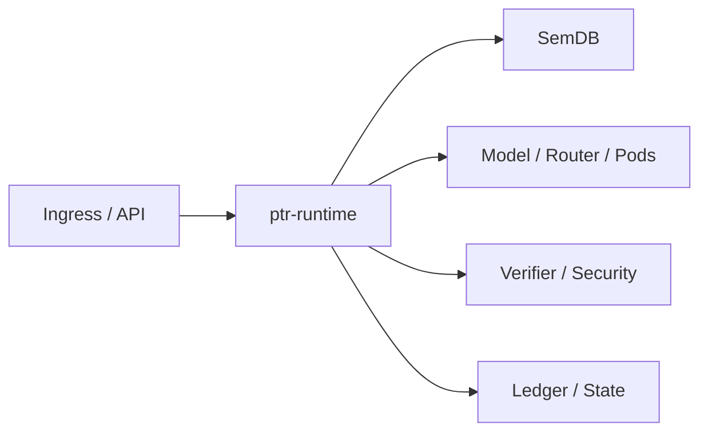

# ptr-runtime — End-to-End Runtime Orchestrator

> **Role:** Compose PTR's semantic, model, execution, verification, security and authority layers into one request lifecycle.

<!-- PTR:STATUS:BEGIN -->
## Current implementation status

> **Generated section.** Source of truth: [`component.toml`](component.toml) plus code-derived metrics from `src/`. Run `python3 scripts/update_component_docs.py --write` after editing implementation metadata. Do not hand-edit inside this block.

**Maturity:** `prototype`  
**Last reviewed:** 2026-10-09  
**Code footprint:** 42 Rust source files · 41743 nonblank source lines · 84 integration-test files · 1086 test markers (`#[test]`, `#[tokio::test]`)

### Implemented now

- PtrRuntime::run_model_run_resumable(request_id, raw_text, infer) is the entry point for a ModelRun-producing (KV-reusing) backend: it ingests the request text, calls `infer` with the resulting SemanticContext, and builds the ResumableRun only through ingest_model_run (so Approximate taint is recorded and authorize_action refuses the action), emits RequestFinished for a finished run without control events, refuses a run that requests a Pod with RuntimeError::Model (this path does not resume Pods) and a run with neither Finished nor an action with ModelNoProgress. Used by ptr-server's ServerBackend::KvReusing; covered by ptr-server tests/kv_taint.rs
- ReferenceKvReuseBackend (src/kv_infer.rs), the first KvReusingBackend that really reuses KV: it owns an InMemoryPagedKvBackend, a KvPrefixCatalog over it and the R005 tiny Qwen2 reference stack (seeded random weights, PreRope keys, f32 CPU), looks up the longest live exact prefix of a SegmentedModelRequest, forks it through the witness-gated path, prefills only the remaining tokens one 16-token chunk at a time (publishing and inserting every completed prompt chunk boundary), decodes greedily up to a bounded max_new_tokens and returns a ModelRun whose KvReuseReport is always Exact (it never produces Approximate). A prompt that is entirely cached is refused as a hit and prefilled again, because the last prompt token's logits are not in a cache. Catalog capacity, a draining slot or a dead dependency are a graceful insert miss counted in the outcome (and the refused backend prefix is retired unless another entry holds it); they never change the output. Prompt length, generated length and catalog limits are bounded with typed ReferenceKvError values; principal and project enter the KvSalt and the page binding, so scopes never share an entry; invalidate_inputs and flush tombstone and retire entries. The same type implements plain InferenceBackend as the cold path (no lookup, no insert, no report). The run's taint is Exact and ingest_model_run accepts it. With ReferenceKvReuseBackend::with_rope_scaling and Qwen2RopeScaling::DynamicNtk each request fixes its RoPE regime once at admission from prompt_tokens + max_new_tokens, runs prefill and decode under it, derives its chain id (and page-binding manifest) under it and reports it in ReferenceKvOutcome::rope_regime, so requests in different regimes never share an entry: a request whose admission regime differs from a cached entry's misses and is recomputed (Exact, bitwise equal to its own cold run), and lengths up to the original maximum positions share one regime. Covered by tests/kv_infer.rs (cold versus warm 32-token shared prefix: hit_tokens == 32 and bitwise equal text, tokens and logits digest; principal, project and revision isolation; invalidation and flush; capacity; ingest)
- R007 WP1 probes on the reference KV backend: ReferenceKvReuseBackend::probe(scope, request, ReferenceKvProbeMode::{Cold, Warm, StaleDonor}) runs the one-shot path and also returns ReferenceKvProbe { outcome, prompt_logits (the full 256-entry next-token logits vector at the last prompt position, compared on f32 bit patterns via logit_bits), kv_state_digest }; KvSession::prompt_logits and KvSession::kv_state_digest give the same stepwise. kv_state_digest is SHA-256 over domain ptr.kv.reference-state.v1, prompt_tokens, layers, row_width (u64 little-endian), then per layer the K rows and V rows of positions 0..prompt_tokens as f32 bits little-endian, so it is independent of pages, chain ids and salts and equal for a cold run and a run that reused part of its rows. A span is modelled as a revocable Derived or Memory segment and forgotten by invalidate_inputs on its identity; no new primitive. StaleDonor is a negative control only: it looks up a donor request under an always-live oracle, cuts the forked rows to the last chunk boundary below the prompt and inserts nothing. ReferenceKvLimits::max_prompt_tokens can be raised per instance (default stays 256; the chain id and the tiny-model config digest do not depend on it). Covered by tests/kv_span_forget.rs; the full 4224-token case is an ignored release-only test (one cold prefill takes about a minute)
- KV-reuse P2a taint at the action boundary (src/kv_taint.rs): PtrRuntime::ingest_model_run takes a ptr_model_api::ModelRun, returns a ResumableRun whose new kv_taint field is the run's KvReuseTaint, and for an Approximate run records the run's single action by a revision- and generation-independent identity digest (target, operation, capability, input type, effect, payload; domain-separated from action_digest, so re-stamping a stale action to a newer revision or generation keeps the taint) in a bounded (MAX_LIVE_TAINT_SUBJECTS = 65,536 live subjects) persistent registry (see the next entry) that fails closed with KvTaintRegistryFull; authorize_action checks it first and refuses a recorded action with RuntimeError::ApproximateStateAtEffectBoundary { report_digest } (and check_execution_action refuses it too, so prepare_execution, prepare_execution_once and execute_prepared do not rely on authorize_action; also reached through the Pod ActionProposal admission paths), authorize_action_with_taint takes a caller-held taint, an Exact or no-report run behaves as before, a later Exact ingest of the same action does not clear the taint, and a run with several control events is refused before anything is recorded. Covered by tests/kv_taint.rs
- admit_pod_output binds a retry to the admission it completes: a request id already admitted for another scope or session is refused, and only a record written after the PodOutputAdmitted record counts as its follow-up, and for a state-changing output the promoted value itself must equal the admitted payload, so neither an earlier promotion nor a later one with another output (whose origin carries no output digest) is taken for it, a candidate record must write the admitted payload too (the digest in its origin is not recomputed from the delta), and a hypothesis record counts only when its session, scope and derived branch id are the admission's as well
- The OIDC replay set is indexed by id and by expiry, so dropping expired token ids visits only the expired ones instead of every live id on each authentication; pruning follows the latest time ever presented and a token that had already expired at that time is refused as a replay, so a clock that reads earlier later cannot free a consumed id
- admit_pod_output builds a hypothesis's PodOutputAdmitted and PodHypothesisCommitted events up front and checks both with the ledger's check_encodable before committing the first, so an output over the ledger limits is refused whole instead of leaving an admission whose retry reports success for a hypothesis that was never created
- The cached JWKS document is dated from when the fetch returned, not when it started, so a fetch slower than the refresh cooldown does not hand back keys that are already stale; the cooldown for new attempts still counts from the start
- bind_checkpoint resolves the slot encoding an artifact records and refuses a definition this build has no implementation of, because weights trained on vectors it cannot recompute are weights it cannot feed; the encoding is deliberately not part of a StateDeclaration, which says which committed facts a state came from rather than how an artifact was constructed
- AdmissionPolicy maps a transport-authenticated peer to one principal and one grant set; admit_peer takes the peer and nothing else, so no caller-supplied parameter can name either, and a second entry for a peer is refused rather than replacing the first
- A session admitted from the policy re-derives its authority at every use, so withdrawing a peer or replacing the policy stops live sessions at once instead of when a TTL runs out; a host-registered session carries no peer and is unaffected
- Pod resolution is scoped by project, and a Pod in another project is unavailable in exactly the same words as one that does not exist, so a refusal is not an existence oracle across the boundary
- Durable execution audit: an effect commits an EffectAttempted record before it is dispatched and an EffectSettled record after, so the window between them is described by committed history rather than by process memory
- The fence is that record: an attempt with no settlement fences execution and commits, is rebuilt on every open, and therefore survives a crash or panic inside the effect window
- reconcile_effect commits what an operator established from the receiving system; it never infers an outcome and never retries a possibly-applied effect
- A settlement that cannot be committed after the executor or the adapter reported the effect applied is returned as SettlementNotRecorded naming the attempt, never as the Audit error a failed attempt record returns, because the effect applied and a caller told otherwise could apply it again; the attempt stays unsettled and the runtime fenced: settling or reconciling again in that process is refused, a reopen replays what was written, and an attempt still unsettled there keeps the reopened runtime fenced until it is reconciled, which a ledger with no index or record left refuses too
- prepare_execution_once adds an at-most-once key: a retry is answered from history without dispatching again, across restarts, while an attempt reconciled as not applied leaves the key free; is_usable_execution_key answers whether a new request under a key can be expected to be prepared and committed, which is prepare_execution_once's rule with one tightening (a longer key that was only reconciled as not applied passes preparation because the runtime holds it, but a new attempt under it is refused at commit) (a well-formed identifier within MAX_KEY_BYTES, or a longer one an earlier build settled with an outcome a retry is answered from; one only reconciled as not applied binds nothing and is refused) without reserving or recording anything, so a caller can refuse a key before doing work that the refusal would otherwise follow
- An applied key is bound to the project, principal, revision, generation and action digest its attempt recorded and to that attempt's index, set when the attempt is settled or reconciled: a permit under it is a retry when its project and principal match and its action digest, taken at the recorded revision and generation, matches the recorded one, so a retry carrying the current revision and generation is answered after either has moved, and any other permit is refused with KeyBoundToAnotherAction before anything is recorded, and a detached retry or a ResponseNotRetained refusal names the attempt that settled its own key rather than one inferred from response bytes or from the first attempt record under the key; a key reconciled as not applied binds nothing
- A response is retained up to MAX_RETAINED_RESPONSE and its digest unconditionally, so a retry whose response was not kept is refused rather than re-executed or answered with something else
- A denied preparation writes no effect record, and a fenced runtime yields no journal anchor, so no compaction floor can discard a record saying an effect may have applied
- Rustdoc covers the compacted-snapshot and neural-state APIs plus their canonical framing helpers and admission diagnostics
- Detached dispatch for work that does not finish inside the call: the attempt is committed and left unsettled, so the runtime is fenced from the moment the work is handed over until the adapter answers or a person reconciles it, and a refused dispatch writes no record
- A grant is synchronous or detached when it is issued, and each path refuses the other kind before the attempt is committed; both share one admission sequence, so there is one place where the order of checks and the attempt record is decided
- settle_detached records the adapter's own answer and is available only for an attempt this runtime dispatched; the dispatch kind is deliberately not rebuilt on reopen, so after a restart the fence stands and reconciliation is the way forward
- bind_checkpoint binds a real stored model artifact: it reads the shared CheckpointHeader, refuses an assignment this build cannot reproduce and an artifact whose codebook contradicts the declaration, then binds the opaque payload through the same bind_state path every other neural state uses
- PTRNEU01 neural/KV/checkpoint admission: opaque state bound to an anchored journal position, per-input semantic value digests, lifecycle generations, provenance and codebook version plus assignment fingerprint
- Admission is decided at every use rather than at insertion; a payload is reachable only through an admission decision, and a cache exposes no accessor that bypasses one
- Revocation, supersession, edited or removed inputs, foreign history with identical counters, unverifiable positions, changed codebook assignment and a fenced runtime each deny with their own stable code; failure to verify is a denial rather than an error
- bind_state derives every field from committed state and validates its own output through the same admission rules a later use applies
- PTRCS006 compacted materialized snapshot (lifecycle section PTRLC004: PTRLC003 followed by a PTREV001 evidence block of the unverified-legacy expert marks and the per-epoch gate config digest memo, strictly ascending, marks must name registered experts, zero digests refused; PTRCS005 with PTRLC003 is still read, never written, and restores every expert as UnverifiedLegacy with an empty memo because it cannot say otherwise; PTRLC003 is PTRLC002 followed by the expert registry as a PTREG001 block carrying every field the admission compare-and-set reads, verified on restore against the materialized expert: keys, entry for entry, so a mismatch is refused as StateMismatch); a PTRCS004 snapshot with a PTRLC002 section, written before the registry, is still read and only for a history whose materialized state holds no expert: key (otherwise refused by version); a PTRCS003 snapshot with a PTRLC001 section, written before attributed records, is still read as one whose history holds none, a PTRLC001 section carrying semdb:attested or a branch-merge: key is refused by version, and so is any other pairing of outer and lifecycle versions: committed state at a floor with canonical ascending-key sections, checked framing and an externally retained trusted anchor; a PTRLC002 section whose key under branch-merge: is not exactly a merged_branch_key, or whose value is not exactly an index and a plan digest as a merge projects them, is refused as noncanonical
- PTRCS007 compacted snapshot, written only when the registry holds a fence cause or a fence memo (otherwise the snapshot is PTRCS006, byte for byte as before): lifecycle section PTRLC005 is PTRLC004 followed by a PTRFC001 block of (project, pod, cause code, resume code) entries, each naming a registered Fenced expert, then (project, pod, highest fenced epoch) entries, each in strictly ascending key order with epoch equal to state_version for a Fenced expert and 1 <= epoch < state_version for a readmitted one, every Fenced expert covered, then the highest readmission gate epoch (non-zero needs a memo), never an empty block; PTRCS007/PTRFC001 were never written by a released build, so the layout was changed in place rather than versioned; a dropped memo of a fenced-and-readmitted expert is not derivable from the snapshot and is not detected; the registry already carries the state and the state_version (fence epoch); a PTRCS006 or older snapshot holding a Fenced expert restores it with no cause (never readmitted) and a memo of its current epoch (nothing recorded at or below it is live)
- A settled key is written as 1 to MAX_KEY_BYTES (4096) bytes, as PTREX001 wrote it, so prepare_execution_once refuses a longer key this runtime does not already hold with InvalidKey, and commit, through which admission appends its attempts, refuses a keyed EffectAttempted under one with InvalidEffectKey before append (validate_new_record). The project and principal an applied key carries are written at any length, the empty string included, because no build has bounded them: sessions, peers and committed attempts name them as before, and no string of them makes an export fail (the section as a whole is still bounded; see the missing entry on settled keys in total). Replay applies no length bound, only the identifier check every build has made on a key: replay, and through it restore_recovery_snapshot, read_recovery_snapshot, restore_durable_snapshot and migrate_legacy_log; open_durable and open_durable_at; and the records restore_compacted replays above a floor. A log an earlier build wrote with a longer key therefore opens; preparation lets the key through once it has settled here, so the request that spent it is answered from history (its response or ResponseNotRetained) and another is refused as bound to another action, it is never spent again, and every export fails with PTR_COMPACTED_SECTION_LIMIT once it has settled, as it did on the previous build
- install_admission_policy re-derives every policy-admitted session's grants and principal from the new table, so a replacement that narrows a peer narrows its live session instead of leaving the wider set in force until the TTL; a session whose peer is no longer admitted is kept so the refusal can still name PeerNotAdmitted, and the expiry is never extended
- A compacted snapshot carries the execution obligations a raised floor would otherwise discard (PTREX002): spent at-most-once keys with their outcomes, each applied one with the attempt that settled it and the project, principal, revision, generation and action digest that attempt recorded (a retained response encoded by byte length, so one up to MAX_RETAINED_RESPONSE round-trips rather than only one under the item bound), and unsettled attempts with the same five, so a restored runtime neither executes a spent key a second time nor answers another action under it. A PTRCS001 snapshot is refused by version rather than read as an empty obligation set, and a PTRCS002 snapshot or PTREX001 section rather than read as keys bound to no action
- restore_compacted installs floor state then replays the retained journal through the ordinary lifecycle/semantic validation path, keeping committed indices
- CompactedSnapshot::covers reports only the position it holds, so a compaction barrier cannot claim coverage the snapshot lacks
- Versioned replay-backed recovery snapshots bind complete journal, semantic revision, commit index and independently trusted SHA-256 anchor
- Snapshot validation and semantic/lifecycle replay finish before creating a durable destination; existing destinations are never replaced
- Strict anchored reopen and explicit legacy-to-v2 migration preserve history while restoring no process-local authority
- Ordered semantic journal publication before acknowledgment or model resume
- Semantic payload/dependency/revision reconstruction with schema and transition validation during replay
- Every semantic record the runtime writes carries an origin: ingest_text writes a Request record holding exactly the request's raw text and a promoted Pod output a PodOutput record at the level its verifier reported (both ingress, needing no grant); a host write records Host with its principal and attestation; a merge records Merge with the branch, its author, the sealed branch and plan digests, the dependency digest, the rebased keys, the attestation and the authority; commit refuses every semantic record (SemanticRecordOutsideSemanticPath)
- Replay, open_durable, open_durable_at, restore_recovery_snapshot and restore_compacted apply the origin rules every writer also checks before it appends: R1 replays a record without an origin only while the materialized semdb:attested marker is absent (LegacySemanticRecord after it, including below a compacted floor); R2 accepts ingress records only in the exact shape ingress writes; R3 accepts a host write or merge only if it writes, removes, derives and evicts no ingress key (an eviction is checked once the delta is prepared: a key only ingress writes that a record without an origin derived from one the change writes), names valid provenance text (a host write's principal; a merge's branch, author, and reviewer or policy version, with a triage score that is a finite f32 in [0, 1]) and carries an attestation whose weakest level meets its requirement, with 1 to 16 verifiers whose names are distinct and valid and at most 32 soft findings that are sorted, distinct recorded codes; R4 accepts a merge only with no dependency entry, no rebased key removed or reserved to ingress, the plan digest merge_plan_digest gives for its branch, base revision, encoded delta, dependency digest and rebased keys, and a branch not merged before (its branch-merge:<len>:<id> key absent from materialized state); replay also refuses a record the ledger cannot frame, which only a history held in memory (replay, restore_compacted above the floor) can carry
- SemanticGrant is the host's policy for semantic writes that are not ingress: installed once (a second is refused, SemanticGrantInstalled), with 1 to 16 verifiers whose names are distinct identifiers of at most 64 bytes without '/', host writes off until allow_host_writes, an optional merge policy (with_merge_policy, with a calibration seed that is never recorded, returned or printed) and listed reviewers (with_reviewer), the policy version and every reviewer an identifier of at most 256 bytes, and never journaled, so a runtime rebuilt from its log has none; semantic_grant reports its requirement, verifier names, whether host writes are on, the policy version and the reviewers
- Complete typed Pod bytes and source identity are revision-significant
- Fallible ingestion, optimistic base revision and canonical no-op handling
- Scoped synchronous execution gateway with opaque per-runtime sessions, exact grants, frozen ActionIR permits and registered verifier/executor binding
- Consume-time freshness, expiry, ownership and mandatory permission checks; permissions/commit/effect epochs invalidate pending permits
- Executor or ledger ambiguity fences subsequent execution and commits; process-local single-use authority is never replayed
- Ledger-only lifecycle mutation; invalid/rewinding/tombstoned/cross-project transitions rejected before append and during replay
- Central runtime object wiring configuration, SemDB, ledger, materialized state, events and permissions; an in-memory append that runs out of commit indices surfaces as a ledger error rather than a repeated index
- Durable standalone runtime constructor opens/replays FileLedger and reconstructs lifecycle/materialized state across restart
- Text ingestion into revisioned semantic state
- Current-revision, live-generation/revocation and capability/effect checks for ActionIR delegated through typed ptr-security authorization decisions
- Committed-event materialization and runtime event emission
- Committed-event replay rebuilds lifecycle state and preserves revocation
- Reference InferenceBackend request loop runs against a revisioned ModelRequest and emits completion event
- Typed model→PodRegistry→Pod→Verifier→SemDB observation loop for Pure/Read cognitive Pods
- Bounded multi-step model resume loop after verified Pod observations advances semantic revision before continuation
- apply_verified_semantic_delta(expected, delta, principal) is a host write: refused while fenced, with no grant (NoSemanticGrant), when the grant does not allow host writes, for a principal that is not an identifier of at most 256 bytes, against a stale revision, and for an ingress key written, removed or derived (ReservedSemanticNamespace; an ingress key may be a dependency input), or, once the delta is prepared, one it would evict because a record without an origin derived it from a key the write changes (ReservedSemanticNamespace); every grant verifier then judges a SemanticChange (published state before, exact state after, delta, invalidated keys, principal) and it appends only if all pass, the weakest level meets the requirement and no report has a hard finding, refusing otherwise with SemanticVerificationRejected naming hard findings by code, never by message; a finding code that is not an identifier of at most 64 bytes, or more than 32 soft findings, fails closed (InvalidVerificationReport); each verifier's result is emitted as VerifierResult, a verifier whose report fails closed as not passed, and no verifier after it judges
- merge_branch(sealed, authority) is the only way an agent branch reaches semantic state: in order it refuses a fenced runtime, no grant (NoSemanticGrant), Triage under a grant with no merge policy (NoMergePolicy) and Reviewed by a reviewer the grant does not list (UnknownReviewer) or by the branch's own author (SelfApproval, an approval being a second pair of eyes), a branch id or author that is not an identifier of at most 256 bytes (InvalidProvenanceText), a branch already merged (BranchAlreadyMerged naming where), a branch that does not certify against the runtime's own state now, relied generations included (Certification), under Reviewed a plan whose digest is not the one approved (MergePlanChanged), and a plan that writes, removes, derives or would evict an ingress key (ReservedSemanticNamespace); then every grant verifier judges a SemanticChange whose origin is the sealed branch, the plan and its CertificationKind; a merge the verifiers do not admit is held (VerificationRejected) whatever the authority, one the grant's policy does not auto-propose is held (Escalated) with its triage for review by plan digest, one that changes nothing appends nothing and does not mark the branch merged, and a record too large for the ledger to frame is refused (MergeRecordTooLarge); every refusal and hold comes before append and leaves the runtime unfenced; preview_merge certifies and judges without committing, and merged_at reads where a branch was merged
- A Pod output is promoted, by run_model_with_pods and run_resumable_with_pods alike, only when its verifier reports Pass with no hard finding (a hard finding refuses it even under Pass); no minimum level is required, and the level reported is recorded
- generation_validity combines the tombstone set with generation equality, so a revoked generation that is still the live one reads as Revoked rather than Live; ptr_search::retain_live takes it directly, so search hits are filtered by validity rather than by the live generation
- Neural-state input digests are computed from ptr-semdb canonical_input_bytes, byte-identical to the previous encoding (committed fixtures unchanged)
- Execution scopes are journaled: create_scope and transition_scope commit a ScopeLifecycle event carrying the scope's lease binding and the revision it was decided at, and refuse before append a stale revision (ScopeRevisionMismatch), a lease that differs from the scope's own, a lease with a fencing token but no state, Pod or generation, and a parent in another session or project; replay rebuilds the ScopeRegistry, an identical committed event applies idempotently and a conflicting one is refused
- A reopened or replayed runtime marks every scope that was not yet Released as recovery-pending, including one that had already ended (completed, failed, cancelled, timed out or revoked) because it still holds its pod lease, resource lease and session until cleanup ran: transition_scope then accepts only Cancelled, Revoked or Released for it, ensure_available still reports an ended scope as Terminal rather than RecoveryRequired, and recover_scope runs cleanup_scope for it; cleanup_scope drives a ScopeCleanupCoordinator through stop_intake, cancel_children, drain_queues, release_pod_lease, release_resource_lease and close_session, cleans each child under its own lease before the parent, and journals Cancelled and Released
- recover_uncertain_request fences a live scope after a stateful request whose outcome cannot be established, journals Revoked with the reason request-uncertain:<id> and runs the same cleanup; RuntimeRecoveryAdapter exposes that as ptr_types::StatefulRequestRecovery and refuses a request naming another scope
- admit_pod_output admits one typed Pod output before any promotion: it refuses a fenced runtime, a scope that is unavailable, belongs to another session, or whose lease fencing binding differs from the request's placement epoch and fencing token (zero is refused), a manifest whose digest does not match, an output bound to another manifest, generation or artifact, an empty provenance source, a dependency that is zero or not in the manifest, an output that fails PodOutput::validate for the expected type, a revision below the manifest's snapshot revision and a verifier report that is not Pass or has a hard finding; the admission commits a PodOutputAdmitted record before the output reaches semantic state, a repeat of the same request id and Pod is answered from history without a second record, and the same request id with different output bytes is refused
- admit_pod_output routes by output kind: Observation, Candidate, ToolResult and EnvironmentObservation are retained as pod-candidate: keys under a SemanticOrigin::PodCandidate record whose replay shape is checked exactly, in a namespace separate from promoted pod-output: keys; Hypothesis commits a PodHypothesisCommitted record and is rebuilt by replay; ActionProposal is decoded from a versioned, size-bounded payload, authorized through authorize_action and returned with its action digest but never executed; StateDelta and VerifiedResult are promoted through the verified Pod-output path. A retry that finds the PodOutputAdmitted record of an earlier attempt answers from it only when the follow-up (the PodHypothesisCommitted record, or the semantic write of the promotion) is in the ledger too; otherwise it does not write the admission record again and carries out the missing step
- merge_pod_hypothesis rebuilds a persisted Pod hypothesis as a sealed ptr-branch Branch under the key pod-hypothesis:<branch> and sends it through merge_branch, so it needs a SemanticGrant (NoSemanticGrant without one) and the grant's merge policy like any other branch
- promote_verified_pod_output refuses a Pod whose manifest declares an effect other than Pure or Read (PodEffectRequiresActionBoundary) and an output whose type is not one the manifest produces (PodOutputTypeMismatch) before the verifier runs; run_model_with_pods and ContextMemoryController::promote_verified_output both use it
- commit_pod_evidence verifies a PodEvidenceBundle and appends its exact canonical bytes as PodEvidenceCommitted, commit_signed_pod_evidence additionally requires an EvidenceVerifier to accept it, and the ledger validation decodes the bytes and refuses an event whose session, trace, manifest, artifact, generation, revision or bundle digest disagrees with them; commit_mesh_event journals a validated MeshTunnelLifecycle fact (the tunnel operation itself is not performed here)
- admit_execution_manifest resolves an ExecutionManifest's Knowledge generations (present, not invalidated, sources and dependencies known, supersession chain, content digest) and Artifact, reader and adapter lineage (not revoked, lineage verified, digest) against the supplied stores and its snapshot revision against the runtime's, then commits ExecutionManifestAdmitted; the registry holds the admitted record by digest, replay rebuilds it, and revoke_execution_manifest commits ExecutionManifestRevoked, which a later resolve refuses
- admit_execution_manifest_with_authority additionally requires the manifest's principal to be admitted, its policy revision to be the current unrevoked one and its snapshot digest to match; admit_execution_manifest_from_runtime derives the principal from a valid IdentityContext as issuer:subject, requires an activated policy and a manifest snapshot revision equal to the live one, and checks a protected snapshot digest against the live SemDB digest, with a mismatch refused without mutating the authority registry
- A policy bundle is bounded in the ledger encoding by separate limits for the number of items in a list (4096), the length of an identifier (4096 bytes), the signature field (4096 bytes) and the encoded payload (4 MiB, the size the loaders already fetch); the item bound was once applied to byte lengths too, which made a signed payload longer than 4096 bytes undecodable, and verify refuses a key id over the identifier bound (InvalidBundle), decodes the canonical payload as a dry run (InvalidPayload) and refuses one over the payload bound (PayloadTooLarge), so everything that verifies decodes again and no bundle can be activated into a ledger record that replay would refuse to read
- activate_policy_bundle verifies a SignedPolicyBundle (non-empty key id, 64-byte signature, payload validity, payload digest, validity window, a trusted and unrevoked Ed25519 key) and commits PolicyBundleActivated; a revision must exceed the highest activated one, the same revision with a different digest is refused, revoke_policy_revision commits PolicyBundleRevoked and is idempotent, and replay restores the activation, the revocation and policy_authority_ready
- revoke_identity_session commits SessionRevoked before it materializes it, is idempotent, and replay restores the tombstone; admit_identity_context refuses a revoked session
- OidcIdentityAdapter authenticates an EdDSA JWT against a JwksStore into an IdentityContext with a canonical digest: it checks the signature, issuer, audience, iat and exp, rejects a replayed jti (recorded only after every claim was accepted, so a refused token does not burn its id, and dropped once the token's exp has passed, so the set stays bounded) and refuses any other algorithm; an unknown kid triggers one JwksRefresher refresh whose issuer and audience must match, rate-limited by a refresh cooldown (default 30 s, failed fetches included) and cached for that window only (shared by reference, not copied per request), with no fallback to a stale key; HttpJwksRefresher takes an injected fetch function, accepts https or loopback URLs and caps the document at 1 MiB; AutheliaForwardAuthAdapter (which is only safe when the host guarantees the headers reach it exclusively from the trusted proxy: they are not signed, and its docs say so) builds the same context from typed forward-auth headers and refuses an expired one, always judged against the server clock and never a time carried in the credential
- IdentityAdmissionController admits an AdmissionRequest to an AdmissionGrant only when the identity is valid at now, its session is the request's session, the session is not revoked, the policy decision carries the controller's policy revision, the request's project and capability, and an expiry inside the identity's own
- PodPlacementController registers nodes and devices, takes heartbeats (an older one is refused), assigns a Pod to a healthy node and device with enough free VRAM, and bumps a placement epoch on every assignment; a FencedStateLease binds a state to the placement's node, device, epoch, generation and a fresh fencing token, and issuing a second lease for a state, replacing the Pod's placement or marking its node failed makes the earlier lease fail validate_lease with StaleLease; freeze_state revokes the lease and refuses a new one for that state within the same placement epoch; a heartbeat or a re-registration that drops a device or reports it Failed revokes the leases on it (a lease on a device that stays usable is untouched, and no heartbeat brings a lease back), and issue_lease refuses a placement whose node is not Healthy or whose device is missing or Failed
- RuntimeKvAuthority::prepare issues a KvUseTicket only for a valid lease, valid KvStateMetadata matching the request's state, model, adapter, context digest and generation (and the Pod generations when it lists any), and one active use per state; complete rechecks the lease, and a placement change between prepare and complete fails it and releases the slot so a new use can be prepared
- ManagedKvRegistry binds a ptr-pods KvTensorBackend cache to an opaque ManagedKvHandle and a placement lease: allocate, restore from a KvTensorSnapshot, append, snapshot, invalidate, recompute and release each revalidate the lease (StaleLease after a placement change), a handle from another registry is ForeignHandle, an invalidated handle cannot reach the backend again, and recompute allocates a fresh root cache with a new fencing token
- KvMigrationController moves a fenced KV state through Frozen, Snapshotted, Restored and Committed (or Aborted): begin validates and freezes the source lease, snapshot and restore check the snapshot digest, restore requires a target lease for the same state and generation on a different node or device and rebinds the snapshot to the target device, commit requires the restored target's own lease, and out-of-order steps, repeated commit or abort, and a stale source or target lease are refused
- InMemoryPodDirectory resolves a PodRevisionAddress to a PodRoute for a registered endpoint, honouring artifact, region, zone, minimum epoch, VRAM, capability, input type and output type constraints and requiring the last two bindings; register refuses an unhealthy or inactive endpoint, an older endpoint epoch and a different endpoint at the same epoch; a route is a candidate, never an authorization grant
- NativeSandboxExecutor admits a SandboxProfile (non-empty project and namespace, non-zero timeout) as a lease bound to the project and a SHA-256 profile digest, refuses a lease it did not issue or whose project or digest was altered, and releases idempotently; it echoes the request payload and performs no effect; ExternalSandboxExecutor for WinRsBox and SmolVm returns BackendUnavailable for admit, execute, abort and release rather than falling back to native execution
- ContextMemoryController ingests a RawEvent through the deterministic tokenizer, entity extractor, namespace resolver and object builder into a KnowledgeStore, applies the retention controller, compiles context from objects or candidates under a TokenBudget, and promote_verified_output promotes through promote_verified_pod_output before activating a new Knowledge generation that supersedes the base
- ProtectedStateCoordinator forwards seal, open, verify and rotate_key to an injected ptr-storage ProtectedStateStore; replaying a ProtectedStateCommitted record of domain 3 registers its digest as a protected snapshot in the manifest authority registry, and register_protected_snapshot_authority does the same for a digest the coordinator verified
- run_resumable_with_pods keeps selecting a Pod with the plain PodRouter::select and records no draw (a convenience wrapper; run_model_with_pods likewise), while run_resumable_with_pods_using_router takes a `&dyn PodSampler` (src/routing.rs; object safe, implemented for ptr_router::CheckedRouter<R: Router + Send + Sync>, with key_id() the non-secret sampling key identifier) and chooses every Pod through ptr_router::route_checked with a RouteRequest whose request_digest is SHA-256 over a domain tag and the length-prefixed project, capability, input type, request id and Pod request payload; Ok(None) is the unchanged PodUnavailable, a routing error is the new RuntimeError::RouteFailed { reason: &'static str } with a fixed Pod-free reason, and a success emits RuntimeEvent::PodRouted (pod, propensity, nonce, draw, key id) before PodInvoked; a model event stream that carries an ActionReady ends the run with ResumableRun::action set and no dispatch, and more than one Pod request or action in one round is refused (MultipleControlEvents, MixedControlEvents); ModelRequest now carries a semantic_context, and the revision a backend sees is derived from it
- Internal: run_model_once and the Pod loops accept unsized InferenceBackend and Verifier trait objects, and Cargo gains the optional features candle-cuda (ptr-pods/candle-cuda) and oidc-http (reqwest, enabling ReqwestJwksRefresher and ReqwestPolicyBundleLoader, whose HTTPS clients are not exercised by any test)
- src/tier.rs TierJournalProjection::apply folds the ledger events TierBackendLifecycle, TierObjectCommitted and TierReplicaLifecycle into a projection of JournaledBackend, TierObjectManifest and JournaledReplica records: it re-derives backend_lifecycle_digest and replica_lifecycle_digest and refuses a mismatch (InvalidEvent), accepts only the backend transitions Configured to HealthChecked to Available to Draining to Detached (Revoked from any earlier state) and the replica transitions Preparing to Available, Draining to Released (Corrupt or Revoked from live states), requires a strictly rising revision, ignores a repeated event digest, refuses a different manifest under a known root digest (ConflictingObject), and refuses a replica for an unknown object or backend, for a backend of another tier, for a Detached or Revoked backend, or a Preparing replica on a backend that is not Available
- PtrRuntime keeps that projection (tier_journal()) and applies tier events before append and on replay: commit_tier_backend_lifecycle, commit_tier_object and commit_tier_replica_lifecycle commit the three event kinds, so an invalid transition is refused before append, and a runtime opened with open_durable rebuilds the projection from the FileLedger it replays; the ledger records lifecycle and manifests only, never chunk bytes
- PtrRuntime::attach_tier_backend_journaled, register_tier_object_journaled and transfer_tier_replica_journaled order a ledger record around each physical step on a TierResidencyController: Configured, HealthChecked and Available around attach_backend (Revoked is committed if the attach fails); object manifest and a Preparing replica before register_object, Available after it; and for a transfer Preparing before and Available after controller.transfer, or Corrupt after any transfer error (read from the code: the Corrupt record is written for every error kind, including backpressure or a stale write binding, not only for corruption). Registration requires the backend to be Available in the journal projection with the controller's tier
- TierResidencyController (src/tier.rs) is a process-memory residency table over ptr-storage TierBackend implementations, built on Arc<Mutex<..>> state with no ledger or file of its own: attach_backend health-checks a backend into Available or Revoked; register_object and transfer publish a replica only after the chunks verify; transfer is single-flight per (object, source, destination), bounded by with_transfer_budget (TransferBackpressure) and refuses a stale ActiveWriteBinding or TierTransferAuthorization (generation, placement epoch, fencing token) with StaleWriteBinding; pin or read_admitted_object takes a TierPin that blocks evict (ReplicaPinned) and releases on drop; begin_detach and finish_detach drain a backend (BackendNotDrained while pins, in-flight transfers or live replicas remain); evict refuses the last replica and keeps a content-addressed chunk another object still references. Nothing in the repository rebuilds a controller from the journal projection after a restart
- AdmittedTierObject is the only input restore_from_tier and restore_paged_from_tier accept: read_admitted_object returns the manifest and chunks with a verified pin, validate_admitted_object rejects another controller's pin (ForeignPin), a released pin, an unavailable backend or a replica that is not Available with a matching digest, and the registry then also requires the TierJournalProjection to hold the same manifest, an Available backend and an Available replica of the same generation, else TensorKvError::TierBindingMismatch; a controller that was fed the object without the journal is therefore not accepted
- Tier placement policies in src/tier.rs: the TierPlacementPolicy trait with DeterministicLruPolicy (least access, ties by digest), ExplicitTierPolicy, LookaheadPrefetchPolicy (at most max_objects) and BudgetedReplicaPolicy (ReplicaBudgetUnsatisfied when the preferred tiers cannot cover the minimum); they return a TierPlan and no code in this crate calls plan or choose_eviction on a controller, so nothing applies a plan; TierResidencyController::prefetch wraps transfer into PrefetchOutcome::Ready or Skipped
- ManagedKvRegistry paged path (src/tensor_kv.rs, for a ptr-pods PagedKvTensorBackend): allocate_paged binds a KvPageBinding (model, adapter, generation, execution manifest, principal, device, dtype, page size) and the lease's placement epoch and fencing token to the cache and refuses a zero execution manifest or a device other than the lease's (DeviceMismatch); seal_online_snapshot, materialize_online_snapshot and prepare_online_snapshot_to_tier take a snapshot while the cache stays appendable and re-check the lease and the epoch and token before publishing (StaleLease or TierBindingMismatch); restore_paged_snapshot and restore_paged_from_tier restore under a newly issued lease and fencing token; publish_prefix and fork_prefix share a prefix: fork_prefix no longer trusts any caller binding, it refuses an invalidated target (Invalidated), a stale lease (StaleLease) and a prefix whose key generation differs from the target's committed generation (PrefixMismatch), then lazily takes the backend's one KvForkAuthority, mints a single-use KvForkWitness itself and forks only through fork_prefix_admitted The registry keeps its own live set of published prefixes: publish_prefix refuses an invalidated record and records key and source; invalidate and release retire a prefix on the backend when its last source goes (a PrefixNotFound from the backend is tolerated); fork_prefix refuses a key not in the live set with TensorKvError::PrefixNotLive and takes the forked length and offset from the stored entry, not from the caller's public-field KvSharedPrefix. Single-authority constraint: a backend has one KvForkAuthority, so a registry that forks and a KvPrefixCatalog cannot share one backend instance; whichever takes it first wins and the other fails closed (a backend without a witness-gated fork, such as the unbuilt CUDA one, or whose authority a KvPrefixCatalog already holds fails closed, so a registry and a catalog cannot share one backend's authority; the execution-manifest digest of the prefix is not compared, as in doc 36 section D); page_metrics reports the backend's page counters
- ManagedKvRegistry::snapshot_to_tier and restore_from_tier move a non-paged KV snapshot through the same KvTierBinding and journal-authority checks, and restore now refuses a snapshot whose device is not the new lease's device (DeviceMismatch, lease revoked) and revokes the lease when the backend restore fails; invalidate also revokes the lease and calls the backend's revoke
- admit_expert_proposal (src/expert.rs) is the only writer of ExpertStructuralCommitted: it checks, in order, that the proposal's project and proposer equal the host-built ExpertAdmissionGrant's, that the BoundGateReport names this proposal and operation, was produced under the grant's required gate configuration digest and passed, then a compare-and-set against ExpertRegistryProjection (every operand's generation, manifest digest, state, state_version, level and base model; every result's pod and Token slot absent, except a takeover from an operand of the same operation), builds a version 2 ExpertCommitRecord (evidence digest, the report's canonical bytes, the gate epoch and the required gate configuration digest from the grant), derives the event's ids from it and appends through the internal path; each refusal is a RuntimeError::Expert(ExpertAdmissionError) variant and appends nothing; the public commit still refuses the event (StructuralRecordOutsideAdmissionPath)
- fence_expert and readmit_expert (src/expert.rs) are the only writers of ExpertFenceCommitted (tag 28; the public commit refuses it with StructuralRecordOutsideAdmissionPath): the host-built ExpertFenceGrant (ExpertFenceGrant::revocation, or ::gate with a gate epoch and required gate config digest) must name the request's project and carry RuntimeRevocation authority to fence or Gate authority to readmit, a fence never waits for a gate while a readmission needs a passed BoundGateReport bound (expert_readmission_subject_ids: domain-separated digests of project, pod, generation, expected state version, epoch and cause) to exactly that readmission under the grant's config, whose canonical bytes, gate epoch and config digest are embedded in the event and re-verified on replay like a structural record (canonical decode, passed, subject, config, one config per gate epoch, recorded in the epoch memo), then a compare-and-set against ExpertRegistryProjection (generation and state_version; a fence needs Serving or Frozen, a readmission Fenced), and the expert moves to Fenced or Serving at an unchanged generation with state_version + 1, its fence epoch; the registry records the fence cause (ExpertFenceCause), an InputRevoked fence or one of unknown cause (a snapshot from before causes) is never readmitted, and a readmission must name the recorded cause; escalate_expert_fence (Escalate, code 2) re-fences a Fenced AuthorityQuarantine expert for InputRevoked (new epoch, memo bumped, catalog hook as for a fence) and the reverse is refused (NotEscalatable); an InputRevoked fence or escalation carries an ExpertFenceRevocation naming a (subject, generation) that commit and replay verify against the runtime's revoked_generations (FenceRevocationNotCommitted), AuthorityQuarantine staying a host-asserted cause; the event records the state the fence left (resume: Serving or Frozen) and a readmission restores it, checked on replay (FenceResumeMismatch); a readmission's gate epoch may not be below the highest earlier one (GateEpochRegressed, also on replay and across restore); replay and restore repeat the compare-and-set as of that point; invalidate_kv_catalog has an ExpertFenceCommitted arm calling KvPrefixCatalog::invalidate_expert_fences(expert_fence_epochs(event)), so a committed fence or readmission tombstones and retires every entry recorded below the new epoch (or with none) at commit; the registry keeps a fence memo (highest epoch each expert was ever fenced at, never lowered, kept after readmission) and the liveness oracle refuses a dependency whose recorded epoch is 0 or at most it, also after readmission, in addition to the exact state_version check, so no entry recorded before a fence is revived
- retire_revoked_expert (src/expert.rs, R011 WP2) writes fence action Retire (ledger code 3): a Fenced expert of cause InputRevoked becomes Retired(InputRevoked) at its unchanged generation with state_version + 1, under an ExpertFenceGrant::revocation grant only (a gate grant is FenceAuthorityMismatch, a grant of another project FenceProjectMismatch, a superseded grant GrantGenerationStale, all revalidated at commit like a fence), requiring the same committed generation-exact Revoked or ProcedureRevoked as the InputRevoked fence (FenceRevocationNotCommitted) and no evidence (the codec refuses any, so the transition is never gate-driven); refused typed with nothing appended for an unfenced or already retired expert (NotFenced), a fence of cause AuthorityQuarantine or of unknown cause (NotRetirable), a wrong generation or state version (StaleOperand); the expert leaves the fence-cause registry, keeps its fence memo, releases its routing slot, is NotServing for expert_route_admission, is dead for the KV liveness oracle and catalog (the tag-28 epoch hook fires as for any fence action) and is terminal: readmission, escalation, fencing and a second retirement are refused, and the proposal path refuses Reactivate (SeedUnavailable), Retire of a Fenced operand (FencedTarget) and Retire with reason InputRevoked (ReasonNotProposable); replay and compacted restore (state code 9, PTRCS007 fence memo) repeat the compare-and-set, the cause check and the committed-revocation check
- Evidence binding (src/expert.rs check_report, tests/expert_evidence_binding.rs, R011 WP1): one function decides whether a BoundGateReport is evidence for an expectation and admit_expert_proposal and readmit_expert both call it, in a fixed order: subject proposal id, operation id, artifact digest (EvidenceArtifactMismatch), base model digest (EvidenceBaseModelMismatch), the evaluation manifest digest the host put in its grant (ExpertGateRequirement::eval_manifest_digest, EvidenceEvalManifestMismatch), the gate config, passed. The expected artifact digest is expert_evidence_artifact_digest(op): the result manifest digest for Birth, Merge and a Reactivate that creates a generation, the operand manifest digest for Freeze, Retire, an unfreeze and a Prune of one target, and for a Split and a Prune of several targets a SHA-256 over a length-prefixed domain tag (ptr.expert.evidence.artifact-set.split-results.v1 or .prune-targets.v1), the count (u64 LE) and the ordered manifest digests; a readmission is bound to the manifest digest and base model of the expert it readmits; the expected base model digest is expert_evidence_base_model_digest(op). Replay re-checks the artifact and base model binding of every version 2 record and every readmission but not the evaluation manifest, because the grant is not recorded; ledgers written before these checks, whose expert reports carry digests not bound to the artifact and base model, are refused on replay (fail closed) and cannot be reopened
- Commit-time authority (src/expert.rs ExpertGrantBinding, tests/expert_authority_commit.rs, R011 WP1): every ExpertAdmissionGrant and ExpertFenceGrant carries the host IdentityContext, a host clock reading now, the policy key id its authority rests on and the grant generation it was minted at, and immediately before the append (after the compare-and-set) the runtime refuses with a typed error and appends nothing: a grant generation that is not the current one of its ExpertGrantKind (Admission, Gate, Fence; GrantGenerationStale), a revoked identity session (GrantSessionRevoked), a transport peer (ExpertGrantBinding::peer, a NodeId) that the installed AdmissionPolicy no longer admits (GrantPeerNotAdmitted), an identity context not valid at now (expired, not yet issued, wrong digest; GrantIdentityInvalid), a policy key that is revoked or not installed (GrantPolicyKeyUntrusted) and an issuer:subject principal the manifest authority registry does not admit (GrantPrincipalNotAdmitted). Grant generations are host authority in memory (expert_grant_generation, supersede_expert_grant), held beside but outside the equality of ExpertRegistryProjection, not written to the ledger, not replayed and restarting at ExpertGrantGeneration::INITIAL
- PtrRuntime::expert_route_admission(project, pod, generation) (src/expert.rs, R011 WP1, WP3) is the use-time admission check: Ok only for an expert in the registry at exactly that generation in state Serving or Frozen whose recorded inputs, if its record named any, are all live; RouteRefusal names UnknownExpert, GenerationMismatch, Fenced, NotServing (Candidate, Gated, Superseded, Retired) and DependencyNotLive; a fence, a retire, a merge or split that supersedes it and a restart that rebuilds the registry from the ledger are all answered from the registry and the dependency index. No production router consumes it
- Replay and open_durable decode every structural record, re-derive the project, op kind, proposal id, operation id and evidence digest and refuse any disagreement with the event (EventMismatch), check the ledger can frame it, and repeat the compare-and-set against the registry as of that point of the history, so a tampered, reordered, dropped or repeated record fails to open; the registry applies ptr_pods StructuralOp::outcomes, the shared post-operation state table (results enter Serving at state_version 1, Merge and Split sources become Superseded, operands advance by one)
- KvPrefixCatalog (src/kv_prefix.rs, doc 36 phase P2, CPU reference path): a radix over 16-token KvChunkKey { parent, chunk_digest, salt } computed from the request's tokens alone (chunk_keys), so a lookup needs no prefill; KvSalt::derive hashes principal, project, base-model identity, tokenizer identity, numerics tag and schema tag and contains no adapter, execution-manifest digest or generation. Each node holds entries keyed by (KvChainId, prefix lineage digest) that own a KvSharedPrefix, the Vec<KvDependency> (kind, identity, generation, content digest) of every non-Raw segment in the prefix and a refcount. The prefix lineage (domain tag v2) covers the tokenizer and per overlapping segment the kind, the identity, generation and whole-content digest of a bound segment or the digest of the covered tokens of a Raw one, so two requests sharing a Raw prefix hit and a request citing another generation does not (identical tokens with different lineage hold separate entries). lookup re-checks every dependency through a KvLivenessOracle on every use and tombstones an entry that fails; a hit pins the entry and mints a single-use KvForkWitness from the backend's KvForkAuthority; KvPrefixCatalog::fork re-checks liveness again and calls fork_prefix_admitted; only KvRequestPositions::Canonical can hit and only a prefix published at position_offset 0 is admitted. insert is bounded by CatalogLimits (defaults are the R005 values 4096 nodes, 128 MiB of KV page bytes, 8 MiB of metadata), evicts unreferenced entries in LRU order, never evicts a pinned entry, and fails closed with KvCatalogError::CapacityExhausted; it also refuses an insert whose dependency is already not live. invalidate_inputs, invalidate_identities and invalidate_superseded tombstone the affected entries through a reverse index from identity to entries, revoke their pending witnesses (pin_is_live reports a cancelled active fork), reclaim an unpinned entry at once and a pinned one when its last pin is released, and return the backend prefixes to retire (a prefix still used by another live entry is not returned). PtrRuntime::enable_kv_prefix_catalog installs at most one catalog (none by default); kv_prefix_lookup, kv_prefix_fork, kv_prefix_insert and kv_prefix_release use the runtime itself as the oracle (live means the lifecycle authority knows the identity at that generation and it is neither revoked nor superseded, or, for a semantic key, the committed snapshot still holds it); apply_committed calls invalidate_kv_catalog for committed Revoked, ProcedureRevoked, CapsuleCommitted, CapsuleSuperseded, HardConstraintCommitted, ProcedurePromoted and SemanticDeltaCommitted events (the last from the delta the commit publishes, never from a prepared one), and retires the returned prefixes on the backend registered with KvPrefixCatalog::with_retirer. Review fixes: a tombstoned entry still pinned by an active fork keeps its slot, so insert into that slot returns KvCatalogError::SlotDraining instead of overwriting it (byte counters, pins and release stay symmetric; the slot is reusable after the last release); KvDependencyKind::{Segment, Expert} and KvDependency::expert (identity expert:{project}/{pod}) let a caller attach expert dependencies through KvInsert::extra_dependencies, the runtime oracle treats one as live only while the materialized expert:{project}/{pod} value ({generation}:{state}:{state_version}) names that generation in a serving or frozen state, compared against ptr_state::expert_state_name and keyed with ptr_state::expert_key rather than string literals (an absent or malformed value is not live), expert_operand_identities decodes an ExpertCommitRecord and names every source and result pod, and the apply_committed hook for ExpertStructuralCommitted invalidates them (an undecodable record flushes every expert dependency); KvCatalogHit fields are private behind getters and into_parts; kv_prefix_lookup and kv_prefix_fork now also retire queued prefixes. Doc 36 P2 completion (wave 6): KvPrefixCatalog::insert_paged (KvPagedInsert with one KvPageCharge per unique page digest) charges each page digest once while any live entry holds it (refcounted), so the byte bound binds on shared prefixes and eviction frees only pages no remaining entry holds; the older insert keeps charging its single page_bytes per entry (ReferenceKvReuseBackend now uses insert_paged with per-page bytes; the lump insert remains for other callers); a charge that does not list the prefix's unique page digests in order, or charges one digest two sizes, is KvCatalogError::PageChargeMismatch. KvDependencyKind gains BaseModel and Adapter (KvDependency::base_model, adapter) and KvDependency a fence_epoch (KvDependency::expert_fenced; the runtime oracle requires the materialized expert state_version to equal a non-zero fence epoch); invalidate_kind_superseded (a base-model or adapter generation bump, kind scoped), invalidate_expert_fences (expert fence epoch) and the existing invalidate_inputs reach any kind, but no committed ledger event names a base-model, adapter or fence epoch today, so apply_committed does not call the first two and the runtime oracle treats a BaseModel or Adapter dependency as live only if the lifecycle authority knows that identity at that generation. export_entries and restore_entries: a canonical (strictly sorted, magic and version, SHA-256 trailer that detects corruption and is not a signature), bounded (KV_SNAPSHOT_MAX_BYTES, entry, path, page and dependency counts) snapshot of trie paths, lineage, backend prefix keys, dependencies and byte charges, no K/V pages and no recency; restore needs an empty catalog, decodes strictly, admits without a liveness check and rolls back to empty if the entries do not fit; a restored entry whose input was revoked misses at the first lookup through the use-time check, and one whose backend pages are gone is dropped when its fork finds PrefixNotFound (KvCatalogStats::backend_missing_rejections). Open: a forged snapshot with a recomputed digest can omit dependencies (the snapshot must live in a trusted store; the lineage hash cannot re-derive them without the request); no ledger event feeds base-model, adapter or fence invalidation yet. Covered by tests/kv_prefix.rs (24 tests) and tests/kv_prefix_catalog_ext.rs (11 tests: bytes-only bound with shared pages counted once and eviction freeing only unshared pages, lump compatibility, page-charge mismatch, base-model and adapter generation bumps, expert fence epochs, export and restore round trip equal, a restored entry forking when the backend holds the pages and missing cleanly when it does not, restored-pre-revocation, tampered and non-canonical snapshots, restore into a non-empty or too small catalog). The global semantic revision is not part of the lineage (it advanced with every committed request and made each one miss); each bound segment is guarded by its own generation and the use-time liveness check, and the v2 tag keeps old v1 keys from aliasing
- oidc-http: ReqwestJwksRefresher and ReqwestPolicyBundleLoader install a rustls ring crypto provider once (the workspace reqwest is rustls-no-provider, so building a client used to panic); unit tests build both clients without network. CI job feature-gates now clippy-checks and tests this feature; the HTTP clients are https_only with redirects disabled (a redirect to http:// is not followed); the provider install is process-global (rustls install_default, first installer wins), not per client; candle-cuda stays uncompiled in CI (needs the CUDA toolkit)
- ReferenceKvReuseBackend::offer_boundary now charges the catalog through KvPrefixCatalog::insert_paged with the real per-page bytes from PagedKvTensorBackend::prefix_page_bytes, so a page shared by many prompts is charged once and the bytes limit binds on unique pages instead of the former cumulative whole-cache resident_bytes (6 prompts sharing 64 tokens: 10 unique pages charged, against 40 pages under the old lump accounting). Covered by two new tests at the end of tests/kv_infer.rs (page_bytes equal 10 pages; a 7-page bytes-only limit evicts or refuses, never exceeds the limit, and outputs stay bitwise equal to cold)
- Stepwise sessions of the reference backend (src/kv_infer_session.rs, doc 36 section D, R005 Exact half): ReferenceKvReuseBackend::begin_session(scope, request, hint, &dyn KvLivenessOracle) looks up and forks the longest live exact prefix and returns a KvSession that holds the fork's pin between steps; prefill_chunk (one 16-token chunk, offering the boundary to the catalog), decode_step (one greedy token), finish and run_to_end drive it, and no lock is held between steps so a revocation or supersession can be committed between two steps deterministically on one thread. Before every emitted token, before every catalog insert (and at the start of every prefill chunk and at finish) the session re-asks the oracle about every bound-segment dependency of its request and asks the catalog whether its pin's entry is tombstoned; a failure cancels with a typed KvCancellation (KvCancelReason::InputNotLive or PrefixTombstoned, phase, tokens emitted): no token after that point, no insert, the pin released. KvSession::restart re-runs the same request cold (no lookup, no insert) and is bitwise equal (generated tokens, logits digest, run) to a fresh cold run. KvSessionStats records cancelled_requests and restarted_requests id sets, session_limit_refusals, capacity_exhausted_inserts, evictions_with_active_fork_pinned (evictions performed while some fork was pinned), pinned_entry_evictions (audited after every insert and flush, must be 0), stale_hits (a hit the oracle contradicted right after the fork, dropped; must be 0) and suppressed_index_updates. The oracle is the existing KvLivenessOracle: PtrRuntime already implements it from the committed lifecycle state, and ReferenceKvReuseBackend::own_liveness (ReferenceKvLiveness, its own lock, fail closed) answers from the backend's revocation set as the fallback; invalidate_inputs and the new supersede_inputs (generation floors, never lowered) update that set and the catalog index. Fault hook for the lag arm: ReferenceKvFaults { index_update: IndexUpdate::Suppressed } via set_faults makes invalidate_inputs and supersede_inputs update only the liveness set and leave the catalog index stale, so only the use-time check protects (no stale hit, an open session is still cancelled). A request whose lineage is already not live at begin is not cancelled for that (the old one-shot behaviour: uncached, inserts refused with DependencyNotLive); only a lineage live at begin that dies mid-session cancels. At most ReferenceKvLimits::max_sessions (default 8, zero is InvalidLimits) sessions are open, one more is ReferenceKvError::SessionLimit; the one-shot path is serialized by a gate and not refused. Saturation with pinned forks: the insert is refused with a typed CapacityExhausted (ReferenceKvOutcome::insert_refusal_reasons), the session continues with an uncached prefill bitwise equal to cold, and a pinned entry is never evicted. export_catalog and restore_catalog pass through the catalog snapshot for the restore arm (a restored entry whose input was revoked at rest misses through the use-time check; one whose pages are gone is dropped). The one-shot ReferenceKvReuseBackend paths now run on top of a session (same results, same restarted_after_cancel). Covered by tests/kv_infer_session.rs (19 tests: stepwise equals one-shot and cold, interleaved sessions, revocation between decode steps and between prefill chunks and at finish, an external scripted oracle and a ledger-committed PtrRuntime revocation, supersession, born-dead lineage, lag arm at begin and mid-session, restore arm both ways, saturation with pinned forks, eviction never taking a pinned entry, the session bound and abandoned-session release, out-of-phase and bad-begin negatives)
- Use-time liveness of a Semantic KV dependency under PtrRuntime as the oracle (src/kv_prefix.rs, SemanticEdits): the runtime records, for every key a committed semantic delta affects (written keys and keys derived from them), the revision of that commit, and a segment is live only if the committed snapshot holds the key, no tombstone names it, and its generation (read as the semantic revision its content was read at) is not older than the key's last committed edit and not newer than the current revision. A committed edit therefore supersedes every entry and every re-insert built on the earlier content even when the catalog's invalidate_identities was delayed, lost or not restored (use-time rejection on lookup, fork and insert, DependencyNotLive). After restore_compacted the edit history is unknown, so every key is only known to be unchanged since the snapshot revision and an older citation is not live (fail closed). The PTRKVC snapshot format is unchanged: KvDependency already carried the content digest and the snapshot already encodes it. Covered by tests/kv_prefix.rs (lag, normal, restore, unrelated edit, revoked, removed key) and the R005 matrix test a_committed_edit_of_a_semantic_input_is_seen_at_use_with_the_index_lost
- Semantic KV liveness hardening (src/kv_prefix.rs, tests/kv_semantic_liveness.rs): a Semantic dependency never consults generation_validity or live_generations (a semantic key named like a capsule, constraint or procedure identity does not borrow that identity's liveness); a committed Revoked naming a key the snapshot holds is a floor in SemanticEdits (every citation of the key at every generation is dead until a later committed edit of that key, whose new content a citation at or after it names; the exact revoked pair stays dead for good) and the catalog hook now also tombstones every Semantic entry of the key (KvPrefixCatalog::invalidate_kind_identities), not only the (key, generation) pair; SemanticEdits prunes keys the post-apply snapshot no longer holds, caps its per-key history at 65536 edited keys (overflow drops the history and raises the floor to the current revision, a revoked key stays dead), is rebuilt identically by replay and, after restore_compacted, treats every key with a restored revocation as dead until edited; PtrRuntime::semantic_prompt_segment(tokenizer, key) builds the Semantic segment from the committed snapshot value (canonical rendering: the text value byte for byte, payloads refused as NotText, a revoked key refused) stamped with the key's last-edit revision so unchanged content keeps one lineage; generic PromptSegment::from_text Semantic segments remain caller-asserted
- Per-layer catalog entries (src/kv_prefix.rs, tests/kv_prefix_layers.rs, R009/R010 WP3): KvPrefixCatalog::insert_layers takes one KvLayerEntry per layer (its layer index, chain(l), the backend prefix and page charges of that layer, and the caller-stated per-layer dependency set: base model and segments on every layer, an adapter only on the layers it touches, expert (j, i) only on layers above j) and stores each as its own entry keyed (chain(l), a lineage digest bound to the layer index) on the same chunk node, all-or-nothing (every dependency of every layer is checked live first, and a refused layer tombstones the layers of the same call already admitted; the layers of one call never evict each other); lookup_layers returns one KvLayerHit per requested layer, each its own deepest live node, so an invalidated or use-time-dead layer misses or falls back without moving another layer; every hit carries its own pin (KvPin::layer), pin_is_live reports cancellation per layer and revalidate_pin re-asks the oracle for that layer at use; invalidation by identity, generation, kind or fence epoch tombstones only the layers whose dependency set names the input, and page bytes are charged once per unique page digest across layers and entries. The snapshot is v3 (magic PTRKVL03, see the restore entry below) when any layered entry exists; a catalog with none still exports the byte-identical v1 snapshot, and v1 always restores; a v2 snapshot (PTRKVL02) still decodes
- Bound sessions of the reference backend (src/kv_infer_layered.rs, src/kv_infer_session.rs, tests/kv_infer_bound.rs, R009/R010 WP4): ReferenceKvReuseBackend::begin_session_bound / infer_scoped_bound / infer_cold_bound take a StackBinding { adapter: Option<Qwen2Adapter>, moe: Option<MoeBinding> (the Qwen2Moe with its generations, live masks and routing mode, plus the tracked experts with project, pod and fence epoch), successors, layer_scoped }; the default binding is the unchanged whole-stack path (same entries, bitwise the same outcome; ptrd, ptr-server and the R005 harness are untouched), StackBinding::base_layered() is the base model with per-layer entries so that adapter requests can share it. A bound session derives the per-layer chains (derive_adapted_kv_layer_chains_in_regime; for aLoRA the effective chain of a prefix is the base chain only while it ends at or before the invocation), keeps one catalog entry per layer through insert_layers with its own dependency set (base model and segments everywhere, the adapter only on layers whose effective chain differs from the base chain, so f/L for QKV and (f+1)/L for Q-only and MLP-only, and every tracked expert (j, i) on every layer l > j), and offers the layers of each 16-token boundary as one all-or-nothing insert, skipping layers already present. Lookup is per layer: every layer live at one common depth below the prompt is assembled with fork_prefix_layers_admitted and only the suffix is prefilled; for aLoRA the base-chain entries are forked and truncated at the invocation so the boundary page keeps its pre-invocation rows physically shared with the base pages (observable with KvSession::shared_leading_rows) and no post-invocation row is read from or filed under a base-only key of an adapted layer (counter post_invocation_rows_under_base_key, session and backend level, stays 0); when only some layers are live (owner decision 2) the request is computed in full and the live layers are adopted afterwards with adopt_prefix_layers_admitted in checked mode (every row compared bitwise before the shared allocation is swapped in; a mismatch is counted, never served). The outcome carries a LayeredReuseReport of integer counters (assembly, layer_count, shared_layers, computed_layers, shared_rows, computed_rows, total_rows = layers x prompt tokens, adopted_compared_rows, adopted_swapped_layer_pages, adoption_mismatches, boundary_rows, inserted_layer_entries) and the BindingRecord the run executed under. Batch-variant routing (RoutingDeterminism::BatchVariant) refuses Exact reuse: no lookup, no insert, KvReuseReport mode Approximate, an ExactOnly policy is refused (BindingError::ApproximateNotAllowed), and KvSessionStats::approximate_sessions and approximate_inserts_refused count it. The adapter and the tracked live experts are part of the session's liveness set (asked at begin, before every chunk insert, every token and finish; a dead one at begin is BindingError::NotLive unless the run is cold). KvSession::restart / restart_with re-resolve the binding against live state (owner decision 3): a superseded adapter moves to its newest live successor, a revoked one to the base model, a revoked tracked expert is masked, a superseded one moves to its live successor generation; the restart is a cold run of that binding, bitwise equal to infer_cold_bound on it, and records it (BindingRecord::re_resolved, adapter_revoked_to_base, adapter_superseded, experts_masked_by_resolution, experts_superseded). KvPrefixCatalog gained reject_missing_backend_pin for a layered fork or adoption whose backend pages are gone. Covered by tests/kv_infer_bound.rs (base to LoRA f = 2: layers 0-1 shared, 2-3 computed, logits bitwise equal to the full adapter prefill, second request forks 64 rows; QOnly and MLP-only share one more layer; aLoRA boundary rows shared and post-invocation rows never under a base key; adapter revocation cancels and restarts as base, supersession as gen+1; expert (1, i) revocation kills entries l >= 2 only and the restart masks it, an expert supersession restarts on its successor; batch-variant is Approximate with the Exact catalog unchanged; unknown, duplicate and dead bindings are refused)
- Restore of per-layer entries and the R009/R010 dry-run fixes (src/kv_prefix.rs, src/kv_infer.rs, src/kv_infer_layered.rs, tests/kv_layered_restore.rs, tests/kv_prefix_layers.rs, tests/kv_infer_bound.rs). (1) Snapshot v3 (PTRKVL03, own digest domain) adds the key's layer scope (Full, or a non-empty span start..end) after each entry's layer tag; the effective adapter was already part of the key encoding. Decoding is strict (unknown scope tag, empty span and a whole-stack entry with a span are NonCanonical); a v2 snapshot still decodes but its per-layer entries have an unknown scope and are skipped, never guessed as Full (KvRestoreReport::skipped_unscoped_layered), so a v2 catalog restores only its whole-stack entries and the layered ones are recomputed. A restored per-layer entry whose backend pages exist forks, one whose pages are absent is a clean miss (backend_missing_rejections), and one revoked at rest is refused at use. A fork or adoption the backend refuses with PrefixMismatch is no longer a silent miss: it tombstones the entry and counts KvCatalogStats::layered_scope_mismatches, which stays 0 on every correct path. (2) ExpertSuccessor carries the successor generation's own fence_epoch; re-resolution judges the successor at that epoch and the resolved binding tracks it at that epoch, so a binding recorded at a non-zero epoch can move to a successor after a fence and readmission (a successor at a stale epoch is not live and the expert is masked). (3) ReferenceKvReuseBackend::apply_committed_event(&LedgerEvent) applies Revoked, ProcedureRevoked, capsule and constraint supersession, ExpertFenceCommitted and ExpertStructuralCommitted to the backend's own catalog through the same mapping as the runtime hook (invalidate_catalog_for_event) and keeps the backend's own liveness set (revoked pairs, floors, fence epochs, structurally named experts) in step; it returns the number of retired backend prefixes and a SemanticDeltaCommitted event changes nothing here because it carries no delta
- Bound-session review fixes (src/kv_infer_layered.rs, src/kv_infer_session.rs, tests/kv_infer_bound.rs): a bound restart is guarded: KvSession::restart_with(oracle) re-resolves the binding, then runs cold with the real oracle checking the resolved binding's base model, adapter and tracked experts before every chunk, token and at finish; a cancellation re-resolves and retries up to 3 attempts and then returns ReferenceKvError::RestartCancelled with nothing emitted; a bound session has no oracle-less restart (restart() returns BindingError::RestartNeedsOracle, so a restart can never use a different oracle than the run it replaces; default sessions restart as before and still do not re-check segments). The binding must track every live expert of every MoE layer (BindingError::UntrackedLiveExpert; the MoE carries no pod identity, so the dependency cannot be derived; a masked expert needs no tracking), a missing layer chain is BindingError::MissingLayerChain, offer_layers refuses before publishing any entry that would file post-invocation rows under a base-only key (LayeredReuseReport::post_invocation_entries_refused and post_invocation_rows_refused), a failed boundary truncation after a layered fork releases its catalog pins, and a session guards its lineage segments as one class and the binding dependencies each on their own, so a segment dead at begin no longer disables the adapter or expert guard; infer_cold_bound is documented as not checking binding liveness and the layered fork and adopt requests as caller-trusted. Covered by tests/kv_infer_bound.rs (revocation of the re-resolved adapter mid-restart ends on the base model equal to cold base; exhausted restart attempts surface RestartCancelled with no completion; omitted live expert refused, masked one accepted; every one of the 16 experts revoked tombstones exactly the layers above it and cancels the session; dead segment at begin keeps the adapter guard) and a unit test of the pin release on a failed truncation
- Expert dependency index and compound input invalidation (src/expert.rs, src/expert/dependency.rs, tests/expert_input_invalidation.rs, R011 WP3). admit_expert_proposal_with_inputs commits a version 3 ExpertCommitRecord whose typed dependency block names the training and evaluation inputs (identity, generation, digest) of the created expert(s); the base model of the expert is a dependency too (identity base-model:{id}) and the source experts of Merge, Split and Reactivate are source edges. admit_expert_proposal keeps writing version 2 records, which name no inputs and are outside every mechanism here. ExpertDependencyIndex (inside ExpertRegistryProjection, public read accessors) holds input to dependents, expert to inputs, source edges (recorded only when the source is tracked), the input-digest registry and the revoked pairs and supersession floors the committed invalidations set. Admission and replay of a version 3 record refuse, typed, for training inputs, evaluation inputs and the base model: a revoked input (InputRevoked: by a committed InputInvalidated, a committed Revoked or ProcedureRevoked, or generation_validity), a stale input generation (InputSuperseded: below a supersession floor or below the live generation of the lifecycle authority) and a stale digest (InputDigestStale: the FIRST committed use of an (identity, generation, digest) fixes the digest; only a committed Superseded invalidation moves it forward, by fixing the new generation's digest)
- PtrRuntime::invalidate_input(grant, InputInvalidation) appends ONE LedgerEvent::InputInvalidated (ledger tag 30) under an ExpertFenceGrant::global_revocation grant (ExpertFenceAuthority::GlobalRevocation, its own ExpertGrantKind::GlobalRevocation generation, re-read at commit like a fence); a project-scoped ExpertFenceGrant::revocation grant is refused with FenceAuthorityMismatch because the event reaches every project (R011 WP3b). The fence set is derived at the commit index: every expert whose dependency block names the input (Revoked: at exactly that generation; Superseded: at any generation below the new one) closed over the source edges, so descendants of a Merge, Split or Reactivate are included, keeping those Serving, Frozen or fenced for AuthorityQuarantine (escalated); a Superseded closure does not follow a descendant whose own block already names the input at the new generation or above (the one planned-succession rule). The event carries the member count and a domain-separated SHA-256 (expert_fence_set_digest) over the canonical ordered set, never a list; apply fences every member in one step with cause InputRevoked (a supersession uses the same final cause), moves their fence epochs, writes their expert: keys, tombstones their KV entries and, for a revocation, joins the revocation set like a Revoked record. Commit and replay re-derive the set and refuse a different count or digest (FenceSetMismatch); also refused, typed and appending nothing: a gate grant, a repeated revocation, a binding digest other than the registered one, a revocation ahead of or a supersession to a generation the lifecycle authority does not hold, a supersession that does not move the floor forward. The public commit refuses the event. The older Revoked plus fence_expert pair is unchanged and not atomic
- expert_route_admission now also refuses (RouteRefusal::DependencyNotLive) an expert one of whose recorded inputs is revoked or superseded beyond the generation it was built from, by the index or the lifecycle authority, whether or not a fence was applied (closes the revoke-before-fence window for experts admitted with a dependency block); a readmission is refused (DependencyNotLive) while any recorded input is not live
- Compacted snapshots carry the dependency index (src/compacted.rs): PTRCS008 with lifecycle section PTRLC006 (PTRLC005 plus a fence-block flag and the PTRDX001 dependency block), written only when the index holds anything, so a history without version 3 records or invalidations keeps the earlier layouts byte for byte. Restore checks strict order, registered pods at reached generations, a registered digest for every recorded input, that each expert generation (stored as training list, evaluation list, base model and the canonical digest of the inputs block its record committed) rebuilds to that digest from the lists and the registered digests, that the latest generation of each pod carries the digest and counts of its materialized expert-inputs: value, that an edge starts at a tracked expert and that the materialized expert-input: and expert-inputs: keys agree with the index (R011 WP3b changed the PTRCS008 expert entries in place, no released build wrote the layout); an older layout whose materialized state holds such a key (a v3 record or an invalidation) is refused by version rather than restored with an empty index
- Compound invalidation in the KV layers (src/kv_prefix.rs, src/kv_infer.rs): the input half maps like Revoked (a revocation) or a generation bump (a supersession) in the one catalog mapping, the fenced experts' entries are tombstoned through invalidate_expert_fences with the epochs of the set the runtime derived, and ReferenceKvReuseBackend::apply_input_invalidation takes the event plus those epochs (InputInvalidationOutcome::fence_epochs); apply_committed_event refuses a tag-30 event (InputInvalidationNeedsFences) because it names no experts
- Evidence-authority epoch for the gate configuration and the evaluator (src/expert/authority.rs, src/expert.rs, src/compacted.rs, tests/expert_authority_epoch.rs, R011 WP4). PtrRuntime::change_expert_authority(&ExpertFenceGrant::global_revocation, ExpertAuthorityChange) (the same runtime-wide grant as invalidate_input; a project-scoped revocation grant is refused, R011 WP3b) appends ONE LedgerEvent::ExpertAuthorityChanged (ledger tag 31) that moves the standing (epoch and identity digest) of ExpertAuthorityKind::GateConfig or Evaluator; epochs must strictly rise per kind and a Revoke may not leave the revoked identity current. Once a kind has a standing, one shared check (ExpertRegistryProjection::check_authority) runs in admit_expert_proposal, readmit_expert and replay: the evidence's gate epoch must equal the current epoch and its required gate configuration digest the current identity, and the grant must name the current evaluator (ExpertAdmissionGrant::with_evaluator, ExpertFenceGrant::with_evaluator); else the typed refusal ExpertAdmissionError::StalePolicyEvidence and nothing is appended. A kind that no event moved is not enforced, so older histories replay unchanged. The registry projects, per expert, the epoch of each kind it was admitted or last readmitted under (the standing in force then, 0 before any standing). A Revoke or TighteningRotation fences, in the same event and with cause AuthorityQuarantine, every Serving or Frozen expert whose epoch of that kind is below the new one, so an expert admitted before a kind had any standing is fenced by the first such event; a NonTightening rotation fences nothing. The event carries the count and a domain-separated digest (expert_authority_fence_set_digest); commit and replay re-derive the set and refuse a mismatch (FenceSetMismatch), apply fences the members atomically and tombstones their KV entries through the fence-epoch mechanism tag 30 uses (ReferenceKvReuseBackend::apply_authority_change takes the event plus ExpertAuthorityOutcome::fence_epochs; apply_committed_event refuses a tag-31 event, AuthorityChangeNeedsFences). A quarantined expert is readmitted through the existing gate path, only on evidence under the current standing, and the readmission records the current epochs
- R011 WP3b, the fixes to the WP1-WP3 invariant review (src/expert.rs, src/expert/dependency.rs, src/compacted.rs, tests/expert_review_fixes.rs). (1) A Reactivate, Merge or Split inherits what its tracked ancestors rest on: ExpertDependencyIndex::first_dead_input judges an expert over its own inputs and every ancestor's through the source edges (a derived parents map); admission and replay refuse an ancestor input that is revoked (InputRevoked with ExpertInputRole::Inherited, no exception) or superseded (InputSuperseded, unless the new expert's own block or an expert on the path names the replacement, the same exemption the fence-set closure applies), with or without a block of its own, and expert_route_admission and a readmission use the same transitive rule, so a plain Revoked of an ancestor's input makes a block-less descendant unroutable. (2) check_input_live refuses a generation ahead of the live generation of an identity the lifecycle authority knows (InputGenerationMismatch), and a Revoked InputInvalidated no longer depends on the proposer-asserted registered digest (only a Superseded does; the event records the digest the revoker asserted); dependency-block digests are proposer-asserted and the first use fixes them. (3) ExpertGateRequirement::require_inputs makes an admission without a version 3 block (the version 2 path included) fail with InputsRequired, and the gate attests the block: for a version 3 record that creates experts the artifact digest is SHA-256(ptr.expert.evidence.artifact-inputs.v1, artifact digest, ExpertInputs::canonical_digest) (expert_evidence_artifact_digest_with_inputs), checked at admission and on replay. (4) PtrRuntime::observe_host_time keeps a monotone host-time floor (HostTimeRegressed on a lower reading) and revalidate_grant checks the identity at max(binding.now, floor), so a grant reused past expiry is refused. (5) invalidate_input and change_expert_authority need ExpertFenceGrant::global_revocation. (6) The compacted dependency entries carry the role split and the inputs-block commitment and are verified on restore. (7) A fence, escalation or retirement that cites a revocation must cite one of the expert's inputs or an ancestor's when it recorded any (RevocationNotADependency), and a retirement may cite the committed supersession that fenced the expert so it is not a permanent zombie. The expert: rows of a plain projection (projection_entries, the Turso reference, ptr-pg) are not authoritative after a tag-30 or tag-31 fence: only the runtime's materialized state marks the fenced experts (materialized_state_marks_the_fenced_experts_but_a_naive_projection_replay_does_not)
- Compacted snapshots carry the authority state (src/compacted.rs): PTRCS009 with lifecycle section PTRLC007 (PTRLC006 with two block flags, fence and dependency, and the PTRAU001 authority block: the standing of each kind and the per-expert admission epochs), written only when a kind has a standing, so a history without a tag-31 event is written as PTRCS008 or earlier byte for byte as before. A PTRCS008 or older snapshot is read with no standing and every admission epoch 0, but one whose materialized state holds an expert-authority: key is refused by version; restore checks the standings against those keys, entry for entry, and the admission list for order, registered experts, no all-zero entry and no epoch above its kind's standing
- R006 WP2 secondary index inside the prefix catalog (src/kv_prefix.rs, tests/kv_secondary_catalog.rs): KvPrefixCatalog owns one SecondaryIndex (default SecondaryConfig, so an existing catalog is unchanged; with_secondary_config replaces the still empty index, InvalidLimits for a bad config or a populated index; secondary()/secondary_mut() give access for insert, positional lookup and pin release). tombstone_matching hands the same identities and the same affected closure to SecondaryIndex::invalidate_matching, and invalidate_all_experts also runs the index's own expert: range scan, so every invalidate_* function and invalidate_catalog_for_event (committed Revoked, InputInvalidated revoked and superseded, ProcedureRevoked and ProcedurePromoted, CapsuleCommitted and CapsuleSuperseded, HardConstraintCommitted, ExpertStructuralCommitted including the undecodable flush, ExpertFenceCommitted) reaches it without a caller change; rows are copies, so nothing is retired on the backend for them. A lost or suppressed invalidation is covered by the index's use-time liveness at lookup (OriginalUpstreamDead or BindingDependencyDead, run tombstoned), not by the invalidation. Snapshot v4 (magic PTRKVS04, checksum domain ptr.kv.catalog-snapshot.v4): the v3 body followed by one length-prefixed SecondaryIndex::export_section, written only when the index holds a live run, so a catalog without runs exports the byte-identical v1 or v3 snapshot (tested against an independently recomputed v1 checksum, after churn, and with a tombstoned pinned run); restore_entries merges the section's row-less runs after the trie entries (KvRestoreReport::secondary_runs), rows come back by an idempotent re-insert with a rows_digest check, and a section the index refuses (KvSnapshotError::Secondary, e.g. over its limits or a malformed section) empties the trie again so a refused snapshot admits nothing; an empty section, an oversized length and trailing bytes are NonCanonical or LimitExceeded. 21 integration tests plus 7 unit tests of the event mapping; a mutation that removes the funnel call fails 10 of them
- R006 WP3 positional sessions on the reference KV backend (src/kv_infer.rs, src/kv_infer_session.rs, tests/kv_positional.rs): ReferenceKvReuseBackend::with_layers(limits, scope, seed, layers) threads the layer count through the stack config (default 4, the chain id and every pinned digest of an existing configuration unchanged; the one-layer config digest is the sha256 a77e017c...29c2e R006 pins) and with_stack_shape adds the key encoding (a PostRope stack only as the negative control); with_positional_reuse(PositionalOptions) opts a backend in (off by default, refused unless the stack has exactly one layer, ReferenceKvError::PositionalNeedsOneLayer, and unless keys are PreRope, PositionalNeedsPreRope) and rebuilds the catalog's secondary index from its SecondaryConfig. Only begin_session_positional and probe_positional(scope, request, liveness) use the index; begin_session, probe, infer_scoped and the one-shot paths never look up or insert in it (tested equal, outcome for outcome, to a backend without the opt-in; no new ReferenceKvProbeMode variant). A positional session runs the primary lookup, then lookup_positional, drops spans that start below the primary hit (pins released), prefills to the next span start, appends the span's stored layer-0 rows with KvTensorBackend::append as a step of its own (the cache index equals the absolute position, so the stack rotates each key at use at its new position), and after the step where the position passes a segment end offers every completed Exact segment (Raw included) to the index after a fresh check_live, with the base model (identity r005-tiny, generation 1, digest the session chain) recorded as an extra dependency of the run, so the base_model cell is a recorded dependency of the session. The dependencies of every used run join binding_guards together with the base model; check_live also revalidates the secondary pins, and cancels with KvCancelReason::InputNotLive (a dead segment of the request's own lineage), SecondaryDependencyNotLive (a dead dependency of a spliced run, or the base model) or SecondaryRunTombstoned (a pin whose run was tombstoned); every secondary pin is released on finish, cancel, restart_with and drop, and restart_with runs cold (no lookup, no insert, PositionalReport::cold_restart). ReferenceKvOutcome::positional carries PositionalReport (lookups, admitted and applied splices, spans dropped below the primary hit, reused tokens, refusals per SecondaryRefusalReason, inserted, already present and re-attached segments, graceful insert refusals); the run's KvReuseReport counts primary plus positional reused tokens and stays Exact. PositionalControl::BypassUseTimeLiveness is a fault mode and not a serving path: the lookup asks an always-live oracle, no guard is added for a span's dependencies and the pins are not revalidated against the oracle (a pin already tombstoned by an applied invalidation still cancels), so a dead run whose invalidation never reached the index is admitted and a session keeps emitting after the event (PositionalReport::bypass_dead_admissions counts the dead admissions); PositionalControl::PermitPostRopeKeys accepts a PostRope stack, whose spliced keys are rotated at the old position and mismatch bitwise. 33 integration tests: bitwise parity of logits bits, kv_state_digest, generated tokens and events against a cold prefill at shifts 1, 7, 16, 17, 64 and 513 (4096 is an ignored release-only test), non-aligned insertions of 1 and 7 tokens, short-key spans, several spans in request order with reordering, a span moving to offset 0, a primary hit followed by a shifted span, each refusal reason through a session (source kind, identity, generation and digest, original upstream dead and omitted including multiplicity, raw ancestor omitted, binding dependency dead), applied revocation and supersession making the run unreachable, lag refused by use-time liveness, in-flight cancels for memory, semantic, superseded and base-model events before the splice, after it and before decode with no output, repack or insert after the event and a cold restart equal to a cold run, pin release on finish and drop, restore with a re-insert that re-attaches rows, the PostRope control, the bypass control, capacity, and opt-in off. Mutations of the repack, the guards and the pin release each fail tests
- R006 WP1 position-independent secondary KV index (src/kv_secondary.rs; wired into KvPrefixCatalog by R006 WP2 below): SecondaryIndex keys one whole admitted prompt segment (a run) by namespace H(salt, chain(0), mode) with no parent and finds it at any offset through a polynomial rolling fingerprint (u64 modulo 2^61-1, base derived from the namespace hash) over stride-1 windows of W tokens (constructor parameter, default 8; R006 pins 8) plus a short key H(len, tokens) for runs shorter than W; the fingerprint only locates, every candidate is verified by exact token comparison so a collision can neither hit nor produce a refusal. A run stores bit-exact layer-0 K and V rows (Arc<[f32]>), original_start, a domain-separated SHA-256 rows_digest over the f32 bits, its own lineage (kind, identity, generation, digest), the multiset of bound segments and the multiset of raw digests that preceded it, its dependencies (those, itself, and caller-declared extras: base model, adapter, expert with fence epoch), mode, pins, tombstone flag and a logical LRU clock; dedup key is H(namespace, own, upstream, raw, extras); insert is idempotent, admits only Exact, checks every dependency live and re-insert of a row-less restored run attaches rows after a rows_digest check (mismatch is SecondaryError::RowsDigestMismatch). lookup_positional (canonical positions only) returns splices {request_start, len, delta, rows, dependencies, pin} and one typed SecondaryRefusalReason per refused candidate in a fixed order (SourceKindMismatch, SourceIdentityMismatch, SourceGenerationMismatch, SourceDigestMismatch, OriginalUpstreamDead, BindingDependencyDead, OriginalUpstreamOmitted, RawAncestorOmitted), judges presence of the original prefix as a multiset over the whole request (reordering allowed; the span's own occurrence is not counted for it), never splices the last prompt token, picks deterministically (longest span, lowest original_start, lowest run id), tombstones a run found dead and reports refusals only for segments no run served. Pins keep a tombstoned run until the last release. invalidate_matching plus mirrors of every catalog invalidate_* (inputs, identities, kind, superseded, expert fences, all experts by the expert: range) reach it by identity. SecondaryLimits bound runs, row bytes, indexed windows, tokens per run, metadata bytes and candidates per window with LRU eviction of unpinned runs and a typed capacity refusal that evicts nothing when it cannot fit. export_section/restore_section write and strictly decode a canonical row-less section (PTRSEC01, metadata and rows_digest only, ascending run keys, bounded). 50 inline unit tests: rolling hash against naive recomputation, hits at shifts 1, 7, 16, 17, 64, 513, short and non-aligned insertions, each refusal in isolation and in the fixed order, multiset multiplicity and reordering, namespace separation, bounds and LRU, pin/tombstone/reclaim, invalidation by identity/kind/supersession/expert range and fence, export/restore/attach, determinism and forced fingerprint collisions
- R006 harness-honesty fix (src/kv_prefix.rs, tests/kv_secondary_catalog.rs): KvPrefixCatalog::apply_committed_event(&mut self, &LedgerEvent) -> usize is a public, additive wrapper over the one event mapping (invalidate_catalog_for_event) the runtime hook and ReferenceKvReuseBackend::apply_committed_event already share, plus the retirement of the backend prefixes it frees; it returns the retired prefix count (secondary runs hold copies and are never counted). A host that owns a standalone catalog (the R006 declared adapter and expert cells) now reaches CapsuleSuperseded, Revoked, ExpertFenceCommitted and ExpertStructuralCommitted through the real mapping instead of choosing the invalidate_* primitive itself; a SemanticDeltaCommitted event carries no delta and changes nothing (apply its affected keys with invalidate_identities), and the experts fenced by an InputInvalidated event are not in the event (invalidate_expert_fences). 2 integration tests (the wrapper and the runtime hook leave the same runs alive for Revoked and CapsuleSuperseded; a fence spares another expert and a bystander; a no-op event and a delta event change nothing)
- L3 structural-proposal policy (src/expert/structure.rs, tests/expert_structure.rs, Pod-MoE package E): StructurePolicy::propose(&StructureObservation) -> StructureReport is a pure, deterministic generator with no authority: it takes no ledger, grant, gate report, ForgettingGate or verifier configuration (a unit test checks the module use list against an allow-list of ptr_pods, ptr_router, ptr_types, sha2, std and two parent items with no glob, a deny-list of authority names, and the signature of propose). Every output is an ExpertOperationRequest built through ptr-pods validation; Birth, Merge and Reactivate-with-result carry a ResultIntent and no manifest digest, and the host completes them with StructureProposal::complete(trained ManifestDigest) into an ExpertProposal with the same operation id (Freeze and Prune are ready() directly), so nothing the generator returns can be admitted as a trained artifact. Input: bounded windows of per-code routed, unroutable and cleared counts per repair Pod and per-expert usage, the registry view (RegisteredExpert::from_projection; optional last_changed_at), AIMER scores and subspace overlap vs chance for experts in the view, a BirthContext and the codes of outstanding requests. Operators: Birth when a code is unroutable, or routed and never cleared, at least min_unroutable times in each of the last birth_windows windows (ranked by evidence, sub-capped by max_births_per_window); Reactivate (proposal only; replaces the Birth) for a code of a Retired(GateFailed) expert; Prune of a serving, mature Token expert with usage below the floor in each of the last prune_windows windows and an AIMER score, never the last demonstrated clearer of a code (a backup must be registered, Serving or Frozen, and have cleared the code backup_min_cleared times in the last backup_clear_windows windows; a bare registration protects nothing); Merge of Token experts with equal code sets, clear rates within a margin and above merge_min_clear_rate, and overlap above chance by a margin (an uncalibrated placeholder, not doc 37 null threshold); Freeze of serving experts stable over freeze_windows windows with clear rate above freeze_min_clear_rate. Split and Retire are never proposed. Config validation refuses zero counts and caps, non-finite or out-of-range fractions, a zero overlap margin, windows above max_windows and a freeze floor below the prune floor; observation limits (including per-expert code sets and counts above 2^40) refuse rather than truncate; sums saturate; comparisons carry a 1e-12 tolerance. The rationale digest commits to the configuration digest and StructureObservation::digest(). Derived pod ids carry 128 bits of hash plus a birth number so a pruned repairer is reborn under a new id.
- S002 WP1 steppable resumable runs and cooperative cancellation on a revision change (src/stepped.rs; tests/stepped_run.rs): PtrRuntime::begin_resumable_run(request_id, project, raw_text, backend, max_rounds) -> SteppedRun ingests the request and asks the backend; PtrRuntime::step_resumable_run(&mut SteppedRun, &StepResources { backend, pods, router: Option<&dyn PodSampler>, verifier }) performs one round (the loop body of run_resumable_inner, unchanged) and returns RunStep::{Pending, Finished(ResumableRun), Cancelled(CancelledRun)}; an error or a finished or cancelled run ends it and a further step is RuntimeError::SteppedRunEnded. run_resumable_with_pods and run_resumable_with_pods_using_router are now wrappers (run_resumable_blocking: begin with CancelPolicy::Off, step to the end), proven unchanged by a unit test that compares them with a verbatim copy of the previous loop over 14 scripted backends x 4 round budgets x 5 Pod/verifier outcomes x cancellation setting (result, error, event sequence, revision and ledger length equal) and by the unchanged ptr-runtime, ptr-server and ptrd suites. CancelPolicy::StaleRevision (selected by semantic.cancel_stale_revisions, default true, now a consumed setting; false gives CancelPolicy::Off) ends a run at the top of its next step, before the pending events are read, a Pod is selected or the backend is resumed, when the semantic revision differs from the revision the run is bound to; the bound is the revision of the run's own latest write (the ingested request, each promoted Pod output; the bound is rebased after each, so a run's own writes never cancel it, and a no-op own write leaves it unchanged). The cancelled run reports RunStep::Cancelled(CancelledRun { request_id, bound, current, run }) with the observations it committed, no action and none of the unread events, records the taint of what it produced as any returned run does, emits RuntimeEvent::RunCancelled { request, bound, current } and writes no semantic state (for Exact input it appends nothing at all; for input whose KV-reuse taint is Approximate it records that taint, an append, exactly as any returned run does); CancelledRun::into_error gives RuntimeError::RunCancelled { bound, current }. Cancellation is a saving of work and never a safety check: nothing in admit_effect, execute_prepared, prepare_execution or authorize_action changed or reads the policy, nothing is checked after a run has returned its action or after an EffectAttempted, and the boundary refuses a stale action (StaleRevision, StaleGeneration, StalePermit) with cancellation on or off (tests/stepped_run.rs)
- Verifier-closed workspace loop (src/vcw/, tests/vcw_loop.rs, VCW-MoE package H): a NEW path VcwLoop::run(request, eligibility, verifier, RolePods) beside the unchanged run paths. Typed RequestBudget (VerifierCallBudget, RoundBudget) metered so calls never exceed the budget; each candidate verified once; classify (sealed Accepted, cross-checked with ptr_feedback Candidate::passes) is the only Accept, plus the liveness of EVERY Pod whose output is in the candidate (proposer, applied repairers, escalation author); a rejected report is routed by the FindingRouter (repair Pod per code, regenerate, escalate per FallbackPolicy; every escalation goes through RolePods::escalate; unroutable codes counted); the same report is judged by a per-request Workspace through a report cache, with the Pod registry view (RuntimeStanding as PodEligibility: PodRegistry + expert projection state Serving/Frozen + lifecycle authority, fail closed; AuthorStanding as AuthorRegistry) as the single source for router and workspace. Acceptance does not depend on the workspace outcome (integration and broadcast, not a gate): a non-authority refusal or NotSubmitted is in the trace and the answer, never a veto. SelfModel observes every candidate prequentially, AttentionSchema observes and settles (control only through the host-built scorer arm), hints reach the schema only under HintMode::ApplyToSchema; result is Verified(VerifiedAnswer: provisional, unforgeable, not Clone, carries project and all authors), Exhausted or Escalated, never a rejected candidate; bounded typed VcwTrace (private fields, authors per step, routing records with propensities, snapshot digests, predictions, budget use, replayable digest; a failed request keeps its partial trace and its spent budget in the counters); admit_verified_answer consumes the answer, binds request, project, Pod, generation and payload type and bytes, re-checks that every author is live now from the runtime, and calls admit_pod_output (whose verifier is the runtime's own re-verification). L3: per-window tallies (routed, cleared = accepted and returned, unroutable from router counters) feed structure_step(StructureHost over a read-only ExpertRegistryProjection), which returns inert requests; unresolved requests expire after outstanding_ttl_windows, except that an expired request whose experts are found committed and routable is enrolled instead of dropped; the host completes and admits through admit_expert_proposal, then sync_roster enrols the committed routable expert and takes Retired or Superseded experts out of routing (retire_dead_experts; a GateFailed expert stays in the roster so the structure policy can still reactivate it; the removal runs first so a failure there loses nothing)

### Missing for the target architecture

- KV taint residuals after R012 WP4b: the Request subject is never cleared; cleared: tombstones in materialized state grow without bound; a ledger writer who knows a recipe can forge a Clear (trusted-ledger model); only exact whole-content digests are matched; the Pod loops (run_resumable_with_pods, run_model_with_pods) reach a Pod only as ptr_pods::DynPod, whose PodManifest carries no knowledge/artifact/reader/adapter bindings, so a Pod bound to tainted stored content is contained there only when its output equals that content (promote_verified_pod_output_bound exists and refuses a tainted binding, but no loop can supply bindings) and fully only at admit_pod_output; the production paths record input taint only: a tainted action whose text was never recorded (paraphrase) or whose request id is fresh is not detected, and a request id that is tainted taints the generated text and action of every later run under it (fail closed)
- The use-time check of a semantic KV dependency compares the generation, not the token-level content digest: a Semantic segment built with PromptSegment::from_text is caller-asserted and a caller that cites a live generation for other text is only separated by the entry's lineage digest; only PtrRuntime::semantic_prompt_segment binds the text to the committed value, and no host (ptr-server, ptrd) calls it yet; a revoked semantic key can come back only through a later committed edit (undecided whether doc 36 wants a permanent tombstone for it); revocation markers are not capped (bounded by the keys the snapshot holds)
- ReferenceKvReuseBackend is a CPU skeleton, not an R005 result and not a serving backend: the chain id is chain(L-1) of ptr_pods::derive_kv_layer_chains over the actual stack weights and configuration (doc 36 section D), with the backend build identity (crate version, numerics, OS/arch) in both the chain root and the catalog salt, so two stacks with equal seeds but different weights get different ids (the earlier seed/config-Debug derivation collided); the RoPE regime is real only for the DynamicNtk scheme of the reference stack (chain re-derived per request, a hash of all weights each time, fine for the tiny model), no adapters are hashed, and no real weights are loaded; the one-shot entry points (infer_scoped, infer_cold, the trait paths used by ptrd reference-kv and ptr-server) ask only the backend's own revocation set, not the ledger's lifecycle state, and are serialized by a single-request gate; only a caller that drives a KvSession and passes PtrRuntime as the oracle gets ledger-anchored liveness, and no host does that yet; sessions are driven by one thread at a time (a bounded number may be open and interleaved, but there is no concurrent serving scheduler, no async and no fairness); one entry covers all layers and there is no per-layer catalog entry, adapter or expert handling and no mid-run regime transition (a request that would exceed its admitted length is refused by the stack, and a changed regime is only ever a fresh admission with a full recompute); hint.requested_prefix_tokens is advisory; no tier or snapshot persistence, and no Approximate producer
- KV taint P2a gaps (ENFORCEMENT DEPENDS ON THE HOST ROUTING EVERY ModelRun THROUGH PtrRuntime::ingest_model_run; a host that never does records no taint and nothing is refused; execution.rs check_execution_action, used by prepare_execution, prepare_execution_once and admit_effect, now also refuses a tainted action as ExecutionError::Audit(ApproximateStateAtEffectBoundary) before any EffectAttempted, covered by tests/kv_taint.rs): ptr-server calls ingest_model_run for a ServerBackend::KvReusing backend (through run_model_run_resumable) but ptrd has no KV backend name yet, and the run_resumable_* loops no longer ignore taint but can only see INPUT taint (see the production-path entry; a ResumableInferenceBackend reports no KV reuse), the registry itself now survives restart and compaction (see the persistence entry), an identical clean action stays refused while its tainted twin is recorded and only ingest_derived_run clears taint (a cold exact recomputation of the same recipe from clean inputs; see the derivation entry; no production loop calls it), Pod outputs, promote_verified_pod_output, apply_verified_semantic_delta and merge_branch are contained (see the Pod and SemDB containment entry; Pod-side records are never cleared, and only exact whole-content digests are matched, so a paraphrase or substring of tainted content is not detected), and transitive taint across hops exists only through ingest_derived_run and admit_segments (see the derivation entry), which no production loop calls yet
- KV taint derivation hops, segment admission and clearing (src/kv_derivation.rs, R012 WP3): PtrRuntime::admit_segments(request_id, &SegmentedModelRequest) returns AdmittedSegments { taint, segments } (the join and the per-segment KvReuseTaint) and appends nothing. A Raw segment is admitted only if its text is byte-identical to the request's own ingress record (request:<id>:raw, a text value, compared under the byte tokenizer ptr.byte/1); any other text (another request's ingress value, a semantic value, a model output, a request without a text ingress record, or a Raw segment under another tokenizer, which cannot be compared) is refused with RuntimeError::MisclassifiedRawSegment { segment, reason } (fail closed). A Raw, Semantic or Memory segment whose text is a live tainted Content subject (content_subject: SHA-256 over a domain tag and the length-prefixed text bytes) is admitted but Approximate, so tainted output resubmitted as the request's own text keeps its taint (honest identical text is tainted too, accepted false positive). A Derived segment must be id kv-derived:<hex of the Derivation subject digest>, generation 0, and either be recognised from the persistent registry (Derivation subject live: tainted, also after a restart) or be a clean derivation minted by this process with the same content digest; otherwise RuntimeError::UnknownDerivedSegment { segment }. A clean derived id is remembered in memory only, in a bounded FIFO of 65,536 clean mints (separate from the live taint bound; the oldest is forgotten first), so after a restart or an eviction a clean derived id is refused as UnknownDerivedSegment (fail closed); tainted derivations are not kept there (the persistent registry recognises them) and a full mint memory never refuses a run. A Derived segment's taint is Approximate if its Derivation or its Content subject is live. Only exact whole-segment digests are matched: a paraphrase, substring, re-tokenisation or whitespace edit of tainted text is NOT detected, and the content check needs the byte tokenizer. PtrRuntime::ingest_derived_run(&DerivedRunRequest { request_id, request, producer, generation_parameters }, &ModelRun) admits the segments (a refusal propagates, nothing appended), refuses a run with several control events or no generated text (DerivedRunUnavailable) before recording anything, takes the output taint as the segment taint joined with the run's, and for an Approximate output records, taint first and before returning, the Derivation subject of the recipe (the existing request_recipe: operation tag, lineage digest, producer, generation parameters; not the request id), the Content subject of the generated text (the Token events concatenated), the Action subject of the run's action and the Request subject(s); it returns DerivedRun { segment (the minted Derived segment), taint, recipe_digest, resumable } so the taint follows 2 and more hops (tested over 3 hops with a reopen between them). Clearing happens only there and only when the run is Exact AND cold (kv_report is None), every input segment was admitted untainted, and the Derivation subject is live with the same recipe digest: the Derivation subject is cleared, and the Content and Action subjects only if they are live under that recipe (byte-identical recomputed digests); the recompute digest is SHA-256 over ptr.kv.taint.recompute.v1, the recipe, the length-prefixed generated text and the action identity digest; the Request subject is never cleared. An exact echo (input includes the tainted derived segment: Approximate input, another recipe) never clears and a warm Exact recompute (any kv_report) never clears. run_model_run_resumable now matches the request's raw text against live tainted Content subjects, so a run over laundered text records its action (and the request) as Approximate and authorize_action refuses it with no ptr-server change. The runtime trusts the backend's report (a backend that mislabels an Approximate run as cold Exact is outside the claim) and no production loop calls admit_segments or ingest_derived_run yet; the SemDB-value scan for misclassified Raw of the plan is not built. Covered by tests/kv_derivation.rs
- Persistent KV taint registry (src/kv_taint.rs, R012 WP2): the live taint set is a projection of LedgerEvent::KvTaintCommitted (tag 29, ptr-ledger), keyed by (KvTaintSubjectKind, digest) with entry {report_digest, recipe_digest}; the public commit still refuses the event (StructuralRecordOutsideAdmissionPath) and only the runtime's taint path writes it. An Approximate ingest_model_run / ingest_model_run_for appends its Record events (canonical order, chunks of at most 16 subjects, already-live subjects skipped) BEFORE it returns the ResumableRun and only then updates the registry through apply_kv_taint_event, the function replay uses; the bound (65,536 live subjects, whole batch checked first) refuses with KvTaintRegistryFull before anything is appended and nothing is ever evicted; an Exact or no-report run appends nothing. ingest_model_run_for(&KvTaintRequest { request, producer, generation_parameters }, &run) also records a Request subject (domain-separated SHA-256 of the request id) and uses the recipe digest SHA-256(domain, operation tag, SegmentedModelRequest::lineage_digest, producer, generation parameters); ingest_model_run uses a fixed unspecified-request recipe; the report digest is KvReuseReport::digest. Replay validation is fail closed: a Record must keep the live set within the bound, a Clear must name only live subjects of the same recipe (a forged Clear makes open_durable fail with RuntimeError::KvTaint(ClearSubjectNotLive | ClearRecipeMismatch); a forged Record of a subject that is not live applies, taint only refuses more; a Record naming an already-live subject is refused with KvTaintError::RecordSubjectAlreadyLive, see the WP4b entry). restore_compacted rebuilds the registry from the kv-taint: entries of the restored state (approx: live, cleared: not) and fails closed with KvTaintError::MalformedStateEntry on a malformed key or value, an unknown kind or more than the bound; the snapshot layout is unchanged. Crate-internal pub(crate) subject_taint, record_taint and clear_taint (clear refuses unless every subject is live with the same recipe) are the mechanism for the clearing rule (built, see the derivation entry; used only by ingest_derived_run) and Pod/SemDB containment, which is NOT built in this entry: nothing calls ingest_model_run_for or ingest_derived_run in production, one live entry per subject is kept (a second Approximate ingest of a live subject is not recorded, so a future clear must reproduce the first recipe), and the compacted section bounds the materialized entry count at 65,536 so a registry near its bound can make export fail with SectionLimit; a cleared subject stays in materialized state as a cleared: entry and is never removed, so these entries count toward that section bound and grow without limit over a long history (no compaction of cleared taint exists). Covered by tests/kv_taint_durable.rs and the unit tests of kv_taint.rs
- Pod and SemDB containment of Approximate KV taint (src/kv_taint.rs, lib.rs admit_pod_output, semantic.rs, merge.rs; R012 WP4): PodOutputAdmissionRequest has a new pub kv_taint: KvReuseTaint field (what the caller knows). admit_pod_output joins it with the runtime's own registry (pod_output_kv_taint): the Request subject of the request id, the PodOutput subject of the output digest, the Content subject (content_subject) of the payload bytes, each dependency as a PodOutput subject, and every manifest binding (see the R012 WP4b entry); any live entry makes the output Approximate, so a caller passing Exact for a request the runtime recorded as Approximate is still contained. StateDelta, VerifiedResult and ActionProposal are refused with the new RuntimeError::ApproximatePodOutput { kind, report_digest } BEFORE the verifier runs and before PodOutputAdmitted is written (nothing appended). Observation, Candidate, ToolResult, EnvironmentObservation and Hypothesis are recorded taint-first (record_pod_output_taint: one KvTaintCommitted of the PodOutput and Content subjects, before the retry lookup, PodOutputAdmitted and the candidate or PodHypothesisCommitted record) and then stored as before, as a tainted candidate or hypothesis. Pod-side records use the report digest of the entry found or supplied (a caller-supplied Approximate with an all-zero digest uses the fixed SHA-256 of ptr.kv.taint.report.pod-supplied-approximate.v1) and the fixed recipe SHA-256 of ptr.kv.taint.recipe.pod-output.v1, which no clearing rule can reproduce: no cold recomputation of a Pod output exists, so a Pod-side record is permanent (a stated limit). promote_verified_pod_output refuses a tainted request or payload content, apply_verified_semantic_delta refuses a value (text or payload bytes) whose Content subject is live (host-write laundering) and merge_branch and preview_merge refuse a branch holding a tainted Pod hypothesis (its branch id's PodOutput subject or payload Content subject) or any put value with a live Content subject, before any authority is weighed, so a Triage score of 1.0 and a Reviewed approval are refused alike; all three with the new RuntimeError::ApproximateSemanticContent { boundary: SemanticTaintBoundary, report_digest }, nothing appended. The raw ingress record is never touched and search is not involved. NOT covered: matching is by exact whole-content digest, so a paraphrase, substring or whitespace edit evades it, and identical bytes from an honest Exact source are refused (false positives fail closed); an output already admitted before the taint was recorded is not retroactively tainted; a hypothesis already merged stays merged; dependencies only match PodOutput digests of earlier tainted outputs (the Content subject of a dependency digest is no longer matched: a digest is not content). Covered by tests/kv_taint_pods.rs and a unit test of kv_taint.rs
- KV taint on the production request paths (src/kv_taint.rs input_kv_taint / record_input_taint / record_input_request_taint, lib.rs run_resumable_inner, run_model_once, run_model_with_pods, semantic.rs promote_verified_pod_output_bound; W10): run_resumable_with_pods(_using_router), run_model_once and run_model_with_pods compute the same input taint as run_model_run_resumable (Content subject of the raw text joined with the Request subject of the request id) before the backend runs. If it is Approximate, the Request subject, the Content subject of the generated text (generated_text definition) and the Action subject of each ActionReady are recorded taint-first through the same record_approximate_run helper ingest_run uses, before the run or events are returned; in the Pod loop the Request subject is recorded before the first Pod output is promoted (so promotion is refused with ApproximateSemanticContent), ResumableRun::kv_taint carries the input taint joined with the taint of each consumed Pod output, and a full registry (65,536) refuses before the run is returned. Exact input appends nothing and behaves byte for byte as before. promote_verified_pod_output delegates to promote_verified_pod_output_bound with no bindings. Covered by tests/kv_taint_production.rs (each test except the positive controls and the content-equality one fails without the change), ptr-server tests/kv_taint_resumable.rs (409 over HTTP, across a restart) and the unit test a_tainted_binding_refuses_the_bound_promotion_and_a_clean_one_does_not
- R012 WP4b review fixes (src/kv_taint.rs, src/kv_derivation.rs, lib.rs taint code): (1) an Approximate plain run (ingest_model_run, ingest_model_run_for, run_model_run_resumable) now also records the Content subject of its generated text (generated_text, the same definition ingest_derived_run uses; skipped when the run generated no text), taint first in the same bound-checked batch, so that text fed back as raw_text into a second run is Approximate and its action is refused at authorize_action; Exact runs record nothing as before. (2) admit_pod_output resolves every manifest binding (knowledge, artifacts, reader, adapter) via binding_kv_taint: the value stored under the binding key in the current snapshot (Text or Payload bytes, as the host-write check hashes them), a key in the pod-candidate or pod-branch (hypothesis) namespace by the PodOutput subject of the output digest it ends in, and the binding digest as a PodOutput subject; a tainted result refuses StateDelta, VerifiedResult and ActionProposal with ApproximatePodOutput before the verifier, while candidate kinds are stored tainted. Findings: a binding is (key, generation, digest) where key is the Knowledge or artifact id and digest its lineage content digest (ptr-memory content_digest), NOT a SemDB value digest, and admit_pod_output only checks the manifest structurally, so only a key that happens to name a SemDB value or a candidate or branch key resolves; the former content_subject(dependency digest) match hashed a digest as content and was removed. promote_verified_pod_output takes a PodManifest, which carries no bindings, so the binding join cannot apply there (it keeps its request and payload checks). (3) The in-memory map of clean minted derivations is a bounded FIFO (65,536, separate constant) that evicts the oldest clean mint instead of refusing every derived run with KvTaintRegistryFull; only clean mints are kept; the live taint registry still never evicts. (4) validate_kv_taint_event refuses a Record naming an already-live subject (KvTaintError::RecordSubjectAlreadyLive, fail closed on replay), so the compacted projection (which overwrites the kv-taint: entry) cannot diverge from the live registry (which keeps the first); record_taint already skips live subjects. (5) run_model_run_resumable also treats a live Request subject of the same request id as Approximate (a reused request id). Covered by tests/kv_derivation.rs, tests/kv_taint_pods.rs, tests/kv_taint_durable.rs and unit tests of kv_taint.rs and kv_derivation.rs. Still open: the Request subject is never cleared (a request id of an Approximate run stays Approximate for good); cleared: tombstones in materialized state grow without bound; a ledger writer who knows a recipe can forge a Clear (trusted-ledger model); only exact whole-content digests are matched (paraphrase, substring and whitespace edits evade); a Pod-bound Knowledge object is not resolved by its lineage digest against SemDB; no production loop calls ingest_derived_run
- A way to remove a dependency a record without an origin set up that makes a key only ingress writes derived from a host key: no write since can, and a host write that changes the host key would evict the ingress key and is refused (ReservedSemanticNamespace), so such a host key can no longer be written by a host
- Durable compacted-snapshot publication and a runtime backed by an AcknowledgedLedger; compacted restore rebuilds an in-memory ledger above the floor and therefore retains no chain base, so it admits no neural state at all
- Any bound on how long detached work may stay outstanding, and any supervision of a detached adapter: there is no timeout, cancellation or retry, because a runtime that decided the work had failed would be deciding something it cannot observe
- A truly concurrent permission or lifecycle race inside one runtime: exclusive access prevents the interleaving by construction, so the concurrent case is two runtimes deciding at once, which ptr-execwire drives over a real connection rather than this crate
- Durable neural-anchor catalog and streamed or memory-mapped payloads; admission checks the producer's declared input set only, so an undeclared dependency stays invisible
- A trainer that binds a checkpoint as it saves one: bind_checkpoint attaches committed facts after the fact, so an artifact between saving and binding carries its assignment but no position
- An unforgeable peer identity: the NodeId passed to admit_peer is still taken on the caller's word here, and making it constructible only from an authenticated connection would require this crate to depend on ptr-net, which is an open decision; the execution wire itself now exists in ptr-execwire, where the forged-receipt and cross-runtime cases are tested over a real connection
- The admission policy is in memory: it is not journaled, so it does not survive a restart and a replayed history does not describe who was admitted when
- At-most-once memory is bounded by retention: a floor rising past a settled attempt discards its key, and reconciliation is a privileged host API whose caller this crate does not authenticate
- At-most-once keys scoped per principal or project: the memory is addressed by the key alone, so a refusal under a key tells a principal that another spent it and a principal that spends a key first makes it refused to every other; a caller has to choose keys nobody else can guess
- A spent key is refused at admission, not at validation: an EffectAttempted record a host commits directly under a spent key is accepted and replayed, and the key then holds what that attempt's settlement established
- Bounds on an attempt's target and operation: the materialized projection records both and the lifecycle section writes every materialized value as a string of 1 to 4096 bytes, so an attempt, keyed or not, with an empty or longer one leaves every later export failing; admission requires both to be identifiers but bounds neither's length, so a grant with an operation past 4096 bytes reaches it, and validation bounds no other record's materialized strings either
- A bound on the settled keys in total: every settled key goes into the one execution section, at most MAX_SECTION_BYTES (8 MiB) and 65,536 entries, an applied one with its retained response of up to MAX_RETAINED_RESPONSE (1 MiB) and its attempt's project and principal at whatever length they were recorded, and nothing removes a settled key, so eight keyed effects each settled with a full-size response, 65,537 settled keys, or fewer keys spent under a principal or project the host made long, leave every later export failing with PTR_COMPACTED_SECTION_LIMIT although the fence has cleared; the bound on each key does not reach this. PTREX002 writes each applied key with 64 bytes more than PTREX001 plus its project and principal, so a history whose execution section the previous build could still write can fail every export after the upgrade
- Compaction of a log an earlier build wrote with a key past MAX_KEY_BYTES: it opens and answers the key, but once the key has settled every export fails with PTR_COMPACTED_SECTION_LIMIT, as on the previous build; closing it needs a retention rule, a new layout or a migration that rewrites the key
- Router-driven operator selection around the implemented bounded Pod-resume loop
- Async isolate scheduler integration
- Configured raft-engine/raft-rs/Turso backend composition for production runtime modes
- Streaming client response lifecycle and cancellation
- Expert admission checks nothing beyond the report, the grant, the registry and, for a version 3 record, its recorded inputs: no attested training-input manifest or single-use run id, no per-result gate verdict for a Split (one report binds the proposal), no revalidation of the gate epoch against a current epoch at commit (the session, key, principal and grant generation are re-read, see Commit-time authority), and no check of the evaluation manifest on replay; an expert admitted with admit_expert_proposal (a version 2 record) names no inputs and is outside the dependency index, the digest registry and the compound invalidation, and the explicit inputs are what the proposer claims (the runtime checks their liveness and digest consistency, not that the expert was really trained on them); replay re-verifies the embedded evidence (canonical decode, re-derived digest equals the evidence digest, passed, subject bound to the record's proposal and operation, report config equals the record's required config, no two records of one gate epoch with different required configs) but the digest is an unkeyed hash, so it shows the evidence is the admitted evidence, not that the measurements are true; version 1 records replay as UnverifiedLegacy (flagged by ExpertRegistryProjection::evidence_status, never written by admission) and a PTRCS005 snapshot carries neither the legacy marks nor the per-epoch config memo (restored as all legacy, empty memo), a PTRCS006 one carries both; ledgers written before artifact and base model binding, whose expert reports carry digests not bound to them, are refused on replay (fail closed); Candidate and Gated have no admitted transition, and Fenced is reached and left only through the fence path below
- Expert fencing: the fence and readmission grants are host claims, not recorded on the event, so replay cannot re-check them and the event carries no authenticated principal, session or grant generation (the runtime re-reads the session, policy key, principal and grant generation at commit, and a transport peer withdrawn from AdmissionPolicy is refused (GrantPeerNotAdmitted); no operation de-admits a principal from the manifest authority registry, which only a replacement of the registry does); the readmission evidence is verified (decode, passed, subject binding, config, epoch consistency) but the gate report is an unkeyed digest and the gate epoch is not revalidated against the live gate at commit beyond the grant; the readmission report binds the readmitted expert's manifest digest and base model digest only as far as the registry holds them; for an expert admitted without a dependency block the registry records no inputs, so a readmission cannot re-check them and relies on the host escalating to InputRevoked when it sees a revocation (invalidate_input escalates a quarantined dependent itself); AuthorityQuarantine is not ledger-backed; a plain Revoked still triggers no automatic fence or retirement (the host issues fence_expert then retire_revoked_expert, or the compound invalidate_input, which fences but never retires, and a Superseded invalidation fences with cause InputRevoked but names no committed revocation, so retire_revoked_expert cannot retire what it fenced), and the retirement does not re-check that its revocation is the one the fence named, only that it is committed; an expert fenced before the memo existed in a pre-PTRCS007 snapshot only knows its current epoch
- The rest of KV reuse after the P2 catalog: no real inference path calls it (the catalog is exercised with the one-layer reference attention executor), KvChainId is opaque and nothing computes the per-layer chain(l) key, so there is no LoRA or MoE sharing (P2b, P2c); a base-model, adapter or expert generation invalidation, an expert fence epoch and a cross-environment restore check are not wired, and the catalog is not rebuilt from a snapshot after a restart (it starts empty, and an invalidation lost across a restore is covered only by the use-time liveness check); the runtime oracle does not re-verify a segment's content digest; the Approximate taint (P2a) is enforced in authorize_action and check_execution_action but only for runs the host routes through ingest_model_run, and the run_resumable loops do not do so (ptr-server does for a KvReusing backend, but ptrd has no KV backend name yet); the N-layer pre-RoPE reference (Qwen2PagedStack) exists in ptr-pods but the runtime path still uses post-RoPE keys and pages are not per layer; the per-layer catalog entries are a catalog-only API: no backend publishes per-layer prefixes, forks a per-layer hit or computes the per-layer dependency sets yet (the caller states them), and the reference backend and sessions still use whole-stack entries; R005 has no harness and is not run
- An aLoRA prompt fully cached under a base key shares no rows: assembly forks only below the prompt length and refuses to adopt a base-keyed hit deeper than the activation, so such a request recomputes the whole prompt; forking the base hit truncated to the activation boundary is not implemented
- Bound sessions are a CPU reference mechanism, not an R009 or R010 result: a partial hit is computed in full and then adopted (peak memory is transiently the full computation, the stack has no residual cache to resume from), a fork needs every layer live at one common depth, an aLoRA adopts a base-chain hit only up to the invocation, the expert fence authority path is not part of this change (restart masks an expert the oracle reports dead), the base model dependency is checked through the same oracle as every other dependency (a PtrRuntime oracle must know its identity, `r005-tiny` at generation 1), a batch-variant co-batched run is only reachable through the stack's own co-batched prefill, not through sessions (a session is one request), and the candle and CUDA backends have no layered fork or adoption; the post-invocation refusal in offer_layers and the missing-chain error are fail-closed guards no input reaches today, so they have no triggering test; the restart does not re-check lineage segments and a session still cannot hold its oracle between steps (restart_with takes it)
- Compound input invalidation limits (R011 WP3): the fence set is derived from the dependency index, which only version 3 records feed, so an expert admitted without a dependency block, or whose proposer named the wrong inputs, is not reached; there is no adapter field in the record (an adapter is a training input by identity if the proposer names it); the closure follows Merge, Split and Reactivate source edges only, with one planned-succession rule for a Superseded invalidation, and no typed succession plans, Birth with a source expert or upcycling edges or dormant-seed lineage beyond Reactivate; a Superseded fence is final (cause InputRevoked) and cannot be retired through retire_revoked_expert; the fan-out of one event is unbounded in time (O(set) at commit and at each replay) and a snapshot holds at most 65,536 entries per list (a larger dependency index refuses to export with PTR_COMPACTED_SECTION_LIMIT); the projection backends (ptr-state's reference, Turso, ptr-pg) cannot derive the per-expert effect of a tag-30 event; tag 30, record version 3 and PTRCS008 make older builds refuse such a log or snapshot
- R011 WP3b limits: dependency completeness is still the proposer's (require_inputs makes the block mandatory at commit, not complete, and is host policy that replay cannot re-check); the digest a block asserts for an input is the proposer's word, so a squatted digest for an identity the lifecycle authority does not know blocks honest uses of that generation (InputDigestStale) and a Superseded invalidation (InputBindingMismatch), though not a revocation; the host-time floor is in-memory host authority that restarts at 0 and only counts when the host calls observe_host_time; the transitive ancestor check covers only tracked ancestors (an ancestor admitted without a block contributes nothing); an edge dropped from a compacted snapshot cannot be detected (edges have no commitment), nor a consistently edited older generation; a Superseded InputInvalidated ignores its old_generation (it must be below the new generation and match the registered digest, but every generation below the new one is stale); the dependency index is never pruned (revocations, floors, digests, blocks and edges grow with history, the snapshot is size-limited and a supersession scans the older dependents of its identity, O(k*n)), no pruning is built; WP4 limits stand (the evaluator identity is a host assertion not re-checked on replay, a pre-regime expert counts as epoch 0 and is fenced by the first Revoke or tightening of that kind)
- Evidence-authority limits (R011 WP4): only the gate configuration and the evaluator are kinds (no attestor or verifier-set authority); the evaluator the grant names is the host's assertion, because GateSubject carries no evaluator field and the record does not either, so replay re-checks the gate epoch and configuration of a record but not its evaluator; the authority is runtime-wide (the fence grant's project is not a scope); an expert admitted before a kind had any standing counts as epoch 0 and is fenced by the first Revoke or TighteningRotation of that kind, also when restored from a snapshot older than PTRCS009; the grant is not recorded, so a ledger writer that bypasses the public API is not defended against
- R006 positional session limits (src/kv_infer_session.rs): the secondary index is used only by positional sessions on a one-layer PreRope backend, default binding and Exact reuse; a bound (adapter or MoE) session, an Approximate run and a restarted run neither look up nor insert there. The bit-equality claim holds on this CPU reference path only and rests on a one-layer model where the stored rows of a token are a pure function of the token, so a stale reuse is numerically invisible and staleness is judged structurally (what the lookup returned or admitted, and what a session emitted or inserted after the event); the PostRope and liveness-bypass controls exist so those structural checks can be shown to fail. SecondaryRunTombstoned is reachable only when the dependency that tombstoned the run is neither in the request's lineage nor a guard (in practice under PositionalControl::BypassUseTimeLiveness); on the serving path the dependency check fires first. Every completed segment is offered, Raw fillers included, so a long filler takes row bytes in the index until it is evicted; a segment longer than SecondaryLimits::max_tokens_per_run is a graceful insert refusal. Adapter and expert dependencies are not recorded by a session (the default binding has none): R006 declares them on the index directly. A tail segment that holds the last prompt token is never spliced. Row extraction snapshots the whole cache once per prefill step that completes a segment, so a long prompt pays another pass over the cache
- R006 secondary index limits (src/kv_secondary.rs): whether a spliced run is bit-equal to a fresh prefill holds only for a one-layer PreRope stack and is the consumer's contract, which the reference backend enforces at opt-in (one layer, PreRope) and the R006 tests check bitwise; the reuse unit is a whole segment, so an edit inside a segment gives zero reuse and a SourceDigestMismatch refusal, and an edited segment shorter than the window finds no candidate and therefore no refusal; the raw-ancestor multiset records only direct Raw segments of the prefix because a Derived segment carries no ancestor list; refusals are counted per refused candidate that shares one verified window with the request segment, so an unrelated run sharing a window is reported for its lineage reason; snapshots carry no rows, so a restored run misses until the same content is inserted again; Approximate runs are refused (no producer exists)
- R006 WP2/WP3 review fixes (src/kv_secondary.rs, src/kv_prefix.rs, src/kv_infer.rs, src/kv_infer_session.rs): an insert that finds a TokensConflict or RowsDigestMismatch against a held (typically restored, row-less) run now tombstones that run (dropped at once when unpinned, unreachable until its last pin is released otherwise; counted in SecondaryStats::conflict_tombstones) and a session records the typed SecondaryError among PositionalReport::insert_refusals instead of failing the request, so the correct content re-enters as a fresh run; this replaces the earlier behaviour in which the run stayed and every later request containing the segment failed. restore_entries now decodes and bound-checks the secondary section (SecondaryIndex::prepare_restore, no state or counter change) before admitting any trie entry and commits it last; a malformed or over-limit v4 snapshot leaves the catalog, the index and every counter exactly as before, and a trie admission failure restores the stats, clock and pin counter. with_positional_reuse refuses with ReferenceKvError::PositionalIndexNotEmpty when the secondary index already holds runs (opt in before restore_catalog); it no longer replaces the index silently. The oracle passed to a positional session is called while the backend state lock is held for pin revalidation, insert and lookup, so an oracle must not call back into the backend (documented on check_live). A literal-pinned test fixes the default 4-layer backend (chain id, stack-config digest, kv_state_digest and logits digest of one request) to values computed at the base commit, guarding the opt-in-off path. Open: PositionalControl is still ordinary public API; the lookup compares tokens for up to 64 candidates per window under the state lock
- L3 structural-proposal policy limits (src/expert/structure.rs): it is a heuristic generator and not evidence that structural change helps (M013 decides that); every number in an observation is a claim of whoever assembled it (the host must build it from router and ledger state, never from the proposer); the Merge margin is a placeholder that M013 preregistration must fix or replace with the calibrated null threshold; Birth is placed as a Segment pod or in the lowest free Token slot and never upcycles from a source expert; Merge proposes pairs only and Prune one expert per proposal; the generator is stateless, so the host passes outstanding codes and dedupes by operation id; caller-supplied AIMER scores and overlaps are not verified; cleared counts rely on the caller attributing a later Pass to the repair Pod; Reactivate of a Frozen expert (unfreeze) and Split are not generated; no scheduler calls it
- Cancellation limits (src/stepped.rs): NO SHIPPED HOST STEPS RUNS: ptr-server and ptrd call the blocking wrappers, which force CancelPolicy::Off, so semantic.cancel_stale_revisions has no effect on any production path today (only a host that calls step_resumable_run itself sees it); the check is revision-granular and coarse, so any write the run did not make cancels it, including another run's output on the same runtime (two runs interleaved on one PtrRuntime cancel each other; the older one is cancelled, tests/stepped_run.rs); it is cooperative, so a run that is never stepped is never cancelled, and it runs only at the top of a step, so a write that lands after the last step returned the run's action is the effect boundary's to refuse; a lifecycle record (CapsuleSuperseded, Revoked) moves no semantic revision and cancels nothing, the boundary refuses the generation; a cancelled run leaves no ledger record, only RuntimeEvent::RunCancelled (an in-memory event); ptr-server and ptrd still call the blocking wrappers, so neither interleaves nor cancels runs
- VCW-MoE loop limits (src/vcw/): the first proposal is drawn through a regenerate route of an Unknown report because the router has no proposer class (the record is labelled Regenerate(Unknown) at round 0 and the fallback policy must regenerate Unknown); no stronger-verifier escalation (escalation goes to a Pod or human via RolePods::escalate); a repair step with several codes gives one SelfTraceStep per candidate keyed by its first routing record and the self-model label is the verifier's verdict even when the author is no longer live; pod_calls is metered, not budgeted (at most (rounds + 1) * 34 per request); the workspace is per request; a workspace Outbid or Duplicate refusal of an accepted candidate cannot occur inside one request (only passing candidates occupy a slot and the first ends the request), so the non-authority independence is tested with NotSubmitted; the source scan in tests/vcw_loop.rs is a guard against casual regressions (substring matching, bypassable by an alias), not a proof; no experiment shows the loop helps (experiment X)

### Next milestones

- Decide whether peer identity should be constructible only from an authenticated connection, which would make this crate depend on ptr-net; until then ptr-execwire is the one host that passes an authenticated key and nothing else
- Define the PodWire request framing, which is still undefined even though the execution wire is not
- Retaining a NeuralAnchor outside the artifact remains a deployment obligation; nothing here stores one
- Connect evaluated raft-engine/Turso adapters through typed backend config while preserving FileLedger reference mode
- Add opaque backend checkpoint handles and async streaming around the implemented observation resume contract
- Wire ptrd request handling beyond bootstrap ingestion

### Linked experiments

- [E001](../../experiments/system/E001-end-to-end/README.md) — `planned`
- [E003](../../experiments/system/E003-token-efficiency/README.md) — `planned`
- [E004](../../experiments/system/E004-long-horizon/README.md) — `planned`
- [R011](../../experiments/runtime/R011-self-modification-safety/README.md) — `frozen`
- [R012](../../experiments/runtime/R012-approximate-taint-containment/README.md) — `frozen`

### Technology evaluations

- None recorded.

### Decision records

- [ADR-0001-rust-runtime.md](../../research/decisions/ADR-0001-rust-runtime.md)
- [ADR-0012-hard-effect-boundary.md](../../research/decisions/ADR-0012-hard-effect-boundary.md)
- [ADR-0013-runtime-orchestrator.md](../../research/decisions/ADR-0013-runtime-orchestrator.md)
- [ADR-0017-certified-agent-branches.md](../../research/decisions/ADR-0017-certified-agent-branches.md)
- [ADR-0020-only-the-runtime-merges-an-agent-branch.md](../../research/decisions/ADR-0020-only-the-runtime-merges-an-agent-branch.md)

### Current automated checks

- src/policy.rs tests: a key id one byte over the identifier bound, installed in the trust store, is refused by verify as InvalidBundle although the ledger encoding of that bundle is refused by the decoder (a_key_id_longer_than_the_identifier_bound_does_not_verify, failing before the change), while an id at the bound verifies and round-trips as the control
- tests/branch_merge.rs: a listed reviewer cannot approve a branch they authored (a_reviewer_cannot_approve_the_branch_they_authored, failing before the change): the merge is refused as SelfApproval before certification or verification with nothing appended, the branch unmerged and the runtime unfenced, while the same plan authored by someone else merges under that reviewer and the author's own branch still merges under the runtime's triage
- src/policy.rs tests: a payload of 300 projects, longer than 4096 bytes and well under the item bound, round-trips through the ledger encoding and verifies after decoding (a_payload_longer_than_the_item_count_cap_round_trips_through_the_ledger_encoding, failing before the change); 4097 items, an identifier one byte over the bound and a payload over 4 MiB each fail verify with the stated error, and 4096 items verify and round-trip as the control (a_payload_the_decoder_would_refuse_does_not_verify)
- tests/routed_pods.rs: through a CheckedRouter<PodRouter> the chosen Pod equals PodRouter::select with propensity 1.0, and PodRouted carries the key id and precedes PodInvoked; the nonce counter increments across requests; the same key, nonce sequence and request reproduce the same draw (replay, Invariant 14) while another key or payload changes it; a Pod in another project is PodUnavailable in the same words as no Pod, and a policy naming a foreign Pod fails with RouteFailed that never contains the name
- tests/branch_merge.rs: a sealed branch merges only through merge_branch, under triage or review, with its record naming branch, author, seal, plan, rebased keys, verifiers, level and authority (a_merge_records_branch_author_seal_plan_rebased_keys_verifiers_level_and_authority); a revocation or supersession after sealing or preview, a foreign base and a changed plan refuse it; failed verification holds it under either authority; triage holds escalated and calibration-slice branches and is explained by the granted policy; a branch merges once, also after replay, reopen and compaction; every refusal leaves the runtime unfenced, an oversize record included; a merge that would evict an ingress key a record without an origin derived from a key it writes is refused, and replay refuses such a merge record (a_merge_that_would_evict_an_ingress_key_is_refused); each verifier result of a merge is emitted once per merge, never by a preview, a report that fails closed as not passed; a merge's verifier is shown the branch, the plan the record names and whether it was rebased; a reliance on a generation never published, or a no-op whose relied generation was revoked, refuses the merge under either authority (a_reliance_on_an_unknown_generation_or_a_revoked_no_op_refuses_the_merge), and so does a plan whose delta the journal cannot carry, as its digest is computed (a_plan_whose_delta_the_journal_cannot_carry_is_refused_as_it_is_certified); a plan delta written as a host write is recorded as Host; tests/semantic_provenance.rs refuses a merge record with a mismatched plan digest, a dependency entry, invalid provenance or a second merge of one branch on every rebuild path, and its property test covers clean, rebased, triaged and reviewed merges
- an attestation naming no verifier, 17 verifiers or 33 soft findings is refused by replay and by restore_compacted above its floor, which take records the codec never saw, and exactly the bounds replay on every path (an_attestation_naming_no_verifier_or_more_than_a_record_holds_is_refused); a host write that would evict an ingress key a record without an origin derived from the key it writes is refused before any verifier is asked, and replay refuses such a record below and above a compacted floor (a_host_write_that_would_evict_an_ingress_key_is_refused); a report that fails closed is emitted as not passed and no later verifier judges (a_report_that_fails_closed_is_emitted_as_not_passed_and_stops_the_verifiers_after_it); a Pod output with a hard finding is refused by both Pod loops (a_pod_output_with_a_hard_finding_is_not_promoted)
- the committed checkpoint fixture records the slot encoding it was produced under, and verification names both the codebook and the encoding
- detached work fences the runtime until the adapter answers: the fence names the attempt, no permit can be prepared, no journal anchor or compacted snapshot is produced, and the settlement carries the response digest
- an adapter that would not take the work still leaves the window open, because not accepted is not not-applied; a detached attempt survives a restart as a fence that only reconciliation moves, and the adapter's own answer is refused there
- the same runtime restored with the attempt it wrote and no settlement is still fenced and cannot reconcile on a ledger with no index left; an attempt record the ledger cannot commit returns Audit, reaches no executor and leaves no attempt unsettled, while the runtime is fenced by its own ambiguous append
- an effect whose settlement cannot be committed, on a ledger one index below its ceiling, is returned as SettlementNotRecorded naming the attempt after the executor ran once, and the attempt still fences the runtime: no permit is prepared, no journal anchor is produced and reconciliation is refused in that process; an adapter's answer that cannot be recorded leaves the detached attempt outstanding, and handing it over again is SettlementNotRecorded again rather than a refusal
- each dispatch path refuses the other kind of grant with no record written and nothing verified; a settlement for an attempt this runtime did not hand out, and a second settlement of one it did, are refused; so is an adapter answer for an attempt reconciled in the meantime, which is no longer outstanding, with nothing appended and the runtime left unfenced
- an at-most-once key hands detached work out once: while the first is outstanding the fence refuses a retry by name, and after settlement a retry is answered from history without calling the adapter; an oversize answer keeps its digest without being retained and the next retry is refused rather than answered with something the effect never produced
- withdrawing one peer or replacing the policy in the prepare-to-consume window refuses that permit before the verifier while another session keeps working; a generation superseded or revoked in that window is refused before the verifier; one session's successful effect refuses another's in-flight permit without reaching the executor
- a real ptr-burn-a0 checkpoint binds to committed state, is admitted, seals and reopens with its weights unchanged, and is then refused once the generation it was bound under moves and once the semantic input it read is edited
- a checkpoint whose assignment moved, one whose codebook contradicts the declaration, one whose table width is not its family's cardinality and every prefix of one are each refused, with the intact fixture binding as the control
- an admitted peer executes only its granted action and the audited principal is the policy's; a different operation or project is denied before any check that could depend on what the caller claims
- withdrawing a peer refuses a permit issued beforehand, new preparations and re-admission without the TTL moving; replacing the policy kills live sessions and re-admitting does not revive them
- a Pod in another project is unavailable in a refusal equal to the one for a Pod that does not exist, while the same request inside its own project succeeds
- a runtime reopened after an executor error or panic is still fenced by the unsettled attempt it left, refuses to register a session and refuses to commit
- an applied effect commits its attempt before and its settlement after, with the action digest and admitting verification level asserted field by field
- a retry under an at-most-once key returns the first response without dispatching again, before and after a restart, while a different key does dispatch
- reconciliation lifts the fence for both outcomes and lets a key reconciled as unapplied execute again
- a fenced runtime yields no journal anchor and no compacted snapshot; a denied preparation writes no record
- settlements naming no live attempt, a second live attempt under one key, a malformed key, and a retained response that is oversize or contradicts its digest are each refused before append and during replay
- an empty runtime round-trips at the empty floor; a runtime restored at the index ceiling refuses a commit with PTR_LEDGER_INDEX_EXHAUSTED, stores nothing and fences the retry; revocation outranks every other binding mismatch simultaneously
- an admitted state reproduces the identical inference event sequence after a restart, with binding and opaque payload byte-for-byte equal
- revocation, supersession, edited/removed inputs, foreign history with identical counters, unverifiable position, compacted restore, contradicting revision, unknown/changed codebook, unknown target and a fenced runtime each denied
- every single-bit mutation of a sealed state rejected; wrong outer/binding magic, reserved field, length mismatch, byte removal/insertion and undersize rejected after resealing the digest
- an unrelated commit leaves a state admissible, so dependency-precise binding is asserted in both directions
- compacted reconstruction equals a full replay across semantic payloads, dependencies, supersession, constraints, procedures and revocations
- a revocation below the floor still denies after compaction; every single-bit mutation of a compacted snapshot rejected
- resealed noncanonical sections, reserved fields, length and trusted-identity mismatches, and records not above the floor all rejected
- snapshot exact-state/byte-corruption/rollback/revision/legacy/overwrite/authority rejection tests
- scoped execution positive/negative integration tests and non-forgeability/single-use compile-fail doctests
- runtime ingestion/revision/generation/capability/materialization integration tests
- typed authorization decision exposure and RuntimeError compatibility test
- reference model-loop integration test
- bounded verified Pod-observation resume-loop tests
- revocation replay/restart integration test
- durable FileLedger runtime reopen preserves revocation and materialized commit position
- commit refuses every semantic record, a legacy one included (SemanticRecordOutsideSemanticPath, generic_commit_refuses_semantic_records); a merge record as merge_branch writes it replays on replay, open_durable, open_durable_at, restore_recovery_snapshot and restore_compacted, while one that breaks R3 or R4 (a plan digest that does not match its delta or rebased keys, a dependency entry, invalid provenance or attestation, a second merge of one branch) is refused with InvalidSemanticOrigin at its index on all five, the log left byte for byte; tests/semantic_provenance.rs runs every other origin rule through all five paths, ingress shapes with an extra key, payload, dependency, removal or second dependency entry included, and its property test compares what every path rebuilds (revision, materialized state, every value with its inputs) with the runtime that wrote the history
- a PTRCS003 snapshot with a PTRLC001 section restores at its floor with no attestation key, and with the records above its floor exactly as a full replay does, marker included; the same section holding semdb:attested or a branch-merge: key is refused by version while PTRCS004 restores it as state; PTRCS004 with PTRLC001 and PTRCS003 with PTRLC002 are refused, PTRCS005 and PTRLC003 are unknown versions
- tests/semantic_grant.rs: a second grant is refused and the first stays; a grant with no verifier, a shared name, an invalid name or more than 16 verifiers is refused and exactly 16 installs; host writes need a grant that allows them; an invalid principal and an ingress key written, removed or derived are refused before any verifier runs, while an ingress key as a dependency input is admitted; commit refuses every semantic record; ingest_text needs no grant and writes exactly its raw text as a Request record; a Pod output with a hard finding is not promoted and one with a soft finding is recorded at its reported level; a runtime rebuilt by replay or open_durable has no grant until one is installed
- tests/semantic_provenance.rs: a record without an origin after an attributed one is refused on replay, open_durable, open_durable_at, restore_recovery_snapshot and restore_compacted at every floor, while a log of such records alone replays on all of them; ingress records of any other shape, host writes touching an ingress key or naming an invalid principal, and attestations below their requirement or with invalid, repeated or unrecorded verifiers or findings are each refused on every path; 200 seeded histories of ingress, Pod outputs, host writes with and without findings, derived keys and lifecycle records are all accepted on every path and replay to the same state
- tests/verified_delta.rs: a verifier sees before, after, delta, affected keys and its origin; the weakest verifier level decides and the record names every verifier in grant order; a refusal names hard findings by code, never by message, and admitted soft findings are recorded sorted and distinct; invalid finding codes and too many soft findings fail closed
- workspace fmt/check/test/clippy
- tests/at_most_once_keys.rs: another payload and another principal under a spent key are refused with KeyBoundToAnotherAction, reach no executor and write no record, while the request that spent the key is still answered, and a detached dispatch under a spent key hands nothing out; a key reconciled as applied is bound to its attempt's action and one reconciled as not applied binds nothing; the binding holds for payload and principal after a restart and after a compacted round trip, and for the project, from an attempt written into the log directly, after a restart and after a compacted round trip; a detached retry names the attempt that settled its own key when another key settled equal bytes and after compaction, and a ResponseNotRetained refusal names it when the key was attempted twice and after compaction; a retry carrying the current revision and generation is answered after an unrelated delta moved the revision and after the capsule's generation was superseded, live, after a restart and after a compacted round trip, while another payload and another principal are still refused; the admission policy admits a peer under a 64 KiB principal, and a session registered under one spends a key, after which the runtime still exports, restores and answers the retry while another principal is refused; a keyed attempt committed directly under an empty, a 64 KiB, a padded or a control-character principal, and one under an empty or 64 KiB project, opens with replay, open_durable, open_durable_at and restore_recovery_snapshot however its key ended, and once reconciled as applied exports and restores with the key bound to it; a log an earlier build could have written with such a principal or project reopens however the attempt ended, exports unless fenced, refuses alice's request under the key once applied and binds nothing once reconciled as not applied; a key past MAX_KEY_BYTES, and one of the wire's 64 KiB, is refused by prepare_execution_once and at commit, while a history or log holding it opens however it ended, the request that spent it is answered from history (its response once settled, ResponseNotRetained once reconciled as applied) without running, an attempt under it after it was reconciled as not applied is refused at commit with nothing attempted, and export fails once it has settled either way; the longest allowed opens on each path and is spent, exported, restored and answered; a resealed snapshot whose recorded principal's length runs past the section is refused with PTR_COMPACTED_LENGTH and one whose recorded project is not UTF-8 with PTR_COMPACTED_NONCANONICAL_SECTION; a PTRCS002 snapshot and a PTREX001 section are refused by version after resealing (a_spent_key_is_refused_for_another_principal_rather_than_answered_with_its_receipt, a_retry_is_answered_after_the_revision_and_generation_move_and_another_request_is_still_refused, a_principal_of_any_length_spends_a_key_and_a_snapshot_carries_it, a_keyed_attempt_under_any_principal_is_committed_and_a_snapshot_carries_it, a_key_longer_than_a_snapshot_carries_is_refused_before_it_is_spent_and_a_logged_one_is_still_answered, a_keyed_attempt_under_any_project_is_committed_and_a_snapshot_carries_it, a_snapshot_whose_recorded_project_or_principal_is_malformed_is_refused)
- tests/verified_delta.rs: a verified delta commits the state its verifier saw; no failing score, shallow level or hard finding gets a delta past verification; a moved revision is refused before verification; revoked, superseded and unknown generations never read as Live; search hits filtered by generation_validity drop a revoked live generation
- tests/scope_journal.rs: scope events replay and open work is recovery-pending after a reopen until recover_scope runs the six cleanup steps in order (durable_scope_events_replay_and_mark_open_work_recovery_pending); recursive_cleanup_uses_each_child_scope_lease; a_scope_that_ended_but_was_never_released_is_recovery_pending_after_a_restart (failing before the change: a completed scope whose cleanup never ran was missing from recoverable_scopes and refused by recover_scope, while a scope released before the restart is not listed); uncertain_request_revokes_scope_and_runs_recovery_cleanup; stale_scope_revision_is_rejected_before_append; identical_committed_scope_event_is_idempotent_and_conflicting_event_is_rejected; committed_transition_cannot_change_scope_identity_or_created_shape; tests/scopes.rs: cleanup releases children before the parent, a child in another project is refused and cleanup of a released scope is idempotent
- tests/output_admission.rs: a valid observation is admitted as a candidate and a repeat is idempotent; a wrong manifest digest and missing provenance are refused; an action proposal is admitted without being executed and a hypothesis is admitted, replayed and merged only once a grant exists (NoSemanticGrant before it); a verified state delta is promoted after admission; an unknown dependency is refused before append; an admitted output replays; tests/pod_output_type.rs: an output type outside the manifest is refused (runtime_rejects_output_type_outside_manifest); tests/pod_evidence.rs: exactly the verified evidence bundle is committed, a tampered one is refused before append and the signed path requires a valid signature
- tests/manifest_resolver.rs: a manifest resolves against the Knowledge store and Artifact catalog; lineage tampering, revoked or unknown generations and reader and adapter lineage are each refused; strict admission binds principal, policy revision and snapshot digest (strict_manifest_admission_binds_principal_policy_and_snapshot); admission and revocation replay from a durable ledger; tests/policy_authority.rs: policy activation is verified and replayed, an invalid signature and a revision conflict fail closed, policy and session revocation are durable and idempotent; src/policy.rs, src/identity.rs and src/manifest.rs unit tests cover bundle signature and validity, JWKS refresh and jti replay, forward-auth headers and protected-snapshot mismatch
- tests/admission.rs: a valid identity is admitted and a session revoke fences it, a stale policy revision or missing capability is refused, an expired identity is refused before the policy is asked and a tampered identity digest is refused; tests/directory.rs: resolution to the current endpoint, stale epoch, wrong region and stale or conflicting rebinds are refused
- tests/placement.rs, tests/kv_authority.rs, tests/tensor_kv.rs and tests/migration.rs: a placement epoch fences old leases, insufficient VRAM and a stale heartbeat are refused, a second lease or a replaced placement fences the earlier token; a KV use is refused after a placement fence and a duplicate use is refused, a stale completion releases the slot; a real backend cache is bound to an opaque handle and lease, stale placement fences append, snapshot and release, an invalidated handle cannot re-enter the backend and recovery allocates a fresh root state; migration moves a fenced state through snapshot, restore and commit with a corrupted snapshot, out-of-order steps, repeated commit or abort, a stale source lease and a target of another generation refused; tests/tensor_kv_cuda.rs is compiled only with the candle-cuda feature and was not run here
- tests/sandbox.rs, tests/sandbox_scope_integration.rs and src/sandbox.rs unit tests: every unavailable external backend fails closed at admission, the native executor refuses a lease it never admitted or one with a forged project or profile digest and releases idempotently, and scope cleanup releases parent and child scopes in dependency order; tests/memory_controller.rs: ingest and compile run through the runtime-owned path, a generation update invalidates old context and KV state, and verbatim retention is preserved; tests/protected_state.rs: the coordinator verifies before recovery uses state, exposes rotation and a protected snapshot event rebuilds the authority projection
- tests/output_admission.rs: a_retry_completes_a_promotion_that_failed_after_the_admission_record and a_retry_completes_a_missing_hypothesis_record (the admission record committed alone, then retried); tests/placement.rs: a_heartbeat_that_drops_or_fails_the_device_revokes_its_leases, a_heartbeat_that_keeps_the_device_usable_keeps_the_lease, re_registering_a_node_without_the_device_revokes_its_leases, no_lease_is_issued_on_a_failed_node_or_device
- tests/tier_journal.rs: a_replica_on_a_revoked_backend_can_still_be_retired and a_revoked_backend_still_takes_no_new_replica_work (a replica on a Detached or Revoked backend can still be marked Revoked, Corrupt or Released, while Preparing, Available and Draining stay refused); durable_reopen_reconstructs_backend_object_and_replica_projection (open_durable with a FileLedger path, reopen, backend, object and replica read back as Available); invalid_backend_transition_is_rejected_before_append (a first event of Available is refused and the ledger stays empty); replica_requires_known_available_backend_with_matching_tier; journaled_physical_transfer_reopens_as_available_replica (CpuTierBackend source and destination, the journaled attach, register and transfer, reopen shows the destination replica Available). Not covered by a test: the Revoked record after a failed attach, the Corrupt record after a failed transfer, a replayed duplicate event, and a controller rebuilt from the projection
- tests/tier_residency.rs (19 tests, CpuTierBackend and FileTierBackend, with a pausing and a counting test backend): transfer_publishes_only_verified_destination_and_preserves_source; registering_same_manifest_discovers_replica_on_second_backend; pins_prevent_eviction_and_release_is_idempotent; dropping_last_pin_releases_the_replica_for_eviction; evicting_replica_rejects_new_pins_and_transfers; drain_rejects_new_transfers_until_backend_is_empty; draining_source_can_be_evacuated_before_detach; stateful_snapshot_transfer_rejects_stale_fencing and inflight_waiter_must_pass_its_own_fencing_authorization; concurrent_fetches_share_one_inflight_transfer (two threads, one source read); dropping_transfer_future_releases_pin_budget_and_waiters; transfer_budget_rejects_unreserved_bytes_before_mutating_residency; the registration, deletion and draining race cases (registration_reservation_prevents_shared_chunk_eviction, registration_is_rejected_while_shared_chunk_deletion_is_inflight, registration_cannot_publish_after_backend_starts_draining, transfer_completion_does_not_reopen_a_draining_backend); evicting_one_object_keeps_content_addressed_chunks_shared_by_another; deterministic_lru_uses_digest_as_stable_tie_breaker; lookahead_and_replica_policies_are_deterministic_and_bounded. No test in this file calls prefetch or ExplicitTierPolicy or exercises the ForeignPin path of validate_admitted_object, and only the CPU and file tier backends are used
- tests/tier_kv_e2e.rs: managed_kv_snapshot_roundtrips_cpu_nvme_and_restores_under_new_lease and paged_kv_snapshot_roundtrips_cpu_nvme_with_page_aligned_chunks use InMemoryKvTensorBackend and InMemoryPagedKvBackend (ptr-pods), a CpuTierBackend and a FileTierBackend in a temp directory, and a PtrRuntime::new runtime (an in-memory ledger, so these two tests do not reopen anything): snapshot to tier with a stale fencing token refused (TierBindingMismatch), journaled register and transfer cpu to file, evict of the cpu replica, read_admitted_object from the file tier, an object admitted by a controller the journal does not know refused (TierBindingMismatch), a restore under a placement on another device refused (DeviceMismatch), then restore under the original device with a new state id and a changed fencing token, append continuing (sequence length 1 to 2 in the non-paged test; 3 and a new token in the paged test, whose snapshot has 3 page-aligned chunks)
- tests/tensor_kv.rs, the two paged tests: managed_paged_cache_binds_runtime_lease_and_snapshots_without_blocking_continuation (a snapshot of length 3 stays 3 while the live cache grows to 4, one copy-on-write copy is counted, append after invalidate returns Invalidated, restore_paged_snapshot gives length 3 and a new fencing token) and online_snapshot_revalidates_fencing_before_paged_tier_publication (2 chunks prepared, and after the Pod is assigned again prepare_online_snapshot_to_tier returns StaleLease); both use InMemoryPagedKvBackend. The one-line edit to tests/migration.rs only adds key_value_heads to the schema helper. tests/tensor_kv_cuda.rs was extended for the paged path with CandleKvTensorBackend and CandleGpuTierBackend but is compiled only with feature candle-cuda and was not compiled or run here, so nothing is claimed about it
- the workspace test run at this state is green (1281 tests, 0 failures); that confirms the tests above pass and does not check any single statement in the entries above, which were written from reading src/tier.rs, src/lib.rs, src/tensor_kv.rs and the tests
- tests/expert_record_refused.rs: a direct commit of each op kind is refused with nothing appended and no index consumed; an opaque record and a record whose event ids do not match it fail replay and open_durable with a precise ExpertAdmissionError, the file left unchanged
- tests/kv_taint_durable.rs: an Approximate action stays refused after open_durable on the same FileLedger and after export_compacted_snapshot + restore_compacted (also with the record above the floor), a forged Clear (non-live subject, other recipe) makes reopen fail with a typed error while a forged Record applies, an Exact run appends no taint record and an Approximate run has its record committed before ingest returns (idempotent on repeat), the recipe depends on content, producer and parameters but not the request id, and a resealed snapshot with a malformed kv-taint: entry is refused
- tests/kv_derivation.rs: taint follows three hops (Approximate run, then Exact cold runs over its derived segment) and survives two reopens of a durable ledger between them, each action refused at authorize_action; a clean derivation is recognised in memory and refused as UnknownDerivedSegment after a restart; a cold Exact recompute of the same recipe from clean inputs clears the Derivation, Content and Action subjects and the action is authorized, with other generated bytes the Content subject stays tainted and with another action only its own subject stays; a recompute with other input, producer or generation parameters and a warm Exact recompute do not clear; an exact echo does not clear; Raw is admitted only as the request's own ingress text (own text clean, invented, foreign-ingress and never-ingested text refused as MisclassifiedRawSegment); tainted output resubmitted as the request's own raw text is admitted but Approximate over two hops, also through run_model_run_resumable, with a whitespace edit evading the exact digest as the stated limit; forged, malformed, foreign-content and other-generation Derived segments are refused; a run without text or with two control events is refused; nothing is appended on any refusal
- tests/kv_taint_record_refused.rs: a direct commit of a KvTaintCommitted Record and Clear is refused with nothing appended and no index consumed
- tests/kv_derivation.rs (WP4b): text generated by an Approximate run_model_run_resumable and fed back as raw_text into a second run with an Exact backend is Approximate and its action refused at authorize_action, also after replay, while an Exact run over clean text records nothing and stays authorized; an Approximate plain run without text records only its Action subject; a reused request id of an Approximate run stays Approximate while a fresh id over the same text is Exact
- tests/kv_taint_pods.rs (WP4b): a Pod whose knowledge binding names a stored tainted candidate (or a tainted hypothesis by branch id) and which returns an Exact StateDelta, VerifiedResult or ActionProposal with another request id and payload is refused with ApproximatePodOutput before the verifier and nothing is appended; a candidate-kind output bound to it is stored behind a new taint record; a binding to ordinary stored content or to an unresolved key is unaffected
- tests/kv_taint_durable.rs (WP4b): a forged duplicate Record of a live subject with another recipe makes open_durable and replay fail with KvTaintError::RecordSubjectAlreadyLive, a Record after a Clear of the same subject is accepted
- tests/kv_taint_pods.rs: StateDelta, VerifiedResult and ActionProposal with Approximate taint are refused with ApproximatePodOutput, the verifier is not called and the ledger length is unchanged; Observation, Candidate, ToolResult, EnvironmentObservation and Hypothesis are stored with a KvTaintCommitted record before PodOutputAdmitted and the candidate or hypothesis record, and the stored content stays refused by promote_verified_pod_output also after replay while unrelated content is promoted; a caller passing Exact for a request recorded Approximate through ingest_model_run_for is still contained; a branch holding a tainted hypothesis (merge_pod_hypothesis, a hand-sealed branch, a branch putting the tainted text) is refused by merge_branch under Triage 1.0 and Reviewed and by preview_merge with nothing appended, and a clean branch still merges; apply_verified_semantic_delta refuses tainted text and payload values and accepts a different value; Exact Pod outputs write no taint record
- tests/expert_compacted.rs: a restored runtime carries the registry and the materialized expert: keys; a pre-floor pod id (live or pruned) cannot be born again after restore (ResultPodOccupied); Freeze, Retire and Merge on pre-floor experts succeed on the carried compare-and-set state; a registry block that disagrees with the materialized keys (generation, state_version, state tag, or an empty registry beside an expert: key) is refused and an unknown state tag is UnknownTag; a PTRCS004 snapshot of a history holding an expert is refused by version; export, restore and the records above the floor equal a full replay (registry and materialized state)
- tests/expert_compacted_evidence.rs: legacy marks and epoch memo survive snapshot and restore, a same-epoch record with another config is refused after restore, snapshot plus tail equals full replay including marks, a PTRCS005 snapshot restores as all UnverifiedLegacy with an empty memo, tampered evidence blocks are refused
- tests/expert_replay_evidence.rs: replay re-verifies embedded gate evidence (digest mismatch, altered report, failed report, report for another proposal or operation, config mismatch, epoch config conflict), version 1 legacy records replay as UnverifiedLegacy, all seven operations replay to an identical verified projection
- tests/expert_fence.rs: a fence moves Serving or Frozen to Fenced at state_version + 1 and no KV dependency of epoch 0, 1 or 2 is live (entry refused at lookup), a readmission yields Serving at epoch 3 and old entries stay dead while an epoch-3 entry hits, direct commit is refused with nothing appended, a wrong-project grant, wrong authority, stale generation or state version, unknown pod, already fenced or retired expert is refused with nothing appended, a readmission of a non-fenced, input-revoked or cause-mismatched fence is refused, replay reproduces registry, materialized values and causes (and a tampered or cause-altered history fails), compacted PTRCS007 carries state, epoch, cause and memo through restore and tail replay, a committed fence drops the catalog entry count and retires the prefix on the backend at commit, an epoch-0 entry recorded before a fence stays dead after readmission live, replayed and restored, a readmission without a report, with a failed report, for another expert, epoch or cause, under another gate config or with another operation id is refused with nothing appended, replay refuses tampered, truncated, swapped or failed evidence and a conflicting gate-epoch config; a quarantine fence escalates to InputRevoked (epoch moves, memo bumps, entries stay dead, readmission refused, replay and restore agree) but never back, an InputRevoked fence naming an uncommitted, wrong-generation or late revocation is refused at commit and on replay, a Frozen expert is readmitted Frozen (live, replayed, restored while fenced; a flipped resume fails replay), an older gate epoch than an earlier readmission is refused at commit, after restore and on replay; compacted.rs unit tests cover the fence block (round trip, empty or non-ascending or non-fenced block refused, no-cause snapshots stay PTRLC004, tampered memo lowered, raised or dropped refused, readmitted memo must be below the state version)
- tests/expert_revocation_retirement.rs (R011 WP2): positive control (fence then retire under the runtime grant, route admission NotServing, materialized value 1:retired-input-revoked:3, survives replay, a durable reopen and compaction incl. a retirement above a floor, a frozen expert and a procedure revocation retire too); every refusal appends nothing (unfenced, AuthorityQuarantine with either cause, already retired, unknown pod, no/other-subject/other-generation revocation, wrong generation and state version, epoch overflow, gate grant, other project, superseded grant); the public commit refuses the event and evidence on a Retire cannot be framed; a gate-driven Retire of a Fenced operand is FencedTarget, Retire with reason InputRevoked ReasonNotProposable, Reactivate of a revoked-retired expert SeedUnavailable, readmission/escalation/fence/second retirement refused; replay refuses a retirement with an uncommitted revocation, a quarantine fence, wrong operands, no fence and a duplicate; the KV catalog treats every epoch of the retired expert as dead
- tests/expert_admission.rs: a positive control for each of the seven operations (and unfreeze, and reactivation of a retired expert as the next generation); a stale generation, state_version or manifest digest refused for every operation and, for Merge and Prune, on the second operand alone; a stale observed state, an unknown operand, an occupied result pod or slot and a slot takeover; a report bound to another proposal or operation, from another gate configuration or failing; a proposer or project other than the grant's refused before the evidence; the public commit still refused; replay and a durable reopen reproduce the registry exactly; every event field that disagrees with its record, a changed evidence digest inside the record, an undecodable record, and a reordered, dropped or repeated history refused on replay; the state projection agrees with the registry; the ledger codes agree with the proposal kinds
- tests/expert_evidence_binding.rs (R011 WP1): for each of Birth, Merge, Split, Freeze, unfreeze, Reactivate of a retired expert, Prune of one and of several targets and Retire, a report with a wrong artifact, base model or evaluation manifest digest is refused with its own typed error, appends nothing and leaves the registry unchanged, and the exact binding is admitted next; the artifact digest per operation equals the documented result or operand manifest digest or the documented ordered, domain-separated set digest; a merge bound to a source and a split bound to its first result are refused; the check order is ids, artifact, base model, evaluation manifest; a readmission is bound to the readmitted expert (another expert's manifest is refused) with the same refusals and order; replay refuses a hand-forged structural record and a hand-forged readmission with a wrong artifact or base model and accepts one with another evaluation manifest (not re-checkable)
- tests/expert_authority_commit.rs (R011 WP1): for the admission, gate readmission and runtime fence grants, a revoked session, an expired, not yet issued or wrongly digested identity context, a revoked or never installed policy key, a de-admitted principal and a superseded grant generation each refuse the commit with a typed error, append nothing and leave the registry unchanged, while a grant minted with fresh authority commits; a superseded generation is cured only by minting at the new one, generations are per kind, in memory and outside registry equality and replay; a context for a never admitted principal is refused; expert_route_admission admits Serving and Frozen at exactly their generation and refuses Fenced, Retired, Superseded, a wrong generation, an unknown pod and another project, also after readmission, replay and open_durable
- tests/kv_fork_witness_only.rs (10 tests: a current binding forks; a stale-generation target, an invalidated target, a retired prefix, an already-taken fork authority, a prefix of an invalidated or released source, and a prefix never published through the registry all fail with no pages shared; an invalidated record cannot publish; a forged sequence_length or position_offset does not reach registry metadata); tests/kv_expert_e2e.rs (4 tests: through admit_expert_proposal, a Birth makes an expert-dependent entry insertable and hitting, a committed Retire or Prune invalidates it and retires the backend prefix, a Freeze writes the frozen state name the oracle accepts and invalidates older entries, and after export_compacted_snapshot and restore_compacted an insert depending on a retired expert is refused while one on a serving expert is accepted); tests/kv_prefix.rs (24 tests plus a unit test in src/kv_prefix.rs, cargo test -p ptr-runtime --test kv_prefix --locked): chunk keys from tokens alone and shared by a prefix; no cross-principal or cross-project hit; separate entries for identical tokens under different generation or revision, with a shared backend prefix retired only when no live entry holds it; a revoked and a superseded generation stop hitting and are retired on the backend; liveness caught at use when the invalidation was never applied, including for an insert racing a revocation and for a dependency in an earlier segment; stale, revoked and foreign witnesses refused; a pinned entry never evicted with CapacityExhausted, then eviction after release; unique prompts beyond the node, page-byte and metadata limits evict and stay within bounds; non-canonical positions never hit; a catalog fork then decode bitwise equal to a full prefill; runtime hooks for committed Revoked and CapsuleSuperseded and for a committed versus a verifier-refused semantic delta; a pinned tombstoned slot refused with SlotDraining and the counters returning to one entry's after release; expert operand identities decoded from Retire, Prune and Merge records, an expert dependency invalidated by identity, an undecodable record flushing expert dependencies, and the runtime oracle refusing an expert with no serving record (the committed-event arm is exercised end to end in tests/kv_expert_e2e.rs)
- tests/expert_input_invalidation.rs (R011 WP3): a revoked training input fences every dependent in one event whose digest equals an independent computation; the same for an evaluation input and for a supersession (old generation, then old digest at the new generation refused, new digest accepted); the first committed use fixes a digest for both roles and for the derived base model; transitive Merge/Split and Reactivate g+1 descendants, a successor retrained on the replacement not fenced by a supersession but fenced by a revocation; the base model as a dependency; a plain Revoked refuses admission and routing before any fence; a lifecycle supersession makes a recorded input stale; wrong-generation, repeated and backward invalidations, grant checks and the public commit refused with nothing appended; a quarantined dependent escalated and a readmission refused while an input is not live; a 2,000-dependent fan-out as one event with a count and a digest; replay refuses a tampered count, a tampered digest and a forged set; a durable reopen (the crash model) leaves no dependent routable; compaction and replay above a floor carry the index, the digests and the edges; KV entries of the fenced experts die and bystanders' survive, live and on replay; a standalone KV backend is refused the bare event and handed the fence epochs; a history without inputs keeps PTRCS006. compacted.rs unit tests: the PTRCS008 section round-trips canonically, an older layout holding the marks of an index is refused by version, and a block that disagrees with itself or the state is refused
- tests/expert_authority_epoch.rs (16 tests) and src/compacted.rs authority_tests: stale gate epoch, stale configuration, stale or unnamed evaluator refused for every operation (Birth, Merge, Split, Freeze, Reactivate of a frozen and of a retired expert, Prune, Retire) with nothing appended and a current grant accepted; a TighteningRotation and a Revoke fence exactly the Serving and Frozen experts admitted under the old epoch (count and digest checked against an independently built set), the routes are refused and a NonTightening rotation fences nothing; readmission under the old epoch refused and under the current one accepted; non-rising epochs, an unchanged revoked identity, a gate grant and a superseded fence grant refused; a tampered count or digest refused on replay and on a restore above a floor; the standings, admission epochs and fences survive open_durable and compaction (with and without a tail); KV entries of fenced experts die
- tests/expert_structure.rs (48 tests, Pod-MoE package E): each operator triggers at exactly its threshold and not one below, including non-dyadic thresholds; a generated Birth, Merge or Reactivate is a request that cannot be admitted until the host completes it with a trained digest (same operation id, different proposal id per training run), and a completed Birth is refused by admit_expert_proposal on a failing report, on a report for another proposal or another training run, and admitted on a passing one, with the registry holding the trained manifest; a Freeze generated from the resulting registry view is admitted and then stale; Prune never removes the last demonstrated clearer (claim-only and non-clearing competitors protect nothing, backup at exactly backup_min_cleared protects, clears outside the backup windows do not), needs low usage in every prune window and a mature expert; Birth needs the trigger in every birth window, is ranked and sub-capped, and is not repeated while outstanding or in flight; no generated request names a state its operation does not allow or a fenced expert over a roster of every ExpertState; caps, invalid configs, every observation error (counts above 2^40, per-expert code limit, signals for unknown experts), determinism including reordered inputs, and an observation digest that moves the rationale digest
- tests/stepped_run.rs (20 tests) and src/stepped.rs unit tests: the blocking entry points equal a verbatim copy of the loop they replaced on every exit of that loop; a run's own writes (including a no-op write) never cancel it; a foreign write at every position (before the first step, between rounds, after the last round and before the action is handed out) cancels at the very next step with no Pod invoked, no write, no record, the observations kept, no action and RunCancelled emitted once; a fresh run, and a run begun after earlier foreign writes, is never cancelled; with cancellation off the same writes do not stop the run; with cancellation on or off the boundary refuses a stale action at authorize_action and prepare_execution, retires a prepared permit on any later write (StalePermit), refuses a superseded generation that moved no revision, records no EffectAttempted and runs no executor, and a fresh action executes once
- tests/vcw_loop.rs (38 tests) plus 7 unit tests in src/vcw (also a GateFailed expert still yields a Reactivate after the removal pass, a failed removal leaves the request outstanding so a retry enrols, a judge error keeps the verified candidate in the partial trace, an expired but committed request is enrolled) (VCW-MoE package H): the single-shot request is Verified exactly when Candidate::passes holds over status x level x required x findings, also with a trained self-model and a controlling schema (sensitivity: hints were formed); forged Pass, below-level, Unknown and Disputed are never accepted; per-code repair with the critique restricted to that code; out-of-scope repair discarded; budgets never exceeded over 25 budget pairs; revoked, stale-generation and mid-request-revoked or re-generationed Pods never chosen, admitted or accepted, for the proposer, an earlier repairer and an escalation author; RuntimeStanding over a roster of Serving, Frozen, Fenced, Retired experts, a lifecycle-revoked expert, base Pods unknown, ahead, revoked and superseded in the lifecycle authority, and a Pod missing from the registry; unit test over all 10 ExpertState values; sync_roster refuses a present but Fenced expert; the bridge refuses payload, type, Pod, request, generation, project mismatches and revoked, superseded or withdrawn Pods with the ledger unchanged; trace digest replay and a per-field mutation loop over every encoded field; every escalation entry point; failed request accounting; Birth surfaced, completed, admitted via admit_expert_proposal and visible in the next request; outstanding-request expiry; a Full-arm schema preferring an ineligible Pod never routes it; workspace-independent acceptance. Mutation check, MANUAL and not reproducible by CI (each mutation applied by script, the vcw tests run, the source restored): state_is_routable true for Fenced, Retired, Candidate, Gated; deleting the expert registry branch; dropping the expert generation_validity; failing open on an unknown lifecycle; dropping the generation comparison in AuthorStanding, in the acceptance liveness check and in the bridge; checking only the last author; recording no authors in a step; dropping the bridge project and type_id checks; sync_roster accepting any present state; dropping soft_findings, required and step authors from the digest encoder; crediting an ineligible author in the tally; accepting without liveness; treating an unanswered escalation as non-terminal. All 21 killed (the first run of three survived and led to the stale-generation test and the author-generation digest case)

<!-- PTR:STATUS:END -->

## Position in PTR

Dedicated diagram source: [`docs/diagrams/components/ptr-runtime.mmd`](../../docs/diagrams/components/ptr-runtime.mmd)

## Mission

Keep orchestration out of `ptrd` and out of individual domain crates. The runtime coordinates transitions while each component retains ownership of its semantics.

## Current boundary

The executable reference slice now wires configuration, semantic revisioning, a backend-neutral model call, semantic Pod resolution, Pure/Read Pod execution, verifier-gated observation promotion, action authorization, event emission, ledger materialization and durable FileLedger reopen/replay. The new scoped synchronous execution gateway binds opaque sessions and immutable ActionIR permits to host-registered verifiers/executors. Administrative session registration assumes the embedding host has authenticated the principal; it is not an HTTP authentication endpoint. See [P0.1 execution authority](../../docs/architecture/21-scoped-execution.md) for guarantees, counterexamples and the remaining durable/network gates. P0.2 now reconstructs the actual journaled semantic payloads, dependencies and revisions. The next persistence gate is record integrity and verified snapshot/checkpoint admission, not additional backend breadth.

## P0.2 semantic journal integration

[Durable semantic-state contract](../../docs/architecture/22-durable-semantic-state.md)
records the new code/codec, ownership and replay boundaries. Publication follows
successful journal append. Typed Pod bytes and source identity participate in
semantic revisions. Logical removals do not erase log history; neural checkpoints
and authenticated framing remain separate gates. Execution evidence is in the PR.

## Persistence contract update

See [P0.3 checked records and replay-backed recovery snapshots](../../docs/architecture/23-persistence-integrity.md)
for strict reopen, explicit legacy migration, independent anchors, create-new
restore and format/API compatibility. Old automatic crash-tail repair is replaced
by explicit anchored recovery. No authority or neural checkpoint is restored.
