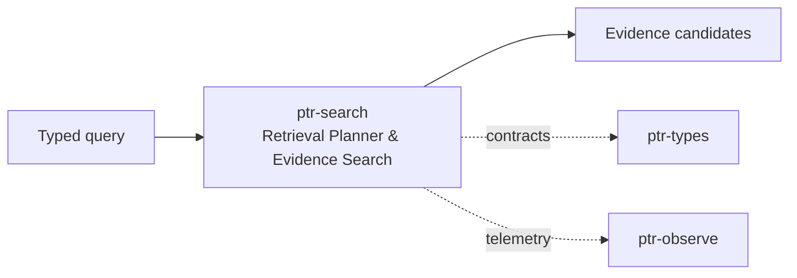

# ptr-search — Retrieval Planner & Evidence Search

> **Role:** Routes queries across lexical, semantic, GPU, multimodal, distributed and structural search backends while keeping retrieval non-authoritative.  
> **Maturity:** see the generated status below; production behavior must be proven by the linked experiments and component evaluations.

<!-- PTR:STATUS:BEGIN -->
## Current implementation status

> **Generated section.** Source of truth: [`component.toml`](component.toml) plus code-derived metrics from `src/`. Run `python3 scripts/update_component_docs.py --write` after editing implementation metadata. Do not hand-edit inside this block.

**Maturity:** `prototype`  
**Last reviewed:** 2026-10-13  
**Code footprint:** 5 Rust source files · 2436 nonblank source lines · 6 integration-test files · 81 test markers (`#[test]`, `#[tokio::test]`)

### Implemented now

- SearchFilter has no Default (SearchFilter::at, audit_without_time); promote_verified_at / promote_verified_with_at ask the authority again (lifecycle and validity) at the instant of reliance
- Retrieval eligibility (ADR-0024): backend-neutral SearchFilter (principal, groups, instant, role, predicate, any-of tags) with validate and the reference predicate admits, SearchAttributes for documents, SearchQuery carrying the filter into SearchIndex::search; SearchHit::observe_at / observe_resolved_at hold a hit to the authority's half-open validity, promote_verified_at / promote_verified_with_at check it again at the instant of reliance (ValidityRefusal, TimedPromotionError) and the untimed promotion refuses a time-checked hit; AliasTable, a closed alias query resolver (longest whole-word match, Unknown / Ambiguous)
- EvidenceStage promotion states
- SearchHit with private evidence stage and explicit promotion API; its capsule and generation are private too, fixed by SearchHit::new and read through capsule() and generation(), so the generation promote_verified promotes is the one observe asked about and a hit observed live cannot be renamed to a revoked or superseded generation (promote_verified does not ask the lifecycle again); observe asks the lifecycle authority for the validity of the hit's own capsule and generation (as generation_validity answers it, the question retain_live asks) and moves the hit to Observed only on Validity::Live, so a revoked generation that is still the capsule's live one is refused (RevokedGeneration), as are superseded, disputed and unknown ones; every promotion refusal has a stable code
- Exact-source resolution and claim verification (src/source.rs): ExactSourceResolver over a RawEventSource (KnowledgeStore implements it; an open trait, so the source is a trust root) and a SourceOwnership (which capsule generations admitted which raw event; SourceOwners is a map) resolves a SourceCitation (raw event id, byte span, quote) only against an existing raw event whose digest it re-checks, a non-empty in-range span whose bytes equal the quote exactly (the offset is part of the citation), and returns a ResolvedSource that records the event's owners; verify_claim compares a structured Claim (subject, predicate, value) with the resolved text under a documented one-statement format (`subject: predicate is [not ]value`, byte-exact tokens, no case folding or normalisation) and returns a ClaimProof; negated statements, other subjects (lookalikes included), predicates and values, and text that is not exactly one statement (the bare value `not`, a truncated negation, included) are refused. Each refusal is a typed variant of SourceError or ClaimError with a stable code and no source text. ResolvedSource and ClaimProof have private fields and no public constructor (compile_fail doctests)
- SearchHit::observe_resolved(ResolvedSource, validity) and SearchHit::promote_verified_with(ClaimProof): the typed promotion path, additive to the boolean one; the hit keeps the resolved source it was observed with and the claim it was promoted with, a proof made for another source is refused (ClaimProofMismatch), a source that is not an event of the hit's own capsule and generation is refused after the lifecycle check (SourceNotOwnedByHit), a refused step leaves the hit at its stage and a refused observation keeps no source. The typed path's guarantee holds given a truthful RawEventSource, SourceOwnership and validity closure, none of which is checked here. The boolean observe/promote_verified stay as the documented trusted-caller path (a hit reaches VerifiedKnown through them with no raw bytes) and leave a hit without source or claim
- SearchIndex contract
- Reciprocal-rank fusion implementation
- weighted_rank_fusion and convex_score_fusion keyed by capsule and generation, so a stale generation never borrows the live one's rank, with deterministic tie-breaking and per-hit backend attribution
- FusedHit is plain data, a search candidate that no function of the crate takes back: the bounds on its score are what the fusions compute, not what every value holds, and a candidate enters evidence promotion only as a SearchHit, which starts at SearchCandidate; WeightedList is validated by every fusion
- retain_live keeps a hit only when the lifecycle answers Validity::Live for its capsule and generation (as generation_validity does), so a revoked generation that is still the capsule's live one is dropped; reciprocal_rank_fusion delegates to the weighted form and returns each entry's generation with its capsule and score, so two generations of one capsule stay two entries a caller can tell apart
- Every fused score is finite and at most the total weight: fusion refuses (FusionError, stable codes) negative or nonfinite weights, weights summing beyond MAX_TOTAL_WEIGHT (f32::MAX), a negative or nonfinite rank constant, a list naming a capsule generation twice and, for score fusion, a nonfinite score, before accumulating anything; scores are accumulated and min-max normalised in f64, so scores spanning the whole f32 range normalise into [0, 1]; check_rank_fusion applies the parameter check on its own

### Missing for the target architecture

- Typed query/search planner beyond the eligibility filter and the alias resolver (no fuzzy or model-based resolution, by design)
- Tantivy/Zvec/cuVS/LanceDB/Havenask/GritQL adapters
- Backend-specific score metadata
- Backend-specific exact source resolver and an ownership record in the store: the resolver reads raw events by id from a store and compares bytes; KnowledgeStore keeps no iterable event-to-object map, so the SourceOwnership is built by the caller from the records that admitted the events; the hit carries no claim of its own, so the claim a proof is made for is the caller's
- Verifier-report typed integration: verify_claim is a deterministic check of one fixed statement format, not a ptr-verifier report; free text, paraphrase, multi-statement spans and conflicts between live statements are refused or undecided, never interpreted
- Resolution of a citation against a durable, anchor-verified store (the resolver trusts the RawEventSource only for the bytes and digest it returns)

### Next milestones

- Implement lexical reference backend first
- Derive SourceOwnership from KnowledgeStore objects (needs an accessor in ptr-memory), connect the typed promotion path to the retriever index and to ptr-verifier reports, and deprecate the boolean observe/promote_verified (Q002, its precondition, is completed)
- Run Q001/Q002 and strong RAG baseline E002

### Linked experiments

- [Q001](../../experiments/retrieval/Q001-fusion/README.md) — `planned`
- [Q002](../../experiments/retrieval/Q002-evidence-promotion/README.md) — `frozen`
- [E002](../../experiments/system/E002-rag-baselines/README.md) — `planned`
- [E003](../../experiments/system/E003-token-efficiency/README.md) — `planned`

### Technology evaluations

- [lexical-search](../../evaluations/components/lexical-search/README.md) — `open`
- [local-vector-search](../../evaluations/components/local-vector-search/README.md) — `open`
- [gpu-vector-search](../../evaluations/components/gpu-vector-search/README.md) — `open`
- [distributed-search](../../evaluations/components/distributed-search/README.md) — `open`
- [structural-code-search](../../evaluations/components/structural-code-search/README.md) — `open`

### Decision records

- [ADR-0002-authority-hierarchy.md](../../research/decisions/ADR-0002-authority-hierarchy.md)
- [ADR-0008-derived-search-not-authority.md](../../research/decisions/ADR-0008-derived-search-not-authority.md)
- [ADR-0004-backend-independence.md](../../research/decisions/ADR-0004-backend-independence.md)
- [ADR-0024-retrieval-eligibility-before-ann.md](../../research/decisions/ADR-0024-retrieval-eligibility-before-ann.md)

### Current automated checks

- tests/filter.rs: revocation and a shortened validity between observation and promotion are refused
- tests/filter.rs: fail-closed access, group membership, half-open boundaries, no-now audit view, role/predicate/tags, validation bounds, commit-time expiry between retrieval and use, the untimed promotion refused for a time-checked hit; tests/resolver.rs: longest match, ambiguity, unknown, bounds
- tests/evidence_promotion.rs: direct Known is blocked; a revoked generation that is still the live one is never observed (a_revoked_generation_is_never_observed_although_it_is_still_the_live_one); superseded, disputed and unknown generations are refused and only a live one is observed; a hit is promoted as the capsule and generation the lifecycle answered live for (a_hit_is_promoted_as_the_capsule_and_generation_the_lifecycle_answered_live_for); every promotion refusal has a stable code
- compile_fail doctests on SearchHit: its capsule and generation cannot be assigned; compile_fail doctests on the source module: a ResolvedSource and a ClaimProof cannot be built by hand (E0451), with a compiling twin that obtains both from the resolver and the verifier
- src/source.rs unit tests: every SourceError reason (unknown raw event, digest mismatch from a source that breaks the store's invariant, empty/reversed span, span past the end, quote mismatch including a doctored tail and a prefix, the offset as part of the citation); every ClaimError reason (other subject, predicate and value in that order, lookalike and Cyrillic/zero-width subjects, negation, malformed statements, malformed claims); stable distinct codes; determinism
- tests/source_promotion.rs: the typed path promotes through every stage; a hit cannot skip a stage (promote from candidate or possible, observe twice, step back); a lifecycle refusal (superseded, revoked, disputed, unknown) keeps the hit possible with no source; a proof made for another source is refused; a boolean-observed hit holds no source; the boolean path stays the trusted caller's and leaves no evidence
- workspace fmt/check/test/clippy
- fusion unit tests: two generations of one capsule are never merged, agreement across backends outranks a single first place, a zero-weight list contributes nothing, convex fusion normalises each list, stale, revoked and unknown generations are dropped
- tests/fusion.rs: a revoked generation is dropped although it is still the live one; unweighted fusion returns each generation of a capsule with its own score (unweighted_fusion_returns_each_generation_of_a_capsule_with_its_own_score); weights whose total could overflow a fused score, invalid weights and rank constants, a repeated capsule generation and a nonfinite score are refused; scores spanning the whole f32 range normalise into [0, 1]; every refusal has a stable code
- ptr-runtime tests/verified_delta.rs: search hits filtered by generation_validity drop a revoked live generation
- ptr-pg postgres test fuses full-text and halfvec hits over live generations only

<!-- PTR:STATUS:END -->

## Position in PTR

Dedicated diagram source: [`docs/diagrams/components/ptr-search.mmd`](../../docs/diagrams/components/ptr-search.mmd)

**Upstream:** ptr-memory, ptr-types  
**Downstream:** ptr-fastmem, ptr-pg, ptr-bench

## Mission

Routes queries across lexical, semantic, GPU, multimodal, distributed and structural search backends while keeping retrieval non-authoritative.

PTR keeps this responsibility in its own crate so the semantics remain stable even when an external library or implementation is replaced.

## Responsibilities

- TypedQuery
- search planner
- backend abstraction
- fusion
- EvidenceCandidate and promotion metadata

## Explicit non-responsibilities

- semantic truth
- long-term object lifecycle
- raw artifact storage

## Data flow

| Direction | Contract |
|---|---|
| Input | Typed query, project scope, retrieval budget |
| Output | Ranked evidence candidates with provenance and index generation |
| Failure | Explicit typed error / rejected state; no silent fallback that changes semantics |
| Observability | Standard PTR tracing fields and a stable component span |

## Technical approach

- Tantivy lexical
- Zvec local vector
- cuVS GPU
- LanceDB multimodal
- Havenask distributed
- GritQL structural code; all candidates remain benchmarkable

External projects are **candidates**, not architectural authority. The PTR-owned traits and domain types must remain usable with a replacement backend.

## Core invariants

1. SearchHit is never Known<T>.
2. Source resolution and generation validation precede promotion.
3. Backend scores are normalized before cross-engine fusion.

These invariants should be executable wherever possible through unit, property, lifecycle or chaos tests.

## Failure model

The component must fail closed for semantic or effect-safety violations. Infrastructure failures should surface as typed errors that preserve request, revision, generation and provenance context. Retries must be idempotent whenever the operation may cross a process or network boundary.

## Performance model

Measure before optimizing. Benchmarks should record at least latency distribution, throughput, allocations/resident memory, queue depth or working-set size where relevant, and the cost of verification. Performance optimizations may not bypass generation, revision, capability or evidence checks.

## Security and privacy

- Treat external inputs and backend outputs as untrusted until validated.
- Do not put raw secrets/private evidence into generic tracing or inspection.
- Preserve provenance on every promotion from raw/possible evidence to stronger semantic state.
- External effects pass through `ptr-security` even if this component already performed local validation.

## Technology evaluation

- [lexical-search](../../evaluations/components/lexical-search/README.md)
- [local-vector-search](../../evaluations/components/local-vector-search/README.md)
- [gpu-vector-search](../../evaluations/components/gpu-vector-search/README.md)
- [distributed-search](../../evaluations/components/distributed-search/README.md)
- [structural-code-search](../../evaluations/components/structural-code-search/README.md)

A new candidate should be added with a reproducible benchmark and failure-semantics analysis rather than replacing the default ad hoc.

## Tests required before production use

- Contract/unit tests for all domain transitions.
- Invalid, stale-generation and stale-revision cases.
- Cancellation/retry behavior.
- Property tests for invariants where practical.
- Cross-backend equivalence if more than one backend exists.
- Observability and redaction checks.

## Related architecture

- [System architecture](../../docs/architecture/00-system.md)
- [Technical architecture](../../docs/TECHNICAL_ARCHITECTURE.md)
- [Component contracts](../../docs/COMPONENT_CONTRACTS.md)
- [Global invariants](../../docs/INVARIANTS.md)

