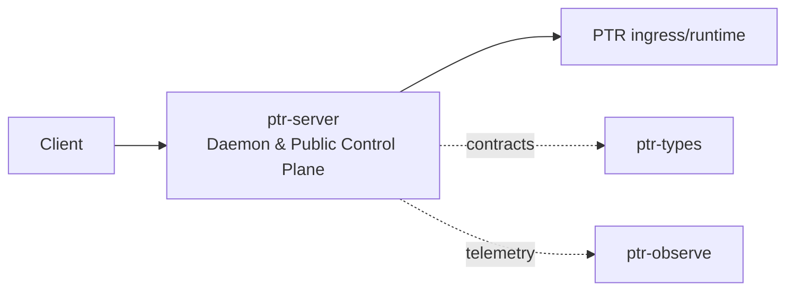

# ptr-server — Daemon & Public Control Plane

> **Role:** Exposes PTR to clients through stable APIs without leaking internal crate boundaries or provider-specific interfaces.  
> **Maturity:** see the generated status below; production behavior must be proven by the linked experiments and component evaluations.

<!-- PTR:STATUS:BEGIN -->
## Current implementation status

> **Generated section.** Source of truth: [`component.toml`](component.toml) plus code-derived metrics from `src/`. Run `python3 scripts/update_component_docs.py --write` after editing implementation metadata. Do not hand-edit inside this block.

**Maturity:** `prototype`  
**Last reviewed:** 2026-10-10  
**Code footprint:** 10 Rust source files · 4009 nonblank source lines · 8 integration-test files · 90 test markers (`#[test]`, `#[tokio::test]`)

### Implemented now

- KV path hardening: KvBackend::with_max_prompt_tokens refuses a text that tokenizes beyond the limit with 413 (ApiError::PromptTooLong) before any runtime call, so nothing reaches the ledger; KvTaintRegistryFull is 507 Insufficient Storage without Retry-After (the registry never drains); the KV path answers with an x-ptr-kv-hit-tokens header (KV_HIT_TOKENS_HEADER); serve_with_backend serves either backend and ptrd wires the reference-kv name (CPU reference, seeded random weights, byte text) through it; tests/reference_kv.rs starts ptrd and sees a second request with a shared prefix report x-ptr-kv-hit-tokens > 0
- ServerBackend is either Resumable(Arc<dyn ResumableInferenceBackend>) (the existing path, unchanged: with_dependencies/router_with_dependencies/serve_with_dependencies delegate to it) or KvReusing(KvBackend), a KvReusingBackend with a Tokenizer and optional KvReuseHint (with_backend, router_with_backend, serve_with_backend). On the KV path the request text becomes one Raw PromptSegment of a SegmentedModelRequest and the ModelRun reaches the request flow only through PtrRuntime::run_model_run_resumable, i.e. ingest_model_run (invariant marked KV-INGEST-INVARIANT in lib.rs): an Approximate run's action is refused by authorize_action before any session or EffectAttempted, answered 409 Conflict (not 422: the refusal depends on the server's KV-reuse state, not the request content, and no edit of the request fixes it); a full taint registry is 503; Exact or no reuse gives responses identical to the plain ScenarioBackend path. The KV path does not resume Pods (a run that requests one is 422). Covered by tests/kv_taint.rs with a test double
- Versioned JSON ApiRequest/ApiResponse and HealthResponse contracts
- Axum router with GET /health and POST /v1/requests
- Reference runtime/backend request path returns revisioned response
- POST /v1/requests runs run_resumable_with_pods_using_router against an injected ResumableInferenceBackend, `Arc<dyn PodSampler>` (built with checked_pod_router(SamplingKey, instance), a PodRouter policy sampled through route_checked), PodRegistry and typed-payload Verifier (router_with_dependencies, serve_with_dependencies); ServerState::new and router() keep the ReferenceEchoBackend, an empty registry and default_verifier(), and ApiResponse gains verified_evidence (type:length per observation)
- A mutating action returned by that run is executed once through the runtime's session path (authorize_action, register_execution_session, prepare_execution_once, execute_prepared): ApiRequest gains an optional idempotency_key that mutations require (400 without it), and ApiResponse.effect returns an EffectReceipt with the ledger indices of the EffectAttempted and EffectSettled records and the SHA-256 of the output; a repeated key replays the receipt
- Effect failures map to HTTP: a key bound to another action, a fenced runtime or an ambiguous outcome is 409, other execution errors and a missing grant are 422, and a payload that is not UTF-8 or exceeds 4 KiB is 400
- demo_effect_grants installs a single demo.local-note.create grant (Effect::Mutation, Deterministic verification) whose DemoNoteExecutor replaces effects/demo-note.txt under a data directory atomically (temporary file named from process id, clock and a counter and retried on a name collision, sync_all, rename, then a directory fsync on Unix, and on Windows, where a directory cannot be opened as a file, a flush of the replaced note's own handle to push its metadata out; the Windows path was verified in CI rather than locally, and what a flush guarantees about a rename after a power loss is the file system's, not this crate's), so every distinct idempotency key can write and the latest note wins; the default state installs no grants, so effects there are refused
- default_verifier() (default_verifier_with(PayloadBounds) for other limits) is PayloadBoundsVerifier (non-empty type id without edge whitespace, at most MAX_POD_OUTPUT_BYTES = 64 KiB, UTF-8 for configured textual type ids; hard findings type-id, payload-size, payload-utf8), replacing the allow-all verifier
- demo_effect_grants verifies the action with ptr-verifier's ActionContractVerifier (action-contract) built from the DEMO_* constants, replacing the allow-all action verifier; DemoNoteExecutor's own check and the handler's 400 precheck remain as defence in depth
- Bounded request admission (Invariant #8): RequestAdmission (atomic in-flight counter, compare_exchange; new() returns Result<_, AdmissionError> and refuses capacity 0) sized from runtime.mailbox_capacity; the slot is taken right after the cheap 400 checks and the locked pipeline runs in tokio spawn_blocking with the slot guard moved in, so it is held until the blocking work ends even if the request future is cancelled and async workers stay free for /health; a request that finds it full is refused with 503 Service Unavailable, Retry-After: 1 and {"error":"request mailbox saturated"}, and the slot is released on drop
- The verifier-closed workspace loop as a new, config-selectable request path (src/vcw/, package VS): POST /v1/vcw/tasks exists only on a ServerState given a VcwService (ServerState::with_vcw, built by VcwService::from_config from the [vcw] section of ptr-config, default off; router_from_state and serve_state serve it); every existing route, type and signature is unchanged and the existing tests pass untouched, with a test that /health and /v1/requests answer byte for byte alike with and without it. A request is {id, task:{kind: arithmetic|json_object|code|fact, ...}} (unknown fields refused; a body limit of 256 KiB, field bounds from the verifiers answered 413, a blank or unserved input 400, a reused id 409, the runtime mutex and the existing RequestAdmission slot as for /v1/requests, 503 with Retry-After when saturated). The server commits the task text as raw evidence, builds the real ptr-verifier verifier of the task (arithmetic, JSON Schema subset, code tests, facts against the runtime snapshot), the RoleRoster from RepairRoleAssignments over the code table (one Pod id per role from config), and runs one VcwLoop per served kind with Guarded experts over the runtime own eligibility view (RuntimeStanding). Outcome is typed: Verified {answer, authors, rounds, verifier_calls, pod_calls, trace_digest, committed range} answered 200 only after admit_verified_answer admitted it (the runtime re-verifies with the same task verifier over the state as it is then; liveness, project and payload checks first), Exhausted {reason} and Escalated {reason} answered 422 without any candidate, an admission refusal 422 with no answer. An accepted answer is committed as a Candidate output (PodOutputAdmitted plus a PodCandidate semantic record), not promoted; the trace digest is bound into the execution manifest of that admission (origins) and emitted as RuntimeEvent::VcwFinished for every outcome. Round 2: an enabled section must name its backend (no default; ptr-config vcw.experts.backend is an Option); the backend is marked in every admission (manifest origins vcw:backend:<name>, plus the four model-file digests for qwen-cpu), in the capabilities of the served Pods (backend:<name>, so the Pod manifest digest differs by backend) and as `backend` in Verified, Exhausted and Escalated responses; a per-request wall-clock deadline (max_request_ms, default 30000, at most 120000, checked before each Pod call) ends a request Exhausted with reason Deadline; every request after its raw text is committed records one VcwFinished (outcome failed for internal errors) and its id is consumed (retry needs a new id); install refuses a Pod id that is a capsule of another project (PodIdCollision), a configured generation different from the live generation of a known Pod (GenerationMismatch) and a scope of an earlier incarnation with a non-default lease binding or children (ScopeNotEmpty), and ptrd builds and installs the service before it binds the listener. Experts: simulated (seeded programmatic experts that plant and clear the finding codes of the code table at configured rates, drawing clean candidates from the request reference, which never reaches a verifier) or qwen-cpu (cargo feature qwen-cpu; arithmetic and json_object; model directory and four SHA-256 digests required, a mismatch refuses to start). Covered by tests/vcw.rs (arithmetic wrong then repaired with ledger and event checks, JSON schema and code repair including the resource role, unrepairable task exhausted, wrong reference never passes, unknown fact never accepted, contradicted fact repaired against committed state, a revoked proposer and a revoked repairer never called, disabled has no route and old routes byte-identical, typed 4xx, id used once, saturation 503, determinism for a fixed seed, build-time refusals)
- Read-back of finished vcw requests (src/vcw/report.rs, package demo): GET /v1/vcw/traces/{id} returns the trace of one of the last 64 requests (MAX_RETAINED_TRACES; steps with round, origin, authors, every routing decision with Pod, generation, propensity and support, the candidate's verifier status, hard finding codes, class and workspace outcome, the decision and the budget after the step; budget limits and spent) and a summary of the ledger events the request committed, taken from the runtime ledger when the request finished (at most MAX_REPORTED_EVENTS = 64 events, each as index, variant name, size of the event's canonical encoding (ptr_ledger::encoded_event) and an 8-byte digest of that encoding, never the event content, so raw payload bytes cannot leak; only this bounded summary is computed while the runtime lock is held, and no event is rendered beyond its variant name); a query reads only the bounded in-memory store and never takes the runtime lock, so it answers while a long request holds the runtime and needs no admission slot (test: trace_reads_and_health_answer_while_a_long_request_holds_the_runtime); 404 for an unknown or evicted id and when the vcw path is not installed; a GET while the request is still running returns outcome running and ledger null (the request is registered with a null trace when its raw text is committed, the trace is stored when the loop has finished, the ledger summary when the request ends; test: a_request_that_has_not_finished_reports_running_and_a_null_ledger). Observability only: no payload and no finding message, no authority; the same loopback-only caveat as the fact kind. serve_state_until(listener, state, shutdown) serves a ServerState until a future completes and lets requests in flight finish; ptrd uses it to stop cleanly on SIGINT or SIGTERM. [vcw.pods.extra_repairers] adds Pods to repair roles (VcwService::from_config assigns them next to the primary one); make vcw-demo (scripts/vcw_demo.py, config/vcw-demo.toml) starts ptrd with two eligible repairers of different skill per role and drives this path end to end (a repaired arithmetic request, a repaired JSON request, and a code request exhausted by inability)
- Shadow learning of the vcw path (src/vcw/shadow.rs, [vcw] learning = "shadow"; package VL): each served kind attaches a ptr_router::RoutingLearner to its loop (VcwLoop::with_learner), freezes a LearnedPolicy candidate after 256 settled verdicts and, from the decisions logged after the freeze, logs the doubly robust value difference of the candidate over the uniform router and its one-sided 95% lower bound as RuntimeEvent::VcwShadowEstimate at geometrically growing log sizes (first at 128 decisions, log capped at 16384; the length is checked with RoutingLearner::log_len_from so a request that is not due copies no log, and when the next estimate point could never fit in the log the candidate is re-frozen and its held-out log restarts, so estimates continue; the estimates are monitoring values (one-step per-route rate, repeated looks at a growing log, independence assumed), never promotion evidence); VcwService::learning_report() returns the counts, the candidate digest and the latest estimate per kind (empty with learning off). The loop's scorer stays UniformScorer: nothing learned routes, nothing is promoted, and there is no configuration that promotes
- Verifier criteria in the request evidence: every vcw Job carries a criteria digest (length-prefixed SHA-256 tagged with the task kind over the arithmetic expression, the JSON Schema text, the code entry with each test id, arguments and expected value, or the fact claims), and the request digest that the trace encodes and the admission manifest commits to includes it, so two requests with the same statement but different tests leave different evidence while hidden tests stay out of the statement a model sees (test: job::tests::the_criteria_digest_binds_the_code_tests_but_the_statement_hides_them)
- A vcw request reads back as running from the moment its raw text is committed: TraceStore::start registers it with a null trace before the loop runs (so GET /v1/vcw/traces/{id} answers running, not 404, while a slow loop holds the runtime), and the finished loop fills that entry (test: report::tests::a_started_request_reads_back_as_running_before_its_loop_has_a_trace)
- Install and request validation (follow-ups of PR #132): a code task whose tests are empty, repeat an id or differ in arity is a 400 before the id is consumed; install checks every Pod of the roster (collision, generation) before committing any, so a refusal leaves no orphan live capsule; an active scope under the service name is adopted only if it has the service project, no lease and no children, otherwise the next incarnation is used (tests: job::tests::an_unpassable_code_suite_is_a_bad_request, tests/vcw.rs a_refusal_late_in_the_roster_commits_none_of_the_earlier_pods and an_active_scope_of_another_project_under_the_service_name_is_not_adopted)
- Shadow learning report consistency: when a kind rotates its frozen candidate (the held-out log can no longer reach the next estimate point), the stored latest estimate is dropped with it, so learning_report() never pairs a fresh candidate digest with the previous candidate's estimate; that estimate stays in the VcwShadowEstimate runtime event (test: shadow::tests::rotating_the_candidate_drops_the_previous_candidates_estimate)
- Second round of install and trace fixes: an active scope under the service name is adopted only with the service session as well (admission refuses a different session), and when the vcw loop itself fails its failed trace is stored before the request is finished, so the trace read-back shows what the recorded digest names (test: tests/vcw.rs an_active_scope_of_another_session_under_the_service_name_is_not_adopted)

### Missing for the target architecture

- Pod resumption on the KV path; the taint registry is in memory and not rebuilt after a restart (see ptr-runtime)
- Streaming ModelEvent/WebSocket or SSE API
- Authentication/session/policy integration
- Readiness/admin endpoints beyond basic health
- Cancellation propagation (backpressure is bounded admission only; there is no queue, priority or per-client fairness)
- The vcw path holds the runtime mutex for the whole run, bounded by max_request_ms plus the step in flight (a slow model serialises requests); the fact kind is an oracle for committed state (200 versus 422 tells a client whether a guessed claim equals fact/<subject>/<attribute>), acceptable on loopback only; hint_mode apply-to-schema lets client traffic change the shared per-kind self-model and attention schema, so routing influence crosses clients (default trace-only); simulated answers are client-authored (drawn from the request reference) and marked as such; every distinct request id commits raw text and a candidate with no quota or authentication; no streaming, no per-client fairness, no authentication; facts need committed semantic state (an empty runtime answers Unknown); the code and fact kinds have no prompts for the model backend; the qwen-cpu feature is not compiled by CI
- Shadow learning has one Pod per role in the shipped roster, so the candidate cannot differ from uniform there; the estimates become informative only with a roster that has several repair Pods per code. Promotion of a learned policy is not reachable from the server

### Next milestones

- Add streaming ModelEvent SSE/WebSocket endpoint and cancellation propagation
- Replace ReferenceEchoBackend route with configured evaluated backend
- Add authentication/session/policy and per-client fairness

### Linked experiments

- [E001](../../experiments/system/E001-end-to-end/README.md) — `planned`
- [E003](../../experiments/system/E003-token-efficiency/README.md) — `planned`

### Technology evaluations

- None recorded.

### Decision records

- [ADR-0001-rust-runtime.md](../../research/decisions/ADR-0001-rust-runtime.md)
- [ADR-0004-backend-independence.md](../../research/decisions/ADR-0004-backend-independence.md)

### Current automated checks

- tests/hardening.rs: grant_verifier_refuses_an_action_the_handler_precheck_admits (422, no effects directory) and a_full_mailbox_is_refused_with_503_and_recovers_when_released (mailbox_capacity 1, gated backend, 503 with Retry-After, backend call count unchanged, A then C succeed) and saturation_is_explicit_with_more_requests_than_workers (2 workers, capacity 4, 6 concurrent requests: exactly 2 get 503 with Retry-After, /health answers 200 while saturated, the 4 admitted succeed)
- tests/http.rs: oversized_id_text_and_body_are_refused_before_the_runtime_sees_them
- scenario_backend_executes_demo_note_once_and_replays_receipt: ScenarioBackend writes the note once, a missing idempotency key is 400, a repeated key returns the same attempt/settlement indices, and the same key with a different request is 409; distinct_idempotency_keys_each_execute_and_malformed_keys_are_rejected_up_front: a second key executes and request id and text are bounded (MAX_REQUEST_ID_BYTES 256, MAX_REQUEST_TEXT_BYTES 1 MiB, 400) and the body is capped at MAX_REQUEST_BODY_BYTES 2 MiB (413), stated here rather than inherited from the framework default; a blank key or one with edge whitespace is 400 before the model run, judged by PtrRuntime::is_usable_execution_key, the rule prepare_execution_once itself applies (a well-formed identifier within MAX_KEY_BYTES, or a longer one an earlier build already settled), so a new over-long key is refused before inference while a retry under a long key that was settled earlier is still answered from its record. The receipt is the most recent settled attempt for the key paired with its own settlement. Whether a request ends in a mutation, and so needs a key, is only known after the model run
- durable_restart_fences_open_effect_until_explicit_reconciliation: over a durable ledger holding an unsettled EffectAttempted, the same key is 409 after reopen and succeeds only after reconcile_effect
- tests: every router_with_dependencies caller passes checked_pod_router with a fixed test key; the unit test checks that checked_pod_router reports the key's identifier (ServerState::new, whose registry is empty, uses a sampler that routes nothing)
- Axum health/request/bad-request HTTP integration tests matching TypeScript SDK contract
- public ApiRequest smoke test
- workspace fmt/check/test/clippy
- tests/vcw.rs: the verifier-closed path with simulated experts (see implemented); tests/vcw_qwen.rs: one ignored test of the qwen-cpu backend (env PTR_QWEN_MODEL_DIR, cargo feature qwen-cpu)
- tests/vcw.rs the_trace_and_ledger_events_of_a_request_can_be_read_back (digest equals the response's, routed Pod and propensity, ledger range equals the response's committed range and holds PodOutputAdmitted), an_unanswered_request_reads_back_without_an_admission_and_an_unknown_id_is_404, the_trace_route_does_not_exist_without_the_vcw_path, the_ledger_summary_has_no_event_content, trace_reads_and_health_answer_while_a_long_request_holds_the_runtime, a_second_eligible_repairer_makes_the_router_sample_with_a_propensity_below_one (support of two Pods, propensity equals the chosen Pod's support entry); make vcw-demo runs the built ptrd through a repaired and an exhausted request and exits 0 only if every expected property held
- tests/vcw.rs shadow_learning_learns_and_logs_estimates_but_never_changes_what_is_served: 160 requests under learning off and learning shadow return byte for byte equal responses, off reports nothing, shadow settled more than 256 verdicts, froze a candidate and logged estimates as runtime events, with one Pod per role the estimated gain is zero, and no VcwPolicyChanged event exists; shadow without an exploration floor is refused at build time and by validate

<!-- PTR:STATUS:END -->

## Position in PTR

Dedicated diagram source: [`docs/diagrams/components/ptr-server.mmd`](../../docs/diagrams/components/ptr-server.mmd)

**Upstream:** external clients  
**Downstream:** ptr-ingress, ptr-exec, ptr-observe

## Mission

Exposes PTR to clients through stable APIs without leaking internal crate boundaries or provider-specific interfaces.

PTR keeps this responsibility in its own crate so the semantics remain stable even when an external library or implementation is replaced.

## Responsibilities

- HTTP/WebSocket API
- request/session boundary
- health/readiness endpoints
- streaming response adaptation
- admin/control endpoints

## Explicit non-responsibilities

- core reasoning semantics
- search logic
- distributed consensus

## Data flow

| Direction | Contract |
|---|---|
| Input | Client requests and admin commands |
| Output | API responses and model/runtime event streams |
| Failure | Explicit typed error / rejected state; no silent fallback that changes semantics |
| Observability | Standard PTR tracing fields and a stable component span |

## Technical approach

- Axum primary server framework
- Pingora optional edge/gateway layer
- JSON public API plus binary/streaming options

External projects are **candidates**, not architectural authority. The PTR-owned traits and domain types must remain usable with a replacement backend.

## Core invariants

1. Public API versions are explicit.
2. Authentication/authorization is delegated to hard security policy.
3. Backpressure propagates to clients instead of unbounded buffering.

These invariants should be executable wherever possible through unit, property, lifecycle or chaos tests.

## Failure model

The component must fail closed for semantic or effect-safety violations. Infrastructure failures should surface as typed errors that preserve request, revision, generation and provenance context. Retries must be idempotent whenever the operation may cross a process or network boundary.

## Performance model

Measure before optimizing. Benchmarks should record at least latency distribution, throughput, allocations/resident memory, queue depth or working-set size where relevant, and the cost of verification. Performance optimizations may not bypass generation, revision, capability or evidence checks.

## Security and privacy

- Treat external inputs and backend outputs as untrusted until validated.
- Do not put raw secrets/private evidence into generic tracing or inspection.
- Preserve provenance on every promotion from raw/possible evidence to stronger semantic state.
- External effects pass through `ptr-security` even if this component already performed local validation.

## Technology evaluation

- No dedicated technology slot yet; architectural alternatives should be added to `evaluations/components/` before lock-in.

A new candidate should be added with a reproducible benchmark and failure-semantics analysis rather than replacing the default ad hoc.

## Tests required before production use

- Contract/unit tests for all domain transitions.
- Invalid, stale-generation and stale-revision cases.
- Cancellation/retry behavior.
- Property tests for invariants where practical.
- Cross-backend equivalence if more than one backend exists.
- Observability and redaction checks.

## Demo: the verifier-closed path end to end

`make vcw-demo` builds `ptrd`, starts it with `config/vcw-demo.toml` (the `[vcw]` path on,
simulated experts, real arithmetic and JSON Schema verifiers, temp data directory), sends a request
that is repaired in a routed repair round and one that ends `Exhausted` (not best-effort accepted),
reads each trace and its ledger events back with `GET /v1/vcw/traces/{id}` (a read while a request is still running shows outcome `running` and ledger `null`), prints rounds, finding
codes, routed Pod, propensity and budget, stops `ptrd` with SIGTERM and exits 0 only if every
expected property held. See [doc 39](../../docs/architecture/39-vcw-moe.md), section 3.6.

## Related architecture

- [System architecture](../../docs/architecture/00-system.md)
- [Technical architecture](../../docs/TECHNICAL_ARCHITECTURE.md)
- [Component contracts](../../docs/COMPONENT_CONTRACTS.md)
- [Global invariants](../../docs/INVARIANTS.md)

