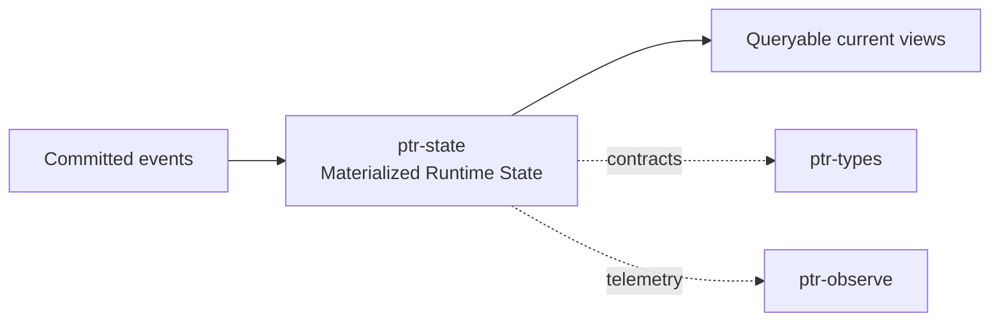

# ptr-state — Materialized Runtime State

> **Role:** Projects committed ledger events into queryable current-state views without replacing the ledger as causal authority.  
> **Maturity:** see the generated status below; production behavior must be proven by the linked experiments and component evaluations.

<!-- PTR:STATUS:BEGIN -->
## Current implementation status

> **Generated section.** Source of truth: [`component.toml`](component.toml) plus code-derived metrics from `src/`. Run `python3 scripts/update_component_docs.py --write` after editing implementation metadata. Do not hand-edit inside this block.

**Maturity:** `prototype`  
**Last reviewed:** 2026-10-08  
**Code footprint:** 1 Rust source files · 1150 nonblank source lines · 3 integration-test files · 17 test markers (`#[test]`, `#[tokio::test]`)

### Implemented now

- ATTESTED_MARKER (semdb:attested) and MERGED_BRANCH_PREFIX (branch-merge:) name the materialized keys that record attributed semantic records and merged branches: every attributed semantic record projects the marker and every merge record its branch's key, and ptr-runtime refuses a compacted snapshot in the pre-attestation lifecycle layout (PTRLC001) that carries either
- Semantic transaction position and revision materialization without duplicated payload ownership; every semantic record with an attributed origin also projects the semdb:attested marker (value 1), and ptr-runtime replays a record without an origin only in the absence of that marker
- A merge record projects merged_branch_key(branch), branch-merge:<byte length>:<id>, so no branch id aliases another's key, with merged_branch_entry(index, plan), the commit index and the plan digest in lowercase hexadecimal; merged_branch_of and parse_merged_branch_entry read back exactly what a merge projects and nothing else, and ptr-runtime refuses a second merge of a branch whose key is present
- MaterializedState reference map with last_applied commit index
- Application of Revoked and HardConstraintCommitted ledger events
- Monotonic materialization with duplicate/out-of-order/gap detection
- All current LedgerEvent variants have deterministic key/value projection semantics
- Effect records project onto the attempt's own commit index, so a settlement overwrites the attempting record's state key instead of adding a second row a reader would have to reconcile
- Feature-gated Turso 0.8.0-pre.11 backend persists atomic projection updates and last_applied state
- classify_next is the one function every backend (reference, Turso, PostgreSQL) uses to decide duplicate, out-of-order, gap or next
- projection_entries is the one event-to-entries mapping, shared by the reference, Turso and ptr-pg so no backend can project an event differently
- projection_entries now maps the newer ledger variants: ProtectedStateCommitted projects protected:<domain>:<logical_id>:generation/revision/ciphertext (the ciphertext digest as lowercase hex, never the ciphertext), MeshTunnelLifecycle projects mesh:<network>:<peer>:revision/state, and ExecutionManifestAdmitted/Revoked project execution-manifest:<digest hex>:state as admitted/revoked
- ScopeLifecycle, PodEvidenceCommitted, PodOutputAdmitted, PodHypothesisCommitted, PolicyBundleActivated/Revoked and SessionRevoked deliberately project no entries (they advance last_applied only); the match over LedgerEvent stays exhaustive
- ExpertStructuralCommitted projects one entry per expert the operation leaves in a new state: expert:<project>/<pod> = <generation>:<state>:<state_version> (state names from expert_state_name, retirement reasons joined with '-'), derived from the record through ptr_pods StructuralOp::outcomes so the projection and the runtime registry share one state table; a record that does not decode projects nothing (the runtime refuses it before commit)
- ExpertFenceCommitted projects the one expert it names: Fence and Escalate as <generation>:fenced:<epoch>, Retire as <generation>:retired-input-revoked:<epoch> and Readmit as <generation>:serving|frozen:<epoch> per the event's resume state, where the epoch is the event's new state version (the expert's fence epoch), so the materialized value an oracle reads no longer carries an earlier epoch (a_fence_event_projects_fenced_at_its_epoch_and_a_readmission_serving_at_the_next, which also covers the retirement)
- KvTaintCommitted projects one entry per subject: kv-taint:<kind>:<hex digest> = approx:<report hex>:<recipe hex> for a Record and cleared:<recompute hex> for a Clear (a_kv_taint_event_projects_one_entry_per_subject); the runtime registry that rebuilds from these entries is not built yet
- Projection of InputInvalidated (ledger tag 30, R011 WP3): expert-input:<identity byte length>:<identity>:<generation> holds revoked:<fence count>:<hex fence digest> or superseded:<new generation>:<hex new digest>:<fence count>:<hex fence digest>, and a revocation also projects revoked:<identity> as a Revoked record does. The event names the fenced experts by count and digest only, so this stateless projection writes no expert: key for them; the runtime, which derives the set from its dependency index, writes those. A version 3 ExpertCommitRecord additionally projects expert-inputs:<project>/<pod> = <generation>:<training>:<evaluation>:<hex block digest> for every expert it creates. Key and value parsers (parse_expert_input_key, parse_expert_input_entry, parse_expert_inputs_generation) accept exactly what the writers write
- Projection of ExpertAuthorityChanged (ledger tag 31, R011 WP4): expert-authority:<kind name> (gate-config or evaluator) holds <epoch>:<hex identity digest>:<class name>:<fence count>:<hex fence digest> and records the latest change of that kind; parse_expert_authority_key and parse_expert_authority_entry are the strict inverses a compacted-snapshot restore checks the authority state against. The experts the change fenced are not in the event; the runtime writes their expert: keys

### Missing for the target architecture

- Rebuild equivalence tests across every backend (the PostgreSQL projection is compared with the reference in ptr-pg; L004 extends it)
- The expert: rows a plain projection writes are NOT authoritative after a tag-30 or tag-31 fence (R011 WP3b): projection_entries writes only the invalidated input, the count and the digest (or the new standing), so a consumer that applies only it shows the fenced experts as Serving; the ptr-runtime materialized state, whose runtime writes the fenced rows from its dependency index, is the only place they are marked (materialized_state_marks_the_fenced_experts_but_a_naive_projection_replay_does_not, ptr-runtime tests/expert_review_fixes.rs). Nothing may route from a plain projection
- The per-expert effect of a tag-30 fence is not derivable from the event, so a projection backend that applies only projection_entries (the Turso reference, ptr-pg) records the invalidated input, the count and the digest but not which expert: keys moved; only the runtime's materialized state holds them
- The per-expert effect of a tag-31 authority change is not derivable from the event (count and digest only), so a projection backend that applies only projection_entries (the Turso reference, ptr-pg) records the new standing but not which experts the change fenced

### Next milestones

- Add schema migration/versioning and richer typed query views beyond key/value projection
- Extend replay tests to full snapshot/rebuild equivalence
- Benchmark Turso against SQLite/redb candidates under replay and update/delete workloads

### Linked experiments

- [L001](../../experiments/lifecycle/L001-revocation-crash/README.md) — `running`
- [L002](../../experiments/lifecycle/L002-raft-recovery/README.md) — `planned`
- [E004](../../experiments/system/E004-long-horizon/README.md) — `planned`

### Technology evaluations

- [materialized-state](../../evaluations/components/materialized-state/README.md) — `open`

### Decision records

- [ADR-0002-authority-hierarchy.md](../../research/decisions/ADR-0002-authority-hierarchy.md)
- [ADR-0009-consensus-ledger-state-separation.md](../../research/decisions/ADR-0009-consensus-ledger-state-separation.md)
- [ADR-0020-only-the-runtime-merges-an-agent-branch.md](../../research/decisions/ADR-0020-only-the-runtime-merges-an-agent-branch.md)

### Current automated checks

- an attributed semantic record of each ingress and host kind projects the revision and the semdb:attested marker, never its payload
- a merge projects its branch's key with its index and plan digest (a_merge_projects_its_branch_key_with_its_index_and_plan), and merge keys are length-delimited: ids that share a character prefix or a length written into them project distinct keys, and merged_branch_of and parse_merged_branch_entry refuse every other spelling (branch_merge_keys_are_length_delimited)
- replay ordering/idempotency integration test
- Turso reopen/monotonicity integration test behind turso-backend feature
- clippy -D warnings over the turso-backend build in the state-turso CI job
- workspace fmt/check/test/clippy
- unit test that only the exact next index is applicable and every other index is classified as duplicate, out-of-order or gap
- ptr-pg postgres test replays a mixed log and compares every entry with MaterializedState
- an_input_invalidation_projects_the_input_and_never_guesses_the_fenced_experts, the_input_key_and_value_parsers_accept_exactly_what_the_writers_write and a_version_3_record_commits_to_its_dependency_block_per_created_expert (versions 1 and 2 project exactly what they did)
- an_authority_change_projects_one_entry_per_kind_and_the_value_parses_back: the entry for each kind, the strict key and value parsers (leading zero, zero epoch, unknown class, bad count or digest and extra fields refused)

<!-- PTR:STATUS:END -->

## Position in PTR

Dedicated diagram source: [`docs/diagrams/components/ptr-state.mmd`](../../docs/diagrams/components/ptr-state.mmd)

**Upstream:** ptr-ledger  
**Downstream:** ptr-memory, ptr-search, ptr-semdb

## Mission

Projects committed ledger events into queryable current-state views without replacing the ledger as causal authority.

PTR keeps this responsibility in its own crate so the semantics remain stable even when an external library or implementation is replaced.

## Responsibilities

- materializers
- current-state schemas
- last-applied commit tracking
- rebuild/replay logic

## Explicit non-responsibilities

- causal ordering
- semantic interpretation of uncommitted data
- retrieval ranking

## Data flow

| Direction | Contract |
|---|---|
| Input | CommittedEvent stream |
| Output | Queryable materialized state |
| Failure | Explicit typed error / rejected state; no silent fallback that changes semantics |
| Observability | Standard PTR tracing fields and a stable component span |

## Technical approach

- Turso/libSQL candidate
- in-memory reference materializer
- CDC hooks for downstream projections

External projects are **candidates**, not architectural authority. The PTR-owned traits and domain types must remain usable with a replacement backend.

## Core invariants

1. Every row/view can be traced to a committed index.
2. Rebuild from ledger yields equivalent current state.
3. Materializers are idempotent across replay.

These invariants should be executable wherever possible through unit, property, lifecycle or chaos tests.

## Failure model

The component must fail closed for semantic or effect-safety violations. Infrastructure failures should surface as typed errors that preserve request, revision, generation and provenance context. Retries must be idempotent whenever the operation may cross a process or network boundary.

## Performance model

Measure before optimizing. Benchmarks should record at least latency distribution, throughput, allocations/resident memory, queue depth or working-set size where relevant, and the cost of verification. Performance optimizations may not bypass generation, revision, capability or evidence checks.

## Security and privacy

- Treat external inputs and backend outputs as untrusted until validated.
- Do not put raw secrets/private evidence into generic tracing or inspection.
- Preserve provenance on every promotion from raw/possible evidence to stronger semantic state.
- External effects pass through `ptr-security` even if this component already performed local validation.

## Technology evaluation

- [materialized-state](../../evaluations/components/materialized-state/README.md)

A new candidate should be added with a reproducible benchmark and failure-semantics analysis rather than replacing the default ad hoc.

## Tests required before production use

- Contract/unit tests for all domain transitions.
- Invalid, stale-generation and stale-revision cases.
- Cancellation/retry behavior.
- Property tests for invariants where practical.
- Cross-backend equivalence if more than one backend exists.
- Observability and redaction checks.

## Related architecture

- [System architecture](../../docs/architecture/00-system.md)
- [Technical architecture](../../docs/TECHNICAL_ARCHITECTURE.md)
- [Component contracts](../../docs/COMPONENT_CONTRACTS.md)
- [Global invariants](../../docs/INVARIANTS.md)

## P0.2 semantic journal integration

[Durable semantic-state contract](../../docs/architecture/22-durable-semantic-state.md)
records the new code/codec, ownership and replay boundaries. Publication follows
successful journal append. Typed Pod bytes and source identity participate in
semantic revisions. Logical removals do not erase log history; neural checkpoints
and authenticated framing remain separate gates. Execution evidence is in the PR.
