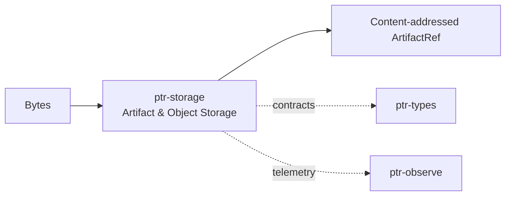

# ptr-storage — Artifact & Object Storage

> **Role:** Provides typed, content-addressed artifact references while abstracting physical storage locations.  
> **Maturity:** see the generated status below; production behavior must be proven by the linked experiments and component evaluations.

<!-- PTR:STATUS:BEGIN -->
## Current implementation status

> **Generated section.** Source of truth: [`component.toml`](component.toml) plus code-derived metrics from `src/`. Run `python3 scripts/update_component_docs.py --write` after editing implementation metadata. Do not hand-edit inside this block.

**Maturity:** `prototype`  
**Last reviewed:** 2026-10-14  
**Code footprint:** 6 Rust source files · 2150 nonblank source lines · 7 integration-test files · 41 test markers (`#[test]`, `#[tokio::test]`)

### Implemented now

- ArtifactRef with stable ArtifactId plus location list
- ObjectStore trait
- In-memory object-store reference implementation
- Typed multi-tier manifests with canonical chunk and root digests
- Immutable CPU and atomic filesystem tier backends with verify-on-read
- Optional OpenDAL memory, filesystem and S3-capable adapter; put_chunk over an existing object that fails its own content address overwrites it with the verified bytes (repair) instead of returning ImmutableConflict, which is kept only for a valid object with different bytes
- PinnedHostTierBackend (feature tier-pinned, Linux only): a TierBackend over per-chunk anonymous mappings locked with mlock under a fixed byte budget charged with the page-rounded footprint (footprint_for returns None instead of wrapping when the rounded size overflows usize); an over-budget put returns BudgetExceeded and an mlock refusal returns MemoryLock, both storing and charging nothing; same digest, validation and verify-on-read semantics as CpuTierBackend
- FileTierBackend direct read path (feature tier-direct-io, Linux only): FileTierBackend::with_options(FileTierOptions { read: FileReadMode::Direct }) reads chunk files with O_DIRECT into a page-aligned anonymous MAP_SHARED buffer (not heap memory, so a concurrent fork cannot corrupt it), with the offset and length alignment taken from statx(STATX_DIOALIGN) when the kernel reports it (4096 otherwise; a file needing more than a page, or reporting no direct-I/O support, is read buffered), falls back to a buffered read per call when the filesystem refuses O_DIRECT or the file changes size during the direct read, and counts both in FileReadStats (a fallback only once its buffered read succeeded); writes, chunk digests, AEAD and the on-disk format are unchanged and FileTierBackend::new stays buffered
- AEAD-bound durable KV chunks with authenticated cross-generation anchors
- Crash-safe protected-state replacement with unique writer temp files
- ProtectedStateStore trait with InMemoryProtectedStateStore and FileProtectedStateStore: seal encrypts a payload with AES-256-GCM-SIV under a key from a KeyProvider, with the domain, logical id, generation, revision, key id and plaintext digest as associated data and a nonce derived from them, and returns a ProtectedHandle carrying the ciphertext and anchor digests; open and verify check the ciphertext digest, anchor, plaintext digest and key
- Per-record GenerationAnchor chain: seal refuses a non-increasing generation or a previous digest that does not match the stored anchor with Rollback, a recomputed anchor digest that differs with AnchorMismatch, and a payload that does not match its declared digest with PlaintextDigestMismatch
- SoftwareKeyProvider holds 32-byte keys in zeroizing memory and supports rotate and revoke; a revoked key blocks open with RevokedKey
- FileProtectedStateStore persists the sealed records (PTRPST01 format) by temp-file write and rename, keeps the payload encrypted at rest, and requires the caller to supply the key provider again on reopen; the decoder refuses a bad magic, truncation, unknown domain or presence byte and trailing bytes

### Missing for the target architecture

- Streaming large-object APIs
- Policy-gated private/secret artifact access
- Production S3 integration and chaos tests
- GPU-resident page allocator and remote transfer engine
- Windows unbuffered I/O for the direct read path and a Windows/non-Linux pinned tier
- zero-copy reads: TierBackend::get returns an owned Vec, so a pinned chunk and an O_DIRECT read are copied once into pageable memory; reading straight into or leasing a page-locked destination for stream-ordered GPU copies (doc 42 stages S3/S4) is wave 4 (PinnedHost carrier)
- Residency plan, eviction and spill from the pinned tier (budget exhaustion is a hard refusal today)

### Next milestones

- Benchmark CPU, NVMe and OpenDAL filesystem transfer paths
- Add conditional-create and multipart capability negotiation
- Integrate paged CUDA storage and distributed transfer metrics

### Linked experiments

- [E004](../../experiments/system/E004-long-horizon/README.md) — `planned`

### Technology evaluations

- [object-storage](../../evaluations/components/object-storage/README.md) — `open`

### Decision records

- [ADR-0004-backend-independence.md](../../research/decisions/ADR-0004-backend-independence.md)

### Current automated checks

- ptr-storage tier, protected-tier and OpenDAL contract tests, including put_chunk_repairs_a_corrupt_replica_at_the_same_key
- tests/pinned_tier.rs (feature tier-pinned): roundtrip, idempotent re-put, forged bytes refused with the stored object untouched, page-rounded budget charging, over-budget refusal, budget release and 200 put/delete cycles without leak, verify report, and the typed MemoryLock refusal (observed when the process lacks CAP_IPC_LOCK; a privileged local run prints a NOTE, and under CI (CI set) an unexercised refusal or a too-low RLIMIT_MEMLOCK fails the test instead of skipping; the RLIMIT_MEMLOCK preflight is four pages of the probed host page size, and the refusal test is skipped outside CI when the limit exceeds 256 MiB instead of allocating the whole limit)
- tests/direct_io_tier.rs (feature tier-direct-io): direct and buffered reads agree for lengths 0, 1, 4095, 4096, 4097, 8192 and 12345, corrupt, truncated and extended files are CorruptChunk, unknown chunk, counters satisfy direct + fallback == reads, and the path taken on the target directory and on /dev/shm is recorded; a unit test in src/tier.rs drives the fallback branch deterministically through an injected refused read (counted as fallback, bytes read buffered), shows a real I/O error is returned, not masked as a fallback, and that a fallback whose buffered read fails is not counted; src/direct_io.rs tests that only EINVAL counts as a refusal, how the reported direct-I/O alignment decides the path, and that the shared buffer is page-aligned, zeroed and writable
- tests/protected.rs: seal/open/verify round trip with an idempotent re-seal, rollback and forged-anchor rejection, revoked-key refusal, and a FileProtectedStateStore reopened twice with the sealed state still readable and extendable by a later generation
- workspace fmt/check/test/clippy

<!-- PTR:STATUS:END -->

## Position in PTR

Dedicated diagram source: [`docs/diagrams/components/ptr-storage.mmd`](../../docs/diagrams/components/ptr-storage.mmd)

**Upstream:** ptr-types  
**Downstream:** ptr-pods, ptr-runtime

## Mission

Provides typed, content-addressed artifact references while abstracting physical storage locations.

PTR keeps this responsibility in its own crate so the semantics remain stable even when an external library or implementation is replaced.

## Responsibilities

- ArtifactId/ArtifactRef
- object-store abstraction
- content hash identity
- location registry

## Explicit non-responsibilities

- semantic validity
- search ranking
- distributed consensus

## Data flow

| Direction | Contract |
|---|---|
| Input | Raw bytes and typed artifact metadata |
| Output | Stable content identities and retrievable blobs |
| Failure | Explicit typed error / rejected state; no silent fallback that changes semantics |
| Observability | Standard PTR tracing fields and a stable component span |

## Technical approach

- OpenDAL candidate for backend abstraction
- BLAKE3 content identity
- local/S3/object-store backends

External projects are **candidates**, not architectural authority. The PTR-owned traits and domain types must remain usable with a replacement backend.

## Core invariants

1. Content identity is independent of location.
2. Raw evidence can be retained even when normalized views change.
3. Secret/private artifact access is policy-gated.

These invariants should be executable wherever possible through unit, property, lifecycle or chaos tests.

## Failure model

The component must fail closed for semantic or effect-safety violations. Infrastructure failures should surface as typed errors that preserve request, revision, generation and provenance context. Retries must be idempotent whenever the operation may cross a process or network boundary.

## Performance model

Measure before optimizing. Benchmarks should record at least latency distribution, throughput, allocations/resident memory, queue depth or working-set size where relevant, and the cost of verification. Performance optimizations may not bypass generation, revision, capability or evidence checks.

## Security and privacy

- Treat external inputs and backend outputs as untrusted until validated.
- Do not put raw secrets/private evidence into generic tracing or inspection.
- Preserve provenance on every promotion from raw/possible evidence to stronger semantic state.
- External effects pass through `ptr-security` even if this component already performed local validation.

## Technology evaluation

- [object-storage](../../evaluations/components/object-storage/README.md)

A new candidate should be added with a reproducible benchmark and failure-semantics analysis rather than replacing the default ad hoc.

## Tests required before production use

- Contract/unit tests for all domain transitions.
- Invalid, stale-generation and stale-revision cases.
- Cancellation/retry behavior.
- Property tests for invariants where practical.
- Cross-backend equivalence if more than one backend exists.
- Observability and redaction checks.

## Related architecture

- [System architecture](../../docs/architecture/00-system.md)
- [Technical architecture](../../docs/TECHNICAL_ARCHITECTURE.md)
- [Component contracts](../../docs/COMPONENT_CONTRACTS.md)
- [Global invariants](../../docs/INVARIANTS.md)

