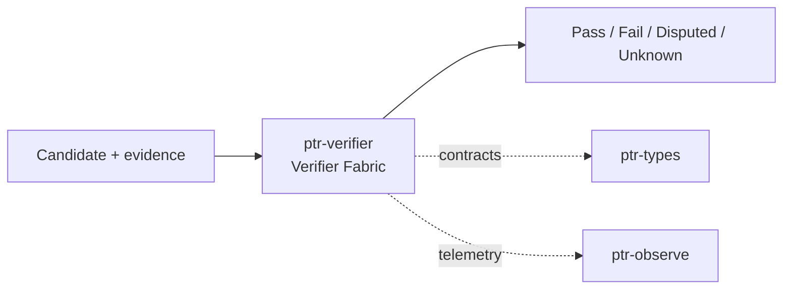

# ptr-verifier — Verifier Fabric

> **Role:** Combines deterministic, executable, statistical and learned checks into explicit verification reports.  
> **Maturity:** see the generated status below; production behavior must be proven by the linked experiments and component evaluations.

<!-- PTR:STATUS:BEGIN -->
## Current implementation status

> **Generated section.** Source of truth: [`component.toml`](component.toml) plus code-derived metrics from `src/`. Run `python3 scripts/update_component_docs.py --write` after editing implementation metadata. Do not hand-edit inside this block.

**Maturity:** `prototype`  
**Last reviewed:** 2026-10-14  
**Code footprint:** 11 Rust source files · 7167 nonblank source lines · 7 integration-test files · 128 test markers (`#[test]`, `#[tokio::test]`)

### Implemented now

- Pass/Fail/Disputed/Unknown statuses
- Finding and VerificationReport with level/score/findings
- Generic Verifier<T> contract
- NamedVerifier + VerifierFabric aggregate reports with Fail > Disputed > Unknown > Pass precedence
- VerifierFabric implements Verifier<T>: its level is the WEAKEST level of its reports (a weaker verifier must not let the fabric satisfy a stronger requirement; the runtime's SemanticGrant applies the same rule, ADR-0020), its status is the worst one, and any hard finding forces Fail so a deterministic contradiction dominates learned scores; an empty fabric is Unknown/Unverified
- VerifierFabric implements Default for any T (a derive would have required T: Default, which ActionIr does not implement), so a fabric of ActionContractVerifier plus further verifiers can be built for ActionIr
- ActionContractVerifier (named action-contract) is a deterministic Verifier<ActionIr> over an ActionContract (target, operation, capability, input type, effect, payload size, PayloadEncoding): each violation is one hard finding with a stable code (target, operation, capability, input-type, effect, payload-size, payload-utf8), Fail/Deterministic/score 0, else Pass/Deterministic/score 1
- Four deterministic task verifiers implement Verifier<String> (Verifier<Vec<FactClaim>> for facts) and NamedVerifier, all at Deterministic level, Pass only on exact success (score 1) and bounded in input size (oversize input is a hard finding, never a panic): ArithmeticVerifier (new() keeps at most the first 512 bytes of a longer task, cut on a char boundary, so an untrusted huge task is not retained whole; task_len() reports the original length; task = integer expression with + - * / and parentheses, evaluated by an independent bounded exact-rational evaluator over the in-crate BigInt, no eval; candidate = integer or a/b; undecidable task is Unknown), JsonSchemaVerifier (in-house pinned JSON Schema subset type/required/properties/additionalProperties/enum/minimum/maximum/minLength/maxLength/items, strict RFC 8259 parser with depth and byte bounds, numbers are exact decimals (no float: 2^53+1 differs from 2^53, 1e-400 is positive), objects are indexed so duplicate-key and equality checks are O(n log n), enum capped at 256 members, one finding per violated keyword with an RFC 6901 pointer cut at 256 bytes, finding cap of 32 with a json.truncated marker only when a further violation exists), CodeTestVerifier (candidate = program in an embedded pure integer language run under hard fuel (CPU; names resolved to frame slots at parse time so each step is O(1), a call pays its frame size), call-depth, memory and output bounds with no I/O, tests supplied by the task and hidden by default: a failing hidden test's finding names the id only, a visible test states expected and got; timeouts and resource exhaustion are findings), FactVerifier (FactVerifier::new takes the snapshot and the live revision, without_staleness_check is the documented host-duty constructor; claims checked read-only against one ptr-semdb SemanticSnapshot; names the snapshot revision in each finding and in verify_bound; a missing fact is Unknown, a stale snapshot is Unknown and judges nothing)
- In-crate bounded arbitrary-precision signed integer (private bigint module: Vec<u32> limbs, add, sub, mul, Knuth-D division with remainder and exact-division check, gcd, comparison, decimal parse and Display, at most 40 limbs per result with typed TooLarge/DivisionByZero errors instead of panics) checked against i128 on seeded xorshift values; ArithmeticVerifier evaluates with reduced BigInt rationals (at most 16 limbs per reduced intermediate, so 10^20 * 10^20 / 10^20 is Pass for 10^20 and Fail for anything else) and still reports Unknown (arith.task) when the FINAL numerator or denominator exceeds 10^30 or an intermediate exceeds the limb bound
- RevisionVerifier (named revision) is a deterministic Verifier<RevisionClaim> and Verifier<ActionIr> that compares a claimed revision and generation with the current SnapshotBinding it was built with: stale and future revision, stale and future generation and an absent binding are hard findings (revision.stale revision.future generation.stale generation.future binding.missing) with expected and actual in the message; it is a fabric verifier and does not replace the runtime's authorize_action
- PromotionVerifier (named promotion) is a deterministic Verifier<PromotionClaim> for a request to promote a claim to Verified or Authoritative: evidence must be cited, evidence derived only from search/index/learned origins is rejected (invariant 5), uncommitted evidence is rejected and not counted (invariant 4), the committed non-derived evidence must come from at least PromotionPolicy::min_independent_sources distinct source labels (typed policy with typed PromotionPolicyError), Authoritative needs committed ledger evidence, and a hard deterministic finding attached to the claim forces Fail regardless of any score (invariant 11); codes promotion.malformed promotion.oversize promotion.no_evidence promotion.derived_only promotion.uncommitted promotion.insufficient_sources promotion.no_ledger_evidence promotion.contradicted
- Snapshot-bound verdicts without touching VerificationReport: BoundVerificationReport { report, snapshot: SnapshotBinding { revision, generation } }, the BoundVerifier<T> trait (verify_at_snapshot, implemented for references and boxes), the AtSnapshot<V> adapter that lifts any plain Verifier with a host-declared snapshot, native implementations for RevisionVerifier and FactVerifier (FactVerifier::with_generation, the inherent verify_bound is unchanged) and BoundVerifierFabric<T>, which combines reports exactly like VerifierFabric and adds a hard snapshot.mismatch finding for every verifier that judged another revision or generation than the one the fabric requires
- ProcessCommandVerifier is a PROTOTYPE of process isolation using std::process only (no namespaces, seccomp, cgroups, network or filesystem confinement, no process-group kill): a Verifier<CommandRequest> that runs an argv vector (no shell) whose executable is an absolute path in the caller's allowlist, with a cleared environment plus an explicit name=value list (secret-looking names such as KEY/TOKEN/SECRET/PASSWORD are refused at configuration), a fresh temp working directory removed afterwards, closed stdin, stdout and stderr captured up to a byte limit and truncated beyond it, a wall-clock timeout by polling try_wait that kills and reaps the child, and bounded argument counts and sizes, and a process-wide bound of 16 capture threads left blocked by a grandchild that holds the pipes (std cannot kill a process group and the crate has no libc: at the bound further runs send output to /dev/null, start no reader and are marked output_truncated; the count falls as the grandchildren end; both streams share one 500 ms drain grace); exit 0 is Pass, a configured failure code (default 1) or a timeout is Fail, any other exit code, a signal or a start failure is Unknown; codes process.malformed process.oversize process.not_allowed process.exit_nonzero process.timeout (soft process.exit_unmapped process.signal process.spawn process.output_truncated); findings never quote child output
- One finding-code table (codes::CODE_TABLE, mirrored in the codes module doc and a test that keeps the two equal): every code is hard or soft and hard codes map to a RepairRole (format, value, schema, code, resource, fact); ptr-router::RepairRoleAssignments builds the FindingRouter registry and the runtime Roster from it. Codes: arith.format arith.oversize arith.value arith.bounds (soft arith.task); json.parse json.oversize json.depth json.type json.required json.enum json.range json.length json.extra (soft json.truncated json.schema); code.syntax code.oversize code.test_failed code.timeout code.resource (soft code.task); fact.contradicted fact.malformed fact.oversize (soft fact.unknown fact.stale_snapshot); binding.missing revision.stale revision.future generation.stale generation.future snapshot.mismatch; promotion.* and process.* as listed above. The new codes reuse the existing six repair roles (no new RepairRole variant, because downstream matches are exhaustive) and leave the fact, code and resource role lists unchanged because ptr-router pins them in a test: format-repair for absent bindings and refused or ill-formed requests, value-repair for stale/future bindings, snapshot.mismatch, a failing exit and a timeout, schema-repair for promotion evidence that violates the policy; this assignment is approximate

### Missing for the target architecture

- Compiler/GritQL/Sentrux adapters (CodeTestVerifier runs only the embedded integer language, not real-language test suites; ProcessCommandVerifier can run an allowlisted compiler or test binary but no adapter parses its output)
- Real sandboxing of real-language candidates: namespaces, seccomp, cgroup limits, network and filesystem confinement and process-group kill (ProcessCommandVerifier is only an allowlist, cleared environment, scratch directory and timeout; an allowlisted program can still read what the OS user can read and a grandchild can outlive the timeout)
- ArithmeticVerifier coverage limit: the final value must be within 10^30 (the candidate bound) and reduced intermediates within 16 32-bit limbs; larger tasks are Unknown (arith.task), never a wrong Pass
- RevisionVerifier and BoundVerifierFabric are not wired to live runtime state: the caller hands them the current SnapshotBinding, nothing in this crate reads the ledger or the runtime, and the runtime's authorize_action still owns the effect-time check
- PromotionVerifier judges only the evidence a caller cites: it does not resolve evidence against the ledger or SemDB, and independence of sources is the caller's source label, not verified provenance
- Calibration of the task verifiers on real task distributions (they are deterministic; their coverage of real tasks is unmeasured)
- Calibration/statistical and learned semantic verifiers

### Next milestones

- Feed RevisionVerifier and BoundVerifierFabric with live runtime state and compare their verdicts with authorize_action in a runtime test
- Resolve PromotionClaim evidence against the ledger and SemDB instead of trusting the caller's origin and commit labels
- Replace the ProcessCommandVerifier prototype with a confined executor (namespaces/seccomp) behind the same Verifier contract
- Extend F001-style evidence to real generators (F001, completed, drove the fabric and the ActionContractVerifier through the ptr-feedback RepairLoop)

### Linked experiments

- [F001](../../experiments/feedback/F001-generate-verify-repair/README.md) — `frozen`
- [Q002](../../experiments/retrieval/Q002-evidence-promotion/README.md) — `frozen`
- [E001](../../experiments/system/E001-end-to-end/README.md) — `planned`

### Technology evaluations

- [code-quality-verifier](../../evaluations/components/code-quality-verifier/README.md) — `open`

### Decision records

- [ADR-0002-authority-hierarchy.md](../../research/decisions/ADR-0002-authority-hierarchy.md)
- [ADR-0012-hard-effect-boundary.md](../../research/decisions/ADR-0012-hard-effect-boundary.md)
- [ADR-0020-only-the-runtime-merges-an-agent-branch.md](../../research/decisions/ADR-0020-only-the-runtime-merges-an-agent-branch.md)

### Current automated checks

- unit tests per task verifier: positive and negative case for every finding code, oversize input, adversarial input (deep nesting, huge numbers, infinite loops and unbounded recursion in code), determinism (same input, identical report)
- unit tests for the review fixes: i128::MIN intermediates never panic (debug build, overflow checks on), exact Int/Float and enum comparison beyond 2^53, 1e-400 is not zero, 32 vs 33 violations with and without the truncation marker, pointer truncation, enum cap, hidden/visible test messages, call frames charged as fuel, maximal recursion and nesting on a 512 KiB stack, 007 and -0 accepted as numerals
- unit test: the code table has unique, short codes, hard iff it has a repair role, and the module doc table lists exactly the table
- crates/ptr-runtime/tests/vcw_real_verifiers.rs: VcwLoop over each real verifier with stub RolePods: wrong candidate, finding, routed to the table's repair role, repaired and accepted; unrepairable task Exhausted; every soft code (arith.task, json.schema, code.task, fact.unknown, fact.stale_snapshot) is Unknown, classified as the Unknown fallback, regenerates and is never repaired or accepted; fact.malformed/fact.oversize go to format-repair, code.resource to resource-repair, arith.bounds to value-repair
- verifier-fabric deterministic failure precedence test
- unit test: a fabric can be built for a type without a Default
- unit tests: one hard finding per ActionContractVerifier code, several findings at once, fabric weakest-level rule, hard finding forcing Fail, empty fabric Unknown
- unit tests of the bigint kernel against i128 on seeded xorshift values (add, sub, mul, div_rem, div_exact, gcd, comparison), multi-limb division by multiplication round trip, decimal round trip beyond i128, typed TooLarge and DivisionByZero; arithmetic tests for 10^20 * 10^20 / 10^20 (Pass and Fail), random integer expressions against i128, final-value and limb bounds staying Unknown
- revision tests (unit and tests/revision_bound.rs): every revision/generation/binding code with expected and actual in the message, ActionIr and RevisionClaim candidates, hard finding dominating a confident learned Pass in VerifierFabric; bound tests: AtSnapshot, FactVerifier::verify_at_snapshot with the unchanged inherent verify_bound, snapshot.mismatch for revision and generation differences, empty bound fabric Unknown
- promotion tests (unit and tests/promotion.rs): every promotion code is emitted, is in the code table and is hard; derived-only, uncommitted, insufficient sources, missing ledger evidence, malformed and oversize claims, typed policy errors; a confident learned Pass in a fabric cannot rescue a derived-only or contradicted promotion
- process tests (unit and tests/process.rs, unix only, skipped when true/false/echo/sleep are absent): true/false exit mapping, echo capture and truncation, sleep 5 killed at a 200 ms timeout and reaped (no /proc entry on Linux), cleared environment, fresh removed working directory, closed stdin, refused requests start nothing, typed configuration errors including secret-like names, every emitted code in the table with matching hardness
- process_leak test (tests/process_leak.rs, Linux): 10 runs of sh -c 'sleep 20 & exit 0' leave at most 16 blocked capture threads (/proc/self/status Threads); unit test with an injected budget: a stuck pair is counted, the next run is skipped fast and flagged, a roomy budget captures normally
- arithmetic unit tests: a 4 MiB task retains at most 512 bytes (task(), Debug output) and stays Unknown/arith.task; the prefix cut respects char boundaries
- workspace fmt/check/test/clippy

<!-- PTR:STATUS:END -->

## Position in PTR

Dedicated diagram source: [`docs/diagrams/components/ptr-verifier.mmd`](../../docs/diagrams/components/ptr-verifier.mmd)

**Upstream:** ptr-semdb, ptr-types  
**Downstream:** ptr-runtime, ptr-pods, ptr-router, ptr-feedback, ptr-branch, ptr-podwire, ptr-server, ptr-bench

## Mission

Combines deterministic, executable, statistical and learned checks into explicit verification reports.

PTR keeps this responsibility in its own crate so the semantics remain stable even when an external library or implementation is replaced.

## Responsibilities

- verifier composition
- verification levels
- findings and evidence
- action validation hooks
- semantic and probabilistic checks

## Explicit non-responsibilities

- candidate generation
- state persistence
- search indexing

## Data flow

| Direction | Contract |
|---|---|
| Input | Candidate<T>, evidence, action, source or execution result |
| Output | VerificationReport with status, level, confidence and findings |
| Failure | Explicit typed error / rejected state; no silent fallback that changes semantics |
| Observability | Standard PTR tracing fields and a stable component span |

## Technical approach

- Compiler/tests/GritQL/Sentrux-style executable checks
- source evidence verification
- calibration checks
- learned semantic verifier only when deterministic checks are insufficient

External projects are **candidates**, not architectural authority. The PTR-owned traits and domain types must remain usable with a replacement backend.

## Core invariants

1. Deterministic contradictions dominate learned approval.
2. Unknown is a valid outcome.
3. Verifier confidence is not silently converted to hard truth.

These invariants should be executable wherever possible through unit, property, lifecycle or chaos tests.

## Failure model

The component must fail closed for semantic or effect-safety violations. Infrastructure failures should surface as typed errors that preserve request, revision, generation and provenance context. Retries must be idempotent whenever the operation may cross a process or network boundary.

## Performance model

Measure before optimizing. Benchmarks should record at least latency distribution, throughput, allocations/resident memory, queue depth or working-set size where relevant, and the cost of verification. Performance optimizations may not bypass generation, revision, capability or evidence checks.

## Security and privacy

- Treat external inputs and backend outputs as untrusted until validated.
- Do not put raw secrets/private evidence into generic tracing or inspection.
- Preserve provenance on every promotion from raw/possible evidence to stronger semantic state.
- External effects pass through `ptr-security` even if this component already performed local validation.

## Technology evaluation

- [code-quality-verifier](../../evaluations/components/code-quality-verifier/README.md)

A new candidate should be added with a reproducible benchmark and failure-semantics analysis rather than replacing the default ad hoc.

## Tests required before production use

- Contract/unit tests for all domain transitions.
- Invalid, stale-generation and stale-revision cases.
- Cancellation/retry behavior.
- Property tests for invariants where practical.
- Cross-backend equivalence if more than one backend exists.
- Observability and redaction checks.

## Related architecture

- [System architecture](../../docs/architecture/00-system.md)
- [Technical architecture](../../docs/TECHNICAL_ARCHITECTURE.md)
- [Component contracts](../../docs/COMPONENT_CONTRACTS.md)
- [Global invariants](../../docs/INVARIANTS.md)

