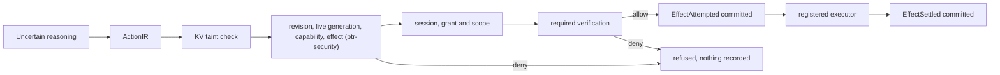

# PTR Technical Architecture

This document is the technical reference for PTR. It complements the root
[README](../README.md) (diagrams of the built system, crate map, how to run), the per-crate
READMEs and the numbered documents in [`docs/architecture/`](architecture/README.md), whose index
states which of them are design and which are implemented. Where this document says
**planned**, nothing in the code does it yet.

## 1. Architectural objective

PTR separates **language**, **semantic state**, **uncertainty**, **reasoning method selection**,
**external computation**, **verification**, **effects** and **durable authority**, so that no
single autoregressive token stream is responsible for every concern. The rule that holds in code
today is the authority split: a model or a Pod may propose; only `ptr-runtime` commits, and only
through the ledger, the verifier and the hard effect boundary.

## 2. Crate layering

The workspace is 34 library crates plus `ptrd`, `ptrctl`, `ptr-bench` and `ptr-worker`, placed in
eight ranked layers by [`research/catalogs/crate-layers.toml`](../research/catalogs/crate-layers.toml).
`scripts/check_crate_layering.py` (CI) refuses an upward dependency and a backend crate outside
its owner; the only tolerated exception is `ptr-bench` → `tokio-postgres`
([41](architecture/41-crate-layering.md)).

| Rank | Layer | Role | Crates |
|---:|---|---|---|
| 0 | kernel | shared vocabulary | `ptr-types` |
| 1 | foundation | one concern each, depend on the kernel only | `ptr-semdb`, `ptr-ledger`, `ptr-model-api`, `ptr-security`, `ptr-protocol`, `ptr-storage`, `ptr-fabric`, `ptr-memory`, `ptr-lineage`, `ptr-core`, `ptr-exec`, `ptr-events`, `ptr-config`, `ptr-analytics`, `ptr-ingress`, `ptr-inspect`, `ptr-observe` |
| 2 | domain | built on foundation crates | `ptr-verifier`, `ptr-search`, `ptr-net`, `ptr-labeling` |
| 3 | composition | combine domain crates | `ptr-pods`, `ptr-branch`, `ptr-feedback`, `ptr-fastmem`, `ptr-cluster` |
| 4 | projection | routing and materialization | `ptr-router`, `ptr-state` |
| 5 | orchestration | the runtime and the PostgreSQL substrate | `ptr-runtime`, `ptr-pg` |
| 6 | surface | HTTP API and the runtime-level wires | `ptr-server`, `ptr-execwire`, `ptr-podwire` |
| 7 | binary | composition only | `ptrd`, `ptrctl`, `ptr-bench`, `ptr-worker` |

Backend ownership: `iroh`, `wireguard-uapi`, `wintun` → `ptr-net`; `raft`, `raft-engine` →
`ptr-ledger`; `turso` → `ptr-state`; `tokio-postgres`, `deadpool-postgres` → `ptr-pg`; `opendal` →
`ptr-storage`; `candle-*` → `ptr-pods`; `tracing` → `ptr-observe`; `burn` → none (it lives in the
separate `model/burn-a0` workspace). All backends are Cargo features, off by default.

## 3. Planes as built

The plane model of [00](architecture/00-system.md) is the target. What each plane is today:

| Plane | In code | Planned |
|---|---|---|
| Ingress | `PtrRuntime::ingest_text` commits the raw request text as a `Request`-origin semantic delta | typed interpretation and raw↔typed cross-check (`ptr-ingress` has a std-only prototype pipeline; `ptr-server` runs it only as opt-in advisory diagnostics and `ptrctl ingest` exposes it, while the runtime still commits only the raw text) |
| Semantic | `ptr-semdb`: revisioned store, dependency invalidation, immutable snapshots, canonical delta codec | memoized derived queries |
| Cognitive | `ptr-core` data structures; `model/burn-a0` trainable toy | a model on the request path (ADR-0022, S8: not until an A0 study passes) |
| Routing | `ptr-router`: project-scoped Pod selection with keyed sampling and logged propensities; finding router; OPE; policy book | reasoning/search/symbolic operator routing |
| Execution | runs inside `PtrRuntime` under one mutex in `ptr-server`; `ptr-exec` has a bounded `Mailbox` | isolate scheduler and supervision ([03](architecture/03-runtime.md)) |
| Verification | `ptr-verifier`: reports, fabric precedence, deterministic arithmetic, JSON Schema, code-test and fact verifiers | learned verifiers behind deterministic ones |
| Authority | `ptr-ledger` `FileLedger`; raft backends as a library | raft under the runtime |
| Knowledge | `ptr-state` materialization; `ptr-pg` projection and derived search; `ptr-search` evidence promotion; `ptr-memory` in-memory only | durable memory stores, engine adapters |
| Observation | `RuntimeEvent`s, VCW traces, `ptr-observe` sink port | exporters, plan-versus-execution correlation |

## 4. Request flow

`POST /v1/requests` on `ptrd` (the sequence diagram is in the root README):

1. `ptr-server` takes a bounded admission slot (`runtime.mailbox_capacity`; 503 when full) and
   locks the runtime for the whole request.
2. `ingest_text` prepares a SemDB delta holding the raw text, appends `SemanticDeltaCommitted`
   with its origin to the ledger, then applies it to SemDB and materialized state.
3. The backend's `infer` gets the request and the snapshot's semantic context and returns
   `ModelEvent`s. At most one control event per round is accepted.
4. For `PodRequested`, the checked router selects a Pod from the project-scoped registry and emits
   `PodRouted` (propensity, nonce, draw, key id); only `Pure`/`Read` Pods run here; the output is
   verified, promoted as a `PodOutput`-origin delta, and the backend is resumed (at most 4 rounds
   from `ptr-server`).
5. For `ActionReady`, the server calls `authorize_action` (approximate-KV taint, then
   `ptr-security`'s revision, live-generation, capability and effect gates), registers an
   execution session with the host's grants and calls `prepare_execution_once` with the client's
   idempotency key and `execute_prepared`, which commits `EffectAttempted`, runs the registered
   executor and commits `EffectSettled`.

The `reference-kv` backend takes the same path through `run_model_run_resumable`, which records
the run's KV-reuse taint before any action can be authorized. `ptrd` registers no Pods and ships
only plumbing backends, so step 4 is exercised by tests and harnesses.

## 5. Authority hierarchy

1. committed ledger event;
2. validated semantic state (SemDB at a revision reached by committed deltas);
3. lifecycle-managed objects (capsules, experts, adapters) at a live generation;
4. queryable materialized view (`ptr-state`, `ptr-pg` projection);
5. search and graph projections;
6. caches (including KV caches);
7. transient model hidden state.

No layer may promote itself upward without the validation and commit contract of the layer
above. In code: every semantic record carries an origin checked on append and on replay
([22](architecture/22-durable-semantic-state.md)); neural, KV and checkpoint state is admitted
against committed state at every use ([27](architecture/27-neural-state-admission.md)); a
projection advances only by records verified against ledger anchors (invariant 16).

## 6. Authority and durability path

- **Log.** `FileLedger` (PTRLOG02 records, advisory lock, strict anchored reopen, explicit
  crash-tail recovery; [23](architecture/23-persistence-integrity.md),
  [24](architecture/24-protected-anchors.md)). Retention and erasure are explicit
  ([25](architecture/25-erasure-and-retention.md)).
- **Replay.** `PtrRuntime::open_durable` replays the log through the same validation as append
  and rebuilds lifecycle, semantic, execution, expert and taint state.
- **Snapshots.** Recovery snapshots bound to an independently retained anchor; compacted
  snapshots (`PTRCS006`, `PTRCS007`) carry execution obligations, the expert registry and fence
  causes across a raised floor.
- **Execution audit.** `EffectAttempted`/`EffectSettled`/`EffectReconciled`; an unsettled attempt
  fences the runtime; idempotency keys are at-most-once across restarts
  ([28](architecture/28-durable-execution-audit.md)).
- **Raft.** `RaftEngineLedger` (`raft-engine-backend`) and `RaftNode` with durable raft storage
  (`raft-rs-backend`) in `ptr-ledger`, composed over `ptr-raft/1` by `ptr-cluster`; raft never
  compacts or installs a snapshot above the ledger's retention floor (C7). **Planned:** a runtime
  or daemon running on raft, and a deployment accept/tick loop ([31](architecture/31-cluster-integrity.md)).

## 7. The verifier-closed loop

`VcwLoop::run` (`crates/ptr-runtime/src/vcw/`, specification
[39](architecture/39-vcw-moe.md)) composes the bounded workspace (`ptr-pods`), the finding router
(`ptr-router`), the self-model and attention schema (observation, at most scoring inside the
admissible set), and the critique and accept semantics of `ptr-feedback`:

1. A proposer Pod produces a candidate; the request's verifier judges it once (charged to the
   budget).
2. `ptr_router::classify` decides: `Accept` (Pass, no hard finding, level at least the required
   one), `Repair(codes)` (one repair Pod per distinct hard finding code, sampled among eligible
   Pods with the propensity logged), or a fallback (`Regenerate`, `Escalate`) for `Unknown`,
   `Disputed` and malformed reports.
3. The candidate is submitted to the workspace for broadcast; workspace outcomes never decide
   acceptance.
4. `Accept` yields a provisional `VerifiedAnswer`; `admit_verified_answer` re-checks that every
   contributing Pod is still live and calls `admit_pod_output`, where the runtime verifies again
   and commits. Spent budget or deadline ends `Exhausted` (no candidate is returned).

`ptr-server` serves it as `POST /v1/vcw/tasks` when `[vcw] enabled = true`, with simulated
experts or `qwen-cpu` (a CPU Qwen2 generator with pinned file digests). L3 structure changes run
through `vcw_host::StructureDriver` → `PtrRuntime::admit_expert_proposal` in the F007 harness and
tests; **planned** for a served deployment. Shadow learning estimates a candidate policy off-policy
but never routes; `PolicyBook::promote` is a host action nothing in the service takes.

## 8. Revision vs Generation

**Revision** identifies the global input world observed by a computation.
**Generation** identifies the lifecycle version of one semantic object.

A snapshot may be `revision=812` while containing `Project@g17`, `Constraint@g4` and
`Procedure@g9`. A new unrelated input can advance the revision without changing any of those
generations. The effect boundary checks both: an action carries the revision and generation it
was produced at.

## 9. Data representations

| Boundary | Built today | Preferred / planned |
|---|---|---|
| Rust domain | strong structs, enums, newtypes | — |
| Public API | JSON (`ptr-server`) | — |
| Network | hand-written bounded frames with magic and version (`PTRRAFTW`, `PTREXREQ`/`PTREXRCP`, `PTRPWREQ`/`PTRPWANS`) | Protobuf (`proto/`, converted in `ptr-protocol`, not spoken on a wire) |
| Ledger | canonical binary records with explicit code tables | — |
| Trusted local hot path | — | rkyv candidate |
| GPU tensors | — | DLPack/CUDA handles |
| Large artifacts | content-addressed refs and tier manifests (`ptr-storage`) | — |

See [07](architecture/07-network-protocol.md) for the ALPN rules.

## 10. Model event protocol

`ptr-model-api::ModelEvent` is a stream, not a string: `SemanticSlotUpdate`,
`HypothesisCreated`, `ConfidenceUpdated`, `OperatorRequested`, `PodRequested`,
`CandidateReady`, `ActionReady`, `Token`, `Finished`. The runtime's loops act on `PodRequested`,
`ActionReady`, `Token` and `Finished`; the others are carried but not yet acted on (**planned**).
Text-only backends expose a reduced set.

## 11. Effect boundary

The core rule is: **reasoning may be soft; effects are hard**. A refused preparation writes no
effect record ([21](architecture/21-scoped-execution.md), [28](architecture/28-durable-execution-audit.md)).

## 12. Consistency model

- semantic writes: linearized through the runtime's single ledger (raft linearization is a
  library composition, not used by the runtime);
- materialized views: derived from the committed index;
- search and projection indexes: asynchronous; a hit is generation-validated before promotion;
- caches: disposable, admitted at use;
- reasoning snapshots: immutable and revision-scoped. Cancellation of a run whose revision moved
  exists only for hosts that step runs (`SteppedRun`); the shipped server holds the runtime for
  the whole request instead.

## 13. Failure model

Tested today: crash before and after append and fsync, torn and truncated tails, crash inside the
effect window, stale generation after revocation and restart (L001-v2), raft crash and recovery
at every declared point (L002), stale search hits and late projection writes (Q002, Q003-v3,
L004), queue saturation (R001), duplicated execution requests (idempotency keys), stale KV state
after invalidation (R005–R012). Failpoints are in `ptr-ledger` (feature `failpoints`).

**Planned:** network partition and leader change under a deployed cluster loop, verifier
disagreement at scale, partially available inference and search backends.

## 14. Replaceability

External systems are evaluated behind PTR-owned contracts (32 slots in
`evaluations/registry.toml`, all open). Changing a transport, store or engine may change
performance and operations but not semantic invariants; the layering check keeps each backend
inside its owner crate. See [Component contracts](COMPONENT_CONTRACTS.md) and
[Evaluation architecture](architecture/12-evaluation.md).
