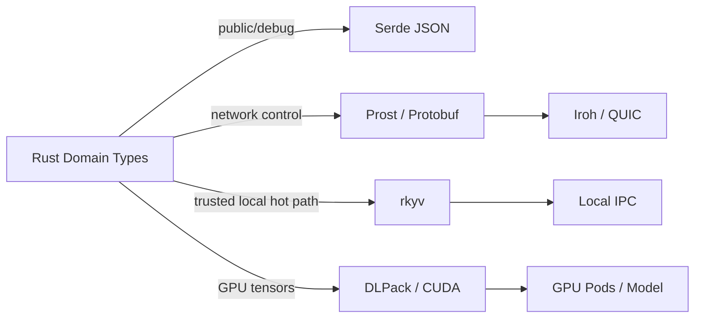

# Network & Protocol Architecture

## Separation

PodWire defines semantics. Prost/Protobuf is a network encoding candidate. Iroh/QUIC is a transport candidate. rkyv is a trusted local data-plane candidate. DLPack carries tensors.

## ALPN design

One ALPN per protocol, because two protocols on one ALPN is how a request meant for
one gets parsed by the other.

Spoken today:
- `ptr-raft/1` — raft traffic between cluster members (`31-cluster-integrity.md`)
- `ptr-podwire/1` — Pod access (`33-pod-wire.md`)
- `ptr-exec/1` — execution requests and receipts (`32-execution-wire.md`)

An ALPN exists only when its protocol has a contract. `ptr-model/1`, `ptr-blob/1`
and `ptr-events/1` were declared ahead of any protocol and have been removed rather
than left declared (C3 in issue #23): a name nothing speaks invites a first speaker
with no frame format, bound or refusal codes. An endpoint serving every declared
ALPN refuses one of them
(`an_endpoint_serving_every_declared_alpn_refuses_a_retired_one`). A protocol for
model traffic, blobs or events gets an ALPN in the same change that gives it a
contract.

## Validation

Network decode is followed by semantic validation into PTR domain types. Network retries use idempotency keys for operations that could be duplicated.
