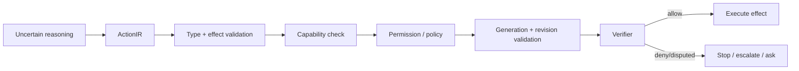

# Security Architecture

Security is split into:
- semantic trust/provenance;
- runtime capability/effect authorization;
- infrastructure identity/storage/secrets.

## Effect classes

`Pure < Read < Mutation < External < Irreversible` is a useful ordering for policy strictness, though concrete policy is domain-specific.

## Context trust

External text, tools, retrieved documents and agent-generated state are evidence with source/trust metadata, not authority.

## Redaction

Secret/private types are non-rendering by default across tracing, valuable-based introspection and debug exports.

## Implemented reference-process execution boundary

[P0.1 scoped execution](21-scoped-execution.md) now adds the actual registered
executor call behind issuer/session/scope, revision/generation/capability, expiry
and required-verifier checks. AuthorizationReceipt remains diagnostic. This
process-local gateway does not by itself implement network authentication,
durable exactly-once effects or scoped access for existing Pure/Read Pod paths.
Those came later as separate layers: a journaled execution audit with fencing and
at-most-once keys ([28](28-durable-execution-audit.md)), peer admission by host
policy and project-scoped Pods ([29](29-peer-admission-and-pod-scope.md)), and the
execution and Pod wires over authenticated transport ([32](32-execution-wire.md),
[33](33-pod-wire.md)). A signed receipt is still not built (ADR-0022, S2).
