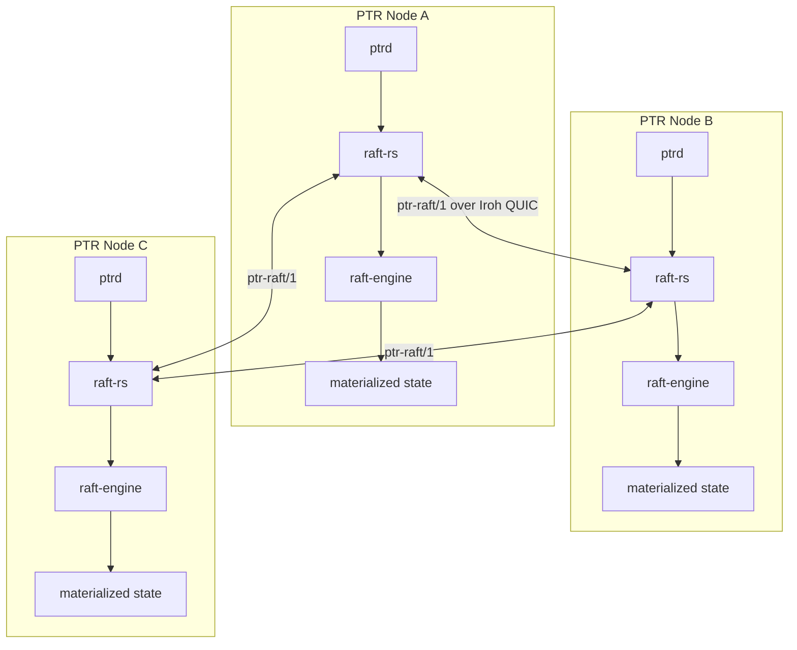

# Deployment Topologies

## Developer / single-node

`ptrd`, local ledger/state, local model backend or remote vLLM/SGLang, local vector/lexical indexes.

### Network wires next to the HTTP API (D4 in issue #23: decided)

With a `[wire]` section, `ptrd` also serves the execution wire (`ptr-exec/1`) and the
Pod wire (`ptr-podwire/1`) on loopback, next to axum, with one shutdown for all of
them. The execution wire shares the HTTP API's runtime rather than opening a second
one over the same ledger. Without the section no wire is served.

The split D4 decided: **the accept loop is mechanism** — `ptr_net::serve`, written
once and shared by every wire — and **when to give up is the host's explicit
policy**: `[wire]` names the connection limit, the per-connection deadline and the
services, every field required and range-checked, and the loop's `ServePolicy` has
no default to fall back on. A connection over the limit is refused rather than
queued, one still open at its deadline is closed, and nothing retries. The section
also lists the peers the deployment knows (`[[wire.peers]]`), from which `ptrd`
rebuilds its address book at every start (`34-address-authority.md`).

```toml
[wire]
max_concurrent = 16
per_connection_deadline_ms = 5000
services = ["exec", "pod"]

[[wire.peers]]
id = "<64 lowercase hex digits: the peer's endpoint key>"
direct = "127.0.0.1:4433"
```

What this does not do yet: `ptrd` installs no admission policy, so the execution
wire refuses every peer and the Pod wire answers every peer `NotAdmitted`; granting
a peer anything remains a decision the configuration does not make. Each start
binds a fresh endpoint key, so `ptrd`'s wire identity — and the key its receipts are
signed with — changes on restart; a persisted endpoint key is not configurable yet.
A cluster member is not composed here (`ptrd` permits standalone mode only).

## Multi-GPU workstation

Runtime remains one authority process while model/embedding/vector Pods use separate GPUs/processes. Tensor payloads prefer DLPack/IPC rather than serialization through JSON.

## Cluster



Consensus covers authoritative semantic state, not every cache/index operation. Retrieval remains local/replicated according to performance requirements.

## Enterprise/federated

Raw private memory remains local by default. Model/verifier adapter updates may use a federated-learning layer when explicitly configured.
