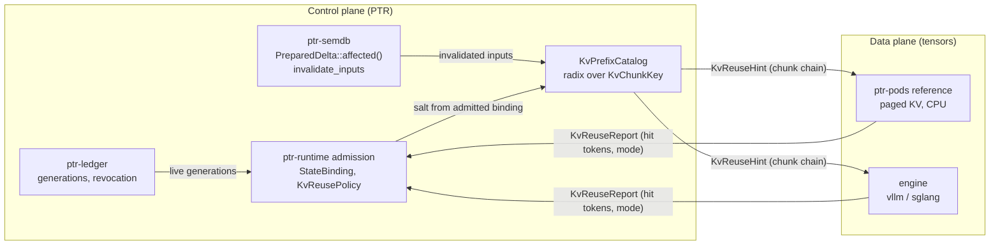
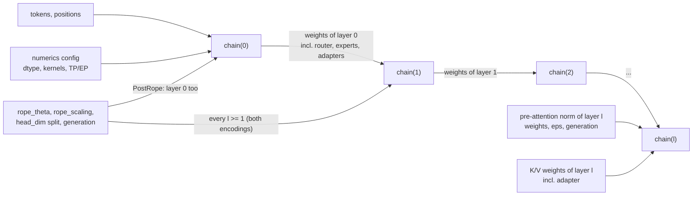

# 36 — KV-cache reuse: control plane in PTR, data plane in engines

Status: **design.** Nothing in this document is implemented beyond the existing
`ptr-pods` CPU reference code described in section A, which is not wired into any
inference path. Every claim about speed-up or hit rate is an **experiment** with a
falsification rule (section E), and all of them are planned, none has run.
Nothing here changes the authority order of ADR-0002: the ledger stays the only
authority, and a KV block is derived state under invariants #3, #5 and #17.

The one-sentence design: **PTR decides whether a cached KV block may be used;
an engine (or the CPU reference) computes and stores it.** Admission, keys,
invalidation and revocation live in `ptr-runtime`, `ptr-semdb` and `ptr-ledger`;
tensors, paging and kernels live behind a backend trait.

## A. Current state in code

All line numbers were opened and checked against the tree at the time of writing.

### No real inference path

- `ModelRequest` carries `raw_text: String`
  (`crates/ptr-model-api/src/request.rs:7`); there are no token ids.
- `InferenceBackend::infer` returns a synchronous `Vec<ModelEvent>`
  (`crates/ptr-model-api/src/backend.rs:9`); there is no streaming and no cache
  report.
- The only backends are `ReferenceEchoBackend` and `ScenarioBackend`
  (`crates/ptr-model-api/src/backend.rs:20` and `:44`), and `bins/ptrd` accepts
  exactly those two names (`bins/ptrd/src/main.rs:83-84`) and refuses others.
- No workspace crate tokenizes model input. `ptr-memory` has a
  `SemanticTokenizer` (`crates/ptr-memory/src/ingestion.rs:33`), but it turns a raw
  event into a semantic event, not a model vocabulary id sequence. The `tokenizers`
  crate appears only in `Cargo.lock` as a transitive dependency of `candle-core`
  (patched via `Cargo.toml:87`).

### Unwired CPU KV reference in `ptr-pods`

| Piece | Where | What it is |
|---|---|---|
| `KvPageSize` | `crates/ptr-pods/src/paged_kv.rs:12`, default 16 at `:15` | tokens per page |
| `KvPageBinding` | `paged_kv.rs:51` | model, adapter, generation, execution manifest, principal, device, dtype, page size |
| `publish_prefix` / `fork_prefix` | `paged_kv.rs:799` / `:845` | seal full pages, register a prefix, fork it copy-on-write into an empty cache |
| `KvContinuationExecutor` | `crates/ptr-pods/src/attention.rs:113` (`prefill` `:118`, `decode` `:125`) | continuation over a paged backend |
| `Qwen2PagedDecoder` | `crates/ptr-pods/src/qwen.rs:261` | one-layer Qwen2 decoder step |
| single-layer limit | `qwen.rs:297` (`layer_count != 1` is rejected) | |
| `apply_rope` | `qwen.rs:423`, applied to the key at `:328` before `append` | keys are stored **after** RoPE |

Around it in the runtime and memory crates:

- `ManagedKvRegistry` (`crates/ptr-runtime/src/tensor_kv.rs:99`) owns KV handles
  with placement and fencing.
- `StateBinding` (`crates/ptr-runtime/src/neural.rs:289`) binds opaque neural state
  to a journal anchor, revision and codebook; `NeuralStateCache::admit`
  (`neural.rs:972`) re-decides admission at every use and exposes no payload
  accessor. This is the model for how KV must be admitted (doc 27).
- `KvStateMetadata` (`crates/ptr-memory/src/kv.rs:26`) records
  `dependency_digests` (`kv.rs:34`) so semantic edits invalidate dependent state.
- `ptr-storage` has `TierObjectDomain::KvSnapshot`
  (`crates/ptr-storage/src/tier.rs:18`) and a content-addressed
  `TierObjectManifest` (`tier.rs:113`).
- `proto/podwire.proto` deliberately removed `session_id` (`:6-13`, number and name reserved).
  **A KV handle must never cross the wire**; only activations and policy do
  (doc 33). Today this is a **design rule, not an enforced guarantee**: removing
  `session_id` does not stop KV material from crossing PodWire, because
  `TypedPayload` is an arbitrary `type_id` plus bytes (`crates/ptr-protocol/src/lib.rs:16-19`)
  and the `PodCall` conversion checks only that the type id is non-empty
  (`crates/ptr-protocol/src/lib.rs:61-85`, `MissingTypeId` at `:73`). Enforcement is
  phase P5a.

### Five defects that block reuse

1. **The prefix key cannot be looked up before computing.** `publish_prefix`
   derives `prefix_digest` from the digests of the K/V tensor pages
   (`paged_kv.rs:814`, `digest_list(b"ptr-kv-prefix-v1\0", &page_digests)`). A new
   request does not have those pages yet, so it cannot ask "is my prefix cached?".
   Reuse needs keys derived from **tokens**: a chain `parent hash -> chunk hash`
   as in vLLM Automatic Prefix Caching.
2. **The prefix catalog is never pruned and revocation depends on the caller.**
   `PagedBackendState::prefixes` (`paged_kv.rs:333`) is only inserted into
   (`:826`) and read (`:867`). `fork_prefix` compares the generation of the
   **caller's own** binding (`:854-862`), not the currently admitted generation, so
   invariant #3 holds only if every caller passes a fresh binding.
3. **Keys are stored after RoPE** (`qwen.rs:321-336`), so a cached key is bound to
   its absolute position. That forbids positional reuse (section B, T2).
4. **`ModelRequest` is a public-field struct built literally in five places** outside
   its definition: `crates/ptr-model-api/tests/smoke.rs:6`,
   `crates/ptr-model-api/tests/backend.rs:8`,
   `crates/ptr-protocol/tests/prost.rs:307`, `crates/ptr-runtime/src/lib.rs:1299`
   and `:1414`. Adding a field is a breaking change in all five; a **new trait**
   avoids it.
5. **Every page bundle holds all layers, and the adapter binds the whole cache.**
   `HostPageBundle.layers: Vec<KvLayerSnapshot>` (`paged_kv.rs:304`, field at `:309`),
   `KvTensorSchema.adapter` (`crates/ptr-pods/src/kv.rs:50`) and
   `KvPageBinding.adapter` (`paged_kv.rs:53`). Base-model KV and LoRA KV therefore
   cannot be shared per layer even where they are mathematically identical.

## B. Literature, tiered

Each entry was checked against the paper; corrections to common claims are stated
where they matter. Tier decides what PTR may do with the method.

### T1 — exact, adopt

| Method | Reference | What PTR takes, and corrections |
|---|---|---|
| PagedAttention / vLLM | arXiv 2309.06180, SOSP'23 | fixed blocks (16 tokens), copy-on-write sharing; matches the existing 16-token `KvPageSize` |
| RadixAttention / SGLang | arXiv 2312.07104 | radix tree over token prefixes with LRU; the shape of `KvPrefixCatalog` |
| vLLM Automatic Prefix Caching | vLLM documentation | block hash = parent hash + block tokens + extras (for example the LoRA id); `cache_salt` is mixed into the first block; the `sha256_cbor` hash is reproducible across versions, the default pickle-based `sha256` is **not** |
| Activated LoRA (aLoRA) | arXiv 2504.12397, NeurIPS 2025 | states before the invocation token are identical to the base model in all layers (Prop. 1), so the base prefix is shared. Its vLLM PR #19710 was **closed unmerged on 2026-02-09**; a vLLM follow-up paper is arXiv 2512.17910 |

### T2 — positional and edit reuse (exact only for one layer with pre-RoPE keys, otherwise Approximate)

| Method | Reference | Notes and corrections |
|---|---|---|
| PIE | arXiv 2407.03157 | position-integrated re-encoding for edits. The ">85%" figure refers to **KV-update latency only** and was evaluated on **code only** |
| "Suffix Cache Reuse (SCR)" | none | **not a named method.** The mechanism is PIE plus Leyline |
| Leyline | arXiv 2606.01065 | guarantee is "positional, not informational"; its FORGET mode is a real re-prefill |
| CacheBlend | arXiv 2405.16444, EuroSys'25 | selective recompute of about 15% of tokens; implemented in LMCache |
| EPIC | arXiv 2410.15332, ICML'25 | LegoLink recomputes the first k (k <= 32) tokens of each chunk. "Up to 8x" TTFT is **versus CacheBlend under synthetic multi-request load, not versus full prefill**; up to 3x versus CacheBlend for a single request |
| MEPIC | arXiv 2512.16822 | page-aligned chunks, pre-RoPE storage, RoPE inside a fused kernel. The gain is **HBM memory 2-5x**, latency only 9-11% |
| CacheSlide | FAST'26 | needs LoRA/CoPE training, **deferred** |

### T3 — lossy and offload: optional derived tier only, always Approximate

| Method | Reference | Notes |
|---|---|---|
| ShadowKV | arXiv 2410.21465 | pre-RoPE low-rank keys plus CPU values, nothing permanently evicted; the best fit for the tier system (phase P6) |
| TailorKV | arXiv 2505.19586 | per-layer choice between quantize and offload; needs calibration |
| CacheGen | arXiv 2310.07240, SIGCOMM'24 | lossy codec, transport only |
| MiniCache | arXiv 2405.14366 | cross-layer merge; needs a deep model |

**Rejected:** SnapKV (arXiv 2404.14469), Ada-KV (arXiv 2407.11550) and K-VEC
(arXiv 2606.29563; an unreviewed preprint without code). Query-dependent eviction
breaks prefix sharing, because what survives depends on the request, and Ada-KV's
variable-length heads conflict with fixed pages.

### T4 — learned hidden-state compaction: rejected as an authoritative path

| Method | Reference | Why |
|---|---|---|
| KV-streams | arXiv 2609.35750 | RL-trained. Retained KV deliberately carries deleted content, which is a **revocation leak**. Its reported speed-ups are mutually inconsistent across abstract, body and conclusion |
| MEMENTO | arXiv 2604.09852 | needs SFT; the paper reports about 2.5x lower peak KV and 1.75x throughput. It has an implicit KV channel; restarting from text only loses 15.3 percentage points on AIME24. **Only the text channel is adopted**, as a `ptr-memory` object with provenance |
| STILL | arXiv 2606.07878 (Baseten) | not called "Neural Compactor"; TTFT is worse (6.8 s versus 3.1 s) |
| DroidSpeak | arXiv 2411.02820 | approximate cross-model reuse |

### Key insight, and its limit

In a single-layer model the K/V of token i depends only on its embedding and its
position. With **pre-RoPE** storage, any positional reuse (shift, splice, drop a
span) is then exact. This is a **mechanism check on the reference code, not
evidence for deep models**, where the K/V of layer l depends on all earlier
layers' outputs, which depend on the whole prefix. Re-rotating an already rotated
key is not bit-identical in floating point, so keys are stored pre-RoPE and rotated
at use.

## C. The Exact / Approximate rule

```rust
enum KvReuseMode { Exact, Approximate }
struct KvReusePolicy { allow_approximate: bool } // default: false
```

- **Exact** means the logits are bitwise equal to a full prefill of the same
  tokens under the same numerics. Only Exact reuse is admitted by default.
  The one **proven** Exact case is positional reuse with pre-RoPE keys in a
  **single-layer** model, and only once R006 has passed.
- **Approximate** reuse is admitted only when `allow_approximate` is set, and a run
  that used it may only produce **candidates**. Approximate are: positional
  re-encoding in multi-layer models, selective recompute, lossy tiers and
  non-dropless MoE.
- An effectful action reachable from a run with Approximate reuse fails with
  `RuntimeError::ApproximateStateAtEffectBoundary`.
- The mode is recorded in provenance of the result, **but provenance alone does not
  enforce the effect boundary** (next rule).

**Design rule: the mode must travel with the action.** Today the runtime copies a
bare `ActionIr` out of `ModelEvent::ActionReady` into `ResumableRun::action`
(`crates/ptr-runtime/src/lib.rs:1446-1473`, assignment at `:1472`; field at `:567`),
and `authorize_action` receives only that action (`:1558`), so a mode kept only in
result provenance is lost before authorization. Therefore:

- a `KvReuseTaint` (the mode, plus the reuse report digest) is carried with every
  model event and with `ResumableRun::action`;
- action admission and `authorize_action` check it and deny an Approximate-tainted
  action with `ApproximateStateAtEffectBoundary`;
- the taint is also attached to the result of every Pod the run requested
  (`ModelEvent::PodRequested`), and `promote_verified_pod_output` rejects or
  candidate-routes a tainted result, so an Approximate run cannot durably publish
  authoritative SemDB state either;
- taint propagates **transitively**: a candidate derived from an Approximate run
  stays tainted until it is recomputed Exact.

This is phase P2a below; until it exists the effect-boundary sentence above is a
design rule, not an enforced guarantee.

This applies invariant #5 (a cache cannot self-promote to truth), #7 (hard effect
boundary) and #11 (a learned or approximate signal cannot override a deterministic
verifier).

## D. LoRA, MoE and split Pods: the per-layer chain key

The K/V of layer l for tokens up to t depends on: the tokens, their positions, the
K/V projections and norms of layer l, and **all modules of layers below l**
(attention, FFN, router, experts). It does **not** depend on layer l's own FFN or
experts, which run after attention. So a cache key is a chain over layers:

```
chain(l) = H( chain(l-1),
              all weights of layer l-1 incl. router, experts, adapters, + their generations,
              every transformation applied to the residual stream before layer l's
                K/V projections (pre-attention norm weights, eps/config), + generations,
              K/V weights of layer l incl. adapter,
              numerics config: dtype, quantization, kernel set / batch-invariance,
                               TP/EP layout, inter-pod activation precision,
              positional-encoding config: rope_theta, rope_scaling policy,
                head_dim split (rotated vs pass-through dims), + their generation,
                included if l >= 1 (attention of layers < l rotated Q/K and so
                shaped the residual) or if KvKeyEncoding = PostRope (the stored
                key itself is rotated, so layer 0 too) )
```

General rule: the key covers **every transformation applied to the residual stream
before layer l's K/V projections, with its configuration and generation**. In the
Qwen2 reference path that includes `input_layernorm` and `rms_norm_eps`, which
`Qwen2PagedDecoder` applies before the K and V projections
(`crates/ptr-pods/src/qwen.rs:313-321`, weights field at `:115`); changing them
changes K and V of layer l even though no K/V weight changed.

**The positional encoding is part of the key, for every layer l >= 1 and, with
post-RoPE keys, for layer 0 too.** Two separate effects bind it:

- *Stored rotation (`PostRope`).* The stored key is already rotated, so the rotation
  configuration is baked into the cached bytes: `Qwen2PagedDecoder` passes
  `self.config.rope_theta` to `apply_rope` while it builds the key that is appended
  to the cache (`crates/ptr-pods/src/qwen.rs:328-334`; the config field is at `:22`,
  validated at `:45`). A `PostRope` chain key therefore binds `rope_theta`, the
  `rope_scaling` policy (any context-extension scheme, including its factors), the
  `head_dim` split between rotated and pass-through dimensions, and the generation
  of that configuration at **every** layer, including layer 0.
- *Rotation upstream of the residual (both encodings).* With `PreRope` storage the
  RoPE configuration is bound at use for **layer 0's own K/V only**: layer 0 projects
  K/V from the embedding, before any attention has run, so its cached pre-RoPE
  tensors do not depend on the rotation. For every layer `l >= 1` the cached
  pre-RoPE K/V was projected from a residual that went through the attention of
  layers `< l`, and that attention rotated Q and K under the RoPE configuration in
  force. The residual, and so layer l's K/V, therefore depends on `rope_theta`,
  scaling and the rotated-dimension split even though the stored tensor carries no
  rotation. The configuration must enter the per-layer chain key at every `l >= 1`
  (equivalently: it enters above the first attention layer, at the step from
  `chain(0)` to `chain(1)`). Binding it only at use would classify layers `>= 1` as
  valid after a RoPE change and serve stale tensors as Exact.

So a RoPE configuration change invalidates layers `>= 1` for `PreRope` storage and
all layers for `PostRope` storage. In a single-layer model (the reference path)
`PreRope` has no layer `>= 1`, which is why the one-layer positional-reuse check in
section B holds and does not extend to deep models.

Consequences:

| Change | Layers invalidated |
|---|---|
| pre-attention norm weights or eps at layer k | layers >= k |
| `rope_theta`, `rope_scaling` or `head_dim` split, `PostRope` keys | every layer |
| `rope_theta`, `rope_scaling` or `head_dim` split, `PreRope` keys | layers >= 1 (layer 0's own K/V is unaffected and is bound at use; layers >= 1 see the rotation through the residual) |
| QKV-LoRA attached at layer k | layers >= k |
| Q-only or MLP-only LoRA at layer k | layers >= k+1 |
| aLoRA | every layer before the invocation token is shared with the base |
| swap or revoke expert (j, i) | only layers > j |

### The token trie is independent of adapter identity

The prefix catalog has two levels, and adapter identity belongs only to the second:

1. **Token trie (radix over token ids).** `KvChunkKey { parent, chunk (16 tokens),
   salt }` with `salt = H(tenant / security principal, base-model identity,
   tokenizer, numerics config, schema version)`. The salt contains **neither the
   adapter nor the execution-manifest digest.** Tenant isolation is unchanged: two
   tenants have different salts and diverge at the first node.
2. **Per-layer entries on each trie node**, keyed by the per-layer chain key
   `chain(l)` above. A node holds one entry per layer range, and a request can hit
   only an entry whose `chain(l)` equals the one computed for **its own** adapter
   binding. The adapter enters `chain(l)` only for layers at or after the first
   layer the adapter touches (`AdapterAttachment::first_layer`, plus one for a
   Q-only or MLP-only adapter, table below), and for an aLoRA adapter only for
   tokens after the activation point. Layers below that point have the same
   `chain(l)` for the base model and for every adapter, which is what lets them be
   shared.

**Why the manifest digest cannot be in the trie salt.** The execution-manifest digest
folds in the adapter binding: `calculate_digest` hashes the manifest generation
(`crates/ptr-pods/src/manifest.rs:229`) and then, in one loop over knowledge,
artifacts, reader **and adapter** bindings (`:230-236`), each binding's key,
generation and digest (`:237-239`). Any adapter key, generation or digest change
therefore changes the manifest digest. A salt that mixed in the manifest digest, or
the adapter value, would differ between a base request and a LoRA or aLoRA request,
so the two would diverge at the **first radix node**, before any per-layer chain
could discover that the lower-layer pages are identical. Layer sharing (P2b) and
R009 could not work as specified. Partitioning the token trie by the whole adapter
binding is therefore rejected.

**Adapter admission metadata lives on the per-layer entries**, not in the trie salt:
each entry records its **effective dependencies**: the base-model identity and
generation, the layer-range chain key, and, **only if the adapter enters `chain(l)`**,
the adapter key, generation and digest. Admission validates those effective
dependencies and that their generations are still live (not revoked), re-deciding at
every use as `NeuralStateCache::admit` does (section A). It does **not** require the
producing execution-manifest digest to equal the requesting one: that digest differs
between a base and an adapter request even for layers whose pages are identical, so
requiring equality would defeat the sharing. A base-keyed entry records no adapter
dependency, so revoking an adapter drops only the entries that name it and never a
base-keyed page.

**Entries also record their semantic input dependencies.** For every `PromptSegment`
the entry's tokens came from (source `Raw`, `Semantic` or `Memory`, per the P1
contract) the entry records the validated input identity, its generation and its
`content_digest`. Admission re-checks these as live at every use. The catalog keeps a
reverse index from input key to trie nodes, and `invalidate_inputs` (proposed, not in
the tree) maps the semantic keys of `PreparedDelta::affected()`
(`crates/ptr-semdb/src/lib.rs:459`, returning `&BTreeSet<String>`; the type is at
`:444`) to entries through the recorded identities. A token-identical entry derived
from an edited or revoked input is therefore never admissible, even though its token
chain key matches.

**Security property kept:** a request can hit only per-layer entries whose chain key
matches exactly the one derived from its own tenant salt, base model, adapter
binding, numerics and RoPE configuration, and only after every effective dependency
of that entry is validated as live. Sharing a trie node never lets a request read an entry computed
under a different adapter, generation or tenant; it only lets requests with
different adapters reach the same node, where the chain keys then decide.

**Disaggregated expert pods are KV-stateless**: KV lives with attention
(MegaScale-Infer, arXiv 2504.02263; Step-3 attention-FFN disaggregation,
arXiv 2507.19427). **Pipeline split:** the KV of a layer range lives on the Pod
hosting it; only activations cross Pods, as a `TypedPayload`:

```
ActivationFrame { boundary, positions, upstream_chain, tensor }
```

`proto/podwire.proto` is unchanged, and revocation uses the existing
`Revoke { subject, generation }` (`proto/podwire.proto:22`).

**Exact requires dropless routing and batch-invariant kernels.** Capacity limits
make routing depend on the batch (Soft MoE, arXiv 2308.00951, section 2.2), and
kernel reductions are batch-dependent unless made invariant (Thinking Machines,
"Defeating Nondeterminism in LLM Inference", Sep 2025; vLLM `VLLM_BATCH_INVARIANT`).
Without both, the MoE layers and every layer above them are **Approximate**.

Proposed types (none exists yet):

- `ptr-types`: `LayerIndex`, `LayerRange`, `ExpertId`.
- `ptr-pods`: `ModelComposition`, `AdapterAttachment { first_layer, kv_proj_adapted,
  activation: Always | AfterInvocation }`, `MoeTopology`, `RoutingDeterminism`.
- `KvLayerBinding { layers, effective_weights_digest, generations }`.

## E. Phases, experiments and falsification

All phases are **planned**. P0 is this document; every other phase has an
experiment that can fail.

| Phase | Content | Experiment and falsification |
|---|---|---|
| P0 | this document, experiment records | none |
| P1 | token-aware contract in `ptr-model-api`: `TokenId`, `Tokenizer` trait, `ByteTokenizer`, `PromptSegment` (with `content_digest` and source `Raw` / `Semantic` / `Memory`), `SegmentedModelRequest`, `KvReuseHint`, `KvReuseReport`, `ModelRun`, and a **new trait** `KvReusingBackend`. Existing backends are untouched. A real HF tokenizer comes later in a new crate `ptr-tokenizers` | contract tests only |
| P2 | exact prefix reuse on CPU. A `retire_prefix` trait method with default `Unsupported` (the candle path is not compiled in CI). `ptr-runtime/src/kv_prefix.rs`: `KvPrefixCatalog`, a radix tree over `KvChunkKey { parent, chunk (16 tokens), salt }` with `salt = H(principal, model, tokenizer, numerics, schema)`, deliberately **without** the adapter or the execution-manifest digest (section D); per-layer entries on each node keyed by `chain(l)`; per-layer admission at the deepest node, validating each entry's effective dependencies (base model, chain key, adapter only if it enters the chain) against live generations and not the producing manifest digest, then a walk back to the admitted ancestor; subtree invalidation; semdb `PreparedDelta::affected()` wired to `invalidate_inputs`; `ReferenceKvReuseBackend` | **R005 exact-prefix-reuse**: falsified by any bitwise difference against full prefill, any successful fork of a revoked generation, or a hit rate below 40% at 50% shared prefix |
| P2a | `KvReuseTaint` carried with every model event and with `ResumableRun::action`, checked by action admission and `authorize_action`, propagated transitively to derived candidates (section C). The taint also covers **Pod results**, not only actions: on an Approximate run a `ModelEvent::PodRequested` (handled at `crates/ptr-runtime/src/lib.rs:1337` and `:1438`) makes the Pod result carry the `KvReuseTaint`, and `promote_verified_pod_output` (defined at `crates/ptr-runtime/src/semantic.rs:58`, called from `lib.rs:1376` and `:1515`) must reject tainted output or route it to a candidate; it never publishes it to SemDB as authoritative state | **R005** additionally falsified by any action admitted from a run whose reuse mode was Approximate, or by any SemDB promotion from an Approximate run |
| P2b | LoRA layer sharing and aLoRA. The sharing oracle is derived per adapter type from `kv_proj_adapted` and the exact affected layer set (consequences table): a K/V-changing adapter (QKV-LoRA) first attached at layer f shares layers `< f`, fraction `f/L`; a Q-only or MLP-only adapter at f leaves layer f's own K/V unchanged and shares layers `<= f`, fraction `(f+1)/L`; an aLoRA shares every layer for tokens before the invocation point. Base and adapter requests share one token trie and discover shared lower-layer pages through per-layer chain keys; adapter dependencies are recorded on, and admitted per, the per-layer entries (section D); admission never compares whole manifest digests | **R009 layer-shared-lora-kv**, falsified if shared pages differ bitwise from the base pages, the measured sharing deviates from the fraction predicted per adapter type (below), revoking the adapter drops any base-keyed page, or the aLoRA prefix is not bit-identical |
| P2c | MoE expert generations | **R010 moe-expert-kv-revocation**, falsified if any page above j that was created before the revocation is served after it, any page at or below j is dropped because of the revocation, or any nondeterministic-routing run is tagged Exact (pages recomputed after the revocation are allowed). **Bit-identity oracle:** deterministic (dropless, batch-invariant) MoE reuse must be bit-identical to a full prefill of the same prompt under the same expert generations; any bitwise mismatch falsifies R010 |
| P3 | pre-RoPE keys: `KvKeyEncoding { PostRope, PreRope }` with a versioned digest; N-layer `Qwen2PagedStack`. `KvChunkKey` includes the parent-prefix hash, so after an edit before a cached chunk every later key changes even if the contents do not. P3 therefore adds a **position-independent secondary index**: key `H(salt, chunk token ids, chain-relevant config)` **without the parent**, mapping to `PreRope` pages plus their original absolute positions; after an edit, lookup realigns by content. For edits that shift the 16-token page alignment, the shifted suffix is **re-chunked at the new alignment** and looked up at content level (content-defined chunk boundaries are the alternative, not chosen here); a page that no longer aligns is **recomputed, never partially reused**. The index yields Exact reuse only for the single-layer case R006 proves; multi-layer positional reuse stays Approximate (section C) | **R006 positional-reuse-oracle** (one layer, bit-identical) and **M016 approximate-chunk-reuse** (falsified if top-1 agreement is below 99% or the saving is below 2x at the best k) must both exercise lookup **through the catalog and its secondary index**, not pages handed to the backend |
| P4 | span eviction without hidden carry-over (Leyline FORGET) | **R007 span-forget**, falsified if the state differs from a fresh prefill without the span, or a canary token remains probeable |
| P5a | pipeline and expert split. Includes an explicit **wire-type denial**: KV handle, page and state type ids are rejected by `ptr-protocol` conversion and by PodWire admission, with a test. Until it lands, "no KV handle on the wire" is a design rule, not an enforced guarantee (section A). It also settles the size of an `ActivationFrame`: PodWire bounds one payload at `MAX_BODY_BYTES = 4 MiB` (`crates/ptr-podwire/src/frame.rs:65`, enforced on the request body at `:503-508`), and one frame of 2048 tokens x 2048 width in bf16 is 8 MiB, which does not fit. P5a therefore specifies **bounded chunking of activation frames**: each frame has a stable `frame_id`, and each chunk is its own `TypedPayload` below the body bound carrying `{ frame_id, chunk_index, chunk_total, chunk_digest, upstream_chain }`, where `chunk_digest` binds `frame_id`, `chunk_index`, `chunk_total`, `upstream_chain` and the chunk bytes; the chunks of one frame travel as **distinct PodWire requests with distinct request ids**, because a request id that a session already completed with different bytes is refused with `PodWireError::DuplicateRequest` (`crates/ptr-podwire/src/endpoint.rs:242`, raised at `:1094`, `:1152` and `:1191`), so one outer request id must never be reused across chunks; `upstream_chain` is repeated on **every** chunk so a stage can refuse a chunk stored under a mismatched chain without waiting for the rest; the receiver reassembles keyed by `(session, frame_id)` into a **bounded queue** (invariant #8) with a limit on chunks in flight, and rejects a frame that is incomplete, duplicated, reordered beyond the window, or whose per-chunk digests do not match. The alternative is an explicit, tested **supported-shape limit** (tokens x width x dtype below one body) that fails closed with a typed error; the document does not claim to support larger shapes under that alternative | **E007 split-pod-kv** (its `wire_kv_handle_count` check depends on the denial; it must also run two frames with the same `upstream_chain` through concurrent, interleaved reassembly without cross-frame mixing, and at least one frame larger than one body, 8 MiB at the shape above, bit-identical to the single-pod run, or, under the shape-limit alternative, show the typed refusal) |
| P5 | engine adapter crate `ptr-model-engine` (`vllm-http`, `sglang-http`); an engine cannot do per-layer live-generation admission, so PTR defines an **engine-specific cache salt** containing every admitted generation and digest: base-model generation and artifact digest, adapter key, generation and digest, expert generations for MoE, and the numerics config. A revoked or replaced binding then can never reproduce an old block hash. In addition, a **cache flush or salt rotation acknowledged by the engine** is required before a new binding serves. Trade-off: generation-salted engine caches cannot share base pages across adapters; P2b's sharing is a property of the P2 reference backend, not of an engine, unless the engine supports per-layer keys. Router cost term `KvReuseEstimate` | **E006 engine-prefix-reuse**, falsified if the TTFT gain is below 1.5x at 50% shared prefix, or any hit lands on a block created under a revoked or replaced generation |
| P6 | lossy tier `TierObjectDomain::KvSnapshotLossy` | **R008 lossy-kv-tier**, falsified if memory reduction is below 2x at top-1 agreement of at least 98% |

## F. Risks

- All P0-P4 evidence is **CPU reference math**. It is mechanism evidence, not
  evidence about production engines or deep models.
- **One-layer over-claiming:** exact positional reuse (section B) holds for one
  layer only; any text that generalizes it is wrong.
- The candle path is not compiled in CI, so GPU behaviour is unchecked.
- **Splitting pages by layer is the largest breaking change** (defect 5): the
  default range is `[0, L)` and digests are versioned.
- Invalidation above layer j is **conservative**: it may drop blocks that would
  still be valid.
- Cross-machine Exact needs reproducible arithmetic (numerics config in the chain
  key; batch-invariant kernels).
- **Engine-side eviction is not controllable** by PTR: a miss is always possible,
  so the engine path can only claim "never a stale hit", not a hit rate.

## G. Control plane and data plane



Per-layer chain key (section D):



A changed weight, adapter or expert generation at layer j changes `chain(l)` for
every l > j (and for l = j when it touches the pre-attention norm or K/V), and
changes nothing below. A changed RoPE configuration is the exception: with
`PostRope` keys it enters at `chain(0)` and so changes every layer; with `PreRope`
keys it enters at `chain(1)` and so changes every layer `>= 1`, leaving only layer
0's own K/V reusable (its use-time rotation is checked at admission).
