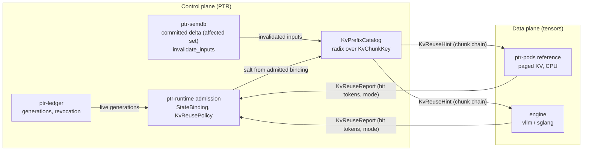
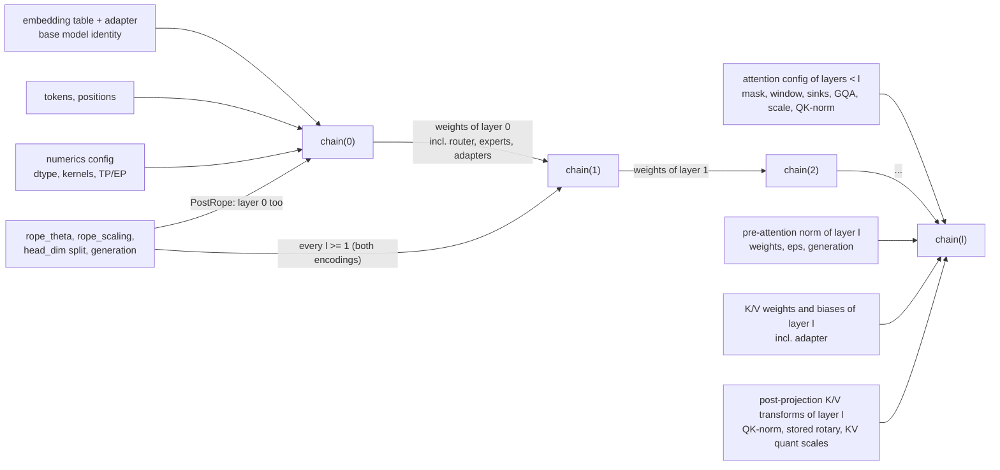

# 36 — KV-cache reuse: control plane in PTR, data plane in engines

Status: **design.** Nothing in this document is implemented beyond the existing
`ptr-pods` CPU reference code described in section A, which is not wired into any
inference path. Every claim about speed-up or hit rate is an **experiment** with a
falsification rule (section E), and all of them are planned, none has run.
Nothing here changes the authority order of ADR-0002: the ledger stays the only
authority, and a KV block is derived state under invariants #3, #5 and #17.

The one-sentence design: **PTR decides whether a cached KV block may be used;
an engine (or the CPU reference) computes and stores it.** Admission, keys,
invalidation and revocation live in `ptr-runtime`, `ptr-semdb` and `ptr-ledger`;
tensors, paging and kernels live behind a backend trait.

## A. Current state in code

All line numbers were opened and checked against the tree at the time of writing.

### No real inference path

- `ModelRequest` carries `raw_text: String`
  (`crates/ptr-model-api/src/request.rs:7`); there are no token ids.
- `InferenceBackend::infer` returns a synchronous `Vec<ModelEvent>`
  (`crates/ptr-model-api/src/backend.rs:9`); there is no streaming and no cache
  report.
- The only backends are `ReferenceEchoBackend` and `ScenarioBackend`
  (`crates/ptr-model-api/src/backend.rs:20` and `:44`), and `bins/ptrd` accepts
  exactly those two names (`bins/ptrd/src/main.rs:83-84`) and refuses others.
- No workspace crate tokenizes model input. `ptr-memory` has a
  `SemanticTokenizer` (`crates/ptr-memory/src/ingestion.rs:33`), but it turns a raw
  event into a semantic event, not a model vocabulary id sequence. The `tokenizers`
  crate appears only in `Cargo.lock` as a transitive dependency of `candle-core`
  (patched via `Cargo.toml:87`).

### Unwired CPU KV reference in `ptr-pods`

| Piece | Where | What it is |
|---|---|---|
| `KvPageSize` | `crates/ptr-pods/src/paged_kv.rs:12`, default 16 at `:15` | tokens per page |
| `KvPageBinding` | `paged_kv.rs:51` | model, adapter, generation, execution manifest, principal, device, dtype, page size |
| `publish_prefix` / `fork_prefix` | `paged_kv.rs:799` / `:845` | seal full pages, register a prefix, fork it copy-on-write into an empty cache |
| `KvContinuationExecutor` | `crates/ptr-pods/src/attention.rs:113` (`prefill` `:118`, `decode` `:125`) | continuation over a paged backend |
| `Qwen2PagedDecoder` | `crates/ptr-pods/src/qwen.rs:261` | one-layer Qwen2 decoder step |
| single-layer limit | `qwen.rs:297` (`layer_count != 1` is rejected) | |
| `apply_rope` | `qwen.rs:423`, applied to the key at `:328` before `append` | keys are stored **after** RoPE |

Around it in the runtime and memory crates:

- `ManagedKvRegistry` (`crates/ptr-runtime/src/tensor_kv.rs:99`) owns KV handles
  with placement and fencing.
- `StateBinding` (`crates/ptr-runtime/src/neural.rs:289`) binds opaque neural state
  to a journal anchor, revision and codebook; `NeuralStateCache::admit`
  (`neural.rs:972`) re-decides admission at every use and exposes no payload
  accessor. This is the model for how KV must be admitted (doc 27).
- `KvStateMetadata` (`crates/ptr-memory/src/kv.rs:26`) records
  `dependency_digests` (`kv.rs:34`) so semantic edits invalidate dependent state.
- `ptr-storage` has `TierObjectDomain::KvSnapshot`
  (`crates/ptr-storage/src/tier.rs:18`) and a content-addressed
  `TierObjectManifest` (`tier.rs:113`).
- `proto/podwire.proto` deliberately removed `session_id` (`:6-13`, number and name reserved).
  **A KV handle must never cross the wire**; only activations and policy do
  (doc 33). Today this is a **design rule, not an enforced guarantee**: removing
  `session_id` does not stop KV material from crossing PodWire, because
  `TypedPayload` is an arbitrary `type_id` plus bytes (`crates/ptr-protocol/src/lib.rs:16-19`)
  and the `PodCall` conversion checks only that the type id is non-empty
  (`crates/ptr-protocol/src/lib.rs:61-85`, `MissingTypeId` at `:73`). Enforcement is
  phase P5a.

### Five defects that block reuse

1. **The prefix key cannot be looked up before computing.** `publish_prefix`
   derives `prefix_digest` from the digests of the K/V tensor pages
   (`paged_kv.rs:814`, `digest_list(b"ptr-kv-prefix-v1\0", &page_digests)`). A new
   request does not have those pages yet, so it cannot ask "is my prefix cached?".
   Reuse needs keys derived from **tokens**: a chain `parent hash -> chunk hash`
   as in vLLM Automatic Prefix Caching.
2. **The prefix catalog is never pruned and revocation depends on the caller.**
   `PagedBackendState::prefixes` (`paged_kv.rs:333`) is only inserted into
   (`:826`) and read (`:867`). `fork_prefix` compares the generation of the
   **caller's own** binding (`:854-862`), not the currently admitted generation, so
   invariant #3 holds only if every caller passes a fresh binding. The fix (P2) is
   that the backend's `fork_prefix` takes a **runtime-minted admission witness**, as
   `NeuralStateCache::admit` does, instead of trusting a caller-supplied binding. The
   witness is **single-use and revalidated**: issuing it atomically registers the pending
   fork in the same cancellation registry that a dependency invalidation sweeps (so an
   invalidation after issuance cancels it), and `fork_prefix` consumes it once and
   revalidates its bound dependency generations and fence epoch against the live ledger
   at fork time; a consumed, cancelled or stale witness is rejected with a typed error.
3. **Keys are stored after RoPE** (`qwen.rs:321-336`), so a cached key is bound to
   its absolute position. That forbids positional reuse (section B, T2).
4. **`ModelRequest` is a public-field struct built literally in five places** outside
   its definition: `crates/ptr-model-api/tests/smoke.rs:6`,
   `crates/ptr-model-api/tests/backend.rs:8`,
   `crates/ptr-protocol/tests/prost.rs:307`, `crates/ptr-runtime/src/lib.rs:1305`
   and `:1420`. Adding a field is a breaking change in all five; a **new trait**
   avoids it.
5. **Every page bundle holds all layers, and the adapter binds the whole cache.**
   `HostPageBundle.layers: Vec<KvLayerSnapshot>` (`paged_kv.rs:304`, field at `:309`),
   `KvTensorSchema.adapter` (`crates/ptr-pods/src/kv.rs:50`) and
   `KvPageBinding.adapter` (`paged_kv.rs:53`). Base-model KV and LoRA KV therefore
   cannot be shared per layer even where they are mathematically identical.

## B. Literature, tiered

Each entry was checked against the paper; corrections to common claims are stated
where they matter. Tier decides what PTR may do with the method.

### T1 — exact, adopt

| Method | Reference | What PTR takes, and corrections |
|---|---|---|
| PagedAttention / vLLM | arXiv 2309.06180, SOSP'23 | fixed blocks (16 tokens), copy-on-write sharing; matches the existing 16-token `KvPageSize` |
| RadixAttention / SGLang | arXiv 2312.07104 | radix tree over token prefixes with LRU; the shape of `KvPrefixCatalog` |
| vLLM Automatic Prefix Caching | vLLM documentation | block hash = parent hash + block tokens + extras (for example the LoRA id); `cache_salt` is mixed into the first block; the `sha256_cbor` hash is reproducible across versions, the default pickle-based `sha256` is **not** |
| Activated LoRA (aLoRA) | arXiv 2504.12397, NeurIPS 2025 | states before the invocation token are identical to the base model in all layers (Prop. 1), so the base prefix is shared. Its vLLM PR #19710 was **closed unmerged on 2026-02-09**; a vLLM follow-up paper is arXiv 2512.17910 |

### T2 — positional and edit reuse (exact only for one layer with pre-RoPE keys, otherwise Approximate)

| Method | Reference | Notes and corrections |
|---|---|---|
| PIE | arXiv 2407.03157 | position-integrated re-encoding for edits. The ">85%" figure refers to **KV-update latency only** and was evaluated on **code only** |
| "Suffix Cache Reuse (SCR)" | none | **not a named method.** The mechanism is PIE plus Leyline |
| Leyline | arXiv 2606.01065 | guarantee is "positional, not informational"; its FORGET mode is a real re-prefill |
| CacheBlend | arXiv 2405.16444, EuroSys'25 | selective recompute of about 15% of tokens; implemented in LMCache |
| EPIC | arXiv 2410.15332, ICML'25 | LegoLink recomputes the first k (k <= 32) tokens of each chunk. "Up to 8x" TTFT is **versus CacheBlend under synthetic multi-request load, not versus full prefill**; up to 3x versus CacheBlend for a single request |
| MEPIC | arXiv 2512.16822 | page-aligned chunks, pre-RoPE storage, RoPE inside a fused kernel. The gain is **HBM memory 2-5x**, latency only 9-11% |
| CacheSlide | FAST'26 | needs LoRA/CoPE training, **deferred** |

### T3 — lossy and offload: optional derived tier only, always Approximate

| Method | Reference | Notes |
|---|---|---|
| ShadowKV | arXiv 2410.21465 | pre-RoPE low-rank keys plus CPU values, nothing permanently evicted; the best fit for the tier system (phase P6) |
| TailorKV | arXiv 2505.19586 | per-layer choice between quantize and offload; needs calibration |
| CacheGen | arXiv 2310.07240, SIGCOMM'24 | lossy codec, transport only |
| MiniCache | arXiv 2405.14366 | cross-layer merge; needs a deep model |

**Rejected:** SnapKV (arXiv 2404.14469), Ada-KV (arXiv 2407.11550) and K-VEC
(arXiv 2606.29563; an unreviewed preprint without code). Query-dependent eviction
breaks prefix sharing, because what survives depends on the request, and Ada-KV's
variable-length heads conflict with fixed pages.

### T4 — learned hidden-state compaction: rejected as an authoritative path

| Method | Reference | Why |
|---|---|---|
| KV-streams | arXiv 2609.35750 | RL-trained. Retained KV deliberately carries deleted content, which is a **revocation leak**. Its reported speed-ups are mutually inconsistent across abstract, body and conclusion |
| MEMENTO | arXiv 2604.09852 | needs SFT; the paper reports about 2.5x lower peak KV and 1.75x throughput. It has an implicit KV channel; restarting from text only loses 15.3 percentage points on AIME24. **Only the text channel is adopted**, as a `ptr-memory` object with provenance |
| STILL | arXiv 2606.07878 (Baseten) | not called "Neural Compactor"; TTFT is worse (6.8 s versus 3.1 s) |
| DroidSpeak | arXiv 2411.02820 | approximate cross-model reuse |

### Key insight, and its limit

In a single-layer model the K/V of token i depends only on its embedding and its
position. With **pre-RoPE** storage, any positional reuse (shift, splice, drop a
span) is then exact. This is a **mechanism check on the reference code, not
evidence for deep models**, where the K/V of layer l depends on all earlier
layers' outputs, which depend on the whole prefix. Re-rotating an already rotated
key is not bit-identical in floating point, so keys are stored pre-RoPE and rotated
at use. The same limit applies to positional reuse: after an **insert of whole
`PromptSegment`s between unchanged segments, or a shift or reorder, in which every
recorded lineage segment is unchanged** (path (b) of P3), a
page reused out of position is exact for layer 0 only; layers `>= 1` may be reused
only Approximately, with selective recompute, tagged `KvReuseTaint`. A content edit
(including a deletion or redaction) or a dependency invalidation (revocation or committed supersession) is path (a): the page is
unreachable for every layer, layer 0 included, and is freshly prefilled (section D).

## C. The Exact / Approximate rule

```rust
enum KvReuseMode { Exact, Approximate }
struct KvReusePolicy { allow_approximate: bool } // default: false
```

- **Exact** means the logits are bitwise equal to a full prefill of the same
  tokens under the same numerics. Only Exact reuse is admitted by default.
  The one **proven** Exact case is positional reuse with pre-RoPE keys in a
  **single-layer** model, and only once R006 has passed.
- **Approximate** reuse is admitted only when `allow_approximate` is set, and a run
  that used it may only produce **candidates**. Approximate are: positional
  re-encoding in multi-layer models, selective recompute, lossy tiers and
  non-dropless MoE.
- An effectful action reachable from a run with Approximate reuse fails with
  `RuntimeError::ApproximateStateAtEffectBoundary`.
- The mode is recorded in provenance of the result, **but provenance alone does not
  enforce the effect boundary** (next rule).

**Design rule: the mode must travel with the action.** Today the runtime copies a
bare `ActionIr` out of `ModelEvent::ActionReady` into `ResumableRun::action`
(`crates/ptr-runtime/src/lib.rs:1446-1473`, assignment at `:1472`; field at `:567`),
and `authorize_action` receives only that action (`:1558`), so a mode kept only in
result provenance is lost before authorization. Therefore:

- a `KvReuseTaint` (the mode, plus the reuse report digest) is carried with every
  model event and with `ResumableRun::action`;
- action admission and `authorize_action` check it and deny an Approximate-tainted
  action with `ApproximateStateAtEffectBoundary`;
- the taint is also attached to the result of every Pod the run requested
  (`ModelEvent::PodRequested`), and `promote_verified_pod_output` rejects or
  candidate-routes a tainted result, so an Approximate run cannot durably publish
  authoritative SemDB state either;
- **taint is persistent in the cache.** Every KV page and catalog entry records its **production mode**. A page produced by an Approximate reuse (shifted or repacked multi-layer P3 reuse, a lossy-tier object, any other Approximate path) is **never inserted into the Exact catalog**: it lives only in a separate **Approximate namespace** with a persistent `KvReuseTaint` that survives a snapshot and a restart. A hit on a tainted entry yields a **tainted result**, subject to the action and SemDB hard deny, and an Exact lookup **never matches** a tainted entry;
- taint propagates **transitively**: a candidate derived from an Approximate run
  stays tainted until it is recomputed Exact. Taint is cleared **only** by an Exact
  recomputation of the **same derived value from its original untainted inputs with the
  same operation**; an Exact pass over a tainted `Derived` segment (an "echo") does not
  clear it.

This is phase P2a below; until it exists the effect-boundary sentence above is a
design rule, not an enforced guarantee.

This applies invariant #5 (a cache cannot self-promote to truth), #7 (hard effect
boundary) and #11 (a learned or approximate signal cannot override a deterministic
verifier).

## D. LoRA, MoE and split Pods: the per-layer chain key

The K/V of layer l for tokens up to t depends on: the tokens, their positions, the
K/V projections and norms of layer l, and **all modules of layers below l**
(attention, FFN, router, experts). It does **not** depend on layer l's own FFN or
experts, which run after attention. So a cache key is a chain over layers:

```
chain(-1) = H( base-model identity + generation,
               embedding-table digest + generation, any embedding adapter,
               numerics config )

chain(l) = H( chain(l-1),                       // one formula for every l >= 0
              all weights of layer l-1 incl. router, experts, adapters, + their generations,
              every transformation applied to the residual stream before layer l's
                K/V projections (pre-attention norm weights, eps/config), + generations,
              K/V projection weights and biases of layer l incl. adapter, + generations,
              every post-projection K/V transformation of layer l as stored (QK-norm
                weights and eps, rotary parameters if stored post-RoPE, any KV
                quantization scales or parameters), + generations,
              numerics config: dtype, quantization, kernel set / batch-invariance,
                               TP/EP layout, inter-pod activation precision,
              positional-encoding config: rope_theta, rope_scaling policy,
                head_dim split (rotated vs pass-through dims), + their generation,
                included if l >= 1 (attention of layers < l rotated Q/K and so
                shaped the residual) or if KvKeyEncoding = PostRope (the stored
                key itself is rotated, so layer 0 too) )
```

For `l = 0` the term "all weights of layer l-1" is empty, so `chain(0)` binds
`chain(-1)` (the embedding table and any embedding adapter), layer 0's pre-attention
norm (weights, config, eps), layer 0's K/V projection with any layer-0 K/V adapter
generation and digest, the numerics config and, for `PostRope`, the RoPE
configuration. A QKV-LoRA attached at f = 0 therefore changes `chain(0)` and shares
no layers.

The **attention configuration** of every layer below l is also bound, because it
changes the residual that layer l projects K/V from: attention mask (causal,
bidirectional or custom), sliding-window size, attention sinks, GQA grouping
(`num_key_value_heads` per query heads), softmax scale or soft-cap, and QK-norm
weights and eps. The **base model is identified by identity and generation**, not by
a name alone.

**Sweep rule:** `chain(l)` covers the full producer of layer l's K/V bytes as stored, so anything that can change a stored K/V byte of layer l is in `chain(l)`: everything in layers `< l`, layer l's pre-attention norm, its K/V projection weights and biases, and every post-projection K/V transformation, each with its generation.

General rule: the key covers **every transformation applied to the residual stream
before layer l's K/V projections, with its configuration and generation**. In the
Qwen2 reference path that includes `input_layernorm` and `rms_norm_eps`, which
`Qwen2PagedDecoder` applies before the K and V projections
(`crates/ptr-pods/src/qwen.rs:313-321`, weights field at `:115`); changing them
changes K and V of layer l even though no K/V weight changed.

**The positional encoding is part of the key, for every layer l >= 1 and, with
post-RoPE keys, for layer 0 too.** Two separate effects bind it:

- *Stored rotation (`PostRope`).* The stored key is already rotated, so the rotation
  configuration is baked into the cached bytes: `Qwen2PagedDecoder` passes
  `self.config.rope_theta` to `apply_rope` while it builds the key that is appended
  to the cache (`crates/ptr-pods/src/qwen.rs:328-334`; the config field is at `:22`,
  validated at `:45`). A `PostRope` chain key therefore binds `rope_theta`, the
  `rope_scaling` policy (any context-extension scheme, including its factors) **and its effective runtime state**, the
  `head_dim` split between rotated and pass-through dimensions, and the generation
  of that configuration at **every** layer, including layer 0.
- *Rotation upstream of the residual (both encodings).* With `PreRope` storage the
  RoPE configuration is bound at use for **layer 0's own K/V only**: layer 0 projects
  K/V from the embedding, before any attention has run, so its cached pre-RoPE
  tensors do not depend on the rotation. For every layer `l >= 1` the cached
  pre-RoPE K/V was projected from a residual that went through the attention of
  layers `< l`, and that attention rotated Q and K under the RoPE configuration in
  force. The residual, and so layer l's K/V, therefore depends on `rope_theta`,
  scaling and the rotated-dimension split even though the stored tensor carries no
  rotation. The configuration must enter the per-layer chain key at every `l >= 1`
  (equivalently: it enters above the first attention layer, at the step from
  `chain(0)` to `chain(1)`). Binding it only at use would classify layers `>= 1` as
  valid after a RoPE change and serve stale tensors as Exact.

**Effective scaling state, not only the static policy.** For context-length-dependent
schemes (dynamic NTK and similar) the effective rotation frequencies depend on the
sequence length. The chain key therefore includes the **effective scaling factors in
force** (or the sequence-length regime that selects them) for every affected layer,
and requests in different regimes never share entries: reuse across a regime boundary
is a **miss**. **Within one request,** an Exact result requires one effective RoPE regime for the whole request: the regime is **fixed at admission from the maximum sequence length** (prompt plus `max_new_tokens`). If a decode would cross a dynamic-NTK boundary under a regime not fixed that way, the affected cache is **recomputed under the new regime** before continuing (Exact only after the recomputation), otherwise the result is Approximate. The alternative, forbidding reuse under dynamic scaling, is not
chosen; binding the effective state is preferred.

So a RoPE configuration change invalidates layers `>= 1` for `PreRope` storage and
all layers for `PostRope` storage. In a single-layer model (the reference path)
`PreRope` has no layer `>= 1`, which is why the one-layer positional-reuse check in
section B holds and does not extend to deep models.

Consequences:

| Change | Layers invalidated |
|---|---|
| pre-attention norm weights or eps at layer k | layers >= k |
| `rope_theta`, `rope_scaling` or `head_dim` split, `PostRope` keys | every layer |
| `rope_theta`, `rope_scaling` or `head_dim` split, `PreRope` keys | layers >= 1 (layer 0's own K/V is unaffected and is bound at use; layers >= 1 see the rotation through the residual) |
| QKV-LoRA attached at layer k | layers >= k |
| Q-only or MLP-only LoRA at layer k | layers >= k+1 |
| aLoRA | every layer before the invocation token is shared with the base |
| swap or revoke expert (j, i) | only layers > j |

### Dependency invalidation: one rule for every protective mechanism

A **dependency invalidation** is either an explicit revocation **or a committed
supersession** (a generation replacement or an edit) of **any generation-bearing
dependency**: a semantic input, a memory input, a **derived** input (a `Derived` segment, which carries its own provenance and generation), a training input, an evaluation input,
an adapter generation, an expert generation or the base-model generation. The list of kinds is **closed**: {semantic, memory, derived} plus the model kinds (base model, adapter, expert); **every non-Raw (generation-bearing) segment kind is a dependency kind, and any future generation-bearing segment kind joins by definition**. Every
protective mechanism in this document triggers on **any dependency invalidation**,
never only on revocation and never for only one dependency kind: salt or epoch
rotation, cancellation of active forks, fencing of in-flight engine requests,
completion-time admission, expert fencing through the compound event (doc 37), and
use-time admission. Each experiment exercises the in-flight race for every dependency
kind it covers. Wherever this document says "revocation" inside one of these rules,
read "dependency invalidation".

**A fence is an invalidating event for KV too.** A fence of an expert, for any cause
(`InputRevoked` or `AuthorityQuarantine`), invalidates every cache entry whose chain
includes that expert generation (L1 token experts in layers `< l`, L2 pod KV) at the
fence's commit index, although the generation does not change. The invalidation set is
therefore **revocation, supersession, and fence of any chain dependency**. Cache
admission checks each chain expert's **live serving status** (not fenced) as well as its
generation, and every entry records the **per-expert fence epoch** it was produced
under, so an expert readmitted at the same generation (possible only for the readmittable authority kinds, doc 37) never revives entries from before
the quarantine; they are recomputed.

### The token trie is independent of adapter identity

The prefix catalog has two levels, and adapter identity belongs only to the second:

1. **Token trie (radix over token ids).** `KvChunkKey { parent, chunk (16 tokens),
   salt }` with `salt = H(PrincipalId, ProjectId, base-model identity, tokenizer,
   numerics, schema)`. The salt contains **neither the adapter, nor the execution-manifest
   digest, nor any generation**: generations live on the entries and in `chain(0)`.
   Isolation is unchanged: two principals, or two projects, have different salts and
   diverge at the first node.
2. **Per-layer entries on each trie node**, keyed by
   `(chain(l), semantic_lineage_digest)`, where `chain(l)` is the per-layer chain key
   above and the lineage digest is the one defined below. One trie node can therefore
   hold **several entries for identical tokens with different lineages**, and
   admission compares the request's lineage with the entry's and admits only an exact
   match. A request can hit only an entry whose `chain(l)` equals the one computed for
   **its own** adapter binding. The adapter enters `chain(l)` only for layers at or after the first
   layer the adapter touches (`AdapterAttachment::first_layer`, plus one for a
   Q-only or MLP-only adapter, table below), and for an aLoRA adapter only for
   tokens after the activation point. Layers below that point have the same
   `chain(l)` for the base model and for every adapter, which is what lets them be
   shared.

**Why the manifest digest cannot be in the trie salt.** The execution-manifest digest
folds in the adapter binding: `calculate_digest` hashes the manifest generation
(`crates/ptr-pods/src/manifest.rs:229`) and then, in one loop over knowledge,
artifacts, reader **and adapter** bindings (`:230-236`), each binding's key,
generation and digest (`:237-239`). Any adapter key, generation or digest change
therefore changes the manifest digest. A salt that mixed in the manifest digest, or
the adapter value, would differ between a base request and a LoRA or aLoRA request,
so the two would diverge at the **first radix node**, before any per-layer chain
could discover that the lower-layer pages are identical. Layer sharing (P2b) and
R009 could not work as specified. Partitioning the token trie by the whole adapter
binding is therefore rejected.

**Adapter admission metadata lives on the per-layer entries**, not in the trie salt:
each entry records its **effective dependencies**: the base-model identity and
generation, the layer-range chain key, and, **only if the adapter enters `chain(l)`**,
the adapter key, generation and digest. Admission validates those effective
dependencies and that their generations are still live (not revoked or superseded), re-deciding at
every use as `NeuralStateCache::admit` does (section A). It does **not** require the
producing execution-manifest digest to equal the requesting one: that digest differs
between a base and an adapter request even for layers whose pages are identical, so
requiring equality would defeat the sharing. A base-keyed entry records no adapter
dependency, so invalidating (revoking or superseding) an adapter generation drops only the entries that name it and never a
base-keyed page.

**Raw segments use a content-bound admission rule.** Their lineage contribution is (kind `Raw`, content digest): they carry no identity or generation and need no liveness check, so two requests with an identical raw prefix share entries. **Runtime-produced content can never be Raw**: any model output, tool output or derived text is a **Derived** segment carrying its provenance, including any Approximate taint, which propagates until an exact recomputation (so Approximate output cannot be laundered into an Exact entry by re-entering as a prompt). Content that must be revocable or forgettable is **never Raw**: it enters as an ingress evidence record (identity plus generation) and is treated like `Semantic` or `Memory`.

**Entries also record their semantic input dependencies.** For **every non-Raw `PromptSegment`
before and including the entry's own** (source `Raw`, `Semantic`, `Memory` or `Derived`, per the
P1 contract), not only the segments that supplied its own tokens, the entry records
the validated input identity, its generation and its `content_digest`: its
**transitive prefix lineage**. This matters because the K/V of every layer `>= 1`
depends on the whole prefix (each earlier segment shaped the residual), so a hidden
state can carry removed context. The lineage is **derived from the trie ancestors**: a
segment reference is stored only on the node where a segment begins, so the metadata
is O(n) in prompt length and not O(n^2) per-page copies; the digest over the ordered
list and the per-segment set for revocation lookup are computed from that chain. **Universal sweep:** every lineage record used for reuse admission (the P3 secondary index, a split frame's `input_lineage`, and any future one) carries the **ordered raw ancestry** plus the closed generation-bearing list. Every **parent-independent** (secondary-index) entry also records `(Raw, content_digest)` for **every raw ancestor** in its transitive lineage, besides the typed segments with generations, and reuse requires each recorded raw ancestor to be present in the current request prefix (a multiset check over `(kind, digest)`); any lineage record used for reuse admission covers raw ancestors as well as generation-bearing inputs. A recorded segment is **live** iff its exact (identity, generation, `content_digest`)
is the one **committed at the current ledger anchor** and is not revoked or superseded (invariants #3
and #4; `StateBinding` binds a journal anchor). Admission re-checks liveness at every use and does **not** rely only on subtree invalidation: `invalidate_inputs` may be delayed, missed or lost across a restore, so invalidation is an eviction optimisation and the use-time check is the guarantee. The catalog keeps a
reverse index from input key to trie nodes, and `invalidate_inputs` (proposed, not in
the tree) maps the semantic keys affected by a **committed** delta to entries through
the recorded identities. `PreparedDelta::affected()` (`crates/ptr-semdb/src/lib.rs:459`,
returning `&BTreeSet<String>`; the type is at `:444`) is the source of that set, but it
describes a delta that is only **prepared and unpublished**, so invalidation is wired
to the commit of the delta, never to the prepare step: an entry derived from an
overlay that is later discarded must never be admissible. A token-identical entry derived
from an edited, superseded or revoked input is therefore never admissible, even though its token
chain key matches. A dependency invalidation of **any** upstream segment makes the entry
**unreachable**, not merely tainted, and its bytes are **tombstoned and purged**
(a dependency invalidation **cancels every active fork whose lineage or effective dependencies include the invalidated generation**:
its run is cancelled and must restart from a fresh prefill, and no token, candidate or
result produced after the invalidation may escape; the page is tombstoned immediately and
its bytes are reclaimed when the refcount reaches 0;
`KvSnapshot` tier objects are purged the same way, with a reclamation check): this keeps "revoked generations cannot become
usable after restart/cache/index lag" (`SECURITY.md:17-21`, the invariant list, whose
third item is that sentence) true for cached hidden state.

**Security property kept:** a request can hit only per-layer entries whose chain key
matches exactly the one derived from its own salt (principal and project), base model, adapter
binding, numerics and RoPE configuration, and only after every effective dependency
of that entry is validated as live at the current committed anchor. Sharing a trie node never lets a request read an entry computed
under a different adapter, generation, principal or project; it only lets requests with
different adapters reach the same node, where the chain keys then decide.

**Disaggregated expert pods are KV-stateless**: KV lives with attention
(MegaScale-Infer, arXiv 2504.02263; Step-3 attention-FFN disaggregation,
arXiv 2507.19427). Only **pipeline (layer) split** is specified for the wire: a
network split of experts is **not supported at L1** (doc 37, section 2) and has no
E007 coverage. **Pipeline split:** the KV of a layer range lives on the Pod hosting
it; only activations cross Pods, as a `TypedPayload`:

```
ActivationFrame { boundary, positions, upstream_chain, input_lineage, tensor }
```

`upstream_chain` carries the **upstream stage pod's identity, generation and manifest digest**, and **every effective upstream model-side dependency of the closed list**: the base model, and every adapter and every expert of the upstream layer range, each with identity, generation, digest and, for experts, the per-expert fence epoch. The downstream cache dependency set includes all of them and downstream admission revalidates all of them. **Sweep rule:** every subject an E007 matrix kind names is carried in the signed frame and in the downstream cache dependency set, and every element of `upstream_chain` (stage, base model, adapters, experts) has an E007 matrix kind and vice versa: a **bijection**, enforced by a checker. A buffered or in-flight frame whose upstream adapter is invalidated is dropped. `input_lineage` is the identity, generation and digest of **every generation-bearing
input of the closed dependency-kind list** (semantic, memory, derived and any future
generation-bearing segment kind, section D) **that contributed to the activation**, bound into the authenticated frame (signed
by the upstream runtime with the frame). The downstream KV cache entry records this
lineage, and downstream use-time admission revalidates it against live generations, so
a dropped `Revoke` or index lag cannot serve KV derived from an invalidated input.
`input_lineage` also carries the **ordered `(Raw, content_digest)` ancestry of every Raw
segment that influenced the activation**, the downstream cache key includes the
**activation-frame digest**, and downstream reuse requires the same ordered raw ancestry.

`proto/podwire.proto` is unchanged, and revocation uses the existing
`Revoke { subject, generation }` (`proto/podwire.proto:22`). A `Revoke` message can be
dropped or delayed, so it is not the guarantee: each Pod **re-validates against a
runtime-issued fence epoch at use**, as `ManagedKvRegistry` fencing does
(`crates/ptr-runtime/src/tensor_kv.rs:99`), and a downstream Pod never serves KV
derived from an upstream chain whose stage generation has been invalidated (revoked or superseded).

**Exact requires dropless routing and batch-invariant kernels.** Capacity limits
make routing depend on the batch (Soft MoE, arXiv 2308.00951, section 2.2), and
kernel reductions are batch-dependent unless made invariant (Thinking Machines,
"Defeating Nondeterminism in LLM Inference", Sep 2025; vLLM `VLLM_BATCH_INVARIANT`).
Without both, the MoE layers and every layer above them are **Approximate**.

Proposed types (none exists yet):

- `ptr-types`: `LayerIndex`, `LayerRange`, `ExpertId`.
- `ptr-pods`: `ModelComposition`, `AdapterAttachment { first_layer, kv_proj_adapted,
  activation: Always | AfterInvocation }`, `MoeTopology`, `RoutingDeterminism`.
- `KvLayerBinding { layers, effective_weights_digest, generations }`.

## E. Phases, experiments and falsification

All phases are **planned**. P0 is this document; every other phase has an
experiment that can fail.

| Phase | Content | Experiment and falsification |
|---|---|---|
| P0 | this document, experiment records | none |
| P1 | token-aware contract in `ptr-model-api`: `TokenId`, `Tokenizer` trait, `ByteTokenizer`, `PromptSegment` (with `content_digest` and source `Raw` / `Semantic` / `Memory` / `Derived`; a **Raw** segment's lineage contribution is (kind Raw, content digest) with no identity or generation, see section D), `SegmentedModelRequest`, `KvReuseHint`, `KvReuseReport`, `ModelRun`, and a **new trait** `KvReusingBackend`. Existing backends are untouched. A real HF tokenizer comes later in a new crate `ptr-tokenizers` | contract tests only |
| P2 | exact prefix reuse on CPU. A `retire_prefix` trait method with default `Unsupported` (the candle path is not compiled in CI). `ptr-runtime/src/kv_prefix.rs`: `KvPrefixCatalog`, a radix tree over `KvChunkKey { parent, chunk (16 tokens), salt }` with `salt = H(PrincipalId, ProjectId, base-model identity, tokenizer, numerics, schema)`, a project-scoped security namespace (the runtime's `AdmissionPolicy` binds a peer to one principal and one grant set and carries no project: `crates/ptr-runtime/src/execution.rs:291-298`, so one principal can act in several projects), deliberately **without** the adapter, the execution-manifest digest or any generation (section D); per-layer entries on each node keyed by `chain(l)`. **Admission** is per layer at the deepest node and validates at **every use** each entry's effective dependencies (base model, chain key, adapter only if it enters the chain) **and its recorded semantic-input dependencies** (identity, generation and `content_digest` per `PromptSegment`; live means committed at the current ledger anchor and not revoked), not the producing manifest digest, and **not relying only on invalidation**, since `invalidate_inputs` may be delayed, missed or lost across a restore; then a walk back to the admitted ancestor. Backend `fork_prefix` takes a **runtime-minted, single-use admission witness** (like `NeuralStateCache::admit`) instead of trusting a caller binding: issuance registers the pending fork in the cancellation registry that dependency invalidation sweeps, and `fork_prefix` consumes the witness once and revalidates its bound dependency generations and fence epoch against the live ledger at fork time (a consumed, cancelled or stale witness is rejected, typed). `invalidate_inputs` is wired to **committed** deltas, not to `PreparedDelta::affected()` at prepare time, so an entry from a discarded overlay is never admissible. A **dependency invalidation** (revocation or committed supersession of any generation-bearing dependency of the closed list in section D, that is any generation-bearing segment kind (semantic, memory, derived and any future one) or an adapter, expert or base-model generation) **cancels every active fork whose lineage or effective dependencies include the invalidated generation**, with completion-time admission as on the engine path: the run is cancelled and must restart from a fresh prefill, no token, candidate or result produced after the revocation may escape, the page is tombstoned immediately and its bytes are reclaimed when the refcount reaches 0. Per-layer entries are keyed by `(chain(l), semantic_lineage_digest)`, so one node can hold several entries for identical tokens with different lineages and admission admits only an exact lineage match. A **bounded catalog**: capacity limits on trie nodes and metadata and on KV page bytes (pinned in the R005 config), LRU (or equivalent) eviction that reclaims trie metadata and unreferenced pages, refcounts so a page held by an active fork or run is never evicted; eviction never changes correctness, a miss recomputes (this fixes the "never pruned" defect of section A). **Allocation is fail-closed:** if pinned (active-fork-referenced) pages or nodes leave no evictable capacity, a new insert is refused with a typed `CapacityExhausted` and the request proceeds as an uncached full prefill (no insert), so the bounds are never exceeded and a pinned page is never evicted. Lineage metadata is derived from trie ancestors (O(n)) and bounded by `max_metadata_bytes` (preregistered: a per-node budget of 1 KiB, so 4096 nodes give 4 MiB; the page bytes per node are stated for the pinned shape; the nodes-only and bytes-only over-capacity workloads run independently); tombstoned revoked pages and `KvSnapshot` tier objects are purged with a reclamation check. `ReferenceKvReuseBackend` | **R005 exact-prefix-reuse**. **The run is invalid (vacuous) and counts as falsified if any coverage prerequisite is unmet:** `cross_principal_attempts` below 1; `cross_project_attempts` below 1 (same principal, same prefix, different project); `input_revocations_performed` below 1; post-revocation lookups with matching tokens below 1 on entries whose lineage includes the revoked segment; same_tokens_distinct_lineage_entries below 2; `active_fork_revocation_attempts` below 1; attempts to read a revoked page pinned by an active fork below 1; attempts to read an entry from a discarded overlay below 1; `evictions` below 1 under the unique-prompt workload larger than capacity; `forged_witness_fork_attempts` below 1; decode_regime_crossing_cases below 1 (a prompt below the dynamic-NTK boundary whose decode crosses it); stale_witness_replay_cases below 1 (an authentic witness held across a dependency invalidation); witness_reuse_attempts below 1; current_layer_kv_transform_change_cases below 1 (a QK-norm weight or eps change at layer l with layers below l unchanged); exact_echo_cases below 1 (an Exact pass over a tainted Derived segment); approximate_output_reintroduced_as_raw_attempts below 1 (a multi-hop test in which Approximate output re-enters as a prompt segment); supersession_active_fork_race_cases below 1 (an active fork whose admitted pages derive from a semantic generation that is superseded while the run is in flight); memory_supersession_active_fork_race_cases below 1 (the same for a memory generation); superseded_lookup_cases below 1 for each kind (semantic, memory, derived) on each path (normal, lagging invalidation, actual restore); base_model_inflight_race_cases below 1 for each type, revocation and supersession (an active fork with an in-flight base-model invalidation; reported per type); saturation_demand_cases below 1 (the attempted working set of the concurrent forks exceeds capacity; the accepted pinned set stays within `max_trie_nodes` and `max_kv_page_bytes`); capacity_exhausted_refusals below 1 (the excess insertion is refused with `CapacityExhausted`); raw_prefix_reuse_cases below 1; raw_identical_prefix_hits below 1 (two requests sharing an identical raw prefix must hit); attempts to admit an effect from a cancelled run below 1; the lag arm (`invalidation_suppressed_arms` below 1, the revocation committed but `invalidate_inputs` fault-injected to be dropped), the restore arm (`restore_arms` below 1, or restored_pre_revocation_entries below 1: a pre-revocation entry, from a snapshot or tier object, must actually be restored and observed in the catalog before the post-event lookup; a plain runtime restart is a **separate arm**, empty_restart_arm, reported, and does not satisfy restore coverage), or post-event lookups below 1 in either arm; fewer seeds than pinned. **Falsified if any of:** a bitwise difference against full prefill; `forged_witness_forks_accepted` above 0; stale_or_reused_witness_forks_admitted above 0; stale_exact_hits above 0 (any hit on a K/V entry produced before a current-layer K/V transform changed); exact_outputs_across_regime_crossing_without_recompute above 0 (a fork with a forged admission witness); `cancelled_run_effects_admitted` above 0 (an effect of a cancelled run admitted; invariant #7 and `authorize_action`); any successful fork of a revoked generation; a hit rate below 40% at 50% shared prefix (workload pinned in the manifest: request count, prompt length a multiple of 16, shared length, cold-start handling, concurrency, so the target is achievable); catalog nodes, page bytes or `peak_metadata_bytes` above the bound under that unique-prompt workload; eviction of a page referenced by an active fork; `cross_principal_hits` above 0; `cross_project_hits` above 0; `revoked_lineage_entry_hits` above 0; `cross_lineage_hits` above 0; a revoked pinned page served after the revocation; bytes of a revoked pinned page not all reclaimed after release; `discarded_overlay_entry_hits` above 0; `outputs_escaped_after_revocation` above 0; laundered_exact_admissions above 0; superseded_stale_hits above 0 in any cell; outputs_after_supersession above 0 (semantic, memory and derived cases); base_model_inflight_outputs_after_invalidation above 0; base_model_inflight_cache_inserts above 0; any stale hit in the lag or restore arm. Every seed must meet each threshold (preregistered) |
| P2a | `KvReuseTaint` carried with every model event and with `ResumableRun::action`, checked by action admission and `authorize_action`, propagated transitively to derived candidates (section C). The taint also covers **Pod results**, not only actions: on an Approximate run a `ModelEvent::PodRequested` (handled at `crates/ptr-runtime/src/lib.rs:1337` and `:1438`) makes the Pod result carry the `KvReuseTaint`, and `promote_verified_pod_output` (defined at `crates/ptr-runtime/src/semantic.rs:58`, called from `lib.rs:1376` and `:1515`) must reject tainted output or route it to a candidate; it never publishes it to SemDB as authoritative state. A persisted Approximate candidate **stays tainted when reloaded after a restart** | **R005**, additional clauses. **The run is invalid (vacuous) and counts as falsified if any coverage prerequisite is unmet:** `fresh_exact_recomputation_admitted` below 1; `tainted_candidate_reload_attempts` below 1; approximate_pod_result_promotion_attempts below 1; taint checked over fewer than 2 hops. The Approximate producer is a pinned stub backend returning `KvReuseMode::Approximate`, and attempt counters count only attempts made after persistence and before recomputation. **Falsified if any of:** an action admitted from a run whose reuse mode was Approximate; a SemDB promotion from an Approximate run; an admission along the path Approximate result, persisted candidate, later otherwise-Exact run before a fresh Exact recomputation; `taint_lost` above 0 after a reload; taint_cleared_by_echo above 0; an Approximate Pod result promoted (accepted above 0) |
| P2b | LoRA layer sharing and aLoRA. Sharing is of **KV memory only**: a forward-compute saving would need a layer-boundary residual cache, which is out of scope, so no `prefill_flops` claim is made. The sharing oracle is derived per adapter type from `kv_proj_adapted` and the exact affected layer set (consequences table): a K/V-changing adapter (QKV-LoRA) first attached at layer f shares layers `< f`, fraction `f/L`; a Q-only or MLP-only adapter at f leaves layer f's own K/V unchanged and shares layers `<= f`, fraction `(f+1)/L`; an aLoRA shares every layer for the rows before the invocation point. **Invocation inside a page:** the boundary page is split by a per-page **invocation offset** kept as sub-page dependency metadata (the alternative, forcing a page boundary at the invocation point with the partial page closed, is not chosen): rows before the offset are keyed by the base chain, rows from the offset on by the adapter-dependent chain, and a page containing any post-invocation row is **never admitted under a base-only key**. The aLoRA sharing oracle counts all full pre-invocation pages plus the pre-invocation rows of the boundary page, for every layer. Base and adapter requests share one token trie and discover shared lower-layer pages through per-layer chain keys; adapter dependencies are recorded on, and admitted per, the per-layer entries (section D); admission never compares whole manifest digests | **R009 layer-shared-lora-kv**. **The run is invalid (vacuous) and counts as falsified if any coverage prerequisite is unmet:** `base_pages_before_revoke` below 1; `adapter_entries_before_revocation` below 1; adapter A's entry requested by adapter B (and an old generation against the new one) attempted fewer than 1 time; inflight_adapter_revocation_race_cases below 1 (an adapter-using request that starts before the adapter generation is invalidated, by revocation or supersession, and completes after it); any of QKV-LoRA and Q-only at f = L/2 and at f = 0, MLP-only, or the aLoRA case (invocation position and prompt length pinned) not run; with N layers, `input_revocations_performed` below 1 or post-revocation lookups with matching tokens below 1; the lag arm (`invalidation_suppressed_arms` below 1, the revocation committed but `invalidate_inputs` fault-injected to be dropped), the restore arm (`restore_arms` below 1, or restored_pre_revocation_entries below 1: a pre-revocation entry, from a snapshot or tier object, must actually be restored and observed in the catalog before the post-event lookup; a plain runtime restart is a **separate arm**, empty_restart_arm, reported, and does not satisfy restore coverage), or post-event lookups below 1 in either arm. **Falsified if any of:** shared pages differ bitwise from the base pages; the measured sharing deviates from the fraction predicted per adapter type; revoking the adapter drops any base-keyed page; a hit after revocation lands on an entry whose chain key depends on the revoked adapter generation; the aLoRA prefix is not bit-identical; the adapter request's logits are not bit-identical to a full adapter prefill; cross_adapter_hits_on_mismatched_chain above 0; outputs_after_adapter_revocation above 0; `revoked_lineage_entry_hits` above 0; any stale hit in the lag or restore arm |
| P2c | MoE expert generations, and expert fences (an entry records the per-expert fence epoch of every chain expert, and admission checks that each is still serving). Sharing is of **KV memory only** (no `prefill_flops` claim, as in P2b). Invalidation is **conservative per layer**: revoking expert (j, i) makes every page above j unreachable even where it would still be valid, and only pages at or below j must survive | **R010 moe-expert-kv-revocation**. **The run is invalid (vacuous) and counts as falsified if any coverage prerequisite is unmet:** `nondeterministic_divergence_observed` below 1; expert_generation_revocations_performed below 1 (the generation of expert (j, i) itself is revoked); expert_quarantine_kv_cases below 1 (Exact KV populated, then the expert fenced by an authority revocation, then a matching request); inflight_expert_revocation_race_cases below 1 for each cell of trigger (revocation, supersession) x input kind (expert, semantic), the four cells reported separately (a request using expert (j, i) that starts before its generation is invalidated, by revocation or supersession, and completes after it); pages_above_layer_cached_before_revocation below 1; matching_post_revocation_lookups below 1; with N layers, `input_revocations_performed` below 1 or post-revocation lookups with matching tokens below 1; the lag arm (`invalidation_suppressed_arms` below 1, the revocation committed but `invalidate_inputs` fault-injected to be dropped), the restore arm (`restore_arms` below 1, or restored_pre_revocation_entries below 1: a pre-revocation entry, from a snapshot or tier object, must actually be restored and observed in the catalog before the post-event lookup; a plain runtime restart is a **separate arm**, empty_restart_arm, reported, and does not satisfy restore coverage), or post-event lookups below 1 in either arm. **Falsified if any of:** a page above j that was created before the revocation is served after it; a page at or below j is dropped because of the revocation (pages recomputed after the revocation are allowed); stale_expert_generation_hits above 0; kv_reuse_after_expert_fence above 0; outputs_after_expert_revocation above 0; inflight_outputs_after_invalidation above 0 in any of the four cells; `mismatching_runs_tagged_exact` above 0 (a nondeterministic-routing run tagged Exact); a bitwise mismatch of deterministic (dropless, batch-invariant) MoE reuse against a full prefill of the same prompt under the same expert generations; `revoked_lineage_entry_hits` above 0; any stale hit in the lag or restore arm |
| P3 | pre-RoPE keys: `KvKeyEncoding { PostRope, PreRope }` with a versioned digest; N-layer `Qwen2PagedStack`. `KvChunkKey` includes the parent-prefix hash, so after an edit before a cached chunk every later key changes even if the contents do not. P3 therefore adds a **position-independent secondary index**: key `H(salt, chunk token ids, chain-relevant config)` **without the parent**, mapping to `PreRope` pages plus their original absolute positions; after an edit, lookup realigns by content. The index is built at **sub-page granularity** (rolling hashes over small token spans, 1 token up to a page, or content-defined boundaries) so a non-page-aligned insert can still be matched; a shifted suffix is **repacked from old pre-RoPE K/V rows by span** (rows are per token): old **layer 0** rows are copied into new pages at the new alignment **only if the page's lineage is live**, and a span with no content match is **recomputed, never partially reused**. Every page records its **transitive prefix lineage** (section D) and admission revalidates liveness at use, where a segment is live iff its exact (identity, generation, `content_digest`) is committed at the current ledger anchor and not revoked. **P3 admission rule (it does not inherit P2's exact-lineage equality):** a secondary-index (shift) hit is admitted **iff** the page's own source-segment lineage (identity, generation, digest) equals the request's segment exactly **and** every upstream input of the page's **original** prefix is live (committed at the ledger anchor, not revoked). The request's ordered prefix lineage **may differ**, which is the point of P3, but **every segment of the page's original prefix (identity, generation, digest) must be present in the requesting prefix as a multiset**: insertion, shift and reorder are allowed, **omission or deletion is not**; the result stays tainted Approximate for the upper layers (positional reuse). **Path (a), revocation or content edit:** if any lineage segment is revoked, or its content was edited (including a deletion or redaction, which supersedes the old generation under invariant #3), the page is unreachable for **every layer, layer 0 included**, and is freshly prefilled (`SECURITY.md:17-21`). **Path (b), insertion of whole new `PromptSegment`s between unchanged segments, shift or reorder, in which every recorded segment is unchanged:** (an insertion **inside** a segment changes that segment's `content_digest`, which is path (a) with zero reuse, so P3 helps only reorder, shift or insertion of whole segments) approximate upper-layer reuse with selective recompute (CacheBlend/EPIC-style, k tokens) is permitted; the result is tagged Approximate and carries `KvReuseTaint` (section C), so it never reaches an effect path, and the pages it produces go only to the Approximate namespace with persistent taint (section C), never into the Exact catalog. No removed context can leak on path (b), because it requires every lineage segment to be unchanged and live. The index yields Exact reuse only for the single-layer case R006 proves; multi-layer positional reuse stays Approximate (section C) | **R006 positional-reuse-oracle** (one layer) and **M016 approximate-chunk-reuse**, both exercising lookup through the catalog and its secondary index, not pages handed to the backend. **The run is invalid (vacuous) and counts as falsified if any coverage prerequisite is unmet:** `reused_tokens_per_shift` equal to 0; omitted_upstream_segment_cases below 1 (R006 and M016: a request that omits an upstream segment of the page's original prefix); raw_ancestor_omission_cases below 1 (R006 and M016: a raw upstream segment removed, the rest unchanged); shifted_reuse_inflight_race_cases below 1 for each kind x type of the matrix; for **M016 only** (the multi-layer Approximate path): shifted_taint_cases below 1 (a real shifted result must carry `KvReuseTaint`) and shifted_effect_boundary_cases below 1 (a shifted, Approximate result reaches an effect path and must be rejected); shift_insert_ordinary_hit_cases below 1 (a shifted run inserts, a later ordinary-prefix request for the same prompt follows, then an effect attempt; and the same across a restart); for **R006** (the one-layer Exact positional oracle): exact_shifted_parity_cases below 1 (untainted, bit-exact shifted results); secondary_index_hits_per_shift below 1; non-page-aligned insertions of whole segments of 1 token and of 7 tokens not run; the in-segment-insertion case (zero reuse expected) not run; post-revocation secondary lookups with matching content below 1; `canary_probes` below 1 in the canary-edit case; the lag arm (`invalidation_suppressed_arms` below 1, the revocation committed but `invalidate_inputs` fault-injected to be dropped), the restore arm (`restore_arms` below 1, or restored_pre_revocation_entries below 1: a pre-revocation entry, from a snapshot or tier object, must actually be restored and observed in the catalog before the post-event lookup; a plain runtime restart is a **separate arm**, empty_restart_arm, reported, and does not satisfy restore coverage), or post-event lookups below 1 in either arm. **R006 is falsified if any of:** a bitwise difference against a `PreRope` full prefill at the new position; tainted_exact_results above 0; non_bit_exact_exact_results above 0; shift_hits_with_dead_original_upstream above 0 (a shift hit admitted although an upstream input of the page's original prefix is revoked); omitted_upstream_admissions above 0 (a hit admitted although a segment of the page's original prefix is absent from the requesting prefix); reuse_after_raw_ancestor_removed above 0. **M016** has a single selection rule: `k_sel` is the smallest k in [4, 7, 10, 13] whose top-1 agreement on a disjoint calibration split is at least 99% at every shift (if none exists, M016 is falsified), and it is then evaluated on a held-out split, where `k_sel` needs agreement of at least 99% **and** a median speedup of at least 2x at every shift. Agreement is counted only at positions whose K/V used approximate rows. The recomputed tokens are pinned (preregistered: the CacheBlend-style highest-deviation tokens, in every layer `>= 1`). The workload is pinned so that the target is feasible: a 512-token prompt in 64-token chunks, 7 of 8 chunks reused (448 reused tokens, 64-token suffix). The FLOP cost model includes the deviation-selection pass over the reused tokens, and the analytic bound in the config requires each candidate k to reach 2x in the ideal model; a k that cannot is dropped and reported. Bitwise experiments (R006, R009, R010, R005, E007) use seeded random weights with a pinned seed and shape; the agreement experiments (R008, M016) use the pinned pretrained `Qwen/Qwen2.5-0.5B` at a resolved Hugging Face revision sha, with the checkpoint's layer count and vocabulary; `prefill_speedup` is the median after a pinned warm-up and includes lookup, secondary-index, repack and recompute time; the 1-token and 7-token insertions count toward both criteria, and the 2x target is measured on path (b) only (live_lineage_insert_shift_cases means insertion of whole segments, or shift, with every recorded segment unchanged). **M016 is falsified if any of:** shifted_reuse_inflight_outputs above 0; shifted_reuse_inflight_cache_inserts above 0; shifted_effects_admitted above 0; tainted_pages_served_as_exact above 0; effects_admitted_from_tainted_results above 0; untainted_shifted_results above 0; omitted_upstream_admissions above 0; reuse_after_raw_ancestor_removed above 0; any reuse in the in-segment-insertion case; no k meeting the calibration rule; held-out top-1 agreement below 99% at `k_sel` at any shift; median `prefill_speedup` below 2x at `k_sel` at any shift; `revoked_page_layers_reused` above 0; `canary_logit_shift` above 0 in the case where an edit removes a canary; `reused_results_tagged_approximate` not equal to `reused_results`, or `approximate_tag_violations` above 0; any stale hit in the lag or restore arm. The safety checks do not count toward the speed metric |
| P4 | span eviction without hidden carry-over (Leyline FORGET) | **R007 span-forget** (bitwise only; there is no percentile path). **The run is invalid (vacuous) and counts as falsified if any coverage prerequisite is unmet:** canary_span_tokens below 1; downstream_rows_before_forget below 1; prefix_reuse_tokens below 1; post_forget_probes below 1. **Falsified if any of:** the state differs from a fresh prefill without the span; a canary token remains probeable; `canary_logit_shift` (the absolute difference of the canary token's logit, maximised over probes) is above 0; `stale_downstream_rows_reused` above 0; `recompute_tokens` not equal to the number of tokens after the span |
| P5a | **pipeline (layer) split** only; a network split of experts is not supported at L1 (doc 37, section 2) and is outside P5a and E007. Includes an explicit **wire-type allowlist**: `TypedPayload` is arbitrary bytes plus a caller-controlled `type_id` (section A), so a deny-list of KV type ids can be evaded by mislabelling. PodWire admission for split-pod operations therefore accepts **only** the activation-frame and policy schemas valid for that operation, decodes them (typed, schema-validated, including tensor shape tokens x width x dtype and the length of `positions`), and rejects any other `type_id`, in `ptr-protocol` conversion and in PodWire admission, with a test; the shape check is kept only for wrong-shape payloads. The real invariant is that the **receiving Pod has no KV-install path from PodWire**: an activation frame is only ever fed to compute. `wire_kv_page_bytes` is the byte count of any payload that does not decode as an allowlisted schema **or** matches the digest of a KV page held by either Pod; an activation-shaped payload that is consumed only as activation is a positive control and is excluded. Until it lands, "no KV handle on the wire" is a design rule, not an enforced guarantee (section A). It also settles the size of an `ActivationFrame`: PodWire bounds one payload at `MAX_BODY_BYTES = 4 MiB` (`crates/ptr-podwire/src/frame.rs:65`, enforced on the request body at `:503-508`). The reference path supports **F32 only** (`crates/ptr-pods/src/kv.rs:244`), so the boundary dtype is pinned to F32 and one frame of 2048 tokens x 2048 width x 4 B is **16 MiB**, which does not fit (the model width 2048 and the vocabulary size are pinned, preregistered). P5a therefore specifies **bounded chunking of activation frames**: each frame has a stable `frame_id`, and each chunk is its own `TypedPayload` below the body bound carrying `{ frame_id, chunk_index, chunk_total, chunk_digest, frame_digest, parent_operation_id, signed_absolute_deadline, upstream_chain }`, where `chunk_digest` binds `frame_id`, `chunk_index`, `chunk_total`, `frame_digest`, `parent_operation_id`, `signed_absolute_deadline`, `upstream_chain` and the chunk bytes and **every chunk also carries a whole-frame digest**; the chunks of one frame travel as **distinct PodWire requests with distinct request ids**, because a request id that a session already completed with different bytes is refused with `PodWireError::DuplicateRequest` (`crates/ptr-podwire/src/endpoint.rs:242`, raised at `:1094`, `:1152` and `:1191`), so one outer request id must never be reused across chunks; `upstream_chain` is repeated on **every** chunk so a stage can refuse a chunk stored under a mismatched chain without waiting for the rest; an incomplete frame carries a **frame-level deadline**: it expires after a bounded time or when its session or request is cancelled, its buffered chunks are released, and a typed error is returned; each chunk header carries a **signed absolute deadline and the parent operation id**, and admission **rejects any frame whose `signed_absolute_deadline` has already passed (minus the skew bound) before reserving a tuple**; the receiver keeps a **bounded per-principal tombstone of abandoned `frame_id`s**, retained until `abandonment_time + replay_window`, where `replay_window >= max_frame_deadline_lifetime + 2 * max_clock_skew_ms` (both pinned), with a bounded count, so a **late chunk of an abandoned frame is rejected**, including a replay under fresh request ids after the abandonment; the first accepted chunk of a frame **atomically reserves** `(authenticated principal, parent_operation_id, frame_id)` in the same principal-scoped table as the tombstones, so a concurrent assembly of the same tuple from another session is rejected (typed) or joins the single buffer, with exactly one delivery; the reservation expires at `signed_absolute_deadline` plus `max_clock_skew_ms` into an abandonment tombstone; admitting an incomplete frame **reserves one future tombstone**, used for either abandonment or completion, and the bound is `admitted_incomplete_frames + retained_tombstones <= max_frame_tombstones_per_principal = 64` (retained tombstones are abandoned plus completed): a successfully reassembled frame leaves a **completion tombstone** keyed at **principal scope**, `(authenticated principal, parent_operation_id, frame_id)`, which, like an abandonment tombstone, **survives reconnects** and is retained until `signed_absolute_deadline` plus `max_clock_skew_ms`, and any replay of its chunks, also under fresh PodWire request ids, is rejected with a typed `FrameReplayed`; when no reservation is possible the frame is refused with a typed `FrameTableFull` (rate-limited) until a tombstone expires, and tombstones are never evicted before their retention; the number of incomplete frames per peer is limited; the receiver reassembles keyed by `(session, parent_operation_id, frame_id)`, and any mismatch across the chunks of a frame rejects the frame; the receiver reassembles into into a **bounded queue** (invariant #8) with a limit on chunks in flight, and rejects a frame that is incomplete, duplicated, reordered beyond the window, mixes chunks of two frame versions under one `frame_id`, or whose per-chunk or whole-frame digests do not match. E007 pins (preregistered) 5 chunks of at most 3.5 MiB for the 16 MiB frame, `reorder_window = 4`, `frame_deadline_ms = 5000`, `max_incomplete_frames_per_peer = 8` and `max_chunks_in_flight = 32`. Chunked frames are **mandatory**: there is no supported-shape-limit alternative, so every chunk prerequisite below applies unconditionally | **E007 split-pod-kv**. **The run is invalid (vacuous) and counts as falsified if any coverage prerequisite is unmet:** `non_allowlisted_type_attempts` below 1 (each with a typed rejection, separate from the mislabelled-KV attempts); fewer than 1 adversarial mislabelled KV payload; any of chain_mismatch_attempts, duplicate_chunk_attempts, out_of_window_attempts, bad_chunk_digest_attempts, mixed_version_frame_attempts, incomplete_frames_over_peer_limit, queue_overflow_attempts, digest_inconsistency_attempts below 1; `splice_attempts` below 1 (individually valid chunks from different frames); cross_operation_splice_attempts below 1 (valid chunks from different parent operations); activation_control_cases below 1 (an activation-shaped KV payload consumed only as activation is a **positive control**, excluded from the typed-rejection requirement and from `wire_kv_page_bytes`); `reassembly_attempts_after_abandon` below 1; late_chunks_after_abandon_attempts below 1; expired_deadline_frame_attempts below 1; post_abandonment_replay_cases below 1 (a replay of abandoned chunks under fresh PodWire request ids after the abandonment); full_frame_replay_attempts below 1 (including replays under fresh request ids); cross_session_replay_attempts below 1 (reconnect before the deadline and replay the same chunks); concurrent_cross_session_assembly_cases below 1 (the same tuple assembled from two sessions at once); tombstone_saturation_cases below 1 (the per-principal tombstone table filled); concurrent_abandonment_cases below 1 (several admitted frames abandoned together near the bound); new_frames_refused_typed below 1; `interleaved_chunk_switches` below 1 (two frames sharing an `upstream_chain` reassembled concurrently); `abandoned_chunks_sent` below 1, or buffered bytes not above baseline before the abandonment; no frame above one body (the large F32 frame of 16 MiB); raw_ancestor_omission_cases below 1 (an earlier Raw segment removed or changed, typed inputs, chain and positions equal); upstream_expert_fence_cases below 1 (an upstream-chain expert fenced); upstream_adapter_invalidation_race_cases below 1 (an upstream adapter invalidated while a frame is buffered or in flight); stale_upstream_entries_before_revocation below 1 (a downstream KV entry under the old upstream generation must exist before the revocation); stale-upstream attempts below 1 (the `Revoke` message dropped or delayed, then a request sent). **Falsified if any of:** any payload with a non-allowlisted `type_id` admitted (`non_allowlisted_payloads_admitted` above 0); `wire_kv_handle_count`, `wire_kv_page_bytes` or any other `wire_kv_*` check above 0; kv_pages_installed_from_wire above 0; activation_control_kv_installs above 0; any attempt of the enumerated adversarial, malformed or over-limit kinds (the config list adversarial_attempt_kinds; the activation positive control is not among them) not rejected with a typed error, or any valid frame (the 16 MiB chunked control, concurrent valid reassembly, the activation control) that does not complete bit-identically; frames_with_consistent_whole_frame_digest not equal to valid_frames_sent (the equality is over **valid frames only**: all chunks of a valid frame must carry the same whole-frame digest); any digest_inconsistency_attempts (digest-inconsistent adversarial frames such as mixed-version and splice frames, counted separately and members of adversarial_attempt_kinds) not rejected with a typed error; a spliced frame accepted; late_chunks_after_abandon_admitted above 0; expired_frames_admitted above 0; abandoned_frame_replays_admitted above 0; replayed_frames_admitted above 0; cross_session_replays_admitted above 0; duplicate_activation_deliveries above 0; cross_operation_splices_admitted above 0; tombstone_evictions_before_retention above 0; tombstone_bound_violations above 0; `abandoned_chunks_released` not equal to `abandoned_chunks_sent`, or buffered bytes not returned to baseline; the large F32 frame not bit-identical to the single-pod run (output means the final logits bytes plus the per-layer KV bytes on each pod; the single-pod baseline applies the identical boundary cast, a no-op in F32); `stale_upstream_kv_served` above 0; reuse_after_raw_ancestor_removed above 0 (an earlier Raw segment removed or changed while the typed inputs, chain and positions are equal); downstream_kv_reuse_after_upstream_fence above 0; downstream_kv_reuse_after_upstream_adapter_invalidation above 0 |
| P5 | engine adapter crate `ptr-model-engine` (`vllm-http`, `sglang-http`); an engine cannot do per-layer live-generation admission, so PTR defines an **engine-specific cache salt** containing the **project and the security principal** (`ProjectId` and `PrincipalId`, the same project-scoped namespace as the P2 salt) and every admitted generation and digest: base-model generation and artifact digest, adapter key, generation and digest, expert generations and per-expert fence epochs for MoE, and the numerics config. A revoked or replaced binding then can never reproduce an old block hash. Because the principal is in the salt, **one principal cannot hit another principal's blocks**. The salt does not by itself prevent capacity or eviction timing channels, so **timing isolation is claimed only at the granularity at which the engine cache capacity is partitioned**: the partition must be per `(principal, project)` pair (a block quota or an engine instance per pair), declared per backend as `capacity_partitioning` with its granularity and recorded. A backend partitioned at `(principal, project)` granularity claims cross-principal **and** cross-project timing isolation; a backend partitioned only per principal claims cross-principal timing isolation but only "no cross-project hits"; otherwise the claim is only "no cross-principal and no cross-project hits" and timing isolation is reported not applicable. E006 tests both (below). **Every dependency invalidation (revocation or committed supersession of any dependency of the closed list in section D: every generation-bearing segment kind, an adapter generation, an expert generation or the base-model generation) requires an engine-acknowledged salt rotation before further requests are served**, done by **salt-epoch rotation**, not a global flush (the engine is not required to evict). Per-principal salt epochs are **monotone and durable**: derived from, or persisted with, the ledger commit index, and **never reused**, and the dependency reverse index is **rebuilt from the ledger before the runtime serves** after any restart, so a restart of the PTR runtime alone cannot bring back an old salt or forget a dependent principal. The rebuild reads **dependency journal records**: the `(principal, project, dependency generations)` association of each request is durably committed to the ledger **before** the cache-populating request is sent to the engine, and a request whose association is not committed is never sent (the ledger record kind does not exist yet; it is a follow-up). The associations are **bounded**: they are deduplicated per `(principal, project, salt epoch, dependency-generation set)`, an association is retired when its principal's salt epoch rotates past it (its blocks become unreachable), and a per-principal bound max_live_associations_per_principal (pinned, default 4096) is enforced **fail-closed**: reaching it rotates that principal's salt epoch, retiring all its associations, before the request is admitted. Compaction snapshots hold live associations only. **Compaction preserves these dependencies:** a ledger compaction snapshot carries every live `(principal, project, dependency generations)` association and every principal's current salt epoch, and the reverse-index rebuild after a restart reads the snapshot plus the retained ledger. If a compaction cannot preserve them, it **rotates every principal's salt epoch fail-closed** before the runtime serves again. Today the compacted snapshots restore committed state only and **omit neural and KV state** (`crates/ptr-runtime/src/compacted.rs:17-19`), so carrying these associations is a follow-up. The semantic state is global (`crates/ptr-semdb/src/lib.rs:471-475`: one `SemanticHost` holds one `SemanticState`), so PTR keeps an explicit reverse index, **principal to dependency generation**, covering **every dependency kind that can appear in a request lineage** (every generation-bearing segment kind of the closed list, plus adapter, expert and base-model generations), and tracks, **per generation, the set of principals whose cached blocks depend on it**, and a dependency invalidation rotates the salt epoch of **every dependent principal**; only a principal with no dependency on the revoked generation keeps its epoch and its hit rate; requests arriving during the rotation window are queued or rejected. **Supersession counts as revocation on the engine path (section D, dependency invalidation):** every committed generation replacement of any generation-bearing dependency triggers the same dependent-epoch rotation, in-flight fencing and completion-time admission as an explicit revocation. **In-flight requests are fenced too:** on any dependency invalidation commit, every in-flight engine request whose binding or lineage includes the invalidated generation is **cancelled (or fenced) before any output escapes**, and, as defense in depth, **completion-time lineage admission** re-checks the request's lineage against the ledger anchor at completion and drops the result if any input was revoked meanwhile (no output, no candidate, no cache insert). The request is restarted from a fresh prefill under the rotated salt if it is still wanted. The committed delta (not `PreparedDelta::affected()` at prepare time) drives the rotation. A single request-level engine salt cannot carry page-specific lineage, so the lineage digest is **not** put in the salt; per-block salts at segment boundaries would be required to do better and are out of scope unless an engine supports them. The salt must cover **every input that section D's per-layer chain key binds**, or state a fallback: (1) base-model weights, **normalization weights and eps/config**, embedding table, attention configuration, router and K/V weights: covered by the base-model generation and artifact digest, which must fold in those weights and configs; (2) adapter and expert generations: in the salt, as above; (3) **tokenizer** identity and version: in the salt, since the engine hashes token ids, not text; (4) **numerics** (dtype, quantization, kernel set and batch-invariance, TP/EP layout, inter-pod activation precision): in the salt; (5) **positional config**: `rope_theta`, scaling policy, rotated-dimension split, **its generation**, and the **effective RoPE scaling regime** (the scaling factors in force, or the sequence-length regime that selects them, as in section D), so that requests in different dynamic-RoPE regimes never share engine blocks; (6) `KvKeyEncoding`: in the salt. **Fallback:** if the engine cannot key a block per request regime (or cannot expose any item above), the model runs with engine prefix caching **disabled** and E006 is reported **not applicable for it, not passed**. Trade-off: generation-salted engine caches cannot share base pages across adapters; P2b's sharing is a property of the P2 reference backend, not of an engine, unless the engine supports per-layer keys. Router cost term `KvReuseEstimate` | **E006 engine-prefix-reuse**, whose **safety portion** (invalidation, salt transition, restart and in-flight cancellation matrix, and every safety falsifier) runs for **every enabled engine backend**, `vllm-http` **and** `sglang-http`, each at a pinned version (the set of backends run equals the set enabled; a backend not run makes the run invalid), with the performance thresholds pinned per backend separately and **not a precondition for the safety verdict**; the vLLM run uses a pinned vLLM version (preregistered) with `VLLM_BATCH_INVARIANT=1`, on a GPU profile in `hardware/` that supports vLLM's batch-invariant kernels (if no profile there does, E006 is inconclusive by design until suitable hardware exists), with the model pinned (OLMoE-1B-7B-0125 at revision 9b0c1aa87e34a20052389dce1f0cf01da783f654), a pinned test LoRA (rank, targets, seed), pinned expert generations and a pinned baseline workload for principal B; a missing batch invariance makes the run **inconclusive, not a pass**, and a model for which caching must be disabled is reported **not applicable, not passed**. **The run is invalid (vacuous) and counts as falsified if any coverage prerequisite is unmet:** no regime-crossing probe; decode_regime_crossing_cases below 1 (a prompt below the boundary, a decode crossing it); `inflight_revocation_race_attempts` below 1 for any dependency kind E006 covers (every kind of the closed list in section D: the generation-bearing segment kinds, adapter, expert, base model; a request that starts before the invalidation commit and completes after it); a salt-input transition with stale probes missing for any of model, adapter, expert, RoPE, tokenizer, numerics and `KvKeyEncoding`; `stale_semantic_probe_requests` below 8; supersession_probe_requests below 1 in each of the normal, lag and restart arms (reported per arm); expert_fence_salt_transition_cases below 1 (an expert fence changes the salt); memory_revocation_probe_requests below 1 in each of the normal, lag and restart arms (a cached memory-dependent request is made and exactly that memory generation is revoked, and the dependent principal's epoch must rotate); no unsalted or no-rotation control that shows the stale hit; requests attempted during the flush window below 1; `cross_principal_attempts` below 1; `cross_project_attempts` below 1 (same principal, same prefix, different project); dependent-principal attempts below 1 (principal B used the revoked input and B's epoch is rotated); n_timing_samples_per_arm below 1000, measured separately from the hit-rate workload; the lag arm (`invalidation_suppressed_arms` below 1, the revocation committed but `invalidate_inputs` fault-injected to be dropped), the persistence arms (engine-owned prefix blocks have **no PTR catalog restore**, so `restore_applicable` is false for E006, reason: engine-owned cache, no PTR catalog or tier restore, and the catalog-restore prerequisite does not apply): `engine_restart_salt_reuse` below 1 per backend (restart the engine and runtime, then replay requests that could hit pre-revocation blocks), a `runtime_only_restart` arm per backend (the PTR runtime restarts while the engine process and its cache stay warm, then requests that could hit pre-revocation blocks are replayed; runtime_only_restart_arms below 1 per backend; dependency_journal_crash_cases below 1 per backend at two reachable crash points, (a) after the journal commit and before the engine send, and (b) after the engine send and store and before completion), and a `compaction_restart_revocation_cases` arm per backend (a compaction, then a PTR-only restart with a warm engine, then a revocation, then a matching request; compaction_restart_revocation_cases below 1 per backend), an association-bound arm, association_bound_cases below 1 per backend (the bound is exceeded), and a `persistent_cache_reload` arm for every backend that **declares a persistent engine cache** (declared per backend; declared and not run makes the run invalid), or post-event lookups below 1 in either arm. The three timing-isolation falsifiers below (the TOST test, the attacker classifier and the eviction case) apply only to a backend whose `capacity_partitioning` is declared at the matching granularity. **Falsified if any of:** the TTFT gain is below 1.5x at 50% shared prefix (workload pinned: request count, prompt length, shared length, concurrency, warm-up, and whether the first request is in the TTFT median); a hit on a block created under a revoked or replaced generation; a block shared across RoPE regimes; any bitwise difference between cache-enabled engine output and a cache-disabled full prefill under the identical binding and numerics; a stale hit, detected from the engine-reported cached tokens per request or from canary output divergence against a full prefill under the new binding; stale_semantic_hits_dependent_principals above 0; stale_memory_hits above 0; stale_superseded_hits above 0; stale_blocks_served_after_fence above 0; exact_outputs_across_regime_crossing_without_recompute above 0; `inflight_outputs_after_revocation` above 0 (a token, candidate or result returned by an in-flight request after the revocation); inflight_cache_inserts_after_revocation above 0 (a cache insert by such a request); a request during the flush window that is neither queued nor rejected; the hit rate of a principal with no dependency on the invalidated generation changed by the rotation (checked for memory invalidation as well as semantic); `cross_principal_hits` above 0; `cross_project_hits` above 0; a TOST equivalence test on median TTFT that fails to show equivalence within +/-5% of the baseline median at alpha 0.05 (bound preregistered), for the cross-principal arm and for the cross-project arm; an eviction side-channel case per backend, eviction_side_channel_cases below 1 for both the cross-principal and the cross-project pair (the attacker primes its own blocks, the victim contends for capacity, the attacker probes for evictions), judged only where the matching granularity is declared, judged with the same pinned attacker classifier, where eviction_attacker_auc_ci_upper above 0.55 falsifies when partitioning is claimed; a preregistered **attacker classifier** (logistic regression on pinned TTFT features: single-request TTFT and 8-request repeated bundles) that distinguishes cached from uncached victim state with an AUC 95% confidence interval whose upper bound exceeds 0.55 (n = 1000 per class, bootstrap of 10000 resamples, pinned seed); any stale hit in the lag, engine-restart, runtime-only-restart or persistent-cache-reload arm; reused_salt_epochs above 0; unjournaled_cache_populations above 0; any stale hit after crash recovery, in the compaction-restart-revocation arm or after a bound-triggered rotation in the conforming system; live_associations_max above the bound. The **reversed order** (engine store before the journal commit) is not reachable for a conforming system, so it is run as a required **unsafe negative control** on a deliberately broken variant that must show a stale hit (unsafe_order_control_stale_hits of at least 1, otherwise the control is invalid) |
| P6 | lossy tier `TierObjectDomain::KvSnapshotLossy` | **R008 lossy-kv-tier** (model, context length and positions pinned for top-1 agreement; `lossy_kv_bytes` counts all tiers plus index and metadata). **The run is invalid (vacuous) and counts as falsified if any coverage prerequisite is unmet:** attempts with `allow_approximate` false below 1; revoked_lossy_objects_present_before_event below 1 (an object whose dependency was revoked must exist before the event); revocation attempts below 1; restart attempts below 1 (revocation and restart are counted separately); restored_revoked_lossy_objects_after_restart below 1 (the snapshot or tier restore path must actually reload the revoked object); post_restart_lookups below 1 (lookups targeting it); inflight_lossy_reuse_race_cases below 1 for each invalidation type, revocation and supersession (a lossy-tier reuse that starts before the invalidation and completes after it); lossy_hit_taint_cases below 1 (with `allow_approximate` true, an actual `KvSnapshotLossy` hit must carry `KvReuseTaint`, and the effect-boundary rejection must be exercised); lossy_supersession_attempts below 1 and restored_superseded_lossy_objects_after_restart below 1 (a supersession, not only a revocation, targeting an actually restored lossy object, in the normal and the post-restart case). **Falsified if any of:** memory reduction below 2x at top-1 agreement of at least 98%; lossy_hits_with_allow_approximate_false above 0; untainted_lossy_results above 0; lossy_effects_admitted above 0; a `KvSnapshotLossy` object whose dependency was revoked served after the revocation (hits above 0); an in-flight lossy reuse that returns output after the invalidation (either type); lossy_hits_after_restart above 0 (the same revoked object served after a restart); lossy_hits_after_supersession above 0 (a lossy object whose dependency was superseded, served in the normal or the post-restart case). valid_objects_surviving_restart is reported as information and is not a criterion: a still-valid object may survive a restart |

### Invalidation coverage matrix

Wherever an experiment protects against stale use of a dependency, the required
coverage is the **full cross product** of (the dependency kinds it names) x
(invalidation type: revocation, supersession and, for the expert kind, fence) x (path: normal lookup, lagging
invalidation or index loss, actual restore from a snapshot or tier object or a restart,
in-flight race), **restricted only to the paths that system actually has**. Every cell
is at least 1 and is reported per cell (`invalidation_coverage_matrix` in each config),
and a stale hit or escaped output in **any** cell falsifies. A cell below 1 makes the run
vacuous. In the rows below, "semantic, memory, derived" stands for **every generation-bearing segment kind of the closed list in section D**, so a future kind joins every such row by definition. Every row lists the **full effective dependency set** of the cached objects in that experiment's workload, never a subset; the in-flight path applies wherever a consumption interval exists after the lookup, and "does not apply" is allowed only where none exists, with its reason. The cells per experiment:

| Experiment | Dependency kinds | Paths (each with revocation and supersession) |
|---|---|---|
| R005 | semantic, memory, derived, base model | normal, lag, restore, in-flight (an active fork) |
| R006 / M016 | semantic, memory and derived lineage segments, base model | normal, lag, restore, in-flight (invalidation during consumption of shifted or repacked K/V after the secondary-index lookup) |
| R008 | every effective dependency of a lossy object: semantic, memory, derived, base model, adapter, expert | normal, lag, restore and restart, in-flight (inflight_lossy_reuse_race_cases) |
| R009 | base model, adapter, semantic, memory, derived | normal, lag, restore, in-flight |
| R010 | base model, expert (types revocation, supersession and **fence**), semantic, memory, derived | normal, lag, restore, in-flight |
| E006 | semantic, memory, derived, adapter, expert, base model | normal, lag, engine restart (replaces restore: engine-owned cache, no PTR catalog restore), in-flight |
| E007 | the upstream stage pod (identity, generation, manifest digest), the **upstream base model** (revocation and supersession), the **upstream-chain experts** (types revocation, supersession and fence) and the **upstream adapters** (revocation and supersession), and every generation-bearing input kind of the closed list recorded in the frame's `input_lineage` | normal, lag (the `Revoke` message dropped or delayed), in-flight; restore does not apply (no KV is restored on a Pod) |

R011's matrix is in doc 37, section 3.

## F. Risks

- All P0-P4 evidence is **CPU reference math**. It is mechanism evidence, not
  evidence about production engines or deep models.
- **One-layer over-claiming:** exact positional reuse (section B) holds for one
  layer only; any text that generalizes it is wrong.
- The candle path is not compiled in CI, so GPU behaviour is unchecked.
- **Splitting pages by layer is the largest breaking change** (defect 5): the
  default range is `[0, L)` and digests are versioned.
- Invalidation above layer j is **conservative**: it may drop blocks that would
  still be valid.
- Cross-machine Exact needs reproducible arithmetic (numerics config in the chain
  key; batch-invariant kernels).
- **Metadata and tombstones are bounded.** Lineage metadata is O(n) (segment
  references at segment starts), and R005 pins `max_metadata_bytes` (preregistered)
  and reports `peak_metadata_bytes`. Unreachable revoked page bytes and `KvSnapshot`
  tier objects are tombstoned and purged, with a reclamation check.
- **Engine-side eviction is not controllable** by PTR: a miss is always possible,
  so the engine path can only claim "never a stale hit", not a hit rate.

## G. Control plane and data plane



Per-layer chain key (section D):



A changed weight, adapter or expert generation at layer j changes `chain(l)` for
every l > j (and for l = j when it touches the pre-attention norm or K/V), and
changes nothing below. A changed RoPE configuration is the exception: with
`PostRope` keys it enters at `chain(0)` and so changes every layer; with `PreRope`
keys it enters at `chain(1)` and so changes every layer `>= 1`, leaving only layer
0's own K/V reusable (its use-time rotation is checked at admission).
