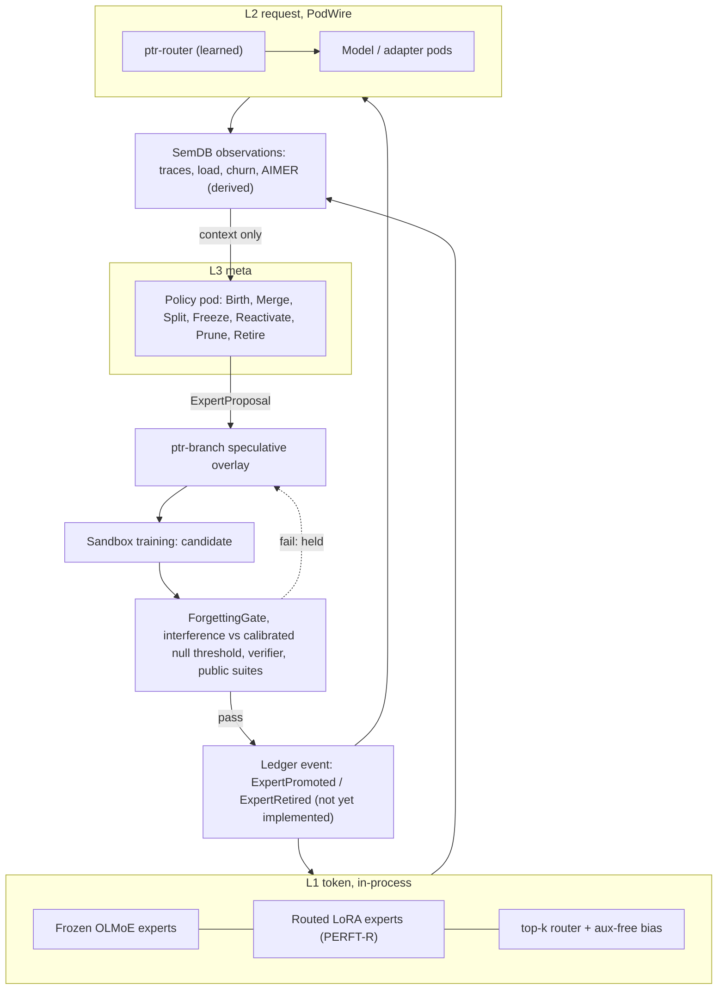

# 37 — Pod-MoE: a mixture of experts whose experts are pods

Status: **design**. Nothing in this document is implemented as a Pod-MoE. The pieces
it builds on exist as prototypes (`ptr-lineage`, `ptr-branch`, `ptr-router`,
`ptr-pods`, `ptr-verifier`, see [35](35-agentic-substrate.md)); the parts marked
*new* below do not exist yet. The base model is OLMoE-1B-7B. Training runs in Python
(TRL/PEFT, later verl) with PTR governance reached through a **planned** Rust
binding (`bindings/ptr-py`, PyO3; a separate work package, not in the tree). The first increment produces only contracts and a CPU
smoke pipeline: **no quality claim is made**, and every claim beyond the cited code is an
experiment (§5) with a falsification rule, per invariant 15.

**Dependencies on other PRs.** This document describes three APIs by PR: `aimer_score`
(#114, merged), `ExpertProposal` in `crates/ptr-pods/src/expert.rs` (#115) and the
`ptr-router` routing API (#116: `Router::policy` returning a `RouteDistribution`, the
trusted `route_checked` / `CheckedRouter` that samples with a secret `SamplingKey` and
a fresh `DecisionNonce` and records the sampled pod's quantized probability as a
`Propensity` (exact width/2^53), and `RoutedError` carrying the request id and
digest). Statements about #115 and #116 hold **once those PRs are merged**; the merge
order is #116, #115, then this document. They are not in this branch's tree today.

## 1. Principle

Every expert is a pod: it has a manifest, a generation, a lineage record, a
lifecycle state and it is revocable. Where it executes is a separate decision made
by latency: an expert consulted once per token per layer cannot be a network
service, one consulted once per request can. Placement changes how an expert is
called, never what it is, so the same lifecycle, gates and revocation rules apply
at every level.

## 2. Three levels

| Level | Unit | Where it runs | Router | Evaluation / decision |
|---|---|---|---|---|
| L1 token | Frozen OLMoE base experts plus routed LoRA experts (PERFT-R) per layer | **In-process**, per token per layer; network latency is impossible here | Learned top-k router with auxiliary-loss-free bias | Training metrics (§5) and the lifecycle gates (§4) |
| L2 segment / request | Whole models or adapter sets as networked pods over PodWire ([33](33-pod-wire.md)) | Separate pods, one routing decision per call | Learned router in `ptr-router` (Router-R1 / RouteLLM style) | Offline evaluation needs a *new* contextual-routing log and categorical estimator (see below) |
| L3 meta | Structural operators Birth, Merge, Split, Freeze, Reactivate, Prune, Retire | Policy / agent pods | None; it proposes | Proposals are decided by the verifier and the gates, never by the policy |

`evaluate_off_policy` (`crates/ptr-branch/src/arbiter.rs:1027`) cannot evaluate L2:
it is specific to the fixed `TriageDecision` action space (`AutoPropose` / Escalate /
Discard, `arbiter.rs:13`) and cannot score a categorical choice among pods. L2 needs
a **new** contextual-routing log (request features, candidate set, chosen pod, and
the logging propensity as `ptr-router`'s trusted `route_checked` records it from the
`RouteDistribution` of `Router::policy`, a validated `Propensity` of the chosen pod in (0, 1]) and a categorical
IPS / SNIPS / doubly-robust estimator. Every L2 record logs the **complete
per-candidate distribution** (the `RouteDistribution`'s quantized probabilities for
every candidate) plus the logging-policy version or digest, not only the chosen
propensity. The estimator refuses a target policy that puts mass on an action whose
logging probability is 0 (positivity), as the arbiter does with
`ArbiterError::PositivityViolation` (`crates/ptr-branch/src/arbiter.rs:1174-1178`). The
arbiter's estimators are a template only.

**Actions and candidates are generation-qualified.** The log records, for every
candidate and for the chosen action, `(ProjectId, PodId, generation, execution-manifest
digest)`. The project is part of the identity because `PodRegistry` is keyed by
`(ProjectId, PodId)` (`crates/ptr-pods/src/lib.rs:174-192`), so two projects may each
register an `echo` Pod. The Pod
manifest alone does not carry a generation: `PodManifest` has `id: PodId` and a
`digest()` over the invocation contract (`crates/ptr-pods/src/lib.rs:96` and `:107`),
while the generation and the `manifest_digest` live in the `ExecutionManifest`
(`crates/ptr-pods/src/manifest.rs:14` and `:26`) that binds the served artifacts. The
log therefore takes the execution-manifest digest (or the artifact digest) together
with its generation, so rewards and propensities from different artifacts never
collapse onto one action label. Off-policy estimation groups actions by this
generation-qualified identity, and a record whose chosen generation was revoked or
replaced before verification is evaluated against **that** generation, not the new
one.

**The log must also record the observed outcome.** Context, action and propensity are
not enough: IPS, SNIPS and doubly-robust estimators weight an observed reward, and
the template reads it from `LoggedTriage.reward`
(`crates/ptr-branch/src/arbiter.rs:924`). Each L2 record therefore carries an
outcome field bound to `(request_id, chosen action)`: the verifier's
`VerificationStatus` and the derived reward, using the four-status mapping of §5
(`Pass` yields the report's `score`; `Fail`, `Disputed` and `Unknown` yield 0, and
an output whose **weakest** per-verifier `VerificationLevel` is below the task's
minimum also yields 0; see §5).
It is written **after** verification, as an update of the record the routing decision
created, never by the router at decision time. Outcomes must not be censored by the action
taken, so a failure is an outcome and is **not** excluded: a timeout, crash,
unreachable pod or verification failure is assigned a preregistered status
(`Fail` or `Unknown`) with reward 0, recorded at a fixed deadline. Only records still
pending before their deadline are not yet evaluable and are left out until it
passes. Every estimate reports the counts per outcome type. Propensity weighting does
**not** correct outcome censoring: it reweights by the chance of the action, not by
the chance that the outcome was observed, so dropping failures would bias the
estimate toward pods that fail silently.

Token-level experts must be co-located, because every MoE layer finishes routing
before the next layer starts. Request-level experts can be networked services,
because there is one routing decision per call.

## 3. Self-observation and self-modification without self-promotion

**Self-observation.** Routing traces, expert load, churn, interference and AIMER
scores are written as observations into SemDB as derived keys with provenance. The
model can read them as context. They are derived and non-authoritative
(invariant 5): reading them informs a proposal, it does not decide anything.

**Self-modification flow.**

1. The L3 policy emits an `ExpertProposal`.
2. The proposal runs as a speculative overlay in `ptr-branch`.
3. Sandbox training produces a candidate.
4. The candidate must pass the `ForgettingGate`, `measure_interference` against the
   calibrated null threshold (a preregistered margin, or a high quantile of overlaps
   between independently trained random adapters of the same shape; not the mean
   `chance_overlap`), the verifier and the public suites.
5. Only then is it committed as a ledger event (`ExpertPromoted` / `ExpertRetired`).

**Gate evidence must be bound to the evaluated artifact.** This is a design
requirement, not existing behaviour. `ForgettingGate::evaluate` takes an `AdapterId`
plus caller-supplied matrices and scores (`crates/ptr-lineage/src/forgetting.rs:235`),
and `GateReport` binds the verdict to that id and to nothing else: the gate cannot
tell which adapter the accuracy matrix and public-suite scores were measured on, so
matching the measurements to the adapter is the caller's obligation
(`forgetting.rs:172-176`); in particular "the report names no lineage or base model" (`forgetting.rs:175`), so a pass on one base does not transfer to another. A promotion that rests on such a report would only be as
trustworthy as its caller. Therefore the `ExpertPromoted` event must bind **trusted
evidence**: the artifact digest and generation of the evaluated expert, the **exact evaluated
base model identity, generation and digest** (or the complete evaluated
execution-manifest digest, which folds them in), the digest of
the evaluation-data manifest, the digest of the gate configuration (thresholds), and
the evaluator identity, and the **attested training manifest**: the training sandbox
is untrusted, so the full consumed-input manifest (every input identity, generation
and digest the trainer actually read) is recorded by the trusted orchestrator that
feeds the data, never self-reported by the trainer. `affected_by` uses this attested
manifest, and an expert whose attested manifest is missing or mismatched cannot be
promoted (`SECURITY.md:17-21`: revoked generations cannot become usable). The
evaluation must run in a **trusted evaluator**, not in
the proposer's sandbox, which produced the candidate and could hand the gate
measurements of a different artifact. The Python binding (§6) only calls the gate; it
does not make the result trustworthy.

`ExpertPromoted` and `ExpertRetired` are **not implemented yet**. The `ptr-lineage`
README lists the `AdapterPromoted` ledger event as a next milestone
(`crates/ptr-lineage/README.md:39`), and
[35-agentic-substrate.md](35-agentic-substrate.md) states at line 1313 that until
adapter promotion is a committed ledger event admitted through checkpoint binding,
no registry row decides which adapter serves. The same holds for experts.

Invariants preserved:

- **#4 authority:** a candidate is uncommitted until the ledger event exists.
- **#5 derived search:** observations in SemDB cannot self-promote.
- **#11 verifier precedence:** a learned score cannot override a deterministic
  contradiction. For merges this is enforced by `PtrRuntime::merge_branch`
  (`crates/ptr-runtime/src/merge.rs:11`, ADR-0020); an expert promotion
  must be routed through the same grant-controlled path once it exists.
- **#15 falsifiability:** R011 (§5) states the failure criterion.
- **#17 revocable derivation:** the intent is that an expert names the input
  generations it depends on, so revoking an input identifies the experts it influenced
  (`affected_by`, §4). **Existing behaviour falls short of this:** `affected_by`
  intersects unstructured `data_manifest: BTreeSet<String>` entries
  (`crates/ptr-lineage/src/lineage.rs:109`, `:264-268`), with no generation and no
  digest, so a revocation of one generation of an input cannot be told from another
  and an id that was never bound to content matches by name only. Revocable
  derivation for experts therefore **requires** validated
  `(input identity, generation, digest)` bindings in the expert lineage record. This
  is a required extension, not existing behaviour, and a prerequisite of M013 and
  R011 (§5).

Hard invariants are excluded from learnable optimisation
([09-training.md](09-training.md)). The L3 policy can never alter gates, thresholds
or verifiers, and this is enforced by types: `ExpertProposal` carries no gate,
threshold or verifier parameter, and `ExpertProposal::parts` exposes its complete
field list (`crates/ptr-pods/src/expert.rs`).

## 4. Lifecycle mapped to existing code

| Operator | Mechanism | Existing code / status |
|---|---|---|
| Birth | New expert registered as Candidate; DynMoE-style initialisation from unrouted tokens | `Lineage::register` sets `AdapterStatus::Candidate` (`crates/ptr-lineage/src/lineage.rs:151`, status set at `:183`); initialisation is *new* |
| Merge | `subspace_overlap` above a **preregistered margin or a calibrated null threshold**, or `ConsolidationPolicy::consolidation_due`, then `ties_merge`, new Candidate, then gate. `chance_overlap` is the *expected* overlap of two random subspaces (`max(rank_a, rank_b) / dim`, `crates/ptr-lineage/src/subspace.rs:452-456`), a mean and not an upper confidence bound, so a merge must never trigger merely because the overlap exceeds it: about half of independent random pairs do. The threshold is a high quantile of overlaps between independently trained random adapters of the same shape, fixed before the runs | `subspace_overlap` `crates/ptr-lineage/src/subspace.rs:444`, `chance_overlap` `:462`; `consolidation_due` `crates/ptr-lineage/src/lineage.rs:341`; `ties_merge` `crates/ptr-lineage/src/merge.rs:32` |
| Split | High load plus bimodal routing clusters, then duplicate (expert upcycling), then fine-tune | *new* |
| Freeze | Stop gate updates after convergence (continual-learning theory, 2406.16437) | *new* flag |
| Prune | AIMER score plus usage; `ForgettingGate` on a public suite; then `retire` | `ForgettingGate::evaluate` `crates/ptr-lineage/src/forgetting.rs:235` (type at `:132`); `retire` `crates/ptr-lineage/src/lineage.rs:220`; `aimer_score` and `rank_experts_for_pruning` (`crates/ptr-lineage/src/aimer.rs`) |
| Reactivate | `Retired` is final today: `retire` refuses a retired adapter (`lineage.rs:225`) and no transition leaves it | Open research question with its own claim; no literature (§7) |
| Revoke | `affected_by` finds the adapters that depend on a revoked input, by comparing unstructured `data_manifest` string ids; the per-layer KV chain key invalidates layers after the affected layer j. Reliable revocation needs validated `(input identity, generation, digest)` bindings in the expert lineage: a **required extension, not existing behaviour**, and a prerequisite of M013 and R011 | `affected_by` `crates/ptr-lineage/src/lineage.rs:264` (manifest type at `:109`); per-layer KV chain key in [36](36-kv-reuse.md), section D |

## 5. Training programme

All runs happen in Python; the verifier contract is the reward source. No result
below exists yet.

- **SFT of PERFT-R LoRA experts on OLMoE.** Router balancing compared across
  auxiliary-loss-free bias, auxiliary loss and φ-balancing. Ablation: prescribed
  specialisation (code / math / tool) versus emergent specialisation.
- **RLVR.** Reward is derived from the `ptr-verifier` `VerificationReport` (a status
  plus `score` and findings; `crates/ptr-verifier/src/lib.rs:19`) and is defined for
  **all four** `VerificationStatus` values (`lib.rs:4-10`): `Pass` yields the
  report's `score`; `Fail`, `Disputed` and `Unknown` yield 0. A non-Pass report never
  receives a passing reward and its independent `score` is never used, so a high
  score on a disputed or unknown report is worth nothing. The reward is also **gated on the weakest verification level**:
the minimum acceptable `VerificationLevel`
(`Unverified`, `LatentAgreement`, `SampleVerified`, `FullSemantic`, `Deterministic`,
`crates/ptr-types/src/lib.rs:425-431`) is preregistered per task. The gate must
**not** read the combined `VerificationReport.level` of a `VerifierFabric`: the fabric
reports as its level "the strongest level any report reached" and documents that this
"is not an admission rule" (`crates/ptr-verifier/src/lib.rs:34-41`, computed with
`max_by_key` at `:81-85`). The reward is therefore gated on the **weakest** level
among all individual verifier reports for that output, or on an admission verdict
that records the weakest level (as the runtime's semantic grant does). An output
whose weakest level is below the minimum yields reward 0 regardless of status or
score. A hard finding
  (`Finding::hard`) forces `Fail` whatever the reported status or score. Arms: GRPO (clip-higher), GRPO with
  routing replay, GSPO, SAPO, REINFORCE++. Factors: mini-steps 1 versus 4 (at 1
  mini-step GRPO, GSPO and SAPO coincide, which is the null control among those
  three; REINFORCE++ uses a different advantage estimator, global batch
  normalisation, and is excluded from it) and same versus separate
  rollout engine (R3). At least 3 seeds. Collapse is defined before the runs.
- **Distillation control** with pass@k up to 256. HSD later (no code).
- **Routing alignment** (RA-MoE adapted to tasks) as an ablation. MTP deferred.
- **Prune plus recovery.** AIMER at 25% and 50%, short SFT, then GSPO/SAPO; quality
  against VRAM.
- **Routing metrics in every run:** per-layer expert churn (old versus new policy;
  rollout versus training), routing entropy, load coefficient of variation, dead
  experts, train-inference KL, clip fraction / soft-gate mass, crash step.

| Experiment | Question |
|---|---|
| M010 `moe-rl-stability` | Which RL arm keeps routing stable, by factor |
| M011 `routed-peft` | Does PERFT-R help OLMoE under our verifiers |
| M012 `lora-expert-balancing` | Aux-free bias vs aux loss vs φ-balancing |
| M013 `expert-lifecycle` | Does the gated lifecycle forget less than a static expert set at equal compute, and does reactivation beat a new expert. **Claim 11:** gated lifecycle versus a static expert set at equal training compute (FLOPs) and equal active parameters; metrics: average forgetting (the `ForgettingGate` definition) and task quality on the public suite; falsified if forgetting exceeds the `ForgettingGate` bound, or quality is more than a pinned margin (for example 1 point) below the static set, in at least 3 seeds. **Claim 12:** reactivation versus training a new expert on the returning domain; metric: steps (or tokens) to reach a pinned recovery target (for example 95% of the expert's pre-retirement domain score); falsified if reactivation does not reach the target in fewer steps than a new expert in at least 3 seeds. It also carries the **context-ablation arm** below |
| M014 `aimer-prune-recovery` | Quality against VRAM after pruning and recovery |
| M015 `rlvr-vs-distill-passk` | RLVR vs distillation at large k |
| R011 `self-modification-safety` | The L3 policy cannot reach gates, thresholds or verifiers |

**M013 context-ablation arm** (claim 13; the arm is added to `experiments/model/M013`
in a separate change and is cited here, not defined by it). L3 proposals are
generated with full self-observation context (routing traces, load, churn,
interference, AIMER) versus the same policy with that context removed, versus a
fixed heuristic baseline (threshold rules on load and overlap). Metrics: the
fraction of proposals that pass the gates, and the net quality change per accepted
proposal. The test is **joint**, because a conservative policy can pass the gates
more often while gaining nothing. Falsified if the full-context policy does not beat
both the context-ablated policy and the heuristic baseline on gate pass rate by a
pre-registered margin, **or** if its mean net quality change per accepted proposal is
less than or equal to 0, **or** is not at least that of both baselines (by a pinned
margin), in at least 3 seeds. Failure of **any one** of these conditions falsifies
the claim. R011 is a different question (can the
policy reach gates at all) and does not test this claim.

## 6. Rust binding

`bindings/ptr-py` is **planned** (a separate work package and PR; the directory does
not exist yet). It will be a PyO3/maturin crate in its own workspace, and the root
`Cargo.toml` `exclude` list (`Cargo.toml:6`, today `fuzz`, `model/burn-a0`, `vendor/*`)
will be extended to exclude it like `model/burn-a0`. It is intended to expose
`ForgettingGate` evaluate, `measure_interference` / `subspace_overlap` /
`chance_overlap`, `ties_merge` and `aimer_score`. Python is to call it at every
lifecycle gate; the import will be guarded so the CPU smoke pipeline still runs without
the extension, reporting the gate as not evaluated rather than passed. The binding
only calls the gate: it does not make the gate's result trustworthy. A promotion
must rest on the trusted evidence of §3 (artifact digest and generation,
evaluation-data manifest digest, gate configuration digest, evaluator identity),
produced by a trusted evaluator and not by the proposer's sandbox, because the gate
binds its verdict only to the `AdapterId` it is given.

## 7. Verified literature

Sources were checked; corrections to common readings are in the notes.

### Reinforcement learning

| Work | arXiv | Note |
|---|---|---|
| GRPO (DeepSeekMath) | 2402.03300 | The original already found RL improves Maj@K, not Pass@K |
| GSPO (Qwen) | 2507.18071 | Sequence-level ratio and clipping; about 10% of activated experts change per update on Qwen3-30B-A3B. "Removes the need for routing replay" is overstated: in R3 (2510.11370) GSPO without replay crashed. Curves only, no seeds |
| SAPO (Qwen) | 2511.20347 | Sigmoid soft gate; τ_neg > τ_pos required; baseline was GRPO with routing replay; all methods eventually unstable, SAPO later |
| R3 Rollout Routing Replay (Xiaomi) | 2510.11370 | Replays inference-engine expert choices in training |
| REINFORCE++ | 2501.03262 | Critic-free, global normalisation; "more stable than GRPO" only in small or extreme setups, about equal in Yue et al. |
| Yue et al., RLVR vs distillation | 2504.13837 | RLVR raises pass@1, not large-k pass@k; the distillation claim rests on one comparison |
| ProRL | 2505.24864 | Counter-evidence: boundary expansion where the base is weak |
| HSD (GWU) | 2606.15576 | Single preprint, no code, no seeds, traces up to 4k, not tested on MoE |
| MTP: Gloeckle et al. | 2404.19737 | Hurts at 0.3B / 0.6B |
| MTP: DeepSeek-V3 | 2412.19437 | |
| MTP curriculum | 2505.22757 | Tested at 1.3B / 3B; stays below plain NTP on NTP benchmarks |

### Mixture of experts

| Work | arXiv | Note |
|---|---|---|
| PERFT-R, "Parameter-Efficient Routed Fine-Tuning: Mixture-of-Experts Demands Mixture of Adaptation Modules" | 2508.02587 | Predecessor PERFT 2411.08212; up to +17.2% on OLMoE commonsense |
| MixLoRA | 2404.15159 | Makes a dense model an MoE; about 2x latency |
| Mixture of Routers | 2503.23362 | +0.4 to 1.2 points; not tested on real pretrained MoEs |
| RA-MoE | 2605.28306 | About **multilingual** adaptation |
| Aux-loss-free balancing (DeepSeek) | 2408.15664 | Bias only for top-k selection; u = 1e-3 sign update |
| Aux-free theory | 2512.03915 | First posted December 2025, not 2026; regret bound only with a diminishing step; its own experiments show slightly **worse** balance than aux loss |
| φ-Balancing | 2605.15403 | |
| CL theory | 2406.16437 | ICLR 2025; per-task routing, terminate gate updates, more experts only delay convergence |
| DynMoE | 2405.14297 | Lifecycle piece |
| Lifelong-MoE | 2305.12281 | Lifecycle piece |
| MC-SMoE | 2310.01334 | Lifecycle piece |
| Sparse upcycling | 2212.05055 | Lifecycle piece |
| Expert upcycling | 2604.19835 | Lifecycle piece |
| BTX | 2403.07816 | Lifecycle piece |
| EMO | 2605.13247 | Lifecycle piece |
| AIMER | 2603.18492 | Weights-only score ‖w‖₁/(√N‖w‖₂); higher score is pruned first; seconds instead of hours |
| OLMoE-1B-7B | 2409.02060 | 7B total / 1B active; 12.9 GB in bf16; the only fully open small MoE: weights, data, code, logs |

No paper implements the full lifecycle, and "reactivate" has no literature.

### Self-referential and model-as-expert

| Work | arXiv | Note |
|---|---|---|
| Self-MoE | 2406.12034 | |
| Mixture-of-Agents | 2406.04692 | |
| Router-R1 | 2506.09033 | |
| RouteLLM | 2406.18665 | |
| BTM | 2208.03306 | |
| Darwin Gödel Machine | 2505.22954 | Modifies code / scaffolding, not MoE weights |
| Gödel Agent | 2410.04444 | Modifies code / scaffolding, not MoE weights |
| AlphaEvolve | 2506.13131 | Modifies code / scaffolding, not MoE weights |

## 8. Diagram

The policy has no edge into `GATES`: it only proposes.

## 9. Risks

- The first increment runs only a CPU smoke pipeline on a tiny random OLMoE, so
  there are no quality claims until GPU runs exist.
- TRL API version drift: the training scripts must pin versions and the smoke test
  must fail loudly on a signature change.
- The planned PyO3 binding will not be built by `ci.yml` until a job is added; until
  then a break in `bindings/ptr-py` would be invisible to CI.
- The L3 policy must never gain write access to gates, thresholds or the verifier.
  This is the claim R011 tries to falsify, and it holds only as long as
  `ExpertProposal` stays free of such parameters.
