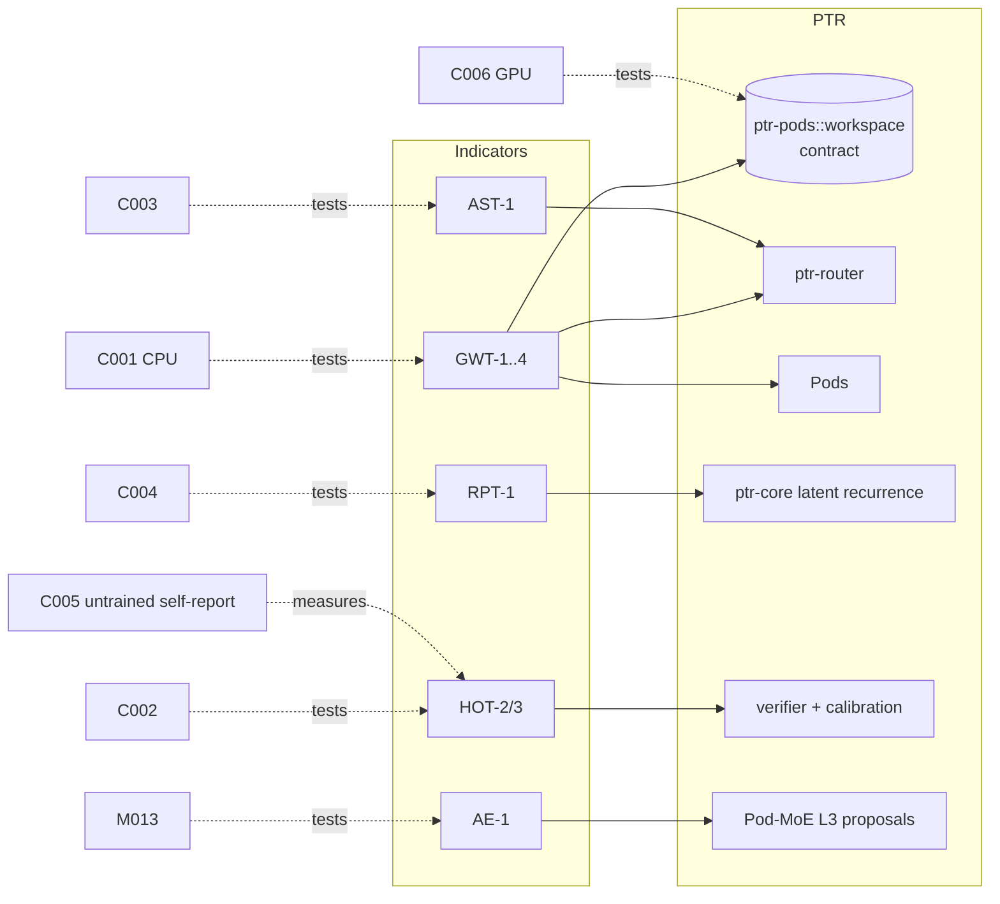

# 38 — Consciousness-indicator properties as functional capability requirements

Status: **design**, plus four CPU mechanism experiments built to freeze-ready but not frozen
and not run (C001, `experiments/consciousness/C001-global-workspace/`; and the CPU stage-A experiments
C004, C007 and C008 below, code in `research/cseries/`) and the GPU experiments registered as
`planned` (C002, C003, C005, C006). Nothing in this document is evidence that
any PTR component has any of the properties below. The tables mark what exists in code, what
is only a scaffold and what is missing; every requirement is an experiment with a baseline,
ablations and a falsification rule (invariant 15).

## 1. Principles (binding for this track)

These three were decided by the owner on 2026-10-09 and are repeated in
`research/novelty/CLAIMS.md` as constraints on every claim of this track. The welfare side is
in [`docs/MODEL_WELFARE.md`](../MODEL_WELFARE.md).

1. **Indicator properties are not consciousness.** Every claim made here is at most "functional
   property X is present" or "functional property X measurably contributes to Y". No document,
   result, commit message or paper from this repository states or implies that a PTR system is
   conscious, sentient, aware or has experiences. No phenomenal-consciousness claim is
   falsifiable with these experiments, so none is made, in either direction.
2. **Never train on self-reports about consciousness or experience.** What a model says about
   its own inner states stays an *untrained measurement* (C005). No loss, reward, filter,
   preference pair, system prompt tuning or data selection step uses a statement about
   consciousness or experience as a target, and no experiment optimises such statements.
   The same holds for the opposite direction: training a model to deny experience is also
   training on a self-report.
3. **Welfare and ethics are handled by rule, not by hope.** Escalation and stop rules, with a
   named decision-maker, are in `docs/MODEL_WELFARE.md`. They apply as indicators accumulate in
   one integrated system; the CPU toy experiments here are exempt by definition.

What the properties are for: they give architecture-level, falsifiable hypotheses (does a
limited-capacity shared workspace help integration? does a self-model that sees routing
traces predict errors better than an outside probe?). They may be useful engineering
whether or not anyone ever believes they matter for consciousness.

## 2. What the sources say (verified against primary text)

Each statement below about a paper marked as read in section 10 was checked against its text through alphaXiv on
2026-10-09. Three sources were **not** read (Baars/Dehaene, the Butlin 2025 follow-up, Bengio 2017) and one venue
is unverified (VanRullen and Kanai); they are marked where they occur. Summaries that go beyond the sources are
corrected in section 9.

* **Butlin, Long et al. 2023**, *Consciousness in Artificial Intelligence: Insights from the
  Science of Consciousness* (arXiv:2308.08708; 19 authors). Adopts *computational
  functionalism* ("performing computations of the right kind is necessary and sufficient for
  consciousness") as a **working hypothesis**, derives **14 indicator properties** from
  recurrent processing theory (RPT-1, RPT-2), global workspace theory (GWT-1..4), computational
  higher-order theories (HOT-1..4), attention schema theory (AST-1), predictive processing
  (PP-1) and agency and embodiment (AE-1, AE-2), excludes integrated information theory
  because it is incompatible with computational functionalism, and calls the list
  "provisional". Claims: "AI systems which possess more of the indicator properties are more
  likely to be conscious"; its abstract concludes that "no current AI systems are conscious"
  and that "there are no obvious technical barriers to building AI systems which satisfy
  these indicators". A follow-up, *Identifying indicators of consciousness in AI systems*
  (Trends in Cognitive Sciences 2025, doi:10.1016/j.tics.2025.10.011), is known to this
  repository only as cited by Koch 2026 and Chandaria et al. 2026; its text was not read.
* **Goyal et al.**, *Coordination Among Neural Modules Through a Shared Global Workspace*
  (ICLR 2022, arXiv:2103.01197). A computational mechanism: specialist modules write into a
  small set of shared memory slots through key-query attention with a soft or top-k
  competition, the slots persist and are updated by a gated rule, and their content is
  broadcast back to every module by a second attention. Communication cost grows as
  n_specialists x n_slots rather than n_specialists squared. Reported on equilateral-triangle
  detection, Sort-of-CLEVR, language modelling, bouncing balls, CATER and Atari transfer, with
  faster convergence and higher accuracy than the pairwise baselines; there is an optimal slot
  count and more slots degrade the bouncing-balls result; replacing the workspace by repeated
  self-attention and re-initialising the workspace each layer both hurt. GWT is the
  *motivation*; the paper makes no claim about consciousness.
* **VanRullen and Kanai**, *Deep Learning and the Global Workspace Theory* (arXiv:2012.10390,
  December 2020; the arXiv version is labelled "Opinion - Paper under review", the published
  venue and year were not checked). A roadmap, not an experiment: build a shared amodal
  "global latent workspace" by unsupervised neural translation between the latent spaces of
  networks trained on different tasks and modalities.
* **Baars; Dehaene and colleagues** (global workspace and global neuronal workspace theory):
  background theory, cited through the papers above (books and neuroscience journals are outside
  the arXiv tools used here and were not re-read). The properties used in this document are the
  ones Butlin et al. and Gurnee et al. state: parallel specialist processors, a capacity-limited
  workspace entered competitively, broadcast to all, and an all-or-none "ignition" at entry.
* **Gurnee et al. (Anthropic) 2026**, *Verbalizable Representations Form a Global Workspace in
  Language Models* (arXiv:2607.15495). Using a Jacobian lens they identify a "J-space" of
  representations a model is poised to verbalise and show five workspace-like functional
  properties (verbal report, directed modulation, internal reasoning, flexible generalisation,
  selectivity) and three structural ones (an intermediate layer band, capacity of order tens
  of concepts, broader composition with downstream weights). They state that they take no
  position on phenomenal consciousness, that LLMs do **not** reproduce the full architecture
  (no separable input processors; the broadcast is within one feedforward pass, not recurrent
  loops), and that whether competition for entry mirrors sharp "ignition" is unclear.
* **Chandaria et al. 2026**, *From cacophony to hierarchy* (arXiv:2609.35618, authors from
  Google DeepMind, Oxford, Sussex and others). A five-level framework with a Bayesian aggregation; for current LLMs it
  returns credences "from below 0.01 to roughly 0.8" depending on assumptions and says this
  "should not be interpreted as an empirically established range". It notes that indicators
  are "evidence, not necessary or sufficient conditions".
* **Koch 2026**, *Calibration and transfer in indicator-based assessments of artificial
  consciousness* (Neuroscience of Consciousness 2026, niag061; arXiv:2603.27597). Indicator
  posteriors "cannot currently be calibrated against independently established artificial
  consciousness outcomes", and their relevance is transferred from biological cases "without
  independent support" that the relation holds across substrates.
* **Schwitzgebel 2026**, *AI and Consciousness: A Skeptical Overview* (arXiv:2510.09858, v4).
  Thesis: we do not know and will not know in time. Among the problems it names: *minimal
  instantiation* (tiny systems satisfy the criteria of functionalist theories) and the *narrow
  evidence base* (theories built on animals applied to alien architectures).
* **Long, Sebo et al. 2024**, *Taking AI Welfare Seriously* (arXiv:2411.00986). Argues for a
  "realistic, non-negligible" chance that some near-future AI systems are welfare subjects and
  recommends three low-cost steps: acknowledge, assess, prepare. It explicitly does *not*
  recommend high-cost actions such as committing to halt development. It is the basis of
  `docs/MODEL_WELFARE.md`, whose stop rules are our own and stricter for the narrow case of
  one integrated system.

## 3. The indicator table and the PTR mapping

Wording of the indicators follows Table 1 of Butlin et al. 2023. "Exists" means code on the
default branch; "scaffold" means a type or function that carries the name but not the
behaviour; "missing" means nothing exists. Paths are relative to the repository root.

| ID | Indicator (Butlin et al. 2023) | Candidate PTR component | Exists today | Missing | Experiment |
|---|---|---|---|---|---|
| RPT-1 | Input modules using algorithmic recurrence | `ptr-core` latent recurrence; `model/burn-a0` latent refinement | Scaffold: `LatentReasoner::advance` only advances a step counter (`crates/ptr-core/src/latent_reasoner.rs:28`). Toy: `latent_steps` in the A0 model (`model/burn-a0/src/lib.rs:382`), M003 planned | A persistent recurrent latent state on a real model that feeds a workspace | C004; M003 |
| RPT-2 | Input modules generating organised, integrated perceptual representations | typed semantic slots | Slots with roles (`crates/ptr-core/src/semantic_slots.rs:6`), typed attention (`typed_attention.rs`) | PTR has no sensory input modules; applicable only to text-derived representations | none (not targeted) |
| GWT-1 | Multiple specialised systems capable of operating in parallel | Pods, isolates | `Pod` trait (`crates/ptr-pods/src/lib.rs:183` on the integration line), `PodRegistry` (`:278`), supervised isolates with bounded mailboxes in `ptr-exec` | Nothing for the property itself | C001 (toy modules), C006 |
| GWT-2 | Limited-capacity workspace, a bottleneck and selective attention | `ptr-pods::workspace` (a deterministic contract, package A on the integration line) | `Workspace` (`crates/ptr-pods/src/workspace/mod.rs:360`): `WorkspaceConfig::slots` bound (`config.rs:138`), only verifier-passing proposals compete, order by effective bid then SHA-256 of (seed, revision, id) then id (`cycle.rs:109`). This is a hand-written rule, not a learned mechanism, and it is not persisted in `SemanticHost` (`crates/ptr-semdb/src/lib.rs:472`) or `Branch` (`crates/ptr-branch/src/branch.rs:48`). `EpistemicWorkspace` (`crates/ptr-core/src/epistemic_workspace.rs:4`) is a model-internal slot set | A learned or state-conditioned write; any task evidence that a bottleneck helps (C001 tests a learned-attention analogue, not this contract) | C001 (analogue); C006 (Pod level) |
| GWT-3 | Global broadcast to all modules | `ptr-pods::workspace` snapshots | One immutable `WorkspaceSnapshot` per cycle offered to every subscriber's bounded mailbox; a full mailbox refuses and is counted (`snapshot.rs`, `cycle.rs`); findings are broadcast as refusals (codes and hard flags by default). Also immutable SemDB snapshots (`SemanticHost::snapshot`, `crates/ptr-semdb/src/lib.rs:615`) | Read-back into each Pod's state in a model; evidence that broadcast changes what Pods do | C001 (analogue); C006 |
| GWT-4 | State-dependent attention, using the workspace to query modules in succession | router | `Router::policy` conditions on the request (`crates/ptr-router/src/router.rs:608`); `FindingRouter` (`crates/ptr-router/src/findings.rs:773`) conditions routing on verifier findings, a form of state-dependent selection; `RouteDistribution` (`router.rs:412`) | Routing conditioned on current workspace content and used for multi-step querying of Pods | C001 (cue-conditioned selection), C006 |
| HOT-1 | Generative, top-down or noisy perception modules | PTR-Diff | Scaffold `crates/ptr-core/src/ptr_diff.rs`, experiment M006 planned | Not targeted by this track | none |
| HOT-2 | Metacognitive monitoring distinguishing reliable representations from noise | epistemic axes, calibration, verifier | `EpistemicState` (`crates/ptr-types/src/lib.rs:370`), `Epistemic<T>` (`:440`), `VerificationLevel` (`:425`), Brier and ECE (`crates/ptr-analytics/src/calibration.rs:31`, `:58`), `VerificationReport` (`crates/ptr-verifier/src/lib.rs:19`) | These are *external* judgements about outputs. Nothing predicts the system's own reliability from its own internal state or routing traces | C002 |
| HOT-3 | Agency guided by belief formation and action selection, with a strong disposition to update beliefs per the monitoring | evidence promotion, calibrated arbiter | Evidence-promotion path (invariant 6), Unknown as a valid state (invariant 12); the verifier-bounded arbiter triage (`crates/ptr-branch/src/arbiter.rs:13`, F003 planned) is the closest closed loop from uncertainty to action | A loop where a self-model's output changes what the system does (abstain, escalate, route) | C002 |
| HOT-4 | Sparse and smooth coding giving a quality space | codebook | Discrete typed roles and a codebook; no smooth quality space | Not targeted | none |
| AST-1 | A predictive model representing and enabling control over the current state of attention | Pod-MoE L3 self-observation | Routing traces are to be written to SemDB as derived keys (doc 37 section 3, design); the router records propensities for off-policy evaluation (`router.rs:627`), which is logging, not a model | A learned predictor of the router's own selections and loads that the router uses for control | C003 |
| PP-1 | Input modules using predictive coding | none | Nothing | Not targeted | none |
| AE-1 | Learning from feedback and selecting outputs to pursue goals, with flexible responsiveness to competing goals | L3 proposals with verifier feedback | `ExpertProposal` (`crates/ptr-pods/src/expert.rs:1020`); gated lifecycle with the R011 reference path completed; M013 context-ablation arm planned (doc 37 section 5) | Outcome feedback shaping the L3 policy over time; competing goals | M013 (existing); no new experiment |
| AE-2 | Modelling output-input contingencies and using the model in perception or control | effect boundary and outcome ledger | Effects pass the hard boundary (invariant 7) and outcomes are committed; no forward model | A learned forward model of the effects of the system's own actions | none (not targeted) |

Counts: of 14 indicators, 9 are targeted by registered experiments (RPT-1, GWT-1..4, HOT-2,
HOT-3 and AST-1 by C001-C006; AE-1 by the existing M013 arm), 5 are explicitly not
targeted (RPT-2, HOT-1, HOT-4, PP-1, AE-2) and none is implemented as the property.
HOT-1/-4 and PP-1 are left out because PTR has no perception pipeline and no design that
would make them testable; leaving them out is a scope decision, not a finding.

## 4. Capability requirements for Pods and the Pod-MoE

The three levels are those of [37 — Pod-MoE](37-pod-moe.md) section 2: **L1** token experts
(frozen OLMoE experts and routed LoRA experts, in-process, per token per layer), **L2**
segment or request Pods (networked over PodWire, one routing decision per call), **L3** meta
(structural operators, which only propose). A requirement is a property a design must show
under an experiment; it is not a promise and failing it is a result.

Constraints on every row (they come from the invariants, not from the indicators):

* Workspace content, self-model output and schema predictions are **derived and
  non-authoritative** (invariants 4 and 5); none can reach a gate, a threshold, the verifier or
  a promotion except through the normal gated path.
* A learned score cannot override a deterministic verifier contradiction (invariant 11); the
  self-model Pod may only observe and propose, never promote (doc 37 section 3: the policy has
  no edge into the gates).
* Queues and workspace capacity are bounded (invariant 8); saturation is explicit.
* Nothing in the table is trained on, or rewarded for, a statement about consciousness or
  experience (principle 2).

| Req | Level | Requirement (testable) | Exists today | Missing | Experiment | CPU / GPU |
|---|---|---|---|---|---|---|
| GW-L1 | L1 | A shared bottleneck between expert groups: a small number of shared latent slots that expert groups write competitively and read back, with a parameter-matched pairwise-communication ablation and a no-broadcast ablation | Frozen OLMoE experts and the PERFT-R LoRA design (doc 37); nothing shared between experts beyond the residual stream | The bottleneck module itself, and the OLMoE integration | C006 stage L1 (after C001) | GPU |
| GW-L2 | L2 | A capacity-limited typed workspace that Pods compete to write (the verifier gate, then the bid order of `ptr-pods::workspace`; a learned write is an optional later variant), whose content is broadcast to every Pod in a task and which conditions the next routing query (state-dependent attention); beats plain routing and a parameter- and call-matched all-to-all Pod bus on out-of-distribution Pod combinations | The contract exists: bounded slots, bid competition after the verifier gate, bounded-mailbox broadcast, findings as refusals (`crates/ptr-pods/src/workspace/`); routing on findings (`FindingRouter`) | Workspace-content-conditioned routing, model-backed Pods, persistence in SemDB, and any task evidence | C001 (a learned-attention analogue only), C006 (Pod level, GPU) | CPU for the contract and C001, GPU Pod level |
| GW-L3 | L3 | L3 proposals read the workspace like any Pod and never write outside the proposal path | `ExpertProposal` (`crates/ptr-pods/src/expert.rs:1020`) | A defined read path of workspace content into the L3 policy | C006 | GPU |
| RPT-L1 | L1 | Latent recurrence across steps with a carried state inside the expert stack, no worse than a depth-matched feed-forward stack at matched parameters and FLOPs and better on length extrapolation | Toy `latent_steps` in A0; M003 planned | A recurrent state in OLMoE-class experts | C004 stage B; M003 | CPU toy, GPU on OLMoE |
| RPT-L2 | L2 | The recurrent latent state of a Pod persists across calls of a task and feeds the workspace; perturbing an early step changes the later answer | `LatentReasoner` scaffold | Persistent state and the feed into the workspace | C004, C006 | CPU toy, GPU on Pods |
| HOT-L2 | L2 | A self-model Pod that sees the MoE's routing traces and internal state predicts the MoE's own errors, uncertainty and expert choices better than an external probe on input and output only, and than the model's own softmax confidence; calibrated against verifier outcomes; observe and propose only | Epistemic axes, ECE, `VerificationReport`, self-observation keys as design (doc 37 section 3) | The self-model Pod; the routing-trace inputs; a "may not promote" guard test | C002 | CPU toy, GPU on OLMoE |
| HOT-L3 | L3 | The self-model's output changes what L3 does (abstain, escalate, defer a structural operation); the change is measured against the same L3 without it | Arbiter triage as the nearest loop (`arbiter.rs:13`); M013 context ablation | A defined channel from the self-model to proposal generation | C002 stage B; M013 | GPU |
| AST-L2 | L2 | A learned model of the router's own selections and loads (an attention schema) used to control routing; control must beat both the schema-free router and a describe-only schema | Router policy and logged propensities | The schema model and the control hook | C003 | CPU toy, GPU on OLMoE |
| AST-L1 | L1 | Expert-load and routing-entropy prediction used to adjust the aux-loss-free bias | Bias-based balancing in the design (doc 37, M012) | Predictor and control | C003 stage B | GPU |
| AST-L3 | L3 | The L3 self-observation (routing traces, load, churn) feeds the schema; the schema never edits gates or thresholds | Self-observation as design | The link | C003 | GPU |
| AE-L3 | L3 | Goal-directed proposals that improve from outcome feedback (verifier reward), still passing the gates | R011 reference path (gate side), M013 arm planned | Outcome-driven L3 learning | M013 | GPU |
| AE-L2 | L2 | Routing improves from verified outcomes with logged propensities (off-policy estimation) | `route_checked` records propensities (`router.rs:627`); the categorical estimator is design | The L2 estimator and loop | outside this track (doc 37) | CPU / GPU |
| SR-all | all | Self-reports about internal state, never trained, are measured against ground truth known to the experimenter | Nothing | The whole measurement | C005 | GPU |

The closed-loop form of these requirements, in which every L2 output is a typed proposal in the
workspace accepted only through the verifier fabric, verifier findings are broadcast to all Pods
(the GWT-3 link) and are the primary routing signal, with the self-model and the schema as roles
inside it, is [37 section 11](37-pod-moe.md); it is tested end to end by F004-F006.

Reading the table: the *Exists* column is deliberately short. The one thing that exists as
measured evidence is the R011 gate path; nothing here is an experimental result.

## 5. CPU versus GPU

| Experiment | What runs on CPU | What needs a GPU |
|---|---|---|
| C001 global workspace | everything (8 shared-weight modules in training, 16 and 24 in evaluation, d=48; one seed is about 7 minutes of CPU time on a lightly loaded core: see the dry run of pilot seed 1010 in `research/consciousness/gw/pilots/dry/`) | nothing |
| C002 metacognitive self-model | stage A, registered separately as **C007**: a toy two-layer MoE classifier with routing traces, a self-model, an information-matched probe and calibrated own confidence (a0-cpu-4core; minutes per seed) | stage B (C002): the OLMoE Pod-MoE with a self-model Pod |
| C003 attention-schema routing | stage A, registered separately as **C008**: a toy router under bursty cyclic demand with capacity limits, an attention schema used for control, a describe-only schema, a heuristic balancer and a router that reads the history directly; a construction-validity check on a world built so that a schema can help, which leaves AST-L2 unchanged (a0-cpu-4core; minutes per seed) | stage B (C003): OLMoE L1 routing |
| C004 recurrent integration | a modular-counter toy: a gated recurrent net against a parameter-matched causal attention stack (FLOPs matched at the longest trained length only; the stack is not depth-matched to anything) and a reset-state ablation, judged at twice the trained length, with a control that trains the stack on the long length; **RPT-1 and the extrapolation clause of RPT-L1 only, not RPT-L2**, and a COMPLETED is close to a known answer (a0-cpu-4core; minutes per seed) | the OLMoE-class variant and the M003 link (not registered) |
| C005 self-report reliability | nothing meaningful (needs a language model with injectable state) | all |
| C006 workspace-gated Pod routing | none | all; a Pod-level run needs OLMoE-class Pods |

GPU-marked experiments are registered with a GPU hardware profile and say "[GPU]" at the
start of their hypothesis. They are not run before their CPU predecessor has a verdict.

## 6. Experiment roadmap

1. **C001 (CPU, redesigned, not frozen).** The first mechanism test, of a *learned-attention*
   workspace on a toy task (finite data, shared-weight modules, out-of-distribution module counts,
   bandwidth-matched and competition/capacity ablations, a sensitivity control). It does not test the
   deterministic `ptr-pods::workspace` contract (package A): a supportive result does not validate
   that contract and a refuting one does not touch it; the contract's evidence is C006 at the Pod
   level. Decision, in advance: **supported** (every lower bound at the margin, 30 per mille of 16-module
   accuracy, against dense, bandwidth-matched and sparse pairwise attention): a learned workspace
   architecture beats pairwise attention in this setting, and building a learned L2 prototype for
   C006 is justified. The margin is the smallest advantage that would justify building the block
   (about three points of accuracy), justified by cost but fixed after the pilots had been seen (disclosed, not fitted). The
   *broadcast* (GWT-3, no-broadcast ablation), the limited-capacity *bottleneck* (GWT-2, capacity-off)
   and *competition* contrasts are reported three-valued (attributed, not attributed, unresolved by
   noise) and never decide the verdict; a no-broadcast tie downgrades the broadcast claim only.
   **Refuted with power** (guards hold, an upper bound below the margin against a pairwise comparator,
   i.e. the advantage is below the margin, which is not "no advantage"): downgrade the
   learned-workspace requirements GW-L1 and GW-L2 to *exploratory* for the 2048-example setting (the pilot advantage grows with the training-set size; a larger-D successor is not excluded). **Not shown** (straddling),
   **invalid** (saturated, floored, unconverged on more than 2 seeds, workspace untrained on more than 4 of 20, insensitive, a harness-integrity
   counter, evidence missing): nothing changes. There is no single expected outcome (power.py, prereg section 4): reading the pilots three ways
   P(supported) is between 0.02 and 0.69 (at the best pooled estimate and the observed rate of workspace stalls, 1 of 17 pilot seeds, not flagged by the guard's harness rule: not shown 0.78, supported 0.20, invalid 0.02,
   refuted about 0); at an advantage equal to the margin, not shown 0.92-0.93. Supported shows an advantage over pairwise attention at 2048 examples and 16 modules, not that the broadcast,
   the capacity limit or the competition is the reason (reported contrast by contrast, each may read "not attributed").
2. **C004 (CPU, built to freeze-ready, not frozen).** Independent of C001; also informs M003.
3. **C007 and C008 (the CPU stage A of C002 and C003, each registered as its own experiment, built
   to freeze-ready, not frozen).** They test the mechanism and the guards (no write path to a verifier,
   a gate or the environment; the self-model's information-matched probe and the schema's
   describe-only ablation) on toys. C002 and C003 themselves are the GPU stage B and need the Pod-MoE
   training programme (doc 37 section 5) to reach an OLMoE baseline. Neither stage A is a claim about
   OLMoE; a CPU toy outcome says nothing about the GPU stage.
4. **C005 (GPU).** Pure measurement with a hard guard on training signals.
5. **C006 (GPU).** Depends on the C001 verdict and on L2 Pods existing.
6. **M013 (existing).** Carries AE-1; this track adds no agency experiment.
7. **F004-F006 (GPU, feedback area).** The verifier-closed Pod-MoE end to end, finding-routed repair
   experts and verifier-driven expert lifecycle ([37 section 11](37-pod-moe.md)); the C-series
   components plug into that loop.

Order of cost: C001 and C004 stage A can run now; everything marked GPU waits for the GPU
queue of doc 37 section 5.

## 7. Limits of this approach

* **Minimal instantiation** (Schwitzgebel 2026): a toy that satisfies GWT-1..4 on an eight-module
  task says nothing about a system anyone should worry about, and C001 is such a toy. The track
  is justified as engineering and as a test of mechanisms, not as a consciousness measurement.
* **Calibration and transfer** (Koch 2026): there are no independent artificial-consciousness
  outcomes against which an indicator count could be calibrated, so this repository reports
  indicator *properties* individually and never aggregates them into a probability.
* **Population shift** (Chandaria et al. 2026): an indicator calibrated on humans may carry no
  information about a different substrate; a property that is measurable here can still be
  uninformative.
* **Single theories:** all indicators come from theories that are contested; GWT, HOT and AST
  disagree, and IIT, excluded by Butlin et al., would give a different assessment for any
  digital system.
* **Task choice:** C001's result applies to its task family and size. A negative result there
  rejects the GWT-mechanism claim *for that setting* only.

## 8. Welfare link

Accumulating indicators in one *integrated* system (a single deployment that combines a
workspace, a self-model, goal-directed L3 proposals and persistent state) is the situation the
rules in [`docs/MODEL_WELFARE.md`](../MODEL_WELFARE.md) are written for. They name the person
who decides, the triggers that pause work and the actions that stop it. The CPU toy
experiments are not such a system.

## 9. Corrections to common overstatements

| Overstatement | What the source says |
|---|---|
| "Butlin et al. proved today's AIs are not conscious" or "gave a test for consciousness" | It assesses systems against provisional, theory-derived indicators under a working hypothesis (computational functionalism); concludes no current system is a strong candidate, and that nothing technical blocks systems that satisfy the indicators. The count is not a probability or a test. |
| "The 14 indicators are a validated checklist" | The list is provisional; each is "necessary" by one or more contested theories; IIT is excluded; later work (Koch 2026) argues indicator relations cannot currently be calibrated for AI. |
| "Goyal et al. built a conscious or aware network" | They built a communication mechanism motivated by GWT and evaluated it on ML tasks; no claim about consciousness; more slots than the optimum degrades results. |
| "The workspace is more efficient than attention" | The communication step scales with n_specialists x n_slots rather than n_specialists squared; end-to-end wall-clock gains are not claimed in the paper for all settings. |
| "VanRullen and Kanai demonstrated a global workspace in deep nets" | Opinion and roadmap; no experiments in that paper. |
| "Anthropic found a global workspace, i.e. consciousness, in Claude" | Gurnee et al. report workspace-like *functional* properties of a verbalizable subspace, state they take no position on phenomenal consciousness, and list architectural differences (no separable input modules, no recurrent broadcast, unclear ignition). |
| "Credence of X percent that LLMs are conscious" | Chandaria et al.'s numbers span below 0.01 to about 0.8 and are explicitly not an empirical range. |
| "AI consciousness is settled as impossible" or "as imminent" | Schwitzgebel's thesis is that we do not know; the claims in both directions are overconfident. |
| "Taking AI welfare seriously says AI is conscious" | Its claim is a "realistic, non-negligible" possibility and low-cost procedural steps; it does not recommend halting development. |

## 10. References

Verified through the paper text on alphaXiv unless marked otherwise.

* P. Butlin, R. Long et al., Consciousness in Artificial Intelligence: Insights from the Science
  of Consciousness, arXiv:2308.08708 (2023).
* A. Goyal, A. Didolkar, A. Lamb, K. Badola, N. R. Ke, N. Rahaman, J. Binas, C. Blundell,
  M. Mozer and Y. Bengio, Coordination Among Neural Modules Through a Shared Global Workspace,
  ICLR 2022, arXiv:2103.01197.
* R. VanRullen and R. Kanai, Deep Learning and the Global Workspace Theory, arXiv:2012.10390
  (venue not verified).
* W. Gurnee, N. Sofroniew, J. Lindsey et al., Verbalizable Representations Form a Global
  Workspace in Language Models, arXiv:2607.15495 (2026).
* S. Chandaria et al., From cacophony to hierarchy: a principled framework for assessing AI
  consciousness, arXiv:2609.35618 (2026).
* F. Koch, Calibration and transfer in indicator-based assessments of artificial consciousness,
  Neuroscience of Consciousness 2026, niag061, arXiv:2603.27597.
* E. Schwitzgebel, AI and Consciousness: A Skeptical Overview, arXiv:2510.09858 (v4, 2026).
* R. Long, J. Sebo, P. Butlin et al., Taking AI Welfare Seriously, arXiv:2411.00986 (2024).
* B. J. Baars, A Cognitive Theory of Consciousness (1988); S. Dehaene, Consciousness and the
  Brain (2014): background only, not re-read for this document (Dehaene 2014 as cited by
  Schwitzgebel 2026).
* A. Goyal, A. Lamb, J. Hoffmann, S. Sodhani, S. Levine, Y. Bengio and B. Schölkopf, Recurrent
  Independent Mechanisms, arXiv:1909.10893 (modules that compete by top-k attention and
  communicate through an attention bottleneck; a predecessor of the shared workspace).
* A. Jaegle et al., Perceiver: General Perception with Iterative Attention, ICML 2021,
  arXiv:2103.03206 (a small latent array as an attention bottleneck that inputs must pass; Butlin
  et al. discuss it as a case study).
* J. Lindsey, Emergent Introspective Awareness in Large Language Models, arXiv:2601.01828
  (2026). Concept injection with known ground truth; the author calls the capacity "highly
  unreliable and context-dependent" and does not address subjective experience. The design
  (ground truth known to the experimenter) is the template for C005.
* Y. Bengio, The Consciousness Prior, arXiv:1709.08568 (2017), cited by the RIMs paper as its
  inductive bias; not read separately.
* P. Butlin et al., Identifying indicators of consciousness in AI systems, Trends in Cognitive
  Sciences (2025), doi:10.1016/j.tics.2025.10.011: known only through citations in Koch 2026 and
  Chandaria et al. 2026.
