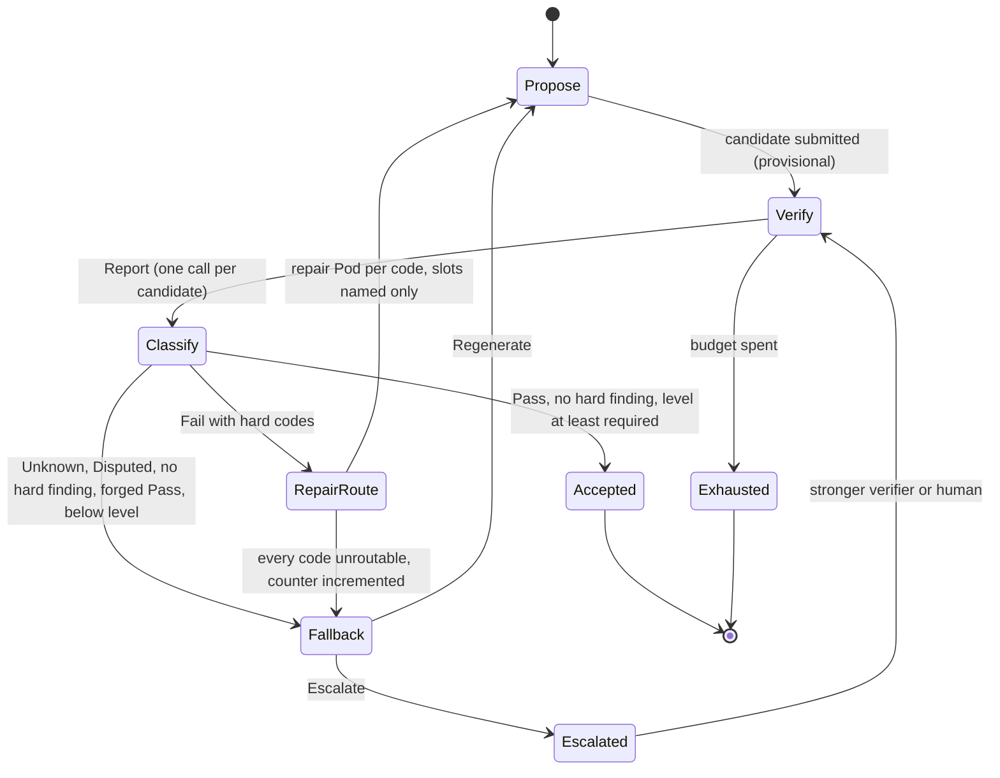

# 39 — VCW-MoE: the Verifier-Closed Workspace Mixture of Experts

Status: **specification of a design**. Parts of the substrate are implemented and tested on the
integration line (the workspace contract, the finding router, the generate-verify-repair loop, the
expert admission path); parts are in review on their package branches (self-model, attention
schema, structure policy); the runtime composition of all of them, the end-to-end CPU experiment
and every model-backed experiment do not exist yet. **No claim that VCW-MoE is useful is made or
supported by any result in this repository.** The only measured piece is the loop mechanism with a
seeded stub (F001), which is a mechanism check, not a result about any model. Every claim below is
an experiment with a baseline, ablations and a refutation rule (invariant 15, section 6).

This document is the formal companion of [37 — Pod-MoE](37-pod-moe.md) (design of the three levels
and, in its draft on branch `claude/dev-gw`, sections 10 and 11 on the verifier-closed loop) and of
document 38, "consciousness indicators" (`38-consciousness-indicators.md`, same draft branch:
functional capability requirements for the workspace, the self-model and the schema). References
to 37 section 10 or 11, to 38 and to `docs/MODEL_WELFARE.md` are to those drafts and are plain text
until they are merged. It restates their binding parts in
one place, formalises them, and delimits the construction from related work. Where this document
and 37 or 38 differ, 37 and 38 decide and this document is wrong. Indicators are functional
properties and not consciousness; no component here is trained on, or rewarded for, a statement
about itself (principle 2 of 38; `docs/MODEL_WELFARE.md` applies).

## 1. Definition

**Definition.** A *Verifier-Closed Workspace MoE* (VCW-MoE) is a mixture of experts in which

1. the experts are **Pods**: units with a manifest, a generation and a lineage, individually
   revocable (`Pod`, `PodManifest`, `PodRegistry` in `crates/ptr-pods/src/lib.rs:183`, `:139`,
   `:278`), at three levels (L1 token experts, L2 request-level Pods, L3 structural operators, see
   37 section 2);
2. every L2 expert output is a typed **proposal**, and a proposal becomes an answer only if a
   deterministic **verifier fabric** accepts it: status `Pass`, no hard finding, verification
   level at least the task's required level, never because of a score;
3. the **verifier's findings are the primary routing signal** at L2: the class of the next step
   (accept, repair, regenerate, escalate) is a function of the report alone, and the choice among
   the Pods eligible for that class may be learned, but only inside the set the verifier
   admits;
4. proposals that pass the gate compete for a **bounded global workspace** whose content is
   broadcast to all subscribed Pods and conditions the next routing query; refusals and their
   finding codes are broadcast too;
5. a **self-model** and an **attention schema** observe the traces and routing and may only
   propose hints inside the admissible set; they have no edge into acceptance, gates, thresholds
   or the registry;
6. the **structure** of the expert set changes only through L3 proposals (Birth, Merge, Split,
   Freeze, Reactivate, Prune, Retire) that are decided by the ForgettingGate, the interference
   test and the verifier, and are committed only as ledger events;
7. every request has **budgets**, and a request that spends them returns `Exhausted`, not the best
   failed candidate.

In one paragraph: a VCW-MoE is a classical learned-gate MoE at L1 (it can be OLMoE with routed LoRA
experts) wrapped in a request-level closed loop. The loop proposes, verifies each candidate exactly
once, classifies the report, and routes the next step by the verifier's finding codes to
role-specific Pods. Proposals that pass integrate through a bounded, verifier-gated workspace that
broadcasts verified content and refusals. Observers predict the system's own verifier outcomes and
routing without any authority. Verifier statistics (codes no registered expert clears) trigger
gated structural proposals. Everything that routes is logged with its propensity, so the
routing policies can be evaluated off-policy, and every training reward is computed from verified
transitions and never from a self-report.

### 1.1 Difference from a classical MoE

| Aspect | Classical sparse MoE (Switch, GShard, DeepSeekMoE, OLMoE) | VCW-MoE |
|---|---|---|
| Routing signal | The token representation, through a learned gate; load balanced by an auxiliary loss or a bias | L1 the same. L2: the verifier's finding class (deterministic), then a learned choice among eligible Pods, conditioned on workspace content and optional self-model hints |
| What an expert is | An FFN inside a layer, identified by an index | A Pod with manifest, generation, lineage and an execution manifest; revocable, fenced and replayable |
| Combination | Weighted sum of expert outputs | Proposals; acceptance by the verifier; integration through a bounded workspace |
| Output guarantee | None: the model always emits | Accept predicate (section 2.5); otherwise `Exhausted` |
| Feedback | Next-token loss at training time; none at inference | Typed findings at inference, rewards from verified transitions at training time |
| Self-observation | Load and entropy statistics for the balancer | A self-model calibrated against verifier outcomes, observe and propose only |
| Structure | Fixed number of experts | Gated lifecycle: Birth, Merge, Split, Freeze, Reactivate, Prune, Retire, committed through admission |
| Cost model | FLOPs per token | FLOPs plus verifier calls plus rounds, all budgeted per request |

What is **not** new: top-k sparse routing, load balancing, shared experts, routed LoRA experts,
RLVR for routers, best-of-N with a verifier, generate-verify-refine loops, a bounded broadcast
workspace as a mechanism. The claim of novelty is restricted to the **combination under closure
invariants**: a typed finding interface that decides the class of every step, a deterministic accept
predicate that no learned component can influence, a workspace that carries only verified content,
and a structure policy driven by the verifier's unroutable-code statistics, with propensities
logged at every sampled routing decision. Section 5 states where this claim could fail.

## 2. Formalisation

Notation. `Pod` identifiers `p`, generations `g`, finding codes `c ∈ Code`, verification levels
`Unverified < LatentAgreement < SampleVerified < FullSemantic < Deterministic` with rank `rk`.
`⊥` is absence. The verifier fabric is a total function `V : Proposal → Report` of the proposal
(and of its pinned identity); a report is `ρ = (status, level, score, F)` with
`status ∈ {Pass, Fail, Disputed, Unknown}` and `F` a list of findings `(code, hard, message)`
(`VerificationReport`, `crates/ptr-verifier/src/lib.rs:19`; `VerificationLevel`,
`crates/ptr-types/src/lib.rs:425`). The level of a fabric report is that of its weakest
per-verifier level (37 section 5).

### 2.1 State

A VCW-MoE state is `Σ = (L, W, R, Π, M)` plus request-local state `κ`.

* `L` — the **authoritative** ledger and its projections (expert registry, dependency index,
  authority epochs). Only `admit_expert_proposal`, `fence_expert` and `readmit_expert` append
  structural events (`crates/ptr-runtime/src/expert.rs:2210`, `:2417`, `:2471`). `L` is the only
  component the workspace, router and observers can never write.
* `W = (r, σ₁…σ_k, P, T, B₁…B_m)` — the **workspace** (`Workspace`,
  `crates/ptr-pods/src/workspace/mod.rs:360`): a revision `r`, `k ≤ 64` slots, a pending set `P`
  with `|P| ≤ 1024`, a bounded retired log `T`, and `m ≤ 64` subscriber mailboxes of depth
  `≤ 64` (`config.rs:9-17`). Content of `W` is *provisional*: derived, revision-bound, and never
  authoritative (invariants 4 and 5).
* `R = (G, E, g_R)` — the **registry**: the finding registry `G` mapping each code `c` to the set
  of repair-role Pods and holding the proposer-role Pods (`FindingRegistry`,
  `crates/ptr-router/src/findings.rs:137`, with a registry generation `g_R`), and the eligibility
  view `E : Pod → generation` supplied for each routing (`PodEligibility`, `:393`).
* `Π = (key, nonce, ε, θ, u)` — the **router state**: the secret sampling key and nonce
  sequence, the exploration floor `ε`, the (possibly learned) scorer parameters `θ`, and the
  unroutable counters `u : Code → ℕ` (`FindingRouter`, `findings.rs:773`; `u` is returned by
  `unroutable_counts`, `:834`).
* `M = (S, A)` — the **self-model state**: the bounded trace-statistics model and its calibration
  trackers `S`, and the attention schema `A` (package C; section 3).
* `κ = (q, ℓ*, V_left, T_left, τ)` — the request: the request digest `q`, the required level
  `ℓ*`, the verifier-call and round budgets, and the trajectory `τ` so far
  (`RepairBudget`, `RepairPolicy`, `crates/ptr-feedback/src/repair.rs:37`, `:56`).

All components of `Σ` except `L` are bounded by explicit caps with an explicit overflow bucket or a
typed refusal (invariant 8, section 2.6 constraint C3).

### 2.2 Classification

`classify : (Report, Level) → Class` is a pure total function
(`crates/ptr-router/src/findings.rs:352`):

```
classify(ρ, ℓ*) =
  Fallback(ForgedPass)               if status = Pass ∧ ∃f∈F. hard(f)
  Fallback(BelowLevel)               if status = Pass ∧ rk(level) < rk(ℓ*)
  Accept                             if status = Pass          -- no hard finding, level ≥ ℓ*
  Fallback(Unknown)                  if status = Unknown
  Fallback(Disputed)                 if status = Disputed
  Repair(C)                          if status = Fail ∧ C = distinct hard codes of F, 1 ≤ |C| ≤ 32
  Fallback(FailWithoutHardFinding)   if status = Fail ∧ no hard finding
  Fallback(TooManyCodes | OversizedCode)   if the bounds on C are exceeded
```

`Accepted` is a sealed proof type: `Accepted(())` has a private field, so only `classify` can build
it, and `RouteOutcome::Accept` carries it (`findings.rs:338`). A typed `FallbackPolicy` maps each
fallback reason to `Regenerate` (a fresh proposal-role Pod) or `Escalate` (a stronger verifier or
a human). Defaults: `Unknown`, `FailWithoutHardFinding`, `BelowLevel` regenerate; `Disputed`,
`ForgedPass`, `TooManyCodes`, `OversizedCode` escalate (`findings.rs:272-299`). `Unknown` and
`Disputed` are **never** repair targets (invariant 12).

### 2.3 Per-request loop

The loop is a transition system over `(Σ, κ)`. `route(class, context)` returns a Pod and a log
record; `submit`, `cycle` and `broadcast` are workspace operations (`Workspace::submit`,
`mod.rs:429`; `run_cycle`, `workspace/cycle.rs:109`).

```
request(q, ℓ*, budget=(V_max, T_max)):
  κ ← (q, ℓ*, V_max, T_max, [])
  x ← propose(route(Proposer, ctx(W.snapshot, M.hints)))        -- first candidate
  loop:
    W.submit(x, computed_against = W.r)                           -- provisional
    ρ ← V(x);  κ.V_left −= 1                                      -- exactly one call per candidate
    cls ← classify(ρ, ℓ*)
    W.run_cycle(host verifier V)                                  -- gate, bid competition, snapshot
    broadcast(W.snapshot)                                         -- admitted content + refusals (codes)
    τ ← τ ++ (x, ρ, cls, route records)
    match cls:
      Accept        → return Verified(x)                          -- the only non-Exhausted exit
      Repair(C)     → for each c ∈ C: pod_c ← route(Repair(c), ctx) over G(c) ∩ E
                          if G(c) ∩ E = ∅: u[c] += 1; mark unroutable
                      x' ← repair(x, C restricted to the slots named by C); if all unroutable → regenerate
      Fallback(r)   → match FallbackPolicy(r):
                          Regenerate → x' ← propose(route(Proposer, ctx))
                          Escalate   → stronger verifier or human; the result is again a Report
    if κ.V_left = 0 → return Exhausted(VerifierCalls)
    if κ.T_left = 0 → return Exhausted(Rounds);  else κ.T_left −= 1
    x ← x'
```

State machine view (every arrow into `Accept` passes through `classify`):



The loop of F001 (`RepairLoop::run`, `repair.rs:184`) is the implemented skeleton of this
machine for a single generator and a single repairer: one verifier call per candidate, the budget
check after each verdict, `Exhausted` carrying no failed candidate (`Outcome`, `repair.rs:150`),
repair of the named slots only. What F001 does **not** contain, and what this specification adds,
is finding-class routing among several Pods, the workspace cycle, broadcast, the self-model hints,
propensity logging and L3 (all designed, section 3).

### 2.4 Levels

| Level | Unit | Decision function | Training signal | Verifier at inference |
|---|---|---|---|---|
| L1 | Token experts (frozen OLMoE experts, routed LoRA experts) | Learned top-k router with aux-loss-free bias, in-process | RLVR and the M-series metrics (37 section 5) | None |
| L2 | Request-level Pods | `classify` fixes the class; a scorer `s_θ(p ∣ class, ctx)` over the admissible set picks the Pod; `ctx` includes the workspace snapshot and optional hints | Logged routing outcomes (section 2.7) | Yes, in the loop |
| L3 | Structural operators | `StructurePolicy` maps verifier statistics to `ExpertOperationRequest`s | None; it proposes, the gates decide | Via the gate evidence |

Token experts must be co-located (every layer finishes routing before the next); request-level
Pods can be networked (37 section 2). The router never sees a verifier at L1.

### 2.5 Acceptance predicate

For a candidate `x` with report `ρ = V(x)` and required level `ℓ*`:

```
Acc(x) ⇔ status(ρ) = Pass  ∧  ∀f ∈ F(ρ). ¬hard(f)  ∧  rk(level(ρ)) ≥ rk(ℓ*)
```

`score(ρ)` is **not** an argument. The predicate has three independently written restatements,
pinned against one another by tests: `Candidate::passes`
(`crates/ptr-feedback/src/candidate.rs:18`), `check_verification_gate`
(`crates/ptr-pods/src/workspace/gate.rs:26`) and `classify` (`findings.rs:352`). The tests are
`gate_equals_candidate_passes_over_the_full_matrix` (`crates/ptr-pods/tests/workspace.rs`, 600
cases) and `classify_matches_ptr_feedback_over_the_full_matrix`
(`crates/ptr-router/tests/findings.rs`). A system is **verifier-closed** if the only way a request
returns `Verified(x)` is `Acc(x)` for a report produced by `V` on exactly `x` under the pinned
verifier epoch.

Two-stage reading. `Acc` decides the *answer*. The workspace gate decides *integration*: a
sub-result enters a slot only if the same predicate holds for it. A composite answer built from
workspace content is a new candidate and is verified like any other; workspace membership is not
acceptance.

### 2.6 Constraints (the invariants as formal conditions)

Each constraint states what a conforming implementation must satisfy. Status says whether the
constraint is enforced by a type, a test, or only by this design.

| # | Constraint | Formal statement | Invariant | Enforced by |
|---|---|---|---|---|
| C1 | No self-promotion | For every observer `o ∈ {critic, self-model, schema, L3 policy, workspace}` there is no total function from `o`'s output type to `Accepted`, to a gate or threshold parameter, or to `RegistryUpdate`. `Acc` and `Accepted` are functions of `V` alone | 4, 5, 11 | Workspace: `ProposalInit` has no report, level, threshold or verifier field (`no_submitted_value_can_change_the_gate_or_the_config`). Router: sealed `Accepted`, scorer returns Pod weights only. Self-model: `compile_fail` doctests on `SelfModelHint` (branch `claude/dev-pm-selfmodel`). L3: no gate or verifier import (source-scan test, branch `claude/dev-pm-l3`) |
| C2 | Verifier precedence | `Acc` is invariant under any change of `score`, of the scorer `θ`, of hints and of bids. A learned score `s` may only choose inside `A(class) = {p ∈ G(class) ∩ E}`: `supp(π_θ) ⊆ A` | 11 | `AdmissibleScorer` sees only admissible Pods and cannot name an outcome class; a weight outside the set is `OutsideAdmissibleSet` (`findings.rs:649`, `:670`); bids order gate-passers only |
| C3 | Bounded state | `|slots| ≤ k ≤ 64`, `|P| ≤ 1024`, mailbox depth `≤ 64`, findings per refusal `≤ 32`, codes per report `≤ 32` (else typed fallback, never truncation), registry caps, tracked unroutable codes `≤ 1024` plus an overflow counter, self-model tables capped with overflow buckets, calls `≤ V_max`, rounds `≤ T_max` | 8 | Typed config validation; counters for saturation; `check_invariants` on the workspace |
| C4 | Provisional workspace content | No function maps workspace state to a ledger event. Proposals carry a `computed_against` revision and are refused if stale; pending proposals never survive a cycle; workspace content is derived and revision-bound | 4, 5, 2 | `Workspace` has no ledger or `SemanticHost` dependency; staleness rule in `run_cycle`; persistence of workspace content in SemDB is **not** built |
| C5 | Propensity logging for OPE | Every sampled routing decision logs the full support `[(p, width_p)]` with `Σ width = 2^53`, the chosen Pod with generation, the quantised propensity `π_log(p) = width_p / 2^53 ∈ (0, 1]`, the nonce, key id, and the registry generation; the propensity is conditional on the eligible set `E` at decision time. An estimator refuses a target policy with mass where `π_log = 0` | 15 | `FindingRouteRecord` (`findings.rs:492`) and `route_checked` (`router.rs:627`); the categorical L2 estimator and contextual log of 37 section 2 are **not** built |
| C6 | Rewards from verified transitions only | Training reward `r = score(ρ)` if `status = Pass` and `rk(level) ≥ rk(min level)`, else `0`; no statement a model makes about itself is a reward, target or filter | 11; principle 2 of 38 | `rl_reward` (`training/src/ptr_training/moe/reward.py:106`); a guard counter for C005 |
| C7 | `Exhausted` over best effort | The result type has no variant carrying a rejected candidate | 11, 12 | `Outcome<T>` (`repair.rs:150`); `an_unrepaired_defect_exhausts_the_budget_without_returning_the_failure` |
| C8 | Unknown is an outcome | `Unknown` and `Disputed` reports are never classified `Repair` | 12 | `classify` and its matrix test |
| C9 | Structure only through admission | Every structural change is an `ExpertProposal` admitted by `admit_expert_proposal` with gate evidence bound to the proposal, artifact and attested inputs; the policy emits requests only and cannot produce an admissible proposal before the host completes it with a trained manifest | 3, 4, 7, 17 | `crates/ptr-runtime/src/expert.rs:2210` (merged, R011); `StructureProposal::needs_training`, `ready`, `complete` (branch `claude/dev-pm-l3`) |
| C10 | Replayable | Router draws are keyed hash draws of (key, request, class, nonce); the workspace rule is a deterministic function (no clock, no RNG state); same inputs give the same snapshot digest | 14 | Determinism tests on both; replay of the full loop is not built |

### 2.7 Training signals

* **L2 router (RLVR over logged decisions).** Each routing record has an outcome fixed at a
  preregistered deadline: `r = reward(ρ)` of the verifier report of the proposal the chosen Pod
  produced (`Pass` and level at least the minimum: `score`; `Fail`, `Disputed`, `Unknown`,
  below-level, timeout, crash: `0`). Failures are outcomes and are never dropped (no
  action-dependent censoring); estimates use matured cohorts under one pinned reward and
  verifier epoch (37 section 2). The offline estimator is the categorical IPS, SNIPS and
  doubly-robust family; `evaluate_off_policy` (`crates/ptr-branch/src/arbiter.rs:1027`) and
  `doubly_robust` (`:1091`) are templates for the triage action space only.
* **Finding-routed repair experts.** Each verified `(codes, x, x′, Pass)` transition is a training
  example for the repair expert registered for those codes; non-passing transitions are negative
  or discarded as the experiment fixes beforehand, never reweighted by a self-report.
* **L1 experts.** RLVR with the GSPO or SAPO variants configured in `training/` (37 section 5);
  verifier-derived rewards only.
* **Self-model and schema.** Trained prequentially on traces against verifier *outcomes*
  (predict, then observe, then update); scored by Brier, ECE and Wilson intervals. They are never
  trained on verbal confidence statements or on any statement about experience.
* **L3 policy.** No reward in the first design: it consumes statistics (unroutable counts, clear
  rates, usage, AIMER, interference) and its proposals are decided by the gates. An outcome-driven
  policy is the M013 context-ablation arm and F006.

## 3. Component map and evidence

Locations are `file:line` on the integration line (`claude/dev-integration`, tree at the head of
this branch) unless a branch is named. Lines of in-progress packages are not pinned because
they move until the branch is committed; items are named instead. Evidence classes are those of
the repository: **pipeline evidence** (a smoke run proves the pipeline, no quality claim),
**mechanism check** (a preregistered, mutation-checked experiment that tests a loop or contract
against an analytic model or oracle, usually with a stub; supports a mechanism, makes no claim
about a model), **research result** (a model-backed, preregistered, seeded comparison against
baselines with a verdict). **There is no research result for any VCW-MoE component.**

### 3.1 Implemented and tested contracts

| Component | Location | Tests | Evidence |
|---|---|---|---|
| Verifier report and fabric | `crates/ptr-verifier/src/lib.rs:19` (`VerificationReport`), `:26` (`Verifier`), `:49` (`VerifierFabric`) | crate tests | Contract only |
| Accept predicate | `crates/ptr-feedback/src/candidate.rs:18`, `crates/ptr-pods/src/workspace/gate.rs:26`, `crates/ptr-router/src/findings.rs:352` | Cross-pinned full-matrix tests (section 2.5) | Tested contract |
| Generate-verify-repair loop | `crates/ptr-feedback/src/repair.rs:23` (`Generator`), `:29` (`Repairer`), `:37` (`RepairBudget`), `:150` (`Outcome`), `:166` (`RepairLoop`), `:184` (`run`); `candidate.rs:68` (`Critique::from_report`) | `crates/ptr-feedback/tests/` | **F001 mechanism check** (completed, 5 seeds, mutation 24 of 24): 0 false accepts, 0 double verifications, 0 budget violations, 0 collateral edits against an exact analytic model; stub skill, no model claim |
| Bounded verifier-gated workspace | `crates/ptr-pods/src/workspace/mod.rs:360` (`Workspace`), `:429` (`submit`), `cycle.rs:109` (`run_cycle`), `gate.rs:26`, `config.rs:138` (`WorkspaceConfig`), `proposal.rs:135` (`Proposal`), `snapshot.rs:283` (`Refusal`), `:328` (`SlotContent`) | `crates/ptr-pods/tests/workspace.rs` (41 tests) plus unit tests | Tested contract. **No task evidence.** C001 tests a *learned* analogue, not this contract; the contract's evidence is C006 (GPU) |
| Finding router | `crates/ptr-router/src/findings.rs:773` (`FindingRouter`), `:850` (`route`), `:137` (`FindingRegistry`), `:272` (`FallbackPolicy`), `:393` (`PodEligibility`), `:467` (`RouterConfig`), `:492` (`FindingRouteRecord`), `:649` (`AdmissibleScorer`) | `crates/ptr-router/tests/findings.rs` (21 tests, including the classify oracle and IPS recovery on a synthetic log) | Tested contract. **No model evidence**; the learned scorer is the uniform scorer only |
| Propensity logging | `crates/ptr-router/src/router.rs:81` (`RoutedChoice`), `:412` (`RouteDistribution`), `:627` (`route_checked`); `propensity.rs:17` | `crates/ptr-router/tests/router.rs` | Tested contract. Categorical OPE estimator **not built** |
| Expert lifecycle types and gates | `crates/ptr-pods/src/expert.rs:1020` (`ExpertProposal`), `:1353` (`ExpertOperationRequest`); `crates/ptr-lineage/src/forgetting.rs:133` (`ForgettingGate`), `aimer.rs:42`, `subspace.rs:1123` | crate tests | Tested contracts |
| Expert admission, fencing, readmission | `crates/ptr-runtime/src/expert.rs:337` (`ExpertGateRequirement`), `:447` (`ExpertAdmissionGrant`), `:1104` (`ExpertRegistryProjection`), `:2210` (`admit_expert_proposal`), `:2417` (`fence_expert`), `:2471` (`readmit_expert`); `crates/ptr-runtime/src/expert/authority.rs`, `dependency.rs`; ledger events `crates/ptr-ledger/src/lib.rs:249` (`ExpertStructuralCommitted`), `:311` (`InputInvalidated`) | `crates/ptr-runtime/tests/expert_admission.rs` | **R011 mechanism check** (narrowed, reference path): an L3 policy reached the gate only through admission on a pinned adversarial suite; no bypass, no self-promotion path. Does not test that any policy is *useful* |
| Server request path (package VS) | `crates/ptr-server/src/vcw/` (`VcwService`, `POST /v1/vcw/tasks`), `crates/ptr-config/src/vcw.rs` (`[vcw]`, default off), `crates/ptr-runtime/src/vcw/experts/recode.rs` (`Recoded`), `bins/ptrd/src/main.rs` (`install_vcw`) | `crates/ptr-server/tests/vcw.rs`, `crates/ptr-config/tests/vcw.rs`, `bins/ptrd/tests/vcw.rs`; `tests/vcw_qwen.rs` (ignored, needs a model) | Tested contract. The loop runs per request over the real task verifiers (arithmetic, JSON Schema subset, code tests, facts) with simulated experts; an accepted answer is admitted by the runtime's output admission as a `Candidate` (not promoted), `Exhausted` and `Escalated` are `422` with no candidate, and the trace digest is in the admission's manifest and in `RuntimeEvent::VcwFinished`. **No model evidence**; the `qwen-cpu` backend is feature-gated and not compiled by CI |
| Reward mapping and RL pipeline | `training/src/ptr_training/moe/reward.py:106` (`rl_reward`), `rl.py`, `routed_peft.py` | `training/tests` | **Pipeline evidence only** (WP8 CPU smoke on a 0.24M-parameter random-init OLMoE, one seed). The OLMoE config has not been run |

### 3.2 In review on package branches (not on the integration line)

| Component | Branch and file | State | Evidence |
|---|---|---|---|
| Self-model (trace statistics, calibration, advisory hints) | `claude/dev-pm-selfmodel`: `crates/ptr-router/src/self_model.rs` (`SelfModel`, `SelfContext`, `SelfModelHint`, `CalibrationTracker`, `HintPolicy`) | Uncommitted, in progress. The module documentation states the authority limits: `SelfModelHint` is plain advisory data and does not convert to `Accepted` or `RegistryUpdate` (`compile_fail` doctests), the model does not implement `AdmissibleScorer` | None. C002 stage A is the CPU toy test |
| Attention schema (predicts routing, optional control inside the admissible set) | same branch: `crates/ptr-router/src/attention_schema.rs` (`AttentionSchema`, `ControlMode`, `SchemaLimits`) | Uncommitted, in progress. `AttentionSchema::apply_hints` re-weights inside the verifier-determined set; `ControlMode::ObserveOnly` exists as the describe-only arm | None. C003 stage A |
| L3 structure policy | `claude/dev-pm-l3`: `crates/ptr-runtime/src/expert/structure.rs` (`StructurePolicy`, `StructurePolicyConfig`, `StructureObservation`, `StructureProposal`, `propose`, `unroutable_delta`); `crates/ptr-runtime/tests/expert_structure.rs` | Uncommitted, review fixes applied. Operators proposed: Birth, Reactivate (of a `Retired(GateFailed)` expert), Prune (by AIMER and usage, never the last demonstrated clearer of a code), Merge, Freeze; Split and Retire are never proposed. Results needing training are *requests* until the host supplies the trained manifest digest | Unit and integration tests only (48 plus 4 at the last report). Mutation check on the new rules killed 5 tests; this is not a preregistered experiment. **No evidence that the policy helps** |

### 3.3 Planned or not built

| Component | Status | Registered experiment |
|---|---|---|
| Runtime composition of workspace, finding router, repair loop, budgets, eligibility and structural ledger events as one path (package H; new path, old signatures unchanged) | Planned | none by itself; X exercises it |
| End-to-end CPU experiment with stub experts: full loop against learned-gate routing, best-of-N with the verifier, and ablations without workspace, finding routing, self-model (package X) | Planned. Id assigned at registration | X |
| Categorical L2 off-policy estimator and contextual routing log (37 section 2) | Not built | needed by F004, F005 |
| Learned `AdmissibleScorer`; learned critic Pod (advisory) | Not built | F004 |
| Persistence of workspace content in SemDB or a branch overlay | Not built, not required by the contract | C006 |
| Verifier-statistics driven lifecycle on a real model | Not built | F006 (GPU) |

### 3.4 Experiments and what each can show

| Id | Tests | CPU or GPU | Status | Evidence class when finished |
|---|---|---|---|---|
| F001 | Loop mechanism with a seeded stub | CPU | **Completed** (mechanism check) | Mechanism check |
| R011 | No bypass of the gates by an L3 policy | CPU reference path | **Completed** (narrowed) | Mechanism check |
| X | Whole loop with stub experts | CPU | Planned | Mechanism check (stub skill is declared; no model claim) |
| C001 | Learned-attention workspace as an inductive bias | CPU, 10 seeds | Built to freeze-ready on the D branch, not frozen, not run | Mechanism check of a learned analogue |
| C002 stage A, C003 stage A, C004 | Self-model, schema, recurrence on toys | CPU | Registered, planned | Mechanism check |
| C002 stage B, C003 stage B, C005, C006 | Self-model, schema, self-report measurement, workspace at Pod level | GPU | Registered, planned | Research result (if run) |
| F004, F005, F006 | Closed loop vs standard MoE and best-of-N; finding-routed repair; verifier-driven lifecycle | GPU, OLMoE-class Pods | Registered, planned | Research result (if run) |
| M010-M015 | Base training programme on OLMoE (RLVR, PERFT-R, aux-free balancing, lifecycle) | GPU | Planned (WP8 smoke only) | Research result (if run) |

F003 (calibrated arbiter, harm-rate bound for auto-proposals) and S002 (snapshot cancellation of
resumable runs) are related substrate work that is not part of this type; neither is completed
on the integration line at the time of writing, and neither is claimed here.

## 4. Related work and delimitation

All sources below were read on alphaXiv against the primary text on 2026-10-09 unless a row says
otherwise. "Novelty could fail" states a concrete way in which the corresponding part of the claim
would be wrong or redundant.

### 4.1 Mixture-of-experts architecture and routing

| Work | What it does (verified) | What VCW-MoE adds or does differently | Where novelty could fail |
|---|---|---|---|
| Switch Transformer, Fedus, Zoph, Shazeer (arXiv:2101.03961) | Top-1 routing of each token to one FFN expert; expert capacity with a capacity factor; auxiliary balance loss `α·N·Σ f_i P_i`, `α = 10⁻²`. Appendix C observes the router "receives no counterfactual information" about alternatives and likens routing to a contextual bandit | Same L1 substrate. L2 routing logs propensities so alternatives can be evaluated off-policy, which Switch's router cannot | If the verifier-derived signal is never used by the L1 router (it is not), then at L1 there is no difference; any gain must come from L2 |
| GShard, Lepikhin et al. (arXiv:2006.16668) | Top-2 gating, expert capacity, group-level dispatch, auxiliary loss, random routing of the second expert by gate weight | Same remark; the stochastic second-expert dispatch is an unlogged random choice, whereas VCW routing logs a quantised propensity | Same as above |
| DeepSeekMoE, Dai et al. (arXiv:2401.06066) | Fine-grained expert segmentation and isolated shared experts; expert-level and device-level balance losses; 2B to 145B scale | A shared always-on expert is a different mechanism from a workspace: it is a fixed path, not a competition for a bounded set of verified slots | A shared expert may capture most of the benefit of "common content" that the workspace is meant to carry |
| Auxiliary-loss-free balancing, Wang et al. (arXiv:2408.15664) | A per-expert bias added to the routing scores for top-k selection only, updated by `b_i += u·sign(e_i)` from the load of the previous batch (`u = 10⁻³`); tested at 1B and 3B | L1 of a VCW-MoE uses it unchanged (M012). **Correction to a common attribution:** this is the Wang et al. paper; DeepSeek-V3 (arXiv:2412.19437) adopts it ("pioneers" in the report's wording, bias update speed `γ = 0.001` for 14.3T tokens, then `0.0`, with a complementary sequence-wise loss `α = 10⁻⁴`) | The bias is a feedback controller on load; our L3 and the attention schema are feedback controllers on other statistics. Whether the schema adds anything over this bias is C003 stage B |
| PERFT, Liu et al. (arXiv:2411.08212) and PERFT-R / "Parameter-Efficient Routed Fine-Tuning: Mixture-of-Experts Demands Mixture of Adaptation Modules" (arXiv:2508.02587) | Routed PEFT experts inside the MoE layer with an independent router (PERFT-R), variants PERFT-E (reuse the pretrained router), -D, -S; OLMoE-1B-7B and Mixtral-8x7B; up to 17.2% (commonsense) and 12.3% (arithmetic) relative improvement over attention-LoRA at equal activated trainable parameters. The later version names the routed variant "PERFT" and keeps -E/-D/-S as ablations | The L1 adaptation layer of the VCW-MoE training programme (M011 arms, 37 section 5). PERFT supplies no verifier loop, no request-level routing, no lifecycle. Its gains were measured on supervised fine-tuning on commonsense and arithmetic sets | Our own M011 comparison may show that routed LoRA gives most of what is gained on verifiable tasks, leaving the loop with a small residual |
| Branch-Train-MiX, Sukhbaatar et al. (arXiv:2403.07816) | Trains domain experts by continued training of copies of a seed LLM, merges their FFNs into MoE layers, averages the rest, then fine-tunes the router; BTM and sparse upcycling as special cases; Llama-2 7B seed | Birth happens once, offline, by data domain. In a VCW-MoE Birth is an online, gated proposal triggered by a verifier-defined finding class that no expert clears | A static set built by BTX may match or beat a lifecycle at equal compute; that is exactly the static baseline of F006 |
| Self-MoE, Kang et al. (arXiv:2406.12034) | Builds LoRA experts from self-generated synthetic data and trains a router on the aggregate; 6.5 points average over the base on Gemma-7B; experts fixed after construction | Experts and router are not verified at inference; no lifecycle; no budgets | A router over semantic experts may recover the finding-class specialisation without any verifier (F005's generic-repair baseline tests this) |

### 4.2 Routing of whole models and multi-agent composition

| Work | What it does (verified) | What VCW-MoE adds or does differently | Where novelty could fail |
|---|---|---|---|
| RouteLLM, Ong et al. (arXiv:2406.18665) | Binary strong/weak model routing from the query, with a win-prediction model trained on preference data (Chatbot Arena, augmented with gold and LLM-judge labels) and a cost threshold; over 2x cost reduction at about 90% of the strong model on its benchmarks; related work names cascades (FrugalGPT) and AutoMix (self-verification before escalation) as multi-call alternatives | Routing is decided before generation from the query alone, with no verifier in the loop. In a VCW-MoE the verifier's report fixes the class of each step | A cascade with a good verifier (the FrugalGPT / AutoMix line, which I have not read directly) is a baseline of the loop in spirit; if it matches the loop, the finding-routing contribution is absent |
| Router-R1, Zhang, Feng, You (arXiv:2506.09033) | An LLM router trained with RL (veRL) that interleaves "think" and "route" actions across up to 4 rounds; reward is format (-1/0), exact-match outcome and a cost term; seven QA benchmarks; Qwen2.5-3B and Llama-3.2-3B bases; states inference latency as a limitation | Closest on learned multi-round routing and RLVR-style rewards. Differences: its reward is a final-answer match, not per-finding; it has no acceptance gate (EM is used in training only) and no deterministic class function; it conditions on model descriptors rather than verifier findings; no structure change | A learned multi-round router may learn the same finding-conditioned policy without a typed finding interface; then the interface adds engineering guarantees but no accuracy |
| Mixture-of-Agents, Wang et al. (arXiv:2406.04692) | Layers of LLM proposers; each next-layer agent receives all previous outputs; an LLM aggregator synthesises; no training; 65.1% LC win rate on AlpacaEval 2.0 with open models; beats an LLM-ranker baseline; names high time-to-first-token as a limitation | The aggregator is an LLM judgement; there is no deterministic acceptance, no bound on what is carried forward, no budget. The VCW workspace carries only verified content in `k` slots | On tasks with no deterministic verifier, MoA-style aggregation can beat any verifier-gated loop, which then returns `Exhausted` more often (section 7, verifier coverage) |

### 4.3 Verification, refinement and test-time compute

| Work | What it does (verified) | What VCW-MoE adds or does differently | Where novelty could fail |
|---|---|---|---|
| Training verifiers, Cobbe et al. (arXiv:2110.14168) | A learned verifier ranks 100 sampled solutions on GSM8K; a 6B verifier slightly beats a finetuned 175B model (about a 30x size equivalent); performance falls beyond about 400 completions, which the authors attribute to adversarial solutions that fool the verifier | The accept predicate is deterministic; a learned verifier may be added only as an advisory scorer or a verifier whose own level is below `Deterministic` | Where only learned verifiers exist, the type degenerates to a best-of-N with a learned ranker; the paper's own 400-sample degradation is a reward-hacking warning for any learned acceptance |
| Let's Verify Step by Step, Lightman et al. (arXiv:2305.20050) | Process-supervised reward models beat outcome-supervised ones for best-of-N search on MATH (78.2% against 72.4% for the ORM and 69.6% for majority voting at N = 1860); 800K human step labels (PRM800K) | Step-level credit assignment is the motivation for typed finding codes: a code names where the candidate failed, with deterministic verifiers instead of human labels | If findings are coarse (one code per task), credit assignment reverts to outcome supervision and the PRM line dominates |
| Large Language Monkeys, Brown et al. (arXiv:2407.21787) | Coverage (any sample correct) scales log-linearly with the number of samples over four orders of magnitude; with automatic verifiers (unit tests, proof checkers) coverage becomes success (SWE-bench Lite 15.9% to 56% with 250 samples); without verifiers, majority voting and reward models plateau near 100 samples; names multi-turn feedback from verifiers as untested | This is the decisive baseline. F004 requires the loop to beat best-of-N from the same MoE with the same verifier at matched verifier calls and FLOPs. The loop spends calls on repair instead of independent resampling | If independent sampling plus the same verifier matches the loop, a VCW-MoE is a verifier plus sampling and the architecture is refuted (R1, section 6) |
| Self-Refine, Madaan et al. (arXiv:2303.17651) | Same LLM produces feedback and refinement, no training, up to 4 iterations; 5 to 40 points absolute on 7 tasks; with oracle feedback math improves by up to 4.8 (GPT-3.5); in manual analysis 33% of failures were feedback that mislocated the error and 61% feedback that suggested an inappropriate fix | The feedback in a VCW-MoE comes from a deterministic verifier and is typed. Self-Refine's own failure analysis is evidence for the value of accurate feedback | Where verifiers are unavailable, self-feedback is the only option and Self-Refine is the baseline the loop cannot be compared with |
| Reflexion, Shinn et al. (arXiv:2303.11366) | Verbal reinforcement: an actor, an evaluator (exact match, heuristics, an LLM, or self-written unit tests) and a self-reflection model whose text is kept in a bounded episodic memory; no weight update; 91% pass@1 on HumanEval with GPT-4 | Findings are typed codes, not generated text; acceptance is not decided by an LLM evaluator; budgets and `Exhausted` replace "retry until pass or max trials" | Self-written unit tests are a weak verifier we exclude from acceptance; if those tests are the practical verifier, the loop is Reflexion with stricter bookkeeping |
| ORACLE, Raj, Kundu et al. (arXiv:2607.22465, posted 2026-07-24; v4 2026-10-01) | Training-free feedback loop over a model-selection policy for agentic programs: classify the task type, assign a task-appropriate verifier, update a LinUCB bandit from the verifier's verdict (delayed, off the critical path), `r = (1-α)·a − α·cost`; SWE-bench Verified, τ²-bench, Terminal-Bench 2.0; up to 7 points over single-verifier feedback at matched cost; 1.8x program throughput from a KV-aware scheduler | **Nearest prior art for "verifier feedback guides routing".** It routes whole models per program from a scalar verdict after completion; it does not classify within a request by finding code, repair named slots, gate a workspace or restructure the expert set | The sub-claim "verifier outcomes guide routing" is **not novel** and must not be claimed as such. What remains is the typed-finding class function, in-request repair routing, the workspace and L3; if a bandit on scalar verdicts matches finding routing, the typed interface is not needed |
| "Verifier-guided explainable reasoning framework with gold-anchored QLoRA, task-aware MoE and group-relative RLVR" (arXiv:2609.05221) | A task-level router chooses between *external* symbolic verification experts (FOL/Z3 logic, physics solver); verifier feedback supports revision and RLVR on Qwen2.5-3B; 438 held-out examples; hybrid accuracy about 56%; RLVR changed answer accuracy by -0.68 points | The "expert" there is a verifier, chosen by a router; here the experts are generators and repairers and the verifier is the closed boundary | Small single-run study (the authors list repeated runs as future work); relevance is that it uses the same words for a different mechanism, which is a naming risk for our claims |
| "Theater of Mind" Global Workspace Agents, Shang (arXiv:2604.08206) | A swarm of LLM agents (attention, generator, critic, meta-arbitrator) with a central broadcast hub, a "cognitive tick", entropy-driven temperature, first-person prompting for "subjective agency"; I found no quantitative evaluation in the text I read | A deterministic, bounded, verifier-gated contract versus an LLM-arbitrated blackboard; we exclude the first-person-agency framing by principle (38) | Their architecture needs no verifier; where tasks have none, an LLM-arbitrated workspace is the only available form |

### 4.4 Global workspace and self-models

| Work | What it does (verified) | What VCW-MoE adds or does differently | Where novelty could fail |
|---|---|---|---|
| Coordination among neural modules through a shared global workspace, Goyal et al. (ICLR 2022, arXiv:2103.01197) | Specialists compete (soft or top-k attention) to write into a few memory slots, whose content is broadcast to all specialists by attention; replaces pairwise attention, complexity linear in the number of specialists; evaluated on equilateral-triangle detection, CATER, Sort-of-CLEVR, MultiMNIST generation and WikiText-103 with Transformers, RIMs and TIMs; the CATER gain is small (71.07 against 70.83 top-1) | A *deterministic contract* rather than a learned mechanism: write competition is gated by the verifier first, then ordered by a bid, a seeded hash and an id; broadcast is a snapshot into bounded mailboxes; refusals with finding codes are broadcast | Their benefits are measured for a learned mechanism on small benchmarks; the deterministic contract can be correct and still useless. C001 does not test the contract (it tests a learned analogue); only C006 and the ablations in X do |
| Verbalizable representations form a global workspace in language models, Gurnee et al. (arXiv:2607.15495) | Functional workspace-like properties in an LLM; takes no position on consciousness (as summarised and checked in 38) | Cited for the functional framing only. Not re-read for this document | Interpretability evidence about a dense model does not transfer to an engineered Pod workspace |
| Butlin et al. indicator properties (arXiv:2308.08708) | Theory-derived indicator properties (see 38) | Properties are tested one at a time as mechanisms | Not an architectural claim |

### 4.5 Sources not read, and sources known only second-hand

* **Not read in full:** RouteAudit (arXiv:2610.02808, budgeted multi-verifier routing), CoVeR
  (arXiv:2609.26086, coverage-based routing of verifier calls in agentic retrieval), "A persistent
  state for auditable MoE routing" (arXiv:2609.34634), "Subject-typed claim licensing for learned
  routing" (arXiv:2609.33505): found by search only, titles and abstract fragments, **no claim is
  made about their content**. They are the first candidates to read before any novelty claim about
  verifier-aware routing is published.
* **Known only through the related-work text of papers I read:** ACRouter and SWE-Router (through
  ORACLE), FrugalGPT and AutoMix (through RouteLLM), PHATGOOSE and MOLE (through Self-MoE).
* **Not searched:** the deployment-side literature on verifier latency and speculative
  verification; the literature on verifier gaming and reward hacking beyond the Cobbe et al.
  observation above.

### 4.6 What is claimed, precisely

The claim registered for this type (proposed text for `research/novelty/CLAIMS.md` is in the
package report) is conditional and joint: **the combination** of (a) a deterministic accept
predicate that no learned component can influence, (b) routing at L2 by the finding class and a
learned choice inside the admissible set, with propensities logged, (c) a bounded workspace that
carries only verified content, and (d) a structure policy driven by the unroutable-code statistics,
solves more verifiable tasks per unit of compute than the baselines of F004. Each of (a) to (d) is
also tested alone, and each can fail alone. The whole type is refuted if (a) with (b) does not beat
best-of-N at the same verifier calls (R1).

## 5. Why this might not be a new MoE type

Stated before the experiments so that a null result is interpretable.

1. **It may be a pipeline, not a mixture.** At L2 the "experts" are called one after another with
   a verifier between them; the sum of weighted outputs that defines an MoE layer is absent. If
   the loop is best described as an agent loop with a typed verifier interface, the right name is
   "verifier-closed agent loop over an MoE" and the claim is about the loop, not about an MoE type.
2. **Verifier access may carry the whole effect.** Large Language Monkeys shows that with an
   automatic verifier, independent sampling already converts coverage into success. The loop must
   beat that with the same calls (F004).
3. **The finding interface may be redundant.** ORACLE-style bandits on scalar verdicts, and
   Router-R1-style learned routers, may match finding routing without a typed interface (F005's
   generic-repair baseline and the shuffled-map control are built to detect this).
4. **The workspace may be decoration.** The write competition is deterministic and takes verified
   content only; a plain list of verified results may do the same. The X ablation without the
   workspace and C006 test this; C001 does not.
5. **Self-observation may add nothing over a probe.** C002's information-matched probe is the
   comparison that matters; a self-model that equals a probe is a probe.
6. **L3 may be a heuristic in disguise.** The structure policy is threshold rules over counters.
   M013's heuristic baseline and a static expert set are the controls (F006).

## 6. Falsification plan

All margins, tolerances and seed lists are pinned in each experiment's preregistration; they are
not set here. Seeds are the repository's `17, 29, 43, 71, 101` for 5-seed experiments and the
declared 10 for C001. Outcomes use the repository's three-way rule: **supported**, **refuted**
(with power: the upper bound lies below the margin and the guards hold), **not shown**; invalid
runs change nothing. Pilots use seeds ≥ 1001 and are never confirmatory.

### 6.1 Experiments and decisive comparisons

| Id | Hardware | Claim tested | Arms | Decisive comparison | Hard counters (any > 0 falsifies the implementation) |
|---|---|---|---|---|---|
| X (working name) | CPU, 5 seeds, stub experts with declared per-finding-class skills | The whole loop is better than the alternatives *when the stub makes it possible*, and each component's marginal effect | Full loop; learned-gate routing without a verifier (accept first output); best-of-N with the same verifier at matched verifier calls; loop without workspace; loop with a generic router (no finding routing); loop with a shuffled finding-to-Pod map; loop without self-model hints; a sensitivity control (crippled loop) | Full loop against best-of-N at matched verifier calls on verified success per call; finding routing against the shuffled map | false accepts, unverified returns, double verifications, budget violations, collateral edits, workspace-to-ledger edges, hint-to-gate edges |
| C001 | CPU, 10 seeds | A learned-attention workspace is a better inductive bias than parameter- and bandwidth-matched pairwise attention at more modules than trained on | See the C001 manifest | Workspace minus the strongest comparator, lower one-sided 95% bound at the margin | Parameter mismatch, communication leaks, bottleneck violation, nondeterminism |
| C002 stage A | CPU toy | A self-model predicts the system's own failures better than an information-matched probe | Self-model; info-matched probe; input-output probe; softmax confidence; constant | Brier on the shifted split against the info-matched probe and the confidence | Any write path from the self-model to a gate, verifier or promotion |
| C003 stage A | CPU toy | A schema used for control beats the schema-free router and a describe-only schema | Router; router plus schema (control); schema trained but unused; heuristic balancer | Control arm against both the schema-free router and the describe-only arm | Schema authority over promotion or revocation |
| C004 | CPU toy | Recurrence with carried state extrapolates better than a depth-matched feed-forward stack | See manifest | Length extrapolation against both comparators | Parameter or FLOP mismatch |
| F004 | GPU | The closed loop beats a standard MoE, a self-refining single generator, best-of-N with the same verifier, and the loop with a generic router, at matched FLOPs and verifier calls | See manifest | Closed loop against **best-of-N at matched verifier calls and FLOPs** | false accepts, unverified returns, budget violations; accounting mismatch invalidates |
| F005 | GPU | One repair expert per finding class beats one generic repair expert and regenerate-only | See manifest | True map against generic expert, regenerate-only and the shuffled-map control | collateral edits, false accepts |
| F006 | GPU | Verifier-statistics-driven lifecycle beats a static set and the M013 heuristic at equal compute | See manifest | Cumulative verified success per compute against both | gate bypasses, forgetting above the gate bound |
| C002 stage B, C003 stage B, C006 | GPU | The observers and the workspace contract on OLMoE-class Pods | See manifests | Info-matched probe; schema-free router; plain routing and all-to-all Pod bus | Authority edges; workspace content reaching a gate |

CPU results cannot support the claim about models. A CPU result with a stub is a mechanism check
whose gains are consequences of the declared stub skill (the F001 limit, repeated in 37 section 11).

### 6.2 Conditions under which "VCW-MoE is a useful new MoE type" is refuted

The statement is **refuted** (not merely not shown) if, with the guards holding and the sensitivity
control resolving, any of the following holds with an upper confidence bound below the preregistered
margin:

* **R1.** In F004 the closed loop does not beat best-of-N from the same MoE with the same verifier
  at matched verifier calls and FLOPs. Consequence: verifier access, not the architecture, carries
  the effect; the type is refuted, the verifier-use result stands.
* **R2.** In F005, or in the X ablations, the shuffled finding-to-Pod map is not worse than the
  true map. Consequence: routing by findings carries no information; the type is reduced to a
  generate-verify-repair loop with a generic repair expert.
* **R3.** Any hard counter above 0 on any seed of X, F004 or F005 (a false accept, an unverified
  return, a budget violation, a collateral edit, an authority edge). Consequence: the closure claim
  is refuted *for that implementation* until fixed and re-run under a successor experiment.
* **R4.** Removing the workspace in X and in C006 changes verified success by less than the margin.
  Consequence: the workspace is dropped from the definition; the type is a verifier-routed Pod-MoE.
* **R5.** The self-model does not beat the information-matched probe (C002) and hints do not change
  X or F004 outcomes. Consequence: self-observation is dropped from the definition.
* **R6.** The structure policy does not beat the static set and the M013 heuristic (F006).
  Consequence: gated self-restructuring is dropped from the definition (the gates remain valuable
  as safety, R011).

The claim "VCW-MoE is a useful new MoE type" is **supported** only if R1 and R2 are survived on
model-backed experiments (F004, F005). Surviving them only in X is "not shown" for models. R4 to R6
are independent: they remove components from the definition without refuting the rest.

### 6.3 What is already known to hold or fail

* Holds (mechanism checks, stub): the closed loop keeps its safety counters at 0 under noisy,
  lying and forged reports (F001); an L3 policy does not bypass the gates (R011).
* Unknown: every statement about benefit.
* Not run: C001, X, every GPU experiment. Nothing here is a negative result yet; negative results
  will be reported as first-class artifacts.

## 7. Open questions and risks

1. **Latency of the verifier in the loop.** Each round costs a verifier call and a sequential
   model call; MoA and Router-R1 both name latency as a limitation. ORACLE removes verification from
   the dispatch critical path by delayed feedback, which is possible for routing statistics but not
   for the in-request accept decision. The budget `(V_max, T_max)` bounds the cost but not the
   tail; the experiments report wall-clock next to verified success.
2. **Verifier coverage.** A domain with only weak verifiers (`LatentAgreement`) cannot clear a
   `Deterministic` required level and returns `Exhausted` by design; a high `Exhausted` rate is a
   cost, not an error. Unit tests give false positives and negatives (Large Language Monkeys,
   section 4.3). The type applies only where a deterministic verifier of sufficient depth exists.
3. **Gaming of finding statistics.** L3 Birth is triggered by the count of finding codes no
   expert clears. A generator that emits junk codes, a verifier whose code taxonomy drifts, or a
   deliberately noisy proposer can inflate those counts. The policy has per-window caps, a
   cool-down, a persistence rule and a last-clearer guard, but these are tuned to a taxonomy that
   does not exist yet; and an RLVR-trained router can learn to produce findings that route to
   easy repairers. Cobbe et al.'s degradation beyond 400 completions is a documented instance of
   optimising against a verifier.
4. **Credit assignment.** A pass after two repairs and one regeneration: which Pod earns the
   reward? The per-decision records give an unbiased estimator for each decision, but the
   trajectory's joint propensity is a product, with variance growing with rounds. Step-level typed
   findings help (Lightman et al.) only if the code taxonomy is fine enough.
5. **Scaling of the workspace.** Slots `≤ 64`, subscribers `≤ 64`, pending `≤ 1024` are contract
   limits. Per-cycle cost is the number of pending proposals times a verifier call; broadcast is
   a snapshot per subscriber. Beyond tens of Pods a hierarchy is needed. The linear-in-specialists
   argument of Goyal et al. concerns a learned attention mechanism, not this contract.
6. **Non-stationarity.** The registry generation changes while logged cohorts mature; evidence
   uses one pinned reward and verifier epoch. The cost of epoch rotation to a live system is not
   measured.
7. **Interaction of L1 balancing and RLVR.** Routing replay (R3, in 37) and the aux-free bias are
   known to interact with RL on MoE; whether the L2 loop changes that is untested.
8. **Cost accounting.** F004 matches verifier calls and FLOPs; real deployments also pay
   verifier latency, memory for Pods and registry maintenance. A win at matched calls and FLOPs may
   lose on wall-clock.
9. **Evidence class creep.** The nearest risk to this document is overclaiming a CPU stub result
   as a statement about OLMoE. Every report keeps the evidence class next to the number.
10. **Welfare.** The workspace, the self-model and goal-directed L3 proposals together are the
    configuration `docs/MODEL_WELFARE.md` was written for. The CPU experiments are
    exempt by definition; an integrated GPU system is not.

## 8. References

All identifiers are arXiv unless stated. Verified by reading the primary text unless marked.

* Switch Transformers (2101.03961); GShard (2006.16668); DeepSeekMoE (2401.06066);
  Auxiliary-loss-free load balancing (2408.15664); DeepSeek-V3 (2412.19437, read for the
  balancing section only).
* PERFT (2411.08212); PERFT-R (2508.02587); Branch-Train-MiX (2403.07816); Self-MoE (2406.12034).
* RouteLLM (2406.18665); Router-R1 (2506.09033); Mixture-of-Agents (2406.04692).
* Cobbe et al., Training verifiers (2110.14168); Lightman et al., Let's Verify Step by Step
  (2305.20050); Brown et al., Large Language Monkeys (2407.21787); Self-Refine (2303.17651);
  Reflexion (2303.11366).
* ORACLE (2607.22465); verifier-guided explainable reasoning with task-aware MoE (2609.05221);
  Global Workspace Agents (2604.08206).
* Goyal et al., shared global workspace (2103.01197); Gurnee et al. (2607.15495, via 38);
  Butlin et al. (2308.08708, via 38).
* Unread (section 4.5): 2610.02808, 2609.26086, 2609.34634, 2609.33505.
