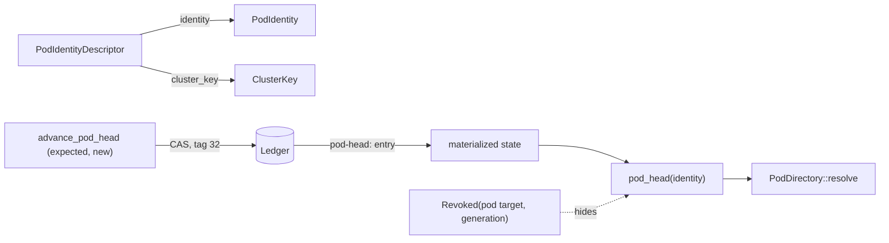

# 40 — Pod linking: stable identity, committed head, advisory learned address

Status: **identity, head resolver and the learned-address loader are implemented; the routing
claim is not shown.** Experiment R015 has a harness and no frozen result. The Symlink-LoRA idea is
design only.

Plan: [`../RESEARCH_INTEGRATION_PLAN_20261013.md`](../RESEARCH_INTEGRATION_PLAN_20261013.md)
(work package 1). Decision: [ADR-0023](../../research/decisions/ADR-0023-learned-pod-addresses-advisory.md).
Owners: `ptr-types`, `ptr-pods`, `ptr-ledger`, `ptr-state`, `ptr-runtime`, `ptr-router`,
`training/` (Python).

## The problem

A pod is retrained, its artifact and generation change, but callers, caches and learned routing
state should keep naming "the same pod". Three things must stay separate:

1. **Who the pod is** — a name that does not move when values move.
2. **Which revision answers now** — a fact that changes, so it is committed.
3. **Which pod a question probably wants** — a guess, so it is advisory.

## Identity and cluster key (`ptr-types`, `ptr-pods`)

`PodIdentityDescriptor { schema_version, domain, kind, predicate, semantic_role, aliases }` holds
the hard semantics of a pod and nothing else: no artifact, no generation, no value.

- `identity()` is `pod:` plus the SHA-256 over a domain tag and every field, length-prefixed, the
  aliases in sorted order. It is the `PodIdentity`.
- `cluster_key()` is the hash over the same hard semantics without the aliases. Pods that differ
  only by alias share a cluster; a different domain, kind, predicate or role is another cluster.

`PodSemanticManifest` gained `predicate` and `aliases`, `identity_descriptor()` and `cluster_key()`,
and `validate` requires `pod_identity == descriptor.identity()`. A retrained pod changes `digest()`
(artifact, generation) and not its identity or cluster key; changing an alias or the role needs a
new identity, and the manifest refuses the old one with expected and actual.

The plan said an alias change moves both hashes. The research definition (and the reason for a
cluster at all) excludes aliases from the cluster key, so this implementation does too; a role,
domain, kind or predicate change moves both.

## Head resolver (`ptr-ledger`, `ptr-state`, `ptr-runtime`)

`LedgerEvent::PodHeadAdvanced { identity, old, new }` (tag 32) is a compare-and-swap record:

- `new` must be a valid revision address; with an `old` its generation must rise strictly (the
  ledger codec refuses anything else on append and on decode);
- the runtime commits it only if the committed head equals `old` (`None` for the first head) and
  `new` is not a revoked pod generation, and checks the same on replay.

The head is projected to `pod-head:<identity>` in the materialized state, so replay, the Postgres
projection and a compacted snapshot all reproduce it with no extra snapshot format. A restore
fails closed on a malformed entry.

`PtrRuntime::pod_head` returns the head unless its generation is revoked; it never falls back to an
older revision. `advance_pod_head(AdvancePodHead { identity, expected, new })` commits through the
ledger. `PodDirectory::resolve_head` resolves identity, then head, then the ordinary `resolve`.
A pod generation is the lifecycle target `pod:<project>/<namespace>/<pod>` (`pod_lifecycle_target`).

## Dragonfly: a learned address per pod (`training/`, `ptr-router`)

Per pod, a vector `z` and a bias over a **frozen** encoder, trained on explicit positive and
negative address questions (trusted aliases expanded into the positives, similar other entities
as negative aliases) with a class-balanced cross-entropy. There is no shared trainable state.

`logit = cosine_weight * cos(q, z) + metadata_weight * 1 - bias`, `score = sigmoid(logit)`.
During training every question counts as metadata-matched, so a metadata flag cannot solve the task
and only the question vector is learned; at run time the registry has already enforced the
metadata, so the same constant applies. The weights (12 and 3) are part of the representation.

**Activation gate.** A representation is activated only if every trusted alias scored at least 0.8
and at least 90 % of the negative examples were rejected. Otherwise the exporter writes
`not-activated`. `RepresentationStore::insert` re-checks the measured values against its own
minima whatever thresholds the artifact claims, refuses a representation that is not activated
(`RouteError::InactiveRepresentation`), one of another encoder or dimension, or one that is not a
newer generation of the same pod.

**Router.** `LearnedPodRouter` implements `Router` and ranks only `registry.candidates(...)`;
the trusted boundary still refuses anything outside that set. It returns a point mass on the best
candidate (propensity 1), or abstains with `RouteError::Abstained { best, runner_up, best_score,
margin }` when the best score is below 0.5 or the runner-up is within 0.15. `NoRepresentation`
means no candidate had an address. The default `PodRouter` remains the router when none is
configured. The runtime reports an abstention as `RouteFailed { reason: "routing abstained" }`
without naming a pod; the fallback and counters are work package 2.

**Query vector.** `PodSampler::features` supplies `RouteFeatures::vector`; `EmbeddingSampler`
wraps a `CheckedRouter` with a `QueryEmbedder`. PTR has no Rust encoder: the host provides one.
`ptrd` does not wire a learned router for that reason.

**Artifact.** `dragonfly-<identity>.json` (manifest) and `.bin` (`dims` little-endian `f32` of `z`,
then the bias). The manifest carries the encoder, dimension, generation, pod, identity, cluster
key, scoring weights, the gate measurement, `weights_sha256` and a `digest` over every field and the
weights. The Python exporter and the Rust loader share a committed fixture
(`crates/ptr-router/tests/fixtures`): identities, cluster keys, weights bit for bit and every probe
score must agree, and a Python test checks the fixture is reproducible.

## Revocation per pod (`ptr-runtime`)

A representation is neural state: `bind_pod_representation` binds it under its pod's lifecycle
target at the pod's exact generation, with its digest in the provenance, and
`admit_pod_representation` re-decides on every use. Revoking one pod generation yields
`Denial::RevokedGeneration` for that pod only (Invariant 17); a new generation yields
`StaleGeneration` until a representation trained for it is bound; a payload swapped under a valid
binding is refused. `admitted_representations` builds the router store from the cache and reports
what was refused and why.

## What is not here

- **Symlink-LoRA.** A model that emits a link was a research idea; PTR keeps identity value-free
  and the head a ledger fact, so no link is learned in code. It is a candidate in
  `evaluations/components/pod-routing` and a design note with a kill criterion in R002.
- **A Rust encoder, a `ptrd` wiring of the learned router, a frozen R015 result.**
- **Failover and counters** for misses (work package 2).
- Postgres tests of the new event need `PTR_PG_TEST_DSN`; the projection mapping itself is
  unit-tested.
