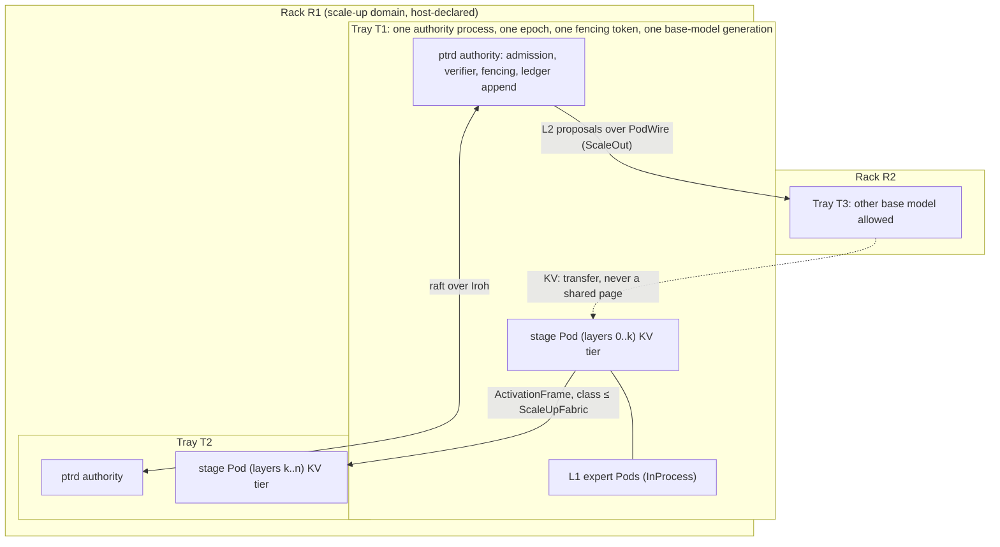

# 40 — Pod racks and trays: the NVL72 composition pattern applied to Pods

Status: **design proposal, nothing implemented.** This document takes the composition pattern
of NVIDIA's Vera Rubin NVL72 rack (one rack as the unit of scale-up, trays as the
field-replaceable unit, a host CPU paired with every group of accelerators, a scale-up fabric
inside the rack and a scale-out network between racks, a memory hierarchy per tray) and asks
which parts of it carry over to PTR Pods as **typed contracts**, which parts are already
covered, and which parts are hardware facts that PTR does not own and must not pretend to.
Every proposal below names the code it would extend, the invariant it must keep and the
experiment that would show it is worth having. No claim is made that any of it helps until that
experiment has run (invariant 15).

The source of the pattern is NVIDIA's public NVL72 description: 72 Rubin GPUs and 36 Vera CPUs
in one rack, 18 compute trays of 4 GPUs and 2 CPUs each plus 9 NVLink switch trays, HBM4 on every
GPU, LPDDR5X on every CPU, NVLink 6 as the scale-up fabric inside the rack and ConnectX-9 for
scale-out between racks (NVIDIA product page and the Cisco/Supermicro data sheet; NVIDIA labels
the figures preliminary). The figures themselves (transistor counts, bandwidth, price) play no
role here; only the **structure** does. PTR's hardware is PCIe only: the owner has two PCs with
one card each, an RTX 3090 and an RTX 4090 (`hardware/rtx3090.toml`, `hardware/rtx4090.toml`;
the owner inventory of 2026-10-13, which supersedes the earlier two-3090 desktop, see
[42](42-pod-data-plane.md) section 0a).
So every "rack" in this document is a **logical** construct whose first instance is one
workstation.

## 1. Why the pattern is interesting for Pods at all

Doc 37 already states the one rule the rack pattern makes concrete:

> Where [an expert] executes is a separate decision made by latency: an expert consulted once
> per token per layer cannot be a network service, one consulted once per request can.
> Placement changes how an expert is called, never what it is.
> ([37](37-pod-moe.md) section 1)

and

> Token-level experts must be co-located, because every MoE layer finishes routing before the
> next layer starts. Request-level experts can be networked services, because there is one
> routing decision per call. ([37](37-pod-moe.md) section 2; repeated in [39](39-vcw-moe.md) 2.4)

Today that rule is **prose**. Nothing in `ptr-pods`, `ptr-runtime::placement` or
`ptr-runtime::directory` can express "these Pods must share a device", "this stage may cross a
host but not a WAN", or "this group is placed and fenced as one unit". `NodeRecord` knows a
`zone: String` and a list of devices (`crates/ptr-runtime/src/placement.rs:33`); `Placement` is
one Pod on one device (`:42`); `assign` places one Pod at a time (`:171`); `PodResourceProfile`
is RAM, VRAM and concurrency (`crates/ptr-pods/src/semantic.rs:59`); `ResourceRequirements`
adds an optional `DeviceId` (`crates/ptr-pods/src/neural.rs:38`). The pipeline split of doc 36
binds a `placement_epoch` into every `ActivationFrame` but has no notion of how far the two
stages may be apart.

The NVL72 pattern supplies exactly the three missing nouns, and they are nouns about
**placement**, not about what a Pod is, so they fit the rule above without touching
`PodManifest`, lifecycle, admission, lineage or revocation:

| NVL72 noun | What it is in hardware | PTR noun proposed here |
|---|---|---|
| Rack | The scale-up domain: everything inside it is reachable at fabric latency and shares one memory pool view | **Scale-up domain** (`RackId`): the set of nodes and devices among which L1 experts, pipeline stages and KV pages may be co-located and shared |
| Compute tray | 4 GPUs + 2 host CPUs, placed, powered, replaced and fenced as one unit | **Tray**: a group of Pods placed under one placement epoch and one fencing token, all or nothing, with one host-side authority process |
| Switch tray / NVLink versus ConnectX | Two transports with different latency classes, chosen by distance | **Interconnect class**: a typed distance that a Pod's locality requirement is checked against at placement and at every activation-frame admission |

The rest of the pattern (HBM per GPU, LPDDR per CPU, NVMe behind it) is already PTR's tier
hierarchy (`TierResidencyController`, `crates/ptr-runtime/src/tier.rs:648`; GPU, CPU, NVMe and
OpenDAL tiers, `docs/POD_MASTER_PLAN.md` section "Multi-Tier-Speicherhierarchie"); the rack
pattern only adds a **scope** to it (section 4).

## 2. Mapping, item by item

### 2.1 One rack: the scale-up domain

**Proposal.** `NodeRecord` gains `rack: Option<RackId>` next to `zone`. A rack is a declared
set of nodes whose pairwise interconnect class is no farther than `ScaleUpFabric` (in the order
of section 2.4, `InProcess` nearest to `ScaleOut` farthest), so a node reachable only by scale-out
can never be a rack member. The declaration is
**host policy** (the operator says which nodes share a fabric), exactly like `AdmissionPolicy`
says which peer is which principal ([29](29-peer-admission-and-pod-scope.md)): PTR cannot
measure NVLink and must not pretend to. A node without a rack is a rack of one: every scope
comparison uses an effective scope `Declared(RackId) | Singleton(NodeId)`, so two undeclared
nodes are two different racks and never share pages, while one undeclared node still shares
within itself.

**What the rack scopes.**

- **L1 token experts** (doc 37 level L1) require `InProcess` or `SameDevice`: they never leave
  a tray, let alone a rack.
- **Pipeline-split stages** (doc 36, `ActivationFrame`) require at most `ScaleUpFabric` by
  default: a stage boundary may cross hosts inside a rack and never crosses a rack. A split whose
  admitted profile declares `ScaleOut` instead is **remote-capable**: its frames go chunked and
  signed over PodWire ([42](42-pod-data-plane.md) S5), and only such a split may cross racks. The
  bound comes from the admitted profile and a request can only narrow it. Today E007 covers an
  in-process split only; E008 (loopback) runs under the default rule, and E013 (the owner's two
  PCs, two racks) runs a split admitted as `ScaleOut`.
- **KV page sharing** (`KvSharedPrefix`, `KvPrefixKey`, `crates/ptr-pods/src/paged_kv.rs`) is
  rack-scoped: a prefix page is shareable only with requests placed in the same rack. Cross-rack
  reuse is a **transfer** (the Mooncake-like row of the master plan, section I, still open), never
  a shared page.
- **L2 request-level Pods** have no locality requirement: PodWire over Iroh QUIC
  ([33](33-pod-wire.md)) is the scale-out network, and the finding router of doc 39 routes
  among whatever is eligible.

**Invariant kept.** A Pod in another rack is still the same Pod with the same manifest,
generation and lineage (doc 37 section 1). The rack is a property of a `Placement`, not of a
`PodManifest`, so `PodRegistry`, `resolve` and the project boundary are untouched.

### 2.2 One tray: the unit of placement, fencing and replacement

In the rack, a tray is pulled and replaced as a whole; nothing inside it survives the pull.
PTR's equivalents of "pull" are a failed heartbeat, a revoked device and a topology change,
and today each of them revokes **per Pod** or per node: `heartbeat` revokes the placements
and leases on a device that vanished or failed, `register_node` for a node already registered
(a replacement) and `mark_node_failed` revoke every placement and lease on the node
(`crates/ptr-runtime/src/placement.rs`, `register_node`, `heartbeat`, `mark_node_failed`). A group of Pods that only make sense together
(an attention stage with the expert Pods it routes to, or two pipeline stages that share a
`placement_epoch`) can therefore end up half placed and half revoked, and the half that
survives is routable with a stale partner.

**Proposal.** A `TraySpec` belongs to exactly one project and names its members
(`(ProjectId, PodId)`, `ArtifactId`, `Generation`, `ResourceRequirements` each). `PodRegistry`
allows the same `PodId` in two projects, so every placement, membership, lease and fencing lookup
of a tray is keyed by `(ProjectId, PodId)`, and a member of another project is refused. A tray
also names the **complete ordered per-layer KV chain** its members share, and the host that acts
as its authority process. **Every member placement is on that host**: its `NodeId` equals the
tray's authority host, `assign_tray` refuses a member on any other node with a typed error
(all members or none are placed), and a replacement under a new epoch keeps the same rule. Pods
on another host form their own tray with their own authority process; traffic between trays
uses the scale-out class of section 2.4 and the `Remote` path of
[42](42-pod-data-plane.md), never membership in one locally fenced tray. The chains are derived per member by
`crates/ptr-pods/src/kv_chain.rs`; the root `chain(-1)` alone is not enough, because layer
weights and most layer configuration enter only in `chain(l)` (`crates/ptr-pods/tests/kv_chain.rs`
checks that changing a layer's key norm leaves `root()` unchanged). `assign_tray` therefore
requires exact equality of every member's layer count and every `chain(l)` (equivalently of
`final_id()` together with the layer count, since each `chain(l)` folds in its predecessor), so a
tray shares KV the way an NVL72 rack does. The KV chain is not a full model identity: a change
to a layer's FFN or the output path that leaves every stored K/V unchanged moves no chain
(`crates/ptr-pods/tests/kv_chain.rs`, `ffn_change_at_layer_l_changes_chain_after_l_only`). So
`assign_tray` also requires equality of every member's complete base-model artifact and manifest
digest and of its numeric configuration (dtype, quantisation, numeric regime). The KV chains are
the condition for sharing KV; the model digest and numeric configuration are the condition for
homogeneity.
`PodPlacementController::assign_tray` places all members or none under **one** placement epoch
and **one** tray `FencingToken`; the per-member `FencedStateLease` carries the tray token in
addition to its own. Any event that would revoke one member revokes the tray **at that event**:
the placement of every member is revoked (removed) in the same controller step. Removing a
placement on device disappearance, device failure, node failure and node replacement is a
**prerequisite** that is not in `main` today (`mark_node_failed` calls `revoke_for_node`, which
removes leases and leaves `self.placements` untouched); it is the device-fence package of wave 1
of [42](42-pod-data-plane.md), and tray revocation builds on it. With the placements removed, `split_stage`, which
reads only `Placement.epoch`, refuses a frame of any surviving member at once; a tray token in
the leases alone would not reach activation frames. In the same step every member's state and
KV leases are removed and its open uses cancelled, because `validate_lease` consults the lease
table and not the placements; a lease of a surviving member therefore cannot outlive the tray
either. A tray is never partially fenced. Replacement is `assign_tray` under a new epoch, and
the per-Pod `PodPlacementController::assign` **refuses a tray member** with a typed error (it
would revoke and re-create only that one Pod), so every existing caller that places a single Pod
cannot leave a tray partially placed; every in-flight activation
frame, KV lease and state lease of the old epoch is refused at its next admission, which the
existing `placement_epoch` revalidation in `split_stage`, `kv` and `tensor_kv` already does
per Pod. That revalidation covers the **upstream** side only (`AdmittedFrame::revalidate` checks
the frame's chain and upstream placement epoch, `crates/ptr-runtime/src/split_stage.rs:213-219`,
and a prefill holds no `UseTicket`), so a consumer whose own tray was fenced after admitting a
frame could still release its output. The tray change therefore binds the **consuming**
placement and its tray epoch to the admitted operation as well and checks both at output
release; an output computed by a member of a fenced tray is refused there.

**Invariant kept.** Fencing is strictly stronger, never weaker: a tray token adds a reason to
refuse, it never admits something the per-Pod token would refuse. `register_node`, `heartbeat`
and `mark_node_failed` keep their present behaviour for Pods that are not in a tray.

### 2.3 The host CPU in every tray: authority stays beside the accelerators

NVL72 pairs two Vera CPUs with every four GPUs, so no accelerator group is without a host. PTR's
version of the host is the authority process: `ptrd` with `ptr-runtime` doing admission, policy,
fencing, output admission and the hard security boundary, the verifier fabric, and the ledger
append path. Doc 15 states this for one workstation ("Runtime remains one authority process
while model/embedding/vector Pods use separate GPUs/processes").

**Proposal.** The rule generalises to **one authority process per tray, on the host of every
member** (section 2.2), and a cluster is
raft across the authority processes ([31](31-cluster-integrity.md), [06](06-consensus-ledger.md)),
not across GPU Pods. GPU-side Pods (stage Pods, expert Pods, KV tier backends) hold **no**
authority: they never append to the ledger, never admit an output, never decide acceptance.
Everything a GPU Pod produces is a `TypedPayload` or an `ActivationFrame` that the tray's
authority process admits. This is already how `split_stage` and the output admission path are
written; the proposal only forbids the alternative (a GPU-side process that appends).

**What this buys.** The latency-sensitive loop (doc 39's classify, route, repair) runs against
a verifier and an admission path on the same host as the Pods it drives, while the
authoritative state is still the replicated ledger. The PTR-Research cluster (three LXD nodes,
raft over the container network, `research/MULTIHOST-CLUSTER-20260917.md` in PTR-Research) is
the ready-made testbed: three CPU-only trays in one logical rack.

### 2.4 Scale-up versus scale-out: a typed interconnect class

**Proposal.** A closed enum in `ptr-types`:

```text
InterconnectClass = InProcess | SameDevice | SameHost | ScaleUpFabric | ScaleOut
```

ordered from nearest to farthest, and a `LocalityRequirement { max_distance, anchor_kind }` on
`PodResourceProfile` (and on `ResourceRequirements` for neural Pods), where `anchor_kind` says
whether the bound is measured from the **device of a named co-placement partner** (for an L1
expert, the stage that invokes it: `SameDevice` needs this), the Pod's tray, its rack or nothing.
For a co-placement anchor the placement records the partner, and assignment and resolution
require the same device as the partner's current placement **and**, when the partner is a tray
member, membership in that same `TraySpec` (sharing a device does not imply sharing a tray, so
an L1 expert outside its stage's tray would survive the stage's tray fence; with this check it is
a member and is fenced with it). The requirement is
topology-independent and part of the manifest; the **concrete** tray or rack it is measured from
is a property of the `Placement`, chosen at placement time, so moving a Pod to a replacement tray
or rack never changes its manifest identity. Placement refuses an assignment whose distance to the anchor exceeds
`max_distance` (`PlacementError::LocalityViolation`). Routing enforces the same bound, but the
bound is **loaded from the admitted profile of the resolved Pod**, never taken from the caller:
`PodDirectory::resolve` (`crates/ptr-runtime/src/directory.rs`) today sees only caller-supplied
`RouteConstraints`, so resolution must look up the admitted requirement itself, and a request's
constraints may only narrow it, never widen or omit it. A route to a Pod that is too far is a
`ResolveError`, not a slow route. The activation-frame
admission in `split_stage` checks the class of the link the frame arrived on against the
stage's requirement, as it checks `placement_epoch` today.

The class of a link is again **declared by the host**, not measured: in-process and same-device
are known from the placement, same-host from the node id, fabric from the rack declaration,
everything else is scale-out. The calibration experiment of section 5 says what each class
costs on real hardware so the declaration can be checked against a measurement, but the
measurement never decides placement at run time (a learned or measured value must not be able
to widen what a typed requirement allows; the same shape as invariant 11).

**What this replaces.** The prose rule of doc 37 section 2 becomes a refused placement and a
refused route. The "DLPack/IPC rather than JSON" preference of doc 15 becomes a property of the
`InProcess` and `SameDevice` classes rather than a recommendation.

### 2.5 Memory hierarchy per tray: a scope for the tiers, nothing new

HBM4 per GPU, LPDDR5X per CPU, NVMe and object storage behind them is the hierarchy PTR already
has (`CandleGpuTierBackend`, CPU and NVMe tiers, OpenDAL, `TierResidencyController`). The rack
pattern adds one thing: the **GPU and CPU tiers belong to a tray**, so a tier object's residency
record names the tray it is resident in, and a `TierTransferAuthorization` between two trays of
one rack is a fabric transfer while a transfer between racks is a scale-out transfer with the
budget and backpressure the controller already enforces. Pinning, dedupe, drain and replay are
unchanged.

### 2.6 Homogeneity: one generation per tray

An NVL72 rack is one GPU generation. The PTR analogue is that a tray binds **one** base-model
generation and numeric regime, because L1 experts and pipeline stages share hidden state and KV
pages whose chain keys include the base model identity and generation (doc 36 section D,
`KvChainIdentity`). Heterogeneous base models live in different trays and talk at L2 only.
Retraining the base is a new generation (doc 37 section 4.1), which supersedes the tray: its
members are fenced by the existing `InputInvalidated` path and a new tray is placed for the new
generation. Nothing here changes the supersession rule; it only says that a tray cannot outlive
the generation it was placed for.

## 3. What is deliberately not transferred

- **Transistor counts, bandwidth figures, price and power.** PTR has no such hardware and no
  budget model that reads these numbers. A `RackId` declaration carries a human-readable
  description at most.
- **A rack-wide shared memory pool.** NVLink lets every GPU reach every other GPU's HBM. PTR's
  KV pages are refcounted, principal- and manifest-bound and fenced (doc 36); "shared within a
  rack" means "shareable through the existing page and tier contracts between placements of the
  same rack", never a flat address space.
- **Hardware health.** The rack reports tray health through its own management plane. PTR has
  heartbeats and device records and nothing more; a declared fabric that is in fact a slow link
  is a host-policy error, which is why section 5 calibrates the classes.
- **Scheduling across racks as one job.** Training-style all-to-all across racks is out of scope;
  PTR's cross-rack traffic is L2 proposals and typed transfers only.

## 4. Proposed types and where they go

| Piece | Crate | Shape | Touches |
|---|---|---|---|
| `InterconnectClass`, `RackId`, `TrayId`, `LocalityAnchor`, `LocalityRequirement` | `ptr-types` | closed enums and validated id newtypes, `Ord` on the class | nothing existing |
| `PodResourceProfile.locality: Option<LocalityRequirement>`, `ResourceRequirements.locality` | `ptr-pods` | optional; `None` means `ScaleOut` (today's behaviour) only for Pods without an activation-frame boundary; a pipeline-split stage with `None` gets the `ScaleUpFabric` default of section 2.1, and only an explicit `ScaleOut` makes it remote-capable, so no existing stage manifest becomes cross-rack by omission | `PodSemanticManifest::digest` (the topology-independent requirement, `max_distance` and `anchor_kind`, is part of the manifest digest; the concrete tray or rack id is not, it lives on the `Placement`), `NeuralPodDescriptor::lineage_digest` |
| `NodeRecord.rack: Option<RackId>` | `ptr-runtime::placement` | host-declared | `register_node`: a rack change is a topology change; bumping the controller's epoch is not enough, because existing `Placement`s keep their stored epoch and issued KV and tier leases and open uses do not repeat the rack-key lookup, so a rack re-declaration removes every placement on the node (as a device failure does), revokes its KV and tier leases and cancels its open rack-scoped uses in the same step; new placements then use the new rack |
| `TraySpec`, `TrayPlacement`, `assign_tray`, tray token in `FencedStateLease` | `ptr-runtime::placement` | all-or-nothing, one epoch, one token; a member revocation revokes the tray | `revoke_unavailable_leases`, `revoke_for_node`, `revoke_for_pod` |
| `PlacementError::LocalityViolation`, `ResolveError::TooFar` | `ptr-runtime`, `ptr-types` | typed refusals | `assign`, `PodDirectory::resolve` |
| link class check in activation-frame admission | `ptr-runtime::split_stage` | refuses a frame whose link class exceeds the stage requirement | the existing `placement_epoch` revalidation |
| rack scope on `KvPrefixKey` sharing and on tier residency | `ptr-pods::paged_kv`, `ptr-runtime::tier` | a prefix is shareable only inside one rack; a transfer names its class | `KvSharedPrefix`, `TierTransferAuthorization` |

Order of work, smallest first, each a pull request with positive and negative tests
(`docs/TESTING.md`): types; manifest fields and digests; node rack and locality refusal in
placement; tray placement and tray fencing; directory constraint; activation-frame link check;
KV and tier scope. The first three are independent of any GPU. None of them changes a wire
format: `ActivationFrame` v1 stays as it is, and the link class is a property of the receiving
end, not a field of the frame.

## 5. Experiments that would justify each piece

Each follows `docs/architecture/19-research-method.md` and AGENTS.md section 3: a baseline, an
ablation, a sensitivity control and a refutation rule, registered with `scripts/new_experiment.py`. None is registered yet, and none has an id:
the names below are working titles, and an id is assigned at registration (`L002`, `L003`
are taken; `E009` to `E013` are reserved by [42](42-pod-data-plane.md) for its experiments).

| Id (proposed) | Claim | Baseline / ablation | Refuted if | CPU or GPU |
|---|---|---|---|---|
| locality-refusal (mechanism) | An L1 expert or a pipeline stage with a locality requirement can never be placed, routed or fed a frame across a link farther than its requirement, including after a rack re-declaration, a node failure and a replay | the same controller with locality enforcement disabled by a dedicated mutation (every locality check admits), since `locality = None` would still give a pipeline stage the `ScaleUpFabric` default (ablation); sensitivity: a planted too-far case at each of the three checks (a placement, a directory route and an activation frame), each attempted a nonzero number of times in the re-declaration, failure and replay scenarios and each detected independently, must be refused | any placement, route or frame admission across the bound succeeds in any seed; or the refusal depends on a measured value | CPU |
| tray-fence (mechanism, extends L001-v2) | A tray is never partially fenced: after a member device fails, whether between `assign_tray` and the first use or while another member already holds a lease or is computing, no member's lease, KV page or frame of the old epoch is admitted and no output of an in-flight use of the old epoch is released | per-Pod placement of the same members (ablation); sensitivity: a planted surviving member must be detected by the harness when tray revocation is disabled; race arm: one member fails after another acquired its lease or began computing and before its output release, and that active use and its output must be refused | a surviving member serves a request of the old epoch in any seed | CPU |
| link-classes (calibration, descriptive; the data-plane counterpart is E011 in [42](42-pod-data-plane.md)) | The declared classes order the measured activation-frame round trip on the owner's hardware: in-process < same-device < same-host (loopback QUIC) < LAN, each by a preregistered factor | baseline: the `Bytes` carrier over the same link; ablation: class-based carrier selection overridden, every class forced to the same carrier, so any ordering that remains comes from distance alone and not from the classification; sensitivity: an injected fixed delay on one class must reorder it measurably | the order is violated, or two classes are within the measurement noise (then only the cost model is revised; classes are typed eligibility boundaries and are never merged or widened by a measurement, section 2.4) | CPU and one GPU |
| rack-kv-scope (mechanism) | Rack-scoped prefix sharing admits exactly the cross-request hits of the global scope for requests in one rack and none across racks, with the fencing and dependency rules of doc 36 unchanged | global sharing (ablation); sensitivity: a planted cross-rack request must be refused | a cross-rack hit, a lost in-rack hit, or any doc 36 safety counter above 0 (stale-entry admissions, cross-principal or cross-project hits, hits after a dependency invalidation); doc 36 coverage counters must instead be above 0 for the run to be valid | CPU |

In every row the "Refuted if" column applies to the **unperturbed claim cells** only. Each
ablation and planted sensitivity cell is expected to fail in the named way (the
enforcement-disabled mutation admits the too-far placement, per-Pod placement leaves the survivor, the injected delay reorders
the class, global sharing produces the cross-rack hit, the planted request or placement is
refused) and is judged only on whether that expected outcome was observed; a control that does
not show it makes the run invalid (the harness is blind), never falsified.

A **positive** result of any of these shows a mechanism, not a benefit. Whether tray-atomic
placement or typed locality reduces anything a user can see (p95 latency of the doc 39 loop,
`Exhausted` rate under a failing device) is a later, model-backed experiment on the F-series
hardware plan (`docs/VCW_MOE_GPU_PLAN.md`), and the honest expectation on one workstation is a small
difference at most: each of the owner's PCs has one card, so one device is one tray is one
rack, and the two PCs are two racks joined over the LAN. The value of the typing on those machines
is that the rule exists and is tested before more devices or hosts appear.

## 6. Risks

- **Over-typing.** Five interconnect classes may be two too many. A class that no requirement ever
  names should be removed by a reviewed type change; the link-class calibration only informs that
  decision and never merges classes by itself.
- **Declared facts.** Rack membership and link classes are host declarations. A wrong
  declaration is not detected at run time; it is the same trust boundary as `AdmissionPolicy`
  and is stated as such. The link-class calibration is the only check.
- **Tray atomicity costs availability.** Revoking a whole tray for one failed device is the
  deliberate choice (correctness over availability, as everywhere in PTR); on a workstation with
  two GPUs it halves capacity on one failure. The alternative, partial trays, is the failure
  mode this document exists to remove, so the cost is accepted and should be measured in the tray-fence experiment.
- **Pattern worship.** The rack is a product; PTR is a research runtime. Everything above was
  checked against an existing PTR rule or a named gap, and section 3 lists what was left out
  because it has no PTR counterpart.

## 7. Diagram


