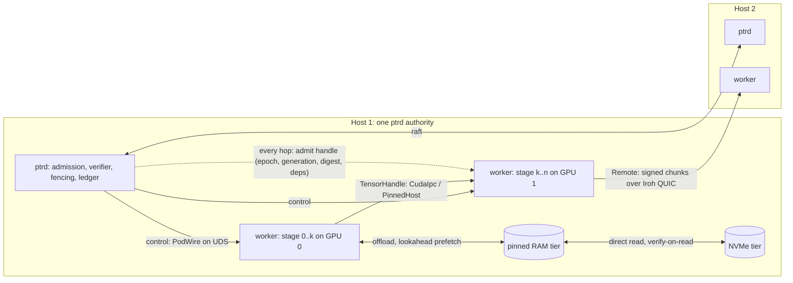

# 41 — Pod data plane: a fenced zero-copy fabric in five stages

Status: **plan, nothing implemented.** Companion of [40](40-pod-rack.md). Doc 40 asks where Pods
may be placed; this document asks how tensors move between them once they are placed, and plans
the software counterpart of what NVLink does in hardware: reaching another Pod's data without
serialising it through the host, and treating GPU memory, host RAM, NVMe and remote hosts as one
hierarchy with explicit, fenced transfers. What cannot be copied from NVLink is bandwidth and
per-token latency, so the plan is bounded by doc 37 section 2: L1 token experts never cross a
device; everything from a pipeline stage boundary upward may use this fabric.

The plan is cut into the five stages the owner named, in the order they build on each other:

| Stage | Topology | Carrier | Exists today |
|---|---|---|---|
| S1 | one host, several processes, zero or one GPU | shared memory and CUDA IPC handles | nothing; `TypedPayload` is `Vec<u8>` (`crates/ptr-protocol/src/lib.rs:17`) |
| S2 | one host, several processes, several GPUs | device-to-device or via pinned host buffer | nothing; `CandleGpuTierBackend` is one device (`crates/ptr-pods/src/candle.rs:120`) |
| S3 | host RAM as an offload tier | pinned host buffers with prefetch | `CpuTierBackend` (unpinned `BTreeMap`, `crates/ptr-storage/src/tier.rs:383`), `TierResidencyController`, `LookaheadPrefetchPolicy` (`crates/ptr-runtime/src/tier.rs:648`, `:1774`) |
| S4 | NVMe as an offload tier | file-backed chunks, verify-on-read | `FileTierBackend` (`crates/ptr-storage/src/tier.rs:485`), the `PTRKVP3` page format, the RTX 4090 GPU→CPU→NVMe→GPU roundtrip recorded in the master plan (`docs/POD_MASTER_PLAN.md`, section "Multi-Tier-Speicherhierarchie") |
| S5 | several hosts | signed chunking over Iroh QUIC | `chunk_frame`, `FrameAssembler` (`crates/ptr-podwire/src/chunk.rs:834`, `:301`), `ActivationFrame` (`crates/ptr-protocol/src/activation.rs:107`), downstream admission in `split_stage` (`crates/ptr-runtime/src/split_stage.rs`); E007 completed in process, E008 planned |

The thing every stage shares, and the reason this is one plan rather than five, is section 1.
Whether the plan is worth building, stage by stage, is section 7; the short answer is that S1,
S3 and S4 pay for themselves on any single card, S2 has no hardware on the owner's two
single-card PCs (section 0a) and is built on S3's pinned buffer, and S5, the already-planned
E008, runs between those two PCs.

## 0. Facts checked before implementation

Read from the tree at the merge of #136, before any code was written for this plan:

- **No Pod runs outside the authority process today.** `ptrd` holds every Pod in process
  (`bins/ptrd/src/main.rs`, `PodRegistry::default()`); `ProtocolBinding::LocalWorker`
  (`crates/ptr-pods/src/protocol.rs:7`) and `PodTransport::LocalWorker`
  (`crates/ptr-types/src/pod_address.rs:134`) name a local worker that nothing implements. S1 is
  therefore the largest stage, not a small one.
- **A device failure does not move a placement epoch.** `heartbeat` and `mark_node_failed`
  revoke state leases but leave every `Placement.epoch` unchanged
  (`crates/ptr-runtime/src/placement.rs:137-169`), and `RuntimeStageLiveness::placement_epoch`
  reads only that epoch (`crates/ptr-runtime/src/split_stage.rs:63-68`). Rule 4 of section 1
  would not hold for a device failure until placement bumps the epoch of every placement on a
  device that disappeared or failed. That change comes first.
- **`candle-cuda` cannot be built without `nvcc`** (`crates/ptr-pods/CANDLE_CUDA.md`, `ci.yml`
  comment on the feature). The CUDA carriers therefore depend on `cudarc` directly with dynamic
  loading, so that CI compiles them without a toolkit; their behaviour on a card is checked only on
  hardware (section 6).
- **Experiment ids.** `L002` and `L003` are taken and no `P` or `T` series exists. The
  experiments of section 6 are `E009` (handle fence), `E010` (offload roundtrip), `E011` (carrier
  calibration), `E012` (the GPU part C split out of E008) and `E013` (the two-host arm that E008
  part B, loopback only, does not cover).

## 0a. The owner's hardware (stated by the owner, 2026-10-13)

Two PCs with one card each: one with an RTX 3090, one with an RTX 4090, both 24 GiB, both PCIe.
The repository's profiles describe a different setup: `docs/LOCAL_START.md:5` and
`hardware/dual-rtx3090.toml` name one desktop with two RTX 3090. This document follows the
owner's statement; aligning those profiles is a separate change that touches experiment manifests
and is not made here. Consequences for the stages:

- **S1, S3, S4** run on either PC alone.
- **S2** (several GPUs in one host) has no hardware today. It is built and tested on the
  `PinnedHost` path with simulated devices, and is checked on a card pair only when one exists.
- **S5** (several hosts) is directly testable: the two PCs are two hosts, so E013 (the two-host
  split) and the LAN cell of E011 run between them. E008 part B stays a loopback run and is
  E013's baseline, never two-host evidence.
- **CUDA carriers** (`CudaIpc`, CUDA-pinned host buffers) are checked on each PC separately;
  the two cards being different generations (Ampere and Ada) is a second data point, not a
  pair.

## 1. The one contract: a handle is a fenced payload

Today a Pod call carries `TypedPayload { type_id, bytes }`. A zero-copy fabric replaces the
bytes with a **handle** when sender and receiver share a carrier, and keeps the bytes as the
fallback carrier. The handle is not a pointer; it is a claim that is admitted like a frame:

```text
TensorHandle {
  carrier:      Carrier,                 // closed enum, section 2
  locator:      CarrierLocator,          // shm fd slot + offset, CUDA IPC handle + device, frame id + frame digest, ...
  shape, dtype, byte_len,                // byte_len == product(shape) * size(dtype), overflow-checked;
                                         // rank and every dimension bounded; byte_len bounded per handle
  content_digest,                        // SHA-256 of the tensor bytes, signed with the rest
  upstream_chain,                        // producer stage, base model, adapters, experts (as ActivationFrame)
  placement_epoch,                       // captured at production, revalidated at every use
  consumer,                              // the stage the handle is addressed to (audience)
  parent_operation_id,                   // the call this handle belongs to, checked against the consumer's call
  deadline_ms,                           // bounded: at most now + lifetime + skew at admission
  handle_nonce,                          // single use
}
```

The first implementation (codec v1) carries no `input_lineage`; it is added together with the
E008 frame fields, and until then a handle carries exactly the lineage of an ActivationFrame v1.

Rules, each the same as the one already enforced for frames and KV pages, restated for handles:

1. **Admission before access.** A receiver obtains memory only through
   `split_stage`-style admission (`AdmittedFrame`, `UseTicket`, `crates/ptr-runtime/src/split_stage.rs:178`,
   `:305`): principal registered for that stage identity, signature, `placement_epoch` equal to
   the current placement, generation and manifest digest live, every dependency live at the
   committed anchor. A handle that fails any check is refused; the memory is never mapped.
   This keeps `docs/POD_MASTER_PLAN.md` row H ("kein Raw Pointer nach außen") true for every
   carrier: the raw pointer exists only inside the admitted scope.
2. **Single use with a deadline.** A handle is consumed once; the nonce is tombstoned like a
   chunk id (`FrameAssembler`'s reservations and tombstones, `chunk.rs:301`). After the deadline
   plus skew the sender may reclaim the buffer whether or not it was consumed.
3. **Ownership stays with the producer until the consumer acknowledges.** The producer keeps the
   buffer alive until `Consumed` (sent after the consumer has unmapped) or until the deadline
   **plus the clock skew**, never at the bare deadline, so a consumer whose clock lags by the
   allowed skew can never touch a freed buffer. A consumer that needs the data beyond that copies
   it into its own tier object. No carrier has shared ownership.
3a. **The bytes are committed and immutable.** The handle carries a `content_digest` of the tensor
   bytes, covered by the signature. After signing, the producer gives up write access until
   `Consumed` or reclaim. For `HostShm` and the CPU side of `PinnedHost` this is enforced by the
   kernel: the region is a `memfd` sealed against writes before the handle is sent, and the
   consumer verifies the digest after mapping and before use, so there is no check-use race. For
   `CudaIpc` and `DevicePeer` no seal exists, so a mapped device allocation is never used
   directly under this contract: the consumer copies it into a **receiver-owned** allocation
   (one device-to-device copy), verifies `content_digest` on that copy, and only then uses it.
   Zero-copy use of a producer-owned device allocation is outside the authenticated-content
   guarantee and is not offered.
3b. **Bytes are bounded, not only handles.** Every handle has a maximum `byte_len`, and each
   producer has an in-flight byte budget; a handle that would exceed it is refused with a typed
   saturation error. A handle's bytes count against the budget for as long as its buffer is
   held, so they are released only with the notice that frees the buffer: `Consumed` or the
   reclaim at deadline plus skew; abandoning a handle releases nothing earlier (invariant 8).
   Deadlines are bounded too: a handle whose deadline lies beyond now plus the configured
   lifetime plus skew is refused, so tombstones cannot be pinned indefinitely.
3c. **A handle is addressed and scoped.** The signed `consumer` names the stage it is for, and the
   signed `parent_operation_id` names the call; a table built for one consumer refuses a handle
   addressed elsewhere, and a handle presented under another operation is refused, as the chunk
   path does with `parent_operation_id` and its `SplitPolicy`.
4. **A fence invalidates handles.** A placement epoch bump, a device revocation, a tray fence
   (doc 40) or a dependency invalidation makes every handle of the old epoch unadmittable at
   its next use, exactly as doc 36 section D cancels forks whose lineage includes an
   invalidated generation. In-flight handles are not drained; they are refused.
5. **The carrier is chosen by placement, never by the caller.** The runtime knows both
   placements and picks the nearest carrier both ends support (section 2). A request cannot
   name a carrier, as it cannot name an endpoint ([34](34-address-authority.md)).
6. **Bytes are the universal fallback.** Every carrier can degrade to `Bytes` with the same
   admission; a receiver that lacks a carrier is never stuck, only slower. E011 (section 6)
   measures how much slower.

Invariants kept: uncommitted state is never authoritative (a handle is derived, revision-bound
data), queues are bounded (per-principal handle tables with the same caps as the assembler),
effects pass the hard boundary (handles never cross `ptr-execwire`; they are Pod-to-Pod only),
revoked generations cannot become usable after lag (rule 4).

## 2. Carriers

A closed enum, ordered from nearest to farthest, which is the `InterconnectClass` of doc 40 seen
from the data side:

| Carrier | When | Mechanism | Zero copies? |
|---|---|---|---|
| `InProcess` | same process | the tensor object itself (candle `Tensor` or a DLPack capsule across a language boundary) | yes |
| `HostShm` | same host, other process, CPU tensor | `memfd` or a named shared mapping (`memmap2` is already in `Cargo.lock`), sealed read-only before the handle is sent | yes |
| `CudaIpc` | same host, other process, same GPU | `cudaIpcGetMemHandle` / `cudaIpcOpenMemHandle` through `cudarc` with dynamic loading (0.19.10 is already in `Cargo.lock` through candle); event handle for stream ordering | yes |
| `DevicePeer` | same host, other GPU, peer access available | `cudaMemcpyPeer` on a stream, or direct peer mapping | one device-to-device copy |
| `PinnedHost` | same host, other GPU, no peer access; and the RAM tier | GPU→pinned host→GPU with two stream-ordered copies; the pinned buffer is itself a `HostShm` region | two copies |
| `NvmeFile` | the NVMe tier | file-backed chunk, verify-on-read, `O_DIRECT` where the platform allows | one read |
| `Remote` | other host | `chunk_frame` over Iroh QUIC, `FrameAssembler` on the far side | one send, one reassembly |
| `Bytes` | fallback | today's `TypedPayload` | copies |

Two consequences for several cards in one host, which the owner does not have today (section
0a). Peer access between two cards over plain PCIe depends on the driver and the board and must
be probed with `cudaDeviceCanAccessPeer`, never assumed; on an RTX 4090 pair PCIe peer access is, to the best of
the author's knowledge, not offered by the driver (unverified here, no such hardware). S2
therefore ships with `PinnedHost` as its working path and `DevicePeer` as a probed option.

## 3. The stages

### S1 — one host, several processes

**Why first.** Everything after it needs a second process: a GPU worker that can crash without
taking the authority process down, a Pod that is a different binary, a Python training process
that reads the same tensors. Today every Pod of the reference path runs inside `ptrd`.

**Build.**

- A **Pod worker process** protocol on a Unix domain socket (Windows named pipe later): the
  authority process spawns or admits a worker, the worker registers the stage identities it
  serves with its signing key (the same registration the assembler already does per principal,
  `chunk.rs:344`), and control messages are the existing PodWire request and response types.
  Data goes by handle.
- `HostShm` carrier: the producer creates a `memfd`, writes once, seals it against writes, and
  sends the descriptor with `SCM_RIGHTS` over the control socket in the same message as the
  handle; the locator names that descriptor slot (a `memfd` is anonymous and cannot be reopened
  by name). The consumer maps it read-only only after admission, verifies `content_digest`, and
  unmaps before sending `Consumed`.
- `CudaIpc` carrier for a single GPU shared by two processes (the worker holds the model, the
  authority process holds the verifier and admission; or two expert workers on one card).
- The **authority rule of doc 40 section 2.3** becomes code: a worker holds no ledger handle and
  no admission grant; every output it produces is admitted by the authority process.

**Scope guard.** No scheduler, no multi-tenant isolation beyond process boundaries, no
sandboxing (row J of the master plan, owned by `ptr-runtime` and `ptr-pods`). One worker per Pod placement.

### S2 — one host, several processes, several GPUs

**Build.** `PodPlacementController` already models several devices per node
(`NodeRecord.devices`, `crates/ptr-runtime/src/placement.rs:33`). S2 adds a per-host **carrier
table**: for each ordered device pair, whether `DevicePeer` is available (probed once at node
registration, recorded in the `DeviceRecord`, never assumed) and otherwise `PinnedHost`. The
pipeline split of E007 gets its second half: stage k on device 0, stage k+1 on device 1, in two
worker processes, frames carried by handle instead of bytes.

**What it is not.** It is not tensor parallelism and not expert parallelism across devices at
L1. A model that does not fit one device is split by **layers** between devices (pipeline), or
its experts are **offloaded** (S3, S4), never dispatched per token across PCIe.

### S3 — host RAM as an offload tier

**Why it matters per card.** A 24 GiB card (both the RTX 3090 and the RTX 4090 profile) holds OLMoE's experts (about 12 GiB bf16) but not
a second base model, a large KV working set and several adapter sets at once. The master plan's
Multi-Tier slice already moves **KV pages** GPU→CPU→NVMe→GPU with digests and a new fencing
lease. S3 widens that to **expert and adapter weights** and makes the CPU tier real:

- `PinnedHostTierBackend`: a `TierBackend` (`crates/ptr-storage/src/tier.rs:370`) over
  page-locked memory with a fixed budget, so GPU↔RAM copies are asynchronous and
  stream-ordered. `CpuTierBackend` (an unpinned map) stays as the test backend.
- Expert weights as tier objects: `ModelWeightTierAdapter` (`crates/ptr-pods/src/tier_storage.rs:200`)
  already binds weights to tier objects; S3 gives it a per-expert granularity so one expert can
  be resident on the GPU while the others wait in RAM.
- Prefetch from signals that exist before the call. At **L2** the finding router's eligible set
  (doc 39) is known before a Pod is called and is the signal for which Pods' adapters and weights
  to warm, fed into `LookaheadPrefetchPolicy` (`crates/ptr-runtime/src/tier.rs:1774`). At **L1**
  the next layer's top-k is **not** known before the current layer runs, because its router input
  is the current layer's output; L1 expert prefetch needs an explicit predictor (or same-layer
  reuse across tokens) whose prediction quality is measured on its own, and is not part of this
  plan.
- Every object keeps the existing residency record, pins, dedupe, drain and replay; S3 adds no
  new state kind.

**Honest limit.** Offloaded experts cost a PCIe copy per use. Per-token expert offload is a
bandwidth-bound regime where the known systems (DeepSpeed-Inference, FlexGen, llama.cpp
offload) are reported to be roughly ten to fifty times slower than resident weights (an
estimate from the literature, not measured here; E010 measures the PTR path). S3 is for **request-level** Pod
weights, adapters and KV working sets. An experiment that offloads L1 experts per token is a
different claim and is not in this plan.

### S4 — NVMe as an offload tier

**Build.** `FileTierBackend` exists and is replayed and verified. S4 makes it a real offload
target rather than a durable copy: a **direct read path** (`O_DIRECT` and aligned buffers on
Linux, unbuffered I/O on Windows, falling back to buffered reads), reads straight into a pinned
host buffer so an NVMe→GPU move is one read and one copy, and a **residency plan** that keeps
the chunks the lookahead names within one tier of the GPU. Object identity, chunk digests,
AEAD on protected chunks and the `PTRKVP3` page format are unchanged.

**What it is for.** Many Pods' weights and adapters, cold KV prefixes, and the pinned
checkpoints of an experiment, on one machine. It is not a database and not a cache of
authoritative state: the ledger stays where it is.

### S5 — several hosts

**Build.** The transport is E008 as registered (`experiments/registry.toml`, `E008`, planned):
the signed chunking of `ptr-podwire::chunk` carried by `PodHost` and `PodClient` over Iroh QUIC.
E008 part B runs that over **loopback** only and is therefore no evidence for two hosts; the
two-host arm is a separate experiment, E013 (section 6), run between the owner's two PCs. Both
use the v1 frame's `placement_epoch` and, once implemented, the E008 fields (`input_lineage`,
`mode`, `taint`). The data-plane contract of section 1 adds only that a `Remote` handle names the
**complete frame**: its frame id, the whole-frame digest and the assembly metadata (chunk total,
parent operation), while the per-chunk digests keep authenticating each envelope; a single chunk
digest would identify one slice only. It is admitted by the same function as local handles. Cross-host **tier transfers** (a KV snapshot or an expert's weights moving from
one host's RAM to another's) need their own grant. `TierTransferAuthorization`
(`crates/ptr-runtime/src/tier.rs:390`) is only the tuple (generation, placement epoch, fencing
token) that the in-process controller compares; it names no object, source, destination,
principal, deadline or nonce and carries no signature, so serialising it across hosts would let a
live grant be replayed for another object or redirected to another backend. A remote transfer
therefore carries an authenticated, single-use grant that binds the object digest, source,
destination, principal, deadline and nonce, signed by the authority that issued it, and uses the
chunk carrier; this is the Mooncake-like row of the master plan, section I, in its
simplest form (QUIC, no RDMA).

**Later, not here.** RDMA (RoCE or InfiniBand) as a second remote carrier; GPUDirect RDMA. Both
need hardware the owner does not have and change nothing in the contract.

## 4. Who owns what

| Piece | Crate | Note |
|---|---|---|
| `Carrier`, `TensorHandle`, `CarrierLocator`, `HandleError` (codec errors) | `ptr-protocol` | next to `ActivationFrame`; schema-versioned like the frame |
| handle admission, handle table, tombstones, `HandleRejection` (wraps `ChainFault`) | `ptr-runtime` (a `handle_admission` module next to `split_stage`) | one function for every carrier; the frame path becomes the `Remote` carrier of it |
| `HostShm`, `CudaIpc`, `DevicePeer`, `PinnedHost` carriers | new crate `ptr-fabric` | backend-specific code stays out of domain crates (`CLAUDE.md`: backend types must not leak); `cudarc` and `memmap2` live here behind features |
| worker process protocol | `ptr-podwire` (control) and `ptr-fabric` (data) | reuses PodWire request and response types |
| `PinnedHostTierBackend`, direct-read `FileTierBackend` | `ptr-storage` | behind features, CI jobs like `storage-tiers` |
| carrier table per node, peer probe | `ptr-runtime::placement` | recorded in `DeviceRecord` |
| per-expert weight tier objects, lookahead signal | `ptr-pods::tier_storage`, `ptr-runtime::tier` | |

Every pull request: positive and negative tests (`docs/TESTING.md`), `component.toml` updated,
`make docs`, and for `ptr-fabric` a CI job that runs without a GPU (shared memory and the
`Bytes` fallback) plus a feature-gated GPU path that is admitted only on detected hardware
(`docs/POD_MASTER_PLAN.md`, "Verifikation und Grenzen").

## 5. Order and size

1. **S1a** `ptr-protocol` handle types and the admission function with the `Bytes` and `HostShm`
   carriers, two processes, no GPU. Small; CPU-only CI.
2. **S1b** `CudaIpc` on one GPU, two processes. Needs one of the owner's PCs for the record.
3. **S3** `PinnedHostTierBackend` and per-expert weight objects with lookahead prefetch.
   Medium; the GPU part needs one of the owner's PCs.
4. **S4** direct-read NVMe path and residency plan. Small on top of S3.
5. **S2** carrier table, peer probe, two-device pipeline split in two workers. Needs two GPUs in
   one host for the record, which the owner does not have; the `PinnedHost` path is testable
   with one.
6. **S5** E008 as registered, then cross-host tier transfer. Needs two hosts: the owner's
   3090 PC and 4090 PC; the PTR-Research LXD cluster is enough for the CPU part.

S2 comes after S3 on purpose: without peer access S2's working carrier **is** S3's pinned
buffer, so S3 builds the piece S2 needs.

## 6. Experiments

Mechanism checks first, each registered with `scripts/new_experiment.py`, each with a baseline,
an ablation, a sensitivity control (a planted defect the harness must detect, so a pass cannot
be vacuous) and a refutation rule (doc 19, AGENTS.md section 3). The preregistration of each
names its sensitivity control; the table names the baseline. Ids are proposals.

| Id | Claim | Baseline / ablation | Refuted if | Needs |
|---|---|---|---|---|
| E011-carriers | The carriers order the measured frame transfer time: `InProcess` < `HostShm` ≈ `CudaIpc` < `PinnedHost` < `NvmeFile` < `Remote` (loopback) < `Remote` (LAN), each by a preregistered factor, at frame sizes within the existing bounds (1 MiB to 64 MiB, the activation `MAX_FRAME_BYTES`; the `Bytes` baseline is chunked under PodWire's 4 MiB `MAX_BODY_BYTES`, and every compared carrier carries the same chunking) | `Bytes` at every size | the order is violated, or two adjacent carriers are within noise (then they merge in the type) | CPU cells (`InProcess`, `Bytes`, `HostShm`, `NvmeFile`, loopback `Remote`) here; GPU cells and the LAN cell on hardware |
| E009-handle-fence | After a placement epoch bump, a device revocation or a worker crash, no handle of the old epoch is admitted, no mapping outlives its deadline plus skew, and the producer reclaims every buffer | the same loop with admission disabled (must leak or admit, else the test is blind) | any stale admission, any mapping alive after reclaim, any byte leak across a crash, in any seed | CPU for `HostShm`; GPU for `CudaIpc` |
| E010-offload-roundtrip | Expert weights and KV pages move GPU→pinned RAM→NVMe→GPU with identical digests, the fencing lease renewed, and the lookahead policy keeps a preregistered hit rate on a replayed routing trace | LRU without lookahead; unpinned RAM | a digest mismatch, a stale-lease admission, or a hit rate below the preregistered floor | CPU part (RAM and NVMe tiers, unpinned versus locked) here; the GPU leg on hardware |
| E008 (registered) | two-stage split across a loopback socket (part B) with the extended frame (part A), bit-identical to the in-process split | E007 in process | any output difference, any admission of a frame with a stale epoch | CPU, one host |
| E012 (E008 part C) | a real checkpoint split across two devices, F16/BF16 boundaries, activation versus KV bytes | the same checkpoint run on a single device, and an F32 boundary, as E008 part C registers them | as E008 part C | GPU in one host (no such hardware today) |
| E013-two-host-split | the two-stage split of E008 with the stages on two hosts over the LAN, bit-identical to the in-process split, with every E008 refusal unchanged; plus a cross-host tier-object transfer (a KV snapshot) under the signed single-use grant, with a replay, a redirected destination and a foreign object attempted and counted | E008 part B on loopback; the transfer without a grant (must be refused, else the test is blind) | any output difference, any admitted stale frame, any replayed or redirected grant admitted, or zero attempts of any counted attack (vacuous) | the owner's two PCs |

None of these says the fabric makes a model better. The model-backed question (does
request-level offload keep p95 latency of the doc 39 loop under a bound while holding N Pods on
one card) is a later experiment on the F-series hardware plan and is not claimed here.

## 7. Does it make sense, stage by stage

- **S1: yes, now.** Process isolation of Pods is the missing half of "Pods leased via
  typestate": today a Pod that panics takes the authority process with it. S1 is also the
  precondition for a Python-side Pod and for every later stage, and it needs no GPU.
- **S3 and S4: yes, on any single card.** They are the only way to hold more than one base model,
  several adapter sets and a large KV working set on a 24 GiB card, and three quarters of the
  contracts exist. The risk is performance, and E011 and E010 measure it before anything
  depends on it.
- **S2: build, but no hardware yet.** The owner's PCs have one card each, so S2 is built on the
  pinned buffer of S3, tested with simulated devices, and checked on hardware only once a host
  has two cards.
- **S5: yes, as E008**, already planned and registered, and directly testable between the
  owner's two PCs; this document adds nothing to it but the shared handle contract.
- **What never makes sense here:** per-token expert dispatch across PCIe or a network, and a
  claim that any of this is "NVLink". The fabric is, as an estimate, around a hundred times slower (section 2: PCIe
  against NVLink bandwidth) and carries typed,
  fenced, lineage-bound payloads instead of bytes. The second property is the one PTR needs;
  the first is the one it cannot have.

## 8. Risks

- **Platform code.** Shared memory, CUDA IPC, pinned allocation and direct I/O are four
  platform surfaces, two of them with Windows variants the owner uses. `ptr-fabric` behind
  features with a `Bytes` fallback is the mitigation; a carrier that cannot be built on a
  platform is absent, never emulated.
- **Lifetime bugs.** A mapping that outlives its handle is a use-after-free across processes.
  Rule 3 (producer owns until acknowledged) and E009 are the mitigation; the admitted scope is
  the only place a pointer exists.
- **Consumer GPUs.** Peer access on consumer cards is driver-dependent and driver patches that
  enable it are out of scope; the plan never depends on it.
- **Scope creep toward a serving engine.** vLLM, SGLang and Mooncake already move KV and weights
  across tiers and hosts at scale. PTR's reason to build its own is the fenced, lineage-bound
  admission at every hop, not throughput. If an experiment shows the admission can be kept with
  an engine's data plane underneath (doc 36: "control plane in PTR, data plane in engines"), that
  engine replaces S2 to S5 and this plan shrinks to S1 and the handle contract.

## 9. Diagram


