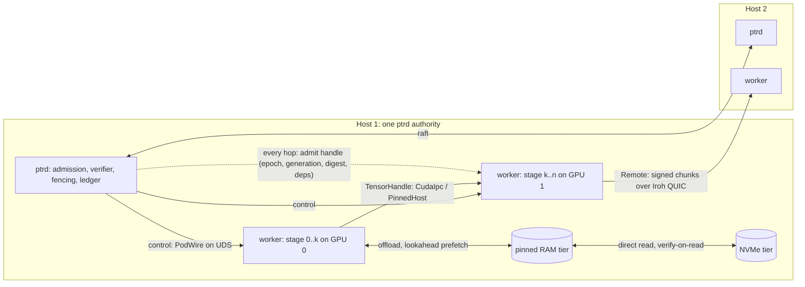

# 42 — Pod data plane: a fenced zero-copy fabric in five stages

Status: **plan, nothing implemented.** Companion of [40](40-pod-rack.md). Doc 40 asks where Pods
may be placed; this document asks how tensors move between them once they are placed, and plans
the software counterpart of what NVLink does in hardware: reaching another Pod's data without
serialising it through the host, and treating GPU memory, host RAM, NVMe and remote hosts as one
hierarchy with explicit, fenced transfers. What cannot be copied from NVLink is bandwidth and
per-token latency, so the plan is bounded by doc 37 section 2: L1 token experts never cross a
device; everything from a pipeline stage boundary upward may use this fabric.

The plan is cut into the five stages the owner named, in the order they build on each other:

| Stage | Topology | Carrier | Exists today |
|---|---|---|---|
| S1 | one host, several processes, zero or one GPU | shared memory and CUDA IPC handles | nothing; `TypedPayload` is `Vec<u8>` (`crates/ptr-protocol/src/lib.rs:17`) |
| S2 | one host, several processes, several GPUs | device-to-device or via pinned host buffer | nothing; `CandleGpuTierBackend` is one device (`crates/ptr-pods/src/candle.rs:120`) |
| S3 | host RAM as an offload tier | pinned host buffers with prefetch | `CpuTierBackend` (unpinned `BTreeMap`, `crates/ptr-storage/src/tier.rs:383`), `TierResidencyController`, `LookaheadPrefetchPolicy` (`crates/ptr-runtime/src/tier.rs:648`, `:1774`) |
| S4 | NVMe as an offload tier | file-backed chunks, verify-on-read | `FileTierBackend` (`crates/ptr-storage/src/tier.rs:485`), the `PTRKVP3` page format, the RTX 4090 GPU→CPU→NVMe→GPU roundtrip recorded in the master plan (`docs/POD_MASTER_PLAN.md`, section "Multi-Tier-Speicherhierarchie") |
| S5 | several hosts | signed chunking over Iroh QUIC | `chunk_frame`, `FrameAssembler` (`crates/ptr-podwire/src/chunk.rs:834`, `:301`), `ActivationFrame` (`crates/ptr-protocol/src/activation.rs:107`), downstream admission in `split_stage` (`crates/ptr-runtime/src/split_stage.rs`); E007 completed in process, E008 planned |

The thing every stage shares, and the reason this is one plan rather than five, is section 1.
Whether the plan is worth building, stage by stage, is section 7; the short answer is that S1,
S3 and S4 pay for themselves on any single card, S2 has no hardware on the owner's two
single-card PCs (section 0a) and is built on S3's pinned buffer, and S5 runs between those two
PCs as E013, with the already-planned E008 (loopback) as its one-host baseline.

## 0. Facts checked before implementation

Read from the tree at the merge of #136, before any code was written for this plan:

- **No Pod runs outside the authority process today.** `ptrd` holds every Pod in process
  (`bins/ptrd/src/main.rs`, `PodRegistry::default()`); `ProtocolBinding::LocalWorker`
  (`crates/ptr-pods/src/protocol.rs:7`) and `PodTransport::LocalWorker`
  (`crates/ptr-types/src/pod_address.rs:134`) name a local worker that nothing implements. S1 is
  therefore the largest stage, not a small one.
- **A device failure does not move a placement epoch.** `heartbeat` and `mark_node_failed`
  revoke state leases but leave every `Placement.epoch` unchanged
  (`crates/ptr-runtime/src/placement.rs:137-169`), and `RuntimeStageLiveness::placement_epoch`
  reads only that epoch (`crates/ptr-runtime/src/split_stage.rs:63-68`). Rule 4 of section 1
  would not hold for a device failure until placement bumps the epoch of every placement on a
  device that disappeared or failed. That change came first: since wave 1 a placement on a device
  that vanished or failed, and every placement on a failed or replaced node, is revoked at that
  event (`crates/ptr-runtime/src/placement.rs`, tests in `crates/ptr-runtime/tests/placement.rs`
  and `tests/split_stage.rs`).
- **`candle-cuda` cannot be built without `nvcc`** (`crates/ptr-pods/CANDLE_CUDA.md`, `ci.yml`
  comment on the feature). The CUDA carriers therefore depend on `cudarc` directly with dynamic
  loading, so that CI compiles them without a toolkit; their behaviour on a card is checked only on
  hardware (section 6).
- **Experiment ids.** `L002` and `L003` are taken and no `P` or `T` series exists. The
  experiments of section 6 are `E009` (handle fence), `E010` (offload roundtrip), `E011` (carrier
  calibration), `E012` (the GPU part C split out of E008) and `E013` (the two-host arm that E008
  part B, loopback only, does not cover). The registered E008
  (`experiments/system/E008-split-pod-extensions/experiment.toml`) still holds part C today.
  Part C leaves E008 only in the commit that registers E012 (wave 5 of the implementation
  plan), which edits E008's manifest while it is still `planned`. Until then E012 is a reserved
  id with no manifest and no evidence of its own, so no part C result can count twice.

## 0a. The owner's hardware (stated by the owner, 2026-10-13)

Two PCs with one card each: one with an RTX 3090 (`hardware/rtx3090.toml`), one with an RTX 4090
(`hardware/rtx4090.toml`), both 24 GiB, both PCIe. This is the binding inventory (`AGENTS.md`,
`docs/LOCAL_START.md`, updated with this document); the earlier two-3090 desktop
(`hardware/dual-rtx3090.toml`) is superseded and stays only for experiments that declare it.
Consequences for the stages:

- **S1, S3, S4** run on either PC alone.
- **S2** (several GPUs in one host) has no hardware today. It is built and tested on the
  `PinnedHost` path with simulated devices, and is checked on a card pair only when one exists.
- **S5** (several hosts) is directly testable: the two PCs are two hosts, so E013 (the two-host
  split) and the LAN cell of E011 run between them. E008 part B stays a loopback run and is
  E013's baseline, never two-host evidence.
- **CUDA carriers** (`CudaIpc`, CUDA-pinned host buffers) are checked on each PC separately;
  the two cards being different generations (Ampere and Ada) is a second data point, not a
  pair.

## 1. The one contract: a handle is a fenced payload

Today a Pod call carries `TypedPayload { type_id, bytes }`. A zero-copy fabric replaces the
bytes with a **handle** when sender and receiver share a carrier, and keeps the bytes as the
fallback carrier. The handle is not a pointer; it is a claim that is admitted like a frame:

```text
TensorHandle {
  carrier:      Carrier,                 // closed enum, section 2
  locator:      CarrierLocator,          // shm fd slot + offset, CUDA IPC handle + device, frame id + frame digest, ...
  shape, dtype, byte_len,                // byte_len == product(shape) * size(dtype), overflow-checked;
                                         // rank and every dimension bounded; byte_len bounded per handle
  content_digest,                        // SHA-256 of the tensor bytes, signed with the rest
  payload_type,                          // schema and argument slot of the tensor (what TypedPayload.type_id was)
  upstream_chain,                        // producer stage, base model, adapters, experts (as ActivationFrame)
  placement_epoch,                       // captured at production, revalidated at every use
  consumer,                              // the stage the handle is addressed to (audience)
  parent_operation_id,                   // the call this handle belongs to, checked against the consumer's call
  signed_absolute_deadline_ms,           // absolute; bounded: at most now + lifetime + skew at admission
  handle_nonce,                          // single use
  signature,                             // Ed25519 over every field above, by the producer's registered key
}
```

A handle always describes a **dense, row-major, contiguous** tensor: there is no offset or
stride beyond the locator's own offset, and `byte_len` is exactly the addressed span. A producer
holding a sliced or transposed view materialises a contiguous copy before signing, and a
consumer interprets the bytes only in that layout; so the digest, the length check and the
tensor the consumer builds always refer to the same bytes.

The codec v1 handle carries no `input_lineage`. Input lineage is instead **owned by the
authority**: `parent_operation_id` names an operation the authority process started and recorded,
including the generation of every semantic, memory and derived input that operation read, the
**ordered Raw ancestry** it read (`(Raw, content_digest)` pairs, since Raw segments carry no
generation; doc 36 section D), the **destination placement** (the consumer stage's placement and
its epoch at the time the operation started) together with the **consumer worker's session id**
(a random value the supervisor draws at every spawn of that worker), the **producer worker's
session id** (drawn the same way; a crashed and respawned producer gets a new one even when its
placement epoch is unchanged, and its exit cancels every operation it produced for, so none of
its unconsumed handles of any carrier stays admittable), and
the **expected model-side chain** (stage, base model, adapters and experts with identity,
generation, digest and fence epoch), the **payload types** the operation accepts, and the
**authority-derived project** (`ProjectId`) the operation runs in. Pod and stage ids are unique
only within a project (`PodRegistry` allows the same Pod id in two projects), so every lookup of
the record's placement, inputs and worker session is keyed by that project, and a handle whose
consumer placement, inputs or worker session belong to another project is refused. The placement controller keys placements, leases and freezes by (`ProjectId`, `PodId`), and handle admission and consumption read the placement epoch for the project of the call (`StageLiveness::placement_epoch_in`), so a stage of the same name in another project is not this handle's stage. Admission and
consumption both ask the authority whether the operation is known, every input is still live at
the current committed anchor, every Raw ancestor is still present (not erased) with its recorded
digest, the consumer stage still holds the recorded destination placement and epoch and is
served by the worker session the record names, the producing worker still runs under the
recorded producer session, all within the recorded project (so a handle delivered to a replacement worker
after the consumer's device failed, its stage was re-placed or its worker crashed and was
respawned for the same placement is refused, and each of those events cancels every operation
addressed to the old placement or session), the handle's chain **equals** the expected chain exactly (a
different but live adapter or expert is refused) and the handle's `payload_type` is one the
operation accepts. Otherwise the handle is refused and the locator is never released. This keeps
the stale-generation invariant without trusting a worker to report its own lineage. Operation
records are bounded in number and in size: a global and per-principal cap on the number of
records, and per record a cap on the count of each input category (semantic, memory, derived,
Raw ancestors, chain elements, payload types), a cap on the size of each identity, and a cap on
the record's total encoded bytes, plus a global cap on the bytes of all live records; any of
these exceeded gives a typed saturation refusal when the operation is started. Each record also
carries an **absolute operation deadline** that the authority mints when the operation starts
(bounded by a configured maximum operation lifetime); a handle whose deadline lies beyond it is
refused, handle issuance closes when the operation completes, is cancelled or reaches that
deadline, and the record is retained until the operation deadline plus skew,
after which the record is removed deterministically (so a live handle never meets a missing
record, and abandoned calls cannot accumulate).
Codec v1 handles are **Exact only**, as `admit_frame` refuses any non-Exact upstream today
(`ChainFault::NotExact`, `crates/ptr-runtime/src/split_stage.rs`): the operation record also holds
the operation's KV reuse mode and taint, and a handle of an operation that is Approximate or
carries any taint is refused at admission and at consumption, so Approximate-derived bytes can
never reach an Exact namespace or shed their taint before `check_kv_taint`. Carrying `mode` and
`taint` in the handle itself, together with the E008 frame fields (`input_lineage`), is a later
codec version; the authority check stays either way.

Rules, each the same as the one already enforced for frames and KV pages, restated for handles:

1. **Admission before access.** A receiver obtains memory only through
   `split_stage`-style admission (`AdmittedFrame`, `UseTicket`, `crates/ptr-runtime/src/split_stage.rs:178`,
   `:305`): principal registered for that stage identity, signature, `placement_epoch` equal to
   the current placement, generation and manifest digest live, every dependency live at the
   committed anchor. A handle that fails any check is refused; the memory is never mapped.
   This keeps `docs/POD_MASTER_PLAN.md` row H ("kein Raw Pointer nach außen") true for every
   carrier: the raw pointer exists only inside the admitted scope.
2. **Single use with a deadline.** A handle is consumed once. Admission **atomically
   reserves** `(principal, parent_operation_id, handle_nonce)` as an open slot before any
   locator is released, so a second admission of the same nonce, concurrent or later, is
   refused; consumption or abandonment turns the slot into a tombstone kept until the deadline
   plus skew, like a chunk id (`FrameAssembler`'s reservations and tombstones, `chunk.rs:301`);
   the assembler's tombstones are carried over to a new principal id that brings the same key and
   stage identity (the same runtime behind a new endpoint identity after a restart), and they are
   in memory, so they do not survive a receiver restart, where a replay is bounded by the signed
   deadline plus skew alone. After the deadline
   plus skew the handle can no longer be admitted or consumed, but the sender reclaims the
   buffer only once its teardown is verified as rule 3b requires (never on the deadline alone).
3. **Ownership stays with the producer until teardown.** The producer keeps the buffer alive at
   least until `Consumed` (sent after the consumer has unmapped) or the deadline **plus the clock
   skew**, never only the bare deadline, so a consumer whose clock lags by the allowed skew can
   never touch a freed buffer; for a carrier shared with another process it is freed only once
   that consumer's isolation domain is reaped (rule 3b). A consumer that needs the data beyond that copies
   it into its own tier object. No carrier has shared ownership.
3a. **The bytes are committed and immutable.** The handle carries a `content_digest` of the tensor
   bytes, covered by the signature. After signing, the producer gives up write access until
   `Consumed` or reclaim. For `HostShm` and the CPU side of `PinnedHost` this is enforced by the
   kernel: the region is a **dedicated `memfd` per export** holding exactly the tensor (offset 0,
   file size equal to `byte_len`, never pooled or sub-allocated, so the descriptor exposes no
   other byte), sealed against writes and against resizing (`F_SEAL_WRITE`, `F_SEAL_SHRINK`,
   `F_SEAL_GROW`, then `F_SEAL_SEAL`) before the handle is sent; the consumer checks those seals,
   that the offset is 0 and that the file size equals `byte_len` before mapping, and the
   consumer verifies the digest after mapping and before use, so there is no check-use race. For
   `CudaIpc` and `DevicePeer` no seal exists, so a mapped device allocation is never used
   directly under this contract: the consumer copies it into a **receiver-owned** allocation
   (one device-to-device copy), verifies `content_digest` on that copy, and only then uses it.
   Before copying, the consumer checks the extent and refuses the handle unless
   `offset + byte_len` lies inside the allocation, overflow-checked, analogous to the file-extent
   check for `HostShm`. For the legacy form it queries the imported allocation's actual base and
   size with `cuMemGetAddressRange`. That query is documented only for `cuMemAlloc` and
   `cuMemAllocPitch` allocations, not for a `cuMemCreate` allocation mapped with `cuMemMap`, so for
   the VMM form the consumer instead uses the allocation size recorded by the supervisor in the
   export record (a multiple of the allocation granularity), reserves and maps exactly that range
   with `cuMemAddressReserve` and `cuMemMap`, and checks the extent against it. That check protects the
   consumer, not the producer: CUDA IPC maps the whole underlying driver allocation, and the
   driver may place even a separate small `cudaMalloc` inside a shared block, so the importer
   could address adjacent tensors or weights. The producer therefore exports each tensor only
   from an **isolated staging buffer**: either a virtual-memory-management allocation
   (`cuMemCreate` with a POSIX file-descriptor shareable handle, size rounded up to the
   allocation granularity, holding nothing else), or a legacy `cudaMalloc` whose size is rounded
   up to a multiple of 2 MiB, as NVIDIA's IPC guide recommends. Before a legacy export, the
   guardian queries the buffer with `cuMemGetAddressRange` and refuses to export unless the
   returned base equals the buffer's start and the returned size equals its rounded size, so a
   sub-allocated buffer is never exported; a VMM buffer is isolated by construction (one
   `cuMemCreate` per buffer), and its size is recorded in the export record. The whole range outside the tensor span is zeroed **before every
   publication**, not only at allocation, because a pooled buffer reused for a shorter tensor
   would otherwise expose the previous tensor's tail; E009's GPU cell includes a long-then-short
   reuse case. E009's GPU cell includes a
   cross-process overread test: the consumer tries to read past the signed span and must find
   only the staging buffer's own zeroed padding, never producer data.
   The staging buffers are **owned by the supervisor**, held by its **guardian** process (below),
   which holds no model and does not crash with a worker, not by the producer worker: freeing an exported allocation
   before every importer has called `cuIpcCloseMemHandle` is undefined behaviour, and a crashing
   producer's context would free its own allocations. The producer imports its staging buffer
   from the supervisor and writes the tensor into it. The producer is therefore an importer too:
   staging buffers form a pool per (producer, consumer) pair, and the supervisor frees a buffer
   only after **both** the producer's and the consumer's domains have been reaped since it was
   exported (an import that a reaped process held is closed by the kernel and the driver); until
   then it counts against both quotas (rule 3b). A buffer is handed out again only for that pair
   and only after the consumer that imported it has been reaped, because a consumer that lies
   about `Consumed` may still map it; while that consumer lives, every new handle gets a fresh
   buffer. Where no broker is available for a producer, the
   CUDA carriers are disabled for it. E009's GPU cell also runs a live producer that keeps its import open after publishing (the buffer must stay allocated and charged to both quotas until both domains are reaped), and kills the producer during the consumer's
   import and during its copy, and the consumer must either complete a digest-verified copy or
   refuse the handle, never read freed memory.
   The export takes one of two forms, carried in the locator: the **legacy** form
   (`cuIpcGetMemHandle`, opened with `cuIpcOpenMemHandle`) for a `cudaMalloc` staging buffer, and
   the **VMM** form for a `cuMemCreate` buffer (`cuMemExportToShareableHandle` to a POSIX
   descriptor, passed with `SCM_RIGHTS` through the supervisor, opened with
   `cuMemImportFromShareableHandle` and `cuMemMap`); `cuIpcGetMemHandle` cannot export a VMM
   allocation, so the two are distinct locator kinds.
   A legacy IPC handle is a bearer capability: any process on the same device that holds its 64
   bytes can call `cuIpcOpenMemHandle` itself, and no admission check can stop that call. The
   legacy form is therefore **disabled for untrusted workers**: a Pod worker receives only VMM
   exports, and only while the confinement of rule 3b is active. The legacy form is kept only
   between trusted processes whose exporter and importer share one failure lifecycle (one
   process, or processes that are killed together); the supervisor and its guardian can fail
   independently, so the guardian path uses VMM only. Where VMM
   is unavailable, a worker's GPU tensors go by `PinnedHost` or `Bytes`. Every CUDA export is minted by the supervisor as an **export record** that names the export,
   the producer session, the one consumer session and the operation it is for, and the
   supervisor delivers the handle bytes or the VMM descriptor to that consumer itself. Admission
   and consumption refuse a `CudaIpc` or `DevicePeer` handle unless its locator matches a live
   export record for exactly that consumer session and operation; a worker that copies a
   received locator into a newly signed handle for another worker is therefore refused, and the
   only importers of an export are the recorded producer and consumer, which are the two domains
   whose reap frees it. The VMM form is preferred where available, because its descriptor moves
   only through `SCM_RIGHTS` via the supervisor and cannot be replayed from bytes; E009's GPU
   cell adds a forwarded-locator arm that must be refused.
   Zero-copy use of a producer-owned device allocation is outside the authenticated-content
   guarantee and is not offered. `InProcess` has no kernel seal either, so it is zero-copy only
   when the producer **moves unique ownership** of an immutable buffer to the consumer for the
   admitted lifetime: the producer keeps no alias (a candle tensor whose storage is shared with
   another live tensor, or any buffer exported through DLPack, does not qualify), and the
   consumer checks the digest after taking ownership. Where unique ownership cannot be shown, the
   carrier copies into a receiver-owned buffer and verifies the digest there, as `CudaIpc` does.
3b. **Bytes are bounded, not only handles.** Every handle has a maximum `byte_len`, and each
   producer has an in-flight byte budget; a handle that would exceed it is refused with a typed
   saturation error. Budgets and quotas are charged with the **allocated footprint**, not the
   logical `byte_len`: the VMM size rounded to the allocation granularity, the legacy allocation
   rounded to 2 MiB, the `memfd` rounded to whole pages, padding included, so many small handles
   cannot hold more memory than the cap. A handle's bytes count against the budget for as long as its buffer is
   held, so they are released only with the notice that frees the buffer. For a carrier that is
   not shared with another process (`InProcess` under moved ownership, `Bytes`, `NvmeFile`,
   `Remote`) that notice is `Consumed` or the reclaim at deadline plus skew; for a **shared**
   carrier (`HostShm`, `CudaIpc`, `DevicePeer`, the CPU side of `PinnedHost`) it is only the
   verified teardown below, never `Consumed` and never the deadline alone. Abandoning a handle
   releases nothing earlier (invariant 8).
   Reaching deadline plus skew does not by itself make shared memory disappear: a consumer that
   hangs or keeps its mapping keeps the pages alive (a `memfd` mapping survives the producer's
   close), and freeing an exported CUDA allocation before the importer has closed it is unsafe.
   So shared bytes are released only on **verified teardown that does not depend on the
   consumer**. `Consumed` is a message from the consumer worker, which may be compromised, so it
   only marks the handle complete and never frees or recredits anything. Nor does a scan of the
   worker's descriptors prove teardown: a descriptor queued in a Unix socket with `SCM_RIGHTS`
   appears in no `/proc/<pid>/fd` or `map_files` list and can be received again later. The rule
   is therefore the same for every shared carrier (`HostShm`, `CudaIpc`, `DevicePeer` and the
   CPU side of `PinnedHost`): each worker runs in its own **isolation domain**, a cgroup-v2 group
   created by the supervisor that the unprivileged worker cannot leave, and every exported byte
   counts against the quotas (fixed caps) of **both** its producer and its consumer, because
   either may keep a reference (a producer that created a `memfd` can keep a duplicate, a
   consumer can keep its mapping). The bytes are released only when both domains have been
   terminated and reaped since the export, which closes every descriptor, queued rights,
   mapping and CUDA import in them, **and** the supervisor has drained the old control-socket
   endpoint of each reaped worker, receiving and closing every descriptor still queued on it
   (a worker can send one with `SCM_RIGHTS` just before it is recycled, and that reference
   would otherwise survive outside its domain). Only then are the buffers freed and the quotas
   recredited. CUDA staging allocations are **never reused while an import of them may be live**: each
   handle gets a fresh allocation, and an allocation returns to the pool only after the
   consumer that imported it has been terminated and reaped (the release rule above). A
   consumer that acknowledges `Consumed` but keeps its VMM mapping therefore cannot read a
   later tensor through it, not even one addressed to itself before that tensor has passed
   admission.
   When a consumer's quota is exhausted, new handles to it are refused, and the supervisor
   recycles the **pair**: it lets the current operations finish or cancels them at their
   deadline plus skew, then terminates, reaps and respawns both the consumer and the producer
   whose exports fill the quota, each with a new session (the operation record of section 1
   then refuses every old handle), and drains their old control sockets, which releases the
   pair's charges at once; recycling the consumer alone could not release them, because the
   live producer may still hold a reference. A consumer that has not acknowledged by deadline plus skew is recycled the same way.
   A producer that serves several consumers can fill **its own** quota while every consumer stays
   under its cap. Then new handles from that producer are refused, and the supervisor recovers on
   the producer side: it recycles the producer together with the consumers whose exports from
   it hold the quota, taking the oldest exports first, until the released bytes cover the
   refused handle. Each recycled worker gets a new session, and the old control sockets are
   drained as above. A consumer whose exports from that producer are all released is left
   running. E009 has a multi-consumer arm for this: one producer, several consumers each below
   its cap, the producer quota full, and the recovery must release it without exceeding any cap.
   Above the per-handle, per-producer, per-consumer and per-pair caps, the supervisor charges
   every allocated footprint atomically against a **host-wide cap** per memory kind (host RAM,
   and VRAM per device); a handle that would exceed it is refused with a typed saturation error,
   so any number of individually conforming pools cannot together exhaust the host.
   Every quota and pool has a fixed cap, so a consumer that withholds, falsifies or delegates
   acknowledgements or descriptors can at most exhaust its own quota and force its own recycle
   (and that of the producers it shares exports with), never grow memory beyond it.
   The supervisor is the broker that owns the CUDA staging buffers, so its own failure is a
   fence, and that fence must not depend on the broker running cleanup code. A broker killed
   with `SIGKILL` would destroy its CUDA context before any reaper can act, freeing the staging
   allocations while worker imports are still open. So the staging allocations and their exports
   live in a separate **guardian** process: it holds only the CUDA context with those
   allocations, takes no input from workers (the broker asks it for exports over a private
   channel), and exits only after the reaper has terminated every importer domain. Every worker
   domain is therefore a cgroup owned by an **external reaper** (a service manager scope bound to
   the broker's unit, for example a systemd scope with `BindsTo` the broker and
   `KillMode=control-group`), which writes `cgroup.kill` for every worker domain when the broker
   exits for any reason, `SIGKILL` included, waits until those domains are empty, and only then
   stops the guardian; and workers **cannot create processes** (the seccomp
   allowlist permits `clone` only with thread flags, and no `fork`, `vfork`, `clone3` for
   processes or `execve`), so no descendant can escape a parent-death signal or the domain. A
   supervisor crash thus terminates every producer and consumer domain and no importer outlives
   the guardian's CUDA context; the authority's operation records name the
   supervisor's session, so every operation of the old session is refused after a restart.
   A crash of the guardian itself also terminates every worker domain (the worker scopes are
   bound to it as well), and its context is gone before the importers are. That is safe only
   because the guardian exports **only in VMM form**: a VMM import
   (`cuMemImportFromShareableHandle`) holds its own reference to the physical allocation, and the
   driver frees physical memory only after every mapping is unmapped and every handle,
   shareable ones included, is released, so the guardian's death cannot free memory a worker
   still maps. A legacy `cuIpc*` import holds no such reference, so the legacy form is never
   used on the guardian path; it stays only for trusted in-authority processes whose exporter
   and importer are one failure domain. Where VMM export is unavailable, the CUDA carriers are
   disabled for workers (they fall back to `PinnedHost` or `Bytes`), and so they are where that
   shared failure lifecycle cannot be enforced. E009's GPU cell kills the guardian while a worker
   holds a VMM import and requires the worker's mapped bytes to stay readable and unchanged
   until the worker is reaped.
   E009 has a broker-death arm that kills the broker with `SIGKILL` while a worker holds an
   import and tries to leave a descendant behind: the process creation must be refused, and
   the recorded order must be worker domains empty first, guardian exit second.
   Deadlines are bounded too: a handle whose deadline lies beyond now plus the configured
   lifetime plus skew is refused, so tombstones cannot be pinned indefinitely.
3c. **A handle is addressed and scoped.** The signed `consumer` names the stage it is for, and the
   signed `parent_operation_id` names the call; a table built for one consumer refuses a handle
   addressed elsewhere, and a handle presented under another operation is refused, as the chunk
   path does with `parent_operation_id` and its `SplitPolicy`.
4. **A fence invalidates handles.** A placement epoch bump, a device revocation, a tray fence
   (doc 40) or a dependency invalidation makes every handle of the old epoch unadmittable at
   its next use, exactly as doc 36 section D cancels forks whose lineage includes an
   invalidated generation. In-flight handles are not drained; they are refused. A refusal at
   consume cannot reach computation that has already started on the bytes, so the runtime also
   revalidates the operation (inputs, chain, placement) when it admits the **computed output**,
   as split-stage revalidates before releasing an output today; an output derived from an input
   revoked mid-computation is refused there, or the operation is cancelled on the invalidation.
   For an operation whose inputs live at another authority (a `Remote` handle, S5), that
   output-time revalidation is the same source revalidation request as at admission and
   consumption, so an output computed from an input revoked at the source is never released.
5. **The carrier is chosen by placement, never by the caller.** The runtime knows both
   placements and picks the nearest carrier both ends support (section 2). A request cannot
   name a carrier, as it cannot name an endpoint ([34](34-address-authority.md)).
6. **Bytes are the universal fallback.** Every carrier can degrade to `Bytes` with the same
   admission; a receiver that lacks a carrier is never stuck, only slower. E011 (section 6)
   measures how much slower.

Invariants kept: uncommitted state is never authoritative (a handle is derived, revision-bound
data), queues are bounded (per-principal handle tables with the same caps as the assembler),
effects pass the hard boundary (handles never cross `ptr-execwire`; they are Pod-to-Pod only),
revoked generations cannot become usable after lag (rule 4).

## 2. Carriers

A closed enum, ordered from nearest to farthest, which is the `InterconnectClass` of doc 40 seen
from the data side:

| Carrier | When | Mechanism | Zero copies? |
|---|---|---|---|
| `InProcess` | same process | the tensor object itself, with unique ownership moved to the consumer (rule 3a) | yes, only under moved unique ownership; a candle tensor with shared storage or a DLPack capsule across a language boundary is copied into a receiver-owned buffer (one copy) |
| `HostShm` | same host, other process, CPU tensor | a dedicated, exact-size, sealed `memfd` per export (Linux; created, sealed and mapped with `rustix` (`memfd_create`, `fcntl_add_seals`, `mmap`), already in `Cargo.lock`); a named shared mapping cannot be sealed, so it is never a `HostShm` carrier: on a platform without `memfd` the bytes are copied into receiver-owned memory before verification and use | yes (sealed `memfd` only) |
| `CudaIpc` | same host, other process, same GPU | an isolated, supervisor-owned staging buffer exported in legacy form (`cuIpcGetMemHandle` / `cuIpcOpenMemHandle`, `cudaMalloc` rounded to 2 MiB; trusted processes only, never to a Pod worker) or VMM form (`cuMemExportToShareableHandle` to a POSIX descriptor passed with `SCM_RIGHTS`, `cuMemImportFromShareableHandle` and `cuMemMap`), base and size checked before export, through `cudarc` with dynamic loading (0.19.10 is already in `Cargo.lock` through candle); event handle for stream ordering; the consumer copies into its own allocation (rule 3a) | no: one device-to-device copy |
| `DevicePeer` | same host, other GPU, other process, peer access available | the same export as `CudaIpc` (VMM for a Pod worker, legacy only between trusted processes; supervisor-owned staging buffer on the source device); the consumer imports it (`cuIpcOpenMemHandle` enables peer access for a context on another device; for VMM, `cuMemSetAccess` grants its device) and copies peer-to-peer on a stream into a receiver-owned allocation on its own device; a process-local pointer is never a locator | one device-to-device copy |
| `PinnedHost` | same host, other GPU, no peer access; and the RAM tier | GPU→pinned host→GPU with two stream-ordered copies; the pinned buffer is itself a `HostShm` region | two copies |
| `NvmeFile` | the NVMe tier | file-backed chunk, verify-on-read, `O_DIRECT` where the platform allows | one read |
| `Remote` | other host | `chunk_frame` over Iroh QUIC, `FrameAssembler` on the far side | one send, one reassembly |
| `Bytes` | fallback | today's `TypedPayload`, inline up to the handle codec's own `MAX_INLINE_BYTES` (1 MiB, chosen below PodWire's 4 MiB `MAX_BODY_BYTES` so the signed handle with its inline tensor always fits one PodWire body); a larger tensor goes through the signed, bounded chunking of `ptr-podwire::chunk` (`FrameAssembler` with its reservations, tombstones and `MAX_CHUNKS_PER_FRAME`) over the local control socket, the same path `Remote` uses between hosts, so every admitted handle size up to `MAX_HANDLE_BYTES` has a fallback | copies |

Two consequences for several cards in one host, which the owner does not have today (section
0a). Peer access between two cards over plain PCIe depends on the driver and the board and must
be probed with `cudaDeviceCanAccessPeer`, never assumed; on an RTX 4090 pair PCIe peer access is, to the best of
the author's knowledge, not offered by the driver (unverified here, no such hardware). S2
therefore ships with `PinnedHost` as its working path and `DevicePeer` as a probed option.
Peer access being available does not make it faster: some boards route peer traffic through
the CPU root complex. Until E011's paired `DevicePeer` against `PinnedHost` claim has been
measured, the carrier table picks `DevicePeer` for a device pair only when this host's own
calibration record shows it **strictly** faster than `PinnedHost` for that pair (a tie goes to
`PinnedHost`), and `PinnedHost` otherwise. The probe and the calibration live in the per-host
`CarrierTable` of `ptr-runtime` (`carrier_select.rs`), beside `NodeRecord`, one row per
**ordered** device pair; peer access without a calibration is not enough.

## 3. The stages

### S1 — one host, several processes

**Why first.** Everything after it needs a second process: a GPU worker that can crash without
taking the authority process down, a Pod that is a different binary, a Python training process
that reads the same tensors. Today every Pod of the reference path runs inside `ptrd`.

**Build.**

- A **Pod worker process** protocol on a Unix domain socket (Windows named pipe later): the
  authority process spawns or admits a worker; the **stage identities a worker may serve are
  derived by the authority from the admitted placement and host policy**, never read from the
  worker, and the worker only proves possession of the signing key bound to them (the key is
  delivered over the inherited control socket of the spawn, then challenged). This is the same
  shape as `FrameAssembler::register_principal` (`chunk.rs:344`), where the deployment supplies
  stage identity and key; a compromised worker can therefore not register its key for another
  stage. Control messages are the existing PodWire request and response types.
  Data goes by handle.
- `HostShm` carrier: the producer creates a dedicated `memfd` of exactly `byte_len` per export, writes once, seals it against writes and
  resizing (rule 3a), and
  sends the descriptor with `SCM_RIGHTS` over the control socket in the same message as the
  handle; the locator names that descriptor slot (a `memfd` is anonymous and cannot be reopened
  by name). The consumer maps it read-only only after admission, verifies `content_digest`, and
  unmaps before sending `Consumed`.
- `CudaIpc` carrier for a single GPU shared by two processes (the worker holds the model, the
  authority process holds the verifier and admission; or two expert workers on one card).
  *Implemented on a CPU double* (`bins/ptr-worker`, `PodHost::start_produce_staged`,
  `admit_staged`, `consume_staged`; the guardian's `--backend fake`, workers with
  `--staging fake`; nothing has run on a GPU): the host chooses `CudaIpc` only with a usable staging
  host, both workers on one placed device, the same import and full confinement, and falls back to
  `HostShm`, then `Bytes`, otherwise. The producer receives a descriptor of the leased buffer and
  the tensor in a sealed `memfd`, so this path has neither the control frame limit nor the
  guardian's fill limit; the signed locator must equal the host's template; admission claims the
  export record (producer session, consumer session, `parent_operation_id`, device, allocation
  size) **before** the table sees the handle; the consumer gets a fresh descriptor and the record
  and copies the tensor into its own memory before the digest is checked. Charging: the host-wide
  ledger charges session pairs, once per admitted handle, with the record's footprint, and
  releases at the pair's verified teardown; the pool's per-session book is separate; a buffer
  reused for a new consumer is therefore counted by the ledger again until the producer is reaped
  (an over-count of admitted bytes). The ledger bounds only admitted bytes: leases that are never
  admitted are bounded by the pool's limits alone, which must be at or below the ledger's caps.
  A CUDA import is not chosen yet (its producer cannot write), and the host classifies each
  worker's seccomp profile from its probe, requires it to be the requested one and decides
  carriers on the confinement together with the profile (a self-report of the started image). The producer side of the *CUDA* backend (writing through an imported VMM
  descriptor) is not built; only the guardian's fill exists there.
- The **authority rule of doc 40 section 2.3** becomes code: a worker holds no ledger handle and
  no admission grant; every output it produces is admitted by the authority process.

**Scope guard.** No scheduler and no general sandboxing (row J of the master plan, owned by
`ptr-runtime` and `ptr-pods`). One worker per Pod placement. The one confinement S1 does require
is **descriptor confinement**, because rule 3b releases shared bytes only when a worker's
isolation domain is reaped, which closes only what is inside it: each worker runs under its own
user id (no other process can open its `/proc/<pid>/fd` entries), in its cgroup-v2 domain and
its own network namespace, under a seccomp **allowlist** (default deny): only the system calls
the worker needs for compute, memory, its inherited descriptors and the control socket are
permitted. A denylist is not enough, because `io_uring` can create and connect sockets and send
descriptors (`IORING_OP_SOCKET`, `IORING_OP_CONNECT`, `IORING_OP_SENDMSG`) without the filtered
system calls; `io_uring_setup`, `io_uring_enter` and `io_uring_register` are therefore not on the
list, nor are `socket`, `socketpair`, `connect`, `bind`, `accept`, `pidfd_getfd`, `ptrace`,
`process_vm_readv` and `process_vm_writev`. Its only socket is the inherited control socket to
the supervisor, which never forwards a descriptor it received from a worker to anyone but the
addressed, admitted consumer.
A descriptor can therefore not leave the domain except through the supervisor. Where this
confinement is not available (another OS, or a kernel without seccomp or cgroup v2), the shared
carriers are disabled for that worker and its data goes by `Bytes`, a copy.

**GPU worker profile (weaker, explicit, unverified on a GPU).** A worker that must call the CUDA
driver cannot run under that allowlist: the driver reaches the kernel through `ioctl` on
`/dev/nvidiactl`, `/dev/nvidia<N>` and `/dev/nvidia-uvm`, and the CPU allowlist permits three
requests (`FIONBIO`, `FIOCLEX`, `FIONCLEX`). `ptr-fabric` therefore has a second allowlist, the
`Gpu` value of `SeccompProfile`. It is the CPU allowlist with **one** change: `ioctl` accepts any
request except thirteen that no driver uses: terminal control (`TIOCSTI`, `TIOCLINUX`,
`TIOCCONS`, `TIOCSETD`, `TIOCSPGRP`, `TIOCSCTTY`, `TIOCNOTTY`, `TIOCVHANGUP`), two that open a new
descriptor (`TIOCGPTPEER`, `SIOCUNIXFILE`, the latter being the `open` that `openat` refuses) and
three that route signals (`FIOASYNC`, `FIOSETOWN`, `SIOCSPGRP`, which would reopen the signal
routing that `F_SETOWN` refuses). The other `SIOC*` and `FS_IOC_*` families are **still reachable**
on any descriptor the worker holds (the control socket, received memfds); the ones that change
anything need `CAP_NET_ADMIN` or `CAP_SYS_ADMIN`, so the profile depends on the worker holding no
capability. `Supervisor::spawn` provides that (bounding set dropped and ambient set cleared, then
`capset` to empty, then `no_new_privs`, in the forked child before `exec`: `supervisor.rs`, steps
4 and 6 of its module docs); the seccomp installer itself drops nothing. `mmap`, `munmap`, `mprotect`, `mremap` and `madvise` are already allowed in the base
list without a descriptor or protection restriction, so the driver's mappings need nothing more.
Everything that opens a new resource stays refused: `open`, `openat`, `socket`, `socketpair`,
`connect`, `bind`, `accept`, `pidfd_getfd`, `pidfd_open`, `ptrace`, `process_vm_*`, `io_uring_*`,
`fork`, `execve`, `unshare`, `setns`; `clone` stays threads-only. Because `open` is refused, the
worker initialises CUDA **before** it installs the filter (`prepare_gpu_worker`: driver, `cuInit`,
the primary context of one device, and a warm-up of the VMM import and the pinned registration
paths), and afterwards uses only that device. What stays out of reach after the filter: the first
context of another device, `dlopen` of further libraries (PTX JIT, `libcudart`, `libcublas`),
and `/proc` or `/sys` queries the warm-up did not make once.

*What is weaker, and why.* The CPU worker's descriptor confinement leans on a tiny kernel
surface: a hostile worker can reach almost no kernel code through descriptors it holds. The GPU
profile adds the whole `ioctl` interface of the NVIDIA kernel modules on three descriptors the
worker already owns. That interface cannot be narrowed here: the request numbers are the
driver's, differ between `nvidiactl` (`_IOWR('F', ..)` codes) and `nvidia-uvm` (plain numbers),
and change with driver versions; a list cannot be written without the card to trace. *Residual
risk:* a bug in those modules reachable through an ioctl can be triggered by a compromised GPU
worker, which can then act as the kernel (leave its cgroup, user id and network namespace, read
other processes' memory). Rule 3b's guarantee that a descriptor cannot leave the domain except
through the supervisor holds for the userspace calls the filter refuses, not against a kernel
exploit. It is accepted only for the CUDA carriers and is not applied to a worker that does not
need the driver.

*How the host sees it.* The profile is a typed value, not an inference. `WorkerConfinement`
pairs the observed `Confinement` with a `SeccompProfile`; the profile is supplied by the caller and
must be the **observed** one, not the one requested. `carrier_permitted_for` permits `HostShm`,
`CudaIpc`, `DevicePeer` and `PinnedHost` only when every mechanism (own user id, cgroup v2, network
namespace, and the seccomp filter of that profile, with `no_new_privs`) is observed, for either
profile, and `Bytes` and `Remote` always; nothing else. The kernel shows only that *a* filter is
installed (`Seccomp: 2`), so the worker's own probe (`probe_profile_calls`) adds one call,
`ioctl(-1, FIONREAD)`, to the forbidden-call report: `EPERM` under the CPU filter, `EBADF` (the
kernel answering) under the GPU filter. `observed_profile` classifies the report as `Cpu`, `Gpu` or
`Unproven`; a report without that entry, or with any forbidden call not refused, is `Unproven`.
`ptr-fabric` provides these pieces; the host **requires** that the observed profile equal the one
it asked for, and that wiring (`probe_profile_calls` in every confined worker, the comparison in
`bins/ptr-worker`'s spawn check) is part of this wave's integration in `bins/ptr-worker` and is not
in `ptr-fabric`. Like the forbidden-call check this is a self-report of a binary the supervisor
started, not a kernel proof. The refusals under the GPU filter are tested without a GPU
(`tests/worker_confine.rs`); the two ignored tests of `tests/gpu_worker.rs`
(docs/GPU_HANDOVER.md section 12) are the only check with a card, and have not run, so everything
about the driver's behaviour under this filter is unverified.

### S2 — one host, several processes, several GPUs

**Build.** `PodPlacementController` already models several devices per node
(`NodeRecord.devices`, `crates/ptr-runtime/src/placement.rs:33`). S2 adds a per-host **carrier
table** (`CarrierTable` in `crates/ptr-runtime/src/carrier_select.rs`, a structure beside
`NodeRecord`; `DeviceRecord`, `NodeRecord` and `Placement` are unchanged, because the frozen E007
rig builds them by struct literal): for each ordered device pair, whether `DevicePeer` is available
(probed once at node registration, recorded in the table, never assumed) with this host's
calibration. `DevicePeer` is chosen only for a pair probed `Peer` whose calibration is strictly
faster than `PinnedHost`; every other pair gets `PinnedHost`. A device that fails or vanishes
loses its rows (`reconcile` after a heartbeat). `select_carrier` also fixes rows this document did
not spell out: the same process across two devices uses the cross-process rows (the bytes still
cross devices); a hop between host memory and a GPU is `PinnedHost`; an endpoint that is not fully
confined (`Partial` or `None`) gets `Bytes` for every shared carrier; a failed or vanished device
is a refusal, never a fallback; shared storage in one process is a `Bytes` copy, and `InProcess`
needs moved unique ownership. The
pipeline split of E007 gets its second half: stage k on device 0, stage k+1 on device 1, in two
worker processes, frames carried by handle instead of bytes.

**What it is not.** It is not tensor parallelism and not expert parallelism across devices at
L1. A model that does not fit one device is split by **layers** between devices (pipeline), or
its experts are **offloaded** (S3, S4), never dispatched per token across PCIe.

### S3 — host RAM as an offload tier

**Why it matters per card.** A 24 GiB card (both the RTX 3090 and the RTX 4090 profile) holds OLMoE's experts (about 12 GiB bf16) but not
a second base model, a large KV working set and several adapter sets at once. The master plan's
Multi-Tier slice already moves **KV pages** GPU→CPU→NVMe→GPU with digests and a new fencing
lease. S3 widens that to **expert and adapter weights** and makes the CPU tier real:

- `PinnedHostTierBackend`: a `TierBackend` (`crates/ptr-storage/src/tier.rs:370`) over
  page-locked memory with a fixed budget, so GPU↔RAM copies are asynchronous and
  stream-ordered. `CpuTierBackend` (an unpinned map) stays as the test backend.
- Expert weights as tier objects: `ModelWeightTierAdapter` (`crates/ptr-pods/src/tier_storage.rs:200`)
  already binds weights to tier objects; S3 gives it a per-expert granularity so one expert can
  be resident on the GPU while the others wait in RAM.
- Prefetch from signals that exist before the call. At **L2** the finding router's eligible set
  (doc 39) is known before a Pod is called and is the signal for which Pods' adapters and weights
  to warm, fed into `LookaheadPrefetchPolicy` (`crates/ptr-runtime/src/tier.rs:1774`). At **L1**
  the next layer's top-k is **not** known before the current layer runs, because its router input
  is the current layer's output; L1 expert prefetch needs an explicit predictor (or same-layer
  reuse across tokens) whose prediction quality is measured on its own, and is not part of this
  plan.
- Every object keeps the existing residency record, pins, dedupe, drain and replay; S3 adds no
  new state kind.

**Honest limit.** Offloaded experts cost a PCIe copy per use. Per-token expert offload is a
bandwidth-bound regime where the known systems (DeepSpeed-Inference, FlexGen, llama.cpp
offload) are reported to be roughly ten to fifty times slower than resident weights (an
estimate from the literature, not measured here; E010 measures the PTR path). S3 is for **request-level** Pod
weights, adapters and KV working sets. An experiment that offloads L1 experts per token is a
different claim and is not in this plan.

### S4 — NVMe as an offload tier

**Build.** `FileTierBackend` exists and is replayed and verified. S4 makes it a real offload
target rather than a durable copy: a **direct read path** (`O_DIRECT` and aligned buffers on
Linux, unbuffered I/O on Windows, falling back to buffered reads), reads straight into a pinned
host buffer so an NVMe→GPU move is one read and one copy, and a **residency plan** that keeps
the chunks the lookahead names within one tier of the GPU. Object identity, chunk digests,
AEAD on protected chunks and the `PTRKVP3` page format are unchanged.

**What it is for.** Many Pods' weights and adapters, cold KV prefixes, and the pinned
checkpoints of an experiment, on one machine. It is not a database and not a cache of
authoritative state: the ledger stays where it is.

### S5 — several hosts

**Build.** The transport is E008 as registered (`experiments/registry.toml`, `E008`, planned):
the signed chunking of `ptr-podwire::chunk` carried by `PodHost` and `PodClient` over Iroh QUIC.
E008 part B runs that over **loopback** only and is therefore no evidence for two hosts (its
replay case covers a new endpoint identity with the same key and stage, and the assembler's
tombstones are not durable across a receiver restart, only bounded by the deadline plus skew); the
two-host arm is a separate experiment, E013 (section 6), run between the owner's two PCs. Both
use the v1 frame's `placement_epoch` and, once implemented, the E008 fields (`input_lineage`,
`mode`, `taint`). The data-plane contract of section 1 adds only that a `Remote` handle names the
**complete frame**: its frame id, the whole-frame digest and the assembly metadata (chunk total,
parent operation), while the per-chunk digests keep authenticating each envelope; a single chunk
digest would identify one slice only. It is admitted by the same function as local handles.
Producer and consumer of a `Remote` handle are governed by different `ptrd` authorities, so the
operation record of section 1 must exist at the destination too: before releasing a `Remote`
locator, the source authority installs the record at the destination authority through a
bounded, authenticated **operation setup** over `ptr-cluster`, signed by the source authority,
bound to the project, the destination placement and epoch and the consumer worker's session,
and subject to the same size caps. The destination acknowledges only after checking the record
against its own live state, and drops it on any fence of those bindings; a handle whose
operation has no acknowledged record there is refused as an unknown operation. The copied record
can lag a revocation at the source, so every admission and every consumption of a `Remote` handle
also synchronises with the source authority: the destination sends a bounded revalidation
request naming the operation, and the source answers from its own committed state (inputs, Raw
ancestry, chain and producer session) at an anchor at least as new as the request; the handle is
refused unless that answer arrives before the deadline and confirms every binding. A committed
revocation at the source therefore always wins over the destination's copy. Cross-host **tier transfers** (a KV snapshot or an expert's weights moving from
one host's RAM to another's) need their own grant. `TierTransferAuthorization`
(`crates/ptr-runtime/src/tier.rs:390`) is only the tuple (generation, placement epoch, fencing
token) that the in-process controller compares; it names no object, source, destination,
principal, deadline or nonce and carries no signature, so serialising it across hosts would let a
live grant be replayed for another object or redirected to another backend. A remote transfer
therefore carries an authenticated, single-use grant that binds the object digest, source,
destination, principal, **the authority-derived project scope** (`ProjectId`), deadline and nonce
**and the active-write binding** (generation,
placement epoch, fencing token) of the object, signed by the authority that issued it. Single use
is enforced by the receiver in two steps. Before it accepts the first chunk, it **atomically
reserves** the grant nonce, so a second transfer under the same grant, concurrent or later, is
refused before any buffer or receiver capacity is reserved for it. Consuming the grant and
publishing the replica are then **one atomic step** that turns the reservation into a completion
tombstone; an abandoned or failed transfer turns it into an abandonment tombstone; reservations and tombstones are bounded per issuing authority
**and receiver-wide** (a count and an encoded-byte cap over all authorities together, so many
authorities each under their own cap cannot exhaust the receiver; a typed saturation refusal
when either cap is full, before any buffer is reserved) and retained until the grant's deadline plus skew, and
grant deadlines are bounded like handle deadlines, so the table cannot grow without limit. Each
grant also names the receiver's **session id**, a random value the receiver draws at every
start, so a grant issued before a restart is refused after it even though the tombstones were not
persisted; the
receiver revalidates that binding against the current residency record at transfer time **and
again, atomically, immediately before the destination replica becomes available**. The
residency and placement records of the source are local to the source authority, so the
receiver's final check is a **commit request to the source authority**: the source checks the
binding against its own live state and, if it holds, acknowledges and records the commit in
the same step in which it would apply a fence or a replacement of that active write, so a
fence either precedes the acknowledgement (the commit is refused) or follows it (the published
replica is then fenced like any other). The receiver publishes only after that acknowledgement, discarding the
transferred chunks if the binding or the project scope no longer holds (a principal admitted to
several projects can therefore not move an object of project A into a destination of project B;
`TierObjectManifest` and the KV snapshot binding carry no project today, so the object namespace
gains the project scope as well), so a placement fenced during a multi-chunk
transfer cannot publish a stale replica. The local tier path has the same gap today
(`TierResidencyController::transfer` validates the authorization before its asynchronous copy and
not again when it finishes, `crates/ptr-runtime/src/tier.rs`); closing it is part of the S3
package. It uses the chunk carrier; this is the Mooncake-like row of the master plan, section I, in its
simplest form (QUIC, no RDMA).

**Later, not here.** RDMA (RoCE or InfiniBand) as a second remote carrier; GPUDirect RDMA. Both
need hardware the owner does not have and change nothing in the contract.

## 4. Who owns what

| Piece | Crate | Note |
|---|---|---|
| `Carrier`, `TensorHandle`, `CarrierLocator`, `HandleError` (codec errors) | `ptr-protocol` | next to `ActivationFrame`; schema-versioned like the frame |
| handle admission, handle table, tombstones, `HandleRejection` (wraps `ChainFault`) | `ptr-runtime` (a `handle_admission` module next to `split_stage`) | one function for every carrier; the frame path becomes the `Remote` carrier of it |
| `HostShm`, `CudaIpc`, `DevicePeer`, `PinnedHost` carriers | new crate `ptr-fabric` | backend-specific code stays out of domain crates (`CLAUDE.md`: backend types must not leak); `cudarc` and `rustix` (memfd, seals, mmap) live here behind features |
| worker process protocol | `ptr-podwire` (control) and `ptr-fabric` (data) | reuses PodWire request and response types |
| `PinnedHostTierBackend`, direct-read `FileTierBackend` | `ptr-storage` | behind features, CI jobs like `storage-tiers` |
| carrier table per node, peer probe | `ptr-runtime::placement` | recorded in `DeviceRecord` |
| per-expert weight tier objects, lookahead signal | `ptr-pods::tier_storage`, `ptr-runtime::tier` | |

Every pull request: positive and negative tests (`docs/TESTING.md`), `component.toml` updated,
`make docs`, and for `ptr-fabric` a CI job that runs without a GPU (shared memory and the
`Bytes` fallback) plus a feature-gated GPU path that is admitted only on detected hardware
(`docs/POD_MASTER_PLAN.md`, "Verifikation und Grenzen").

## 5. Order and size

1. **S1a** `ptr-protocol` handle types and the admission function with the `Bytes` and `HostShm`
   carriers, two processes, no GPU. Small; CPU-only CI.
2. **S1b** `CudaIpc` on one GPU, two processes. Needs one of the owner's PCs for the record.
3. **S3** `PinnedHostTierBackend` and per-expert weight objects with lookahead prefetch.
   Medium; the GPU part needs one of the owner's PCs.
4. **S4** direct-read NVMe path and residency plan. Small on top of S3.
5. **S2** carrier table, peer probe, two-device pipeline split in two workers. Needs two GPUs in
   one host for the record, which the owner does not have; the `PinnedHost` path is testable
   with one.
6. **S5** E008 as registered (loopback, one host) as the baseline, then E013 across the two
   hosts, including the cross-host tier transfer. E013 needs two hosts: the owner's 3090 PC and
   4090 PC; the PTR-Research LXD cluster is enough for the CPU part.

S2 comes after S3 on purpose: without peer access S2's working carrier **is** S3's pinned
buffer, so S3 builds the piece S2 needs.

## 6. Experiments

Mechanism checks first, each registered with `scripts/new_experiment.py`, each with a baseline,
an ablation, a sensitivity control (a planted defect the harness must detect, so a pass cannot
be vacuous) and a refutation rule (doc 19, AGENTS.md section 3). The preregistration of each
names its sensitivity control; the table names the baseline. Ids are proposals.

**Scoring rule for every row below.** The "Refuted if" column applies to the **unperturbed
claim cells** only. Every baseline, ablation, mutation and planted sensitivity cell is expected
to show a named outcome (a stale admission, an early recredit, a reordered carrier, a published
fenced replica, and so on) and is judged **only** on whether that outcome appeared; it is never
scored by the claim-cell falsifiers. A control that does not show its expected outcome makes the
run invalid (the harness is blind for that mechanism), never falsified.

| Id | Claim | Baseline / ablation | Refuted if | Needs |
|---|---|---|---|---|
| E011-carriers | The local carriers order the measured frame transfer time: `InProcess` < {`HostShm`, `CudaIpc`} < `PinnedHost` < `NvmeFile`, each step by a preregistered factor, with `HostShm` and `CudaIpc` within a preregistered equivalence band of each other, and, as a separate paired claim on the same device pair, `DevicePeer` < `PinnedHost` by a preregistered factor (`Remote` over loopback and LAN is measured alongside, descriptively), at frame sizes within the existing bounds (1 MiB to 64 MiB, the activation `MAX_FRAME_BYTES`; the `Bytes` baseline is chunked under PodWire's 4 MiB `MAX_BODY_BYTES`, and every compared carrier carries the same chunking) | baseline: `Bytes` at every size; ablation, matched per carrier to the mechanism it actually has: `InProcess` and `HostShm` with their zero-copy step replaced by an explicit copy; `CudaIpc` with the IPC device-to-device copy replaced by a staged device-to-host-to-device copy; `DevicePeer` with peer access disabled (staged through host); `PinnedHost` with pageable instead of page-locked memory; `NvmeFile` with buffered instead of direct I/O; `Remote` is not part of the ordering claim (its cells are reported as descriptive calibration for carrier selection only, since it has no mechanism to ablate); sensitivity: a planted fixed delay on one carrier must reorder it in the measured order, else the harness is blind | the order is violated, `HostShm` and `CudaIpc` fall outside their equivalence band, or two adjacent carriers of a directional step are within noise (the equivalent pair is exempt from this separation test), or `DevicePeer` is not faster than `PinnedHost` by the paired factor (then carrier selection keeps `PinnedHost` for that pair) (then the carrier preference is revised; carriers are never merged, since a carrier is an eligibility boundary, not a cost estimate) | CPU cells (`InProcess`, `Bytes`, `HostShm`, `NvmeFile`, loopback `Remote`) here; GPU cells and the LAN cell on hardware |
| E009-handle-fence | After a placement epoch bump, a device revocation or a worker crash, no handle of the old epoch is admitted, a buffer stays charged against its consumer's quota until the supervisor has reaped that consumer's isolation domain (on quota exhaustion, a missing acknowledgement at deadline plus skew, or a crash), never on `Consumed` alone, including in a lying-acknowledgement arm where the worker sends `Consumed` but keeps its mapping, a delegated-descriptor arm where the worker tries to create a helper process to keep the mapping (the process creation must be refused), a queued-rights arm where the worker parks the descriptor in a socket queue with `SCM_RIGHTS` and receives it again after `Consumed`, an escape arm where the worker tries to hand the descriptor to a process outside its domain through every socket path, `io_uring` included (every attempt must fail), a multi-consumer arm where one producer fills its own quota through several consumers each below its cap (the producer-side recovery must release it without any cap exceeded), and (GPU cell) a broker-death arm (worker domains empty before the guardian exits), no mapping survives a verified reap, and the producer reclaims every buffer | baseline: the same loop without faults (no admission or teardown event may be needed); one mutation per mechanism, each of which must be detected, else the harness is blind for that mechanism: admission revalidation disabled (a stale handle must be admitted), recredit on `Consumed` (an early recredit must be counted), domain reap skipped (a surviving mapping must be found), descriptor confinement disabled (an escape must succeed), padding not zeroed on reuse (the overread must find old data), export-record check disabled (a forwarded locator must be admitted) | any stale admission, any buffer freed or recredited before its teardown was verified (in particular on a lying `Consumed`), any pool exceeding its cap, any mapping alive after a verified reap, any byte leak across a crash, or (GPU cell) any producer byte outside the signed span readable by the consumer through an IPC import, in any seed | CPU for `HostShm`, including a CPU overread test (the consumer maps the whole descriptor and must find no byte beyond `byte_len`); GPU for `CudaIpc`, including the cross-process overread test of rule 3a |
| E010-offload-roundtrip | Expert weights and KV pages move GPU→pinned RAM→NVMe→GPU with identical digests, the fencing lease renewed, and the lookahead policy keeps a preregistered hit rate on a replayed routing trace | baseline: LRU without lookahead; ablation, one claimed mechanism removed at a time: digest verification off (the planted corruption must then pass undetected), lease renewal off (the restore must then fail to complete or be refused as unavailable, a liveness outcome, while the lease validator stays on), lease validation disabled by a separate mutation (a stale-lease admission must then occur), lookahead off (the hit rate must then fall below the floor), each showing the mechanism carries the claim; sensitivity: planted cells (one flipped byte in a stored object, a lease fenced between write and read, a perturbed routing trace that must lower the hit rate) that the harness must detect as a digest mismatch, a refused admission and a measured drop, else the harness is blind | in an unperturbed claim cell: a digest mismatch, a stale-lease admission, or a hit rate below the preregistered floor; in a planted cell: the expected detection or refusal not observed (planted cells are judged only on that, never by the claim-cell falsifiers) | CPU part (RAM and NVMe tiers) here; the GPU leg on hardware, which adds a separate preregistered latency claim that page-locked host memory shortens the host-to-device restore against pageable memory (ablation: pageable buffers; sensitivity: a planted extra host copy of known size in the restore path, whose measured added latency must exceed a preregistered threshold, else the timing harness is blind and the latency cell is invalid) |
| E008 (registered) | two-stage split across a loopback socket (part B) with the extended frame (part A), bit-identical to the in-process split | E007 in process | any output difference, any admission of a frame with a stale epoch | CPU, one host |
| E012 (E008 part C) | a real checkpoint split across two devices, F16/BF16 boundaries, activation versus KV bytes | baseline: the same checkpoint run on a single device, and an F32 boundary, as E008 part C registers them; ablation: both stages placed on one device with the boundary still crossing the handle path (isolates the cross-device transfer); sensitivity: a planted bit flip in one boundary tensor must be refused by the digest check, and the harness must record each stage's device from the runtime placement (a run whose stages report the same device is invalid, so ignoring the second device cannot pass) | as E008 part C; or the planted flip not refused; or any stage-device record contradicting the declared split | GPU in one host (no such hardware today) |
| E013-two-host-split | the two-stage split of E008 with the stages on two hosts over the LAN, bit-identical to the in-process split, with every E008 refusal unchanged; plus a cross-host tier-object transfer (a KV snapshot) under the signed single-use grant, with a replay, a redirected destination, a foreign object, a grant of another project and an active write fenced or replaced after the first authorization but before commit attempted and counted | E008 part B on loopback for the split; for the tier-object transfer, the same object moved by the same chunk-and-grant path between two processes on one host (loopback), so a failure or success of the two-host arm can be attributed to the LAN path rather than to the grant mechanism; validity: authority-derived placement records must show the two stages on two distinct node identities joined by a `ScaleOut` link, or the run is invalid; remote-path sensitivity: cutting the LAN link mid-run must stall and then refuse the in-flight frame (a loopback run cannot show this, so a harness silently on loopback is caught); the transfer without a grant (must be refused, else the test is blind); the final pre-commit check disabled (must publish the fenced replica, else that arm is blind; this arm is judged only on that publication) | in the protected claim cells: any output difference, any admitted stale frame, any replayed, redirected, foreign-object or cross-project grant admitted, any destination replica made available after its write was fenced, or zero attempts of any counted attack (vacuous); the ablation and the no-grant control are judged only on their expected outcome, never by these falsifiers | the owner's two PCs |

None of these says the fabric makes a model better. The model-backed question (does
request-level offload keep p95 latency of the doc 39 loop under a bound while holding N Pods on
one card) is a later experiment on the F-series hardware plan and is not claimed here.

## 7. Does it make sense, stage by stage

- **S1: yes, now.** Process isolation of Pods is the missing half of "Pods leased via
  typestate": today a Pod that panics takes the authority process with it. S1 is also the
  precondition for a Python-side Pod and for every later stage, and it needs no GPU.
- **S3 and S4: yes, on any single card.** They are the only way to hold more than one base model,
  several adapter sets and a large KV working set on a 24 GiB card, and three quarters of the
  contracts exist. The risk is performance, and E011 and E010 measure it before anything
  depends on it.
- **S2: build, but no hardware yet.** The owner's PCs have one card each, so S2 is built on the
  pinned buffer of S3, tested with simulated devices, and checked on hardware only once a host
  has two cards.
- **S5: yes, as E013** between the owner's two PCs, on top of E008 (already planned and
  registered, loopback only, so no evidence for two hosts by itself); this document adds the
  shared handle contract and the signed tier-transfer grant.
- **What never makes sense here:** per-token expert dispatch across PCIe or a network, and a
  claim that any of this is "NVLink". The fabric is, as an estimate, around a hundred times slower (section 2: PCIe
  against NVLink bandwidth) and carries typed,
  fenced, lineage-bound payloads instead of bytes. The second property is the one PTR needs;
  the first is the one it cannot have.

## 8. Risks

- **Platform code.** Shared memory, CUDA IPC, pinned allocation and direct I/O are four
  platform surfaces, two of them with Windows variants the owner uses. `ptr-fabric` behind
  features with a `Bytes` fallback is the mitigation; a carrier that cannot be built on a
  platform is absent, never emulated.
- **Lifetime bugs.** A mapping that outlives its handle is a use-after-free across processes.
  Rule 3 (producer owns until acknowledged) and E009 are the mitigation; the admitted scope is
  the only place a pointer exists.
- **Guardian crash.** If the guardian that holds the CUDA staging allocations crashes, its
  context is destroyed before the reaper has terminated the importing workers (rule 3b). This
  is safe only through the reference counting of VMM imports, which is documented driver
  behaviour but not yet observed on the owner's cards; E009's guardian-crash arm checks it on
  each PC, and if it fails, the CUDA carriers stay disabled for workers.
- **Consumer GPUs.** Peer access on consumer cards is driver-dependent and driver patches that
  enable it are out of scope; the plan never depends on it.
- **Scope creep toward a serving engine.** vLLM, SGLang and Mooncake already move KV and weights
  across tiers and hosts at scale. PTR's reason to build its own is the fenced, lineage-bound
  admission at every hop, not throughput. If an experiment shows the admission can be kept with
  an engine's data plane underneath (doc 36: "control plane in PTR, data plane in engines"), that
  engine replaces S2 to S5 and this plan shrinks to S1 and the handle contract.

## 9. Diagram


