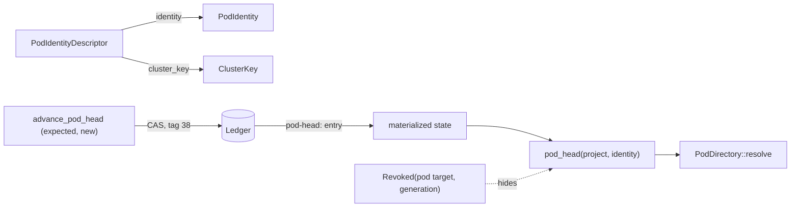
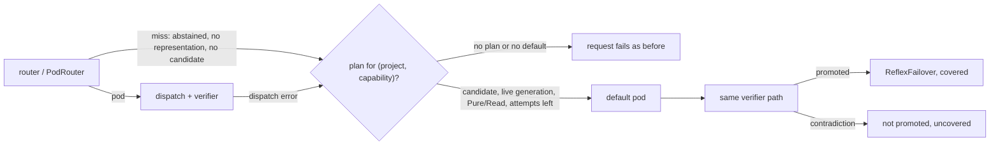

# 43 — Pod linking: stable identity, committed head, advisory learned address

Status: **identity, head resolver, the learned-address loader and the reflex failover with its
counters are implemented; the routing claim and the two reflex claims are not shown.** Experiment
R015 has a harness and no frozen result. The Symlink-LoRA idea is design only.

Plan: [`../RESEARCH_INTEGRATION_PLAN_20261013.md`](../RESEARCH_INTEGRATION_PLAN_20261013.md)
(work packages 1 and 2). Decision: [ADR-0023](../../research/decisions/ADR-0023-learned-pod-addresses-advisory.md).
Owners: `ptr-types`, `ptr-pods`, `ptr-ledger`, `ptr-state`, `ptr-runtime`, `ptr-router`, `ptr-events`,
`training/` (Python).

## The problem

A pod is retrained, its artifact and generation change, but callers, caches and learned routing
state should keep naming "the same pod". Three things must stay separate:

1. **Who the pod is** — a name that does not move when values move.
2. **Which revision answers now** — a fact that changes, so it is committed.
3. **Which pod a question probably wants** — a guess, so it is advisory.

## Identity and cluster key (`ptr-types`, `ptr-pods`)

`PodIdentityDescriptor { schema_version, domain, kind, predicate, semantic_role, aliases }` holds
the hard semantics of a pod and nothing else: no artifact, no generation, no value.

- `identity()` is `pod:` plus the SHA-256 over a domain tag and every field, length-prefixed, the
  aliases in sorted order. It is the `PodIdentity`.
- `cluster_key()` is the hash over the same hard semantics without the aliases. Pods that differ
  only by alias share a cluster; a different domain, kind, predicate or role is another cluster.

`PodSemanticManifest` gained `predicate` and `aliases`, `identity_descriptor()` and `cluster_key()`,
and `validate` requires `pod_identity == descriptor.identity()`. A retrained pod changes `digest()`
(artifact, generation) and not its identity or cluster key; changing an alias or the role needs a
new identity, and the manifest refuses the old one with expected and actual.

The plan said an alias change moves both hashes. The plan was made more precise here, and the
coordinator approved it: the research definition (`semantics.py`, cluster = schema, domain, type,
predicate, role) and the reason for a cluster at all exclude aliases from the cluster key, so this
implementation does too. An alias changes the identity, not the cluster; a role, domain, kind or
predicate change moves both.

## Head resolver (`ptr-ledger`, `ptr-state`, `ptr-runtime`)

`LedgerEvent::PodHeadAdvanced { project, identity, old, new }` (tag 38) is a compare-and-swap record. The head is scoped by project: two projects with the same pod semantics derive the same `PodIdentity`, so a head is keyed `(ProjectId, PodIdentity)` and every address of the record names that project (the ledger codec refuses anything else):

- `new` must be a valid revision address; with an `old` its generation must rise strictly (the
  ledger codec refuses anything else on append and on decode);
- the runtime commits it only if the committed head equals `old` (`None` for the first head),
  `new` is not a revoked pod generation and `new.generation` is not below the generation the
  lifecycle authority holds live for that pod, and checks the same on replay.

The head is projected to `pod-head:<project>/<identity>` in the materialized state, so replay, the Postgres
projection and a compacted snapshot all reproduce it with no extra snapshot format. A restore
fails closed on a malformed entry.

`PtrRuntime::pod_head` (and `pod_heads`, and so `PodDirectory::resolve_head`) returns a head only
while its generation is the one the lifecycle authority holds live for the pod, the same rule that
admits a bound representation: a head whose generation was revoked, superseded, or is not (yet)
live fails closed, including when the pod has no live generation. It never falls back to an older
revision. `pod_head_status` still shows such a head (`Revoked` or `Stale`), so a writer can name
it as `expected` and move the identity on. `advance_pod_head(AdvancePodHead { project, identity, expected, new })` commits through the
ledger. `PodDirectory::resolve_head` resolves the caller's project and identity, then head, then the ordinary `resolve`; another project's head for the same identity is never consulted.
A pod generation is the lifecycle target `pod:<project>/<namespace>/<pod>` (`pod_lifecycle_target`).
That target names its project, so only that project may commit it: lifecycle validation refuses a
`CapsuleCommitted { project: A, capsule: "pod:B/..." }` with `RuntimeError::PodCapsuleProjectMismatch`
(on commit and on replay), and `pod_head` and the admission of a representation also compare the
project the capsule was committed under (`capsule_projects`) with the project of the head or the
representation. Existing ledgers: the `pod:<project>/<namespace>/<pod>` form is introduced by this
change and no code on main commits such a capsule, so no record of a mismatching pod capsule is
expected to exist; the rule is not grandfathered, and a log that does carry one fails replay closed
instead of making another project's pod live. Ids that are not of that exact three-segment form
(`pod:x`, `pod:a/b`, `note:...`) are ordinary capsules and unaffected.

## Dragonfly: a learned address per pod (`training/`, `ptr-router`)

Per pod, a vector `z` and a bias over a **frozen** encoder, trained on explicit positive and
negative address questions (trusted aliases expanded into the positives, similar other entities
as negative aliases) with a class-balanced cross-entropy. There is no shared trainable state.

`logit = cosine_weight * cos(q, z) + metadata_weight * 1 - bias`, `score = sigmoid(logit)`.
During training every question counts as metadata-matched, so a metadata flag cannot solve the task
and only the question vector is learned; at run time the registry has already enforced the
metadata, so the same constant applies. The weights (12 and 3) are part of the representation.

**Activation gate.** A representation is activated only if every trusted alias scored at least 0.8
and at least 90 % of the negative examples were rejected. Otherwise the exporter writes
`not-activated`. `RepresentationStore::insert` re-checks the measured values against its own
minima whatever thresholds the artifact claims, refuses a representation that is not activated
(`RouteError::InactiveRepresentation`), one of another encoder or dimension, or one that is not a
newer generation of the same pod. A store holds at most `MAX_REPRESENTATIONS` pods (4096) and a
manifest is at most `MAX_MANIFEST_BYTES` (64 KiB) before it is parsed; its minima can be made
stricter with `with_policy`, never weaker.

**Router.** `LearnedPodRouter` implements `Router` and ranks only `registry.candidates(...)`;
the trusted boundary still refuses anything outside that set. Representations are keyed by
`(ProjectId, PodId)`: two projects may use the same pod id and neither sees the other's address.
It returns a point mass on the best candidate (propensity 1), or abstains with
`RouteError::Abstained { best, runner_up, best_score, margin, reason }`: `LowScore` when the best
score is below 0.5, `SmallMargin` when the runner-up is within 0.15, and `PartialCoverage` when
some candidate has no address, because ranking only the covered ones would pick among part of the
field. `NoRepresentation` means no candidate had an address. The default `PodRouter` remains the router when none is
configured. The runtime reports an abstention as `RouteFailed { reason: "routing abstained" }`
without naming a pod unless the host set a fallback plan for the request (see "Reflex and failover").

**Query vector.** `PodSampler::features` supplies `RouteFeatures::vector`; `EmbeddingSampler`
wraps a `CheckedRouter` with a `QueryEmbedder`. PTR has no Rust encoder: the host provides one.
The embedder names its encoder (model and revision), and `EmbeddingSampler::new` refuses it with
`EmbeddingSamplerError::EncoderMismatch` unless that equals the encoder of the router's
representation store, also when the dimensions are equal: vectors of two encoders do not share a
space.
`RouteQuery` carries the request payload, which can hold user text, so its `Debug` shows only the
payload length and a digest prefix (Invariant 13).
`ptrd` does not wire a learned router for that reason.

**Artifact.** `dragonfly-<project>__<namespace>__<identity>.json` (manifest) and `.bin` (`dims`
little-endian `f32` of `z`, then the bias). The manifest (schema 2) carries the encoder, dimension,
generation, project, lifecycle namespace, pod, identity, cluster
key, scoring weights, the gate measurement, `weights_sha256` and a `digest` over every field and the
weights. The Python exporter and the Rust loader share a committed fixture
(`crates/ptr-router/tests/fixtures`): identities, cluster keys, weights bit for bit and every probe
score must agree, and a Python test checks the fixture is reproducible.

## Revocation per pod (`ptr-runtime`)

A representation is neural state: `bind_pod_representation` binds it under its pod's lifecycle
target at the pod's exact generation, with its digest in the provenance, and
`admit_pod_representation` re-decides on every use. Revoking one pod generation yields
`Denial::RevokedGeneration` for that pod only (Invariant 17); a new generation yields
`StaleGeneration` until a representation trained for it is bound; a payload swapped under a valid
binding is refused. `admitted_representations` builds the router store from the cache and reports
what was refused and why. The representation names its lifecycle namespace and the digest covers
it: an address in another namespace does not bind (`NamespaceMismatch`), and a binding under the
target of the same pod id in another namespace is refused on admission, so revoking a
representation's own target cannot be bypassed through a sibling namespace.
A sampled Pod request without an eligible registry candidate answers `PodUnavailable` before the
query encoder runs, and with no representation admitted for the request's project the encoder is
not run either (the request is a `NoRepresentation` route failure).

The registry names the lifecycle namespace of each registered implementation
(`PodRegistry::register_in_namespace`, read with `PodRegistry::namespace`), and the learned router
scores a candidate only with a representation of that namespace: an address learned for `ns-a`
never ranks the implementation registered for `ns-b`, even while both are live. An entry
registered without a namespace, or replaced by a plain registration or a takeover, names none and
gets no learned score (fail closed). `PodRegistry::register_at` also names the generation of the
implementation, and a representation scores only the implementation of its own generation, so a
superseded implementation still registered is never ranked with the address of its successor.
The representation store is keyed by project, namespace and
pod, so the generations of one pod id in two namespaces are never ordered against each other.
Per-request admission is bounded: the sampler refuses an admission cache larger than one store
(`MAX_REPRESENTATIONS`), reads each payload in place, and refuses state that names no
representation digest before parsing it. Generation 0 is refused for pod lifecycle targets, pod
heads and learned representations, since no pod revision has it; a compacted snapshot that holds
a pod target live at generation 0, or committed by another project than the one it names, is
refused on restore (`CompactedError::InvalidPodTarget`), as replaying its commit would be.

The store itself holds no binding, so admission is repeated for every request instead of once at
load time. `EmbeddingSampler::new(router, embedder, admission_cache)` keeps the bound states, and
for each Pod request the runtime calls `PodSampler::features_at(&runtime, query)`, which re-runs
`admit_pod_representation` on every cached state against the committed lifecycle and hands the
router the admitted set (`RouteFeatures::with_admitted_representations`: project, pod and digest of
each). A representation outside that set does not take part in scoring, so a revocation or a new
pod generation that was committed after the store was built stops it with the very next request
(the pod is uncovered: partial coverage, or no representation). The set can only narrow what is
scored; eligibility stays with the registry. Without the runtime (`PodSampler::features`) the set
is empty: fail closed. The runtime enforces the same for any sampler: features returned without an
admission set are routed with an empty one, so a custom sampler that supplies only a query vector
scores no representation.

## Reflex and failover (`ptr-router`, `ptr-runtime`, `ptr-events`)

A router may decline, have nothing to score, or pick a pod that then fails. Work package 2 says what
happens next, and counts it without claiming more than happened. Research source: the reflex channel
of `PTR-Research` (`neural_pods/reflex.py`), carried over to PTR types, not ported.

**Miss.** Every Pod request goes through one `dispatch_pod`. The primary path misses (`MissReason`)
when the registry has no candidate (`NoCandidate`), the learned router abstains (`Abstained` with
its `AbstentionReason`, so a partial-coverage abstention is told from a low score), no candidate had
a learned address (`NoRepresentation`, nothing was scored), or the routed pod fails when invoked
(`DispatchError`). A failure of the router itself (an invalid distribution, an ineligible choice, a
policy error) is not a miss and is never covered: a broken router is not hidden by a fallback.

**Plan.** `DefaultPodPlan { default_pod, max_attempts }` is host configuration, set per
`(project, capability)` with `PtrRuntime::set_fallback_plan` together with the
`PodRevisionAddress` of the default pod. It is not a ledger record: a restarted or replayed runtime
has no plan and fails closed (a miss fails the request as before). `max_attempts` counts dispatch
attempts per request including the routed one, so a failing primary pod with `max_attempts = 1`
leaves nothing for the default, while an abstention (nothing dispatched yet) can still be served.

**The default is a joint, not a shortcut.** It is checked at every use, not once at configuration:

1. a registry candidate of the request's project, capability and input type (Pods of another
   project are never candidates);
2. its revision is not revoked and is the generation the lifecycle authority holds live
   (invariant 3); a pod the lifecycle never made live fails closed, and a revocation or a new live
   generation committed after the plan was set stops the failover with the next request;
3. the registry holds exactly the implementation that revision names (`PodRegistry::register_at`: the
   same namespace and generation), so the generation that was checked is the code that runs; a
   default registered at another generation or without one is `StaleFallback` and is not invoked;
4. no effect beyond `Pure` or `Read`, checked before it is invoked (invariant 7);
5. not the pod that just failed, and the attempt budget is not spent;
6. its output goes through `promote_verified_pod_output`, the same verifier path as any pod output,
   so a deterministic contradiction is never promoted (invariants 7 and 11). The reflex substitutes
   a pod; the verifier commits.

A refused failover is `RuntimeError::FailoverRefused { miss, reason }` and names no pod; a default
that fails when invoked (`DefaultFailed`) or whose answer is not promoted (`DefaultRejected`: the
verifier contradicted it, or a taint or type check refused it) is refused the same way, with the
original miss, and not with the default pod's own error, which could name it. Only judgements of the
answer are refused so; a failure of the runtime itself (a ledger error, a fenced runtime) while
promoting or recording the taint is propagated unchanged and leaves the miss uncovered. The miss stays counted
and uncovered. A failover is not a
sampled decision, so it logs no `PodRouted` propensity.

**Counters.** `PtrRuntime::reflex_counters()` returns a snapshot of `ReflexCounters`: hits, misses,
failovers, answers the verifier refused (neither hit nor miss), the miss and uncovered reasons, and
a latency window of the last 1024 requests that times failures too. They are telemetry: not ledger
records, not persisted (a restarted runtime starts at zero), and nothing in the runtime reads them
to decide. The events `ReflexHit`, `ReflexMiss` and `ReflexFailover` (`ptr-events`) are the
observable trace; `ReflexFailover` is emitted only after the default's output was promoted.
Everything is bounded: the plan table (1024), the latency window, the miss and uncovered reason
maps (closed enums).

**What a counter may say.** A miss is counted when it happens and settles as a failover or as an
uncovered miss with its reason; a path that ends unsettled leaves it open, which can only make the
counters look worse. A failover is counted only against an open miss, otherwise it is an
inconsistency and never coverage. `coverage()` is `NoObservations`, `NoMisses`, `Covered` or
`Uncovered`, and `all_misses_covered()` is false with nothing observed (the research gate that
stayed green at zero hits is the reason). True with no miss at all is vacuous, and `coverage()` says
so; the failover path was then never exercised.

**Experiment.** R015 measures two separate claims over the same harness, each with its own verdict
and a guard against the vacuous pass: `reflex_failover_coverage` (mechanism: every miss of the
learned router is caught by the default; INVALID when a seed has no miss; a no-plan baseline arm and a
stale-default sensitivity arm run over the same probes and must see the same misses and serve none) and
`reflex_dispatch_hits`
(benefit: the precision of the router's own dispatches beats description cosine; INVALID when it
dispatches nothing or when one of its ablation arms (no bias, no abstention) or its sensitivity arm
(a stricter sweep point) did not run over every probe; their precisions are reported, not judged).
A world the lifecycle cannot hold (a pod at generation 0 or without a namespace) is reported as an
unexercised reflex block, so the coverage rules make the seed INVALID instead of the harness failing. The faults a failover must be refused for are held by
`crates/ptr-runtime/tests/reflex.rs`, not by the harness. R015 stays `planned`.

## What is not here

- **Trust in the artifact.** The activation gate is self-reported: the gate numbers are written by the exporter and re-checked only against the loader's minima, the manifest digest is unsigned (an integrity check against corruption, not authentication of the exporter), the gate is measured on the training data (a coverage check, not a held-out score), and `activated` is advisory (the store recomputes it from the numbers and never trusts the flag; ADR-0023).

- **Symlink-LoRA.** A model that emits a link was a research idea; PTR keeps identity value-free
  and the head a ledger fact, so no link is learned in code. It is a candidate in
  `evaluations/components/pod-routing` and a design note with a kill criterion in R002.
- **The unsampled convenience wrappers** (`run_resumable_with_pods`, `run_model_with_pods`) still
  select with `PodRouter::select`; they have no sampling key. Routing them through a
  `CheckedRouter` needs a key and nonce source the runtime does not own, and stays open in
  `ptr-router`'s `component.toml`. The production path (`..._using_router`) is already checked.
- **A Rust encoder, a `ptrd` wiring of the learned router, a frozen R015 result.**
- **Durable plans and counters.** The fallback plan and the counters are host configuration and
  telemetry, not ledger records, and the registered `PodManifest` carries no generation: the
  default's generation is checked through the revision the plan names. One default per
  `(project, capability)`, no chain of defaults, no fallback for other router failures.
- Postgres tests of the new event need `PTR_PG_TEST_DSN`; the projection mapping itself is
  unit-tested.
