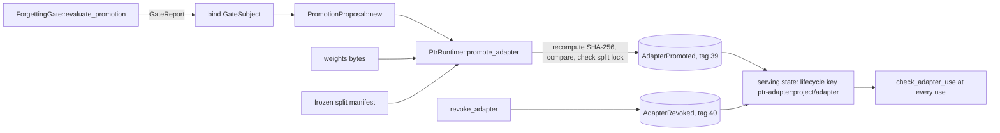

# 44 — Serving and promotion

Status: partially implemented. The adapter ledger events, the promotion rule, the improvement-cycle budget, the
adaptive batcher, the replica router and the replay backtest exist and are tested; the serving path does not use the
batcher yet, nothing measures it, and no experiment of this document has run.

Work package 5 of the research integration. Decision: [ADR-0025](../../research/decisions/ADR-0025-adapter-promotion-and-improvement-budget-are-ledger-events.md).
Related: [35 Agentic substrate](35-agentic-substrate.md) (adapter lineage), [37 Pod-MoE](37-pod-moe.md) (expert
authority), invariants 3, 7, 8, 11, 12, 14 and 17 of [INVARIANTS](../INVARIANTS.md).

## 1. What this document decides

1. Which adapter generation may serve is a fact of the ledger (`AdapterPromoted`, `AdapterRevoked`), not a row of the
   lineage registry, and a use is checked against it every time.
2. A promotion needs a gate report with a serving baseline. A missing baseline is a violation, never a zero.
3. The runtime recomputes the weights digest the gate was bound to instead of trusting the recorded one.
4. How many self-improvement cycles may run per day is counted from the ledger, and an aborted cycle spends budget.
5. A batcher and a replica router sit in front of any inference backend under the same traits, bounded and
   deadline-aware, but they do not take effect in `ptrd` until the server stops serializing the model call.

## 2. Adapter promotion and revocation (`ptr-lineage`, `ptr-ledger`, `ptr-runtime`)

**Events.** `AdapterPromoted { project, adapter, generation, base, artifact_sha256, gate_report_digest }` (tag 39),
`AdapterRevoked { project, adapter, generation, reason }` (tag 40). The codec holds both to one canonical form:
names of 1 to 256 bytes without control characters, whitespace or `/`, a non-zero generation, no all-zero digest, a
reason of at most 512 bytes. The same check runs in the decoder and in `check_encodable`. The public
`PtrRuntime::commit` refuses both, and a new capsule named `ptr-adapter:...` is refused (a ledger that already holds one replays it as a capsule, and an
adapter is refused on a key a capsule owns), so only `promote_adapter` and
`revoke_adapter` write them.

**Keys are project-scoped.** The lifecycle key is `ptr-adapter:<project>/<adapter>`. Because the ledger refuses a `/` in
either name, two pairs never share a key. One project's adapter of the same name is neither served nor revoked by
another's events.

**The gate.** `GateViolation::MissingBaseline` (canonical tag 4) is what `ForgettingGate::evaluate_promotion` reports
when `PromotionSuite::serving` is `None`. The Research original compared with `baseline.get(x, 0)`, so a missing
baseline turned every candidate into an improvement; here the absence is the failure.
`PromotionProposal::new` refuses such a report (`LineageError::MissingBaseline`), a failing one (`GateFailed`) and a
report bound to another adapter, weights digest or base model than the record's (`SubjectMismatch`).

**Digest recomputed.** `promote_adapter` hashes the weights it is handed and compares with the digest the report was
bound to (`ArtifactDigestMismatch`, nothing appended). The lineage still records the trainer's digest without reading
it, and says so; the check is the runtime's. The split lock is checked the same way: the runtime takes the canonical bytes of the frozen split manifest, hashes
them itself and compares with the report's `eval_manifest_digest` (`SplitLockMismatch`, `EmptySplitManifest`); a digest
computed by the caller is not accepted.

**The gate is pinned.** A report vouches only as far as the gate that produced it is the gate the runtime trusts. The host
pins the digest of one forgetting-gate configuration (`PtrRuntime::pin_promotion_gate`, runtime configuration and not
committed history); the pin is set once (the same digest again changes nothing, a different one is `GatePinConflict`). `promote_adapter` compares `gate_config_digest` of the report with it and refuses with
`NoPinnedPromotionGate` when nothing is pinned and `GateConfigurationMismatch` for another configuration, before
anything is committed.

**Serving state is derived.** Promotion sets the live generation of the key and the binding (base, weights digest,
report digest); revocation adds a tombstone. A generation must advance, and a revoked generation is never promoted
again. `serving_adapter` and `check_adapter_use` read the lifecycle on every call, so a revocation, a supersession or
a replay is seen at the next use (invariant 3). The runtime holds at most 4096 adapters.

**KV entries follow the adapter.** A KV prefix entry recorded under an adapter depends on `KvDependency::adapter(key,
generation, digest)`, where the identity is the lifecycle key. Committing `AdapterPromoted` supersedes the adapter
dependencies under that key below the promoted generation, and `AdapterRevoked` invalidates exactly the revoked
generation; both cancel pinned forks and retire the entries, scoped to the adapter kind so no other kind or other
adapter key is touched. `ImprovementCycleRecorded` invalidates nothing.

**Limits.**

- No compacted snapshot layout carries the bindings or the cycle counts. `export_compacted_snapshot` refuses while
  they exist (`AdapterError::CompactionUnsupported`) rather than drop them silently; a runtime with adapters cannot
  compact its log until a snapshot section carries them.
- The runtime proves that the weights it was given hash to the digest the gate was bound to. It does not prove they are
  the artifact in `ptr-storage`, and the gate subject's digests are the trusted evaluator's claim.
- `PromotionProposal` accepts only a report produced by `evaluate_promotion` in this process
  (`GateReport::promotion_evaluated`, a flag outside the canonical encoding): a passing report from the plain `evaluate`
  path, where a placeholder serving score is possible, and a decoded report are `BaselineNotChecked`. The project is bound
  into the digested subject through its operation id, `promotion_operation_id(project, adapter)`, and `promote_adapter`
  refuses a proposal evaluated for another project (`ProjectMismatch`).
- Nothing routes a request to an adapter yet. The first adapter's baseline (the base model's public-suite score) is
  supplied by the caller.
- The Postgres mapping (`ptr-pg`) of the new events compiles and shares the `ptr-state` projection; it was not run
  against a live PostgreSQL in this change.

## 3. The improvement-cycle budget (`ptr-feedback`, `ptr-ledger`, `ptr-runtime`)

A self-improvement cycle proposes a change to the system's own adaptation and measures it. `ImprovementCycleBudget
{ per_day }` is the rule; the count comes from the ledger.

- `begin_improvement_cycle` admits a cycle for a project, on the day the runtime clock reports, and returns a ticket that
  counts as in flight until it is recorded. `record_improvement_cycle` commits `ImprovementCycleRecorded` (tag 41),
  `Completed` or `Aborted { reason }`.
- The day's count is the committed events plus the open tickets. An aborted cycle, a running cycle and a ticket that
  was dropped without a record all spend budget; a replayed runtime counts the same.
- With no budget configured nothing is admitted; a budget of zero admits nothing.
- The caller does not choose the day. The runtime reads a `CycleClock` (days since the epoch; an unreadable clock admits
  nothing, `ClockUnavailable`). A project's high-water day is the latest day it has a cycle admitted or recorded for; a
  day before it is refused (`ClockRegressed`). So going to the next day and back does not reopen the first day, counting
  `day` upwards is impossible, and a history from the future refuses cycles until the clock passes it. A replayed
  runtime rebuilds the same counts and high-water days from the ledger. At most 1024 projects and 1024 open
  admissions are tracked, on replay as in live admission. A ticket names the runtime that admitted it and its open
  admission: another runtime's ticket, an expired one (7 days, judged against the clock at record time; an unreadable
  clock refuses the record) or a used one is refused and commits nothing. Expired admissions of every project are swept
  before the global bound is checked, and recorded cycles are counted per project and day for the retention window, so
  a cycle recorded out of day order is counted on its own day, live and on replay. An
  admitted-but-unrecorded cycle is adapter state: it blocks a compacted snapshot like a promotion does.

**Limit.** An admitted cycle whose process crashes before it is recorded is not counted after the restart. The budget
bounds recorded and running cycles, not crashed ones.

### Replay backtest (`training/src/ptr_training/replay`)

`HistoryPool` is append-only and chronological (a repeated name or an order that does not advance is refused before
anything changes; 256 generations at most). `ReplaySimulator` fits an intercept and one response coefficient per
decision from consecutive generations in which exactly one decision moved; a transition that moves two is ambiguous
and charged to neither. `backtest(pool, error_bound=...)` holds each generation out and predicts it from the rest:

- a generation whose decisions the remaining history does not identify is skipped with `not_identified`, never counted;
- `degenerate` is set when the model has at least as many parameters as the history has generations, which is when the
  in-sample fit is arithmetic;
- `pipeline_ran` (the backtest completed) and `predictive` (at least `min_within_bound` generations predicted out of sample, and at least `min_within_fraction` of the predictable ones, each with every
  family within the bound) are separate claims;
- the categorical encoding of a fold is rebuilt from the generations that fold keeps: a category seen only in the held-out generation never
  takes a position in the training levels (the held-out generation's edges are skipped as before);
- a string decision is one categorical decision (its level is the position of the value in order of first appearance;
  the first value is level 0 if the decision is in the pool's first generation, so an alternating history anchors its
  intercept, otherwise 0 means not set and values start at 1), so `mode` off to on is one decision moving by one level; more than two values are
  treated as linear in that order, a stated limit; an unseen value is extrapolation;
- the within-bound decision uses the exact errors; only the report rounds; a step or slope that is not a finite number
  (a step of 5e-324 overflows the slope) leaves the decision unidentified and no NaN or infinity reaches a prediction
  or the report;
- `choose_winner` aborts with `NotPredictive` on a history that predicted nothing, and with `ExtrapolationAbort` when
  the best policy asks for a decision level the history never showed.

The error bound has no default. It is pinned by whoever preregisters the claim and is not changed after a pilot. No
simulator training happens in PTR until `predictive` has been true on a real generation history at least once.

## 4. Adaptive batcher and replica router (`ptr-model-api`)

`AdaptiveBatcher<B>` implements `InferenceBackend` (and `ResumableInferenceBackend` when `B` does) over a
`BatchInferenceBackend`, whose provided `infer_batch` runs requests one by one: a backend gains only if it overrides it.

- **Bounded (invariant 8).** The queue holds at most `queue_capacity` requests (65536 at most). A full queue answers
  `ModelError::overloaded()` before anything grows.
- **Keys.** Requests are grouped by `BatchKey { project, adapter, principal, generation }`; different keys never share a model
  call. The plain `infer` uses the unscoped key; `infer_with` takes a `BatchAdmission` with the key, an optional
  deadline and an optional `CancelFlag`.
- **Dispatch.** A group goes when it holds `max_batch` requests, when its oldest request has waited `max_wait`, or when
  its tightest deadline is within `deadline_margin`. The ready group with the oldest request goes first.
- **Deadlines.** A request whose deadline has passed is answered without a model call, at the door or in the queue. The
  clock is Unix milliseconds; if it cannot be read it answers `u64::MAX`, so nothing with a deadline is served on a time
  nobody knows.
- **Generation at use (invariant 3).** A `BatchGate` is asked about the key of every batch immediately before the model
  runs; a revoked generation is refused at that use (`ModelError::revoked()`), not only when it was queued. A key that
  names an adapter is refused when the batcher was built without a gate (there is no admit-all default). A resume
  continues a continuation the batcher issued: `infer_scoped` returns the answer with a `ResumeBinding`, which holds nothing but an
  unguessable 128-bit id (two OS-keyed hashers over a counter; no public constructor, `Debug` prints nothing of it). The
  scope (`BatchKey`, request id) and the digest of the observation that resumes it live in the batcher's table of at most
  `MAX_OPEN_CONTINUATIONS` (4096, oldest evicted; an evicted continuation fails closed). Whoever produced the observation
  records it once with `record_observation(binding, observation)`; `resume_with(request, binding, key)` looks the entry up
  and refuses an unknown, evicted or used id, another request id, another key or an observation whose digest is not the
  recorded one (`ModelErrorKind::ScopeMismatch`) before anything runs, then consumes the entry (single-use) and asks the gate
  about the entry's key. Two calls under the same request id with identical outputs therefore stay apart, and an
  observation recorded under a revoked generation cannot be carried by a key or binding of a live one. The unscoped
  `resume` of the trait is served only by a batcher built without a gate (which serves no adapter) and is refused when a
  gate is configured. A gate that panics has not admitted the key (refused as revoked, counted); a worker that ends for
  any reason closes the batcher and answers every queued caller with `closed`. Resume has the same panic containment as a batch. Deadlines and cancellations are checked again after the gate, immediately before the backend call.
- **Failure containment.** A backend panic or a wrong-length answer fails its batch and the batcher keeps serving; every
  caller gets exactly one answer, also on drop. Request text is never printed by `Debug`.

`ReplicaRouter` rotates over 1 to 64 interchangeable replicas and fails over to at most `max_failover` others, each tried
once, by an allowlist on the typed `ModelErrorKind`: only overload and backend failure (`ModelError::allows_failover`).
A refusal of the request itself (kind `Other`, the default of `ModelError::new`), a passed deadline, a cancellation, a
revoked generation and a closed backend end the request; the message is never read. A `resume` tries one replica unless
`ResumeFailover::Interchangeable` declares the replicas interchangeable for it, and it goes back to the replica that answered the `infer` of its request id (the most recent 4096 ids are remembered; an id the router does not know takes the rotation's replica). Counters per replica:
attempts, failures, failovers. `ReplicaRouter(AdaptiveBatcher(backend))` composes.

**Not done, and why.** `ptr-server` serializes requests behind the runtime lock, so a batcher in front of it would only
queue. The restructuring (model call outside the lock, commit inside, the generation checked at the commit) is more
than one small, safe step and was not attempted; wiring `[model.batch]` and `[model.replicas]` into `ptr-config` and
`ptrd` waits on it. `ModelRequest` was not extended with a deadline and a key: that would touch about 70 struct
literals in 40 files. The scoped path is `infer_with`.

## 5. Evidence and experiments

| Claim | Evidence now | What would measure it |
|---|---|---|
| Promotion without a baseline is refused, the digest is recomputed, a revocation is seen at the next use | unit and integration tests (`ptr-lineage`, `ptr-runtime`, `ptr-ledger`) | tests are the evidence of the mechanism; no experiment needed |
| The improvement budget binds and aborted cycles spend it | integration tests (`ptr-runtime`, `ptr-feedback`) | as above |
| The backtest is a valid instrument | `training/tests/test_replay_backtest.py` (mechanism only) | **F008-replay-backtest** (planned): seeded synthetic histories with a known response, positive, negative and interaction controls, the in-sample scorer as the baseline, persistence as the naive predictor, the oracle as the ceiling, noise and bound ladders, ablations of chronology, identification and the extrapolation abort; confirmatory seeds 17, 29, 43, 71, 101 never run, pilot and smoke seeds 1001 and above explorative |
| Batching raises throughput at equal deadline compliance | none: the default `infer_batch` is sequential | **E014-adaptive-batching** (planned; E009 to E013 are reserved by [42](42-pod-data-plane.md); no entrypoint and not freezable until the server calls the model outside its runtime lock; confirmatory seeds 17, 29, 43, 71, 101 never run, pilot seeds 1001 and above explorative): baseline no batcher; arms batch-size and deadline ablations; a batch-cost sensitivity control (fixed against marginal cost per request); an oracle ceiling that batches with perfect arrival knowledge; falsified if the throughput gain at equal deadline drops is below 1.2 times at any confirmatory seed |
| Gated adapter lineage beats a naive chain | none | **R004** stays planned; its harness, preregistration pins and entrypoint do not exist |
| Serving reproduces the evaluation numbers (parity) | none | a parity run for an `adapter-serving` candidate; not registered in this change |

Nothing in this document is a model-quality claim. The backends the batcher is tested with are recording and echo
stubs.

## 6. Open items

- Move the model call out of the server lock, then wire the batcher and the router into `ptrd`.
- A snapshot section for adapter bindings and cycle counts, so compaction works with adapters.
- A request router that uses `BatchKey` and `check_adapter_use` at dispatch.
- Build E014 (after the server-lock restructuring), R004 and F008 up to `prepared`.
- A real batched forward in one backend.
