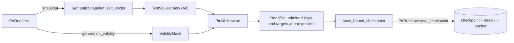

# ptr-a0-bridge

The edge between the PTR runtime and Burn A0 — issue #23's **G1** ("connect actual
semantic payloads to the model") and **C9** ("a trainer that writes a checkpoint
binds it").



## What it provides

- `slot_values_from(snapshot, keys, encoding, width, device)` — one batch of slot
  values, every vector from `SemanticSnapshot::slot_vector`, assembled by A0's own
  `SlotValues::new`. A key nothing committed is refused, never fed as zeros.
- `admission_from(runtime, lifecycles)` — a `ValidityMask` from
  `PtrRuntime::generation_validity`: only a live generation admits.
- `forward_from_runtime(runtime, model, token_ids, slots, device)` — runs A0 on
  payloads and admission taken from one `&PtrRuntime`, and returns what it read.
- `save_bound_checkpoint(runtime, model, read, provenance, paths)` — writes the
  checkpoint, its sealed binding and the retained anchor as one operation through
  `PtrRuntime::seal_checkpoint`, the same step `ptrctl seal` runs. Refused, and
  nothing written, if the runtime moved since the reads.

## What it does not establish

Anything about model quality. Role, epistemic state, provenance bucket and confidence
are still the caller's; only the payload and the admission come from committed state.
The runtime's own request path does not call A0. See
`docs/architecture/26-cognitive-codebook.md`.

## Toolchain and workspace

A member of the A0 workspace (`model/burn-a0/Cargo.toml`), so it shares A0's lockfile
and vendor patches, with `rust-version = "1.99"` and its own `clippy.toml`. A0 stays
the only default member:

```text
cargo +1.99.0 test   --manifest-path model/burn-a0/Cargo.toml -p ptr-a0-bridge --locked
cargo +1.99.0 clippy --manifest-path model/burn-a0/Cargo.toml -p ptr-a0-bridge --all-targets --locked -- -D warnings
```

`make a0-bridge` runs the `bridge` job of `.github/workflows/burn-a0.yml`.

## Tests

- `tests/runtime_payload.rs` — a payload in an admitted slot reaches the logits and an
  identical one does not move them; the same difference in a revoked slot changes
  nothing, and moves them once the slot is live; payload → slot values is bit-exact;
  uncommitted keys and non-live generations are refused.
- `tests/bound_checkpoint.rs` — a bound save reopens under its anchor read back from
  disk and is admitted; a tampered seal, the bare checkpoint and a revoked generation
  are refused; a save after the runtime moved writes nothing.
- `examples/bound_checkpoint.rs` — a few training steps through the bridge, saved
  bound; it produced `training/tests/fixtures/bound-a0`.
