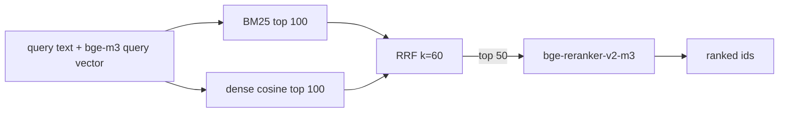

# strong_retrieval baseline

A pinned, CPU-runnable **retrieval-only** baseline for Q003 (and any later retrieval
comparison): BM25 plus dense bge-m3 vectors, reciprocal-rank fusion (k = 60), then a
cross-encoder reranker over the fused top 50.



| Stage | Pin |
|---|---|
| lexical | `research/baselines/rag_reference/runner.py` BM25 (k1 1.5, b 0.75), imported, not copied |
| dense | `BAAI/bge-m3` @ `5617a9f61b028005a4858fdac845db406aefb181`, dense only (no sparse, no ColBERT), 1024-d, CLS pooling, L2-normalised |
| fusion | RRF, k = 60 |
| reranker | `BAAI/bge-reranker-v2-m3` @ `953dc6f6f85a1b2dbfca4c34a2796e7dde08d41e`, top 50, fp32 CPU, score = the classification logit |

Model file digests are in `research/embeddings/models.toml`; the driver refuses to load
a reranker directory that does not match them. `config.toml` and `models.toml` are
cross-checked by the tests.

## Driver

`driver.py` speaks the stdin/stdout JSON protocol described in
`rag_reference/q003_driver.py` (one object per line; ops `hello`, `reset`, `upsert`,
`upsert_many`, `delete`, `size`, `search`, `quit`; replies `{"ok": ...}`), so a Rust
harness uses one bridge for both baselines. `search` additionally returns `stages`,
`reranked` and `rerank_seconds`.

```
uv run --project research/embeddings --frozen python \
    research/baselines/strong_retrieval/driver.py \
    --reranker bge --models-root <dir containing bge-reranker-v2-m3/>
```

`--reranker none` returns the fused list unreranked and says so in every reply. That
mode exists for protocol tests; it is not this baseline's result.

Embeddings are caller-supplied. The bge-m3 vectors of the Q003 pool are the pinned file
`research/embeddings/vectors-q003-bge-m3.f16` (see `research/embeddings/MANIFEST.toml`);
the driver never embeds and never downloads.

## Honest scope

* Retrieval only. There is no answer generator, so this is not `strong_rag` and does not
  unblock E002 or E005. `strong_rag` stays blocked.
* It is strong for a CPU baseline, not state of the art: dense-only bge-m3, one
  reranker, no query expansion, no fine-tuning, and the synthetic templated text of the
  Q003 pool. A result against it says nothing about real-corpus retrieval.
* The reranker runs live on CPU in fp32. Scores are not bit-reproducible across
  machines or thread counts; rank order of well-separated candidates is stable, near
  ties may flip. The vectors are pinned files and are exact.
* Dense search is exhaustive pure-Python cosine (no ANN), so its recall is the exact
  ceiling for the vectors, and it is slow for large indexes.
* Measured cost on this repository's CPU box is recorded in
  `research/embeddings/README.md`.
