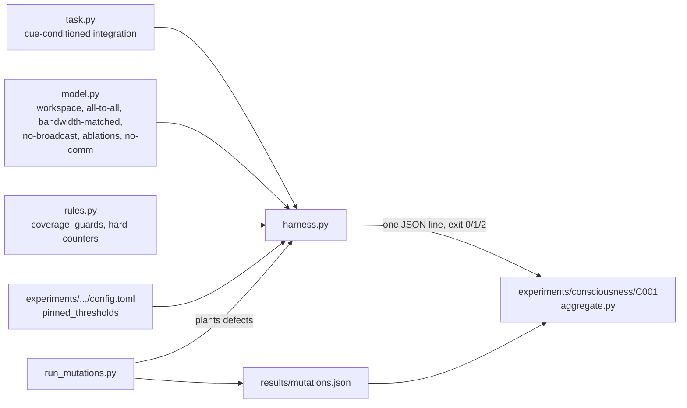

# research/consciousness

Code and pinned environment for the C-series experiments of the functional consciousness-indicator
track ([doc 38](../../docs/architecture/38-consciousness-indicators.md)). Indicator properties are
not consciousness; nothing here claims that any system is conscious, and nothing trains on a
self-report about experience ([welfare rules](../../docs/MODEL_WELFARE.md)).

Today it holds C001 (global workspace, CPU). The torch environment is isolated here
(`pyproject.toml`, `uv.lock`, torch 2.7.1 CPU) and does not touch `training/uv.lock`.

| File | Content |
|---|---|
| `gw/task.py` | the task (a pure function of a torch generator; the module count is free) |
| `gw/model.py` | the module bank, the four communication schemes, parameter matching |
| `gw/harness.py` | one seed: train every arm, evaluate, probe, run the negative controls, print the result |
| `gw/rules.py` | torch-free hard counters and coverage rules (a test pins `criteria.toml` to them) |
| `gw/run_mutations.py` | plants the defects of `tests/mutations.toml` one at a time |
| `tests/` | unit tests (`python -m unittest discover -s research/consciousness/tests`; the torch ones skip without torch) |

Environment. The experiment's entrypoint uses the locked environment, which lives **outside** the repository
(`UV_PROJECT_ENVIRONMENT=../../../c001-venv`, next to the checkout) because the experiment runner refuses to run while the repository holds
git-ignored files such as `.venv`; the locked environment holds torch only (no numpy), so the harness must not use numpy. Any Python with torch
2.7.1 runs the harness for development, but only the locked environment is the shipped one: run the tests in it too
(`UV_PROJECT_ENVIRONMENT=... uv run --locked --project research/consciousness python -m unittest discover -s research/consciousness/tests`).
CPU only; one seed is an estimated ten minutes of CPU time on a quiet four-core machine (the declared scale is in
`experiments/consciousness/C001-global-workspace/config.toml`).
