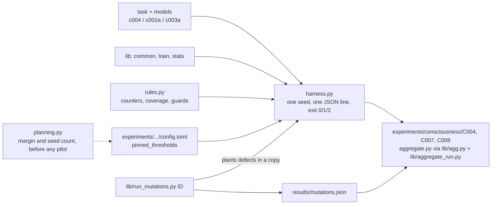

# research/cseries

Code for the CPU stage-A experiments of the functional consciousness-indicator track
([doc 38](../../docs/architecture/38-consciousness-indicators.md)) that follow C001: **C004** (algorithmic recurrence), **C007** (the CPU stage A of
C002, a metacognitive self-model) and **C008** (the CPU stage A of C003, an attention schema used to control routing). Indicator properties are not
consciousness; nothing here claims that any system is conscious, and nothing trains on a self-report about experience
([welfare rules](../../docs/MODEL_WELFARE.md)). The GPU stages B of C002 and C003 are not here.

C001's code (`research/consciousness/gw`) is frozen with its experiment and is **not** imported or changed; the shared pieces below are
new modules. The Python environment is C001's locked one (`research/consciousness/pyproject.toml`, `uv.lock`; torch 2.7.1 CPU): the entrypoints run
`uv run --locked --project research/consciousness python research/cseries/<dir>/harness.py ...`, so this directory has no lock file of its own.

| Path | Content |
|---|---|
| `lib/common.py` | environment check and record, seeding, matching counters, the plateau audit, rule evaluation of the harness |
| `lib/train.py` | the plateau training protocol shared by every arm and its independent audit |
| `lib/stats.py` | Student-t quantiles, exact paired one-sided bounds, Monte-Carlo helpers (standard library only) |
| `lib/agg.py`, `lib/aggregate_run.py` | the rule grammar, one seed's judgement, provenance checks, publication of `metrics.json` and `run.json` |
| `lib/run_mutations.py` | plants the defects of an experiment's `tests/mutations.toml` one at a time and writes `results/mutations.json` |
| `lib/run_agg_mutations.py`, `lib/lib_aggregator_mutations.toml` | plants the defects of an experiment's `tests/aggregator_mutations.toml` (in `aggregate.py` and `criteria.toml`) and of the shared aggregation library one at a time and requires the aggregator's tests, the library tests or the rule-agreement tests to fail on each (as F007's `mutate_aggregator.py` does) |
| `lib/pin_freeze.py` | step 4 of the freeze procedure: pins the preregistration digests and sets the statuses (`--dry-run` shows the change; it refuses a tree that is not a planned, unpinned one) |
| `lib/pilot_power.py` | the second power table, from pilot results: the decision rule's contrasts, every control the verdict reads, the guard rates |
| `c004/` | modular counter: a GRU against a parameter- and FLOP-matched causal attention stack and a reset-state ablation |
| `c002a/` | mixture-of-experts classifier, its routing traces, a self-model, an information-matched probe, calibrated own confidence |
| `c003a/` | bursty cyclic demand over capacity-limited experts, a router with and without an attention schema, a heuristic balancer |
| `<dir>/planning.py` | the planning model that fixed the margin and the seed count before the first pilot |
| `<dir>/pilots/` | pilot tuning scripts (pilot seeds 1001 and up only) and their raw outputs |
| `tests/` | unit tests (`python -m unittest discover -s research/cseries/tests`; the torch ones skip without torch; run them in the locked environment too) |

Environment. The locked environment lives **outside** the repository (`UV_PROJECT_ENVIRONMENT=../../../c001-venv` relative to
`research/consciousness`, next to the checkout) because the experiment runner refuses to run while the repository holds git-ignored files. It holds
torch only (no numpy), so the harnesses must not use numpy. CPU only; each seed is single-threaded and its declared scale is in the experiment's
`config.toml`; the per-seed CPU time is stated in each preregistration (section 3).
