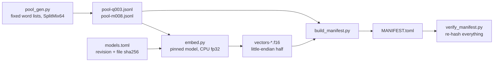

# Pinned CPU embeddings (WP-EMB)

Frozen text pools and sentence vectors for the Q003 (PostgreSQL hybrid retrieval) and
M008 (fast-weight memory) experiments, plus the bge-m3 vectors of the Q003 pool for the
`strong_retrieval` baseline. Rust harnesses read only the committed files; they never
run a model. The torch/transformers environment is isolated here (`pyproject.toml`,
`uv.lock`) and does not touch `training/uv.lock`.



## Files

| File | Content |
|---|---|
| `pool-q003.jsonl` | 12,000 texts: 2,000 cues x (3 fact versions + 3 paraphrased queries) |
| `pool-m008.jsonl` | 14,000 texts: 1,900 cues x (3 fact versions + 4 paraphrased queries) + 700 off-topic queries |
| `vectors-q003.f16`, `vectors-m008.f16` | all-MiniLM-L6-v2, 384-d, one row per pool row |
| `vectors-q003-bge-m3.f16` | bge-m3 dense, 1024-d, Q003 pool, for `strong_retrieval` |
| `models.toml` | model id, Hub commit revision, sha256 of every model file |
| `MANIFEST.toml` | digests of pools, vectors, scripts and lock files, tool versions, timings, repeat-run digests |
| `verify_manifest.py` | re-hashes everything and fails on any mismatch (standard library only) |
| `NOTICE.md` | licences of the models and Python packages (not covered by `check_notices.py`) |

Pool line (JSON, sorted keys, ASCII): `id`, `text`, `tokens`, `kind` (`fact`, `query`,
`offtopic`), `cue`, `entity`, `attribute`, `version` (1..3 for facts), `paraphrase`.
A cue is one (entity, attribute) pair. The versions of a cue differ in the value and by
a seeded template choice, so an older version is a plausible near-duplicate of the
current one; queries never contain the value. A harness seed picks cues, versions and
queries from the pool; the vectors do not depend on the seed.

`tokens` is the exact count under `[A-Za-z0-9]+|[^\sA-Za-z0-9]` (pool text is printable
ASCII, so Python and Rust agree); Rust should recount at load and exit 2 on a mismatch.
The vectors file row `i` belongs to pool line `i` (0-based). Storage is little-endian
IEEE half, row-major, `dimension` values per row. Expand to f32 for arithmetic; half is
exactly what PostgreSQL `halfvec` stores.

## Pipeline

MiniLM (`sentence-transformers/all-MiniLM-L6-v2` @ `1110a243fdf4706b3f48f1d95db1a4f5529b4d41`):
tokenizer, max length 256, forward in fp32 on CPU, mean pooling over the attention mask,
L2 normalise (the model's own `modules.json`), then round to half. No query prefix.
bge-m3 (`BAAI/bge-m3` @ `5617a9f61b028005a4858fdac845db406aefb181`): max length 512, CLS
pooling, L2 normalise, dense only, no prefix.

## Reproduce and verify

```
uv sync --project research/embeddings --frozen
uv run --project research/embeddings --frozen python research/embeddings/fetch_models.py --root <dir>
uv run --project research/embeddings --frozen python research/embeddings/embed.py \
    --model minilm --pool q003 --model-dir <dir>/minilm --out vectors-q003.f16 --threads 1 --twice
python3 research/embeddings/pool_gen.py --check
python3 research/embeddings/verify_manifest.py --regenerate [--deep] [--models-root <dir>]
```

`embed.py` refuses to load a model directory whose files do not match `models.toml`.
Set `UV_PROJECT_ENVIRONMENT` to keep the environment out of the repository.

## Honest scope

* The text is synthetic templated English (16 attributes, a few templates each, names
  from fixed lists). The embedding quality is real but retrieval on this text says
  nothing about real corpora. Sibling cues share templates, which is the point: their
  vectors are close, as in real anisotropic embeddings.
* torch CPU output is not bit-reproducible across machines, thread counts or torch
  builds. This is why the vectors are committed and digest-pinned instead of being
  recomputed per seed or per run. The fresh-process repeat recorded below is a check on
  one machine and one configuration (threads = 1, batch 64), not a portability claim.

## Measured (this repository's 4-core CPU box, shared, load average 14 to 20 during the runs)

| Artifact | Rows x dim | Size | Time (1 thread, batch 64) | sha256 |
|---|---|---|---|---|
| `vectors-q003.f16` (MiniLM) | 12,000 x 384 | 9,216,000 B | 63 s (second in-process run 62 s; fresh-process repeat 109 s) | `4b5c350f...3576a590` |
| `vectors-m008.f16` (MiniLM) | 14,000 x 384 | 10,752,000 B | 89 s (67 s; fresh-process repeat 119 s) | `378d013f...87146762ba` |
| `vectors-q003-bge-m3.f16` | 12,000 x 1024 | 24,576,000 B | 1,978 s (33 min), one run | `b663def2...2482751c6` |

Full digests are in `MANIFEST.toml`. MiniLM was recomputed twice in one process and once
more in a fresh process for each pool: all three digests are identical and the files are
byte-identical (same machine, threads = 1, same torch build). bge-m3 was computed once;
its determinism was not checked. With more than one thread on a loaded machine the same
model ran 2 to 6 times slower, which is why the runs use one thread.

`vectors-q003-bge-m3.f16` is above 20 MB. gzip -9 only saves 8 percent (22.6 MB; half
precision embeddings do not compress), so it is committed raw.

Cost of the `strong_retrieval` reranker (bge-reranker-v2-m3, 50 pairs per query): about
8.3 CPU-seconds per query on one thread; measured wall time 13 s per query on the loaded
box (20 queries, index of 2,000 documents). One Q003 seed with 400 queries is therefore
about 55 CPU-minutes: roughly 15 to 25 minutes of wall time on an idle 4-core machine
(an estimate, not measured idle) and over an hour on the loaded one. The reranker's
(query, passage) scores are memoised by the driver, so repeated pairs cost nothing.
On a 20-query smoke the strong pipeline found the live fact at rank 1 for all 20, the
`rag_reference` pipeline with MiniLM vectors for 65 percent of 400 queries (98 percent
within the top 10). Those smoke numbers show the pipelines work; they are not a result.
