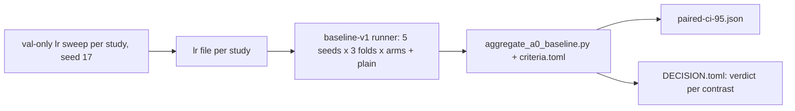

# A0 baseline study v1

Successor study of M001-v4 / M002-v4 and the superseded M002-v5 to M002-v9: **M001-v5** (semantic slots), **M002-v10** (factorized typed pair attention) and **M003-v2** (latent recurrence) against the pinned plain baseline, at A0 scale on operator-routing v2. **M004-v2** is planned and deferred (ADR-0021 item 2). Accuracy is the sole primary endpoint; calibration is a conjunctive hard gate per fold on raw logits; every contrast has its own verdict.

| File | Role |
|---|---|
| [`DESIGN.md`](DESIGN.md) | why, arms, contrasts, gates, rules, budget, threats |
| [`PREREGISTRATION.md`](PREREGISTRATION.md) | the frozen text |
| [`criteria.toml`](criteria.toml) | the single source of every threshold, pin and contrast; read by the decider |

Decider: `scripts/aggregate_a0_baseline.py`, tests `scripts/tests/test_aggregate_a0_baseline.py`; runner: `model/burn-a0/examples/a0_ablation` (`--phase baseline-v1`, `baseline-v1-sweep`, `baseline-v1-select`). Claims stay A0/synthetic (ADR-0021). Results are added here as `RESULTS.md` when the experiments have run.
