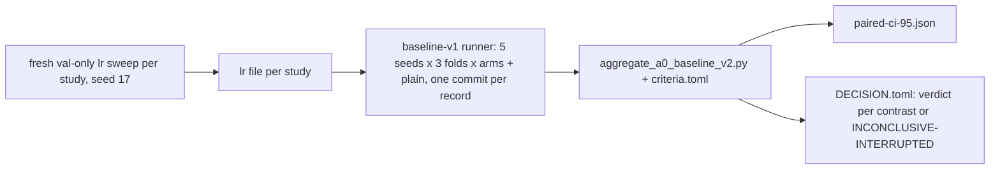

# A0 baseline study v2

Complete successor of the A0 baseline study v1: **M001-v6** (semantic slots), **M002-v11** (factorized typed pair attention) and **M003-v3** (latent recurrence) against the pinned plain baseline, at A0 scale on operator-routing v2. v1 (M001-v5, M002-v10, M003-v2) was replaced by owner decision of 2026-10-09 for a procedural defect of its decider (it demanded one `git_sha` in records that the run protocol commits one by one); **no v1 outcome was observed**. Protocol, arms, contrasts, gates, thresholds, seeds, learning-rate grid and selection rule are identical to v1; sweeps and all confirmatory runs are repeated. **M004-v3 is not created**: M004 stays deferred (M004-v2, ADR-0021 item 2). Accuracy is the sole primary endpoint; calibration is a conjunctive hard gate per fold on raw logits; every contrast has its own verdict; an interrupted confirmatory seed makes its study INCONCLUSIVE-INTERRUPTED.

| File | Role |
|---|---|
| [`DESIGN.md`](DESIGN.md) | why v2 replaced v1, arms, contrasts, gates, rules, record identity, interruption, budget, threats |
| [`PREREGISTRATION.md`](PREREGISTRATION.md) | the frozen text |
| [`criteria.toml`](criteria.toml) | the single source of every threshold, pin, contrast and the two v2 rules; read by the decider |
| [`DEVIATIONS.md`](DEVIATIONS.md) | what happens after the freeze and was not foreseen, and the procedure for an interrupted run; append-only, empty at creation |

Decider: `scripts/aggregate_a0_baseline_v2.py` (imports the v1 decider `scripts/aggregate_a0_baseline.py`, pinned unchanged), tests `scripts/tests/test_aggregate_a0_baseline_v2.py` (re-run every v1 test and add the identity and interruption tests); registration: `scripts/a0_baseline_study.py` (`render --study-version v2`, `freeze`, `extract-sweep`); runner: `model/burn-a0/examples/a0_ablation` (`--phase baseline-v1`, `baseline-v1-sweep`, `baseline-v1-select`, unchanged). Learning-rate files are `lr_<id>.tsv` here, produced by the v2 sweeps only. Claims stay A0/synthetic (ADR-0021). Results are added here as `RESULTS.md` when the experiments have run.
