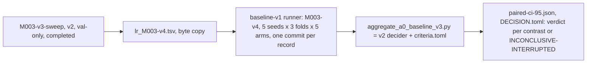

# A0 baseline study v3-m003

Successor study of **M003-v3** (latent recurrence) of the A0 baseline study v2, registered as **M003-v4** by owner decision of 2026-10-10. M003-v3 was INCONCLUSIVE-INTERRUPTED (a container restart killed seed 71): an interruption, not an outcome, so the question has not been answered. Protocol, arms, contrasts, gates, thresholds, seeds, learning-rate grid, selection rule and decision rules are those of v2 value for value; the completed seeds of M003-v3 are not read and not pooled. The learning-rate selection of the completed val-only `M003-v3-sweep` is reused. Accuracy is the sole primary endpoint, calibration a conjunctive hard gate per fold on raw logits, every contrast has its own verdict.

| File | Role |
|---|---|
| [`DESIGN.md`](DESIGN.md) | why a successor, what is identical, why the decider layer and the sweep reuse, budget |
| [`PREREGISTRATION.md`](PREREGISTRATION.md) | the frozen text |
| [`criteria.toml`](criteria.toml) | the single source of every threshold, pin and contrast; read by the decider |
| [`lr_M003-v4.tsv`](lr_M003-v4.tsv) | the learning rates, a byte copy of `../A0-baseline-v2/lr_M003-v3.tsv` |
| [`DEVIATIONS.md`](DEVIATIONS.md) | what happens after the freeze and was not foreseen; append-only, empty at creation |

Decider: `scripts/aggregate_a0_baseline_v3.py` (imports `scripts/aggregate_a0_baseline_v2.py`, pinned unchanged), tests `scripts/tests/test_aggregate_a0_baseline_v3.py`; registration: `scripts/a0_baseline_study.py` (`render --study-version v3`, `freeze`); runner: `model/burn-a0/examples/a0_ablation`, unchanged. Claims stay A0/synthetic (ADR-0021). Results are added as `RESULTS.md` when the experiment has run.
